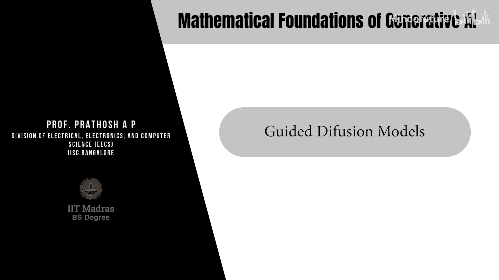
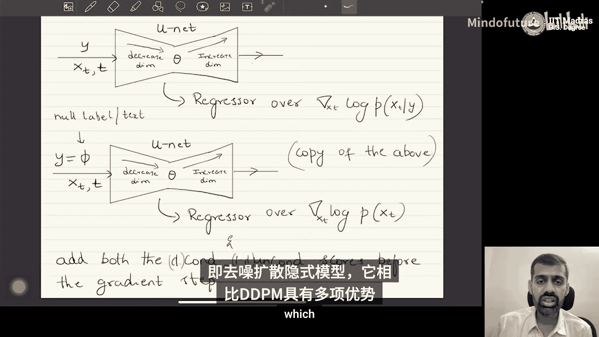

# 生成式Ai的数学基础 ｜ Mathematical Foundations Of Generative Ai p51 P51_W9L36-引导扩散模型 -BV1fperz7EjK_p51-

🎼。

So with this， now let us go to with this background now let us go to guided diffusion for。

Conditional generation， so let's say this is guided diffusion。Guided diffusion models。4one。跟例型的的类型。

So all the commercially available tools that you see today。😊，Are used as conditional generators。

 why because。Given a particular text now let's say that you say that know I would like to generate the pictures of let's say an animal playing some game Okay now the diffusion model would do that。

 So now it is not simply sampling from the data distribution but it is sampling from the conditional data distribution Okay so now the question is how do you modify diffusion models to be able to sample from the conditional conditional distributions Well let's say that for this。

To happen the data that we should have。It should have couples of this certain or it should have couples like xn comm y e。

Well。Why is。The conditional variable。Conditioning variable。So this is why this can be。

So example can be the following， rate。Example can be x not is lets say that it is an image so we are building diffusion models for images。

 let's say why can be a class label。Dre class label where let's say that you have a data set that has hundreds of classes。

 So what you need do is you want you want to generate an image of a cat or a dog or a house or whatever it which which is denoted by variable y or this this y can be。

Some text embedding。more practical example where you are given a particular sentence and you need to generate data from that particular sentence one can generate。

An embeing which is a vectorous version of a given natural language text and use that as deco conditioning variable now given a natural language text or a sentence。

 how does one convert that into a vector called embedding there is something that we will see later in the course when we look at the transformers。

But we assume that y。Is a vector， it can either be a 1 heart vector which contains ones and zeros。

 which represents a particular class level this y can be a real valued vector that represents。

The embedding given corresponding to a particular text in this example， it can be anything， so。

Basically， I am saying the data that we should have in this case has to be the pairs okay。

 the couples of sort x x not comma value where we have the image or rather the data from which we need to sample and why is the conditioning variable。

 this is the kind of data that we need pairs basically pairs of images and text if you want to generate image are pairs of images with the class labels。

 pairs of images basically the corresponding texture descriptions if we want to generate class conditional data Okay so now the goal is to。

三个人。Sample from。The conditional distribution。Sample from the conditional distribution。

Which is p of x not given y okay？So now so far we have been sampling from the marginal distribution p of x not right is in diffus models now we need to sample from the conditional distribution the question is。

How do we modify the question？How to modify a DDPM？读。Sample from the conditional distribution。

 sample from the conditional distribution。Okay， so we will see two ways to do this So one is what is called as the classifier guided。

Conditioning and the other thing is classifier free conditioning。 So let us look at both of them。

 So this is first thing is classifier。Gidance。Classify guided diffusion。 Okay， how do we do this。

 So recall。That。DDPM are。Score predictors。 So we will use this formulation of DDPms being these score predictors to do this。

 So that's why I said right the reason we looked at multiple interpretations of DDPM is that one of the interpretations are。

Becomes handy in different use cases where in the case of converting DDPMs into conditional samples of conditional distributions。

 score based interpretation is mis much handy， so recall that DDPMs are score predictors okay。

Cool predictors now from a conditional distribution perspective from a conditional distribution。

Or rather， from a conditional sampling。Let me write it fully in the previous case。Schore predictors。

Predicting。The true score of the marginal distribution， predicting。あ。Wriing or regressing the2 score。

Off。The unconditional or the marginal distribution。Orinal distribution。

 which is represented as gradient gradient of log of P of x T and this is X T。

 So this is this is what we saw right I mean we saw that the DD PMm are nothing but。

Predicctorors of the score of the distribution of the the nause sample X P。 Now。

 if we want to change this to a conditional sampling perspective from a conditional sampling。

Perspective。The goal。Is to predict。Goal is to predict are rigorous。

Reggress over the conditional code。Right， so now if we want to sample from the conditional distribution。

 what do we have to do， we just have to ensure。Sorry。

 I have to ensure that the the prediction of the neural network that we are building has to sample from the conditional score given by gradient of log of p of X P given y sort every noise step Xt we need to sample from the conditional score or rather we have to estimate or predict conditional score so now how do we do this。

So let's write that。We have the conditional score。Defined as P of。

Xt given y this with respect to xt simply use the basees law here。

 this is the gradient of log of what is the definition of the conditional distribution we have that to be equal to the marginal。

Dmes。The posterior。Divvered by the prior right so this is this is simply base law。Okay。

 so this is equal to。The variant of log of。P of xt with respect to Xt。Then we have plus。

The gradient of log of。P of x。P other P of y given its the。Y given X T this is with respect to X T。

 and we have the third term， which is the gradient of。Log of P， Y。

With respect to Xt now this term goes away， this is 0， right this is no dependence enzyme on。

X T to this term， great。 So now what did we do， we just wrote down the conditional score that we want to estimate the conditional score now log of。

P of X， D given y。With respect to Xt is now equal to the unconditional scores。Bless。

The derivative of log of P of y given x which is the posterior with respect to Xt。

This is a very important result now recall that this is the this is the result that we will be using now。

What did we do we just represented the conditional score that we would want to estimate while doing the conditional generation。

不か。Initional generation， as the sum of。The unconditional score and another gradient term of log of P of y given X T with a split to X T。

 So now how do we modify。 So this first term is the。Unconditional score。The second term is。

Let's call this the classifier gradient。Note that this is not a score of any sort right because the score is defined as a log of the likelihood with respect to the random variable upon which the distribution is defined so this is p of y given xt so it is a distribution over y and the gradient is with respect to xt so therefore it is it cannot be called a score so we we call that classify your gradient okay。

Now we have to just implement this in our DDPM right to be able to sample from the the conditional score now how do we do that So let us get back to our score estimator。

We have this poor estimator now because it is a conditional sampler。

 so we just have to give y also as an additional input here。Why you we are a predict， okay？

Now what the output it is of course predicting the score or we can say that it is it is predicting the noise because both of them are equivalent as we know right so this is Epsilon theta this is what it is predicting it is also predicting the unconditional scores so what is this this is for predicting the unconditional scores we know that predicting noise is equivalent of predicting unconditional score this is。

Rict。Unconditional score。Okay， this is predicting the unconditional score。

What about the second term that we have So for that， What is to be done is you train a classifier。

Separately。So this classifier， what does it do， this takes。Xt as an input。 So this is。A classifiers。

Okay， and predict。P of y given X。So this can be either a classifier or a reggressor okay why can it be a regressor。

 suppose y which is the conditioning variable happens to be a 10 vector then you can use a classifier。

 supposeupp it happens to be an embedding vector then this becomes a regressive network what does this do this this classifier or reggressor So this classifier。

Our regressor。Itrained。I trained separately。Okay， a priority。

 So it is trying separately than the the unit。 So what does it do， It takes to。Predict。Predict y。

 which is either the class label or the embedding。Class labor are embeing。From X from X T。

 So what is gunness， recall that while we are training this unit， right。

 If you recall how we train this unit， we sampled P different time step randomly and give it as an input to this to predict this When we take an i version of the input data。

 we also pass it through the classifier and try it separately okay， So if you try it separately。

 then this becomes a predictor for P of y given X T then what is doneness for during training the the。

DDPM， what we do is that we take Xt and do a forward pass。

 So this let's say that this is a trying the classifier。 we train it separately。

WellLet let me call it pretrained。Okay， pretrain。 what I do is during training the。

This particular unit which which predicts the noise So we give xt as an input to this this is one forward pass Okay and compute the output of this this is computing epsilon theta cap。

 which is equivalent to computing the unconditional score we saw that right eon theta is equivalent to predicting the unconditional score that is what we saw we also compute the。

Conditional scope by。Passing x T through this classifier。 Okay。

 first you pass this through the pretrained classifier and。Gip。P of y given xt。

 this is forward pass and through the reverse pass。

 just do a backward pass through this pretrained classifier。 What do you get。

 you take the gradient of log of the output of this neural network and you do it with respect to X P Now。

 as you can as one can find the gradients of a particular loss function with respect to the parameters of the network one can also find the gradients of a neural network with respect to the input as well So because you can create this input as well as another vector。

 So simply finding the gradient of this with respect to the input vector this gives you the classifier gradient Okay Now when we are doing a backward pass through the the unit that we are training what we should do is that we should take the gradient of。

The laws。With respect to。Theta of this particular term， which is the unconditional score。

 and we also add the gradients。Off。아得 same。诶。Simply add this gradient as to take this。

Just add these gradients that we have computed Okay so this is what is this doing。

 you just add these two gradients while you are doing the backward pass through the the unit that is trained so classifier is separately trained。

Beforehand where before we are beforehand then training the the unit okay it is trying and you compute this particular gradient add that gradient and and to a back propag That's all this is how one would use a classifier or a aggressor to guide DD PMm to be able to sample from the conditional distribution。

there is one other question that I assume that it is obvious but nevertheless state in all these interpretations training is okay when we are regressing over we can look at regressing regression over different kinds of parameters now does the inference changes the question so once you have trying how do you do inference so we saw that inference in ddpm is simply sampling through the decoding distribution P theta of xt minus1 given xt that is what we saw and how do we do that we simply do it via this particular equation where xt minus1 when we need to sample from the normal distribution having the mean mu theta star with theta star represents the trying parameters and the variance is known so this mu theta star we just have to sample from an normal distribution and just scale it with the fixed variance and add it with the mean that is being predicted by the neural network so。

we pass the previous Xt through the neural network that is already trying get your mu theta and then compute Xt minus1 and we do it iteratively right now mean all the other other interpretations right suppose you have built your neural network as a regressiongressor over epsilon instead of mu theta then you should just use the re parameterameterization that relates mu theta to epsilon so where is that。

So we did a reparameterization here where mu theta was related to epsilon right so now instead of you just replace this mu theta the expression of mu theta here mu theta the in the inference equation that I wrote using this a。

Okay， so now the output of this neural network will be epsilon theta star cap because the way we have trained our neural network is as that of regress regressing this particular quantity。

 if that is the case， then in the inference equation we just have to replace mu theta star with this particular equation where epsilon theta cap of xt is coming from the neural network。

 That's it。 So nothing changes in the as far as the inference procedure is concerned right So here this new theta star is simply replace by whatever re parameterization that we did for mu theta star that it。

 okay， so nothing has changed okay so now coming back to the conditional generation case。Again。

 the same thing happens the exact same re parameteraizations。

 Now instead of using the the re parameteraization of the conditional score。

 we just use the unconditional score in the definition of newta where is it。

 So let's get back to that I just show you that quickly。

Now here yeah mu theta is represented in terms of unconditional score here instead of unconditional score you just write it as the conditional score log of P of xt given y。

So that's it so during inference you just take the output of the neural network and the neural network also will have y as an input and please note that this classifier will not be used during inference at all so this is only used during training to socalled guide the diffusion process using the conditioning variable now once this is trying you just discard this and whatever output this neural network is giving can be seen as a conditional score and use the usual inference procedure to do a conditional sampling so that is about doing conditional sampling now the problem with this formulation is that the quality of this entire procedure depends upon how good this classifier is because if the classifier is not trying properly and you don't get this gradient properly and if you don't get get this gradient then you are not estimate any the conditional score in a proper way now the quality of this entire procedure depends upon the quality of the classifier here。

And driving this classifier is not that easy because。

Look what you' are expecting this classifier to do。 Suppose X T correspond to the noisy version of。

 let's say， cat image。Then irrespective of the noise levels here， like at all noise levels。

 you are expecting the classifier to predict the glass as cat。

Now it is a very difficult task to do because now the more the noise that is added to it is not the more difficult for this class we to break the underlying class。

 so now what happens is。In the above procedure， training。Trying the classifier。

At different noise levels is difficult。Therefore。There is another method that was proposed。

 which is called classifier free guidance where。The sampling from the conditional distribution is accomplished without having。

你你。Dependence on the classifier this is called classifier free guidance where the idea is that you know we wrote the score。

Using the base law， we wrote down the conditional score right as a sum of。

The unconditional score be of xt。不。The score or rather not the score the classifier gradient right This is what we wrote now。

One can again use the base law and write it。This particular term。

 which is the classifier term in terms of。Extiently。Minus。

This is simply rearranging the terms using the basees law right This scan very return。

 So now if I plug in this equation in the above expression。 So how did I get this， this is simply。

The base law， please refer to。Previous equations that we derived。 So we just rearranging these terms。

 Okay， what we are doing is expressing this term in terms of the difference between these two terms。

 That's all。 Okay， and plugging that back into this equation。 If we do this。

 then well end up getting nothing。 we just get say that L S is R instead of that。

 what people do is that。Right down the。On the the conditional score that we want to represent in terms of the unconditional score。

 the unconditional score remains as it is。You just add a constant， Okay， some。어。Lambda times。

So we had the P of。Y given x T here。 So you see that you have P of y given x T will replace P of y given xt using this particular occupation。

 but if I do that you know I will simply end up creatingding nothing。 So I will just add a constant。

 a scalable constant okay that。Controls how much of。

The conditional score and unconditional score I'm using， okay， Ill just put a lambda here。

So please note that this is not exactly equal this becomes an approximation now and classifier free guidance is rather an approximate method because these are not exactly equal so only when lambda equal to1 this becomes equal in that case we will go back to classifier guidance okay if we do that and then rearrange the terms so this will be equal to some lambda times。

Beauful。X T E U and y。Plus 1 minus lambda time is simply rearrange in terms。The school log of。Pf X0。

That， so this is this code， so now。Whatever we need the alls。

 which is the conditional score that we would want to estimate。

Xti given y that we would want to estimate now is represented as a convex combination of。

So here lambda is a hyperparameter， so this is the key equation in classifier free guidance so what did we do which is represented the conditional score in terms of unconditional score and conditional score with a constant so lambda is a hyperparameter。

Experimentally tune hyperparameter。 So this is more of an empirical way to deal with the problem。

 So how did we do that， So now whatever we wanted to estimate is now given us a linear combination of unconditional score and conditional score So here we got rid of the problematic term of P of x comm so there is no need for a classifier here So how is it done the way it is done in practice is as follows。

嗯。Okay， we did this。Youual regressor。Okay， we have why。

That is as an input once if you give y as an input， you can interpret this as a regressor over。

The conditional score can just say that this is a regressiongressing over the conditional score log of p of x T given y。

Okay， then you need a regressor over unconditional score as well So to do to do that what is done is in practice。

 you just make another copy of the same neural network okay and give y as a null text。

Or an null label or an null text。Suppose you are doing text conditional thing right。

 you can make it all zero， you can give it as the embeing corresponding to a null text okay。Now this。

 what does it do， this is a regressor。Would。The unconditional。

Score because the conditioning that you have is null right you can actually look into this as a regressor over the unconditional score。

Now what you do is it's simply making another copy。 Okay， this is。Of the above。

So basically what we are doing is given a particular pair of image and text we take the image add the noise。

 give y as an input to this unit and regress over the unconditional score and you take the same x T and condition it on the nu text and regress over the unconditional score okay and then。

Add the gradient of both you know add。And both。The conditional and unconditional scores。

Before the gradient step， that's it。Of course， you know， with。With lambda scaling。

 you need to scale it with lambda and 1 minus lambda。Okay， you just add the conditional score。

 or rather I'll write it this way。Add both the lambda times conditional score and 1 minus lambda times the unconditional score。

Before the gradient step So now this why is this important is important because we are representing the conditional score in terms of lambda times the conditional score and1 minus lambda times the unconditional score we just take a copy of these two to the exact same thing but the only thing that is done is once we give y as an input the embedding of the text or the class label as an input the other time we give the null text or null label as an input which is z all zeros are the emdding correspond as text。

And give it as an input， compute a re over both of them and add the gradient and back propagate so the same neural network there are no there are there are't two neural networks here。

Its the same neural network that once takes an input of y and one takes an input of the entire text and you add them and back propagate ones using the gradient of both and as I said。

 the sampling does not change at all during the sampling you will have to give Yt as an input at every Xp that is why your sampling that is how you are sampling from the conditional conditional model or conditional score and the rest of the sampling remains exactly the same。

Okay so this is how one this is actually the state of the art for for all these models that you see these days right I mean where you give a text and models like GPPT etcter。

 generates an image corresponding to that text these are the models that are using and this is the state of the art which is being used right now which is classifier free guidance。

O with that we come to the end of discussions on DDPM。

 the next set of discussions will be on another class of models called DD Is which are denocing diffusion implicit models that has several advantage areas over DDPM which we will discuss next。

