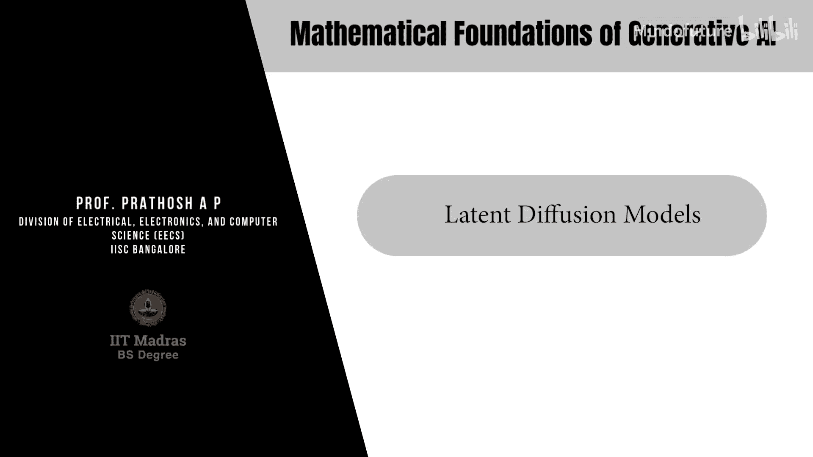
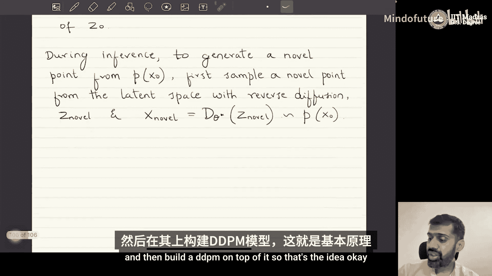

# 生成式Ai的数学基础 ｜ Mathematical Foundations Of Generative Ai p52 P52_W9L37-潜在扩散模型 -BV1fperz7EjK_p52-

🎼。

Hello， everyone。Welcome to this module。This will be the last module in this course where we will be discussing about diffusion models。

Specifically in this module。I will be discussing about two。Imrovisations on top of DDPMs。

 one is called the latent diffusion models， the other is called the DD IMs or diffusion implicit models。

Which are often used in the state of the art， which both of which provides。

Considerable advantage over the Nive formulation of GDPP。

So let us start with the latent diffusion models。Lant diffusion。

These are also oftentimes referred to as the stable diffusion models as well。

So there is no algorithmal novelty in latent diffusion models。But。At an implementation level。

 instead of using diffusion models on the data space。

 diffusion models are built on the latent space of some other encoded decoder structure。

 so this is the basic idea of what latent diffusion models is let us go through it now。

The basic idea。Is to build diffusion。Build diffusion models on the latent space。

Lant space induced by。Another encoder decoder model。Another encoder decor model。So why is this done。

 The basic idea is that。If you take if you consider data like images。They typically lie in a very。

 very high dimensional space as we know。可能。Creating macro chains and operating with data that is in an extremely high dimension creates。

Lot of issues in terms of stability and learning the distribution properly and so on。

 instead of that the idea in latent differential models is to operate on the latent space of some other encoder decoder model that is pretrained so given。

Given data。So we have been indicating that with x not， so lets say that this is in some RD。

The first step。Is to learn。A latent representation。Lant representation， let's call it some z node。

This is in some RK。Where k is much less compared to that of d using。An encoder， decoder model。

SoAn example that is typically used for。The image data set is。Construct。

A vector quant VE or a VQvaE that we have seen before VQVE。To learn。A latent space。So。

 we know that in a Vqva， the late space is deterministic in the sense that given a particular xn。

It will give one deterministic vector which is vector quantized。

 so what happens is that you have an encoder decoder model。There is an encoder。

 and we have a decoder。So x noraught goes in。日D in。安自的的个人。

And in the decoder we have the data reconstructed right xn cap comes out and we have some representation of it not which we call a x node so let us。

Let。一。Fe。Represent an encoder E we and the D theta represent the encode and decoder function respectively。

6体大的不。Represent the encodeder and decoder functions respectively， so these are pre trained。

Ecoder and decoder functions respectively。So we have to train the E fee and D theta。Are trained。

You think。The original data。Xn or sometimes it can even be trained using some other data set that is similar to that top xn so it is a pretrained encodeder decoder structure either using original data or。

Some other data set。Similar to two， it's not。We just pretrain it， then what happens is。

All the data points。All your data points。In RB， which is the real data space。

So let's call them E theta phi and D E phi star and d theta star to represent the pretrain all the data points in RD are projected on two。

D latent space， Y encoder。So we have z n given us E phi star of x0。

So once we have an encoder tri we can just take the tri encoder and project the data points。

 all the data points that we have onto the latent space。No what has done this。A DDPM is constructed。

Diffusion model is constructed。On zn。Okay， on z on rather， let's say that on。

The sum on the space of xenor。We construct a GDPPM using the space of z0。Now， during inference。

During inference。To generate a novel point， say note that our final goal is to generate a novel point from these the distribution corresponding to the real data。

 not from the latent space right during the inference to generate a novel point。From。P xn。

 which is the distribution of the real data。So let us also write it down here。 So x node is in R D。

 So we have。Xn is in idea and it is sampled from px n that is the underlying data distribution that we want to sample from generate a coin from pxn first。

Sample from the latent space， sample a novel point from the latent space。

So how do you point a sample in our nu point from the latent space now point from the latent space？

With。Did you know seeing all the reverse diffusion。

This is because the diffusion model is built on the latent space of data。

There was first sample a novel point from the latent space of the river diffusion。

 so call it z novel。And。X novel， the new point will be equal to pass it through the pretrained decoder pass d。

Now will let in point through the decoder to get。The final novel point or the unseen point that is sampled from。

 So this will be sampled from。P of x not right because the decoder has been learned that way。

 See note here that。The diffusion model is being trained on the latent space of。

Retrained encodeder decoder。The advantage of this is that we are not constructing the diffusion model。

On a high dimensional data space， rather than we are constructing the diffusion model on a much lower dimensional compact latent space that we have learned using a pretrain encode deco model。

就。Most of the currently available implementations are based on this principle that there is a strong encoded decoal model that is pre traineded on the given data and a diffusion model is built on the latent space of the。

Encode a decoder model during inference and novel will point as first。

 I mean the since the diffusion model is。Bilt on the latent space it only learns how to generate the latent points from the latent space once you have a point from the latent space pass it through the decoder the operator and decoder to get the point from the data space so that is the idea。

Okay， so this is also called as stable diffusion because you know it is。

Im particularlyly observed to be much more stabler in in generating image like data sets compared to building a diffusion model completely on he space or the original data space the as I said algorithmically theoretically nothing changes you still have the GDPM that is to be built I mean mathematically。

If you look at it， then X X or z doesn't matter， I mean it's just a random variable upon which we are constructing a macro chain。

 but from an implementation perspective latent diffusion or stable diffusion is the process where you project the data first drawn to the latent space of a pretrain and corner decoder and then build a GDPPM on top of it so that's the idea。

Okay。

