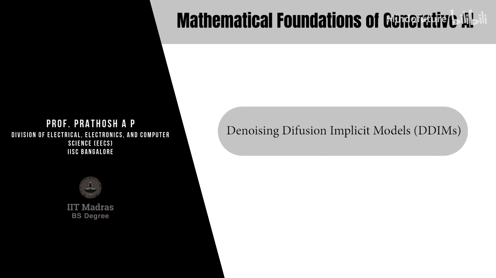
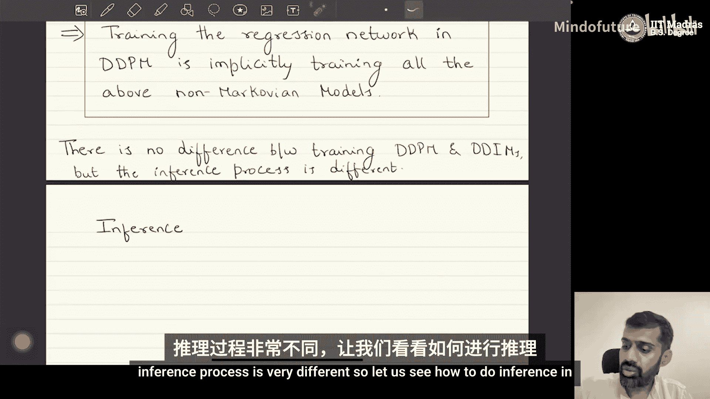

# 生成式Ai的数学基础 ｜ Mathematical Foundations Of Generative Ai p53 P53_W9L38-去噪扩散隐式模型（DDIMs） -BV1fperz7EjK_p53-

🎼。

So let's now go on to another interesting subtopic in diffusion models。

 which is called denoing diffusion implicit models。OrDB itemss。

These are another family of models which are similar。

 very similar to DDPMs in spread where we construct。

Multiple hierarchical latent spaces using a random process and then we sample the reverse direction I mean we sample by trasing in the reverse direction of the given random process。

Now the motivation for this says， you know DDPMs have these limitations。DDPms1。TDPMs are slow。你3不0。

Why is this so capital D is typically a word of thousands of steps？

So note that unlike in a Ghan or a VAAE Ive emphasized this multiple times that DDPM does not generate data in one step。

 so one needs to sample through one needs to travel through the reverse process。

Right multiple times a capital t number of times precisely where it is a hyperparmeter typically it happens to be of thousands of steps so that it is very slow in sampling there is one robot the other thing is and。

Cannot be used。was deterministic。Posted inference。what does this mean？

So Ive been saying one of the biggest advantages of a legend variable model a legend variable generative models is that it does not only give you capability of sampling。

 but it will also enable one two。Do what is called as posterior inference which is learning features or learning representations so why are they important they important one to use them as features in downstream task or to manipulate the given input data and so on that we have seen in multiple places what happens in a DPm that。

The forward process。Istochastic。What does this mean if you recall X T was given by。

Root of alpha t times x not plus。1 minus alpha d times。Epsilon T where epsilon T came from normal 01。

S from normal zero， This means that。Given， so this implies that given。

An x node which is one data point okay。Running the forward process multiple times。

Pros multiple times。Leads to。Different。X capital， you know， which is the the final latent。

Lant representation for x not final latent。而不是你变心。Ford。

Xon right so what happens is you know look at this equation so we have a stochastic element here which is that at every t we sample a data point from normal01 and then add that to a given xon so lets say that you have a particular image xn so we run this forward process lets say 10 times every time we run this forward process we will end up getting a different xt noy point xt after capital D number of steps because of the presence of stochasticity here。

Okay， why is that an issue that means that one particular x node can be represented by multiple xts。

 which means that。We cannot be sure that there exists a particular xt that would generate my x n。

Okay so now given a lets say that we are given a particular image which is x not now if you want to know which is that x so this I write that down so this this mis means this also implies that。

There does not exist。A single or a unique。Unique X T。That generates。A given it not。

From video process。reverseverse diffusion process。So now if I start with a particular xt。

There is no guarantee that I generate the same xn every time so which means that there is no one single representation that corresponds to a given xn why is this a drawback this is a drawback because。

Suppose we have a task that we want to do some manipulation on a given x nos。

Fous example is what is called as image manipulation or image editing where lets say that we are given a particular picture of a scene of let us say an animal in a tiger in a forest now if you want to retain everything in that picture and replace that tiger by lets say an elephant then what we should do is that we should do。

Some processing on the latent space of this particular image。So， if that are to be done。

 then we need to first have an access to a particular latent vector that would give rise to。

They give an input image， but this won't happen in 8pm because as I said since the how do you get the latent vector corresponding to a given image is by running the forward process right so forward process would。

Give us a particular latent vector starting from a given data point。Now。

 since the forward process is not deterministic by the equation but the definition of the forward process that we have。

If you start with the same image and run the forward process multiple times then we get different latent vectors which means that the mapping between the image space or the given input space and the latent space is not unique because of this schastic nature of the forward process this means that I cannot use let's say that I we we take the example of that particular image by the tiger in the forest now I don't have one latent vector that I can manipulate so that everything else remains the same but the tiger is replaced place by the lion that cant happen。

Now， to address these two problems， which are the。呃。

Slowness of DDPMs in sampling which consumes a lot of time and the problem of the DDPMs not being inverable this is called the non invertability of D non unique invertability of DDPMs that means that given a data point there is no unique mapping to the latent space the others in the paper of DD IM comes up with a nice idea of what are called as DD IMs。

 the Ebo problems with DDPMs are。What are thebo issues of。Slow sampling。嗯。Non unique inverittability。

Invertability of DDPms。Are soil in ions。Okay。This is the motivation so as to why one should look at alternate models for DD PMs。

 which is what are called DD IM so let us look at what they are。真可。是嗯。对不对？Okay， so DD I。

Tos in diffusion implicit models before we get to DD Ims， we should first start with。

Another family of。Models， okay， latent variable models that has these following properties。

 let's consider。It us consider。A family of。Inference distributions。

Now DDIMs are also latent variable models， so whenever we talk of latent variable models。We have。

Latnt variables and posterior distributions posterior of latents given data and we also have the model distributions and so on right so lets say that we consider a family of inference distributions and what are inference distributions inference distributions are of this form rightq is what we are representing inference distributions with so Q of x。

X I q of x from x1 means to t given x0aught right these are the inference distributions what are these these are the posterior distributions of latent variables given data。

X x node is a data variable and x12 T represents the latent variables and Q of x12 T given xnt。

Represent the posterior distribution of the latent variables given data Okay now this is what we have in DDPms as well right we represented this as first start macroco chains right now here in。

Defining D ions。We construct not one posteror distribution。

 but we construct a family of posteror distribution parameterized by a parameter called sigma。

 right so distributions。Prameterized by。Paramied me by scales。

Skillar sigma and the sigma is a positive real number。

So its a positive or a non negative variable number actually it to be。Can be0 as well。

0 was a particularly important。Okay， so this is this belongs to real numbers that are non negative。

 So how is this defined。 This is defined as。九食吗。X t given xn。单s。The product of。

F T from 2 to capital T。Q sigma of。X0 minus-1。Condition on X T and。X not。喂。Q sigma of。X T given xn。

你在高兴。With parameters， root alpha。T times xn。And1 minus alpha。T times I。And。For all B。Great than one。

 we have。Q sigma of。X t minus1 given xt and x not you know that comes up。

In the definition of the model is given by a Gaussian distribution。Whose mean is given by Ru tough。

Alpha t minus1 times x0。Plus。Rudolph。1 minus alpha t minus1。Minus sigma T squared。单元。

The entire thing multiplied by x。B minus。Ro of alpha t times it's not。Divided by。

Root of1 minus alpha T。This is the mean then this entire thing is the mean and the variances sigma t squared times the identity。

 so this is the distribution。Okay so this is how we define a family of inference distribution parameterized by a scalar sigma。

诶。No。This is simply the chain rule of probability。So what is to be seen here So now this is a choice of the model that we have made。

Now， there are a few things that are to be noted here。 The first thing is that the。Above process。

 the above process， above forward process。I。North Macowan。

 unlike the forwardwork process that we had in DDPM。

The power process that is defined in at ADDAM which is given by this is is not Markovan。

 it is very easy to see that this chain rule does not respond to a random process that is Markovvian so this is a non Markovviian process。

Okay so now as I said in DDPM one of the DDIM Im sorry DDIM one of the key motivations is to come up with a process which is much faster compared to DDPMs right now one way to do it is to make your transitions in the power direction non more coan so that even in the reverse direction the process becomes a non more coan transition。

Okay， so now this entire the forward process that is defined here is non more co。

 but now one striking property of this particular definition that we have given us that the。

so one other integrity that I have to tell you is that this definition would not readily give you a forward process rate or rather this definition does not give you a forward process。

 the forward process right which isq of。XT。Given x T -1 and x not。

This can be  Q sigma can be obtained using the base bas rule， right  Q sigma of。X t minus1。

Given X and xner。Ts。Q of xt and xn。Q sigma xta given x not divided by。Q sigma of x t -1 given xn。

Okay， now here。Q the things that are to be observed here is unlike in a GDPDPM。

 Q of xt is not independent of x naught given xt management because this is non moreovan。

So that can that is something that is to be noted the forward process。Or。I， the。The farm process。

Corresponding to the above posterior beef let's see where to write it。The former process。

Cresponding to。The above posterior。Is as follows。Now please note that what we have defined here is a posterior of the latent variables conditioned on data right that is what we have defined here and this is our definition so all of these are actually defined with this way right all of these are。

The definitions you know we have chosen to define it this way I tell you why was this chosen in this particular manner these are defined in this particular way so given this particular definition the forward process correspond to the E post here is given by the base law this is simply the base law。

佢。Now how do we obtain in this we just plug in the definition of this particular thing here right and what about these two things these two things can also be founded which we will see now one observation is the above forward process is not more co that is。

I is not Markcovin。So which means that the Teth latent is not independent okay。你问。

Is not independent of。嗯。X not given x t minus1 right so in a DDPM what happened was given x t minus1 xt was independent of everything that came before x t minus-1 but here it is not independent and that is why x t given x t minus1 and x not cannot be written as Q of x t given x t minus1 because it is a normal coin forces okay so now what about。

In this process in the Ebo process。Cure of。Acusic muv X T given xn。

which which appears in the definition of the forward process how do we find this as the question now it turns out this is the this is actually the key observation of DD。

Pm that it is。Exactly the same I am I am sorry， this is exactly the same as the tough GDPDPM。

 so this is equal to root of alpha t times x0。At1 minus root of 1 minus alpha T。Times8。Okay。

The same as。T表。So one subtle thing that is to be observed here is in all DDPm literature we were writing this as al part T bar okay what we have been writing as Al part T bar in the DDPm literature in DDIM literature people write it as al part T so it is just a reparameterraization of the constant that is there just to be consistent with literature are use the same notation as al part T but what is to be seen is that in the family of inferences that we just defined which are non moreovan even though the forward processes very different。

As compared to the top DDPMs， the conditional distribution of xt given xn is exactly the same as the top DDPM。

Okay， why is this important is the question， the most striking observation that is made is sins。

Q sigma of X T given xnt。Which is the。供电信隆。Of X T， given xn。Is the same。In both。DD PM and DD I am。李。

The elbow。For both of them。呃。The same。And optimizing。

Optimizing the elbow leads to the exact same solution。

So this is a very key observation that is made in the article of DDIM that is actually one of the not one of the most important observation that is made if you recall so this this is because the elbow。

Elbow in DDPM and in DDIM。Depends。吴力恩。Q off。X given sorry xt given x n。So。

 if you simply recall the definition of the elbow that we had derived for DPM。

 all the terms that came up in the consistency terms and in the other terms of DPM。

Only depend on depend only was dependent on this particular distribution Q of xt even x nor so it does not depend on。

Any of the other。马进伦是加是。Q of say x1 x to given x n and so on。

 It does not depend on distributions of this art。 It only depends on Q of x to given x n。 Now this。

 what does this mean this implies that。As long as。Q of Xt given xnaught。Is same as。That of GDPPms。佢。

Any process。Can be used。Can be used， and leads to。Same solution。For elbow optimization。

This is the key observation。 So now it doesn't matter what is the So here what is the type of。

Marginals that we have here， so this implies I'll write it mathematically。As far as。Q of xt given xn。

The same as 30 PM。Any definition。4。Q of x1，2 T given x0。看女学诊。

This is the key result so what happens is I mean anybody who knows probabilityit here would know that multiple marginals can lead to same conditional right one can have multiple marginal distributions that can lead to the same conditional so now what we are saying is since the elbow depends only on the conditionals and does not depend on marginals one can have any kind of marginals。

Okay that would make sure that the conditionsals are the same and we will still end up getting the exact same solution as that of elbow now if we go to the definition of the family of inference distributions that we made here so no matter what distribution that you take here you know how does one distribution differ from the other it is by taking different values of the sigma now。

We are we we are defining infinite number of third。

Margiinnal distribution such that the conditional distribution here is exactly the same as the tu。

DDPm， so this is the most important aspect。 So we have chosen the marginals in such a way that the conditionals are exactly the same as that of DPm Now this the。

Complex looking equation that you see here。This particular mean and variance for this distribution was particularly chosen in such a way that if you choose thisq of x given x n will be exactly the same as that of DDP so now this is from elementary probability theory with the multivariate gaussian distribution one can show that this particular choice for Q of x given x minus-1 given x and x n。

Excuse me， so this particular choice of Q of xt minus1 given xt index node would lead to a conditional which is exactly the same as that of GDP。

ok， this is how诶。And a family of non more co processes are chosen。Now， what's the？Next thing。

 so I just write down the results so it can be shown that。Okay， now with this。

 we have now before I come to the reserve formally。

Once we have so while defining any latent variable model， you need two things， one。

 the posterior of the latent variable given the data， the other is the。

Probably are the density of the data given the late。

 so one we need aq of terms like z given x which is the posterior and we need。

P3 of x cube and see this is what we call as the model rate is what we have been calling this model so far。

Now as in the case of DDPs in DDIM as well the forward process is non learnable there is nothing to learn in the forward process albeit it is a non mark process we have defined it the way we want we have to define the model so let's define。

Define in the。The decoder。Or the。Reverse process。For the defined non more co process。

 let's define it this way。 let us define this as P chta of。

Xt minus1 given xt this is our definitionation rate， the reverse process has to be another。

Random process that would start at x t minus1 and starts at x capital and tra the the random process in the reverse direction。

 So let us define it this way so whenever。T equal to one。

 we will define that as a normal distribution with mean equal to let's call this mu theta。

New t of x1。And the variances。Sigma squared into I。And this is for p equal to1。

And for all the other cases， we will define that to be equal to。Q。clive mouth。X P minus-1。

Given xt and should I been xnt instead of xNt， we will call this as mu theta。Of X。Okay。

 now what is mu theta here。So the mu t of xt。Is given by。X t minus。1 minus alpha T。欢迎。

Some excellent tin up cap。Dverted by。Ro of all40。 So where did we get this form from， recall that。

We had our xx n or well start with xt xt was root of alpha t times x n。

Plus root of 1 minus alpha t times xpsilon p right this is what we had by the definition now if you rearrange x not will be given by。

X p minus。Root of 1 minus alphapha D。Times epsilon T diverted by root of alpha t。

here epsilon t is the noise that has been added to x nor to make it xt so the usual definition that we had now if you observe it what we have actually done this so this new theta of xt is an approximate。

Proximation4 its' not late。So just as in the case of DDPM we want a reverse process to match the true reverse process at all T okay if you remember the consistency term in DDPM was nothing but decay divergence between this particular distribution andq of xt minus 1 given xmar and xt so this is what decay divergence was between if weve done the exact same thing here that we want the reverse process to be equal to please ignore the h case for a while now I compute that amendment t equal to 1。

But for equal to1， what we have is that we have the reverse process。

 the model reverse process to be equal to the true reverse process that the distribution is imposing。

 but instead of xn here， we are trying to approximate this xn using a new theta。

Okay that is what we are learning and what is new theta new theta is what we are learning using the neural network epsilon theta by optimizing for the elbow which is this this this this epsilon theta cap is exactly the same epsilon theta cap that we use。

In that we regress using the loss function and EPM so that's exactly what it is。Okay， so now。

This is the model now the important result， the main result is the following， the main result is。

The elbow。The elbow respond to。Theelbo corresponding to the Abo non more Koreanan family of models。

And that tough GDPDpm。啊。The same。See when I say they are the same。

 they are actually off by a constant。Wwhich can be ignored so I'm just saying the actual result says that the correspondinging to these family of non more Q models and that tough DDpM are just off by a constant it's a very very interesting and important result so I not go to the proof of this particular result I mean interators can go to DDD I paper and go through it what's important in this particular what what the importance of this particular result is that this implies that。

Draining。The regression network in GDP PM。Vi network in GDPpm。Is implicitly training。All吏步。

Non more COId models。So， this is the most important result that is presented。

 which means that by training one GDPPM model which is the usual regression task that we solve。

We are solving or we are trying an infinite family of non more co models implicitly。

Okay so that the that is a very， very strong result because by training one model we are not training one model or rather we are not training for one forward intervalverse process。

 but we are training for an infinite family of forward intervalverse processes that we have defined in the Ebo equations so that is the most important result。

Is that which means。That we have already tried this infinite family of models So now what changes is so between DDPM and DDIM。

What changes is not the training procedure you you are just only training one single model。

 what changes is the inference because every model here has a different inference procedure because the inference is nothing but sampling from this particular distribution right？

Since this is very different for DDPM and the reverse process is very different from DDPM and DD IM。

The sampling procedures for DDPM and DDIM are very different， however。

 by training the training procedures for both DM and DDIM are exactly the same and by training one particular model corresponding to DDPM training an infinite family of。

DDIM models are these non moreovan models now why is this non moreov non moreovvariity such an important thing is because as we said the if the process the reverse process is non moreovan then one can skip multiple steps while while doing the decoding or the generating because the dependence on Xt minus1 is not only on the previous Xt but on。

All the other previous theletnt variables that came before that time。

 which means that one can define Markco processes non more sorry。

 one can define non moreco processes that would have much smaller time frame as compared to。

For start Marco chain that occurs in Dp。 that is the main advantage。 Now the question is， okay。

 so now we understood that we are having。Multiple nonmarking processes trained by training 1 DDPm now the question is how does the inference process changes so let us write that down so inference。

So I'll write that on。 There is no。Difference。Between。There is no difference between training。DD PMm。

I am Ddy， Is。NowS no difference between them， but inference changes okay。

The inference procedures is different。Infer processes very different。

 so let us see how to do inference in。

嗯。

