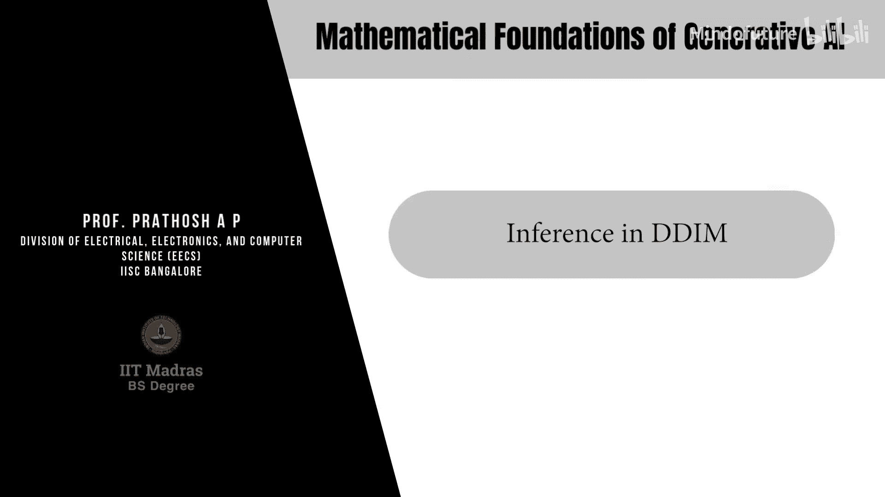
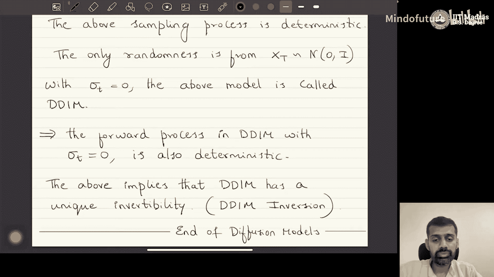
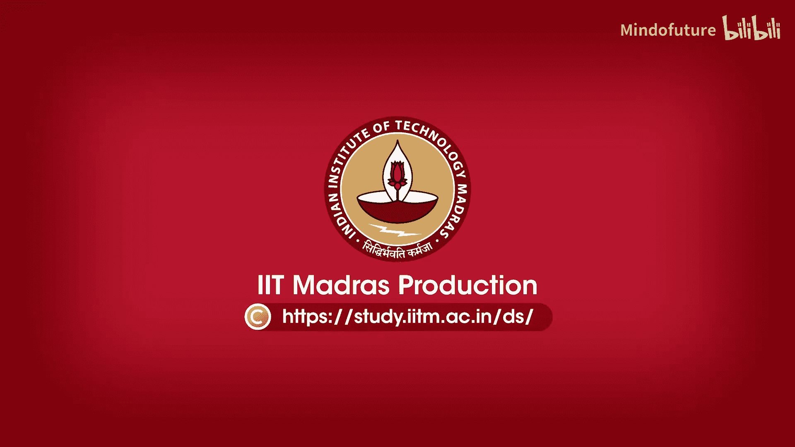

# 生成式Ai的数学基础 ｜ Mathematical Foundations Of Generative Ai p54 P54_W9L39-DDIM中的推理 -BV1fperz7EjK_p54-

🎼。

TDPs were of inference with DD Is。So what is inference as we know that it is simply sampling。

So inferences sampling from。The reverse process， right。

 that's all mean it has been always sampling from P the of x。

X t minus1 given x t this is exactly what inference is all about and what is this by definition we have defined this to be this particular thing So now if we have trained a DDPM we have this as theta star。

Because we have already tried this。Okay， now let me also write the definition of new theta so that。

Yeah， all of it。One， please。Because of this， the sampling procedure is the following。

 so we want x t minus1 to be equal to。So， how do we sample we simply sample from this particular distribution。

 how do we sample from this particular distribution。

 we know that this is a gaussian distribution here。

This please recall that this distribution has been defined to be this way。

 which is a Gaussian distribution， all we need to do is that we need to replace x node here。

By mut data， that is what we need to do and we need to sample from okay。

 so let me just copy this as well so that we have。Context。Okay， so what we need to do is。

Sample from this distribution now instead of xn here。We need mut data。

Because that is how we have defined our P theta star instead of x node here。

 we just have this mu theta so wherever we see xn here we need to simply replace it with mu theta that is what we need to do that is right this says。

Mut theita star。Andright， this is also equal to。You a start right we need to sample from this particular gaussian distribution and how do we sample from any gaussian distribution。

 we simply start from。不听话里不回个事。Sampling from。Pita star of。Xt minus1， given xt。Is as follows。

So we know that it's a Gausian distribution， right。

 How do we sample from a Gaussian distribution as usual， we start with。We start with。Some Z， that is。

나 zero one。Okay， and we take that。 and we need the。

Vance to be equal to sigma t squared so therefore we will write this as a sigma p squared times the z。

 this is the scale that we are doing and we just shift it with the mean what is the mean the mean is equal to this entire thing。

This is what we will write down。 So the mean is equal to so my x t -1 will be equal to root of alpha。

T minus1 times mu theta star， so what is mu theta star we have written mu theta star to be this。电点灯。

Okay， this is the mu theta star。그기 아들 때 말。这个り。Long equation。

 So let me write this as sigma T squared times z。Okay， these， what is the the mean has。

 the mean itself has。Well we wrote this term， what about the second term。

 let me write the second term and so we will take this。

You take this term So that you mean I'm writing this， the mean this plus。This particular term。

 and this is multiplied by x T minus。Extre minus root。

Of alpha t mu t star divided by 1 minus alpha t， what is that equal to just look what that is equal to so this is this implies。

That。Xt minus root of alpha t times。Milty does start。Divided by root of 1 minus alpha t。

This is equal to the predicted epsilon predicted epsilon from the network。

This rearrange in the terms。 So whatever the。Theerm that was multiplying this particular short term now will be written as epsilon theta star。

 so this is epsilon theta。Cap， which is the predicted。

 I'll put a star here because we have already predicted away this is a learned neural。

 and the final term， which is。The Gaussian thing will write this right that way here。This plus。

Sma T square times see。So this is the sampling equation for a DD IM。

Note that with different sigma ts here we have a sigma t here right different sigma Ts will make you sample from a different forward process as I said no the forward process is parameterized by the sigma that we have so we choose a different sigma we have a different forward process what we saw okay what happens is here we have given a generalized sampling procedure for all these family of models okay with different sigmas the sigma t represents the same sigma that we have here。

Which we used to。Define。A family of。Degenative models， in fact， every family can be written as。

I don't have to write it as a skillr。 Let me write it as a vector because。

Because this is different for different times right because we have time index vector sigma so at every t we have a different value of it that is why Ive written as Ive been writing as sigma t so every sigma P a vector a positive vector sigma t will give you one family of or one thrust one forward process and this is the sampling procedure for it。

Okay I hope that this is clear I mean this looks a little complicated but it is not when all we are saying is that by training one DDPM network we are training a whole bunch of family of non more coin processes whose sampling procedure is given by this particular formula okay now what is what is interesting is when。

And sigma T， which is the family of parameterized vectors that we have taken。

 is given by this particular f lab。我豆会。1 minus。Alpha t minus1。Divided by。ruol夫。1 minus alpha t。单用词。

Route of 1 minus alpha T。Divided by。Ro root of alpha t minus1 createate this particular value of sigma t。

The above our process are。A random process。Redduces to DpM。Okay。

 so which means that DDPM is a special case of these family of models with sigma taking a particular value。

That means that while you are trying at DDPM you are also ti a DDPM of course。

 and you are trying a large much larger family of models， so that is the idea。

There is another special case。 Okay， so when。Sigma T is equal to。0。

We have said that the sigmatic can be any。Non negative real vectors it can take a value of 0 as well if that is0 then what happens is this term completely vanishes right with sigma equal to 0 the sampling procedure has the following form。

So x p minus1 will be equal to。Root of alpha t minus1。

Time this entire first term remains exactly the same the right term。X p minus root of 1 minus。

Al40 times。吃问题大概。Diver it by。Ro of 140 so note that this is epsilon theta cap I mean I'll actually write a star here this epsilon theta cap star is coming as the output of the neural network Now remember that our neural network the DDp neural network takes xt and P as input and gives you an epsilon theta star as output right so that that remains the same so this is the first term the second term will be。

Plus。1 minus alpha t minus-1。There's no sigma here。Ro of this times， tipspsalon， Cheah caps star。

So note that this is completely。Little mon stick。The above sampling procedure。Is deterministic。

What does this， this imp that？The only randomness。뉴스프라는？It's from x capital t。

 which is a sample from normal0， so just like a dn right where。You start from a particular I mean。

 you sample from a normal 01 and you pass it through。

A generator and it will give you one particular data point generate data point。

 no matter how many times you pass it through it you just get the exact same data point。

 but in a DDPM what happens is you sample one particular data point from Xt you run through the reverse process if you run through the reverse process every time you get you get a new generated data point but in a DDpM in a DD IM so this is this particular case right with sigma equal to0。

Sigma equal to 0， the E model is called DDIM。Because this is an implicit model in the sense that there is no stochasticity why we are sampling other than this stochasticity that is coming from the the last legend variable or the input noise so start with some input noise and run through this particular backward process if you run through this backward process every time you fix the 60 you are going to end up reading the exact same input exact same generated point x so now this also implies that this also implies that。

The forward process in DDPM DD IM。The forward process in DD I am。W。WithSigma t equal to 0。

 so at DDI am is the case when sigma equal to0 is also deterministic。

Why because the reverse process is deterministic， we also have the forward process to be deterministic as well now what does this mean this means that。

Thebo implies。That。DD I am。Hers。A unique invertability。

It means that if you start from an xnt and run the forward process of a DD IM okay you will get a particular noise Xp right and if you run the DD IM process again with the exact same x node you will get the exact same noise every time now you run the DD IM process this is called also called DD IM inversion。

SoDD I am inversion is simply。The process of starting from a given image and running through the forward process of I am to get。

APart noise vector X T， So that is called DD I am inversion。

Now what is done in practice to solve the problem of image editing I just that I mentioned at the beginning of the lecture。

 which is that suppose you start from an image of。Let's say a tiger in a particular forest and you want you want to change that tiger to lion or rather elephant without changing anything else what is done is take that particular image okay and run it through the forward process of a DDIM so run it through the forward process of a DDIM you get a particular vector latent vector or a noise vector corresponding to this particular image okay then what is to be done is that。

We know that we are we know how to condition these models in text So what is to be done is that you change the text conditioning by saying that now generate the image corresponding to an elephant being in this exact same scene and run a conditional DD Ims reverse process given by this particular equation then what you would get is the exact same image with everything else being the same but that particular tigers image is replaced by that top elephant because that is the way the text condition has been put now suppose you didn't have a unique inversion what would happen as you can still change the input text prompt but what will happen is everything else in the in the background does not remain exactly the same because the latent vector or the noise vector that we have obtained by running the forward process of a DDpm will be different。

Even if you give the exact same image， but here in a DDIM。

 given a particular image since the result of the forward process would end up giving the exact same noise vector every time then a simple thing for editing any image would be to start with the given image and get the corresponding output vector output noise vector corresponding to this particular image and change the textual prompt for this particular image and run the reverse process again so that would produce the exact same image that we started from with the particular edit that we have suggested using the text so that is one of the biggest advantages of using a DDIM because it can be inverted with the deterministic forward process。

So because this process is also non moreov in nature。

 the number of times steps capital T that one would need in generating D measuresters is much lesser compared to the of DDpMs so we have solved both the problems of non-unic invertability and the slower nature of sampling using DDIMs again let me repeat the fundamental idea is to define a family of parameterized non moreovan processes which has the same marginal as that of DDpM so that training one DDPM is equivalent to training all these family of models what changes is the inference process so by changing the inference process as given by this particular equation you will be sampling from different non moreov processes one particular special cases when the sigma t is equal to0 in which case both the forward and the backward processes becomes deterministic。

Okay so that is the the summary of tD IMs and this would take us to the end of diffusion models。

Now there are enormous amount of applications that people have looked at on DDPMs and DDIMs and so on。

 and since this is not an application course I would refra from going into those applications interested readers may go up and look up the literature to see how DDIMs and DDPMs arise by the way today's state of the art is using DDIMs on latent spaces。

 so all the image generation software that you see with all the commercially available software such as GPT and Gemini and so on are mostly using DD IMs while generating and the images。

Okay so this takes us to the end of diffusion models。

 we will revisit diffusion models when we look at the language models the autoive language models。

 so people have tried to use diffusion models for the sequential data as well most。

Prevalent application of diffusion models is in image generation people have not mean till very recently there have been very little efforts in using diffusion models for sequential data generation but now very recently diffusion models are being used for sequential data generation like text as well we will we will go to it when we look at the large language models from the context of autoregressive models okay so the next topic that we will be looking at are autoregressive geneative models which are also called the large language models and we will look at different architectures such as transformers and different ways to train them and align them。

は就。

