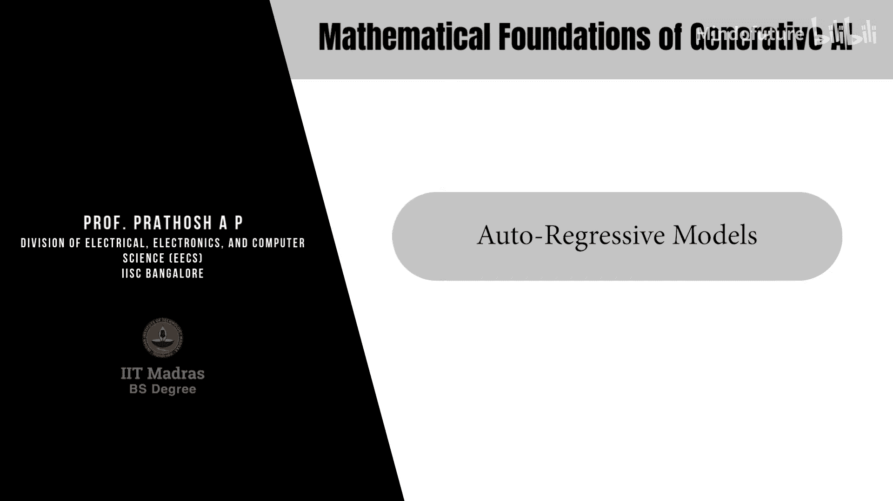
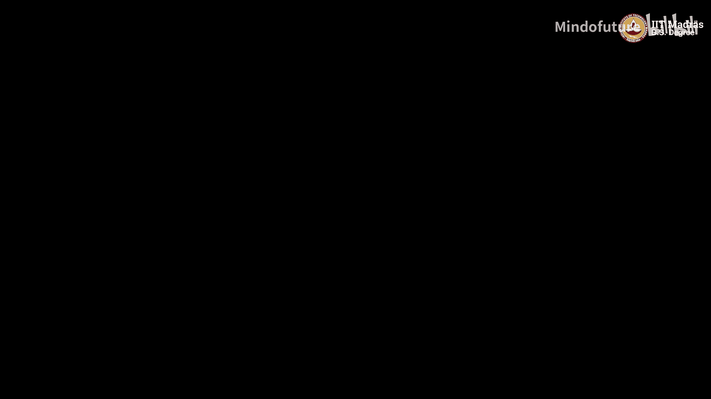
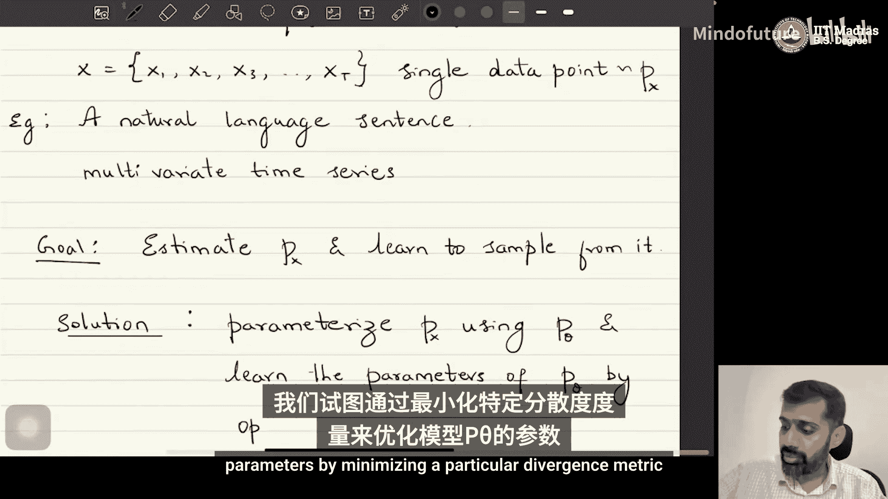
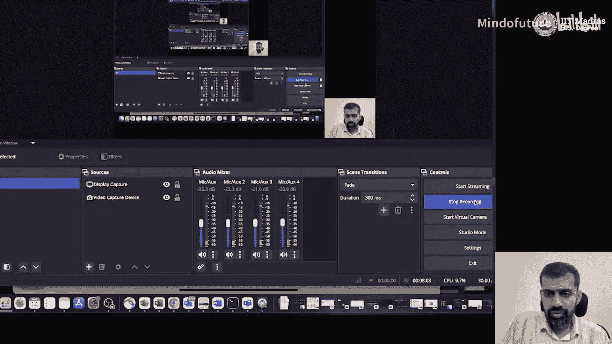
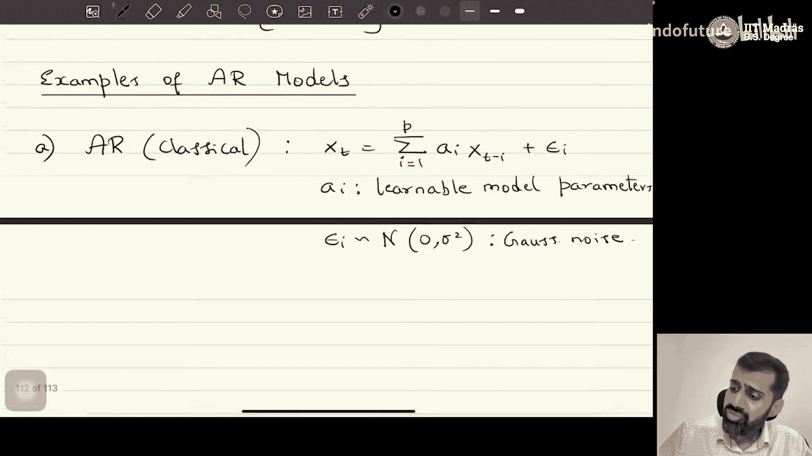
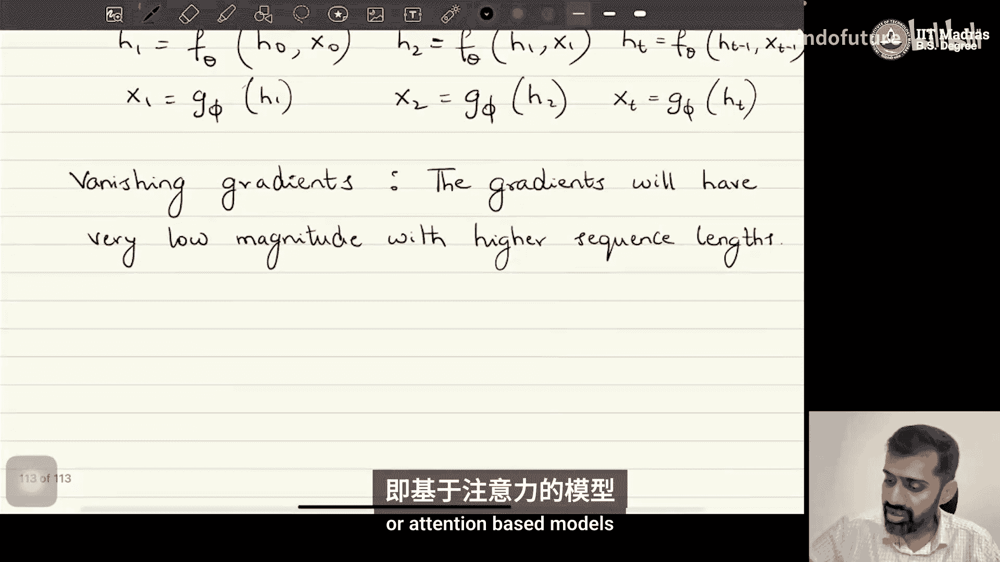

# 生成式Ai的数学基础 ｜ Mathematical Foundations Of Generative Ai p55 P55_W10L40-自回归模型 -BV1fperz7EjK_p55-

🎼。

Hello， everyone。In this set of。Upcoming lectures， we will be discussing about the auto aggressivegressive models。

Now that we have come to the end of discussing diffusion models next set of module next set of generative models that we are going to discuss are。

What are known as the autorecurive models。Are told aggressive models？These autoregressive models。

Are historically well known to be used in the multiple。

Tasks such as time series analysis and sequential data， handling sequential data and so on。

Examples of these auto aggressivegressive models historically have been the classical linear prediction or AR models or ARM auto aggressivegress and moving average models and so on。

Some of the recent examples of autoregressive models are models such as recurrent neural networks and pixel CNN and so on。

Now， the most recent and widely used autoregressive models are what are today known as G generative ratetrain transformers。

 which form the basis for all the。Geneerrative models that you see these days。

 sequential language model based generative models that we see these days。

 this include GPDs and commercial commercial commercially available models such as GPDs and Gemini and C and these kinds of models they are all autogressive in nature。

So let us look at the definition of what an autoregressive model is and we will look at one specific class of autoregressive models which are the transformer based language models as as as an example of autoregressive model in this course because as we move on we will look at different ways of training these autoregressive models and fine tuning them and also aligning them with a particular type of human required output and so on。

 so it is important that we look at deco of this particular class of autoregressive models which is called the transformer based language model so let's start with the definition of autoregressive model so most of these autoregressive models are built on data。

That is sequential in nature。Sequential in nature。What does what does it mean to say that data is sequential。

 so let's say that I can express my data point x as。A set of。In doubles， let me call it as x。X 1。

 X 2。X3。To x capital T。Now， this is one single data point。 So this is a。

Please change please note the change in notation。 We have been using x 1 to x T to denote the。

P different latent variables in the context of a diffusion model here in the autogressive model context。

 we look at x1 through Xt as the sequences of sequences that define one single data point。

 So an example for a sequential data point can be。Natural language， sentence。

This very sentence that I wrote， which is a natural language sentence is an example for a sequential data point where every world here can be represented as one constantstuent element of this sequential data point。

 the other example can be let's say a multivariate time series。

Multivvari time series and one can even look at an image as a sequential data by scanning every pixel。

 Arrranging every pixel in a sequential way， we can go from left to right。

 top to bottom and arrange all of the pixels one after the other and one can look at an image also has a sequential data point。

 Okay so now in all our upcoming discussions， we will assume that we will work with a single data point。

 as we are doing with the other models。 So everything that we do with a single data point can be extended to one data set of multiple data points drawn from a distribution。

 just by having an out expectation with respect to the distribution of interest the problem still remains the same that given multiple samples drawn from this drawn from an unknown distribution。

 So this is drawn from。An unknown Px。So this is drawn from an unknown px as usual。

 and we want to learn to sample from this particular px。

 so that is the problem that we have been solving through the course， Okay， the goal is。

Estimate px it still remains the same just reiterating for the sake of completeness。

 estimate px and learn to sample from it。So this是 the。

One problem that we have been solving from the beginning of the course right so given data points that are sampled ID from a known distribution。

 we just want to estimate a distribution and learn the sample from it and we looked at multiple ways of doing this。

 Now for the data that has this particular type of topology， which is a sequential nature。

The kind of underlying model that is used to model Px is little different and one of the families of models is called the artism model。

So recall that we have used multiple formulations for Pheta one was represented using a neural network and we use the fact that we use we can use samples from an arbitrary distribution and a neural network to transform that and we used variation di minimization to find the parameters that was GNs in VE and diffusion models what did we do we expressed the model distribution using the latent variable model and we used a lower bound on the likelihood function and then optimized it using neural networks in autoregressive model though so Pheta in AR models。

So let me write that the solution still remains the same， the solution for the above problem。

Still remains the same parameterized prex。And learn the parameters。

Arameter is px using a model P theta。哎， learn比的。Of Pta by。

Optimizing or rather minimizing a divergence metric。

 so the the story still remains the same that are we are trying to learn the parameters of the model P theta by optimizing for the parameters by minimizing a particular divergence metric。

By optimizing。Divergence metric。This philosophy still remains the same。

 so mathematically speaking we find out the Theta star that would minimize some divergence matrix which can be called divergence between px and P Theta。

We also saw that this was equal and maximizing。Maximizing the， the log of。The likelihood P theta。

Of x so expected the log likelihood。This was equivalent to maximizing the expected the。

Log like load where the expectation is with respect to px， right？

This also we saw and this is what we called as the maximum light load estimation and we even with auto aggressivegressive models the exact same problem is solved okay so just that the kind of parameterization that we use for P theta is very different Okay so this is the problem that we are going to solve So in auto aggressivegress models。

In autorecurive motor。P theta will take this particular form。 So p theta of x。

 the likelihood of a particular point P theta of x， which is equal to p theta of x1 x 2。X 3。

So on up to x T because every single data point now is a sequence of t number of tokens。

 if you may call it that is given by。Chain rule of probability。

 which would simply say that you just take the product of all of these probabilities from。

So P theta of x。D given1 x。All thes that precedes this well。Pix。T t。

 this symbol is simply the set of all tokens。Starting from H1。2 x p -1。

So the classical chain rule of probability， we are simply saying that this is the definition of an auto aggressive model where the。

Llihood of a particular data point which is a sequence。

 is modeled as the product of multiple conditional distributions。

Of each of the single data point X T conditioned on everything that precedes that okay so see one can look at the sequential data as a random process as well。

 so what we are actually doing is modeling the likelihood of the entire sequence of a random process。

As product of multiple marginals where every marginal is x X T。

 the likelihood of a particular point X T， given that we have observed everything before that X T。

 So this is the definition of autoregressive model。 The reason this is called autore service that。

Every X T now right is made a function of all the x that precedes it。

 So it is sort of regressing on self。 This is one data point。 and X T is now given as。

Something that depends on all the data points that precedes it。

 so it is regressing on self okay the history that is why name auto regressive。

 it is regressing on self。So all the models that we just discussed about right including GPDs and AR models and RNs belong to this particular family。

 So how are they different from each other is the way they define the underlying P Theta okay so let us look at few examples for autoregressive models so examples of autoregressive models。

The first example that we will look at。Is for what is known as the AR model。

Which is a classical A model。So these techniques date back to several decades。

P to the current times these ideas were there the only thing is after the argumentdvent of neural networks。

 we have better function approximations and we can look at multi parametermeter models。

 but the idea of auto aggressivegressive models existed for a long time so here here in the classical a models given red point xt okay is modeled as a linear combination of。

P previous data points， so AI times。X t minus8。Plusless some Epsilon I。

 So where Epsilon I is all these AIs are。Are learnable parameters。

These are learnnable model parameters。And there are P of them。

These are La model parameters and its sallon I is simply noise that is added。

E at a point which is Gaussian， it's a fixed Gaussian noise。

So this is also called the P order linear prediction。 So P is a hyperparameter here。

 how many previous data points that you choose to rigorousgress over is a hyperparameter。

 And this is simply a p parametermeter model because all that we need to learn are P number of coefficients。

 This is the classical autoregress or linear prediction modeling here we assume that data comes from a Gaussian distribution because as you can see every data point is assumed to be a linear combination of previous data points plus some noisy perturbation one can very easily see that the Xt here behaves like a Gaussian because it is simply an apparent transformation over a Gaussian random variable。

 So this is the Gaussian。Causciianity assumption that is made？

Now， these models are， even though they are。

Even though they are pretty good in modeling data that does not have too much complexity or dependency between the previous point。

 but they cannot model very complex sequences such as natural language so people move to what are called as the neural autoregressive models。

So neural AR models where。B T do of X。T given x。The than T， this is modeled as some neural network。

Some neural network。Which is a function of all the excess that is re。 So this is。

The family of neural AR models and this is trying to usually with maximum the ML estimate the ML objective maximum maximum like your objective using back propag algorithms。

 so these neural networks can be anything so these can be let's say a fully connected multilayer perceptron or this can be a a CNN or this can be a recurrent neural network and so on。

 so this was another class of models that are auto aggressive in H so you have in neural network。

That to take all the the data points before a particular given time index t and it predicts what P of xt is by maximizing like you know these are neural these were also called neural language models when when they were proposed。

So， after that there were a little bit of more complexity that was added to these neural A models by using these architectures called recurrent neural networks。

 which are also one family of autoregressive models， recurrent neural networks。Previated as orna。

So all the family of models that you see such as GRUs gate recurrent units and LSTMs。

 long short term memory networks and so on belong to this family of recurrent neural networks。

 where the idea is that there is a hidden state that is zoom。

 so the way recurrent neural network works is you make H as a hidden state to be equal to some function F。

Le theta of。The previous hidden state h t minus1 and x t minus1。

This is parameterized by theta and the next。T point X T is predicted as some other function， G P of。

H T， D T at state and sometimes X1 is1。 So this is the general form where。Where F theta and G P are。

Lable not only near functions。These are learnable non nonlinear functions。

 depending upon the form of F times the G P， there are several family of recurrent neural networks。

 You know， you change F time G P， you get different family of recurrent neural networks， such as。

GRs and LSTM and so on。 So now in this course， the objective is not to not to go to architectures as we have seen so far。

 the objective is to look at the formulations of how the bur class models are working。

 So I not go to the details of architectures interested readers can go and look at architectures per se So these were recurt neural networks。

 The idea was to do what is called as the parameter sharing。I克答。Ro time are the sequences。

The idea here is that the parameters theta and the phi are kept the constant across different time steps of the sequences。

 So what happens is that。H T， so let's say H1 will be equal to F theta of。H0 and x0。

 and we have x1 to be equal to G P of H1。 and if we write H2 H2 is equal to F。F theta of H1。Comma x1。

 and we have x2 to be equal to G p of H2 and G P of H2 and so on。 So now across time， you know。

 no matter what time steps we are looking at the theta and phi remains the constant。

 So this is called parameter sharing across time。so this is how as recurrent neural networks could handle sequences of different length。

 so there is since we are sharing parameters across time。

 there is no constraint on how long the sequences should be so a sequence can be of any length while this gives a this advantage that one can make sequences arbitrarily large。

 this also leads to another famous or rather infamous problem called the vanish ingredients problem。

The issue of vanish ingredients， where the。Gredientents。Hell have very low magnitude。Whi。

Increased sequence lens。Its higher sequence length。

We not going into details because as I said this is only an overview of how the literatures progressed。

 what happens is since the parameters are shared across time。

 suppose you have a very very long sequence。While training these these sort of architectures using gradient descent。

 what happens is that。The same parameters have to be multiplied multi times by computing the gradient gradients。

 and that would lead to the magnitudes of the gradients。Getting smaller and smaller， as we move。

More and more to the left of the sequences while we are traveling through the RNN networks architectures and why is this important。

 this is important because suppose you want to model sequences of larger lens。

Then the model would not facilitate it because the gradients would vanish if you have the sequence lens to be very。

 very large。The other way to look at this is that to generate the teethth sequence。

We need to depend on the tieth hidden state or tieth representation。And this ti representation。

Is the only vector that would that is burdened with the task of encomposing all the information that is there from x n till X T dependence on X dependence on X T or x n is via this H T。

 which is the intermediate representation or the T at the hidden state and。

This steer hidden state is tasked with this with this。Task of compressing all the information。

Regarding all the the previous data points starting from x not till x t minus1 Okay So that is。

 you know， this means that if we， if we look at the sequences of larger lens。

 then this H T may not be。Capable of compressing all that information that is required to generate the data point X T so these were the problems。

 the known problems that were there with the RNn kind of auto aggressivegressive architectures to come up with this people came up with this idea of attention mechanism or attention based models。

