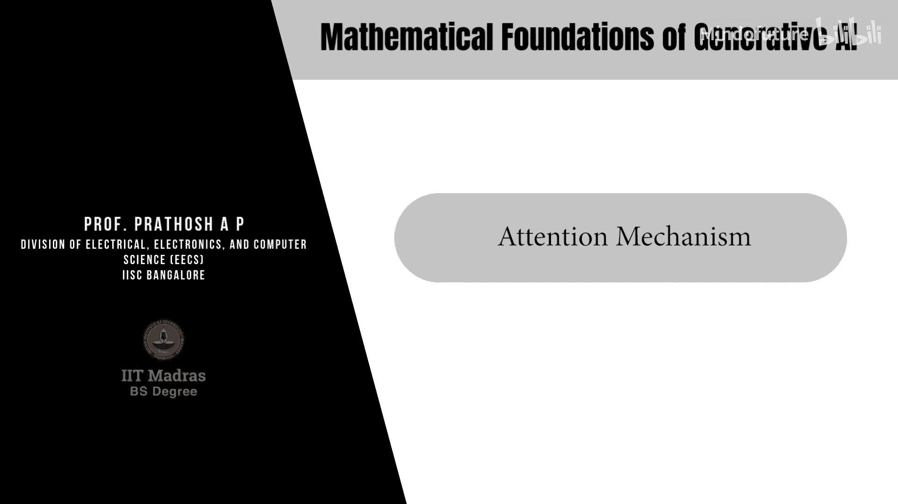
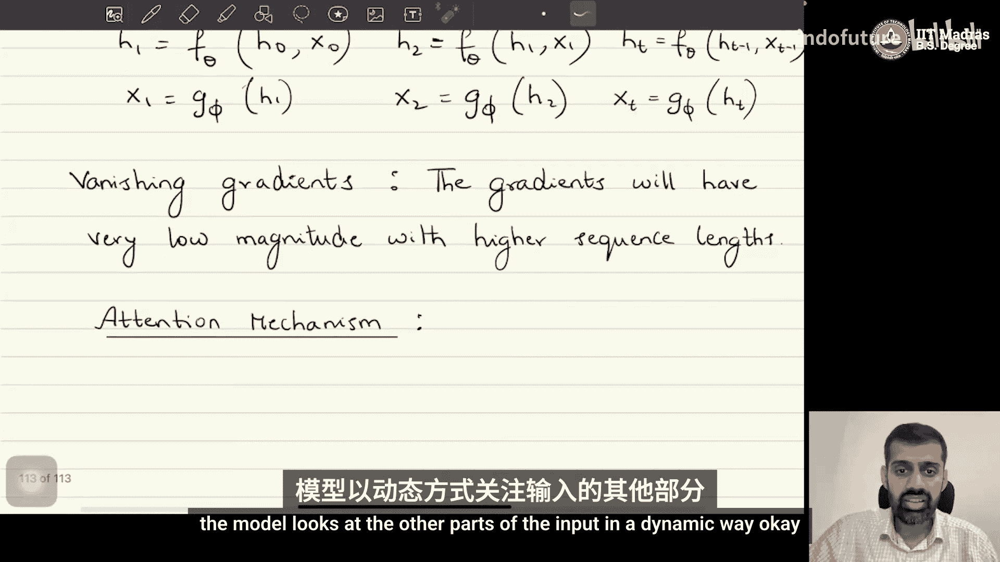
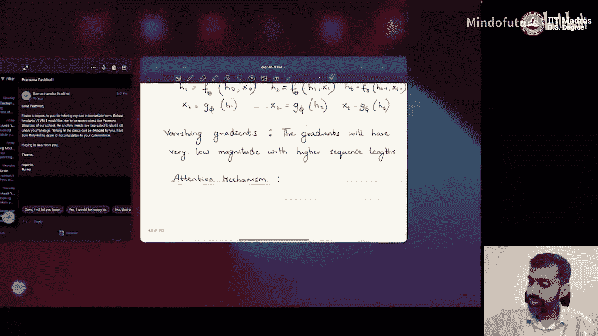
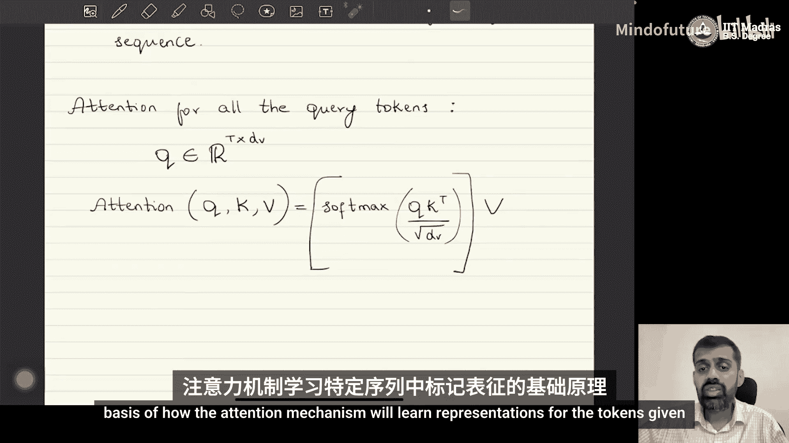

# 生成式Ai的数学基础 ｜ Mathematical Foundations Of Generative Ai p56 P56_W10L41-注意力机制 -BV1fperz7EjK_p56-

🎼。

Attention mechanism。Where， the。Fundamental idea is to make the model。Look at different。

Parts of the input sequences dynamically as it is processing the entire sequence。Okay。

 so I'll just explain mathematically what I mean。 So here。

 what is happening is in in in the classical autoregressive model， such as Rn N。

 So what happens is that the model has to。Look at all of the previous input states。

 input sequences x1 through x t minus1。And to do so， the model has to rely on H T。

 So where H T is the T hidden state， but in attention mechanism。

 what happens is while computing each of these H Ts。

 So the model looks at the other parts of the input in a dynamic way okay in a learnable dynamic way。

 So we will look at what distinct means。

Let us look at how the attention mechanism works。So we are given。A sequence of data。基问。

A sequence of data， let's call it x。It is。X 1， x 2。Up to X T。 So we are， we have three data points。

 So first， we compute first compute。3 set of。Sequences or representations。

 three set of representations。Representations。Card。Three set of representations， namely the query。

你 key。And the value。So what are these？Given a set of data points， given given a particular sequence。

 x1 through xt， you compute representations or projections of that all the individual sequential data points。

On to three different subspaces denoted as query key and value。 So how do we get this， So let us。

Deefine them。So let's say that I represent the input。Represent the。Input data point as a matrix。

Input data sequence。As a matrix。What is that call that has some capital x， So this capital x is in。

And。Capital D gama。D dimensions where capital is the number of tokens that we have in the sequences and a number of items that we have in the sequences。

 the number of items that are there in the sequence each item is called a token that is what the the terminalmin that is used in the literature。

 So I have capital t number of tokens in the sequence in the in the given data point and D is the dimensionality of each of the vector that I have in the in the sequence data point that I have each of the tokens or a con of that sequence iss a d dimensional vector。

 So I have a t cross D matrix Okay Now what we do is。Find， so just find three projections。

Findine predictions。So let me call that as a Q。K and V， as follows。

So first the data is projected onto these three subspaces， so let's the first subspace is  Q。

 let us write that as x。Times， W， Q。And we have de matrix K to be equal to。X。Into W。Okay。And we。

Is equal to x times。W V。Well。WQ。W K and W V。Are mates。That are learnable。

You know that the dimensionality of x is t comm D。 So the dimensionality of W Q has to be。

 So this is。If this is D cross， D， WQ has to be some D cross。DQ， and this， this is， again。T cross D。

 this has to be d cross D， and this is t cross D times。D cross Dv。

 So where Dq Dk and DV are the dimensionality of the2 key and value subspaces。

 So typically Dq Dk and Dv all are taken to be the same having the exact same value。

 So now what we have is you know W Q W K and W V are matrices that are laable as a part of the model。

Now， once we have this。So Q will be。A matrix of。T comma D， let me call that as you know， D DV。

 because I said that typically。SoDq and D K and Dv would have the same dimensionality。

 so I will just use one of these symbols。 Lets let me call that as Dq or Dv。

 So Q is in here and in fact， all three matrices。Like in the same space。 So Q。嘅。

And we all three are matrices。These are in the dimensionality in the space of t cross。DV。

 which means that each of the。There are p number of rows here are。P number of rows。 for each row。

Of the abo mates。Correspond to。To the representations。The presentation of。

A given single token or or rather of a single token， single input token。

RightSo we have capital t number of input tokens in the given sequence。

 So once we project it onto three spaces which we call the the query space。

 the key space and the value space， we have representations corresponding to every single we have three representations for every single input token so that is the idea okay so now what do we do so this is just the definitions of getting these representations now we have to yeah so I just set first compute three set of representations namely query key and value for each of the input token value for。

以上で 국とか。Okay， so Ill just write this。 So X Ie， each of it is in R D。

 and this is what I call as a token。 So there are we have。Think of them as vectors for now。

 so they are all D dimensional vectors and we have capital P of them。

 what we initially do in attention mechanism is first find out。

or rather project them onto to three set of representations using the lanable linear matrices linear projections and call those spaces query key and value see note that at this point there is no particular reason why these should be called as queryry key and value we will see that in a while。

 but these are simply three projections that we do offer data x on two subspaces given by these3 matrices Wq wk and w so these are typically lanable okay。

Alright， so once this is done。 So now comes the tricky part。 So let's say that。

Let's now define the attention。So， I will do it at a vector level and then we will extend these two metrices Now for the attention mechanism。

 lets say that we are given。Aqua vi。Qury vector Q okay that is there in RV。

 right I mean here we see that if we take one of the rows of this Q matrix。

 what we have is a query vector。Whi is。In。Sorry， we call it a Dv。 So this is in Dv。

The dimensionality of。All three query key and value we call we took them to be the same and we call them call them DV。

 So given a particular query vector  Q that is in R DV。

 So what we need to compute their attention is given a query query vector B and we need a set of。

All the。Ked。Iveus。We need the set of all the key and the value vectors。 So let's call them as。

Okay 아이。Which are therein。It in RDV， and we have。The I that are also there in R BV。

 So what are these， these are actually the。The elementsments are rows of the matrices。Rose of。

Maricsses。K and v right So what is this a particular query vector is also one row。A row of cube。

 So this is， you take one row of the。The query matrix。

 which means that you are taking the query representation corresponding to one of the tokens and that is what it means and you take the key and the value representations for all the other tokens which which form the rows of these matrices。

Now to define the attention， we just have to first have to start with。Is to compute。The similarities。

Start to compute the similarity by similarities between。기번 코 일이이。And all the keys。

So how do we define that， let's call that as S of ie， which is equal to。Okay， so let's。First。

 define the similarity between the given query and the I。Key。

 which is the dot product between Q and I。 So this will give you。This is the similarity。Between。

Q and。K I， which is the Iot query。 So now， if we want to， this is a scalar， right， So this is a。어。

This is a scalar。 So now let's define S to be equal to。

The dot product of all of these with the matrix K matrix。W。

 the the transpose of the k matrix because。Q is in the dimension D case in the space of t comma D。

 So we need to take the dot product。 So the dimensionality will be just Q is。啊。

We said it's one row and the D number of columns， and this should be D across。Capital T， right。

 So this score will be in the dimensions。1 cross be。Right。So this represents。The similarities。off。

Similarities between。Similarities between the。Given quality。And all the keys。Okay， so intuitively。

 what is this doing， this is trying to find out。What is the dimensionary what is theity I sorry what is the similarity of a given particular token with all the other tokens that are there in the sequence？

Now the similarity， how is the similarity quantified。

 similarity is quantified as the dot product between the query vector corresponding to a given token and the key vector corresponding to other token so that will give you the similarity between a given query vector。

And。The the given query and the key So basically what we are quantifying by computing the similarity is computing this S is trying to understand how close or how similar or rather what is the amount of information that is there in a given query that is there in all other tokens corresponding to a given token that is represented as query so that is that is why we have this name of query and key so what we are doing is taken taking a particular token or the query representation corresponding to a particular token and trying to match it with all the keys which are the key representations of。

All the other tokens in this sequence。 So we are what we are questioning here。

 what we are trying to quantify here is to see how similar a given token is with the other tokens Okay so this S now gives a one t dimensional vector。

Which contains the similarity between a given query and all the keys that correspond to that that is there in the given sequence。

Okay， so what is the next step。 The next step is to just scale。Discourse。So let's call this scale。

Well， this writing us step。 So this is step 2。Is to scale the similarity。Scaling the art product。

또 나 is the range。Okay， so let's call that as a cap。 So what we do is simply take this and。

Take this vector。Which is given by Q transpose k transpose and divide all that vector by root of。DV。

 just to ensure that the the sizes of these vectors do not blow up。

 This is simply a normalization step。 So once we normalize this， the step 3 is2。Convert these into。

Probabilities， so the next step is to apply， or rather。Convert escape cap。

Into convert elements of his care。Alements of a cap。

Rather I say yeah convert elements of S cap to have values。Between 0 and1。Oh。And。Some to one。

You just want to convert them into。Having values between 0 and1 and something to one。

 So why do we want to do this， this we want to do Because， you know， finally。

 we want to look at the elements of these the dot product as these scaling factors for a convicx combination that we have will take。

 So we have to convert that into how， how do we do that the the way to do that is to。

Apply the soft max function， so let us call this as some alpha equal to soft max。Of escape。

What is this equal to soft max？Soft Mat is a function that accepts a vector。

So softm of e vector S gap is a function that takes。A vector from the t dimensional space。

 Or rather now here， the S is in。一先。T dimensional space。This would map it too。안더라도백들？That is。

Bounded between 0 and1。 So this is what a soft match function does。 So how do we do。

 how do we write that， So Al I is equal to E power。Take the corresponding rock。 you transpose K。Yeah。

 so this is。Along with the scale。Divided by。The sum of this particular。你 both。Qtrans suppose， K， J。

 divided by。B we where。J equal21 to capital D。So that's the way we define the soft Mat function。

 So this will ensure that all the alphas right So now we have all the alpha Is。Are now between0 and1。

 and they would sum2。This is this is how a softm function works right this is a definition of softm function。

 So what do we have now， So let's just recap what we did。 We started with a given query vector。

We are we are interested in finding out the attention corresponding to this query vector Q so attention is defined for a given query vector Q So now given a query vector Q what we want to define is the attention corresponding to that。

How do we do that， We take that query vector and find the similarity of that query vector with all the key vectors corresponding to a given sequence by computing the do products once we have the dot products。

 we convert the similarity vector that quantifies the dot product between a given query and all the keys。

We simply normalize them to ensure that the range is within bounds and then convert that into coefficients。

That would the sum to 1 and all of them are between 0 and 1 so that is the operation that we did so now what did we get we got at this stage。

Alphas。Represent。These killed。Similarity。Similarities。O。Delayd Q。

Or rather similarities between the quality Q。哎。Allie keys ski。I is from1 to capital G。

 So this is what the alpha is now representing it is representing the similarity。

Between the scaled similarity between the given query Q and all the keys in the sequence。

 now we are ready to define attention。 So step 4 is the definition of attention。 So step 4。Deine。

Attention as awaited some。So attentiontention corresponding to。

Attention is a function of three things and now you need a given query queue and we have all the keys and all the values corresponding to everything that is there in the sequence。

Given this， we define attention as a linear combination， rather a convex combination of。

All the value vectors corresponding to each of the tokens are I equal to one per capital T where。

The VI belongs to the value matrix。Of the given sequence。

this is the value matrix of the given sequence for now。Finally， if you look at it。

 attention corresponding to a given query vector is nothing but a convex combination of。

Value vectors that we have computed。 And now the name is justified， right。

 So this is called a value vector because。Finally， what we are computing as attention for each of the query is simply a linear combination or a convex combination of different value vectors Now what should be the coefficients of the linear combination or convex combination is defined by the inner product between the query and the key vectors so basically what we are doing is given a query vector we are finding out how similar is this query vector with all the keys all the key vectors now the query and key vectors。

Give you the coefficientient with which you have to weigh the value vectors to get the attention corresponding to this particular triplet so every the definition of attention has three things involved。

 one is the query vector and we have the key vector key vectors and the value vectors。Now。

 starting from the vector。We compute the darkt product of this query vector with all the vectors to find out the coefficientient with which the value vectors have to be。

Scared and added to get the corresponding attention for this particular query vector Q Okay now if we combine this and compute the attention。

For all the。All the query tokens。So since all of these are linear operations。

 what we can do is that so now we have will take the query matrix Q， this query matrix Q was in R。

We had the well。T cross D V。 This was the dimensionality of the。The query matrix。

 so attention corresponding to each of these this is this entire query matrix is given very following。

 so we have。Attention corresponding to the entire tripleplex with this Q。K and V。

 So note that here we are defining that at the matrix level。

 which has all the tokens involved is simply represented as the。The softm of。Infaly soft mis。

Of Q times。K transpose divided by so this is an element wise division。

 so we are multiplying matrices and we are dividing each of the element of this methods。

And we get vectors and the softm is applied rowwise So vector away。

 So we take each element of this matrix matrix multiplication and we apply softm。

 we get the coefficients once we get all these coefficients， so this will become。A particular。

Mattris of coefficientient。 So we just multiply the switch， the value value matrix。 once we do this。

 what we get is。A set of vectors that we call as attention corresponding to the the given input token okay so this is the definition of what is called as attention So if you look at it what is happening is we are learning a particular representation for a given token。

By ensuring that each of the token。While the representation is being computed for a given token。

It looks at it interacts with all of the other tokens in the given sequence。

How is the interaction happening， The interaction is happening via。The value vectors。

 we first project the given。Vectors in the sequence onto three spaces called the query space key space and the value space and we represent the the given input token in terms of a linear combination of different value vectors how is this linear combination obtained this linear combination is obtained by。

Multiplying and adding it with the coefficients given by the inner product between the query and key key vectors and these query and key vectors are obtained using another project of the given data。

 So this way what's happening is that in this particular modeling framework we are。

Ensuring that while a given element or given token in a sequence is being represented or。컨슬들。

It is attending or it is rather looking at each of the other tokens that are there in the sequence。

 so that is why that is how we are solving the problem that we considered with the previous author model such as RnN where the information corresponding to a given element in the sequence。

Depends on the previous elements through some intermediate representation Okay， here。

 the information corresponding to each of the other tokens or each of the other elements in the sequence is being dynamically considered while we are trying to find a representation for each of the other tokens。

 So that is the。Basis of how the attention mechanism will learn representations for。

The tokens given in a particular sequence。

