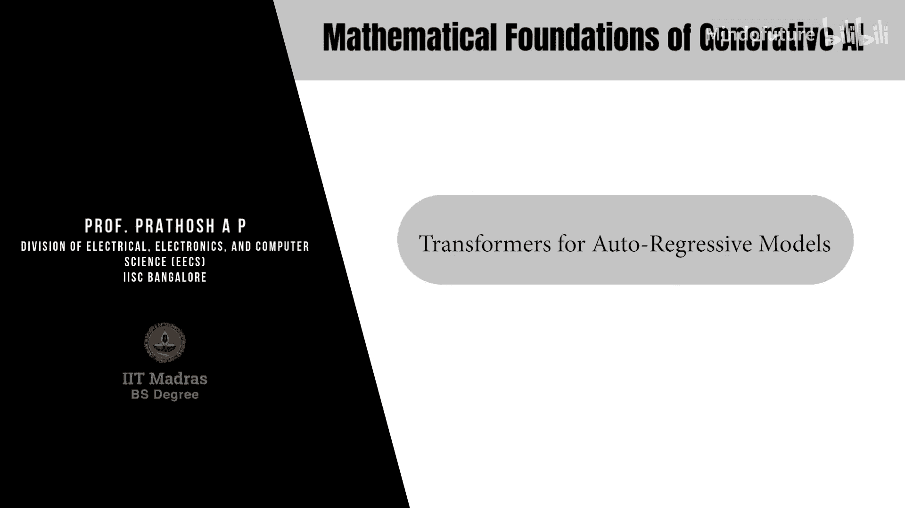
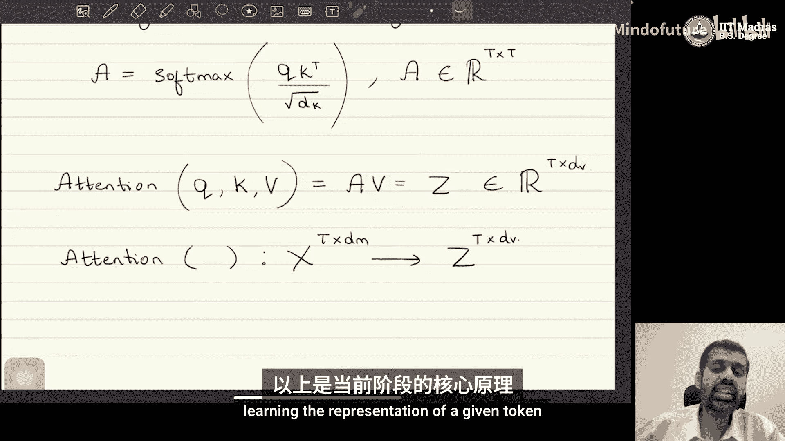

# 生成式Ai的数学基础 ｜ Mathematical Foundations Of Generative Ai p57 P57_W10L42-用于自回归模型的Transformer -BV1fperz7EjK_p57-

🎼。

Hello， everyone。Welcome to this session on generative modeling。In the previous session。

 we looked at autoive models。As one of the members of the family of generative models that we have been discussing。

I also introduced you to the idea of attention mechanism that is often used in one of the famous architectures called the transformformer that is often used in the context of art exam model。

In this session， we will continue our discussions on auto aggressive modeling。And。Specifically。

We will discuss more on transformers as an architectural choice for autoaggressive modeling。

Please note that。Transformers。By itself， they are not methodology for generating models。

 They are mere architectures。 Okay， so in this course。

 so far have not discussed architectures in general have we are only discussing the。

metethodologies behind the generative modeling in a way that is agnostic to architectures， however。

In this particular。Samily of generative models called the autoigive models。

 I will discuss the prominent class of architectures that are used which are called the transformers because。

The current state of the art， generative models。呃。Comprisising all the range of commercially available generative models such as GPDs and Gei and so on。

 they are predominantly based on transformer based autoregressive modeling and therefore it is prudent to discuss this one particular architectural choice called transformers that is used for autoregressive modeling。

Now， transformers are predominantly based on the idea of attention mechanism。

Which was discussed in the previous sessions。So continuing with that in this session。

 I will talk about transformers as a model choice for auto expressive models。

We will discuss about the different nuances that are associated with transformers such as multi head attention and so on。

I will also discuss how transformers are incorporated in the context of autodegressive modeling for generative sampling。

 and we will also look at some of the。Famous， often used inference procedures。

That are incorporated with transformers。With that let us begin if you recall autoreive models are particular choices of models that are often used when the data has a sequential form so now let us say that we have we are given a data point。

which has a sequential form which can be expressed as x1 comma x to commma x3 up to x capital t now note that this is one single data point that we are talking about unlike in our previous notations where we denoted x with a sub to denote one data point here in the context of autoexive models x1 through xt denote1。

Single data point which has a sequential nature denoted by x1 through xt。

 an example of this can be the natural language where every sentence becomes at a single data point and every sentence will have sequence of set of words or characters。

Wwhich are in general referred to as the tokens so every data point now has capital number of tokens and all the analysis that we do is for a single data point and as you know everything that we do for a single data point can be extended to a data set comprising of multiple data points just by taking an expectation at the outside of whatever the loss function that we use which is approximated using sample averages so for the ease of understanding as with the other models we will do all the analysis by taking one data point and then extended to a data set so let's assume that we have a particular data point x1 through Xt so as you know a model。

Imoses。A probability density function over that data point which is also called the likelihood。

In an autoresive model， p theta of x1 through x capital t is given by this particular equation。

 which is the product of multiple density functions and each of this density function。

Captures the likelihood of the tith token in the sequence given that we have already observed all the tokens till the teethth token so this is the definition of an autoregressive model。

Its obvious that this model is referred to as the autoregressive model because what we are actually doing is regressing on the data point Excel。

 So it is a self regression procedure where every T token in a given data point is。

Made a function of all the tokens that are before that occur before that particular token that is by the name autogressive model now。

Each of these data points each of the tokens in the given data point typically belongs to a set v and this set v is referred to as the vocabulary and in the current day modern day autoregressive models the typical vocabulary size would be around tens or even hundreds of thousands of tokens so now a vocabulary is a set a discrete set of a finite discrete set of tokens。

From which the data set or the data arises now。The task is to model the speed theta of xt given x less than t which denotes all the tokens before time t。

 how do we model that as the question and as we discussed in the previous time in a transformer。

The transformformment based。Architecture。P theta of x T given x。As indeed is。Smaller。

Using the attention mechanism。In fact to be precise it is model using what is called as the causal attention we will see what that is so as we are seeing throughout this course the idea is to model this particular distribution B theta in the case of transformer based autoregressive model this P theta of xt given x less10 is model using causal attention mechanism we will see what that means so as I keep repeating transformer is a particular architectural choice that is used to model p theta of xt given x less 10 okay let us begin so transformer as an architecture。

Transformers to model。P theta of xt given。X。St0 so this denotes that we are looking we are trying to。

Regress x T given all the tokens that are before that before that。 Okay， so let us begin。

 So what we are given is it is given。A data matrix。Denoted by。

Scripex what we have is a data matrix noted by scriptex now what is this this is a matrix。

That contains。Ps， capital Ps and。We call this as a Dms， Dm number of columns。 So what is this。

 Every row of this matrix has。A vector that corresponds to one of the tokens。

Of the data right So the way we have constructed this matrix access that。

We have arranged all the tokens that we have as the rows of this particular matrix。 Now。

 what is Dm here， Dm。Is。What is called as the model dimension。It can be let us say 5。

12 or 754 or something which is an arbitrary choice of dimensionality that we want our model to operate on okay so now what happens in practice is that as I said each of these excs are tokens okay I'll just write that as well so every X I here belongs to the vocabulary which is the discrete set now the way it is done as。

Initially， all these tokens。arere represented using the usual1 heart representation and the x matrix is also made learnable and this is learned as the model is learning through gradient decent the is called the model embedding which is also made a learnable parameter where each of these model embeddings are also learned as the。

The model is being trained， so it is initialized using the1 heart representation。

 which means that every X here is a vector that contains one and zeros， all zeros， but for one。

A single one in the position that corresponds to its occurrence in the vocabulary so that is the usual 10 representation and start with 100 representation and then you can initialize with 100 representation and learn it as the model is being trained so you start with this x matrix which is the representation of a given data point so remember that we are still operating with one data point and we have this data matrix x and we start with it okay so given this。

The first thing that is done in a transformer is given X。Compute。Compute the query。き。

And the value matrices。So what are these， Let us let us define matrixq as。X times W Q， and we have。

The matrix K as。X times， W， K。And we， as。Ex times。W V， where。The Wq is of the dimensions R。

DM cross Bk。And W K。Is of dimensions are。Dm cross。呃Bけ。And WV。A of dimensions。BM cross B v。

So where Dk and Dv are again arbitrarily chosen numbers。

So now you make a choice for what should be the dimensions of the query key and value vectors and define these matrices w。

qw k and W appropriately so that they。Multiply with the data matrix。

Now observe that typically the dimensionality of the query vector and the key vectors they are the same they are both equal to dk where the value vector can have different dimensions now this。

Facilitates what is called as cross Ats where attentions can be computed。Between the query。

And the value vector。Or rather the query and D vector value vectors coming from two different parts of a network。

 let's say I mean this is useful when somebody is building what is called as an encoder decoder architecture where the query comes from the encoder and the the value is coming from the the decoder So the dimensionality of the query and D key have to match where the value vector can have a different dimensions in in a typical use case where you have a decoder only model the dimensionality of all of all three are kept the same Now this is a typical design choice but these are hyperparameters you know dk and D we are hyperparameters that have chosen Now here w。

W Q， W V and W K R。Learnable parameters。These are our theta so whenever a transformer is being trained。

 what is being learned are actually these matrices， okay WQ， WV and WK。

 these are the matrices that are learn。Okay， so now once this is done， so what one can see is this。

Q matrix now once we do this multiplication well get a query matrix。Which will be in。

Let's say that the re matrix and the key matrix， both of them lie in R p comm DK。

While the value matrix lies in。R p comma B v， okay， so what did we just do。

We just transform the data matrix x into three different dimensions or three different spaces。

 let us say。One which is called the query space， the other is called the key space。

 the third one is called the value space by multiplying it with the corresponding matrices at all once it is done the data that has dimensions t cross Dm now will be projected on to three different subspacees。

 one is given by the query space， the other by the key space。

 the third is the value space which has the dimensions t cross dk and value has the value matrix has the dimension t cross dv these matrices each of the rows of these matrices correspond to the query。

Repectively correspond to the query the key and the values of each of the individual tokens right so that is what we have now okay so now once this is done what is to be done is that one needs to compute what is called as the attention weights。

Computing。1 needs to compute the attention weight。 So how is it given So recall that attention weight is given by。

A soft Mat operation that is done on。The dot product of。

The normalized third product of these two normalized matrix I mean in this case they are matrix products between the query matrix and the key matrix。

 the normalization is done with respect to the key or the query dimension where so after we do this this a now belongs to。

Now， a， we get a matrix。That is of dimensions。T cross。So basically， give a particular query vector。

It computes the normalized attention weight for a given query a vector with all the key vectors that are there。

Just like we saw in the previous time， attention is defined between a pair of vectors given a query vector and multiple key vectors。

 we define attention as the normalized soft map of the normalized thought product between the corresponding query vector and all the key vectors now this is the vectorized matrix metaized form of this where what we do is that we compute the attention weights for each of the pairs of the query and the key and that is why the attention weight this matrix will be of dimensionality t across p because we have t number of query vectors and we have t number of key vectors and that's why you have the attention weight corresponding to each of the pairs of the query and the key vectors so once we do this we have to compute what is called as key attention。

Which is a function of all three matrices that we have computed Qk capital T now this is given by。

Etime。Where a is the attention weight that we have just computed a times the value matrix。Okay。

 which lies in。啊。T cross B。So this is the attention vector or rather attention matrix that has been computed。

Using the query key and the applicable par this is not t。

 this is v query key and the value mat is that we have compute it a note that what it we actually do is this entire attention mechanism or attention function。

 what does it do it。Transforms a matrix that was there in t cross dim dimensions to a matrix。

Which we called as the let's give it a name， so let us call this as。

Let us denote this as some matrix Z。Okay so this transformed it into a space called Z。

 which is now P cross beam。So this is what happens in the attention mechanism where given a sequential data point。

W which has dimensionality which which lies in a Dm dimensional space。

 the attention mechanism projects this data into another space。

Wwhich is of dimension DV now how does it do that this is the procedure so what it does is it just the first step is to compute what are known as the query key and the value matrices by projecting the data onto three different subspaces called the query space key space and the value space and then compute the attention which is the normalized dark product between every pair of the query and the the key values。

And then take the linear combination of the value vectors。

Weighted by the attention weights or the attention scores that are given by requiring degree key at so what is intuitively what is it doing is that。

It is the entire attention mechanism is trying to。Study the importance of。一9的多工。

Cresponding to every other token that is there in the sequence。

 so the idea is you are trying to quantify how does a given token correspond to the the embedding or rather contribute to the embedding for each of the other tokens in the given sequence or rather how does each of the other tokens in the given sequence。

Contribute to learning the embedding of。Every other token in the sentence are the sequence now this is the reason why this entire procedure is called a selfat mechanism where the attention is the attention scores are now being computed on the tokens that corresponds to a given sequence so that is why it is called the self attention so now suppose。

你。The query and the value vectors come from you know two different representations or two different sequences。

 then they are called they are typically called as the cross attention。

Mechanism here a in a decoder only model what we compute there is what is known as the self attention mechanism where all three query key and the value vectors come from the tokens of a given particular sequence。

Okay， so now that we have our representation are the attention matrix。

That is in dimension t cross D what is that we need to do next。

 So remember that our ultimate goal is to model that auto the aggressive distribution P3 of x t given x t less than t that is what we we want to do Now we have I mean this entire。

Procedure of computing attention what did it just do it just projected the data from a Dm dimensional space to a DV dimensional space。

Where the each of the rows of this z matrix corresponds to the representation of each of the token and these representations are computed using the attention mechanism that would quantify how each of the other tokens in the in these sequence contribute to learning the representation of a given token So this is the story so far okay。

