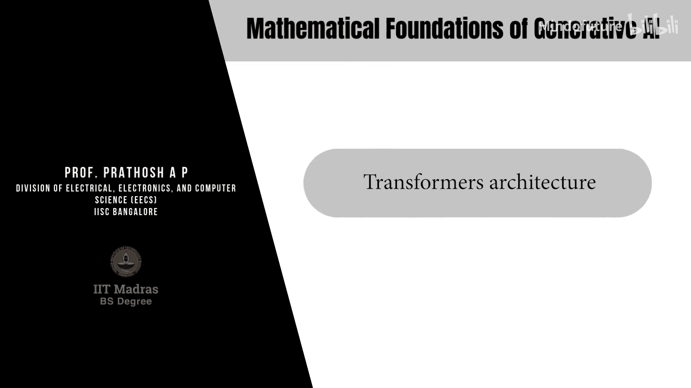
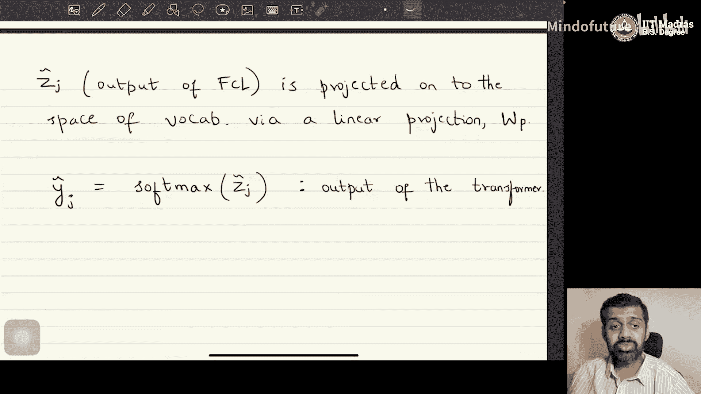

# 生成式Ai的数学基础 ｜ Mathematical Foundations Of Generative Ai p58 P58_W10L43-Transformer架构 -BV1fperz7EjK_p58-

🎼。

Now， once this is done。What is。Followed in a particular internet transform architecture is。

To what is called as the causal attention， let us look at what is mass attention or causal attention。

我s个 nice死的。Casal mosque。Or causal attention。So， recall。That in an auto aggressivegressive model。

Author aggressive model X P depends。On。X1 through x t minus1 so which is the dependency is a causal dependency right it only every xt。

 every tth token depends on x1 through xt minus-1， it does not depend on future right but the way the attention mechanism has been defined here is that if you look at the way the attention weights are computed。

 the attention weights are computed but by assuming that each of the token depends on every other token in the sequence。

 so which means that we are not considering in the fact that in an autoregress model every token depends only on it on its past but it does not depend on the future。

 but the way this attention this attention is computed we are making an assumption that。

Every token depends on every other token irrespective of its position in the sequence， right。

To ensure that the attention mechanism that we have defined adheres to the autoregressive nature。

 so we will have to ensure that we modify。Depends on this， and therefore。To ensure。That。

Xt depends only on the past and not on the future。Depends on the previous tokens。

And not on the future tokens。The attention mechanism has to be modified。诶。😊。

To ensure that the model that we are building is truly auto aggressive。 how is it done。

 this is by this is done by using what is called as a masking mechanism or define。A mask matrix。

Given by be noted by M。 So that M is in。T cross tea space。The I Jth element of this M is。s0。If。

J is less than I。And it is equal to a very large value。

 mathematically defined it to be minus infinity if j is greater than I。Okay。

 now what do you do is that。Modify the attention weights as follows So know which M。

The attention weights。嗯。Are modified as follows。Qualified your attention weights as follows。

 so now define a。With the mass attention as soft Mats。

so remember it was previouslyq k transpose divided by root of dk， this is what we had earlier。

 all you need to do is add this m matrix。Eleement wise to this particular matrix and then take this offm now remember that this addition is possible because you know we are doing an event wise addition so lets say that this addition is a matrix element wise matrix addition。

喂。Recall that both of these matrix is right Q k transpose it is a t by t matrix so we just saw this right a the attention weight is a t by t matrix and so is the m matrix so m is also t by3 matrix so all both of these can be added element wise now if you look at the definition of m so what is it actually doing is that。

Whenever。We are looking at the past it is doing nothing so it is just retaining Q K transpose it is doing nothing so because it's0 but whenever we are looking at the future wherever your j is greater than ie what it does is that this will add a large negative number to Q K transpose whatever we have gotten So now remember that softm has an exponential operation here know e power sumscalear is what softm does now if this scar is a very large value so that would be put to0。

So the weight corresponding to any future token。Will be put down to0 because the value that that that arises before soft mass because of the presence of M will be very large right so this will ensure this。

一五。来得。The element in AM。Corresponding to a future token。To all the future tokens， in fact。

To the future tokens。啊。put to 0。我呀。Addition of M。 So once we add this mass mask matrix the。

M addition。this is the trick that is played to ensure that。

The model that we build will be autoregressive in nature so once we get this AM so we will use this same A to multiply with the value matrix and once we multiply it with the value matrix we get another representation of the data this representation will be such that the dependence is dependence of every token is only on its past but they don't depend on the future so this is the idea of causal masking or causal attention which which is used in all the decoder only geneative models which are based on attention mechanism。

Okay。So one other。Trick the technique that is used in a transformer based auto aggressiveive model is what is called as a multi head attention。

Multi head attention。Okay， so just recall that what did we just say attention mechanism takes the data vector that lies in the m dimensional space and projects it onto Dv dimensional space right so here in the discussion so far we did this projection in one shot now which means that all the M dimensions of data were transformed using one triple of the query and value matrices。

There is no need why one should do it that way in a multi head attention mechanism scenario what is done is to ensure that the expressibility of the model is increased so if you do it in a single projection you know in a single step projection then the expressibility of the model may not be large so what is that what do I mean by that so what we are actually learning are these three matrixes right the weight matrix the sorry the query matrix the。

K matrix and the value matrix the all three metrics that we are learning so instead of only learning three of them what if we divide the data dimensionality Dm into multiple subparts and learn a query key and value metrics corresponding to each of the subpart or subdivision of the data dimensions and learn as many attention mechanisms or as many attention vector corresponding to each of the the subpart of the data dimensions and combine them so this is the basic idea this will increase believe to increase the expressluivity of the architecture that we are looking at so that is the idea what happens is。

Define。H， which is a scalar， positive real number。As the number of hits。Number of attention heads。

These are called attention heads， okay， so what is done this。嗯。So B。Typically。Bケ。Is made to be equal。

 though。DM divided by h what is done is the dimensionality of the query and the the key matrices are meant to be equal to。

BM by H， so what is actually being done as？Now if there are you know if the desired model dimension is let's say 512 and you want eight attention heights so what has done this you learn a query key and value for each of the subdimens of 512 by 8 so that is the idea so typically decay is made to be equal to dm by h so you divide dm。

Into。Parts of I mean， each number of parts okay before you learn the attention for each of them separately。

 so what is themness？For each。H hits so now each of these is called an attention head。

 So for each of the H hits do the following so define a query。W's， let's call it a Q。I what youジ。

Is so x times w。A JQ。Now， this lies in R。T comma d K， so note that my Dk now is Dm by h Okay。

 what I'm doing is learning the query and value mattices for each of the heads separately so okay J is x times w J K and this lies in R。

Pcomode decay K same as that of a query vector， and V J is。X W J。We。Which is in R。Pcom more be we。

Okay， now what I do is I compute the attention per head so this。

Compute the attention per every head as the following， so we have attention。K。Sorry， Q， J， K。

 J and V J。 So this is the attention that that I've computed for。The J3。 So what did we call it。

 I think it was。This is that。 and。And we called attention as Z。 Okay， so let's call this as Z。

This is the the attention matrix corresponding to the Jth head now， So now this belongs to R。Tcoma。

 D K B，V space。Right，So this， this is in our t comma D space。 What is done is after。So， in the end。

All the。Individual heads。Are concateulated。So all the individual attention heads are concatenated this way。

 so let's call that as the concateated as。You take Z1。Concatedated with Z2， concatednate with C3。

你说完呢。We have finally Z H。So all the attention mattresses that are gotten by the individual heads are concateed So this lies in are。

D things。Now t cross each of them lies in dimension Dv and we have h of them。

 so this is Dv times h Now recall that Dv times h。So this is also made to be equal to Dv typically so now Dv times h gives us dm back right so that is the desired model dimension dimensionality is also equal to this is equal to R。

T cross Dm。 So we get back t cross Dm by doing this so。Finally， what is done is the following。

 So once it is done， you define the multi。Head。I didntion。

Multihd attention over the x remember that we are operating on x as the Zc times another matrix W C。

 which makes it in R。T cross Dm again， right So now where W C is in。啊。Dv times 8。Css。Dm dimensions。

Now note that you know while I just said that this is typically meant to be equal to DV in general this need not be the case you know DV can be different from Dk in that case just to ensure that we put the back data in the dimension in the dimensionality of Dm。

Okay， we will ensure that we project the concateated multi headd attention onto one other space Wc where WC will ensure will make sure that all the the attention heads are appropriately combined to get us back to dimensionality Dm so now here。

All the Qs。QJ， or rather let's call them as WJQs， which are the query matrices for each of the head and we have WJK。

 WJV and the final matrix that would combine all of these in two。These are。论。For。J equal to1。

 through，1，2， up to edge。So in multi headd attention what we do is instead of learning one quick query and the value mates we learn each of them each corresponding to a head so this is the idea of multi head attention so note that multi head attention also does the same thing right I mean it starts from x that is in R t cross Bm and this will project it onto z right that is again in。

A P crosss B we are doing you are doing the same thing as in the case of a single at attention。

 but instead of doing it using one query key value synthesises， we split the data dimension into h。

Suppparts and for each of the apart you learn the attention separately and concatenate them all using another projection matrix is called wc so this is the idea of multi head attention Okay so now again you know we are back to where we started from so what we have right now is a representation Z of the given input data x right so remember that we still have to ensure that what we are doing is modeling P theta which is the auto aggressiveive model Okay so let's do that So now we have。

We have obtained。Otained a Z， okay。That lies in R。T cross Dm space， okay。Which is。

Which is a representation， which is a data representation。Let's call it， which is。

A representation of data。Of data。Given by the multi attention。Tn by the multi head attention。

We will have to work on that now in a transform of based architecture。

Once the multihd attention is computed on the input epis。They are followed by fully connected layers。

This is。Applied to ensure that the the whole architecture has more expressibility compared to only having multi attentions。

if you observe the entire attention mechanism， the multihd attention mechanism。

Are predominantly linear operations because they are all matrix multiplications。

 so every matrix multiplication is a linear operation， therefore。If。

One needs to represent a nonlinear function， which often is the case with input output relations in tasks like natural language。

 processinging and so on。Only the linear transformations would not suffice therefore。

Attention layers or multih attention layers are followed by fully connected layers。

Which are multi layer obceptrons， fully connected neural networks that would。

Imose a lot of non nonlinearity and therefore expressivity on the entire architecture。

 so we also have this classical result from neural network theory that a single hidden layer neural network。

Is a universal function approximate in that you can approximate any arbitrary function to any closeness given that you have enough number of neurons in the hidden layer having。

A fully connected neural network after multiha attention would best the purpose of making the entire architecture more flexible。

So， therefore， once。The multihd attentions layers are applied， so you have a fully connected layer。

Layer or sometimes there can be multiple fully connected layers as well。

 so this that's mostly a design choice。And its a typical fully connected layer。 How do we do it and。

One other thing to be noted is that these fully connected layers are。

Applied separately for each of the token so we have here once there is an attention layer applied we have z which is a representation of the input tokens and all of them are in Dm dimensions and there are t of them because you know capital is the number of tokens that we have in the input these fully connected layers are applied on each of the token separately。

So just to contrast this with the attention layer while computing the attention layer。

 the attention for a given token is computed by considering the influence of all the other tokens that are there in the sequence whereas in a fully connected layer each of the token is treated separately and fully connected layers are applied on the embeddings of each of the individual tokens separately Okay so how do we do that for。

Each of the。不是兄姐。In this sequence。This sequence。Oh， let's call this。Letter X。X， J， B D。Jaed token。

So we have the G token and。Instead of calling it X J， let us call it Zj because， you know。

 we have already transformed that in the the。This space is represented by the attention mechanism。

 So here the J section R。Dm， right， that's the transformation that we have done。 So fully connected。

Network or layer， let's call this F C E for fully connected layer that is operating on Z J is defined as。

Some nonlinear nonlineararity， let's call it sigma。We have Z J times W1。Let some bites be。And。

Multiply that with some W。W 2 and you add B2。 This is one example of how one would apply a fully connected layer。

 So this is a single hidden layer neural network where。See is。An only narrative。

Examp can be typical activation functions such as relu or。Sigoid or tanh or any one of them。

 These are examples and W1 and W2 are again。Learnable parameters。These are lookable parameters。

 So in this particular example， W1 is in R DM cross。Let's call it some D F。 And W2 is in。Or。D。

 of course。Dm， so once this is done， right， See the output of。

Output of this fully connected the layer。Call it。Zcap J， this will be in。

The same dimension as that of Z right because you know we have adjusted our W1 and W2 that way that they will be in the same dimension as that of Z that would be Dm。

 so there will be t tokens， all of them in DMm dimensions。

So now what happened sequentially so first we started with an input vector and then we learned an embedding starting from random initialization。

 then a multiher attention is applied but we get some representation Z in some dimension Dm。

That is followed by。Fully connected layers that are applied。

Individually to each of separately to each of the tokens， individual tokens right？Okay。

 so then once this is done， we have some representation Zcapab J in Dm dimensions。

 so what is to be done next is that will define。The final output layer。No， it's called this S。

Tilda we been using my notation C tilde at JF location to be equal to some so we have Zj cap。

 which is the the representation that we are getting from the output of the hidden layer sorry the fully connected layer we have some other matrix let's call this as W P plus some bias Bp and this is in。

Are we where we is the vocabulary thing。 So what is happening here is that。So ZJ cap。

 which is which is the output of the fully connected layer。This。Projected。On to。

A space of vocabularies。W呀。A linear production。Inal production that is Wp what is the dimensionality of Wp here the matrix Wp should be in R Dm because thats the input that it gets and it will project to the space of V okay Now what is being done is that you just have a linear production onto the onto real space that would have the dimension equal to the length of vocabulary Why is this important once this is done remember what we need finally is a distribution over vocabularies So vocabulary is a discrete set of possible tokens what we need is a distribution or a discrete distribution over all the tokens in the vocabulary right now what we have the Zj tilde that we have is a v dimensional real vector now we need to compute we need to。

Translate that v dimensional real vector into a distribution over the vocabularies and how do we do that。

 we have the usual trick which is a soft max， How do we do that。

 So y cap J which is the final output of the transformer is given by。Soft mask。我文。谢就对了。This。

I is what we have as the output of the transformer at the J， this is the。

I is the final output of the transformer， which will give us a distribution over all possible tokens at。

Each of the the J sequence， every if you have capital D as the the input。

The length of the input tokens， then。The output of the transformer would give you a distribution over。

The vocabulary by viaR the soft cooperation over the representations that we have gotten at the output of the fully connected layers。

This way。We get。A distribution， a discrete distribution。

Over the vocabulary at each of the tokens of the input sequence。

