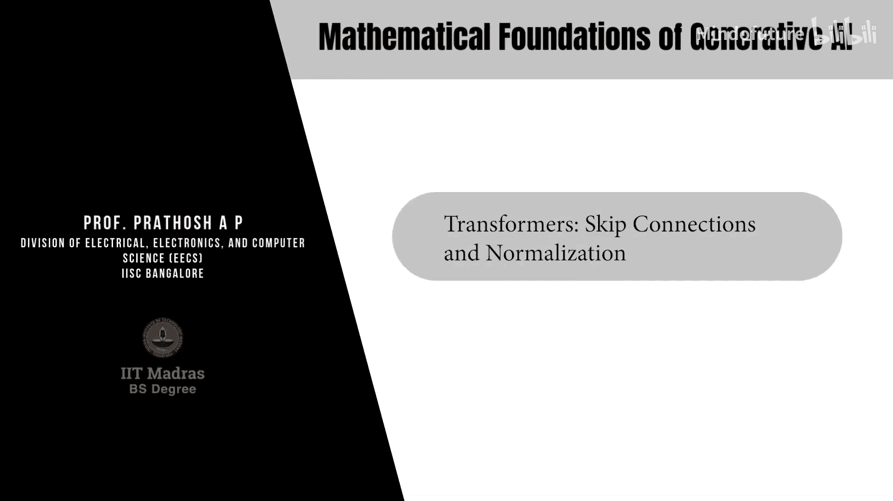
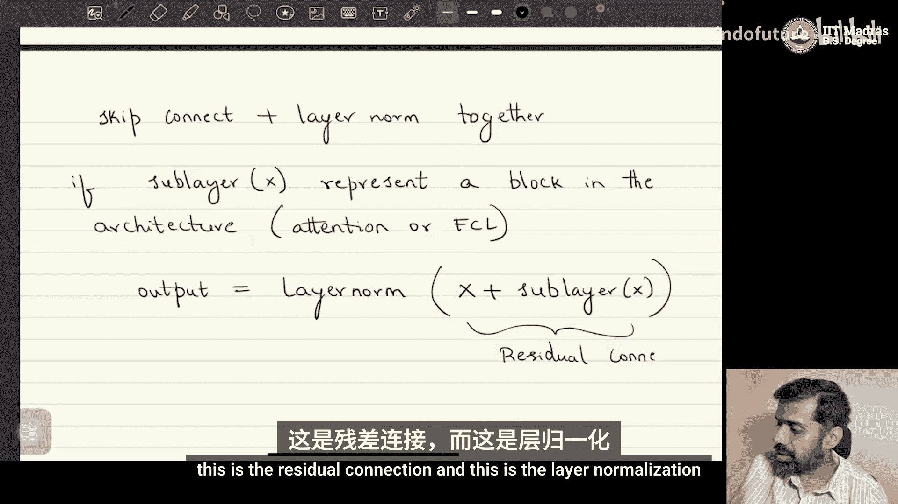

# 生成式Ai的数学基础 ｜ Mathematical Foundations Of Generative Ai p59 P59_W10L44-Transformer-跳跃连接与归一化 -BV1fperz7EjK_p59-

🎼。

Now， before we continue with the training and inference process for this sort of an architecture with auto aggressivegressive modeling。

There are a couple of model answerss that are worth describing here。

One of them is what is called as the skip connection layer normalization。

So we'll return to how to train an auto expressive model with this in a while。No。Skip connections。

Or uncued connections。And normalization layers。What is done typically is that。

Between the input layer and the attention layer。Skip connections are used。

And normalization processes are used。 So what is the idea of skip connection。Now。

 let's say that there is some。Inputus of the certain and。Let's say that there is。Some function F of。

X that is getting operated on this。Now the output of this， we have。はいス。

The idea of skip connections is to have a bypass of the sort。And make the output。

A sum of the output of whatever block is that is being used for processing and the original input as well。

This is also referred to as the residual connection that forms the places to architectures such as resnet and so on。

 now here my y will be equal to x。Plus， F of X。Okay。

So this is called the skip connections of this entire process。What is called as the skip or。

Reial connection。The idea here is to ensure that you know suppose for some reason we don't want this operation f to be conducted for some particular features in the neural network in that case what do we want is that we want to ensure that the neural network or the architecture has an explicit ability to carry out an identity operation right so if you look at it the output of this entire block is identity plus the operation that this block is supposed to be doing now for some reason if if we just want to copy the input at the output and do not want do not want this block to affect what happens at the later stage of the neural network。

We would have this sort of a S connection where we are explicitly putting an architectural regularizer on the architect to ensure that the identity is being explicitly learned here。

 that is the idea of skip connection its why is that done in practice is that in the architecture such as a ReNe。

 it is shown that increasing the depth of the neural network。

woul not always result in better learning right so increased depth may not lead to better learning so sometimes increasing depth is useful sometimes it is not but to ensure that while learning we will not overfi onto the data that is given identity learning is also preserved。

Via S connection， so that is the idea of S connection and in a transformer based architecture S connections are used。

Now this is about S connection， there is also this thing called layer normalization。

That is typically incorporated。 the idea here is to normalize the feature vectors。

At each layer so that they have a predefined mean variance and how is it done so given。Given婚 some。

Pctor x， let's say that is in some Dm。 you define mu as。换为点打。This is是。K 1，2，1，2 D M。X系。Theyated in。不。

Lower case。 So this is x K and learn the variance as1 over Dm times。Some of X。X K minus。

New square is the typical definition of。D mean in variance， once we learn the mean in variance。Near。

Lear now that is operated on the vector x。Ass given by。三。New办词。

X minus mu divided by sigma squared plus some xpsilon。不上必的。Where Epsilon is。

A small number let's say is is some 0。01 or something this is to ensure that we don't run into division by  zero error and U and V are learnable parameters。

Okay， now observe what is being done here。 The idea here is pretty simple that we are ensuring that。

The given a particular vector。We are ensuring that the mean。

The vector is normalized so that it has zero mean and unit variance right I mean what you do here take the vector compute the mean of the values across each I mean each dimension compute the mean of the vector across by taking the sum and divide inip dimensions across the entire in each dimensions and compute the variance that way and normalizedize it。

Now， what are these new and beta doing？While it is a good idea to ensure that the feature vector are all。

Cented centered at 0 and normal is to ensure that the variance is is unity。

Sometimes this is not a good idea， right， I mean there are cases where you don't want to do that。Now。

 how do you ensure that the model would。Choose to normalize or not normalize so that is by having these additional parameters that can undo the normalization that has been done so it's very easy to show that mathematically the values of new and beta can be chosen in such a way that the normalization that has been carried within the the parenthees here is under right so。

The way layer normalization is defined is that you want when you explicitly force normalization。

 but you also keep room to undo the normalization operation and make the neural network learn these two parameters that that you know if the if the data and the model chooses to half layer normalization then beta can be0 and you can be one where normalization is applied if the neural network chooses。

Not to have the organization then you can always learn even new beta in such a way that the original excess retain so this is the typical layer normalization procedure that is done in in in the context of a transformer。

 what is done is that you apply。Residial or skip connection。Plus， layer normalization。都给了了。

In the sense that if。Subplayer。Ex represent。Represent the。Represent a block， I， I represent。

A block in the architecture。this block can be either attention。

It can be the attention block or the fully connected layer block。 Okay。

 so what is done is that you make the。The output。To be equal to。Leear norm。I played on。

The input vector plus。The output of that particular supplierlay。Now what is happening here。

 this is the skip connection part this is the residual connection right。

This is the illit connection and this is the layer normalization okay。

