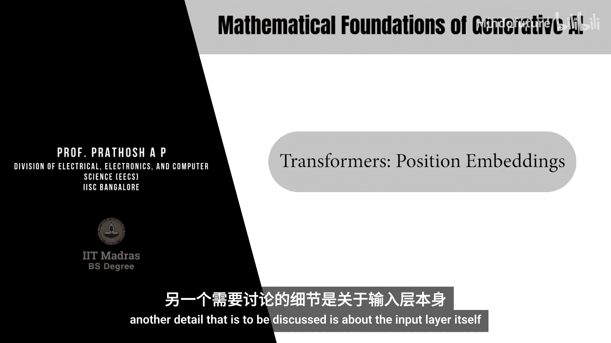
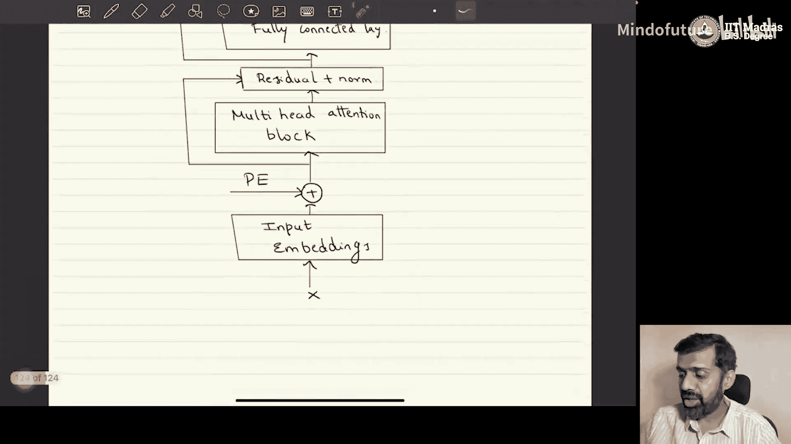

# 生成式Ai的数学基础 ｜ Mathematical Foundations Of Generative Ai p60 P60_W10L45-Transformer-位置嵌入 -BV1fperz7EjK_p60-

🎼。

Another detail that is to be discussed is about the。Input layer itself。

NowNote that in the input layer the transformer has no way to discern the sequential ordering in the given input sequence because they are rated as vectors。

 there is no information that is being fed into the architecture that would preserve the ordering or the precedentnce of each of the given token in the input。

No two。In short。That the。🎼Okayello。Sequential ordering。Ordering is preserved。Pserve。And additional。

Temporal embedding， fixed temporal embedding back thus is added to the input。An additional fixed。

Temporal embedding vector。Bing vector is added to the input。

This is also known as the positional embedding positional encoding as it is called。Posal。

Encoding or embeing。So we have already discussed this in the context of diffusion models right where we gave this temporal information as an input to the underlying unit。

 a similar idea is followed here， there are multiple ways to incorporate the positional encoding or embedding one famous way to do it what is called as the s useoidal。

Signus horizontal embeing or encoing。It is defined as follows for。Suppose。J denotes。

The position in the sequence。In the input sequence。Uput sequence， I。I don。Ebodying dimension。

I'm putting the mention then。你们全等。不是想得。Encoding or abudding defined at。嗯，姐这么都阿姨。Is given us。

signign off。J divided by。Some large number。 let's say that it is ten thousand。

To the power of2i comma B em verium is the model dimension， this is for the even indexs。For the。

Od dimensions。 This is at。2 I plus 1， we made this to be cosine of。是试句。

J divided by that large number， again，10000。So2  commma Dm。

 so this is the definition note that this P would give you a vector of dimensions Dm。

 so don let me write it down。Of this P。Would be。In our。Capital T comeodium。

 so they should be exactly as the in the same dimensions as that of x I don't know because we need to add it。

 So what is done is that finally。The input x。Yes。Added。With these， or let's say， input at。B orJ。

Inputted position， J。Is replaced by the input position J and the。

Corresponding positional embedding at J。So both of these are in now are Dms in the DMm dimensions。

 so now you do it at all Js right for all J。That is in this particular set。

 So we have one to up to capital T as the。Number of token3%。 So this is。So now。

 this will ensure that。Iput to the transformer also has the information about the time note that this P。

Of j is a unique fixed vector that will that will symbolize what is the corresponding position of a given x given token in the input sequence right because these are a fixed constant these things are fixed constant or a given j therefore this will tell you this will tell the architecture。

 what is the corresponding position that I' am looking at Now if I put all of these together and。

I it as an architecture so。The final transformer architecture。

The final transformer architecture would look something like this。 So we'll start with。诶。

Input embeddings。Pleaseise her。Input em buildingsddings。Now from okay。

 let's say that we have x that is given as input。 So now this x is typically a one heart vector。

 So what is done as the。You learn an embedding matrix you put an embedding matrix that is logable that will give the input embeddings once we have the input embeddings。

 you take the input embeddings and add it with。The positional encoding that we just discussed。

 This is you add it with the positional encoding。 then we have。嗯。A multi head attention block。

This is a multi head。There is a multiherd attention block。 Once we have the multihd attention。

 we have a。A residual layer here。我的是谁。😔，Resideial， plus normalization。T layer normalization。

 what do we do， we just take the output of the multiher attention and then betray the input。

Before the attention， and we give it as an input to the。Additional in the residual block。そ的す。Here。

嗯这是这是 O。Okay， so once this is done， we know that we take the output of this and then。

Have a fully connected layer here。Those are fully connected layers I think I need。我别。

Theres a fully connected layer。 And once it is done， we again， have a。A residual land。As I said。

 the residual and the normalization layer is。Applied both after。

The fully connected layer and multiral attention this。Again， the residual plus。

The normalization layer， this will take the input from the fully connected layer and also the。

Vectors between before that， that's the idea of residual。Yeah， so once this is done。

 the final thing is to have a。Linear layer here。Let me just combine the both。Here， there is a linear。

Lets soft mix。And will give us。Oh喂。So this is what a transformal architecture is。

This is just a bare bone architecture， one can have multiple multi head attention blocks and then they can have multiple fully connected layers and you can repeat those blocks multiple times and so on。

 this is a bare bone architecture of how a transform monoypical transformer works。

