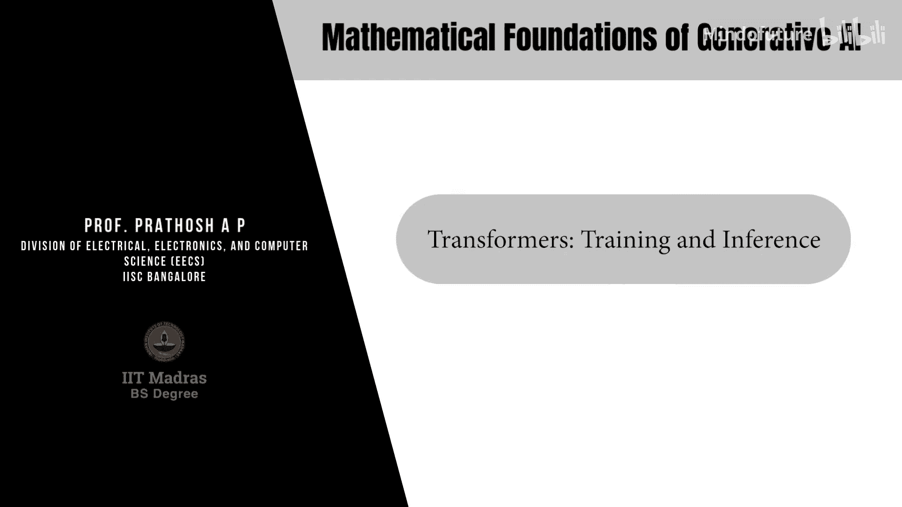
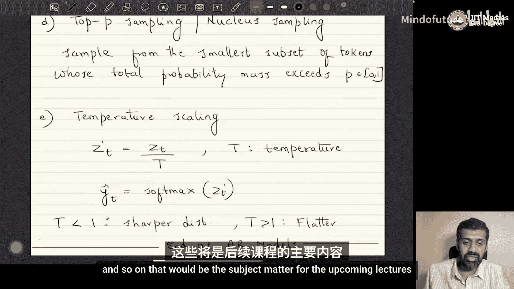

# 生成式Ai的数学基础 ｜ Mathematical Foundations Of Generative Ai p61 P61_W10L46-Transformer-训练与推理 -BV1fperz7EjK_p61-

🎼。

So now that we are done with the architecture， let us see how would one train an autoregress generative model using this particular type of an architecture。

Let us look at the training for。Language modeling or regenerative models using the transformal architecture so training。

Uing。Transformers。我好多的给50。O。No。Remember that。 we are given。😔，A sequence of tokens。

What we are given is a sequence of total as I said。

 we do assuming that we only have one particular data point and this can be extended to a data set by putting an outer expectation as we know。

 this is x2 up to x capital t where it is the size of this particular。every Xt is in vocabulary v。

Okay， so what do we want to learn？ Remember that in an auto regressive model。

 we want to learn P of x 1。Next door。Up to X T， and this is modeled as。

The product from t equal to one to capital D P theta of。X T given X T or x less than T。

 which will this is the definition of。The auto aggressive model， right， This is。

The auto impressiveive murder。Okay， now B to do。Of extra given。See is。TheMoel using。ItsTaken to be。

The output。Of the transformer。At。Be it。做可能。T in an unsupervised way is what is called as teacher forcing。

For training。Here is the idea of input token。I will input tokens。

Is taken to be from x 1 x2 till x t minus1。 the last token is discarded。

 and we take the target tokens are。The target tokens to be。X 2。X 3。2 xt。

know that the transformer because of the massed attention。你 transformed吗。I strain。读。Predict。X P from。

X。Be less than。Ex。X9。It is。All two guns。Prior to。To xt right this is a definition of auto aggressivegress model right so if we take our input token to be x1 to xp minus1 and we take our target tokens to be from x to up to Xt then what we are implicitly asking the transformer2 is to predict xt from x。

Les than d， which is you know all x that is that comes prior to x t right So now how do we define the last function now the loss function。

E is simply。你个读的。Negative log of。T equal to 1，2 capital D will take it to be log of。W gap。Computer B。

4 xt， So just explain what this expression is where。Ycap tcoma x t is。

The probability that we have computed for X T given。10， so what does this mean。

 This is this is actually the。Output of。你。转错了吗。At the tieth token。Corresponding to。2 Xt。

Or rather let's say corresponding to the position of。Pos of x t in the vocabulary。Right。

 so remember that at each time P， the transformer is going to give。A distribution。

Overall all the tokens in the vocabulary， right， so the wife。SoWe have Ycap， t comma X T。

 What does this equal to this is。Or rather Ycap T， the way we have defined is it is a soft max。

That we have computed over Z Tilda。And的。We know that the sum of all。

Y T for i equal to12 capital v is equal to1 because we are looking at a soft max， therefore y cap of。

T at X T is actually equal to the probability of。X T being equal to collects call it as I here。

For the sake of ease of understanding which is equal to xt being equal to the Iat token the vocabulary given。

We have seendy。History， right， So this is， we can compute this particular loss with this。

Particular loss function is computable via this idea called teacher forcing。

What we are trying to do is to minimize the negative of the log likelihood。Of。

Observing this particular input sequence and modeling it using this autoregressive model using the architecture of transformware。

This training is completely unsupervised and you know one can actually do it in a supervised manner as well because you know let's say that there are pairs of input and that target tokens now here in this case what we have done is we have taken the input tokens and shifted the input tokens by。

啊。One place and we have called that as the target tokens it up you can one can also have a pair of input and output tokens and the same procedure would apply。

But typically for teacher forcing timing procedure， we will not meet the target tokens。

 target tokens are generated in a。In an artificial way via the teacher forcing procedure。

 this entire training is done in an unsupervised manner。Okay。

 so lets say that the timing is complete， so one last piece of proposal puzzle is does one how does one accomplish inference in an autoicpress model。

Infence。嗯。Any are author aggressive model， Let us look at how to。肚子疼。Again。

 one can en multiple ways of。Accomplishing the inference I only discuss one or two famous ways of doing it。

 The first way to do it is。What is called as the greedy recording。

It's pretty simple as the name says。喂。Capital P star， Y capital star assembly simply the max。offff。

Beautiful X。Equal to v。So then the so this is over all possible we that are in the vocabulary so what we are doing is that as we saw right at every time step the output of the transformer will be a distribution over all possible tokens in the vocabulary。

 so you choose that token which would correspond to the maximum。

This is PP theta star to choose that particular token corresponding to the maximum value over that soft match that the transformer is giving at every time this is called the query decoding now the advantage of3 decoding that it's very very fast because you don't have to do anything extra other than just compute in this R max or a vector of length v so which can be done very fast and this is deterministic so every time you fix the input you get the exact same output at every time using grid decoding which can both be an advantage and disadvantage depending upon the application in an application where you seek deterministic outputs grid decoding is because but if you seek the output to be if you are working with an application where output needs to be more quote unquote creative then its not a good idea to use。

recordingcording because now every time you get the exact same output。

 the other thing is fully blown sampling。Sampling waste decoing， where the sample。Like啲 to be。

From the categorical distribution。All by the cap。 So what is happening this。

Okay let's call this as mycap star so what happens is that we get a distribution over the entire vocabulary we know right I mean it's a discrete distribution now there are ways to sample from a discrete distribution of size v once we get a distribution over there you just sample from that particular distribution that we have gotten every time P so that is how you get the output。

Now the advantage here is that this is more diverse compared to the grid recording because every time you are getting different outputs because they are actually sampling。

 but the disadvantage is that by doing sampling there may not be coherence in what sort of output that one might observe unlike in grid recording。

So there is a mid path that is taken between these two， which is called the top。Q samplingling。

as the name says， the idea is to sample only from the top k most probable token so let。Sort of V K。

 which is a subset of the vocabulary， we the top。Top key tokens。

How do you define this Vk is equal to v1 v2 up to Vk。Where。

We rank orders are the probabilities of all these。Gs。Yes we do 그러다 than not do。 yes do。要回去。

What we do is first we define a truncated distribution。为。It迪 not么。The given distribution。

 all of these are for the output of。The transformer PfVJ。Fse。We are using this tongue vocabulary。

 and then。邓牛32湖蓉。The new categorical distribution that is obtained。可以。

Catachoural distribution of Pk what are we doing here instead of instead of sampling from the entire distribution here in the in the knife sampling case because of possibility of incoherence and so on what we do is we only take the top k the case hyperparameter。

 top k occurring in tokens and we find the distribution for those k tokens at every time and then the sampling is carried out now the thing is you know if you only lets say where instead of choosing all tokens from the vocabulary we only choose top k of them at every time and then sample from it So this is。

One way to reduce the risk of sampling back tokens and so on。

Now there is one other idea which is called an improvisation over just which is called the top top P sampling also called。

What's known as the nucleus sampling。Car sampling。It's very similar to top case sampling。

 but you know， it's sample from。From the smallest subject of tokens。Smallest subset of tokens。

Whose total probability。不是宝贝。😔，Coral probability mass。Exceed。Some hyperparameter p between0 and1。

 so you choose a a probability P and instead of sampling from top K tokens。You take those tokens。

Rnk harder them in such a way that their total probability mass is exceeding the precho value P and then sample from that。

 So that is one way to do it。 So this is again， you know this is。Adaptive vertical context。

 So what does this mean instead of just choosing top K by choosing a K It know if you make it adaptive in a sense that。

At every time the number of tokens from which your are sampling is varying depending upon what the context is。

one other way to sample is by temperature scaling。temperatureer scaling。 what has done this。Before。

The， the linear layer of soft miless。Okay， just renormalize， call it as Z dash。

Z dash of t to be equal to Z T divided by capital T。

 where t is a hyperparameter called the temperature。

And then we have the usual thing you have ycap t to be equal to soft max when of softm of Zt。

 there will be Zt dash， which is its scaled version of the targetss。Now。

 typically the idea is if these is less than one， we have。We have sharper distributions。

Theres less randomness and if t is greater than one， then we have flatter distributions。

And so on this is called data breaker scaling if you would have seen in chromly available。Use cases。

Transfer waste samples， you would have seen this T as a temperature parameter that is typically used as a user defined hyper parameter。

 There are other ways to sample as well。 You know， one is the usual beam search and there is other contrastive decoding and so on will not be looking at those techniques。

 There are lots of ways to。Sample or do an inference from an aggressive model。Okay。

 so this brings us to the end of auto aggressivegress models。And transform must。

This forms the basis for most of the。Commercially available generative models such as GPs in fact G stands for generative pretrain using transformers so GPs and Gemin use and draw and these models all of them belong to this broad family of autoregressive modeling using transformer as the backbone Now from now on we will look at some of the reinforcement learning based techniques in how to。

align the autoreive models that have been trained on large scales of data for a particular preferential data that has been given will specifically look at policy gradient algorithms and algorithms such as a PPO DPO and so on that would be the subject matter for the upcoming lectures thank you。

