# 生成式Ai的数学基础 ｜ Mathematical Foundations Of Generative Ai p62 P62_W9T17-DDPM噪声估计的实现 -BV1fperz7EjK_p62-

🎼。

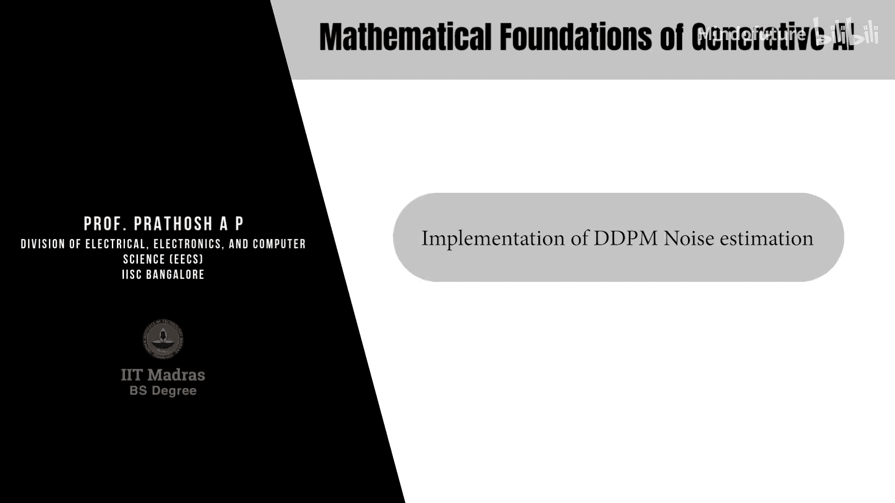

hello on。Welcome to this tutorial session in which now we will be understanding an alternative view of DDPM。

As a regression over added noise。Okay， so now。Without any further ado。

 let's directly start looking into the code in the previous tutorial。

We have already looked into the unit architecture。And then we have looked at the way in which the training is being done。

And the inference process。And there will be a very minimal change。😊。

Whenever we are looking at alternative interpretations of DDPM。

the first one that we shall be looking。😊，Is DDPM as a regression over a noise。

 let's directly start with the code and then we will be going。😊。

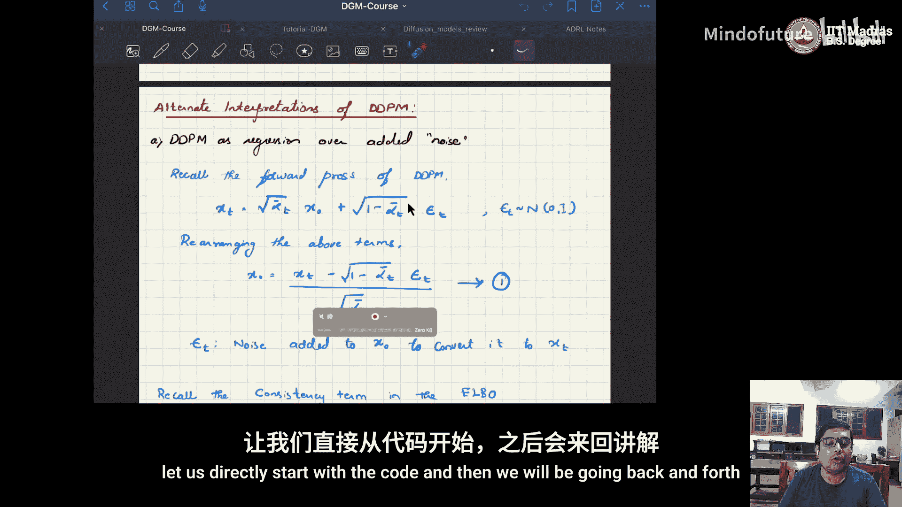

Back and foot。Now the current code that you are seeing is not actually run on collLab now now because of some faster requirement。

 I just ran it on a server， the same thing can work in collab。

 you just need to change the Qa device here， just to CD a coa you have to remove this one there okay。

So the same thing will work。So I'll be just going taking you through the code。

 the structure that is there in this code is a bit different than the structure that we saw in the vanilla version of GPM。

 which estimates the image point itself。Okay。So let's go ahead with that。

These are the necessary libraries which are similar。

Now rather than going through the function one after another。

 lets start with the implementation and then whenever there is a function call now we will come and look at each of these functions I have written this code。

😊，With a lot of comments so that you can take it as a backbone and then use it for implementation of other alternative views like。

The mean prediction。As well as the score prediction with minimal modification。😊，So。

Let's start with the training process itself。Now the image size that I'll be taking is 32。😊。

The batch size is 128 I'm running it for 25 epochs now if you want sharper images now try to do it with more number of epochs。

And then the learning rate I have taken a temporary of minus3 you can。

Chuck by increasing or decreasing the learning rate and then the time steps that I have taken is 600。

So for CRISPR images， you can try it on increased time stepss。The first thing that I'll be taking is。

The beat does。Okay。Now， beta is a modified version of Als now Als is。

1 minus betas okay now in our theory we only look at alphas。

 we don't look at betas in a similar manner we have implemented earlier now it will go and call a function called as linear beta schedule now for this you are giving time steps 600 let us go back to that linear beta schedule it is giving you from the starting point which is 00001 which is deliver of minus4 till002。

It is giving you an equally spaced 600 instances。 So this is what this。😊，Meath function does。So now。

 we will come here and then we will get 1 minus alpha that is what we wanted we wanted my alphas to be greater than。

😊，0。99。 so and then you have accumulated alpha now， which is。At a given point。

 you accumulate it like alpha 1 into alpha 2 into alpha 3， you get that。Okay。

 and then now this is at a point。At a point T， you would have accumulated all tilt。

Now this is accumulated previous， now this is accumulation till t minus1。😊，And here you have。

Square root of the alpha accumulateminated。😊，Okay， and then this is square root of1 minus alpha hummative now why do you need all these things now as you can see here now these。

😊。

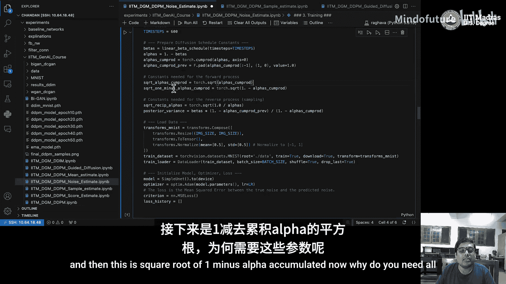

Consts are needed。In obtaining our。Equations obtaining the points okay now rather than doing it then and there now we prepare a list where in which all these points are readily available to us now this is square root of alpha accumulated product now this is square root of 1 minus alpha accumulated。

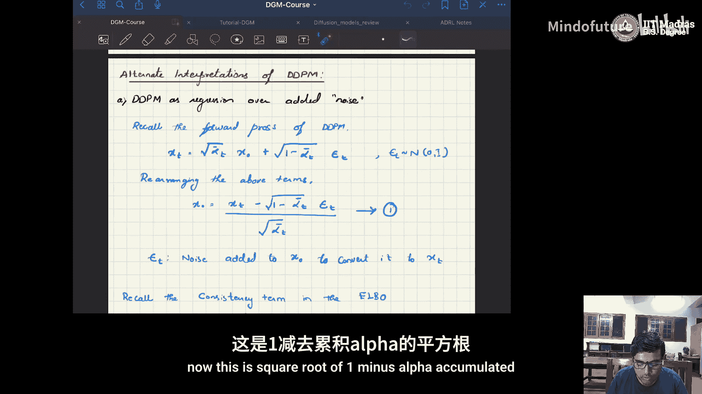

Okay。Yeah。そ no。Well then。呃。Then we will look into them。The post tri。Orvariians。

And then similarly you will get the variance of it， so we are using Ms data。

 now you are transforming it and then you are obtaining the data loaders。And then， you。

Calling the model， which is unit。Now let's look at this unit architecture。😊，this unit architecture。😊。

Now it is having the image channels as one since I am working with MS that the initial the channels that you have is one and then the down channels now you might be remembering now the down channels is 64 128256 and then the up channels now that you have is 256 128 and 64 now to this now please remember that now there is always。

😊，There will be a residual path that is there which needs to be taken care and the output dimension is one。

Okay， now unlike the segmentation problem in which we had an output dimension of three here output dimension is 1。

 the time embedding dimension that you are having is 32。Okay， so and then。

First what do you do you obtain a sinusad embedding now let's go back to the sinusad embedding class now once it is called you are calling it from here from the embeing dimension which is 32。

Now， as you might remember。Now， Sir in his theory sessions has explained how do you obtain the sinus sort andpositional embeing？

I not be going ahead into the theory aspect of it， it is exactly the same formula which is being implemented here so and then after that after you have obtained there is a learnable layer。

😊，An MLlP layer from the time dimension time dimension to the time emine dimension so that the parameters are learnable because of which you get better holding on the positional headcoings。

No。And then you have the first layer where in which image channels， which is one。264。

 not down channels of 0 is 64。The kernel size is 3 and the padding is1。

 so since you have not provided the stride which means that the stride will be1 and then you have the downs now in which you see there is an increase in the number of features and there is a decrease in the spatial dimension of each feature。

😊，Now it is doing an operation called as list comprehension。

 the way in which it happens is this operation is called for each eye here。Okay。

 so now let's look into it。Now there is a block here now first down channels is minus1。

 so the length of down channels is 3 so now it is 2， so the first value that I get is0。

 so I am calling a function Im calling a class block of。Down channels of 0。

 which is 64 comma 128 okay now let's go back to this block and what is it doing here here is a block now。

It takes in channels， out channels， time numbering dimension now。那是跟你了。See here。😊，The 64。

 128 and then 32 and this is what you have got now here you see an initialization。😊，Okay。

 now first you are having an learnable parameters for the time MLlP now from the 32 to whatever is the out channel here the out channel was 128 now so that now you get a vector。

Of size 128 that you added into the each of the features plane is what the positional embedding actually means。

 so now if it is an up sampling process now you have transpo convolution。😊，Now。

 if it is a downsampling process， you have just the convolutions with you。

So followed by a batch normalization and then the rail activation this is the。😊。

Forward process of it first you pass through the con now if it is an up sampling so R the down sampling depending on that。

Okay， now if it is an up sampling， the input channels is two times of that because you will be having a residual connection。

 a skip connection which is there which is coming from the。😊，Encoder part in the unit。

 so because of which the in channel will be twice of it。

Okay so and then you will after that we will be having a transposed convolution to out to out okay yeah now this is a different way of writing a unit architecture now we wrote it in a slightly straightforward manner now this is like you have multiple function calls to take care of it okay now you have pass through convolution one and then after that you pass through the normalization then you have raylu and then you obtain the time embedding and then you pass it through raylu。

And then what do you do， you reshape this， this is a vector which is of size become out channel and what do you do you。

😊，Reshape it now so that you can add it to the。Output of the raillu here。But then you added。

 then you pass through the。The next convolution layer batchs normalize it railro and then you send it out okay。

Now this is regarding the block now if it is an up convolution layer you will be having convolutional layer and then followed by a trans post convolution。

 if it is a down convolution now you will down stream going you will be having a convolution and then followed by a convolution。

😊，Okay， so now let's continue with the unit。Now， what it will be done now 64。

 12832 it will be the first thing and then 128 to 5632 now you will be having two blocks similarly the same thing will be there for the up module。

😊，Now here you are sending up is equal to true so that in the block。

 you recognize that now this is a。😊，Ubsstandly you， you need to。

decreaseecrease the number of features and then you should increase the size of the features。

 the spatial dimension of the feature so that it gets back to the image size。😊。

Okay and finally from the last up channels of minus1 which is 64。

 you have to finally put it into the single channel image okay that is what you are doing finally here。

😊，Okay， so now then。how is the forward process looking now you get x and then the time step。Okay。

 so now first you get the MLP in which you get the time eming and then you pass through the con of0 now which is this。

And then you have residual input now if you are looking at。The down process Okay。

 now but then you have to upend all the。Outcomes of the。

Each of the blocks so that you have to connect it to the。Up convolution， again。

And then in the up convol process， now you concatenate x and the residual x residual x is what you are getting from the downstream and then you pass it through the。

Up convolutions。Okay， now this is the idea of the unit Okay similar to the same idea。

 I just briefed it out again you're using。😊，And Adam optimizer and then the loss is MSc loss yeah now you are keeping track to bookmark the loss history so that we can plot the loss curve okay so now lets look at the training process。

😊，So now first you take an image x0。And then you take a。T now you choose a random T from0 to。

Time steps now which is 0 to 600， which is of size。

 batch size okay now you have randomly selected a bunch of Ps。😊，Okay。

 now and then you are porting it onto the device and then you are doing the forward diffusion process now let's go to this function which is forward diffusion to understand it。

😊，Here is the。Forward。Diffusion process。Now， where in which you have to get xt and then the noise now please remember now this is the。

😊。

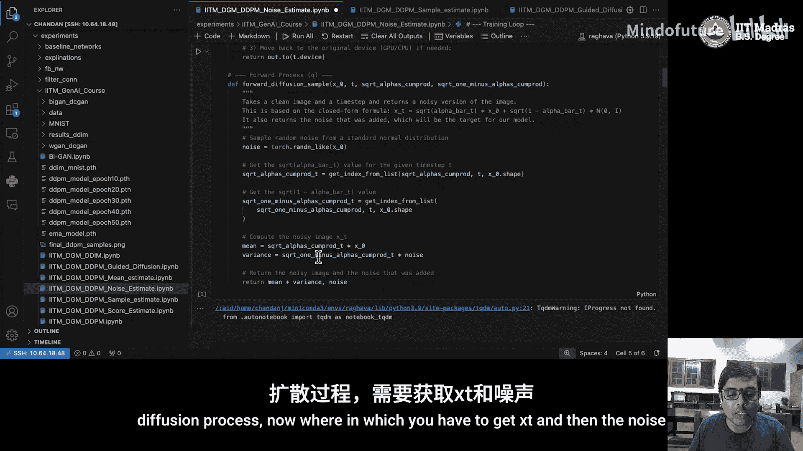

Equation that will be implemented in the forward process。

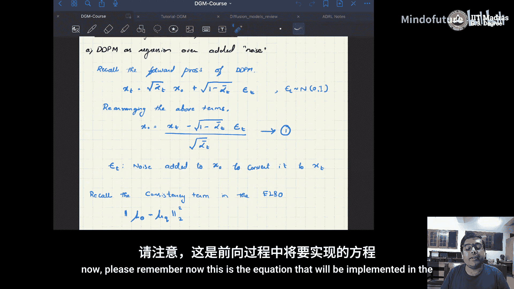

So now first you get。A noise， random noise， which is the same size as that of the x knot。

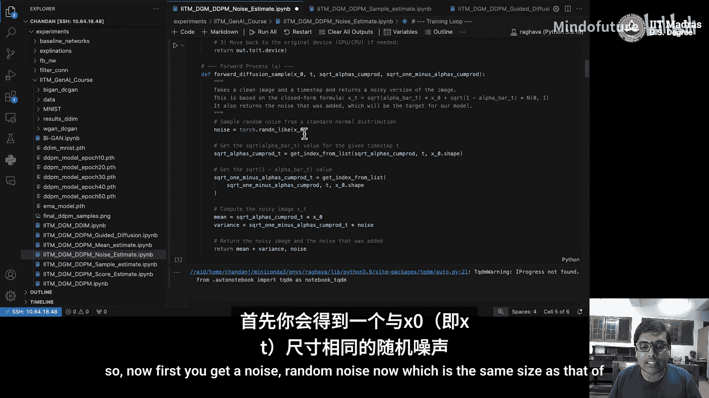

Okay。Which isixy。

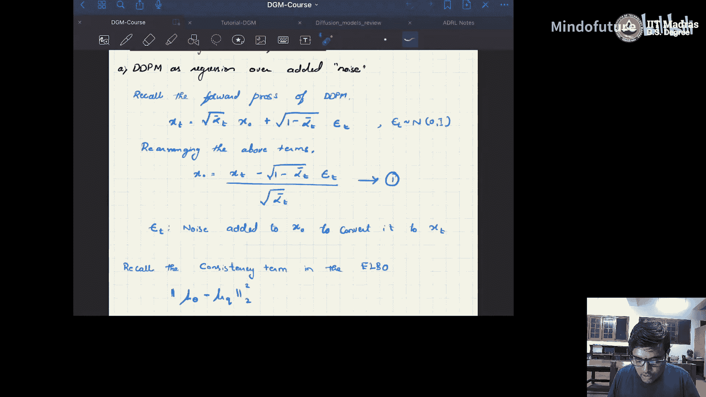

Where you're sampling from。01 you have got this， okay， this equation is done。

And then get index from list， what is this？

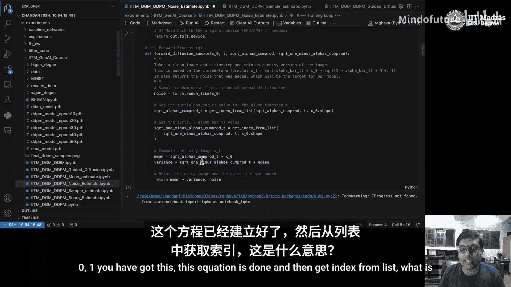

Okay， so now now please look at it here you need for the specific T。😊。

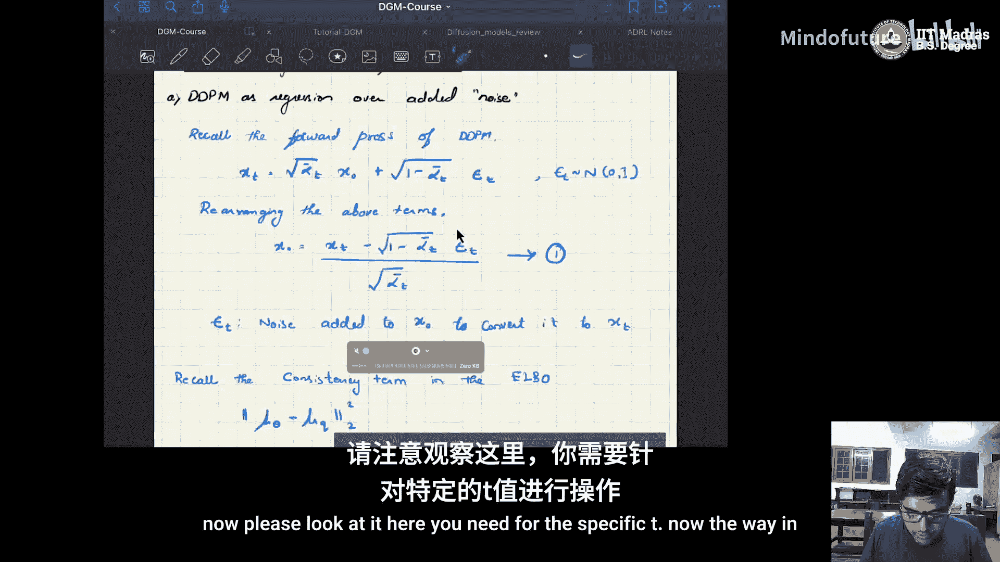

Okay the way in which this get index from list is implemented is now you give whichever list that you have and then you give the T it will give the specific alpha t that are needed okay so now you get for that specific time。

😊。

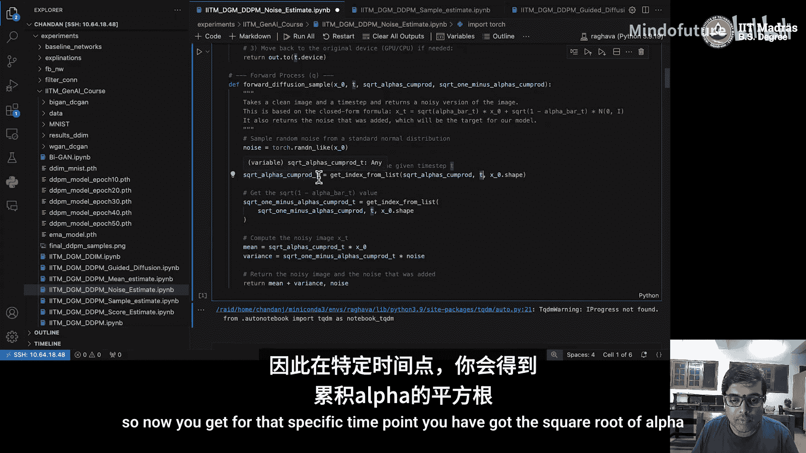

Point you have got the square root of alpha accumulated。

 that is what you have got you have got this now square root of alpha accumulated product。

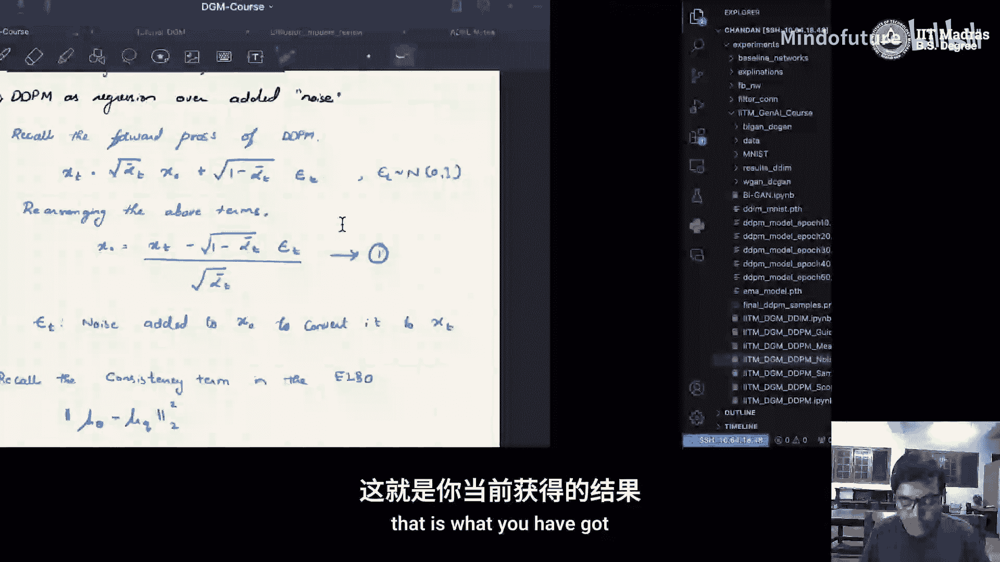

Okay， and again， you have to get this now。😊。

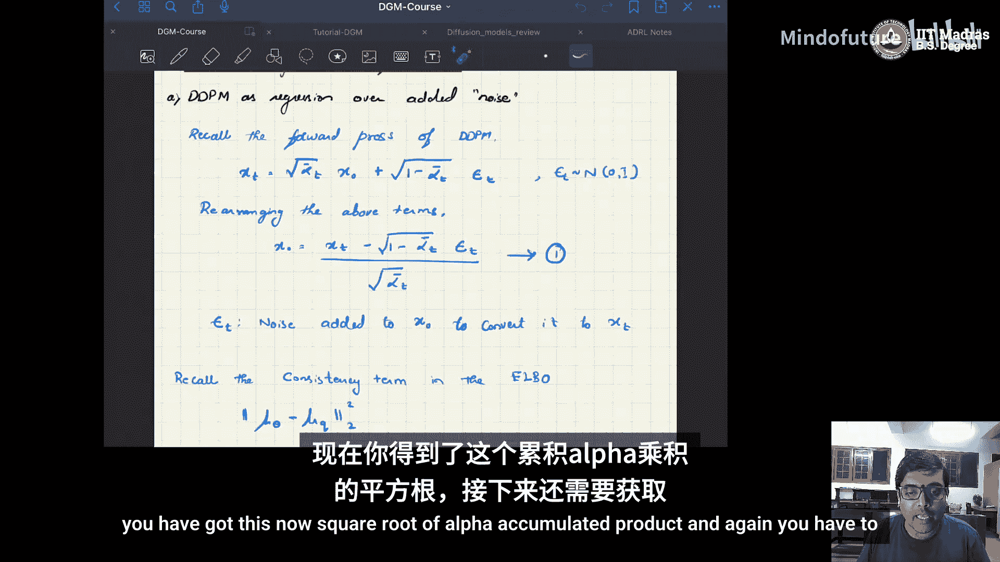

That is that is the next step that you are doing now one minus square root of alpha accumulated you are sending the1 minus alpha accumulated now with the t and then which is so you should be getting it as per the shape of the x0。

 which is your true image okay。😊。

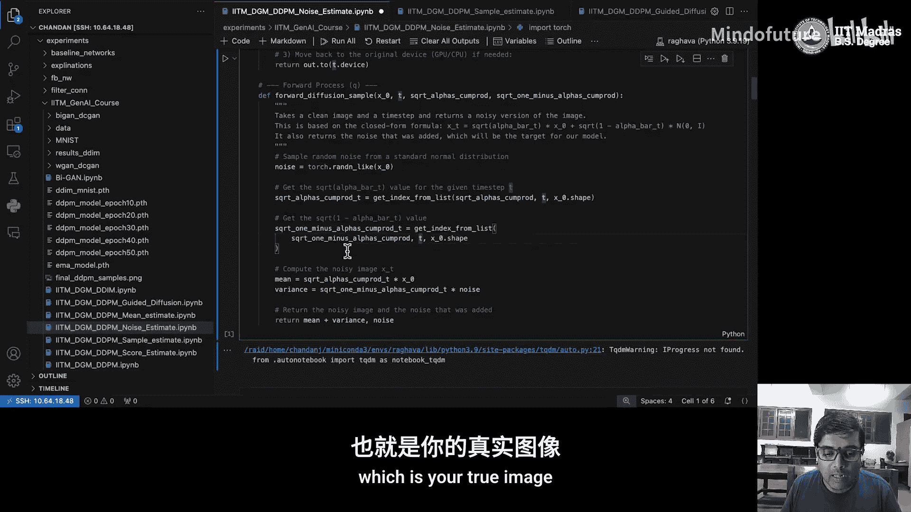

So no。Now from the equation， it is clear that now this is the mean and this is the variance that you should get and the mean is。

😊。

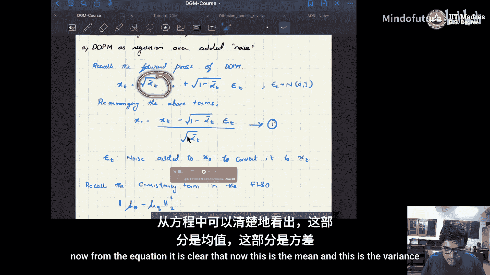

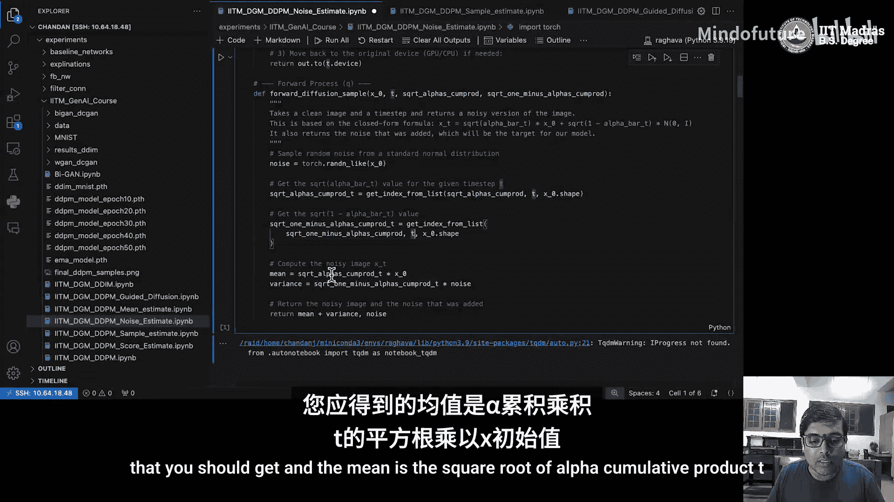

The square root of alpha cumulative product t into x0。

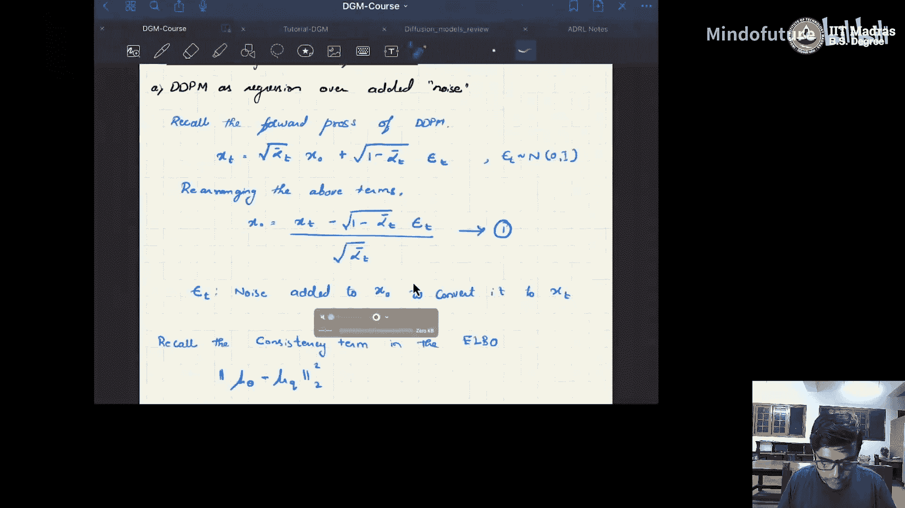

This is the mean which you have got。And then the variance is no one minus square rootta alpha accumulate product into noise。

😊。

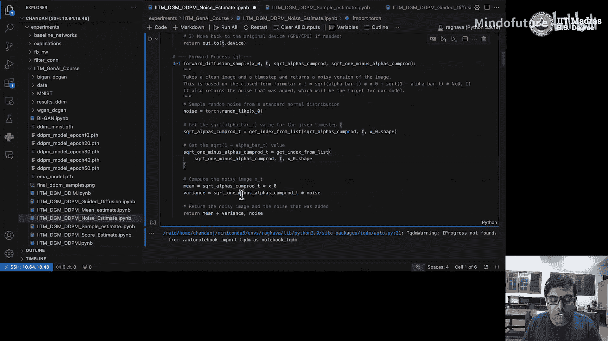

This is the thing if you add them， you get the noisy version of the image at that specific specific instance T。

😊。

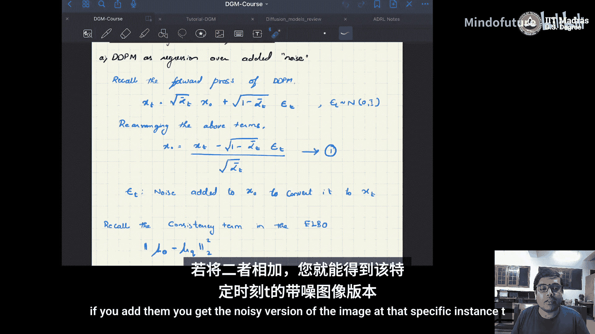

And then you are sending the noise also， now this is the forward diffusion process。😊。

Now coming back to the training procedure。You have got the Xt， the noisy image at that time stamp T。

 and then the noisy target。And then you get the predicted noise from the model okay as I told you this is a noise estimation so you get the predicted noise。

 you give xt and t and it will be giving you the predicted noise and the noise is the same shape as that of the image in all the diffusion process。

😊，And then you have the MSC loss from the noise target to the predicted noise。

 this is the target now which I got from the forward diff process and then this is a prediction which I got from the model。

 I obtained this。😊，Okay。

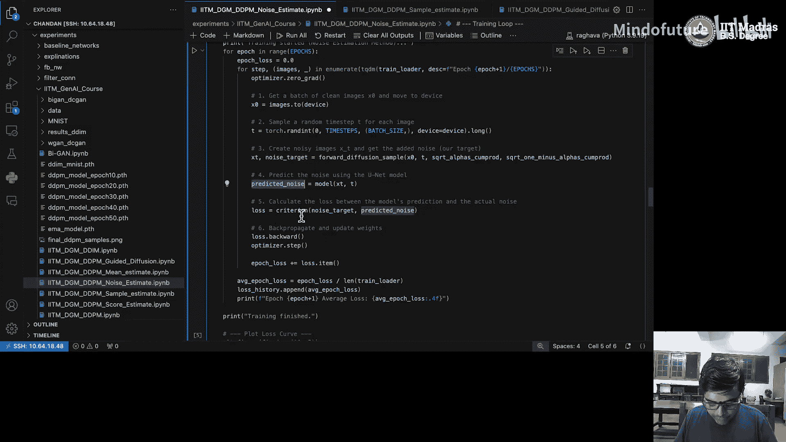

So， now。This is what you have got。Yeah so。This is what you have got。

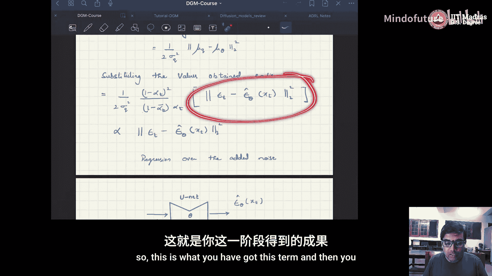

This term。Okay， and then you。Backward， so you get the gradients and then you update the steps Okay now this is the overall training procedure that you do it for one mile so normally you can include。

😊，one more batch here then which you can include one more step to take care of it okay so this is the overall training process now coming to the inference you can see the loss curve I have ran all these things so that I can show you the。

😊，Output results。Now， coming to the inference process， now how does the inference happens。

 the inference is exactly similar to the way that we had inference in the sample estimation case。😊。

So now let's look at the inference。顶。😊，Okay。So now first you get betas， now all these things。

So square root of 1 minus so all of them， all the necessary things you get。

 and then you get the predicted noise。Now， once you have got the predicted noise， now then。

You have to obtain the image now which is mean plus the square root of posterior variance into noise okay now this is what you will be obtaining at every step t now that you in a reverse order from in a reversed order from 600 to0 you do it and then at the last step。

You add one and clamp it till01 so that it is inner。프린터분。And these are the images。

So there is an issue。Now， the background， as you can see。

 is not pitch black as you were expecting in a standard emist。😊，Outcomes。

 which we have got even in our sample estimate just to reiterate now this is the。

Sample estimation problem Now， the output that we have got。 and we can find the。

The notebook of this in my Gitthub repository now which you can make use of it。

Which is not happening， so I will leave it to you as a simple exercise on trying it further。😊。

Cune the hyperparmeter and see why I am not getting the background I am getting the images of the foreground。

 but my background is not clear I will leave it to you as a very interesting and in a small exercise so that you will be able to do it。

😊，This is where I stop with noise estimation with the same method， now you can go ahead， no width。😊。

Mean estimation as well as the explicit score estimation now if you have estimated the noise which is considered as an implicit score estimation。

 you can similarly do it for external explicit score estimation exactly with the same code with a very minimal modification that is needed in the coming tutorials we will be preferably using the same structure where in which I not be going ahead into the details of how the parameters not you should not call it as a parameters how the terms like alpha and things are fixed and then how the forward process and how the unit architecture now those things remain same for the remaining tutorials that we have in this module。

😊，In the next tutorial those things remain same now with this we conclude the tutorials on noise estimation we will meet in the next tutorial thank you。

😊。

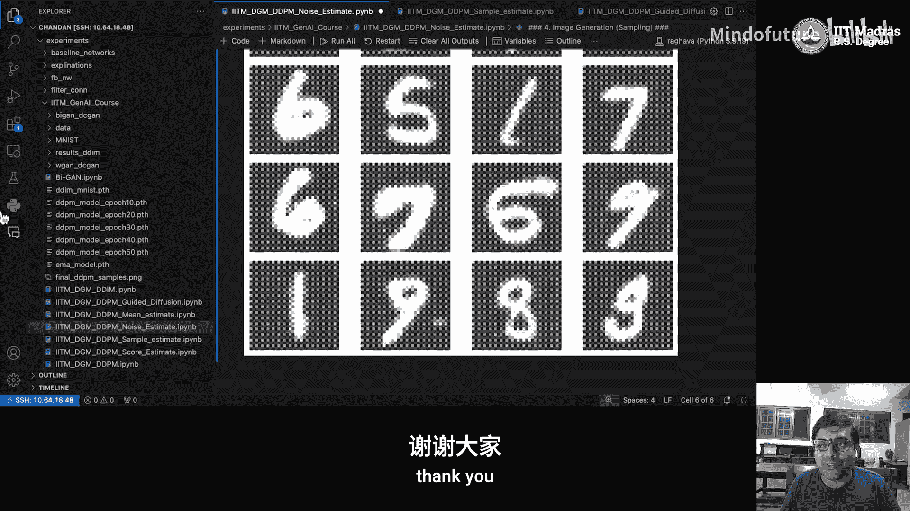

