# 生成式Ai的数学基础 ｜ Mathematical Foundations Of Generative Ai p63 P63_W9T18-DDIM的实现 -BV1fperz7EjK_p63-

🎼。

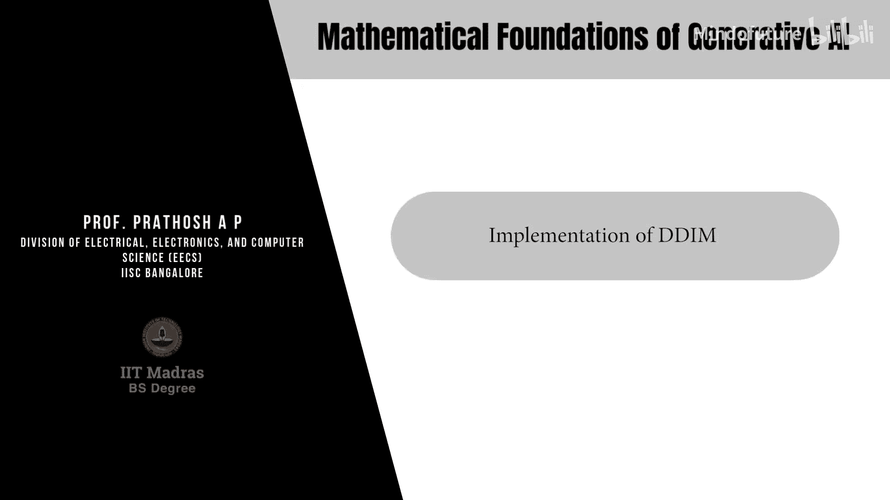

系咯我。Welcome to the tutorials in which we will be looking at implementing DDIMs。Now。

 whenever I' am in implementing DDAs。😊，What do I mean by that test just inferencing using the ADDIM method？

Now， why are we not training anything because it is evident from our theory sessions that？😊，Now。

 if you are training a regression network in DDPM。Now。

 it is implicitly training an infinite family of non more models which are needed for our DDIMs in the current。

Case， I'll be going ahead with the noise estimation model。😊。

Which we have seen in an earlier tutorialium as the base model。

And then we'll be going ahead of it and then obtaining the samples in。A DDIM process。

The only thing that we shall be doing now is inencing。😊。

Using the DDIM idea now please recall from the DDIM。Discussion that。

So whenever you are performing a sampling， it is having three parts， one is this is one part。

 this is another part， this is another part。Now you need to add these。Three parts okay。

 now we will be getting each one of them separately and then finally you will be adding them lets look at the code now。

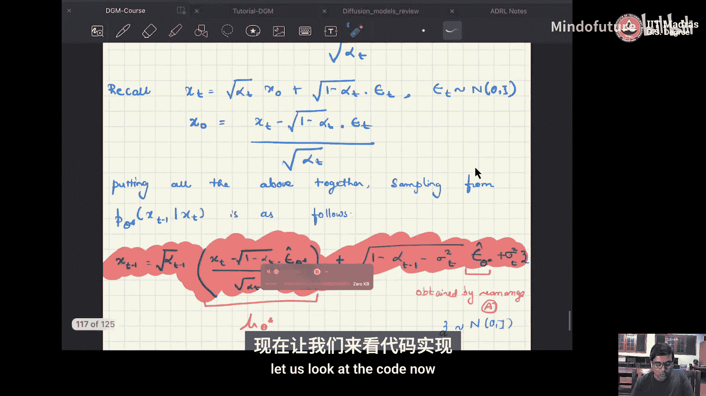

Okay， now these are the generated images for DD Is。They're good。😊，I don't say they are the best。

They're good。😊。

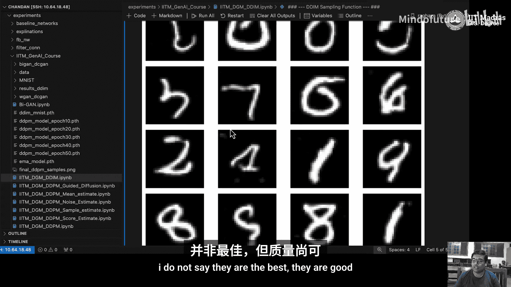

Okay， so now let's go ahead with the DD IM implementation。No。I'm calling the DDIM sampling。

So I'll be giving the number of samples as 16 and need in samples。

 so I'll be sampling for 30 times steps。So now if you are doing ahead with DDPMs now if the model has been trained using 600 time steps you need to go in a reverse order for all the 600 of them now in DDM that is not required you can say that okay now I will be only going ahead with certain amount of time steps here for 30 now Eta should be0 now please go ahead and try for the full time steps and eta equals to1 and compare the results。

So now coming back to2D Is。Now this is what you want， okay， now you have put in the evaluation mode。

Good， you are taking。All the times times， that is what the first thing that we wanted。

And then you are put it in the reverse's order。And converting in it into a list and then finally you are taking。

The adjacent times timess like t0 t1 t1 t2 like this which represents current and the next now because at any given point of time now we will be needing the current the next time test step as well as the current time step so we will be needing them in pairs as per the need of the equation。

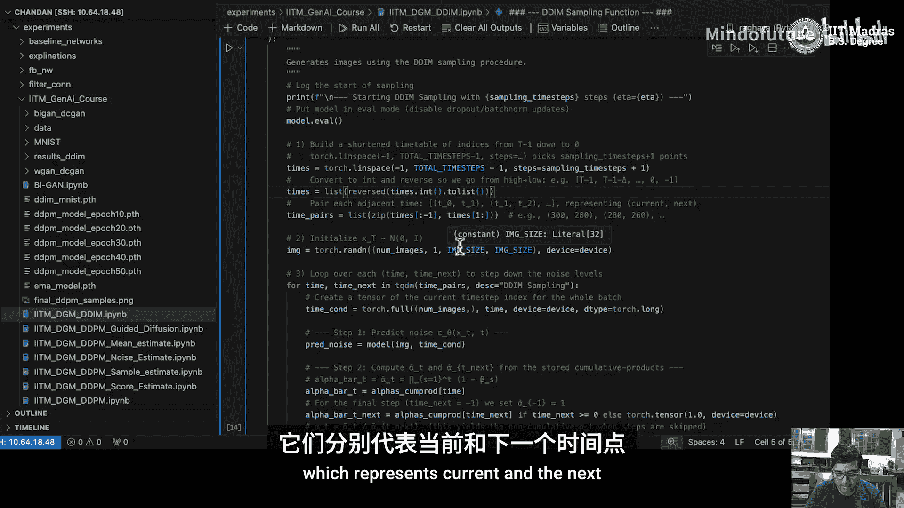

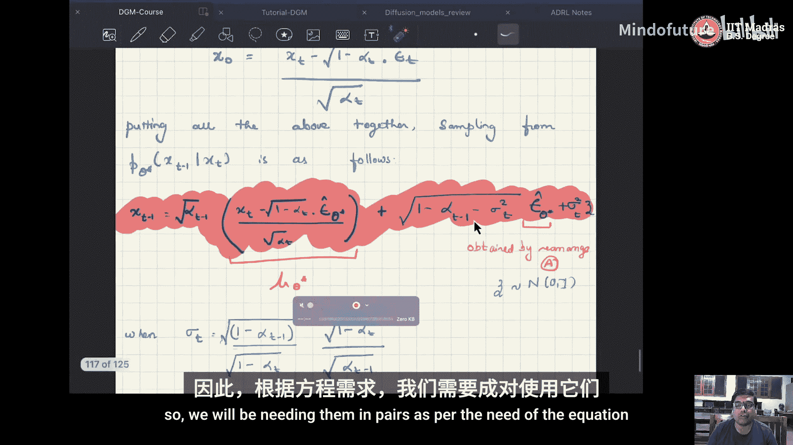

Okay， so。Now first， you sample a standard Gaussian noise。

 then we need to go ahead with the DDIM sampling。OkayNow first you obtain the time fine。And then。

You pass the image and then the time to obtain the predicted noise。

This is a noise prediction method that I shall be using， so you have got the noise needed。

But then you have got all the alpha bar alpha bar t next and all those things now you are actually obtaining this。

Mu theta star okay now please look at the mu theta star equation now in this I have given it as predicted x0 yes。

 even that can be the case now if you are predicting the noise now this can be the x0 now you can look at the similarity now between these equations now xt which is the image that you have minus now one minus。

Alpha。T into the predicted noise now divide by the square root of it。As you can see。

 that is being done image。Minus。A square root of 1 minus。

Yeah here alpha t always means a bar okay that has been discussed in the theory as well whenever I mean alpha t I always means alpha t bar now this is as for the the theory it is as for the literature but here I have preferred to go ahead with the existing terminologist which we have used earlier so that it will not be having issues with the training procedure and then the inference procedure using DDIM I have left it as it is。

Okay， so you have obtained this， which is nothing but。😊。

The predicted mean that means that you have got this okay and then you have you can get this also now this is very easy to get this cumulative product now and then this is the predicted noise。

Okay。you have got X and then you clamp it， now all those things are the standard procedure。

 you get the predicted noise。😊，Into this term。Squa root of1 minus。

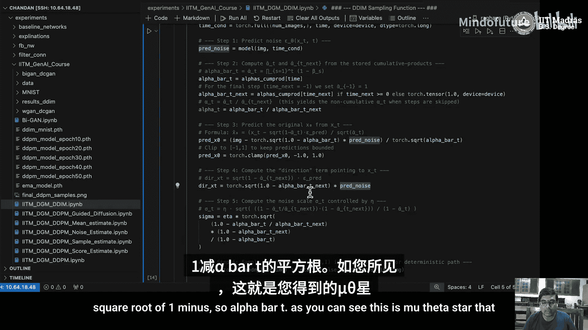

So。Alpha barti。Okay。And as you can see this is。M theta styleb that you have got， this is the thing。

 this is the predicted noise。Okay， and then this is that multiplication that you are supposed to do and please remember that。

😊，The equations descenders are very similar。Okay， now obtaining one is same as obtaining another。

 and as I have told you now here alpha t always means alpha t bar。

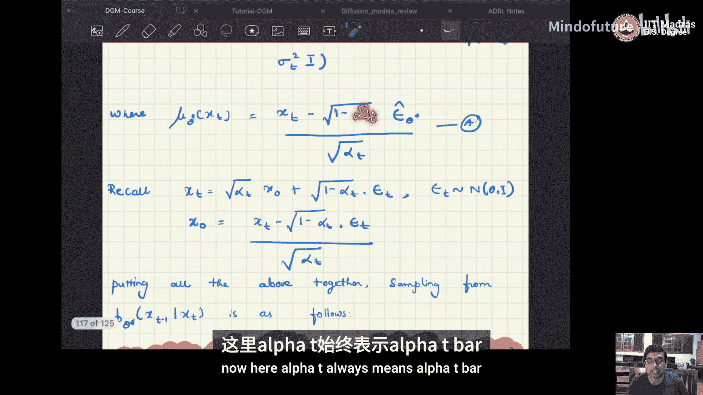

Okay， so now you have got this and then you get this term sigma okay now now what is this sigma？

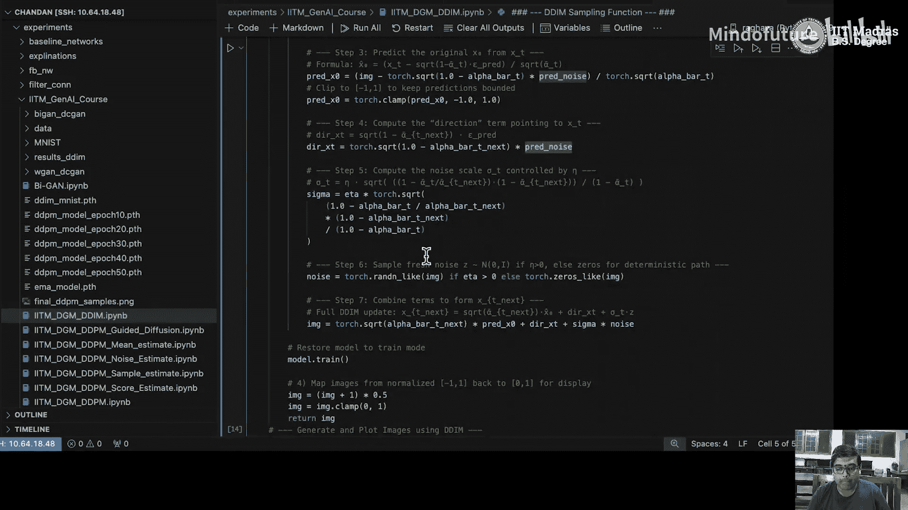

This time。1 minus alpha t minus 1。So， there is a square root so you can take the square root common altogether and then you can have this that is what is being done here the whole product has been calculated okay and then you multiply it by Eta okay why do you multiply it by。

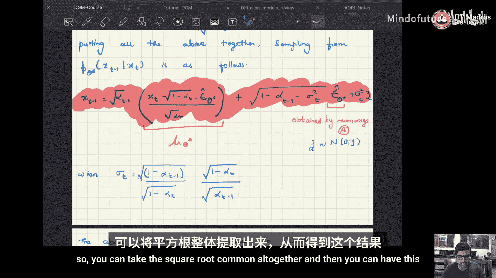

Eta now that the reason is if eta is 0 now which is an indication of dm so we just want to take it into consideration and have this okay since we have0 nowday this will become 0 okay but whenever we have E equals to1 I want you to look at the outcomes and c。

😊，啊。So now you have this part。对。

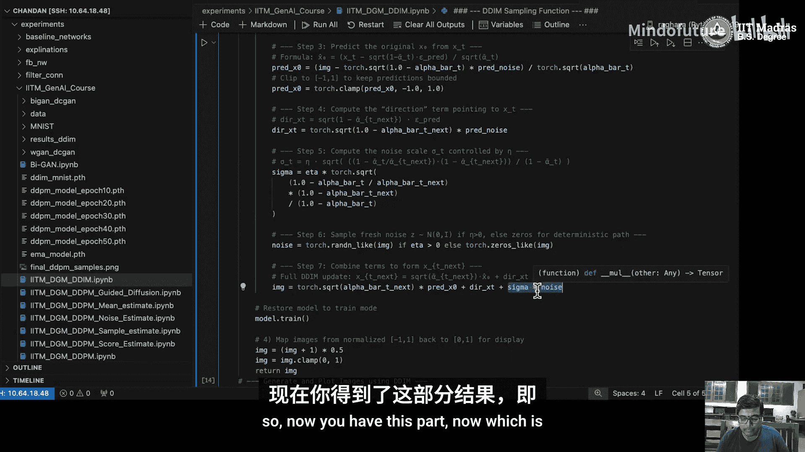

Now which is sigma。Into noise has been become 0 because of my。

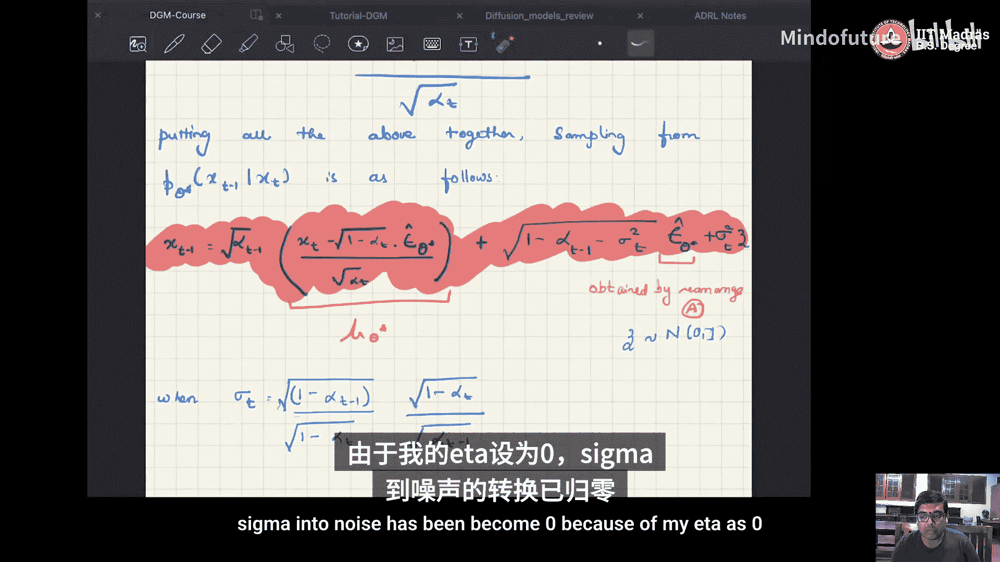

いいた。A0 so now and then you have obtained the direction。

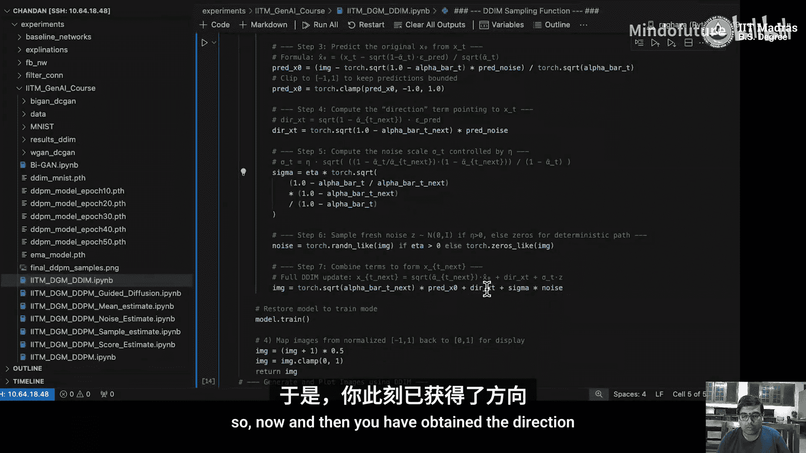

This is the direction that you have obtained and how did you get it？

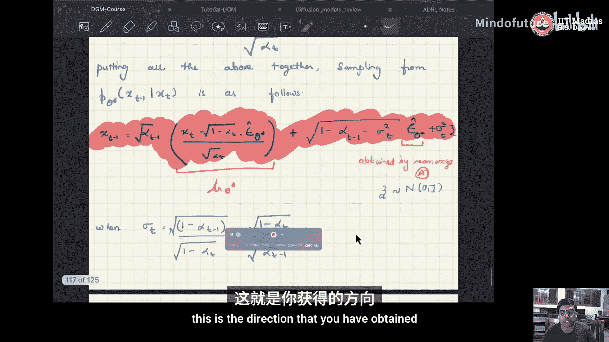

You can see that this is。Square root of 1 minus。

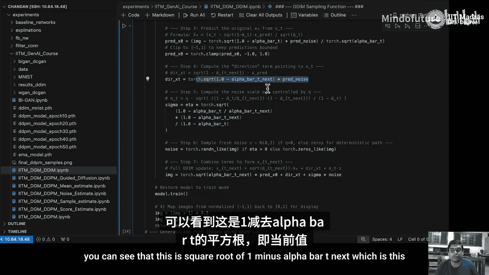

Alpha bar T next， which is this。This will have Eta now because of which it will become zero。

 this into the predicted noise。

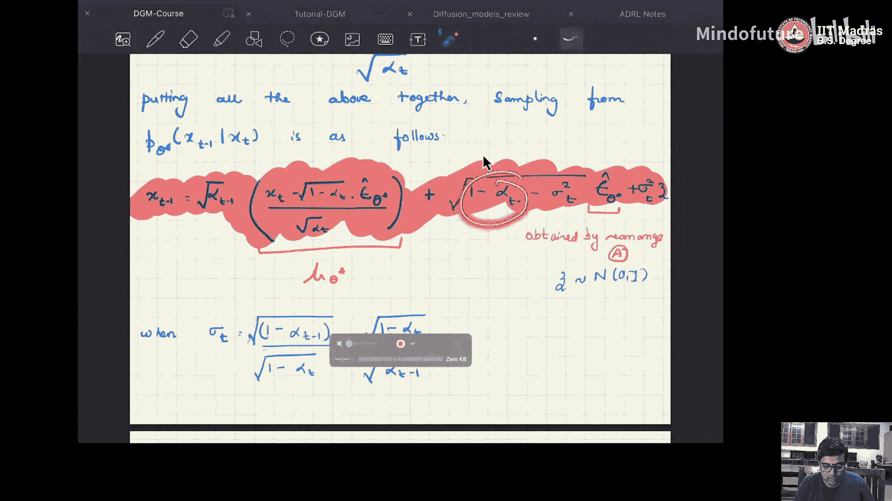

That is what you are getting here this is called as direction of xt you are adding all of them now this is the image now this you are repeating now for the time pairs that you have got and finally you clamp the image to get it in the。

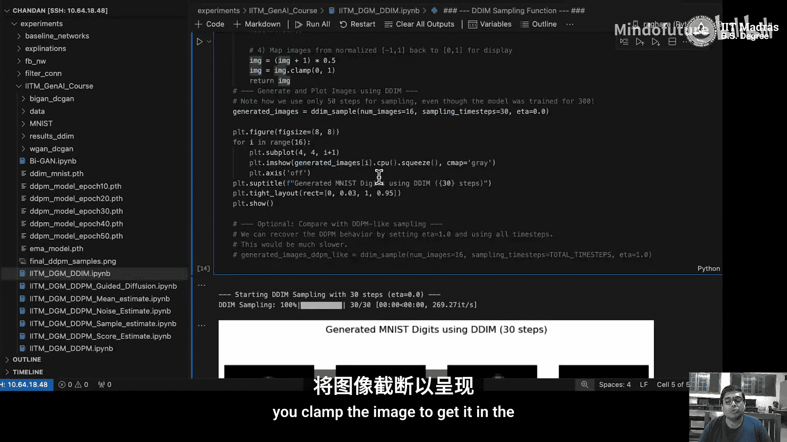

APreable format。Now please remember that now this is the。Equation when it is 0。

 this term and this terms。😊，Are gone enough now because of which this is the predicted mean。

This is the predicted noise from the predicted noise。

 you can get the predicted mean and then perform this operation。😊。

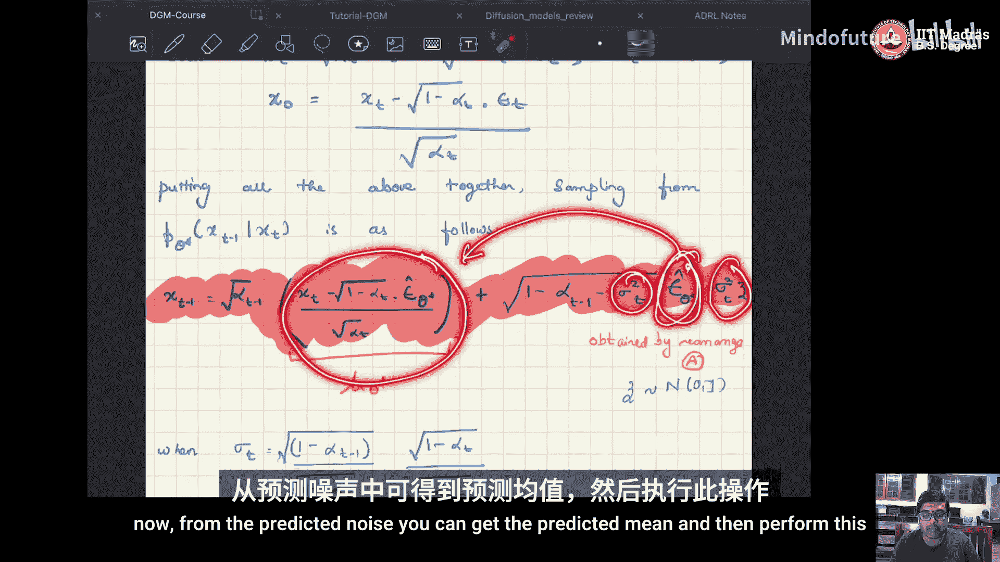

That is what you have done here。

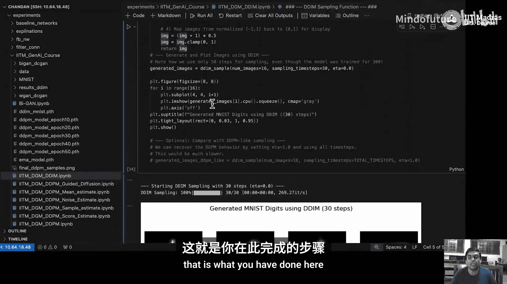

Now， using which you have obtained the。Images。Vita。Almost 10 times of the sampling process Okay。

 now normally if even if 20 times reduction， even if you have taken the time steps as 600 now you are only sampling it for 30 times steps。

 So there is a reduction of 20 times。 this is a very nice operation Okay so I urge you to。

Rerun this with modified parameters and getta CRISPR and sharper images now with this now we will conclude our tutorials on DDPMs in the next tutorials we will be looking at week tense content which is auto accuracy models thank you。

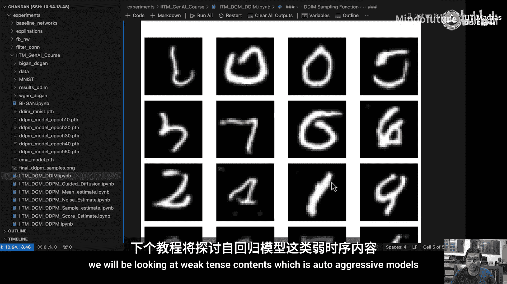

