# 生成式Ai的数学基础 ｜ Mathematical Foundations Of Generative Ai p64 P64_W9T19-引导DDPM的实现 -BV1fperz7EjK_p64-

。

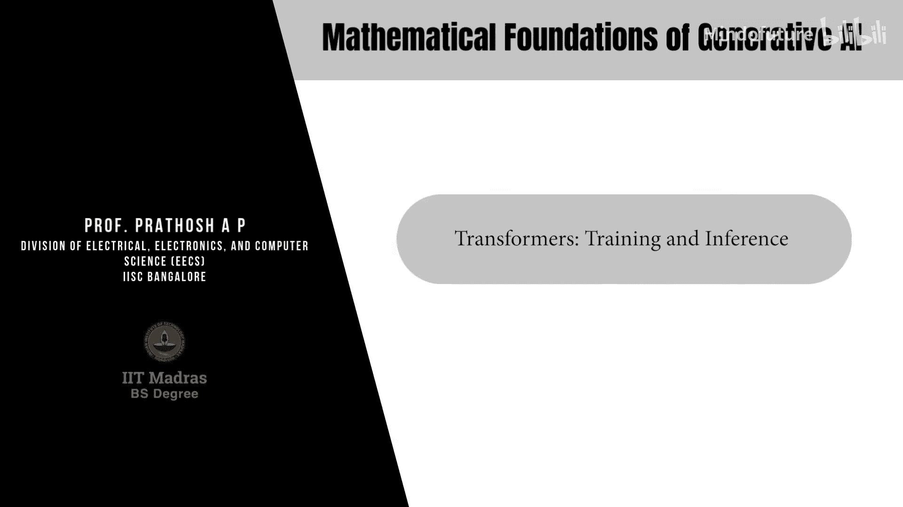

hello on。Welcome to this tutorial。😊，In which。😊，Now， we will be looking into。

The classifier guided way of。Fampling images。The base model that we are considering here is a nice predictor model。

 and then from there we shall be going ahead。

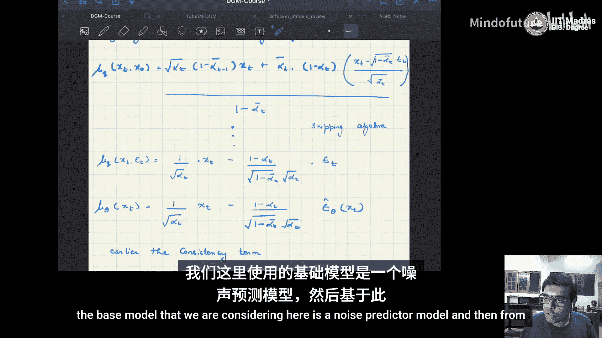

Now。This is the code that we are using。The same thing holds for the previous tutorial also。

 this has been run on a server now the same thing you can just replace this device。

 which will be able to work on your coA notebook。These are the necessary packages。😊。

Thiss the device on which the things will be running and the linear beta should will get index forward diffusion。

 these are the same。Heler functions that I have used even in the previous tutorial of noise prediction。

The sign is sort of embedding。The unit blocks。And the block under the unit now remains exactly same there is no change now that is being done。

Now， the additional thing that is needed for guided diffusion is that I need a noisy classifier。😊。

Now the idea is of this noisy classifier is I'll be giving you at a given timestamp I'll be giving you the noisy image and then in addition to that I'll be giving you the timestamp so now using this I should be able to predict the cut class of it okay that is the idea。

😊，Now here you have the time embedding， so you have a learnable weight。

Similar to that of the unit for。The time for the positional embedding now the same way you are using sinusoidal embedding the it is the same logic that we have used earlier also and then I have used a very simple convolutional neural network where in which I have 1 to 16 now input channel is one and then the 16 channel。

After that， I have a max pullinging again after that。

 I have a one more conversion layer followed by classification height Now how is that we are doing it first I obtain the。

Time numbering。Okay， so I' then。I will pass through convolution 1 and convolution 2。Now pause that。

 Ill interpolate and what I will do is I will extend this time membrane so that it matches the feature size。

😊，Of the convolution block 2。But then I am added。So this is how I'm embedding the time into the。

Extracted features of the noisy image。 pause that I'll pass it through a fully connected layer to obtain the。

Poed， okay。So the way in which the training happens， it's exactly similar， no difference。😊。

Okay now but a couple of things that you should remember here is now first you will be training an unconditionalgan exactly the similar way you used a noise predictor this is a noise prediction model I have used and then you are training the noisy classifier okay this is straightforward any classifier。

😊，That is being used the same will be using it， but please remember that now whenever you are sending。

 so you have to。First， do the forward diffusion process and then send it。Okay。

 now why now because the classifier should be able to learn how to classify an image now given a noisy image way in which there is a presence of noise。

 because of which you perform the forward diffusion and then you obtain the noisy image and thus noisy image with the time is given as an input to the classifier model now this is a noisy classifier you obtain the。

😊，Outcome， and then you use CC laws cross enpy laws2。

Update the weights of this classifier this is a straightforward forward 10 class mist problem。

 but the input being not the actual image x0 but a transformed image。😊，Transform im is added noise。

 Okay now this is the。😊，Classifier that you have trained okay so now both of them have been trained。

 now comes the magic。 now how do you。Put the。So。Things from the classifier and then from the。

Unconditional GDPPM。And then obtain a conditional generation as a question。

 now that needs to be answered， now let's proceed。😊，Now， the target image that I am generating is9。

 let me show the generated images first。Yeah all of them look like nine。

 but some of them look like nines that were preferably written by my son。

 which is very hard to understand these nines are really good actually yeah so now you are doing the。

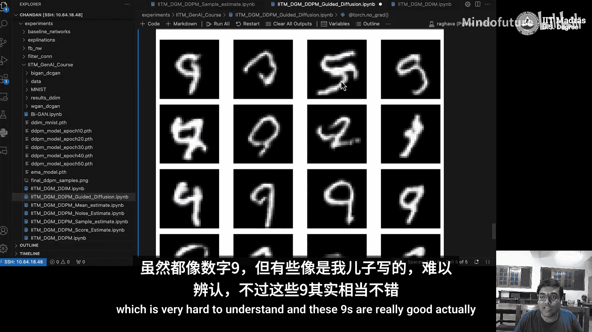

Guided sample。Now the target classes。Nine and then the scale。

 the importance that you are giving is two， we will come to that how it is being done。

So no coming here。Now first you put your model， both the models。

 GDPPM as well as the classifier into the mode evaluation mode。

 and then you obtain xt now which is the noise。😊，From01。It goes in zero1， okay？

SoAnd then what you will do。Now you will come up with a y in which you have the target class 9 in its full dimension now then what you will do you will get this t the timest and then since it is a reverse process you have to go in the reversed manner from thousand0000 is the one that I have picked here till the0 okay now first you predict the noise。

Okay， now once you have predicted the noise， you need to actually get the unconditional mean in this case now how do you obtain the unconditional mean now。

😊。

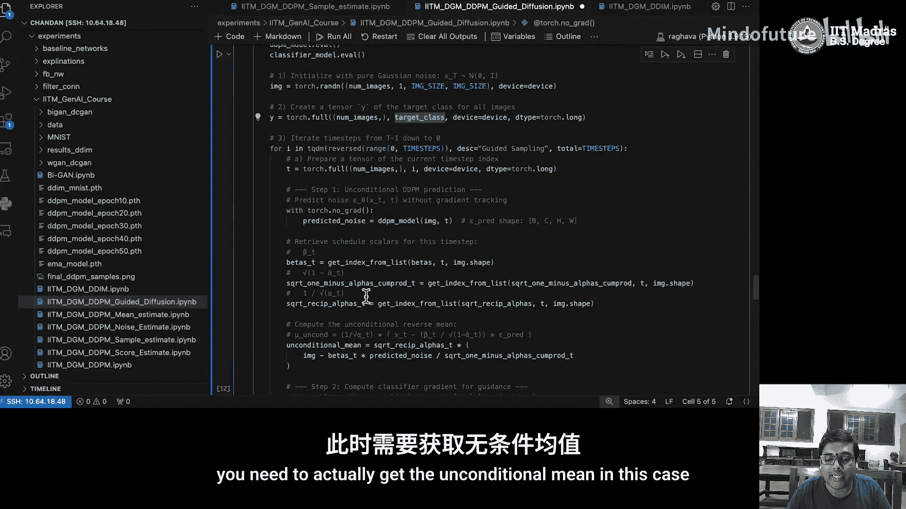

I have just gone with the。Equation。So now this is the equation that I am looking into in which I can take this as a common factor now because of which it will be。

1 over square root of alpha t xt minus 1 minus alpha t divided by 1 minus alpha t bar into the predicted noise now this is your unconditional mean。

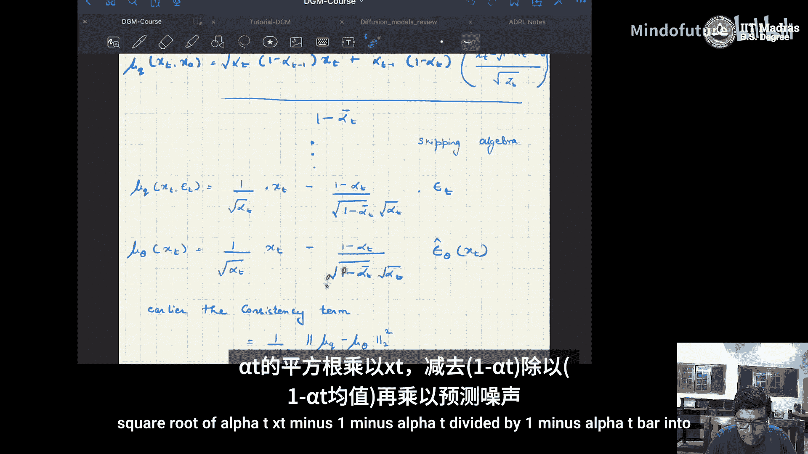

Yeah， now your beta T is nothing but1 minus alpha t。

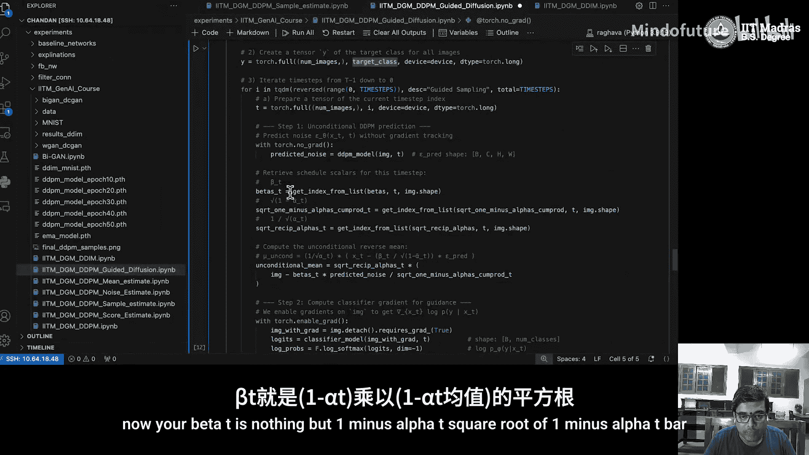

Okay， square root of 1 minus alpha t bar now this is beta t。This is your moment is alpha t bar。Yeah。

 and then now squ root of reciprocal of。Alpha T， now which is this。

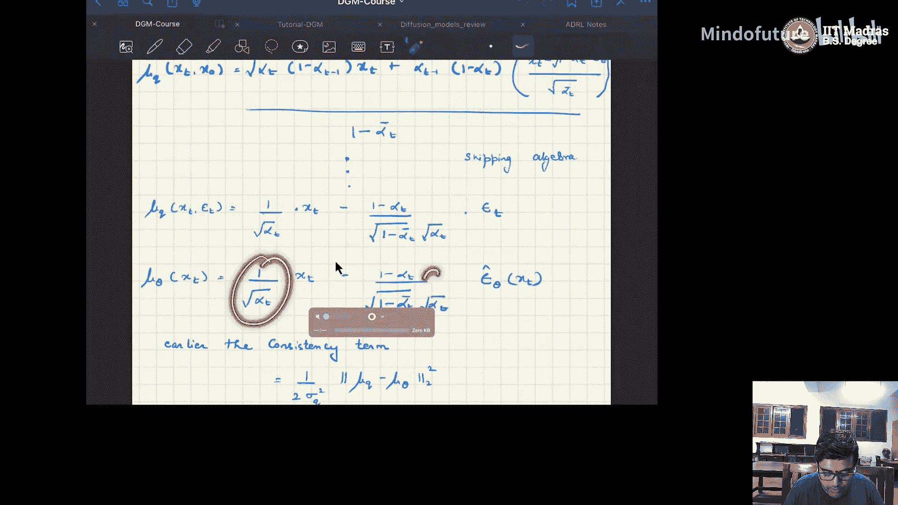

Which you have taken as common factor。Unconditional means that common factor into image。啊对。

Whatever at that time step。

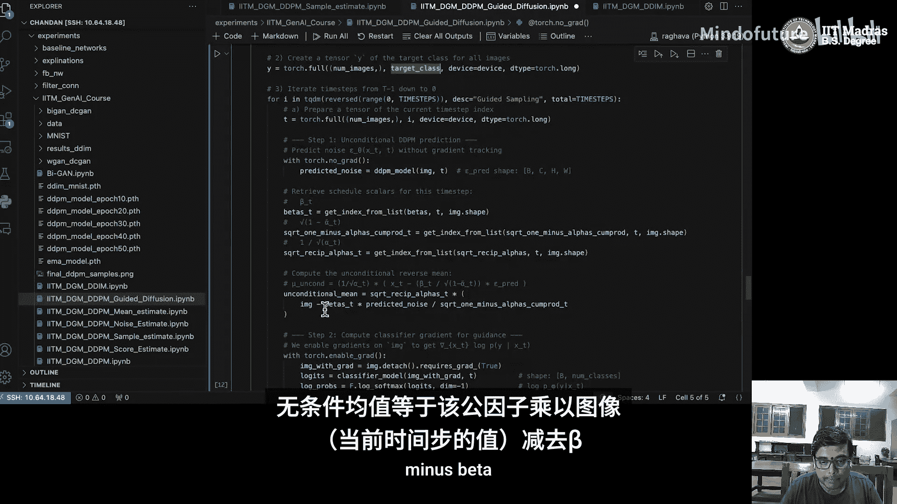

Minus beta， or whatever predicted noise not divided by this。Actually， you are。Okay， hang this down。

Okay， you can do it similarly even with。😊，The noise also yeah。

 but I am going ahead and doing with the。

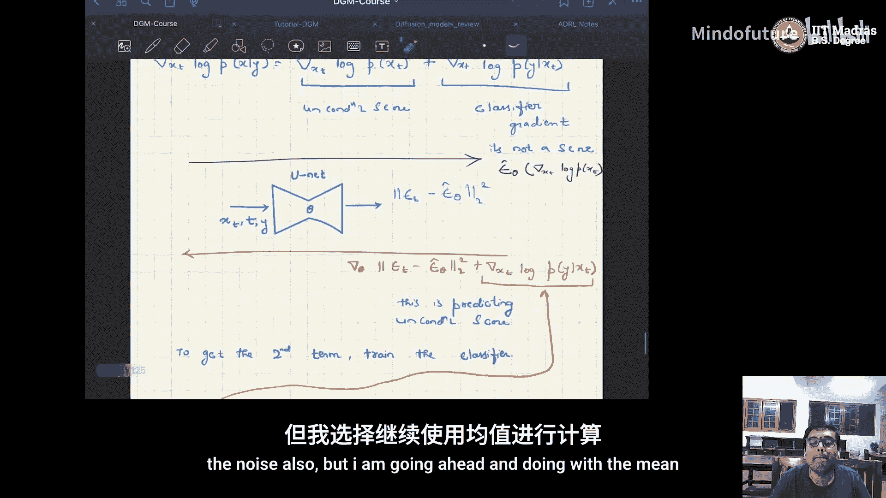

mean， okay， yeah。And then you obtain the gradient now now what you have done。

You have obtained the unconditional mean， which is a good。So你呢。

What we should do now we should obtain the the gradients with respect now that is what is that we want now we want the gradient with respect to xt log of。

P of y given x3， this is what we want first。You say that I need gradients now requires gradient equals to true。

 then you pass through it and then you obtain the log probabilities。Okay。😊。

So and then what do you do， you obtain the gradients。Okay。

 now then you get the posterior variance at that specific time T and then。You scale it up。With the？

You scale it up now this is what2 you have obtained and then the posterior variance at that specific point t at that specific time t and then the classifier gradient now all of them you add now this is the mean that you have obtained。

Okay， what you can do you can do it for m times and then take an average of it or you can do it for one instance itself yeah now depending on what is the time step now you will be getting it。

😊，If I is equal to0 now that means that this is a last time step now this is the image else you are again repeating the same step and then。

😊，You are putting back in the training model the reason why I am putting back in the training model is now sometimes you might need to sample in between the。

Epos at that time now putting putting back these models into the training mode makes sense and then you' are clapping it and this is your results。

Now this is how you'll be combining。😊，The classifier gradients now with the unconditional mean so that you can obtain the images of a specific class I know that the generated images are so not so great。

Yeah， it's up to you to train it furthermore and then obtain better results。

In the next tutorials now we will be looking at DD ionons。

 I have left a couple of things as exercises just for understanding the intricacies now I will be putting the code for sample estimate。

😊，Mean estimate as well as score estimate also。Now， these are not fully trained。😊。

I urge you to take it as a base version and then modify the code so that you will be able to generate images from that those co those Jupyter notebooks will be available in the Github repositories all the best trying them thank you。

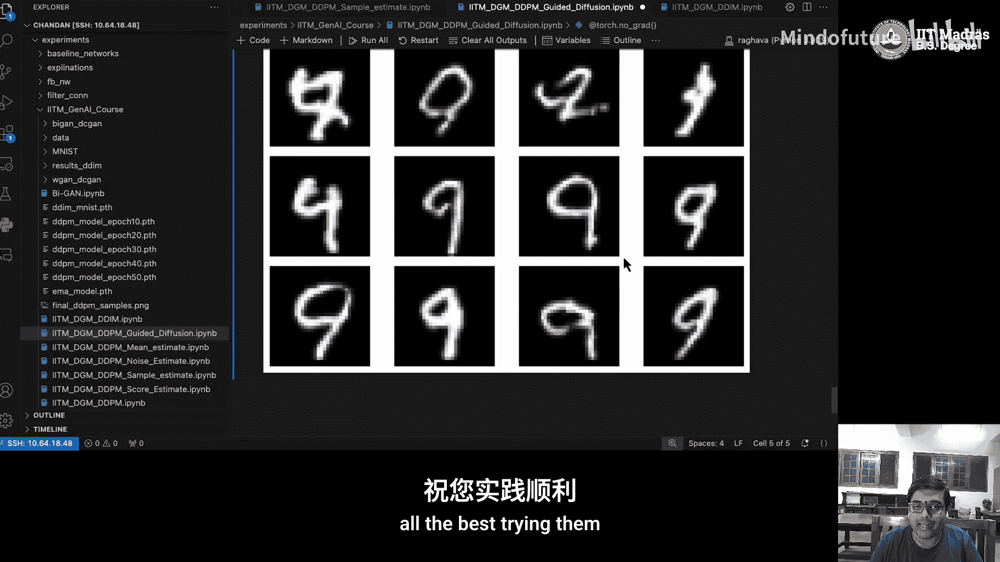

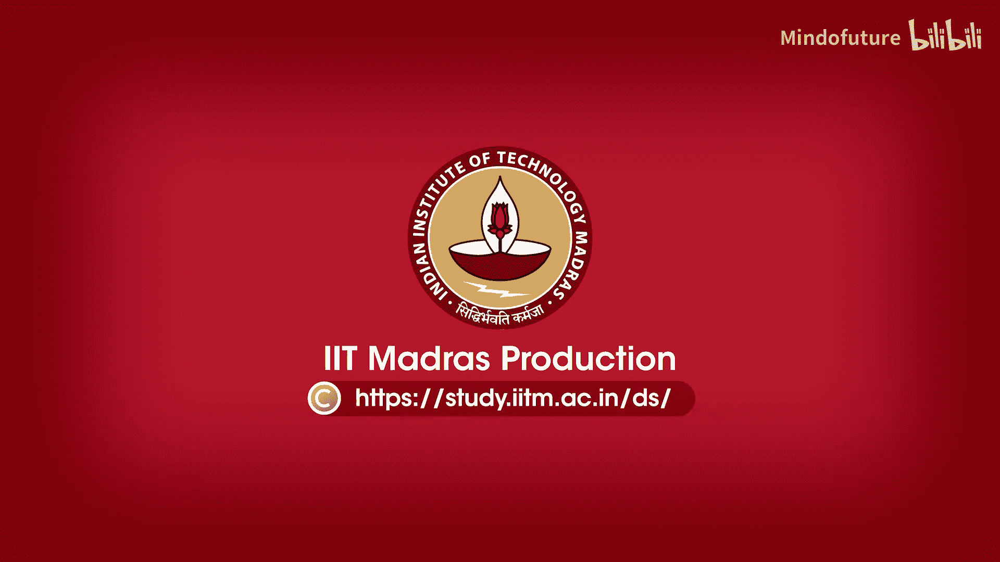