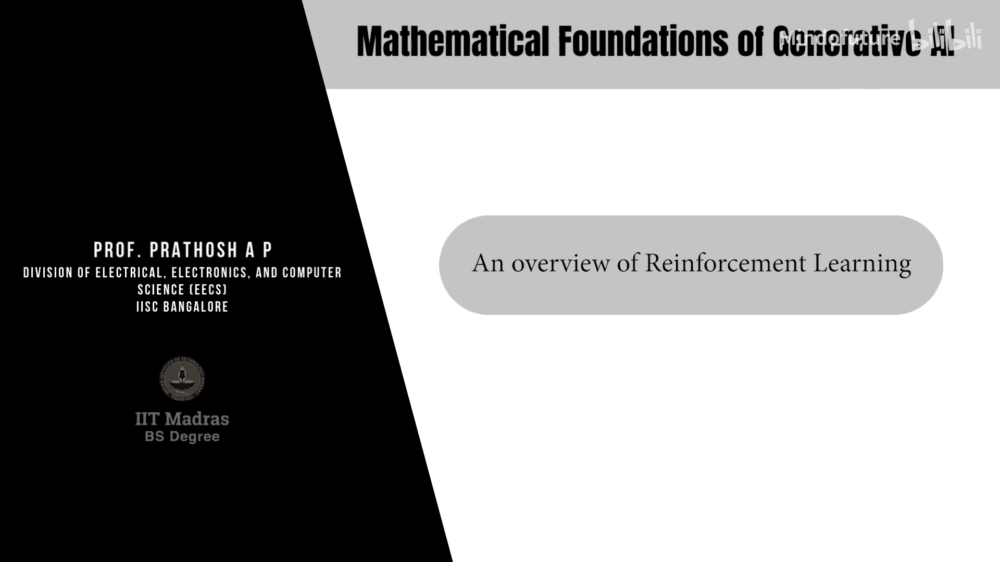
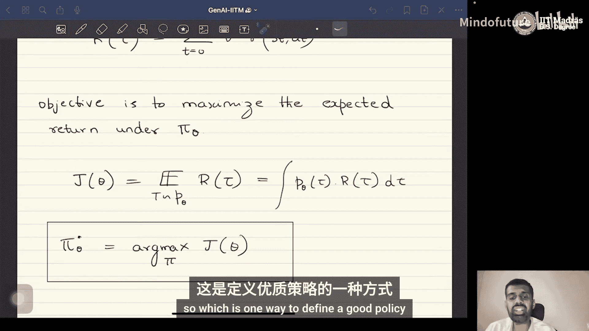

# 生成式Ai的数学基础 ｜ Mathematical Foundations Of Generative Ai p65 P65_W11L47-强化学习概述 -BV1fperz7EjK_p65-

。

하로， 그림？In this。Set of lectures you will be discussing about the reinforcement learning methods for alignment of language models。

As we have seen in the previous sessions。An auto aggressivegressive language model learns a distribution over a set of tokens X T coming from a vocabulary specifically。

It learns to predict the probability of a token Xt given that a previous set of tokens denoted by x less Gen T have already appeared。

Now， this distribution， p the of xt given x less than p is typically modeled using architectures such as transformers。

That have the attention mechanism。Now， given that。A language model is trained using a large set of unlabeled data。

The goal of alignment is to ensure that the language model。

Has compatibility with a desired predefined behavior that is specified either by human annotations or fixed rules。

Why is this important。Typically， what happens is that large scale language models are trained using data that is obtained in。

Places such as Internet， where the data is not regulated in any way。Now， because。

The model is trained in a totally unsupervised way on this sort of。Iregulated data。

One cannot expect these models，2。Behave in a way that is compatible with human expectations。Now。

 to ensure that the models are behaving。In a way that is desirable to what a human being expects it to behave。

The model has to be aligned to the expectations of human beings。Now， how do we do this？

One way to do this is to retrain the model in a completely supervised manner where we have the given input。

And the output in a way that is desired。By a human users。However。

 this sort of data is extremely difficult to be obtained。Now， what is。Easier to obtain is。

That suppose we have a particular language model that is trained。Given an input。

 one can generate multiple possible candidate outputs。

And each of these candidate outputs are made to be。

Rrated by either human judge or some other machine based mechanism。Now。

 based on the ratings are the judgments that the human beings make。

 the language model has to be retrained or rather realigned to ensure that these judgments that the human beings have made on the output that is given by the language model。

Ease。In alignment with what the language model is going to output in future now with this is the broad intuitive goal of why one should look at the aligning a language model once it is trained so I summarizing it again the large scale language models are trained on data that is not regulated which can have all kinds of data tokens。

to ensure that the output of the language models are regulated in a way that is compatible with human behavior。

It has to be retaintrained again， using some methods。

Which would ensure that the output of the language model， language models。

Are compatible with the desired expectation of human users。With this as the goal。

 people came up with a lot of algorithms that are based on reinforcement learning。

Which fits in very nicely within the realm of alignment of language models。

 so let us start with an introduction on reinforcement learning。

An overview of reinforcement learning。Please note that reinforcement learning is a very vast。

Field in itself。And the goal of this course is not to teach reinforcement learning per se。

 but we will only look at a broad overview of what reinforcement learning is all about and look at one of the variants of in a small parts and the variance of reinforcement learning that is used in the alignment process of language models。

Now， there are three broad paradigms of making statistical models learn。

One is the supervised learning paradigm where the kind of data that we have is that we have some data and the corresponding label and the goal is to ensure that the model learns a posterior distribution。

Of labels condition on data。 So this is the usual supervised learning paradigm。

 There is also the unsupervised learning paradigm where you have data sampled from a particular distribution。

 but there are no corresponding labels。 So what we model there is the marginal distribution of the data that has been given。

So there is a third paradigm， which is called the reinforcement learning。

Where the idea is to mimic the way human beings learn there。

The human beings neither have the exact labels。Like in the case of supervised learning。

 nor they do not have any feedback from the environment right I mean the learning with human beings。

Happens in a way that is somewhere in between the strict supervised learning paradigm and the unsupervised learning paradigm where there is absolutely no label。

Now， if you look at how human beings learn。We。Perform a particular action。

 So based on the action that we。Perform the environment that we are in gives up feedback so this feedback can be positive or negative now based on the kind of feedback that a human being receive。

We will change the way we act when we are confronted with the exact same situation later right I mean if it's a positive feedback。

 then our behavior gets reinforced， if the feedback is negative then we change that particular behavior and more to a different behavior。

 So this is the fundamental idea of how human beings learn and this is mimic in the reinforcement learning paradigm。

Let us now formalize the notion of reinforcement learning。In the paradigm of reinforcement learning。

We have what is called as an agent。And in environment。

The agent at every discrete time T stays in a particular state and performs a particular action。No。

The possible states that an agent can be comes from a finite set of state space and the possible actions that the agent can take comes from an action space a。

Now， at every time step T， the agent takes a particular action based on what is called as a policy。

 Now， once the agent。Performs a particular action， the environment responds back by providing it a feedback that is quantified by a function called the reward function。

That what function gives you a real number。From the cross product of the state space and the action space。

 that is when the agent takes an action 80 being at state SP。

 the environment gives back the reward R of 80。Now， once the environment gives the reward。

The agent moves on to a new state S plus one based on。

Another distribution that is called as the transition kernel。And once it goes to the state S plus1。

 it again takes another action based on the policy and this process keeps repeating now the idea is to learn or tweak this policy in such a way that some notion of the cumulative reward is optimized。

Let me repeat the setup is the following that there is an agent that is performing a set of causalus actions。

Being at different states。Every time the agent performs a particular action。

 the environment responds back by giving it a feedback。Which is quantified by the reward function。

Now， once the agent receives a feedback。It moves on to a different state。

Based on the transition kernel and once it is in a different state， it takes another action。

dependepending upon the policy that it is acting upon now this procedure keeps happening the goal of reinforcement learning is to update or learn this policy that the agent acts upon in such a way that some notion of cumulative reward is optimized this is the fundamental idea mathematically speaking this entire process that I just described is formalized by a notion called Markov decision process or MDP which is given by the following T S or gamma and rope let us look at all of them define them so S defines the possible set of states that an agent can be so it can be a finite set of M elements and capital a defines set of possible actions this is also called as the action space。

It is known as the action space。And set S is called the state space of an MDP。

And then there is the transition kernel denoted by P of ST plus1 conditioned on ST and 80。

 this is the probability that in action 80。When performed。

Being at state S at time T will lead to state S T plus 1 at time t plus 1， which is that。

When the agent is at state S and performs the action 80。

 what is the probability that the agent lands up being at state S plus 1 at time 3 plus 1 so this is given by the transition kernel and then we have the reward function which is a function from the cross product of the state space and the action space to real number。

Now this is the reward obtained by taking action 80 at state ST so the agent is at state ST takes an action 8。

 the environment response back by giving a particular reward which is given by this reward functions and a note that this notion of reward is fixed and it is dependent on the environment so that we don't have any control over how the reward is being obtained from the environment this gamma or new is the disc factor it's a number between0 and1。

So this is a scalar I'll just describe why we need the notion of fordi factor and row of is not is the initial state distributions and as you can see there is a stochastic process that is。

That is modeling the behavior of the agent So whenever you have a random discrete time stochastic process we need the initial state distribution。

Vectctor， which is given by row of enat。So now with this。We also have what is called as a policy。

 which is， as I said， the distribution over actions given state S。

 let's say distribution over actions given state right Now this you can see is。The policy。

Its parameterized by theta。Eper by theta。 So now， as we saw the the idea is to change this policy depending upon what sort of reward that we receive。

 Now， it's easy to note that the behavior of the agent completely depends on。

This particular distribution， stochastic policy distribution that would tell us what should be the action that is to be taken being at a particular state。

 This is parameterized by theta。Okay， so while the agent is acting。

 so we get what is called as a trajectory。Denoted by。Taau of this is。A set that contains。

Alternative states and actions。Even it2， sorry， S to。Is to a2 and so on。

 This is we get a trajectory when。The agent。X。B is done。The policy。被铁的。

So lets say that there is an agent that is acting based on a particular policy by theta what we get is a trajectory of states and actions and observed states and actions because the agent is first in status 0 then it performs an action a and r then depending upon the transition kernel it moves on to status1 and then it performs action a1 and so on。

 so whenever the agent acts based on a particular policy we get what is called as a trajectory。

Once we have this trajectory， we can define a distribution over the trajectory。

 let's call this the trajectory distribution。Tragjectory distribution。

 which is a distribution over a particular trajectory that one has obtained。Trag redistribution。

 lets specify that this is under a particular policy。Under the policy by theta。

By theta is given by the following， so let's call the P theta of tau。

 So it depends on theta because it it also depends on the policy is given by。R of asnat。Bes。

The product of。鬼调得。A T given S。Times P into P of。S P plus 1 given。SP and A。

This is simply the chain rule of probability。 So what we have done is that。

We have written the distribution of a given trajectory tau under the policy by theta。

 so recall that a trajectory is obtained when the agent is acting according to a particular policy Now what is this so the agent has started。

At Snat。 So the probability of agent starting at Snat is giving given by the the。

Initial state distribution row of is not and then at at every time T the agent acts according to the policy which means that the agent performs the action 80 given that it is in state S depending upon the action that the agent has performed while being at state S it transits to state S plus 1 in accordance with the transition kernel P right so this is nothing but the product role of probability that would tell you that if you have。

A set of stochastic events， the probability of the entire set of stochastic events is given by。

These the product of these conditional distributions so now the probability of the particular trajectory is given by this expression that will tell you that the agent has started at state 0 now at every time step S it performs a particular action depending upon the policy and once it performs the action 80 being at state S it it transits to state S plus 1 in accordance with the transition kernel。

Okay。Now， with the definition of the trajectory， what we need is need to define the goal。

Of reinforcement learning。Okay， we have to define so recall that the goal here is to learn a good policy right the goal of R is to learn。

Good policy。The question is， how do we define now what a good policy to do that。

 we have to define what is called as a disk。Define another quantity。

 which is called as the discounted reward。Discounted written as it is called discounted rewarders。

 discounted written for a trajectory。Its defined as follows。 let's call this R of tau is given by。

The sum of。Some of all the reward that we have obtained。Over the entire trajectory。And this is。

Discounted by the factor， gamma peak。呃。What is happening here is that you know we could have just said so if you look at it。

 this is nothing but the sum of the reward that the agent has obtained while traversing。

Through that particular trajectory now， instead of simply taking the sum of reward。

 people typically take the discounted the reward for the reason that as we move。

Away from the given time T， the influence that the reward function has on the policy。

 on the way the policy changes has to reduce。Because the actions that are taken closer to a given time step T has to influence the policy more compared to the action that are taken much later that is accounted for by just by multiplying the reward。

By a constant rise to poverty。 So as as we have seen this discount factor。

Gma here is a scalar between 0 and 1。 therefore， as we move farther and farther away from the given p。

 this is going to reduce and that's why we multiply the reward。With the discount factor。

 the powers of the factor， Now this thing is called the discounted written。 Now。

 the goal or the objective in reinforcement learning。Is to maximize。Maxim waste。

The discounted reward。rather， the expected， let's call it as the objective is to maximize the。

Expected。Expected return。Under。Pi theta Okay， so what does this mean。

 Let us define that as so the mathematically speaking， the objective J theta is。The expectation of。

The discounted return where the trajectory is being sampled by。Sle from P Theta。

Which is given by the integral of。BT dot do times。Are of of。Okay。

 so this is the of what we want to do is to。Learn the policy。By start of tda。That would maximize。

The expected return， so this optimization is over all possible policies of this。

Is the objective function。O。Reinforcement learning， so let's just quickly recap what we did。

Now while an agent is interacting with the environment。

 so we obtain what is called as a trajectory which is a set of alternative states and actions。

 we can define the distribution of the trajectory under the policy pie using this particular expression now the goal of the reinforcement learning algorithm is to learn a good policy now one way to define the goodness of a policy is by defining what is called as the dised written。

 which is nothing but。Waited the。Reward over the entire trajectory。

 once we have this discounted return， the objective is to maximize this。Expected return。

 the expected value of this discounted return under the the policy or under the distribution of all possible trajectories。

So which is that we want to obtain a policy by star theta that would maximize the expectation of。

The discounted return while the expectation is taken over the distribution of the trajectories in turn the distributions of the policy so or rather the expectation is taken over the policy。

Now， this is the primary objective function of any of the reinforcement learning algorithms now。

Once we solve this optimization problem， what we get is a policy that would maximize the expected value of the discount deterts。

 so which is one way to define a good policy。

