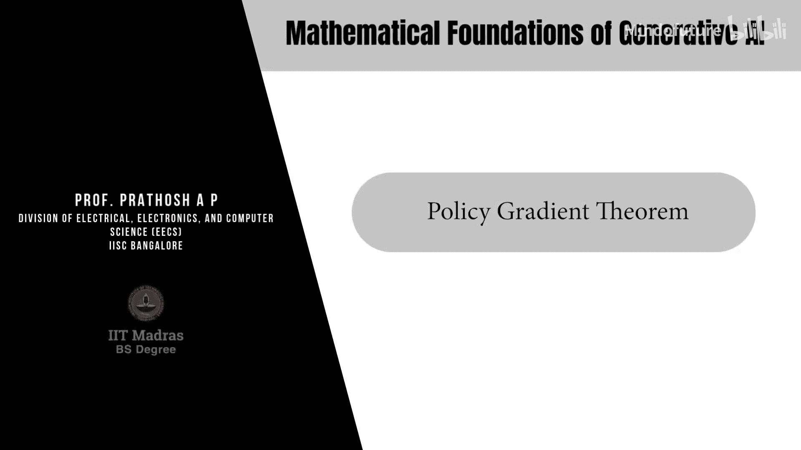
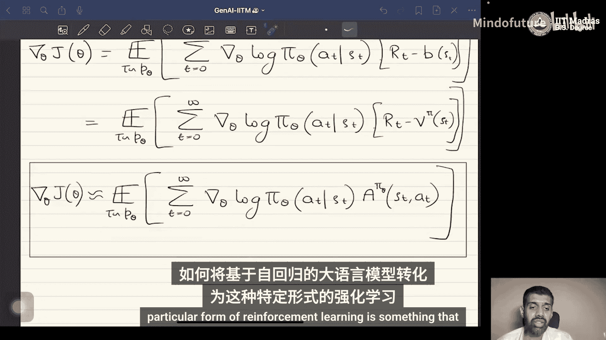

# 生成式Ai的数学基础 ｜ Mathematical Foundations Of Generative Ai p66 P66_W11L48-策略梯度定理 -BV1fperz7EjK_p66-

🎼。

There are multiple ways to solve this optimization problem that constitutes different methods in reinforcement learning。

But for the sake of this particular discussion， we will look at one of the popular ways of solving this optimization problem。

That is given by the policy gradient optimization。Now， the idea is the following， suppose。

The policy that we are optimizing over can be represented using differentiable functions such as neural networks。

So one example can be the particular case that we are considering where the policies are presented using transform or kind of architectures。

 which is a long wave model in such cases this optimization problem can be solved using the usual stochastic gradient methods。

Now to do that， one should obtain the gradient of this particular。Objective function。

 because the gradient descent would say that。That you take。The gradient steps in。

Updating the particular policy， so this is the learning rate and one would meet the gradient of this particular objective function。

Now， this is the。Policy。Updating using gradient decent。

this can be done only if we can obtain the gradient of the objective function with respect to the parameters of the policy theta so to do that we have to look at what is called as the policy gradient theorem that is a very nice powerful result that would enable us to find the gradient of the objective function that that we would need to solve the tabboated optimization problem now let us look at what the the policy gradient theorem ens so what we need is need to compute。

We need to obtain。The gradient。Off。The following objective function。

Pent of the following objective function。 What is the objective function that we have。

 We know that the。Objective function that we have is。The expected。

Discounted written are to where the expectation is with respect to。Tau coming from P Theta。

 So this is the objective function that we have。NowLet us。

Compute the gradient of this objectiveive function。With respect to theta。

 So this is what we need right so let us write that down。

 So this is the gradient of the expectation expectation is given by P theta of tau times。Our to with。

This is with respect to tau， which is the trajectory。

Now we know that the gradient is a linear operator so we can push that gradient。Inside the。

Intelegral， so we have gradient of。BT的到 times。At of。地头。Okay， now the。We need to find the gradient。Of。

particular term P。Thetatau because artta is independent of theta。 Now what is this given by。Let us。

First。Write this gradient using what is called as the log derivative trick where we express this as。

b tda道 da。The gradient of。The log of P3 autoto why is this true This is simply the famous log derivatively where if you take the gradient of log of a function then it is given by one by the function times the gradient of the function which the one by function and this function cancels out and what will remind is the gradient of the function right it is very easy to verify therefore one can write。

你货。We have the gradient of the objective function Jta now is given by。Integral of。B do b t大道 dim。

The gradient of log of。P Tta times。The expected return times data。Okay。

 so now what we need and let us look at the derivative of。Consider。This particular term。

 which is the gradient of。Log of P Theta of tau。 What is this given by。

 So we have the expression for P Theta we know that。We have。P tu of to。To be equal to。

row of Snat we had just defined this using the the product row， right so P row of Snat times。

The product of。T is 0 to infinity， we have。Pi theta of80， given S T。Times。P of S P plus  one。

Given S T and A P。 So this is the definition of P theta， therefore。The derivative of。

Lg of p theta of tau is equal to。第。Graadient。Coned as the sum。equalal to0 to infinity。那个。Gion豆。

Log of。不要调到。8 Q S。So why is this the case So what we have is that you know we need to take the log of this when you take the log of this we have log of row of sn。

 this is independent of theta， therefore the it cancels so we need take the gradient the other term which is p of S plus from given S and8 is also independent of theta which is the transition kernel is independent of policy and therefore that cancels away so what remainss is the term that involves the policy and because there is a product here and we are taking a logarithm that would get converted into a sum and we can put the gradient inside therefore the derivative of log of p theta of2 is simply the sum of sum from t equal to0 to infinity we have the gradient of log of。

Pi theta80 given S T and the derivatives with respect to theta。 Now， putting this back， we have。

The gradient。The gradient of the objective function is simply given by。Interegral。B t do of the di。

T equal to 0 to infinity。Cent of v of。不调大。K honest I'm just rewriting these terms and look at this。

 So this is there is there was P of tau and there's the gradient of log of P of tau which we wrote in comes the policy and we have。

The other term that we have here is。R tu times beta okay。This can be written as an expectation。

 You we have this is the expectation of。T equal to0 to infinity。Log of。跪铁咗。It is honesty。Times。

The returnturn and this expectation is with respect to Tau， as it is coming from。BT导数。

So this is the most fundamental form of what is called as the policy gradient theorem where we say that。

The gradient of the objective function that we used that we used to。

Update the policy is given by this particular expectation， so this is called the policy gradientem。

Now， as we discussed earlier， what we can do is one can use the gradient decent。

The usual grid and distant method。都。maximize this particular policy and we now have an expression for the gradient of the objective function that we have so this constitutes the foundational method of policy gradient method-based optimization function object optimization procedures to obtain an optimal policy in the reinforcement learning paradigm what we will do next is that we will improvise this this estimate of the gradient is known to be very noisy and there are ways to reduce the variance of this particular estimate we will see those ways of reducing the variance of this estimate and then we will connect the primary goal that we started with which is alignment of the language models to this particular policy gradient optimization method and close the loop in finding out。

How would one use these results？In aligning the。Language models that are trained in a completely unsupervised way。

 Another observation in the particular equation that we just derived is that。

This expression applies the same total return R tou to all steps， all time steps T。

 regardless of when the action was actually taken。 So we have this R ta here that would apply the exact same return at all time steps。

Now， we can make it more efficient by defining。Define。Another quantity or T。Which is called。

The go to reward are written from T， right this as。Is this gingerful。The time index。Over eight times。

Reward that is computed。At time is。T plus K and Ac T plus K。

With this we have r tau to be equal to just r n。We can rewrite the gradient of the objective function using this Rt now。

So here。The gradient。Is equivalently written as。Creent of J theta is expectation of。

Expectation at respect to Tao， we have the sum。M T equal to 0 to infinity， the gradient of。

The log of the policy。And what we multiply here is not our tou， but our t。

Which is the reward that we have computed from。Time T to infinity at every time t。

 so instead of computing it from0 to infinity at every time step we compute it from t to infinity right so this is the form that is typically used。

We also said that this particular form that is used。Has a lot of variance to reduce the variance。

 What is done is to。Des。The variance of the Ebo estimate。The variances。

Of the abovebo gradient estimator。A baseline function。A baseline function。Call it as P of S。

 which only depends on state， is subtracted from the return。Is subtracted。フ럼。The return。

So this can it can be shown that this does not alter the the expected value。

 but it reduces the variance I will skip that proof。 so therefore now the new gradient estimate。

With the baseline subtracted， willll have this particular form is expected value of。The some of。

Log of policy。Now here， instead of Rt， what we have is Rt minus。B of SD。

Which is called as the baseline， which is now subtracted。From the。你同啲个度。

0 to infinity and this is expectation as with respect to p tau so this is the base baseline subtracted version of the gradient。

Now。There are multiple choices that have been made in several algorithms in the literature。

 one of the。Famous choices that is made for the baseline function B of S can be taken to be what is called as the value function。

 B pi of S， which is defined as the value function。

So this is one of the choices that is made for the baseline and it it has been shown to be very efficient in terms of computation of this particular gradient。

 Now， let us define what this value function is。And see what the final form of the the gradient of the objective would look like。

Those。Let us define。Dine。The value function。As follows。The value function as follows。 So we have we。

闭。Of steel noted by this as the expectation of。Expectation of the discounted reward。Given that。

The agent has started that state。Is B。At time t equal to 0。

 So this is this expectation is respect to policy。 So what is this。

 This is the expected return that we have gotten。By。

Enacting the policy from the initial state being equal to S。

 so this is the definition of the value function。Okay， now there is another。

Cogninate function of this， which is also called the Q function are also called as。

The action value function， which is defined as follows， the Q function is defined。Denoted by cube pi。

S the commma A P， this is defined in a very similar way to the value function。

 this is expected value。Of the discounted return。Rather discounted reward。When the。

Policies executed by taking。The initial state to be S and the initial action to be 80。

So what is done is that。We have ensured that the initials the agent starts at an initial state of S and takes one particular action initial action。

 which is at the question that we are asking is given that we have started at S and taken the action A at time t equal to 0。

 what is the the expected reward or discounted reward that we are getting so this is called the Q function and we have both the value function and the Q function defined this way there is another function that is defined which is called the advantage function。

A donate function， which is simply。Given by the difference of。Difference between。你叫冯群。

And the value function。This can be interpreted as。What is the advantage that sorry this is v of S value function is a function of state。

So what is the advantage or the extra reward that one has obtained by starting at the particular action a now look at this v is telling you what is the expected reward that we get by starting at state s the Q is telling us。

What is the expected reward that we would get by starting a state。

 starting at status and taking the action a。 If we take the difference between these two。

 what we would get is the。Advantage， so to speak that we are advantage in the reward。

 the extra advantage in the reward that we are getting by not only starting the trajectory at state S。

 but by also taking the action a at time P equal to 0。 This is compared。

 this is this is called the advantage function of the value function Q function and the advantage function。

In writing the expression that we need in a more compact form。What we need to recall。

 what we need to compute is the difference between the go to reward and the value function we find。

There is a nice result that would aid us to compute this in a compact form。

The claim is that the difference between the go to reward word and the value function that。

Appears in the gradient of the policy is is an unbiased estimator of the advantage function。

 So this is the claim。Let me repeat the claim is that the difference between the gota reward and the value function is an unbiased estimator of the advantage function that we just defined How do we show that So consider the expectation of this particular term that we are interested in conditioned on the state SD and the action 80。

We just split the expectation and show that the value function will just come out and the expectation will just give the exact same value。

Now we have the expectation of the Eta reward condition on ST and 80 and this by definition is nothing but the Q function Now the second term that we have here is the value function。

 therefore the conditional expectation of the eta reward and the value function condition on ST and80 is nothing but the ata function。

Okay， now what did we just show we just showed that the expected value of this difference is equal to the advantage function now if we just take Rt minus v pi of S。

It's very easy to note that this is a single sample estimate of the expectation that we have here right So if we just take one sample from the underlyingline distribution。

 then what happens is that you can take that as a single sample estimate of the expectation。

 Now this becomes a single sample estimator for the advantage function right therefore the decline that we just said is is proved that the difference between the goto reward and the value function is a single sample unbiased estimator of the advantage function because of these three simple steps that we just showed。

Therefore。Coming back to what we are interested in so we wanted to get the gradient of the objective function and we showed that that is given by this particular expression and the baseline was subtracted from thego to reward to make it。

To reduce the variance of this expression。And the baseline。

 one of the famous choices for the baseline， was the value function。

Wwhich makes it the difference between the go to reward and the value function and we just show that the difference between the go to reward and the value function is a single sample unbiased estimator for the advantage function right therefore the final expression for the gradient。

Of the objective function that we need in policy gradient theorem is given by this particular expression where we have the sum of the derivative log of the policy multiplied by the advantage function and this。

Is also。Parameterterized by theta So this is the expression that is used in most of the state of the art algorithms。

 policy gradient and based algorithms that are used for alignment of language models。

Now there are two questions that we need to answer here is that how would one use these sciss in the setting of an not language model and two how the advantage function is computed in practice now advantage function is computed in practice using a parametric reward model that will be trained so we will talk about training the parametric reward model later in the in the N course。

Now， once we have a parametricic reward model that is trained。

 there are several methods such as a generalized advantage function estimator or Gs that can be used to trivially compute the advantage function。

The other important question， which is。H would one。

Cat an autodeive based large language model in this particular form of reinforcement learning is something that we would just see。

