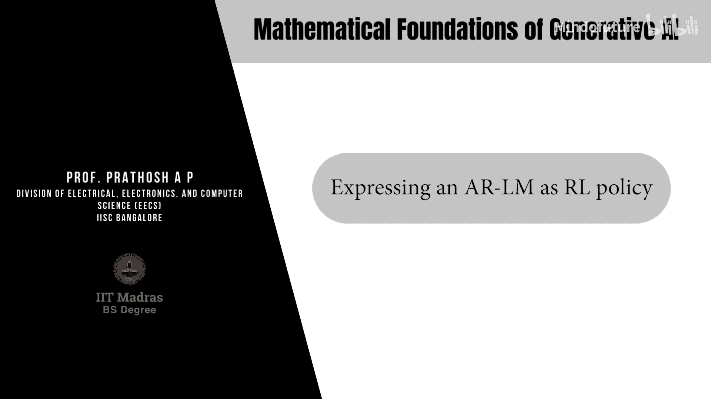
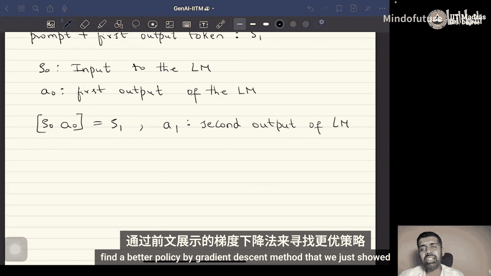

# 生成式Ai的数学基础 ｜ Mathematical Foundations Of Generative Ai p67 P67_W11L49-将AR-LM表达为RL策略 -BV1fperz7EjK_p67-

🎼。

Okay， so now let's come back to。Expressing。A language model。

Or rather an autoregressive language model。As an oral policy。

Right for all the theory that we have seen so far to be applicable。

 we need to first express an autoregressive language model in terms of an r policy。

 Let us see how would one do that。 So what do we need。

 We first need to see a language model in terms of。An R policy。 So what is done in an in in。

An autoregressive language model。What we predict。都跟。X P given。Given the historical tokens？

RightThis is what we do， which is we are modeling P theta of X P condition done。

Everything that is less than0。This is what we do， right in the context of。

In the context of reinforcement learning。The language model。Itself。Is taken as a policy。

policy by theta。Supパテタ of。8 T given s the the train the language model is。

 which is which is P the of x T given x t less 10 T itself is considered as a policy。

 it makes sense because what we finally want to opt is the language model and in the R framework。

 what we optim is the policy， therefore， it is natural and obvious to consider。

The language model itself has a policy right Okay， so now to apply the policy gradient optimization。

 what we need is a trajectory for to apply。あ름。We need a trajectory。

 so how do we define a trajectory in a language model is as follows。So in the language model。

We need a tragic pre， let's write it as a tau。Is equal to。It's not in not。We have S1， A1 and so on。

 so we need a trajectory three of this art in a longage model。In a language model。

 the trajectory is given as the follows the。Initial。Input。と感す。Let's call this as。

Prom right I mean you give an input to a particular language trained language model。

 which is called as the prompt， you take this as S not。Okay。In art。です。他来的。The first token。

 the first output token。Is taken us。You're not。Okay， then。Be proud。Plus。First， output token。

Is itself taken as S1 and so on So we do it cumulatively。

 So what is this So now Sn plus So we have Sn is the input。Input to the language model。And a not。

Is the。First， output。Of the language model。그。We have。Is not plus is not and is not concateated。

 which is the prompt and the first。A token that is given first output token is taken to be S1。

And the， the second action is the。Second output。Of language model and so on。

 So this is how we build a trajectory that is required for any R based algorithm to be applied in the case of a language model。

 So the policy itself is taken to be the language model or the language model itself is taken to be the underlying policy that we would want to optimize。

The trajectory is built that way so the input is taken to be the first state。

 the first output token that is generated out of some inference process from the language model is taken to be the first action now you concatenate the input and the first output token as and that constitutes the second state。

And given that second state， the language model outputs another token that becomes the second action。

 concatenate that with everything that is before， that becomes the third state and so on so that so you constitute project 3 in the case of a language model。

Now， once the trajectory is constructed， it is easy to use the policy gradient theorem to。

Find a better policy by gradient and decent method that we just showed。

