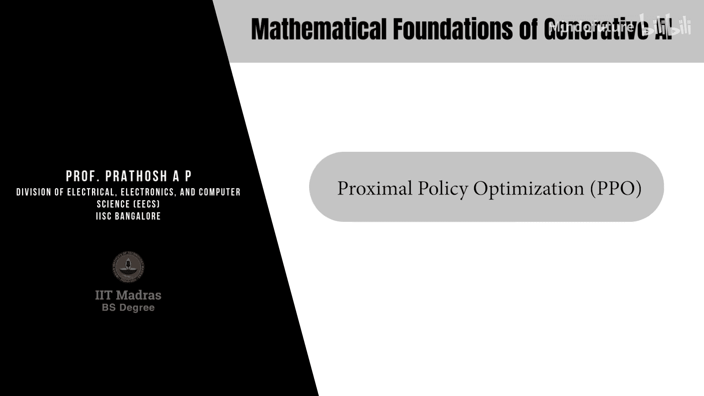
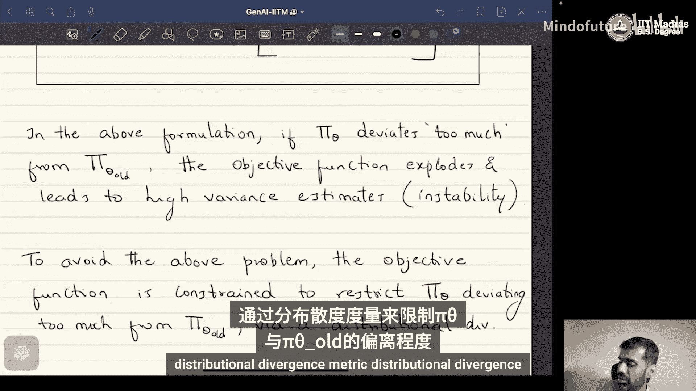

# 生成式Ai的数学基础 ｜ Mathematical Foundations Of Generative Ai p68 P68_W11L50-近端策略优化（PPO） -BV1fperz7EjK_p68-

🎼。

Hello everyone in this module。We are going to look at two improvised versions of policy gradient algorithms for aligning the language model to human preferences。

The first of them is called the proximal policy optimization algorithm or PPO and the other one that we will be looking at is what is known as。

DPO or direct preference optimization。These are。The two very popular algorithms that are used currently for aligning the auto autoregressive language models。

To a particular。Preference that is given by humans or very favorable data。 Now。

 let us start with proximal policy optimization or PPO。So， recall， recall。That。In the R framework。

In the R framework。A language model。Is viewed as a policy。Is viewed as a policy。

A parameterarameterized policy given by denoted by pihi theta and。Policy gradient algorithms。

Policy gradient algorithm。Is used。For alignment。Allignment of that particular policy that is what we saw right so we saw that the parameter update so what was the policy gradient algorithm。

The policy gradient algorithm。Effectively updates the policy using this particular。

Radianant update where theta represents the parameters of the policy given by。Doing a gradient asend。

On an objective function， J theta。That。We obtained an estimate for the gradient。

Of the objective function， which was。The discounted return。

 we saw that this was equal to the expectation。Of trajectory coming from。The policy， we had gradient。

Of long。Of the policy。Policy always is a distribution of actions。Conditioned on states， we saw this。

Bahings。The advantage function。So， this was the definition of the gradient of the objective function that would be used in policy gradient theorem right so now if we approximate this expectation using the log large number sample average is then。

Rather， let say， suppose。Suppose G had。Is an estimate。Is a sample estimate。

Gha is a sample estimate for the abovebo gradient。Sample estimate。For the evo gradient。In that case。

We have G cap to be equal to。1 by B。T equal to 0 to capital t -1。The gradient of log of。The policy。

 in this case， this is a transformer based language model times the advantage function。Right。

 the estimated advantage function where。A cup T is。The estimated advantage。And。A P comma S P。

Are the actions and states coming from the rollout？Are the actions。And states。Bronze from the roll。

So what is a rollout， a rollout is。Enacting the policy in the Ral framework。

 but in the case of a language model， what we are doing is giving a particular prompt and generating。

Thesponses， right we saw how to model a language modeled in terms of the actions and states within an a framework in the last module。

 So this these are the。Roow roads these are the actions and the states that are drawn from the rollout from the current policy right so this is the sample estimate of the ebo gradientarian that we need。

Okay， so now while this can actually solve the problem in the sense that you know one can compute all the terms that are here because you know one can evaluate the log likelihood of the policy。

 which is nothing but the logics that we get at the output of the transform the advantage function can be estimated using generalized advantage estimators and which means that one can take the gradient of log of the the policy using the usual back propag algorithms so this estimator for the gradient that we need for updating the policy can be obtained。

好那么。This is the knife policy gradient algorithm which can be used to update the policy。 So however。

 what is known is that this estimator is on policy， which means that。The above estimator。

The aboveestator。For G， right。Is。On policy。In place。That it requires。Fresh samples。我ら。

Fresh samples for each。Update。From the policy。now what does this mean if you look at this expression here the rollouts or the actions in the states that we are obtaining are actually from the same policy that we are trying to optimize by theta in the context of language models what is happening is that one would input a particular prompt and get the corresponding response so by giving multiple prompts as inputs one would obtain multiple responses or responses as outputs and this would constitute action and state pairs state and action pairs that would that would be the rollout for computing this gradient。

Now， the issue with that is， it is from the same policy that one is obtaining the rollouts that is getting updated as well。

 So every time a gradient step is taken， one needs to。

Otain a rollout from the exact same policy that is getting updated and these sort of updating are called on policy methods because the rollouts are coming from the same policy that is getting updated via the policy gradient algorithm okay now what is the issue with this the issue with this this。

Now， if you start sampling from the exact same policy。

Before each of the updates now what happens is that one this process is extremely expensive because one needs to collect the same policy mean collect the rollouts from the same policy that is getting estimated that is getting updated the second problem is that it will increase the variance because every time a new traories of pain it is only used for one update and the next time once the policy is updated a new tra is being sampled so what of one like is to reuse the tra trajectories which are collected from an old policy and use those as data while updating this current policy so basically what we are talking about is that instead of having on policy。

Updation， we would like to see if it's possible to use a different policy for collecting the rollouts。

Thenhan the one that is being updated turns out that this is possible by using a well known statistical technique called important sampling so let us look at what important sampling is all about。

Importance sampling。importantmant sampling is a generic method in classical statistics。

That is used to evaluate expectation of a particular function。 What is the problem， the problem。

Is to compute。Compute the expectation。Of a particular function of a random variable fex。

With respect to a distribution where x is coming from P。

 So this is the problem that we are interested in。If this is the problem that we are interested in。

 okay how do we。Represent this expectation so expectation of a function with respect to a distribution P。

It is simply given by assuming that the density functions that we have the random variable that we have is a continuous random variable is equal to integral px times。

Fx， Dx。And this is over the sample space。 now， suppose。QX。Is。Another distribution。

QX is another distribution。On the same random variable except this is the case。

Then what I can do is that I can represent the。Expectation of this Fx。With respect to Px。

As the follows， so I will simply multiply and divide。This particular integral。

By QX now because QX is a density function， it is always non negative and the integral does not change if I simply multiply and divide the integral with this particular function  QX。

NowWhat is thisequ to if one closely observes it， this can be written as。嗯这个头。This is integral。Bx。

B Ux。Ts。F of x。Into。QX。Dx。Cates Vx。 So if you closely observe what is this equal to。

 this is nothing but the expectation of。P x by Q x。Times f of x。And x is now being sampled from Qx。

Okay just observe this expression here So whatever we have here can be represented as a function and  Qx is the underlying distribution with respect to which we are comp the expectation。

 Therefore， this entire thing would be now expectation of f of x times the ratio of these two densities and this expectation is now with respect to Qx instead of。

Instead of P X， Okay， So now what did we just do， we wrote。The expectation of a function if a x。

With respect to distribution Px as an expectation。Off。The same function， F of x。Multiplied with。

The ratios of two densities。And this expectation is now with respect to。Qux。Now。

 this technique is what is called as important sampling where what did we just do？

What is an expectation with respect to some density px is now converted into an expectation with respect to some other density qx all that you need to do is you need to know how to compute the ratio of these two densities。

 the old density and the density。Then the expectation with respect to one of the densities of a function can be computed as an expectation that is taken with respect to the other density qus。

Given that the function is multiplied by the ratio of the these two den at all points。

 so this is the result。This particular result is what is called as important sampling。

probablybably you would guess how would this be useful in our case remember that in our case what we were interested in is computing this particular expectation right of a function with respect to some distribution P data now the problem was that we do not wish to take the sample these trajectories from the same policy that is getting updated so instead of taking an expectation with respect to the same policy that is getting updated we will draw a trajectories from some other。

Policy or some other language model in this case。And keep it fixed。 That is the whole idea。

 And instead of using this function now， it is now become the important sample sampling version of the expectation。

 the policy gradient update that we have。Now the next question is。

How to use this idea of important sampling in the policy gradient here， let us look at that。

In the context of policy gradient theorem。In the context of。The policy gradient in theorem。

Context of policy gradient， we have。The gradient of the objective that would want to optimize。

What was that equal to， That was the expectation of。The gradient of log of the policy。

Phi theta A given S times the advantage function K T， this is what we had and this expectation。

 what is important is to note that this expectation was with respect to is with respect to pihi theta which is the policy that is getting  estimateatory。

No。Suppose。There exists another policy。That exists another policy。バイ tda 올。Some week。

The traies are drawn。From which the trajectories are drawn， Okay。

 now applying the idea of important sampling， what do we have we have。This expectation now， J theta。

Which is equal to the expectation of。Log。5hi theta80 given S times。

A and this expectation is with respect to 0 theta is now equal to。Expectation of。This function。Log。

P theta80 given ST times the advantage function， multiply this entire thing by the ratio of reddensities。

The what important sample， important sampling showed us。Diverted by pi Theta old。

Right so now this expectation。The outer expectation now is with respect to poly theta words so this is what important sampling showed us right so just to recall what did we do so the expectation of a function with respect to some distribution is given by the expectation of that function multiplied by the ratios of the densities and the expectation now is with respect to the new density cube Im just applying the policy gradient theorem here what we have sorry the important sampling idea here。

What we had was expectation of some function with respect to pi theta now take this function。

 multiply it with the ratio of the previous distribution and the new distribution our expectation is now with respect to the new distribution in which in our case which is pi theta old now this。

Can further be reduced in a very interesting form。 So consider。Consider Poi Tida。

A given S divided by。P3ta all8 given S。Timemes。The gradient of log of。P Cta，80 y S。Now。

 this is equal to。The gradient of。P theta8 T given us P。Divvered by。8体的 word。A P UND。

This expression is easy to verify It follows from the definition we have the derivative of log of pi theta which is the derivative of pi theta times 1 by pi theta so pi theta in the numerator and the denomerator cancels off you have the derivative of pi theta diverted by。

Pi theta old8 USD， which is a constant， as far as theta is concerned。 right Now， what is this imp。

 this implies that。We can。Define another surrogate loss function， define a surrogate loss。

Srogate loss function。Sororate loss function。Let's call it L theta that is equal to the expectation of。

RRT times。The advantage function A and this expectation is with respect to pi theta O where。

R T is the density ratio， so which is。Y theta80 given S。Divided by。Divided by pi theta old。

A T given S。Okay， now what we just did was we defined another。Survegate loss function。

 It's easy to show that。Can be seen。Can be verified。Can be verified that。The derivative of。

This particular surrogate。Is same as the derivative of。The surrogate that we had。

Where do we derive the policy gradient theorem at？뒤다이 골드。Cta old。 So it' is very easy to show。

 we just showed this actually， right， if you look at it the we use the important sampling of the gradient of the。

Function that we needed in the policy gradient theem was simply given by this expectation which involved a ratio here and the expectation was with respect theta would and the expression that was there inside the expectation。

 which was this。Was shown to be equal to the derivative of this density ratio。

 so let us write this as as equal to the derivative of。R T right This is the density ratio。 Now。

 if we simply define another surrogate loss function， L theta。

 which is expectation of this ratio times the advantage function。

Then it is trivial we already showed that the gradient of this surrogate loss function is equal to the gradient of the objective that we need in the pulseulsi gradient theorem。

Okay， now why is this important in methods just PPO。In methods such as Bvo。And D P O and TRPO。

 the surrogate。Objective。Is used。So this is why we need this If you look at the expressions that are used for PPO TrRPO and so on and you would see that the objective function that is used will have this particular surrogate but not the the one the form that is used for the policy gradient is simply because the derivative of the serogate is exactly equal to the derivative of the objective function that we need so let us write that now。

呃。PP O objective no not yet。 So let's write this as surrogate objective。

 Let's call this as L important sample objective。 So this LIS theta is equal to the expectation of。

R T， which is the ratio times。Wite it explicitly， perhaps so this is equal to expectation of。

P theta80 given。SD。Divided by。🎼By old。80 given S times the don types functions。 So this is the。

New objective function that we have。Which was constructed。

To solve the problem of on policy learning so this expectation now is with respect to pi theta old right this is what we derived using the important sampling theorem important sampling idea where the objective now involves the ratio of the two density functions which are two different policy the old and the new policy and the expectation is with respect to an old policy theta old that is not getting updated during the policy update right。

This forms the basis for this expression forms the basis for a lot of R electrical algorithms。

 including PPO。Now， let's start from here and slowly derive or improvise and go towards the policy gradient hereorem。

 sorry， the P P algorithm。 Okay， now， there is an issue with this particular form that we just looked at。

 which is that if。In the above formulation。In the above formulation。If。W too大。Dvis。

Diviates too much from。Good much from。52 dot org。Red what is happening。

 we get the trajectories from pi theta old， which is a fixed policy and then update the parameters of the policy given by pi theta using gradient de right。

Now， in。While doing this。If p theta， which is the new policy that we obtain after gradient decent。

Deviates too much from pi3 to old， which is the old policy then。The objective function。Its flos。哎。

Leads to very high variance estimates。High variance estimates。Leading to instable training。

 instability。So meaning， while we are。Updating the policy P the。

 we dont want that to get updated not too fast。In the sense that we don't want that to get de from pi theta old too much so how do you ensure that that this does not happen you know it its an obvious way there is an obvious way to do this is constrain this optimization problem using some k type of divergence constraint that would not let pi theta go too far away from pi theta old that is the idea。

然后多。Avoid the above problem。A problem。The objective function is constrained。

Objective function is constrained。To restrict。Restrict pi theta。Deviating。都 much去。From pi theta old。

 so how is this done？喂呀。A distributional dirgence metric。Distribut distributional divergence。

