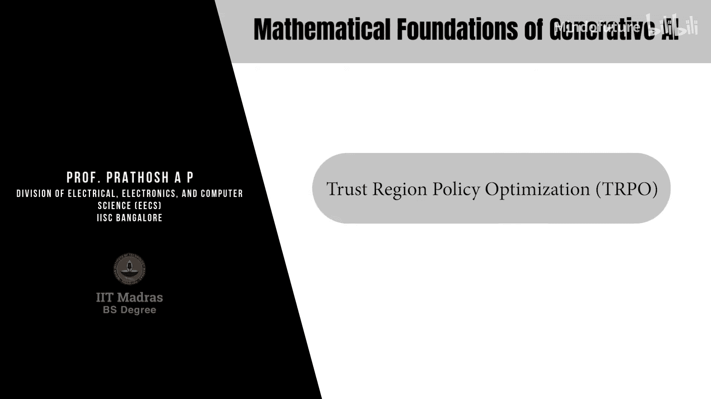
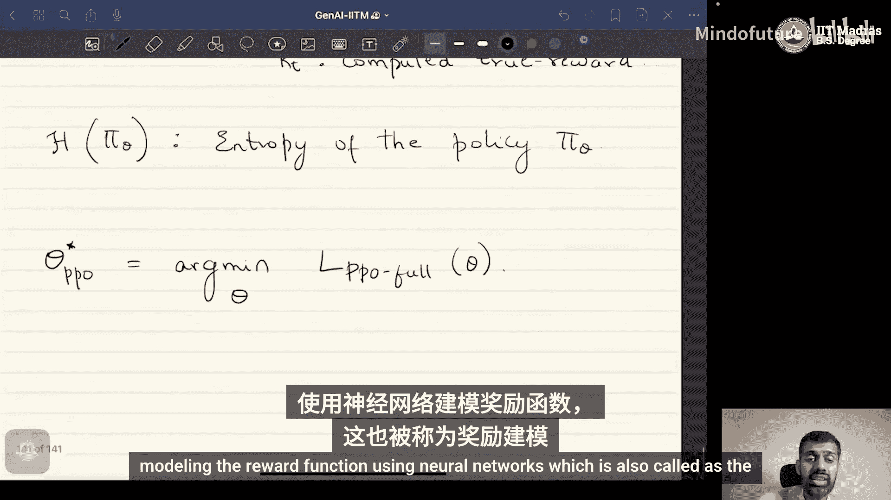

# 生成式Ai的数学基础 ｜ Mathematical Foundations Of Generative Ai p69 P69_W11L51-信任区域策略优化（TRPO） -BV1fperz7EjK_p69-

。

Now， there is an algorithm called。Trust region policy optimization， which would exactly does this。

 we will just write that down。 so trust region。Policy optimization。

Trust as policy optimization abbreviated as TRPvo does exactly what we just described， which will。

Do the following， So the objective in TrRP O。Its simply。

The same expectation of the ratio times the advantage function。

 this expectation is with respect to pi theta old。Subject to。Deal divergence。Between。The old policy。

And the policy that is getting updated。This should be。Bounded。

By delta where delta is a hyperparameter。Okay， so this is the idea where we said， okay， fine。

 we will。Update the policy using the policy gradient theorem。But。

We will do it slowly in the sense that we will update the policy with a constraint that decay divergence between the old policy and the policy that is being updated is bounded by data。

 We not。 We will will ensure that。The new policy is not too much away from the old policy。

 this is what the trust region policy optimization algorithm or TrRP does。Now。

 the problem with this is。Computing and implementing the scale divergence and incorporating that in the policy gradient theorem is a nontravial problem okay so do you how does one solve the constant optimization problem in the case of PRRPO is not the。

Objective of this particular lecture。 But the take home message is that。

Solving this constant optimization problem is。Not to will， therefore。The policy。

 proximal policy optimization algorithm， PP PO so。Sowin。

The above constantstrain optimization problem。Optimization problem is。No주。Therefore。And thus。

PP rule proposes。A surrogate of objective。That does not explicitly compute the care。

That does not compute detailed dirgence。Explitely。So the idea here is not to compute the divergence explicitly。

 but to use another way of constraining。The updates of the policy by just clipping the the objective function effects just above or below a particular boundary。

 So that is the idea that is used in PP PO。 So let us write that， so。Proximal policy。

Oximal policy optimization。The PPO objective that is there is the following。 so let。As usual。

 we have the ratio of the densities are of theta given by pi theta。啊AD。

Given a3 divided by pi 3 top old。8 equal U and S D， So this is。The density ratio that we work with。

Now， the objective function， LPPO。为。Of theta is given by it。

 So we have the expectation with respect to the old policy， as usual， Theta old。So this is Theta or。

Here what is taken。 So recall that the actual objective that we had was。

The ratio R T multiplied by the a x function， right， So that is what we have。 So instead。

 what is computed is the following。 we take the minimum of。R T times the advantage。干嘛。Clip。

Of R T times。Party comma。1 minus epsilon。Coma1 plus epsilon。Baams。The aage function。

 So we take the minimum of these two。Other than taking the ratio time advantage so what is happening is lets write this down so where。

也比。Is simply the。Estimate of the advantage。Of the advantageage function。

 this is common right this was there everywhere。don't takes function。AndExon， Excelon。Is。

A small constant。I typically lets say a 0。1 or 0。2 or something right this is a user defined constant which is given so what is happening is the following right so whenever。

The advantage is high， which means that we are。Looking at good actions， right， I mean。

 whenever the advantage is better， So we want the policy to we want to encourage the policy to move in that particular direction。

 if that is the case。Then。This particular objective encourages increasing that particular type of behavior。

Now， that is okay。 that was there with the previous objectives as well。

 but now we have to constrain the policy。Not to go very far away from pi theta pole right。

 So how is that taken care of that is taken care of by taking the minimum of these two operations。

Now。If。R T， which is the。レしを。Increases a lot beyond a particular point defined by epsilon at both these sides。

 what is done is that the value is splitped at 1 minus epsilon or  one plus epsilon both above and below。

Okay， now what is happening here is by having the clip operation。

 we are not letting the objective function， which is the ratio of the the densities go beyond one。

 So now what is this R T R T is nothing but the ratio of。Pi theta。

 So we look at the definition of R T is the ratio of pi theta pi pi theta old。 Now。

 if this is too much。Great than one， which means that pii Theta is exceeding pi Theta old a lot。

 So whenever that happens， it will be clickped。so it will be kept。

By the number that is clip to the number that is defined by epsilon。 Okay。

 so now by having this clip operation。What we are doing is we are not letting this ratio go too much far away from 1。

 which means that we don't want pi theta to go too much away from pi theta old so that is the idea。

Now， why do we have a minimum here is because。Whenever the advantage is positive。

 we want this r theta Rp to increase the new policy has to be in such a way that the ratio has to increase and whenever this A is negative。

 we want this to decrease because we don't want that particular direction parameter direction in the policy to be taken because we have the negative advantages。

However， in both of the cases， we don't want our policy to deviate too much from pi theta old。

 And that's why we have clipping at both directions， which means that if it exceeds one。

Then we would clip and if it comes below one too much。

 then do we clip so we have a clip operation which would clip the value of Rt if it exceeds too much below and demo1。

 which means that it is going to it is going too far away from pi theta old at both directions if its not going too much away。

 then what we do is we just simply take Rt times 80。

 which is which boils down to the previous objective that we have right So this is the final this is the objective。

 the clip objective that is used in the PP0。Iげ them。Now， the complete PP PO objective also has。

So let's call this as PP PO full。 The complete PPO objective has two more terms。 The first term is。

 of course， this LP P O， which is the。Clippped version of the surrogate objective。

 and the second one is some alpha times。The expectation of。V theta of S minus。Rt。Square。

There's a third term guitar。Times。want that to。So this is a negative here。 this also is minus。

Minus some be times expectation of。Entropy edge of the policy poly Theta。

Let me just explain the first objective we already saw。

 the first objective that we have is the surrogate objective that we just saw the second。

Objective that we have， which is V theta of S minus R T squared is。The laws。To estimate。呢把六方程。

Now why do we need the value function， the value function is needed to estimate the advantage that is there in the objective so we treat off S is the value function。

And R T is the。True computed reward or rather computed true reward。Computed true reward。

Okay so what is this doing is simply solving a regression task over the value function。

 So we have a neural network typically this width heat is represented as a neural network and this neural network is simply estimating the reward Rt which is obtained by the data that we already have So now how do we get the reward is is a question that we would answers subsequently assuming that we have some way to compute the reward this particular objective is regressing over the two reward to get the value function Why do we need the value function we need the value function to estimate the advantage function which appears in all of these objective functions So recall that the advantage function is nothing but the difference between the two function and the value function both of them can be estimated using this neural network using the two reward so we have that as one of the objectives the third。

Objective that is there here。 So each of。T theta is simply the entropy of the policy。

This is also included in the objective function because we want the， the。

Entire objective to ensure that the policy does enough exploration。

 So in in in in the objective that we right now had is completely dependent on the ratios of the the。

New policy and policy。 And this is based on the rewards。

 We need a way to encourage policy to explore more。

 So that's why people incorporate another objective， another。

Function in the complete objective function of P， which is nothing but the entropy of the policy。

 You know， if we want， we want the entropy of this to be optimized as well。 Okay。

 so we want the entropy， the entire thing。 So basically the final。

Parameterters of the policy that we get is the one that would opt which would minimize。

This particular objective function， which involves。

 you know we want there's a negative here because we have written the objective function in terms of minimization。

 And you know that in the policy gradient theorem， we want the reward to be maximized。

 And therefore the negative of these great objective has to be minimized and this is a regression task。

 as we said， that is simply a regressiongressing over the value network to estimate the reward and the entropy also has to be maximized。

 And that's why we have a negative sign here。 So in the second term。

 we want this to be optimized as well。 because。We want to estimate the value function。

 So the total objective function has three terms， which one is the。

Policy gradient optimization therog it further。 The second one is the regressor over the value function。

 The third one is the entropy of the policy。 right This come takes us to the end of the PP algorithm。

 once this PP algorithm is run， we would expect to get a better policy a new policy that is aligned well with the human preferences。

 So theres one missing pieces in in the puzzle， which is。How do we get this reward。

Function which is required to get the value function and the value function is needed to estimate the advantage function and so on right so this entire policy gradient method depends heavily on the estimate of the reward function that we have and for that we need to look at how to model this reward using neural networks。

 So what we will look at next is。Modeling the reward function using neural networks。

 which is also called as the reward modeling。

