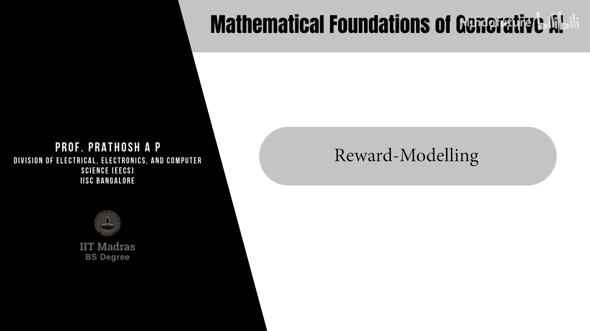
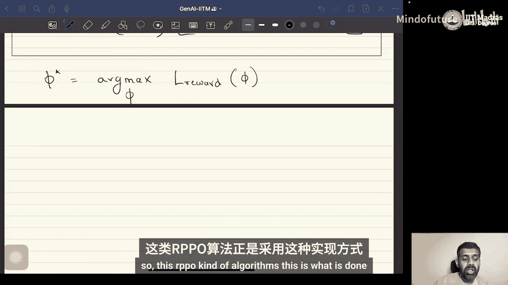

# 生成式Ai的数学基础 ｜ Mathematical Foundations Of Generative Ai p70 P70_W12L52-奖励建模 -BV1fperz7EjK_p70-

🎼。

Let us now discuss。Reward only， as discussed earlier。

Modeing the reward function is important in almost all of the policy gradient based R algorithms because advantage function is based on reward。

 the value function is based on reward and so on that appears in the loss function of all the policy gradient optimization algorithms。

Now， how is it done in practice is as follows， if you recall。

 reward function was a function that operates on the crosspar of the state space in the action space and maps it into a real number。

Now。Practically， what it does is that it takes a state and an action as input and associates that state and action pair with a real number。

which signifies how good the action was so of given a particular state and an action s comma a。

 it will give you some real number R that would tell us how good the given pair of state and action was。

那。From a first look， it looks like suppose we have data that。

Has stated actions and the corresponding reward that has been annotated then。

Trying a reward model in a supervised in a classical supervised learning framework is trivial right because this is simply a regression problem。

 So typically。我他的。Suppose。There was。Suppose there was。Training data。Which had。S comma a。

 comma reward。Pace， so this is the sort of。Data that we need。Re waters。Then。Reward model。

The reward model can be trained reward model can be trained。Using supervised learning。

 supervis learning， supervised learning famous framework。So typically。

 what is done is that the reward model are。Theta， or let's call it R P is parameterized by a neural network。

Srametertrid using a neural network。And learned。Learn what。

ERM empirical dis minimization which is nothing but the usual gradient decent based objective minimization framework。

 but the problem is obtaining this sort of data that has the state actions and the corresponding reward is often not possible。

Especially in the cases where large sizes of data sets are involved so。我文粉。我电咯。

Obtaining such annotated such data。I。Not easy。 Now the other problem that comes up is that the idea of reward is very subjective right。

 I mean suppose we are trying to build a reward model then what might be a good response for a particular input for one person may not be a good response may not be the good response for the exact same input to a different person right so it's very subjective so obtaining a scalealrss。

Score that would be normalized across several annotators is not trivial， right？Therefore。

Alternative approaches for reward model training are sought after alternate。Alternative data formats。

Slash apos。A。St。Fourth reward model training。So。To solve this problem。

 people have thought of obtaining different kinds of data and different sort of models for reward model training one such kind of data that is used is what is called as the preferential data。

The preferential data。Which has。This sort of a format， you know， you have x。Which is the input。

In this case， this can be state。Or a prompt， depending upon whatever the use case might be。

 you have two pairs of outputs to it one is。Yw， which is the the preferred output。

This is also called this is preferred output or response in the case of N LLM。

 So you have Y L which is。The non preferred。Non preferred output or response。

So the kind of data that one would seek is that we have a particular inputex given a particular inputtex we have two corresponding outputs。

 one is denoted by yw which is the preferred output or response。

 the kind of response that you would seek from the model yl is another response that is not preferred。

By by the user and you don't want the model to go towards generating such kind of responses。

This is a kind of data that is sought and this kind of data is called preferential data where we have templates of this heart x comma comma yW comma yL this is called preferential data。

So compared to obtaining a scalar reward for a given response。

 this sort of data is easier to obtain because it is relative。

So now you might have observed in some of these commercially available elements elementss。

When you ask a question Lm gives you two responses and asks you to rate which of the responses you would prefer so that is actually collecting the user preferential data obtaining this sort of data is much much easier compared to obtaining a scalar reward for multiple responses and this being the relative also does not have the problem of scale invari because all the user is doing is choosing which data is better compared to which response is better for a given input it is called preferential data Now given preferential data so we have a question the question that we would want to answer now is that。

Given preferential data。Referential data。 How would one build。How would one build。啊。

Reward model So now given this sort of data you want to build a reward model。

 how is that possible is the question there are again multiple ways to answer this question。

 So there is one very famous way which is called the Bradley Ter model。 let us look at that。

This is one of the classical models that could consume this sort of preferential data and outputs a reward model。

 So now what is this， what does the ba model does So we compute models。The likelihood of。

Likelihood of yL， y W appearing more than likelihood of yL being more than equal to more than。

Yl video par， so models is the likelihood of y W being greater than that of yL。

 so that is the that is what this Brad reward model does mathematically speaking。Athematically。

 so p of Yw being greater than equal to Yl is given as e power。啊。Xcoma， Y W。Divided by。一报告是。

R x comma Y W less。E power R x comma Y L。Its very easy to verify that this sort of a model will estimate the likelihood of yL being grid then。

YW being greater than yl right because all it is doing is computing the soft mass between these two values so this is what is called as the Bradley Ter model now r here this is unknown okay in practice as I site what what is done is that r is parameterized using some neural network lets call this as r p okay now what can we easily shown is that this is equal to is equal to。

Sigma is a wide function of。R fee。X comma YW minus。R p x comma Y L。喂。Sigma of。T is equal to。

1 by one plus e power。欢迎 a stick。This can be shown that if you take sigma it can this entire Bradulator model can be represented using the sigma function of the differences between the reward that is computed for the pair x comma yW and the reward that is computed for the pair x comma yl now once we have this note that our goal is to find a reward model right？

Now， what do we mean is that we seek。That。R p， which。Which。Minimize this。The， or rather， let's say。

 maximizes。That maximizes。The log likelihood of。必有。YW being greater than equal to y else。

S it so the a good reward model is the one that could maximize the like log light load of P of yw being greater than greater than P of p of Yw greater than yL Now how do we do that we just write down So the loss for the reward model。

We be as follows we want。On an expectation， we want。The log of。Log of P Y W greater than yl。

We want this to be maximized and this expectation is over x comma all data points that we have right is what we need we know that this is equal to the expectation over the data set that we have。

And this is log of。1。R P。X comma Y W minus。R3 x comma Y L。

That's it so this is the last function that is used。 I mean， one can see。

That this objective can be optimized if we have data of this sort we have preferential data， then。

By approximating R using a neural network， this objective function can be optimized。

 So what we do is that we get the optimal parameters of the reward model phi star as the one that maximizes。

エボ loss。This is the braulatory way of computing the reward model by using the preferential data so now once the reward model is trained。

 what do we do next is that we use that reward model for the。

Policy optimization via the policy gradient theory so this art PP work into algorithms is what is done。

