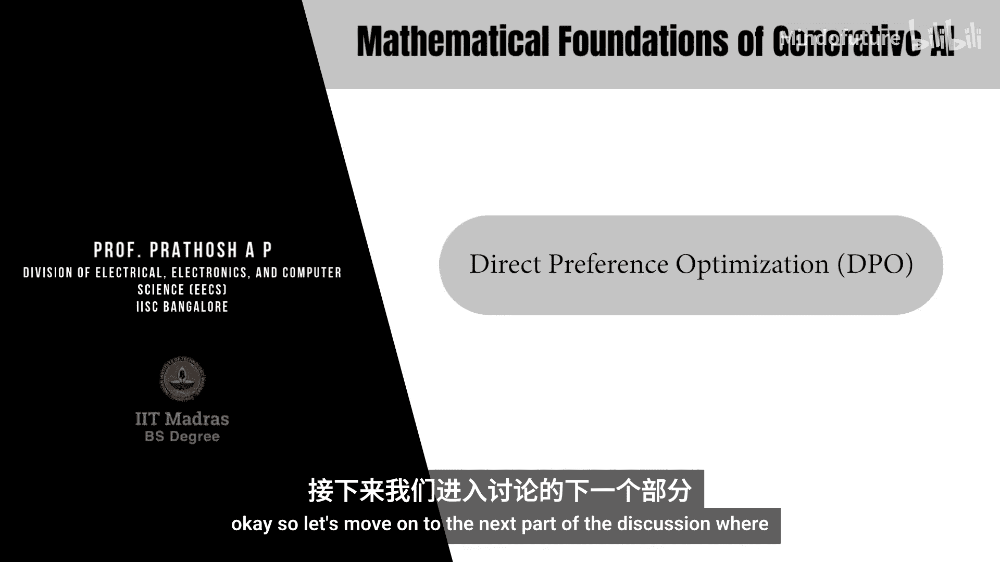
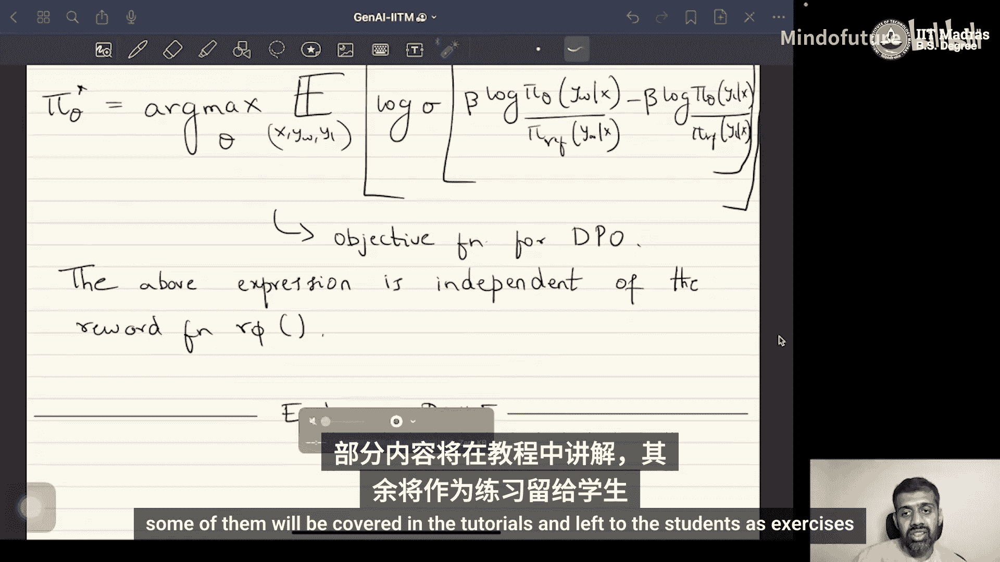

# 生成式Ai的数学基础 ｜ Mathematical Foundations Of Generative Ai p71 P71_W12L53-直接偏好优化（DPO） -BV1fperz7EjK_p71-

🎼。

Okay， so lets move on to the next part of the discussion where we discuss what is called as direct preference optimization。

The motivationration for this algorithm is as follows。in the P them。

We have to first try a reward model， and。Based on the reward model。

 we would use the PPU or the policy gradientient algorithm to update the policy。Now。

 the quality of the policy updates that are obtained using the PPO kind of algorithms。

 policy related algorithms。Depends heavily on the performance of the reward model because I mean it's obvious because the objective function of policy gradient theorem policy gradient algorithms is to maximize the expected reward。

 which means that the expected reward now is estimated using the reward model and the goodness of these algorithms depends extremely on the reward model。

Thats that's one。 second thing is that training a good reward model needs solving this optimization problem that we just saw。

 which itself is computationally expensive。Now the question that is asked in DPO direct preference optimization is that is there a way in which we can completely bypass the reward model but still do a policy optimization using the preferential data that is given okay so let us write it down so one of the goal here。

Is to。Optimize the policy。Optimize the policy。In our case it is the language model。Using。

The preferential data。Losing the preferential data。Without。The reward model。

 suppose you do not have a reward model， can you still optimize the policy。

 the language model policy without having a reward model is the question that is being answered the。

The framework that are meant that is called the direct preference optimization。

 So let us look at it so recall。That。你。Constrained。Policy update。Policy optimization。

Objective is as follows。Policy optimization objective is given by。The following equation。

This equation。Is suggesting that the objective function that we would use to find the policy has to be the one that would maximize the reward。

With a constraint that the divergence between the policy that is being optimized and another policy。

 which is called the reference policy。Has to be minimized。

Okay so now there is a negative sign here because the reward has to be maximized while the K divergence has to be minimized now this looks very similar to the PPO objective that we saw where decay divergence was put put as an additional constraint now the constrained optimization problem can be converted into an unconstrained optimization problem via grandier this is what is done so this is equal into maximizing the reward constraint to the fact that the divergence between pth and pi reference has to be minimized so I have written that in a。

In the oneconstrained form by writing out the lagrian and beta happens to be the laggrian coefficientient。

 Okay， why is this important， This is important because one can show that the。Okay。

 let us write down the optimization problem the optimal。

Pararameterters that are rather the optimal policy。Is the one Let's call this as P star is the one。

That would maximize。We are searching overall policies which would maximize L policy。

whichch is a function of policies， this is what the optimization problem is。Now。

 what can be shown is that it can be shown strictlyly proof。It can be shown。That。

The optimal policy that would solve the above objective function is given by one by。Z。Okay。

 let us write this as P star of。Y given x， y for the response and x for the input。

 so it is given by 1 by Z X。By left。White Ux times。一bo。1 by PEta。

 which is the lag grandian constrain times。アフーエスかマワイ。Okay。

 there is also called the boltman distribution where z of x is the normalization constant。

 which is given by。嗯。In some of all responses。By of y comma x times。Eore。No， that seems we are。

Summing are integrating out the responses the z will only be a function of the inputs x。O。Right。

 so what is now shown is that。For this problem。That we would want to solve。

It can be analytically shown that the optimal policy that we are seeking is given by this particular expression。

 which is a boltman distribution where z x is the normalization constant。Now。

 this means that an optimal policy can be found out if。

We were given the reference policy and if we were able to compute if we were able to compute the normalization constant。

But it turns out that the normalization constant is not tractable because sum over all possible responses is not possible okay。

Therefore， so。However。However。Pistage of vguvanix。Can't be computed。Because z of x is。

It's not talkable。Zfx is not tractable。 So now what do we do about it。Now。

 while one cannot find out the true policy optimal policy analytically。

 this can be used to get an expression for the reward model。

 So that is the advantage of this sort of a formulation。

 what can be shown as that if you just take the log of。The Ebo expression。

 this can be shown to be equal to log of L cube the algebra the interest of time。

 so this is log of pi f y given1 x。Minus。Log of z of x， which is the normalization constant。Plus。

1 overルブタ。R Phi x comm Y， right， This is easy to show。 Now， if we rearrange the terms。

Rearranging the terms。Will give us R P， which is the。

The optimal reward that would lead to the optimal policy as beta times。Log of。Pistt Y UNx。

Diveerted by。P enough。Y UX。欢迎啊，B。Vita log of。C of x， no one can verify this algebra。

 So what did we do so far is that。Let's call this R star for the optimal policy。

 optimal divide model we saw that。Given the optimization problem that we would want to solve。

 there exists an analytical solution for the optimal policy and if you plug in that analytical solution for the optimal policy。

 we get an optimal reward model which is given by this particular equation。Now， what of this？

Useful thought is the question。Let us look at that。Now， if we plug this expression。

 if our star of V is。Substituted in the。In the Bradley Ter model。

 So remember the Bradley Ter model that was used to。Find our model derived model， Ter model。

We get the following。응。So what is that so we have p of yw being greater than equal to yl is given by thisig e power r phi x comma y W divided by。

Epo R fee。Xcoma Y W plus。E power r phi x comma Y L so this was the equation that we had now if we simply plug in。

Let's call this as R star here。Substituting。 So let us just， let me just show this。In one screen。So。

 substituting。Our star。In。So I'll call this as equation 1。So if I skip all the algebra。

 what can be shown is that？Be of。YW being greater than equal to yL。Can be shown to be equal to。

A log of。I don't know beta times。Lo of。Y tta Y given x。Divverted by。Y Y1 x。Minus beta log of。微调到为。

Lll give an x， your pardon this is YW。Yial given an x。De word advice。P F of Yl given x。Okay。

 can be shown。 So now what happens is that what we seek is that we seek。Atheta or by theta。

That would maximize。The log of。P of Y W given a Y W being greater than equal to y right this is what we want to do because we need to maximize the likelihood of y W being greater than equal to y。

 If we just sub this equation， the above equation in here we get our。

Optimal policy to be the one that would maximize。The expected value。Of。Log。所谓。

I think there should be a sigma here。There should be a sigma here。 Yeah， so log of。Sigma。

Bear times log。Pi theta by W given x dividederted by pi ref。Y W of give1 x。Minus。Beta times log of。

P theta by l given x divided by。I F Y L given x。Yeah。

 so now if you look at this and this expectation is over d again the preferential data xcoma y w comma y l。

 So now what did we just do is that we。Completely， if you look at this， thisbo， the above。Expression。

A boy expression is。Independent of the reward model。To what function， independent of the reward。

Reward function R fee。Now， what did we do is that we got an expression for the objective function。

That would give you the optimal policy， which does not contain the reward model right so this is the objective that we started with。

 Now this is the。Objective function for。Direct preference optimization or Dpu now it is called direct preference optimization because given the preferential data。

 you can obtain the policy。Without having to explicitly compute the reward model right so this is theta f。

 we know theta f which is theta old Theta sorry pi F is the previous。

Reference policy or the old policy pi theta is the policy that is being optimized and we have Yw we have byel index。

 all of these can be computed and therefore this objective this optimization problem can be solved using the usual gradient decent methods to align a given policy or the language model with the human given preferential data so thats why this is a very powerful technique compared to PPO because in PPO one needs to prime the reward model and use the reward model to get a good policy here the need for the reward model is completely。

Bypa and a good policy or a policy or a language model can be optimized even without having access to a reward model。

 so you don't even have to try in a reward model explicitlyly when you are using DPU algorithm。

So this takes us to the end of autorepressive language models and RHs。

So RLC stands for reinforcement learning with human feedback。

 so the preferential data that we get is typically obtained using human generated feedback and that is why the method these class of methods are called reinforcement learning through human feedback or RLLF。

好评文。This preferential data can be obtained using verifiable rewards as well where suppose you are solving the task of coding right so where x is an input code input prompt which would ask you to solve a coding problem there are。

Cases where the rewards are not preferential in nature， but they are verifiable in nature。

 which means that you can define the reward as the number of test cases that the input code the output code has passed in which case DPU algorithm typically does not suit because DPU requires preferential data one can use verifiable rewards along with PPU kind of policy gradient algorithms to update the policy right so typically what happens in practice you when you look at models such as GPT g and so on whats happening is that a base。

Auttoregressive generative model， which has transformeders as the architecture。

Well be trained using large amounts of intelligenceence of tokens of unsupervised data using the next token prediction technique that we saw。

 once it is done huge amounts of preferential data is collected and the model that is trained in an unsupervised way will be aligned with the human preferential data using the RL methods that we just described that completes one loop of how these large scale language models。

 large language models or LLMs are trained。There are lots of engineering nuances that was ski for the want of time。

 some of them will be covered in the tutorials and left to be students as exercises。

Thank you。

