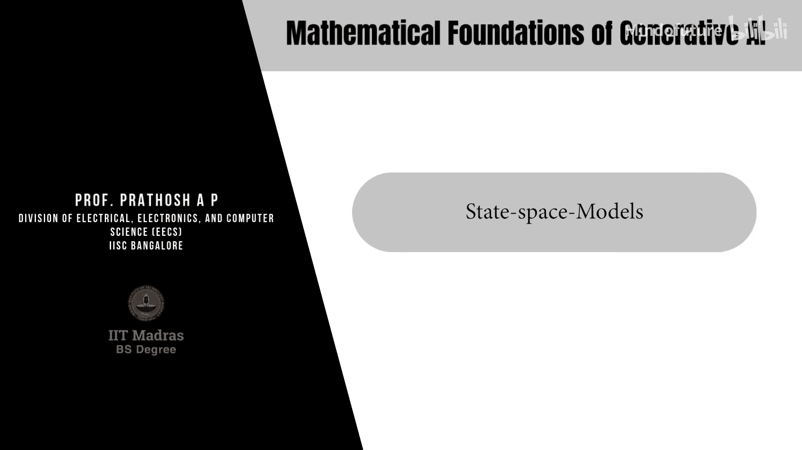
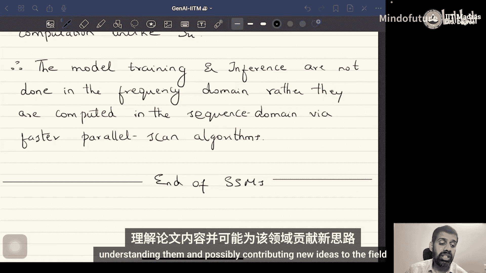

# 生成式Ai的数学基础 ｜ Mathematical Foundations Of Generative Ai p72 P72_W12L54-状态空间模型 -BV1fperz7EjK_p72-

。

Hello， everyone。Welcome to this session on state space models。Abbreviated as Ss。

A large amount of data that is processed。Is sequential in nature， for instance。The language。

 natural language。That is obtained as text which forms the fundamental basis for the foundational models are all sequential in nature。

 so we saw what sequential data refers to in the previous sessions。Now modeling sequences。

 especially the longer ones。Is extremely important while considering these kinds of scenarios。

Transformers have been the go to choice for modeling this sort of sequential data。

Given their applicability in multiple domains。However。

 if the context length as it is called or the length of the sequence grows。

The amount of computation that is needed in transformers。🤧Gross quadratically。

As the length of the sequence grows linearly， so why is this if you recall how transformers operate。

To process every token。One needs to compute the attention scores with all the tokens that are there in the sequences。

And this has to be done for each of the token， which means that if there are capital L number of tokens in the sequence。

 then it takes O squared computations to perform both training and influence。And， therefore。

When the length of the sequences become too large。Then the computation required for transformers becomes prohibitively large to address this issue a community has considered an alternative model family called the state space models in which the computation that is needed for training an inference does not grow quadratically as the sequence length increases linear。

Now， let us look at how is it defined mathematically。An SM is defined by the following equations。

 so for now let us consider the input and the output sequences are both one dimensional so suppose。

Suppose。U of P。And y of P represent。The input。And output sequences represent respectively。

And output sequences。Respectively， so lets say u of T and y of T represent the important output sequences respectively both of these are unidimenal。

So this one。Make the algebra easier so later in the session I will discuss about how to extend this to multidimensional sequences lets say that we have an input sequence represented as UT and Yt represent the output sequence and both of them are one dimensional signals okay now with this a system。

Is defined。As follows。Can just remove this。So given that we have a one dimensional input and output sequence。

 SM is defined as follows。X dash of P。Is eight times。E times X T。不。B times。有逼。

And y of T is equal to c times。X0。Plus， D times。有病。

This is the definition of a state space model for those of you who are。

Familiar with the classical control theory literature would readily recognize this as the classical one dimensional。

State space model that is defined to handle dynamical systems。

 this is the definition of a state space model， where x。X T is。An in dimensional。A hidden space。

Hidden space vector。And AB，C D。啊。The loveable system parameters。Now the system of model parameters。

 let's call them the model parameters。Okay， so this is the definition of a state space model and its dash。

😊，Deote the temporal derivative。You know， what's the time derivative of x？Okay。

 so this is the definition of a state space model， what we have is given a signal u of p which is one dimensional it is called it signal or a sequence。

Now， that is us。Projected， so to speak on to a state space or latent space。

 which is n dimensional de by Xt。Now dynamics are learned。

 the temporal transition dynamics are learned on the stage space now what we are saying is this the first equation here governs our models the evolution of the stage space across time and that is modeled using the A and B vectors or matrices as the case maybe and the output y of t is connected to the stage space through the matrix C。

And the vector of matrix XD connects the output to the input UT。Now。

 it is not difficult to see that this has similarities with the recurrent neural thoughts where the differences。

That in the current neural networks， the relationship that grounds the dynamics is nonlinear。

 whereas in a linear state space model or a state space model the。Relationship between。

The state dynamics and the outputs is gone by linear equations so now Axt plus BUt and Cxt plus B Ut all of these are linear relationships and thats how it differs from typical recurrent development work that has nonlinearities connecting these quantities okay now throughout our discussion unless otherwise is otherwise specified we assume that U and y which are the input and the output sequences are both one dimensionional so as I said I will discuss how to extend this to multidimensional input sequences as we move on okay now these ABC and D are the so-called model parameters that would be learned by a gradient descent。

Now， this is the definition of a state space model。In the literature， typically， this D is。

Not considered。Let me just write it。Typically， the。D vector or D matrix。Is omitted。Since。

It can be realized。Why are a learnable skips connection？ALearnable skip connection。

 So if you closely look at it。Yt is given by c times xt plus d times Ut if Ut is the input。

 all we are doing is we are taking the input and multiplying it with a matrix D and that appears in the equation of the output which is nothing but。

Saying that there exists a skip connection from the input U to the output。

Yt without considering the intermediate states space xt however。

 a typical strip connection would not have any multiplication factor but you can always have a learnable multiplication factor so since this can be learned via or realized via a strip connection this is not。

Considered while defining the typical state express one so b is out of the equation now。Okay。

 now the with this。The final SM。Final continuous time system I would say。

State space model you given by。So， we have。Its dash of P is8 times。Xt plus B times。UD， and we have。

Y P to be equal to c times。this is the equation。Of a state space model in continuous time。Okay。

Where ABC are the model learnable model parameters where A B and C are。Laernable。Model parameters。

Please note that I said that this is for the continuous time signals we are assuming that u and y and therefore the x are all continuous time signals and therefore the derivative of x well defined so I can write it as x dash of t where x dash of t is the time derivative of x but in practice we will not have continuous signals and for instance if you take the sequences of language natural language the text。

That we get today the language data that we get is not continuous in time because we have sampled the time and what we have is a discrete sequence now the question is how does one rewrite or convert this continuous time state space model into the discrete time version is the question so let us take that question now the first step。

In applying。It system。Two sequences。Or let's say discrete sequences。TwoDcrete sequences。

Is to discretize the model。So what is meant by discretization？

One needs to go to the classical signal processing realm。

 suppose you have a continuous time signal there are multiple ways to discreitize it。

 one of which is sampling so what is done is that。Samples of the signal are considered。

At discrete times now once the signal is sampled， the underlying state space equation will change corresponding to the type of sampling that is being considered。

 So let us look at what happens so suppose。Suppose we have。啊。Discrete。Input sequence。Input segments。

Given by。You。Which is equal to。有哪讲嘛？语问。有 do。And so on。

 this is the discrete sequence that we have which is obtained。Bye。Dcrtizing beauty。

Decccrtizing U of P， okay now which means that U k， which is the K， the discrete sample is。You blame。

K times U of K times deelta where。Wellデta。I。The step size。

what is meant by this is that suppose we have a continuous time signal this way。

If this is a continuous time signal and this is P。To disc discretize this。

 let's say that this is U of P to discretize this。 what one would do is。Consider。

Samples of the signal at。Discrete time steps and the difference between these two time steps is what is called as step size or delta so this is k equal to 1 k equal to 2 and so on and at every step what is considered is the value of the signal at that particular point so we have this is u of 1。

This is U of two and so on。 So this would be。This would be u not this would be u1。

 this would be u2 and so on， so this is how one would discretize。

Once the input signal is discretized， the underlying stage based model also gets altered in the sense that the forms of the ABCD parameter matrices that are there in the stage space equations would get modified and those will become functions of the time step data。

Now the way they get transform depends on the type of discretization that is employed to convert the continuous time signal into discretere time signal multiple methods use multiple ways of discretization Ill just show one of such methods that is often used in most of the state based model called the bilineer transform or bilineer method it is also called the Tuins method where。

People who are aware of signal crossing would identify identify this where the idea is to convert the signal from the continuous leplace space to a discrete Z transform space so that is the idea of testingines method and not go with details of how the bi linear transformation method works however it is。

Sufficient to note that。After discretization。After disccratization， the S some parameters。Grange。

As follows。Now let's call them as a bar， so discrete create parameters are a bar so a bar now become。

Becomes I minus。Delta by 2 times a。In was of this times。I plus。Delta by 2 times k。

Where I is the identity matrix of appropriate size and delta is the step size as we saw。

 So B also get transformed into。I minus。Delta by 2 times a。In was。Delta times B。

 so this would be B and C that doesn't change so it is just as C bar will be just same as C now here。

I is the identity matrix of the appropriate size。And deta is the step size used in discretization is the step size。

Used for。Discrtization。This is called the Tuins method or the bi linearar transformation method where the state space model gets transformed into transformed from ABC into A bar B bar C bar C bar just remains same as C and while A bar in B bar becomes a function of A and B that were there in the continuous time counterpart and the step size deta。

Okay， and with this， we have。A new set of equations。说啊。For Ss。For。Discrete sequences。Oucess follows。

 so suppose we consider state space models for discrete sequences instead of having x bar we have xk that is equal to a bar times x。

K minus1 note that instead of derivatives now we have passed out differences。Plus， B bar。Times UK。

And Y K， which is the。The case token in the output sequence is equal to c bar times。X， K。

 so this is the new state space equation that we have the above equations。The Ebo equations。Define。

Define a sequence to sequence map。Instead of a function to function map in the continuous time state space models。

 what we had was mapping from a function U to another function Y T here we have a sequence to sequence map from。

So sequence U to a sequence。W我啊。The state space。W are the state space X K， right。

 So this is exactly what we have。 So this is。The basis of all the modern day database models that are employed in practice。

So just to recap， what did we do was we started from the definition of state space models。

 assuming that the signals， the underlying data that we have is continuous。

Now since in practice we work with discretized data， we discretize the continuous state space models。

 obtaining the discretized state space equations， discrete state space equations with appropriately defined a B and C that is gone by the underlying discretization method。

ok。Given this， the next goal is to come up with a method that would enable us to find a bar B bar C bar via training Okay so how do we obtain a bar B bar C bar given some data is the next question that we are going to answer so lets write training。

Dis great assessment。The question is， how does one train assess given data？Now。

 what can we observe here is that these equations。Define the recurrence between the。

Previous states and the current state。And this recurrence is effectively used to come up with the algorithm algorithms that are computationally efficient while training assessment so let us look at that。

 suppose assume。The initial state。State。Vctor to be 0。

This is just a model assumption that is made for convenience。

 which means that we assume its minus1 to be equal to0 then with this。Unrolling。

Untrolling the state space model。Eachs to the following recurrence。Its to the following recurrence。

Let's write that down。It's not。It will be equal to b bar times you not。X1 will be equal to。A bar。

 B bar times， you not。Plus， B bar times U1。We have x2 to be equal to。It was squared times。

B bar times unit plus。A bar B bar U1 plus B bar times u2。And so on。

 so we can write this deterrence for xk and similarly y not will be equal to C bar。B bar times。

 you not。Y 1 will be equal to C bar， a bar， B bar times。You not plus。C bar， B bar， U1。

The y2 is equal to。C bars， A bars， B bars， you not。Plus， C bar， A bar。Be broad。 You want。Plus， C bar。

 B bar。You2， and so on， so。What I just did was plugged in。

Particular sequence is x 1 x2 x3 here and expanded this via unrolling now this can be generalized as follows。

This implies Yk is equal to。Seebo。A bar to the power of k times B bar。Times u not plus。Seebo。

A bar to the power of k minus1。Times we were into U1。Sn，2， C bar， A bar。B were U k -1。Yes。

It's just a brand a little。Plus。C but。C bar， B bar， UK。Now， if one closely observes this。

 this looks like an equation that is familiar to an operation that is familiar to us。Suppose。Kbut。Is。

An L length vector， okay， given by the following， sea bar。We were。C bar， A bar， B bar。

Times c bar a bar to the power of L minus 1 times b bar。

 so if we define k bar to be this an L and vector to be this。Then。It is。Easy to see。That。Y k。

 which is the K element of the output， is simply given by k bar times。你con。K bar times， the conation。

Our K bar convoled with u where U is the input signal where。St represent。

presents the convolution operation。This is a key result that is saying that。The cat。

Sequence a case token in the output sequence。Is nothing but the convolution product between the input sequence u and a fixed。

Clonnel k， which is defined which is given by this particular equation。

 which is a function of the model parameters。Which means that if one computes this kernel Kbar。

 then finding out the output is nothing but convolving whatever the given input is with this precomputed kernel Kbar。

 so once the kernel is computed， one can do an inference on any of the input by simply taking convolution product。

Between the fixed card and the given input you okay now this K bar is。Scorre the。

SSM convolutional kernel SSM。Convolutional kernel are created。Okay。Now。

 one can guess what is the size of this filter， this the size of the filter or the kernel is。

The same as that of the input sequence input sequence the input sequence is of length capital L。

 then the kernel is also of length capital L so it is a a pretty big filter we large filter that we are talking about。

Now， the whole point of getting into an alternative framework to transformers was to see if we can handle longer sequence with computational ease。

Now， what is the point of representing the output sequence in an SSM in terms of convolution is that。

From the signal crossing principles， one knows that convolution in the so called time domain or the sequence domain is equivalent to multiplication in the。

Frequency domain okay now because that is a possibility and there are faster algorithms to convert a sequence into frequency domain and these algorithms are called the fast Fourier transform algorithms。

 the whole idea in the assessment literature is to compute the kernel by taking it into the frequency domain and computing the output in the frequency domain via a multiplication operation in the frequency domain and converting back the output from from the frequency domain to the sequence or the time domain via inversephoier transform。

Now， sins for transform and image for transforms are operations that can be done in logarithm。

Time using fastphoier transfer F50 algorithms， it is considered to be faster compared to quadratic computation in transformers。

 it is the whole the fundamental idea behind the state based models。Now， given that。

 the goal is to compute this kernel k bar in frequency domain。

 so the rest of the discussion will be now around how would one compute this kernel k bar in NS SSM setting let us consider that computing。

SoBefore that， let's write that in。Practice。违嘅。Or the convolution。Iper。In the frequency domain。Using。

Fastpho transform algorithms。Okay。Now， the next step is to come up with methods to compute the kernel K。

そう。Computing the kernel。Computing the kernel key。In methods such as S4， which is one of the famous。

Models from the family of state space models， the kernel is computed in the frequency domain using the generating functions。

Now， why is it computed in the frequency domain as we just saw before？你。

Output or the database model is implemented using the convolution operation and convolution is equivalent to multiplication in the frequency domain。

 so the card itself is computed first in the frequency domain and the signal is the sequence is multiplied with the the。

Computer kernel in the frequency of domain mine and the inverse transformers。

Applied to get back to the sequence domain so that is the operation that is done and we saw that now to compute the kernel one needs to go the frequency domain using the geneative generating function approach what is the generative function。

For people who are familiar with the signal crossing literature a generating function is typically some discrete transformation such as z transform in this truncet version so now recall that for k bar we had this k bar which was an elegant real number that was given by c bar b bar c bar a bar B bar and c bar a bar K bar of l minus1 times b bar we just saw that indeed。

Definition of kpath right how did we get that we started with the definition of the state space models which was given by the PC equations。

 then we unrolled the equations and we obtained a recurrence。

And we saw we showed that that rerence after unrolling can be written in terms of convolution between the input sequence U and a kernel K bar right So whose definition is。

Whose expression is given by this particular equation？Now。To compute that in the frequency domain。

 we have to first compute the generating function or the z transformation tru z transformation for that How do we do that。

 let's call that K hat L of z that is given by summation of K times z power I where I equal to I runs from0 to L minus-1。

What is K KI is the iat element of this kernel in the time domain and we know that from this expression it is given by c bar a bar to the power of i times b bar and therefore and just plug this KI into this truncated generating function equation will get us to this particular equation where k cap l of z is given by the sum of c bar a bar to the power of i times b bar into z power I so note that z here is the。

Complex number that defines the transformation the fuller transform that we are looking at to actually obtain the fuller transform once the entire geneative generating function is computed one needs to evaluate this entire thing at the roots of unity right that is how one navigates from z transform to fuller transform okay so now if you look at this expression the dependence of this of these terms on i is only through a and z therefore c bar can be taken out and vbar can be taken out so taking c bar to the left and v bar to the right we can write this generating generating function as c bar times this entire sum times v bar at the outset of the expression okay now lets why did we do that let us only consider this particular expression so consider。

This expression。The goal is to somehow get rid of the summation here and write it in terms of inverses instead of powers of a bar here so that is the goal so let us consider this particular expression which is sum of a bar to the power of I times z power I and this can be written in terms of these two expression that is i minus a bar to the power of l times z powerl into i minus a bar。

Time Z inverse。 So how did we get this this entire thing is a geometric series involving matrices and vectors。

 Okay， now there is something called matrix geometric series and one can show that this summation。

Convert this to this particular expression if you have a matrix geometric series I ome de proof here now it can also be shown that with large enough L which means that if L approaches infinity。

 then this particular term which is there which appears in the geometric series。Approaches identity。

 okay， therefore。Let's get back to what we are doing so k bar of z which is the generating function of the kernel is now given which was given by this particular expression。

 what did we do we just took every term that was not dependent on I outside of this emission and using the formula for met geometric series we wrote down this sum in terms of inverse of a inverse of these two me and for L going to infinity this entire term is identity。

 therefore the kernel the truncated generating function of the kernel is given by this particular expression which is c bar times I minus a bar z inverse times b bar therefore the final expression that is given for the kernel the generating function or the z transform of the kernel is this particular thing which is c bar times I minus a bar z inverse times B bar。

What is to be computed is this particular expression。Okay。

 now this this particular expression also is not trivial to be computed， therefore。

What different models do is they impose a particular structure on a。

T means that so far we have not said we have not taken a to B having any particular form for instance a can be diagonal or a can be low rank or anything。

 we did not choose any of such kind of special structures on a but different methods impose different kinds of structures on a to make this。

Cnal computation tractable So there are two special cases that we will study in this particular module。

 one special case is when a bar becomes diagonal。And by the way when one imposes a particular structure on this a matrix。

 this method would be called structured stage space models and S4。

 the name S4 is derived from this particular method which transfer structured stage space for sequence modeling since there are4 S alphabet here this thing is called S4 so the broad idea of most of the modern day state space modules is to impose a particular type of structure on this a matrix and use different tricks。

Of computation different tricks for computing or estimating this a matrix and therefore the final state based model。

 Okay， so we look at some of the structures that can be imposed on this a matrix the first thing is where a bar a or rather a bar becomes a diagonal Now with a bar becomes a diagonal matrix lambda What we have is that we have n diagonal elements so typically a would be an n by n matrix we will have n diagonal elements for this a bar matrix with this So look at this term that we have in the。

C transfer or the generating function of k。 So what is to be seen is when one applies a particular structure on this A bar。

 how would this term。Mar is the question that we should be asking so with a being diagonal if one needs to compute this i minus a bar times z to the inverse sub i minus a bar times z。

 then it is very simple to show that this would be diagonal of 1 by1 minus lambda 1 times z 1 by 1 minus lambda 2 times z and so on where lambda and lambda 2 are the elements of the matrix a bar。

so with this， if you just premply this thing with this expression with C bar and postmply it with B bar。

 then it is very easy to show that this entire thing can be written in terms of estimation of different skill elements。

The summation contains the elements of C elements of b and 1 minus the elements of i minus a bar z matrix therefore the final kernel a doncateated kernel for the case where a is a a bar is a diagonal matrix。

Assumes this particular form now why is this of importance。

 this is of importance because when A becomes diagonal。What involved powers of a。

 if you recall the kernel here， let me show you that。

When we started the kernel involved computing powers of a right so matrix multiplication computing the powers of matrix is an nonal operation so with this particular structure assumption that that was made on a。

There is no computation of power of anymore， so because then all you need to do is。

Compute these terms are also called ca kernels。 It's very easy to compute these terms and these can be computed and therefore the kernel can be computed and when the kernel is computed。

 one needs to just multiply that with the furtherer transform of the input signal to obtain the output and then inward the furtherer transform and take it sequence domain to obtain the output that's easy to do So the key observation that if a particular structure is imposed on the a matrix or a bar matrix that appears in the stage based models。

 then computing this particular kernel in the frequency domain using the truncate generating function will become very easy so that's the broad observation Now making a bar to be diagonal is to restrictive So a more general case is when a bar is not diagonal but it is made the sum of diagonal and。

A low rank matrix okay so this particular structure is called diagonal plus low rank I mean of course there is a minus here since negative sign can be seen as generalized addition this is called diagonal plus low rank or DPL are in short so what we have is a or a bar is imposed this particular structure where there is a diagonal matrix and there is a low rank there are two the outer product of two lower rank matrices here P and Q are rank1 matrices and P andq are also learnable rank1 matrixrices。

That are la niable。Okay， that are learnable。 Now A bar is called daagonal plus low rank matrix。

 Now with this， we need to again compute。😊，This particular expression I minus lambda Z inverse sorry i minus a bar z inverse now instead of a bar being lambda diagonal matrix now we have a bar to be having this particular form which is diagonal plus low rank I will skip the algebra as I mean anyone is anyone who is interested can refer to the S4 paper itself now skipping the algebra what one can show is that something called ubury identity that would help you to inver these sorts of diagonal plus low rank matrixrices if woodbury identity is applied and after algebraic manipulations what can be shown is that the final kernel function that is obtained will have this sort of structure so it looks a little complicated but it is not what can be shown is that it is simply a linear combination of several。

Cushi kernels where each cohi kernel is given by this particular has this particular form where you have a summation of different elements of CN and B divided by some function of z。

 which is the transform variable and the element of theagonal the element of the diagonal part of the matrix。

That's it， which means that in the entire kernel computation there is no involvement of any powers of a all you need to do is compute these kinds of terms which are called Ca kernels which involve animal elementwise multiplication of scalrs and。

Division with some other skill。 that is the element of matrix a。 Okay。

 so this is what is done in S 4， which is one of the。

One of the earlier models of state space model family that were used for large scale sequence model the other thing that is to be noted in S4 is that the a matrix or the a bar matrix is not initialized to a random matrix rather it is initialized to be a special matrix called the hippo matrix it was empirically shown that this particular structure of hippometric leads to better generalization and therefore a or a bar matrix is initialized to hippometric so that's the summary of what is done in S4 which is a special case of the state space model let me just recall quickly what was done so discreteretized state space model has this particular form and if for timing and inferencing Ss what is to be done is when you unroll the equations of Ss you get。

The output to be the convolutional product of a fixed kernel function with the input during timing this kernel is not computed in the time domain because it involves powers of a or Ava rather these this is this is computed in the frequency domain how is it computed in the frequency domain is via what is called as truncated generating function or z transform the z transform of this particular。

A card is computed and using the geometric series of matrices that will。

Boiled down to having this particular form where you have c bar times identity minus a bar z inverse times b bar Now even this cannot be computed easily unless you impose particular structures on a Now several structures can be imposed on a one such structure is to make a bar to be a completely diagonal matrix if its made a diagonal matrix then the kernel that is compute in the frequency domain has this form of coi kernel where there is some constant divided by one minus lambda i times z a diagonal cases very restrictive to make it more general instead of making a bar diagonal one can make it some of diagonal matrix and low rank matrixrices its called diagonal plus low rank matrixrices and using some matrix algebra matrix what can be shown is this again the kernel happens to be a linear combination of multiple coi kernelal terms where each of the coi kernel terms has this particular。

form where you multiply killers and divide by some function of the subtracted with the diagonal elements of a this constitutes the the SSM layer or S4 layer that can be used in any internal network now so far what we have seen is that the all the analysis that we did was with consideration that the input and the output variables are uni dimensional first。

For。Multidimensional data。Which is the case。In practice。SSMs are applied dimensions by are applied。

Dimension voice。Which means。Each dimension of data。Of the data is processed。Crosed separately。Using。

1。SSM， so one state space model， which is uni direction uni dimensional so just like we do multi attention in an attention based transformer where the input data dimensions are split into several。

Several short vectors。Here， an extreme case of that is considered where every dimension of the data is separately processed using a different state based model。

Please note that in this particular instance of the state state based model which is called S4 the there is no dependence。

Of ABC D matrices on time， which means that ABC D matrices are shared across the temporal dimension。

 even though they are different use different state space models for each of the data dimension spatial dimension in the temporal dimension these aB ABC matrices are kept the constant across every time instead so this is how one would implement or one would rather approach the sequence modeling problem using the state space model every dimension is。

Handle separately and for each dimension one can have one SSM and several SMs can be stacked serially through the depth of a neural network so to speak。

 So now this is how an SM is implemented and of course once the sequence models are constructed there is an input and an output you can use any of the loss function such as root means squared or the cross entropy and use gradient decent to update the parameters of the state model let me write that。

Training。Iva。The usual。Emirical dis minimization。你没谁信，有些你。算 last方向。

So it can be done in both supervised and unsupervised way if it you have supervised data。

 supervised losses can be used it if the label are not presented if it has to be done in an unsupervised way。

 then just like the timing of transformers are done by。

By having the next token prediction task right which is the idea of mass language weight modeling exactly the same thing and be using SSM as well one other member in this family of state space models that we will discuss is。

What is known as Mamard。It's also called as selective state space models。

That's a more appropriate naming in my opinion。 So in the model that we saw so far。

 which is called the S4， what happens is the kernel。Criminal is fixed。Right， so got none this fixed。

So this happens because。Model parameters。Model parameters。加 the。ABC parameters。

Do not worry across time I just mentioned that don't worry。With答应。

So this is a known drawback for of the S4 model that the kernel is fixed because the model parameters don't vary with time。

What is the issue with this， So this implies that。Simple tasks。Suggest。Selective copying。

Cannot be accomplished using his fourth。Cannot accomplish。With also water selective copying。

 lets say that we have a particular sequence and the task is to。

Selectively copy a particular set of subset of tokens from that particular sequence that belong to a predefined category lets say that you are given an English sentence all we need to do is pick the words that correspond to noun this task is very difficult to accomplish with this well because the model does not have any idea about。

Different。Positions of different occurrence of tokens in a sequence。

 so this happens because all the parameters， these a B C parameters are not a function of time to solve this what Mambar does is to solve the above problem。

Mumbba。Mix the parameters。Time dependent。Now， this is。

The biggest difference between S4 and Mamba in most of the state space model that came before Mamba。

In all of them， the parameters of the model were kept。Fixed across time。

 but in Maba these are made functions of time therefore mathematically。Athematicically。

 the model looks。The so X。K plus1 is a times。A of UK pardon a of UK times xk plus。Be of UK。

Times U and Y K。Is equal to C of。You给 beam。Exe。What is to be noted areas？A， B and C。

Are functions of input。Functions of the input sequence。U。

 so this is the biggest difference between S4 andba maba model。

 there is a consequence of and while this is a very good idea in in the sense that the。

Model parameters depends on the input。It also comes with some drawbacks in the sense that。

The above formulation。Does not lead to。Cal computation。

Unlike S4 so in S4 we had a fixed kernel and that kernel can could be computed because the parameters ABC were fixed and unrolling is possible and when we unroll we got a kernel that is a function of A B and C but here that cannot happen because A B and C these are functions of UK therefore one cannot unroll them and cannot recurse because at every time the A matrix different C matrix is different and V matrix is different therefore unlike S4 where kernel was fixed and all lit that we saw we are taking it to frequency domain and computing it using coi kernel is not applicable in terms of in the case of a selective stage based models such as Maba。

Then the entire computation differs here， therefore the。Model prim。And inference。Are not。

Done in the frequency domain， unlike in SV。백끈도。Brother。They are computed。

In the time domain or in the sequence sequence or time domain itself。Using。Where faster。

Panels scan algorithms。哦。The authors of Mamba proposes。Algorithms， which make the。

Computation of this operation called parallel scan quicker so what can be shown is that the definition of this particular state space model is very similar to computing what is called as the prefixsome so what is prefixsome in algorithms one would know that given a particular sequence。

You have you one would compute another sequence whose elements are cumulative sums of the previous sequence at every time so that's called prefix sum right so what can be shown is that this particular type of state space equation though do not adhere to the classical recurrence it is very similar to the prefix sum sum operation which can be made parallel using several parallel scan algorithms that is the idea behind making the manba faster you know otherwise this will become。

Computationally heavy， to avoid that。Several parallel scan algorithms are used which are nothing but parallelization of this idea of prefixction。

So that's one thing in Maba there are some hardware related tweaks that are also incorporated which is that they are specialized they are specially designed for some GPU architectures that would have multiple levels of RAM and in MAmba the there is a trick called cognitive fusion that is incorporated where communication between the different types of Rams in a GPU are optimized for speed so I not going to details of all those techniques in this particular course。

 so the fundamental difference between S4 or other stage based models and Mamba is that in Mamba the parameters of the stage based model AB and C are made a function of time and this。

Enables。Several tasks that were not possible with the conventional takespace models。

And just like the case of a conventional state Que model。

 MaMA is also applied independently across each of the dimension of data。

 so there will be as many MaMba blocks as there are the model dimension or the data dimension。Okay。

 so that takes us to the end of what I wanted to discuss with respect to。The SM state space models。

But also that brings us to the end of this particular course。

Where we looked at several mathematical details of multiple state of the art generative models。

 starting from adversarial networks and we looked at variational diversity minimization and we looked at variational autoenderrs diffusion models autoregresssive models transform us and now some introduction to stage based models with this we come to the end of the course and I wish I wish and hope that this course was useful both in terms of theory and practical implications and as I've been mentioning one of the primary objectives of this course is to ensure that the students would appreciate and understand the underlying mathematical details of all these generative models and。

Equip students with the capability of independently going through the research papers。

 understanding them and the possibility contributing new ideas to defeat I wish you all the best。

Thank you。

