# 神经符号夏季学校 ｜ 理查德萨顿 ｜ Neuro Symbolic Ai Summer School 2025 p01 P01_Neuro-Symbolic_AI_Summer_School_2025-Day_1-Centaur_AI_Institute -BV1iAH8zEEDv_p1-

Okay， can everyone see my slides？No。Yes， okay。All right， one sec。Okay， well， welcome everyone。

To the fourth annual neuro symbolmbolic AI summer school。I'm Alex Gray。

The head of the Centerent AI Institute， which is putting this on。Let me first thanks everyone。

This program was built by this program committee。Thanks to Lue， by the way， and Key。

 top people in neurosymbolic AI， Lue， you may know both of them have spoken in our past summer schools。

 but one of the pioneers of neurosymbolic AI。嗯。And on the logistics。

 many of you have already seen can online， he'll be the technical director of this event。

 assisting him will be Kevin。And Olga is our head of operations at the Institute and she'll be helping with Q&A。

Okay。So， no。One second。Okay。U。All right。Now many of you are here because you already know about neurosmic AI。

 of course。So this is at least a reminder for many， but if you're new to neurosymbolic AI。

 let me give you some motivation。First of all。Is AI solved， you might think so， reading news。

 headlines and so on in the popular press， but it's far from true。

Now we have lots of serious issues still open。Of course， one of the most。

Prominent ones is errors due to hallucinations。I sort of put this in the same category I put two things in the same category。

 the fact that their errors is one thing， but sort of compounding that is the fact。

Of being a black box， which means you actually don't know how to fix those errors， okay。

 except in a very indirect way。And。You know， some people think， oh。

 this will like go away or maybe it's not that big a problem。Well， it sort of is a problem。

You can read lots of things about this。So second one。Arguably， in some sense， the deepest one。

Can't reason now this is confusing because you keep reading about reasoning models。But see。

 for example， recent papers by Apple。嗯。And I'll say more about this and reasoning。

 why is reasoning important？Well。For one thing， if it gets complex enough， your problem。

 then pattern recognition is insufficient， it has to do with the complexity of the problem。

 but also if you've never seen the situation before， it's sort of your only path forward。

If you just don't have any pattern in the past， that looks very close to what you're seeing。So。

And then the third one。You could say is cost and this is cost。In terms of data。

 how many data do you need to learn and？Closely related to that is the compute cost。

So for those of you who。Are familiar。 you have， if you want a sort of。

Universal predictor is one terminology then you need a non parametric model， which means。

The size of your model grows with the number of data。So this is sort of an inherent relationship。

That。It sort of relates data and effectively compute cost。Okay， so。No。Are these issues， you know。

 sort of a little temporary issues？Not really no， these are very deep issues， fundamental issues。So。

 and what's the cause of them？So roughly speaking。W are you getting these errors， hallucinations？

Has something to do with the concepts underneath。And you know， if you're going to fix it。

 then those concepts need to be clear。Somehow to whoever's trying to fix it。So。

This is what motivates symbolic just to give a little look at because humans arguably understand things best。

 at least maybe we can understand other things but。

We have gravitated toward things like language and math and so in symbols。To understand each other。

Okay， so we use symbols to understand each other now。So arguably。

To for a model that we can understand sort of has to be symbolic， right？

This is potentially a point of great debate， and we have a time for that。

 which is the end of the summer school in the panel。Now， something interesting here。

 which you may not know。It was a very nice result that we'll be showing in this summer school。🤧。

Hallucinations actually can't be eliminated。Okay， you'll see that with， the current kinds of models。

That mathematically， provably。🤧Now。Reasoning， so why？You know， are they。So called reasoning models。

 unable to go past a certain point。And。Well， because they were relying on past patterns。

 as I said now。When I say reasoning。You know， this includes a bunch of things。

This is a confusing topic， perhaps because the word reasoning is overloaded。

But there is a very formal sense of reasoning， deduction， at least。There's another one。

 you could say probabilistic reasoning， including causal reasoning， planning。

Can be seen as a special case of formal deductive reasoning？

And because we include probabilistic reasoning here。

We have to talk about uncertainty and being aware of your uncertainty。

 given uncertainty in your inputs。Okay， and there are at least two kinds of uncertainty， there's。

I there a probabilistic kind， including what include their subjective belief。🤧嗯。

It's also very deep and old argument， but also ignorance。

Knowing what you know and what you don't know。And then。

So all that is sort of in the bucket of you know， being able to reason clearly and properly。

And we have a lot of work on that in various areas。Now。Cost。As I mentioned。

 one way to understand why the costs of current approaches are so high。

 you could say it's a look to learning theory and。AlLess valiant than others laid the groundwork。

For that。You could say in lieu of reasoning。Real reasoning， what are we doing？

We're wanting to see all the possible patterns， in effect， that's one way to go about it。

And you can kind of approximate that maybe with the entire internet。

But you're paying a cost for that。Okay， so。嗯。These are。Okay， just to be a little provocative。

I'll quote someone who。Is not shy about being provocative， ya lacooon。That is his。呃。

You can see a quote from him here。So you could say maybe is these are the kinds of things that motivate this kind of quote。

Although I't want to speak for him。In making the exact connection to these issues but and maybe one day we'll have Jan。

Appear here and tell us in his own words。Now。So let me just put on the professorial hat for a second。

Let's look back a little bit at history。Now， of course， if you've been around as long as I have。

You lived part of this and you know this。嗯。But for many， you know， if you've， of course， most。

 it's not necessarily obvious， but most AI researchers really have only kind of seen the current paradigm。

 this is because there's been an exponential growth in the number of AI researchers。

I haven't seen many people talk about that。That's great but。It means you may not have。

You may not have really seen or digested the history， which。

At the risk of sounding like a perudgen is actually important。Why， because。

What do you see here in this little cartoon history？Well， you see that there are multiple paradigms。

Even within。The two one of the two major paradigms， KRR， machine learning。

 you have multiple paradigms that if。Waxed and waned。 I don't want to say， started and ended because。

Nothing ever really dies and that's a good thing in research。Because。Often just like in fashion。

 it comes back， but it comes back with a twist。And you could say that's partly what's going on here。

 So this first paradigm care are。Had a lot of good things about it and a lot of bad things。

Which is why it got sort of。Surpassed。In terms of dominance。

But a lot of people work on the deep issues of symbolic AI and continue to work on them。Now。What， so。

I use this to give as close a definition as we can to neurosymbolic AI。I say。

 and this is my definition。Roughly speaking， what we really mean or what I mean。

Is machine learning plus KRR， I mean， when they say KR， you could say well。

You could sort of reason with vectors and so on， that's a kind of reasoning maybe。

 but I mean symbolic care R， which is the classic care R。Because of the， at least the human。

Interpreability part aspect of that that I mentioned。🤧So。Now。What motivates that， well it's because。

Actually， if you just look at the pros and cons of symbolic AI and。ML or statistical AI。

They're remarkably complementary， so the weaknesses of one are the strengths of the other。😊。

In particular， because there's so much focus now on the weaknesses， you could say， of ML。

 we're sort of naturally reminded that things like abstract world knowledge，Rigorrous reasoning。

And so on， these are where the hallmarks of care are and sort of the things missing。Today。

 at least we need more of it。Okay。Now。Some。Thoughtful people started thinking about。

Neurosymbolic AI or what's now called neurosymbolic AI's come under， you could say various names。

 at least since 2000 ish。But。Probably there are arguments for why there is a form of neurosymbolic AI or learning plus reasoning all the way back to the very beginning。

Of AI so but and。You know， these are cartoons that really we're showing。

When things started to become a little bit more prominent。So。嗯。Now。

So people have been noticing this and Gardner。嗯。Pleasantly has pointed this out， you could say。

 so the promise of neuros symbolmbolic AI。And here's their famous hype cycle curve now。

The very top of this curve is the。Is the peak hype point？

And it goes downhill from there into a trough of disillusionment。Now。嗯。Neurosymbolic AI， they put it。

 I believe10 years out or so， so we have at least 10 years。Before we become hype。So。😊，Now。

In Gartner's view now。All right。So。As I said， it's。Actually。

 a lot of stuff has sort of hit on these issues and under different names and here are just at least a few of them many of people I consider。

Real， real leaders。In neurosymbolic AI aret really。Were are part of the star AI community。

That stands for Statistic and Relational Learning or AI。Inductive logic programming。

There's a big movement around explainable AI， which is some aspect of this。

All of these are overlapping。And these are various places where you'll find work that and there're more。

 okay， even now even in the core neural network。Meaning in eye clear and nerves and so on。

Okay there are many approaches， so this exact the plus part in this little equation is not at all obvious it's still open okay。

 so how do you put these two things together in a way that somehow preserves the best of both so。

The exciting， you could say to me， this is the frontier of AI is。What is that plus？

A simple way to say it。Okay， now I try in my。Effort here we try to highlight。

put a spotlight on all of the major kind of ways that people are exploring this plus could say。Okay。

 I have my own research and we do our own research。

 we explore our own kind of things that we think are promising， but I think it's you know。

Even for us， we like to look at everything and try to understand all different viewpoints that people are taking。

And we believe it's important for everyone to see a little bit of everything。No。

And then I just want to say a lot of people， and I agree with them say boil it down to。

When the question comes up， what's missing from AI today and what's the big。Kind of next thing。

 world models。It's often what people say。You can。You could say another way to express that is semantics have some understanding underneath conceptually build up the right concepts。

🤧So。No。Again， that was always part of the symbolic AI approach， role models。

 that's what you're doing。Typically in larger consultant。

So that's a big part of why those ideas or new versions of those ideas are really getting it to the deep issues that many people feel we need。

To address。🤧Okay。Now， why might you find this interesting？呃。So。If you're a researcher， well。

 many people feel for these reasons。This kind of a thing， neurosymbolic eyes， collection of ideas。

Is somehow on the path to solving these key open issues of AI。Maybe also on the path to solving AGI。

What is AGI， so we're starting to see actual definitions。

There's a lot of talk about them in companies but。You know。Hye aside。

 there I think are real ways to begin to talk about AGI。Formmerally。

 and but I think to make progress there， we can start with the G。General。

 and we talk about generalization。In AI and can that's a beginning of how we can formalize。

 so I'll come to that in a second。Now。嗯。Students， this is actually， you are actually。

 if you're a student。You know， our most。Important audience here。

 you're going to develop the next generation of AI。And many people feel。

That sort of set of directions。Somehow lies in this zone。So if you and this is relatively greenfield。

 that's where you want to look if you're a PhD student。Now。A lot's been done。

 but much more has not been done。Now。And then data scientists and AI developers。

We are starting to get pretty interesting emerging tools in this area now， meaning they work。

 they can do some things better than existing ML tools。Now， why。Did we start these summer schools？

The first kind of big observation when I sort of got into this in a bigger way， which was in 2017。

 2018。So is that this is difficult， this is particularly difficult to get into because。

Or at least the。Co reason that。You've got these two big paradigms。And each， I find it interesting。

 it's like on people on the west coast of the US。Versus the East Coast， sort of they have you know。

 some slight suspicion of the other side tend to minimize whatever is good about the other side。😊。

So but in particular， I think。A particular kind of。

Blind spot people have as people tend to think the other side is not that complicated。But it is。

 trust me， both sides are complicated and very thick with lots of work， many deep principles。

 so if you're an ML person， logic reasoning， is not a one liner， okay， there's a lot to it。

 same on the other side， neural nets， machine learning， not a one liner。So。😊。

So in order to work in this area。Effectively， in or I would say the most。

And make the deepest progress。God to really understand as much as you can。

About both sides in a deep way。Now， and there's just a lot。Okay， so our attempt， of course we can't。

Teach you all very high， but we can at least give you a crash course。

 this is what motivated this as a crash course just to get you in get you in the game。😊。

To kind of see some parts that we think are important。As an invitation to go deeper。Okay。And because。

That's the big problem is we don't have time， we're working researchers and so on。

Now we split it into tutorials and talks， tutorials are usually giving a very broad overview of a lot of a whole area。

A talk is usually some focused result， but the line is the line is thin off between them when we're working at the edge of research。

So now， also， as I mentioned， there are many disparate approaches。Taking in some cases。

 quite different philosophical takes。Part of what we try to do is curate from many sources。

And now there are new neuros symbolmbolic conferences， for example， Nezzie is the oldest。

Nezie is coming up。By the way， in Santa Cruz， New is a new conference。It's exciting。

 Steve Mgleton has been running this ILP conference for a long time， lots of great stuff there now。

 but it's increasingly works that I consider in the space are increasingly appearing in all major AI conferences in ML and AI。

呃。Now and even in other fields so I try to monitor everything and so this is in some sense a curation so it's。

This is part education， part art museum。Part intellectual party。

At a minimum you're going to see a lot of interesting ideas and hopefully just sit back。

 something will spark some new thinking in your mind。Now and what's our goal here。

 well it's to accelerate progress in neurosymbolic A because we think our hypothesis is that leads to smarter and safer AI。

And maybe even AGI， say the biggest goals in AI。So。Great， so I've got。We've got this nice program。

Let me give you a quick guide。I've touched upon many of these topics。And this is。You know， warning。

 this is kind of very technical。Now， this is for a technical audience。

 but if you're looking for the big picture， so an excellent talk。

 I believe will be next right after this Arvin's talk。The panel。

 we have a very exciting panel and for all of us researchers we should be inspired by folks like Rich Sutton。

 2024 Turing Award winner。And also other luminaries。On the panel Archer。And Leo Di Mora。嗯。

And we're going to talk very generally about the future of AI。So now tools， as I mentioned。

 so that's Friday morning。Check that out。Um。Planning， oh， I forgot to list mathematics here。 Okay。

 planning mathematics is obvious。 That's sort of the finale right before the。Right before the。Pael。

And you know， you can see here safety interpretability， even though I called out the theme of this。

Event as being mathematics， reasoning and planning more just to draw attention to those areas that。

Neurossmiic AI is having impact in。But really all of the issues I mentioned。

 we touch on them in every summer school， interpretability， out of distribution， generalization。

This is the thing I want to mention that maybe is the thing。

Many people are least familiar with here as far as words， at least compositionality。

 it may not be obvious， but compositionality。In my view is key to out distribution generalization。

Meaning being able to predict well in new situations that are potentially far from your training data。

 okay， so do check those out。What is the deep nature of symbols in being？You know， symbolic。嗯。

Check out the talk by PayHal， but and category theory。Now， this is scary。warning。

 this is like as scary as you can get mathe， okay。But I believe it's a big part of the future in AI in general。

Ideas from category theory， so if you have the stomach for it check that out。

And then a very important hallucinations。We have a remarkable result on efficiency by Felix。And。

Reasoning sort of spread everywhere now we offer a certificate。Just to remind everyone。

For those interested in that。That means see everything and then。We give you more information on that。

 how to get the certificate。Okay， just a little bit， I know I'm just going to be。

One or two more minutes at last slide so about the institute。So we are a nonprofit。

Our mission is smarter and safer AI hypothesis is that can be used through neurosymbolic AI。

 we're about research and education。We have you know some full time staff。

 but we also work with a lot of collaborators， we have about 40 people working in our collaborations。

We're gearing up to ultimately fund academics， so stay tuned。Now。

 how do you participate in I'm going to call this a movement so it's a。啊。

Many people have told me they think of it as a movement。Number one thing is。Hey。

 come hang out with us and do research and especially PC students。

 we call out our formal summer intern， Boone Lee， a very successful internship。

And you'll see his work on Friday。Amazing results。And also Bowen， another Bowen， Duke， Kevin。

 who I mentioned， we have some very talented undergrads。嗯。Now we also do do grants with academics。

So many ways to volunteer。We're all educational stuff we're putting together。

Moving toward the stuff you're seeing as an actual course。

Okay four credit course through partner universities， something we're working on， of course。

 events like this。Discord。Community by the way， is on discord。

 so if you want to or stay in tune with everything， that's the place to go discord。And。

Many other things including curation by curation， I mean find us stuff。

 it's getting to be a lot of stuff so find us the coolest things， let us know， hey。

 you guys should check out this paper， maybe you should feature this paper。

In a summer school or something。And then open source software。

 and you'll be seeing that that's a big effort how we're doing is。

Trying to do some very useful open source software and maintaining it。Okay。

 now I'll mention we also help startups that's part of our you know。Part of our mission。

 you could say， is to have make this stuff proved。Get to the point neuromalki I mean。

 get to the point of having commercial impact。🤧Now。

Because there's a certain line we can't go beyond as a nonprofit。

 we do have other ways to work with startups。Now。And then。Journalists also。

 if you want more information about any of this stuff， let us know。Now。

You can help us too corporate sponsorships is something we're formalizing and you can donate money now we have ways to do that now。

So just some things coming up， we have a consortium we're putting together and these are some of the topics these are specialties within。

That consortium， this is aimed at industry。To sort of help bring neuro symbolmbolic AI ideas to different industries。

Including。Executives。We'll be putting together reading group。

 I'm going to come back to all of this at the very end of the summer school。

 I'm going to give you some pointers for how to know join these things。

And a lot more will be coming on the website， including our。

Scientific advisory committee and a nurse symbolic event calendar and so on。Okay。I think that's it。

 so I'm just going to leave this up。呃。And。Take any questions。Okay， now I'm looking at the questions。

By the way， the way the event will work so we're going to have。You can watch on YouTube you can also。

And please follow along on Discord and you can ask questions there or on YouTube。

We're going to have our our。Are busy bees funneling those？

Questions over to me and then I will re them to the speaker。🤧嗯。So。And by the way。

 I see there are a lot of people all over the world。

 so it's great to see all the folks around the globe。嗯。Okay， we have a question。

 how do you define neurosymbolic AI？诶。A combination of symbolic and neural network slash connectionist。

I want to make a comment about that。This is， this is a term， you know， you've been around。

 if you've been around long enough in AI， you。You see lots of terms， appear and so on。

Or sometimes we have multiple， you know， as I was pointing out， overlapping terms and so on。

It's because nothing is ever perfect。And we're trying to capture something with a term like neuros symbolmbolic AI。

It's never perfect。Then， you know， this is。诶诶。In particular the neural part。

 so at least of course neural nets are the current major ML paradigm you could say。

 but there's something very interesting and important about them。

 but not the only way to learn so the deeper issue to me is a more foundational kind of。

A wayay to look at it is we're。This is about fusing learning and reasoning。

Learning can come in many forms and it may you know the line between a neural net and something else is fuzzy。

 but it may not be a neural net so the neural part to me is not you know not necessarily that most important thing it's learning。

Symbolic。Even symbolic， you know， there are many sort of versions of symbolic， you could say。

Often it's expressed as logic， but it could also be code or programs。

And if you're familiar with things like the Curry Howard isomorphism。Those are equivalent。

So you can equally well talk about learning programs， for example。

So and be neurosymbolic and then category theory is that you know， even a。

Different generalization that you could say gives you。Even more abstract insights into symbolic。Okay。

 so but I argue there is something special about symbolic， which is。

Has to do with the fact that humans can。Understand each other。

And understand and model if it's about crisp concepts。Okay。Maybe I'm out of time。Okay。All right。

 so let me now pass it to Arvin。We're going to do this in a very informal style in general。

Do a fairly informal style in these summer schools。

 so all of these speakers really could be a headliner typically we would give a normally in an academic setting we would give a long kind of intro with all of there。

There。Cruedentials and awards and so on， and all of them are very accomplished。

 so let me just say our next speaker is Arvind。He's fantastic he's been。

illlluminating things for a lot of people he's going to tell you some stuff that you should know。

And you should follow his newsletter， he has a fantastic newsletter。

And he's been saying a lot of things I wish I had said in the way that he says it so。

Bring you the joy right now without further ado， take it away Arvind。All right。

 thank you Alex really appreciate the informal vibe here happy to be here thank you so much for inviting me hi everybody and as Alex earlier said in the outline this is going to be a high levelve talk but it is going to be hopefully provocative that's kind of my job that's why I get invited to things so Ill plan to speak for about 25。

 30 minutes and then would love to have a little bit of discussion at the end。

This picture is just a teaser I'll get to this picture near the end of the talk the point of the talk today is to think about the speed of progress both within AI research and when AI is applied to other scientific fields and I have some thoughts about that I have been doing some work on this from a science of science and philosophy of science perspective。

 so science of science is。Applying scientific methods to the understanding of scientific progress itself and philosophy of sciences of branch and philosophy that studies what is science。

 what are the goals of science， et cetera， I am a computer scientist but I've been dipping my toe into these waters so this is going to be an overview and a provocation based on what a lot of these folks have been saying。

Okay， and in the first 10 to 15 minutes I'm going to talk about the AI research community itself and then in the latter part I will talk about applying AI to other scientific disciplines。

 so let's start with AI research itself and ask a seemingly very simple question is AI progress accelerating。

That might seem like a silly question to ask， you might think of course it is。

 and this has been quantified in some ways by looking at the number of AIML papers on archive and you can see it's doubling with a very good fit for a linear curve on a log scale so that's exponential growth doubling every 23 months or so when you can find the citation at the bottom。

And this is， you know， stas a couple of years ago and perhaps has he accelerated even more because of LLM's in generative AI。

 I'm not sure。However， putting on papers is not the same as progress obviously and we've written about this we've called this the production progress paradox I think a lot of people share this intuition so for instance there was a Twitter poll recently not scientific but with that caveat this person asked you know there are a lot of papers but do you think the underlying science is actually progressing more quickly and only about 40% of people think it's faster now than in 2016 and a lot of people even think it it's slower and others are uncommitted but clearly there is some disconnect between the exponential growth in the number of papers and what we might intuitively think of as progress in ideas in AI and machine learning of course the technology is advancing rapidly but how much of that is just due to hardware and investment as opposed to you know doing the science faster？

So when you want to go beyond these Twitter vibes and want to tease these two apart you immediately run into problems because philosophers of science have been asking what even is progress and theres not a lot of consensus on it so this is a good paper that looks at four different notions of what progress might mean so for our purposes today I don't want us to get bogged down in those philosophical debate so I'm going to make some simplifications。

 I'm going to assume even though this is highly content and I'm going to assume that the goal of the AI community in the AI industry is to make progress toward more powerful and more general techniques。

So for instance， when IageNe came along and deep neural networks started to do really well in computer vision。

Compared to the earlier wave of sift features or whatever people we're using。

 let's assume retrospectively we can look back at that and agree that that constitutes progress again。

 this is highly contested some people might say this view of progress。

Takes away attention from interpretability and other things that are equally important。

 not just more powerful models， and many people have question， should we be even。

Trying to progress towards generality AGI all this stuff where should we keep a domain specific for many reasons including safety this is a very rich Suesque view I think of what is desirable and I know that he's going to be here tomorrow but the reason I'm making this assumption is that the AI industry in particular and a lot of the mainstream of researchers behave as as if this is the goal so let's assume you know this is the most charitable light in which we can look at the behavior of the AI community even if this were the goal I want to argue maybe we're not optimally making progress so that's the key claim that I want to make。

So to be able to make that claim， we have to have a little bit of a model of how scientific progress happens and AI progress happens and for this I want to go back to by far the most famous thing in the philosophy of science。

 Coons， the structure of scientific revolutions。And it's a complex framework。

 but I'm going to simplify it by saying he points out that。

Progress happens in alternating periods of normal incremental progress and revolutionary progress。

 so you're working with one particular paradigm and knowledge accumulates。

 but eventually the underlying you know assumptions frameworks theories behind the paradigm。

Are not really up to par and you stop being able to make too much progress and then you have to tear things down and rebuild them and go to a new paradigm。

So for instance， classic example， the Greeks and in the medieval times。

 you know they thought the earth was the center of the universe but within that paradigm they got really good at predicting the motions of the planets using hacks like epicycless I'm going to come back to that in the second half of this talk but eventually they stopped being able to make progress and they had to recognize that the sun is actually the center of the solar system so that's the cyclical nature of progress between normal and revolutionary。

😊，So does this apply to AI， I think yes， and if we were to go back to our earlier example of sift features in computer vision versus deep neural networks。

 we can think of it as an instance of this kind of model which you can also think of as a punctuated equilibrium so at some point there is an equilibrium everybody is working with this handcod features paradigm you gradually make progress but then in plateaus that tops out and then you need something new radical like neural networks to puncture that equilibrium and get to kind of the next level and in NLP in particular I talked about computer vision a little bit but in NLP there's been a paper that actually looks back at NLP progress and formalizes this and they also use the nice analogy of explore exploit phases so in equilibrium theI community is exploiting the current paradigm and eventually they stop being able to do that and they have to explore come up with a new thing in order to make progress another model that has the same intuition is kind of the stackact as curves model so at any point。

You're on one particular S curve but you stop being able to go too far with that and then you kind of need a new paradigm to make progress okay so given this。

 the key claim I want to make that the AI communities is very good at exploiting any given paradigm but as actually not very good at exploring and coming up with new paradigm that might seem very surprising so I want to give you evidence of this so let me start with the first part which is that we're actually very good at exploitation and this has been written about there are a few specific reasons for this one is that innovations in building more powerful AI methods are composable so what do I mean by that someone might come up with a new architecture someone else might come up with a new optimization algorithm and a third person might come up with a better training data pipeline typically all of these are composable so you can make a lot of progress and parallel as long as with you're within an existing paradigm。

And a second one is what is called frictionless reproducibility。

 this is something we take for granted an AI so we might not even recognize that this is a thing but there's a citation at the bottom where you can read more about this in most other fields a replication of findings is very hard because let's say psychology a field that has famously had many reproducibility or replicability crises someone publishes the results of an experiment if you're kind of skeptical of it。

 you know it costs you tens of thousands of dollars to recruit a new sample of people and do new experiments on them but in AI it's just running some computational experiments again。

Recently， it started to get expensive because of how costly these LLMs are。

 but until recently redoing someone else's computational experiments was very， very easy。

 so that has led to very fast reproducibility。And clear comparison in the form of benchmarks。

 if one method is better than another， we generally expect it to have better benchmark performance。

 of course there are limitations of benchmarks， I'm going to get to that next。😊，Okay， so far so good。

 but what I want to argue is that exploration when your current paradigm is not working。

 you need to get to a new thing， these types of methods don't work well。

 essentially the whole community is stuck in a local minimum。So again。

 I want to keep going back to some historical examples， let's say。

You know back in the 90s people thought SVMs are better than neural networks and so neural networks research was kind of sidelined and so that was an example I would say if a local minimum it took a decade or two before neural networks with the help of GPUs and large data sets like Inet we're able to show that they can excel at computer vision tasks or tasks and other domains so I want to argue that this is a different process from exploitation it's not incrementally exploring the local minimum you're in but kind of temporarily backtracking looking in new directions and I think we're bad at that the reason we're bad at that I have to introduce a key concept this is the notion of turnover of ideas and you can see a citation at the bottom it's not specific to AI but it turns out that every large field especially fast growing fields struggle with turnover of ideas if there is an idea that's currently central。

To the community， like again， you know， going back 15 years ago。

 the idea of hand engineering your features。But in retrospect it turns out to be not such a great idea how quickly can the community recognize that and move past that idea that's holding you back how quickly can an idea that central be displaced by new ideas and when fields are large and fast growing it's actually it turns out to be harder to displace those ideas because there's too much going on and all researchers seek comfort in building upon the ideas that are already considered central in the field so that's roughly the insight of those cited paper but now let's apply that to AI I want to argue that discarding ideas when they need to be discarded should be seen as the true bottleneck to progress as opposed to accumulating new ideas which is relatively easy。

And the reason this is particularly hard in AI might be that the composability that I was talking about earlier breaks down and this becomes an interdependency between different things that are generally looked upon explored in parallel so what do I mean by this suppose it turns out you 10 years from now we're going to look back and think oh my God transformers were really holding us back in 2025 we should have let go of them much earlier than that。

 but it might be the case that proving this requires changes not just to the architecture but to the optimization algorithm that training data pipelines and even evaluation methods as long as you're just looking at perplexity maybe you're never going to be able to show that transformers are holding us back so doing all this at the same time is too much for one paper or even one research project and so this kind of thing doesn't tend to happen people are tweaking one element at a time and unless tweaking that one element results in improvements to the state of the art。

establishedtab benchmarks that tweak is not going to be taken seriously by the rest of the community。

 so that's a classic thing that gets you stuck in a local minimum you're not able to take a big step。

 you're only taking small steps one at a time。So I think we need to do things differently and in particular the fact that there is so much investment。

 especially from the industry， going into sustaining the currently dominant paradigms means that any new ideas。

 new paradigms have to compete with these billions of dollars that are going into making the dominant paradigm。

 the state of the art right so in a way the increased investment in AI is paradoxically while it's making it easier to exploit the current paradigm it's making it harder to take that big step to get unstuck from the local minimum and explore a truly new direction。

😊，Okay， so yeah， as I've been saying， benchmarks might be useful for exploitation。

 but when you're exploring temporarily， you have to look bad on benchmarks until a year or two later。

 enough new innovations have accumulated that you have the new state of the art。

So and the classic solution to this is to have sub communitiesmunities and sub communitiesities pursue different things Earl I was talking about how neural networks research was sidelined when people thought SVMs were the hot thing。

 but the reason neural networks research were sustained is because there was a community of people who truly believed in them and as long as their research was valued by each other。

 they kept on trucking instead of following the herd and following the rest of the community。

And so maybe today， you know neurosymbolic AI is in a similar situation。

 right as Alex was saying maybe it you know we' it's maybe not quite good enough yet to really be commercially adopted so the mainstream is not paying attention to it。

 maybe it's going to take a few more years before that changes but until then this community has to sustain itself because these ideas are treated as valuable by the community of peers。

And in particular， that can only happen if the criteria for what constitutes success。

 what constitutes progress are different from mainstream AIML research， because otherwise。

 if every new paper has to demonstrate the state of the art on something。

 that's almost definitionly equivalent to getting stuck in a local minimum。And finally。

 a sub communitymun can only be successful if it's big and powerful enough to take this。

 you know criteria for what constitutes progress， what is valued in this community and defended when scholars are being hired when they're coming up for promotion or tenure or something like that because otherwise they're going to be evaluated by AIML scholars that are outside the subcommunity。

 by different criteria and their work is not going to look that good。

 so these are all the things I think that it takes for a subcommun to succeed。

And we're wrapping up part one of this， everything I've said so far is about why the invention process can be slow in AI research we have a paper called AI as normal technology with my co-author Sya Coura is probably what I'm best known for these days where we talk about speed limits more broadly in AI and its impacts on the world。

 especially on the economy， so going beyond the research stage we talk about commercialization and we talk about how those。

Products get adopted by the economy by users by other enterprises， etc cetera。

 and we talk about the fact that there are much more serious speed limits in those stages so check it out if you're interested Okay so that's part one let me take maybe 10 or 15 minutes to talk about applying AI to other sciences whether it's social science or medicine or mathematics or whatever it is and what are some limitations to the speed of progress there。

So many people are saying that AI can supercharge science and we wanted to investigate this in a recent essay and what we concluded and I'm going to talk about this is that the way that things are currently going it's more likely that AI is going to slow science then speed it up that might seem again very counterintuitive I do think we can change this but the current path is not good and let me explain why so we basically identified three bottlenecks so again what's not a bottlene is the rate of producing scientific papers in medicine or social science or math that's not the bottleneck。

But more papers doesn't mean faster progress in ideas， the actual bottlenecks one。

 you have to minimize the rate of errors and the amount of energy wasted on replication right I said earlier that in AI replication and reproduction is not such a serious issue。

 but in other sciences it's a much more serious issue。And the second and bottleneck。

 this is something we already talked about in the case of AI。

 it's about how quickly you can let go of theories that are not working well anymore。

As opposed to how quickly you can accumulate new ideas。

And the third bottleneck is human understanding。And you might think oh we're going to automate science we don't need human understanding anymore。

 well I have some things to say about that， so let's look at each of these in turn。

 how AI is currently impacting these and you know how we can potentially change that。So。嗯。First。

 let's look at。The impact on errors it turns out unfortunately that when non-AI experts in other disciplines are using AI for their disciplines。

 a lot of that work is completely filled with errors and we've identified two root causes for this one is just poor software engineering practices and the second is that the AI industry has often pitched these tools as kind of plug in play and you know a lot of scientists I think have swallowed this hype and are using these tools without necessarily understanding them without understanding that there are methodological pitfalls that are being introduced。

So this is not even specific to AI scientists are poor users have technological tools in general。

 so when geneticists are using Excel， for instance， to format their data。

 they don't recognize that sometimes Excel auto formats。

 things in the wrong way and that leads to errors in their data。

 and this is affected I think tens of thousands of papers until somebody noticed that this is happening so if these kinds of rampant errors are possible with as simple a tool as Excel。

 imagine how much worse the problems are when people are using generative AI for writing code automatically or something like that。

So we've done some research into this apologies for the busy slide and what we found is that this is。

A survey of systematic reviews in other fields in which they looked at。AI for， you know。

 for instance， clinical epidemiology and they sampled 71 papers and they found that 48 of those papers had errors。

And 17 out of 17 papers in satellite imaging had errors and so on。

And then we did a bunch of our own analyses as well and these are on the left citations to a couple of our own papers here。

 so when different scientific fields start adopting AI as a research tool in general。

 things don't look good and this is I think pretty depressing。

And one of the most shocking things that we found is that in particular， in political science。

 we showed that a whole subfield was。Fillled with erroneous claims about predicting civil wars highly accurately because they were just testing on the training set and when we published that the response from the political scientists involved was said oh no。

 no no the train test split or whatever that's best practice in your world in the AI world but in political science。

 they've been doing statistics for 50 years and've in stats you don't do train test splits because your models are so simple。

 they can't really overfit， so this is what we do， so this is just a legitimate methodological difference it's not an error。

And you know， that's just a bonkous claim you can either predict civil wars really well or you can't There is there is a notion of ground truth here。

 You can't have different legitimate methodologies that can result in very different conclusions about whether or not you can highly accurately predict civil wars anyway。

 the point is that。AI tools are very easy to use， but best practices on how to use those AI tools。

 including things that are as simple as train test splits， forget about more nuanced things。

 those are not being ported quite as well to various scientific communities that are using AI and I think that's obviously a serious problem。

So I think what we need is specifically to build AI for error detection and people are starting to do this and that's great。

 but right now they're focusing on the text of papers。

 we think they should focus much more on the code of papers because that's where a lot of these errors are going to be lurking and you can't even figure it out from reading the text because a lot of those specific decisions are not documented in the text。

 they're only in the code。All right， so let's look at the next one。

How is the use of AI for science increasing or decreasing our ability to let go a flawed theories？

And here I want to give you a historical analogy， I was talking about the model of the universe with the earth and the center earlier。

 and as I was saying， they got really really accurate at being able to predict the motions of planets by these hacks such as epicycles and eventually it got really。

 really complex。But the problem is prediction is not the same as explanation this is a perfectly accurate predictive model。

 it's so good at prediction that even today planetararians use this kind of model as a way to draw the planetary motions on on the screen above you。

 there's nothing wrong with it from a predictive perspective。

 but of course it's a completely wrong explanation of the solar system。😊。

and our worry is that the exact same thing is happening with AI it's optimized for prediction and this is a paper I think recently from ICML first author is Keyon Baa where they trained a transformer on a bunch of planetary orbits and again you see this perfect prediction despite having a completely incorrect world model。

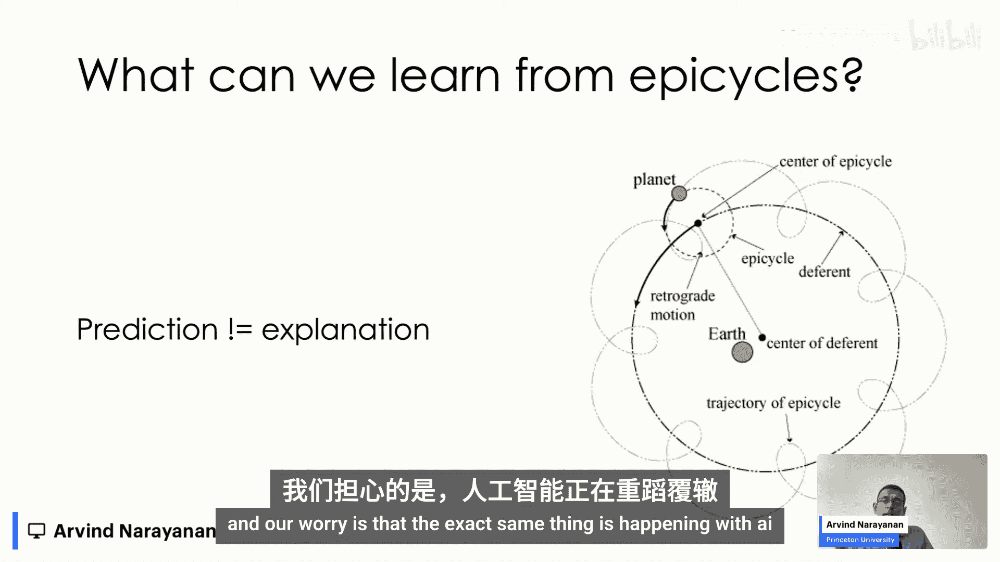

But this is typical， this is just one example。

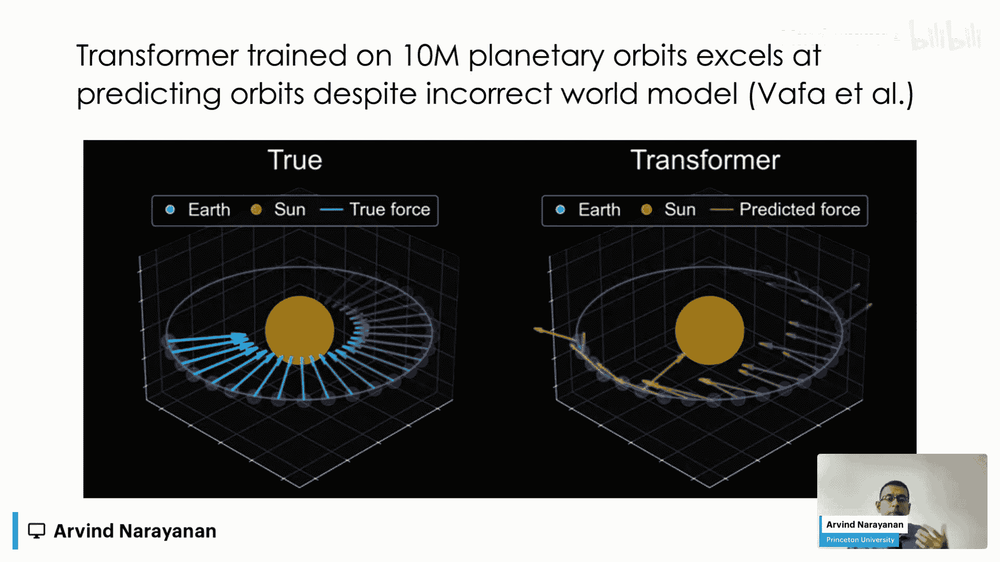

So when people start using AI， they start reframing the goal of what the scientific activity is。

 it goes from understanding how the solar system works or whatever the equivalent is in your field to predicting the motions of planets and so if you're purely focused on prediction you're going to be optimizing for that without necessarily getting to a better understanding of the underlying scientific phenomena and I think we need to change that this is a kind of oped that we wrote on this topic in the journal nature but I think you know this is one area where neurosymbolic AI might help but more generally I think when we're building AI tools for scientists we should focus much more on getting the world models right as opposed to just getting predictive accuracy right。

Okay， so last few minutes， how is AI impacting human understanding。

 and this is where that picture comes in。When we use AI for science。

 I think the vision in many cases is to automate the whole process。

 but I think that's particularly dangerous because it gets you directly from the problem to the solution bypassing all of the human understanding that happens along the way。

 but in a way I to I want to argue that you know we solve scientific problems and publish scientific papers but in many scientific disciplines。

 really the point of that whole activity is the thing that sorry about that what happened here the point of that whole activity is the human understanding that happens in the middle because that's what allows us to generate new problems。

 new theories and paradigms， you know correct errors strain new scientists and apply scientific knowledge to policy or industry or things like that and we're very far from AI being to replace being able to replace all of those things。

So I think we should be very careful about skipping this step in the middle and this can be seen very clearly in a case like mathematics。

 which is a little bit of an extreme example admittedly。

 but I would say that in math the instrumental value of proving theorems。

 especially in pure mathematics is close to zero the theorems are not valuable on their own it's not as if we're going to be applying those theorems to practical problems this year or next decade or even next century typically it takes if at all。

 you multiple centuries for new mathematical knowledge to to find application and so if you're just building AI for proving theorems bypassing the human understanding on the way。

 you've made things worse， not better and there's a great paper on proof and progress in mathematics。

 this was written long before debates about AI explaining that the goal of mathematics is not really to find solutions but。

😊，That's just an excuse for the activity that happens along the way。

 which is to build up human understanding。And so my provocation is， what would AI tools look like。

 whether in mathematics or in other branches of science， if the goal was not to solve the problem。

 but really to improve the understanding of the scientists who are going to be using it。

I don't know the answer， but I think it would be a useful goal to pursue。

So to summarize my talk in the first part I talked about AI research itself and how while we're very good at exploiting a particular local minimum。

 we do tend to get stuck there and that's why it's important to have subcommunities who value different things who have different notions of progress and in the second part I talked about AI for other sciences like medicine or mathematics。

And it seems like based on the three bottlenecks that Ash and I identified in our essay。

 arguably the way that we're building these tools today is making all three bottlenecks worse。

 and I gave some ideas for building different kinds of tools。

Thank you so much and I look forward to your questions。Okay， thanks， Arvin。

I just want to say there's so much urgent truth in everything Arvin said。This is amazing。

 so I wish they were。We should donate money to your cause or whatever if like。All so。嗯。

I just want to mention a few things， which is。Somehow translating some of the questions too from the audience。

 so but let me first relay one anecdote。That illustrates one of the things Arvin said。

This this thing of being so benchmark driven right now， I mean， it's a good thing， of course。

 it like gives us a way to say what's better and what's worse。But very celebrated in ML。

 but but also can be a very bad thing as Arvin said。

 so I remember when if to do speech recognition you had to do some version of FFT plus hidden markov models。

 that was the only way because it was locked like that for， I don't know， 10 years。

 15 years something， why because a DARPA competition and you know you had to win that and you had to compete with basically you know a very well tuneed models that were using that paradigm。

So there was no way to come with a different idea that anyone would pay attention to。I。

 as a PhD student。At the time， I was like， h I don't know anything about this area。

 but what about one big non parametric model， say？It's flexible enough to kind of learn all that。

This is， of course now what we do is neural nets。so。

 but there was no like way to squeeze it was very difficult you had to actually progress with the new approach so much that you eventually beat the benchmark。

 but you had to survive long enough with the ideas problem and so。😊，So super， super true， very real。

 everything Arvin is saying。I also want to point out this train test issue。You brought up。

 it's not just like weird fields that don't understand statistics， it happens in AI。Now。

So we do this， this is shameful， but we do it you know you half knowingly。

 everybody knows that there's a lot of cheating in papers。

 we do tune on the test set when it's available and so on because there's so much pressure。

 you can't get your paper published unless you have beaten other things in your table of results at the end。

Um，Let me just say everybody doing that shame。OkayAnd that's like whatever， 75% of everybody。

 I think so。嗯。So let's see， here's a question during the '70s。There was a huge debate on AI。

 what is Arvin's view of Huber Dreyfus in his work？What computers can't do。cetera。

 if you're familiar with that I'm vaguely familiar with it， yeah， I mean。

 in some ways we're having a lot of the same debates， but in some ways things have changed a lot。

 so if I recall correctly it was Hobchatter perhaps who did say that large language models did cause him to significantly revise his ideas of what AI can and can't do in my own work。

 I've tried to avoid really getting into predictions of what AI can't do。

 I'm happy to leave that one to philosophers but I find it more productive to think about just comparing different approaches or paradigms in AI and what might be the limitations and how to transcend some of those temporary limitations。

One of the questions was， isn't Arvin the author of AI Snake Oil？So I。

 do you want to say a little bit about the book， I think， first of all， extremely illuminating book。

 I took a little look at it， so highly recommend it to everyone。

But do you want to say some of the high points from the book？

Yeah definitely so let me point out that the subtitle of the book is what AI can do what it can't and how to tell the difference so it's not you know it's not a skeptical book it's about lets let's get detail and let's try to separate the wheat from the chaff that's the theme of the book in particular the kind of AI that were most skeptical about is predictive AI that's used in things like criminal justice and hiring and these are used particularly to make decisions about typically lower income individuals。

 people who are facing the criminal justice system or people who are being recruited for lowlel roles and companies etc and these models a lot of these models in our view are just elaborate random number generators and there is this pretense that these are highly accurate predictive models and you can predict who's going to commit a crime and based on those predictions people are jailed without a determination of guilt so these are the kinds of deeply morally。

blematic things and the book goes after in the first part， and then we switch to generative AI。

 which we very much acknowledge the potential we say repeatedly that it is useful to every knowledge worker。

 but also we call out a lot of the hype around generative AI and predictions about superintelligence。

 which is something we're especially skeptical about and in our more recent SAAI's normal technology as well。

 we talk about how a lot of the superintelligence worries are misguided。So let me just ask so。Well。

 first of all， I love your starting with Thomas Coon。

 who was one of the most influential books for me。You know。

 one of the things in Coon's sort of exposition of the topic is。

He talks about the resistance that happens， active resistance， because in the current paradigm。

 whatever it is， will have staked， you know， built their reputations in that paradigm and when a new thing comes along a classic illustration is Einstein's theory in his book。

 then whoever was you know made their reputation in the previous physics you know tends to want to actively kind of suppress this new thing or poopo it or whatever and it comes in the form of maybe not getting your papers published。

 maybe not get grants，And it's because all those people who make those decisions are the people in power are in the current paradigm now。

🤧So this， when you talk about first of all， any comments on that，' love to hear。Well。

 let's start with that。Yeah， it definitely happens in AI as well I think， and in fact， in AI。

 you know you don't even necessarily have to go so far as being very creative about how you you know poopoo the new paradigm you can just be like this doesn't beat the state of the art right why should I pay attention to this and its story but then there's also the commercial aspect the industry is very invested in protecting current paradigms in a lot of cases they might not be able to quickly switch over to a new way of doing things。

 so all of that introduces additional inertia compared to what Cohn was talking about。呃。

Here's a the other thing is you know about the active kind of suppression or whatever。

 but maybe closely related to that is active deception so there's the which is hinted at with snake oil so do you think which parts of it like let's say people talking about superintelence what part of that now we can debate many people legitimately feel we're on the cusp of superintelligence？

I would put forth the probably most。Real AI researchers don't think so。

 but I could be wrong so but what part of it do you think that either the topic or some other example is actual active deception versus self deception or whatever。

Yeah I mean I would say I think where a lot of this hype comes from is is from people's inadequate understanding of human intelligence so our key thing is that even with one word to assume that recursive self-improvement is possible there are still many bottlenecks that will prevent the realization of what people usually think superinligence will be so we break this down into what are the barriers to human intelligence and which of those we have three barriers。

 which of those three barriers will AI be able to surpass so the three barriers one is computational simple example is chess AI is already so much better at the human world champion has chess because the limitations are primarily computational the second is intrinsic limits on many tasks this is as far as you can do there's irreducible error so when you think about for instance AI being used for writing I think A。

Very quickly over the last decade or so large language models rose up to the level of a mediocre human writer。

 but they're having a lot of trouble surpassing that plateau because theres not a clear signal what it means to be an excellent writer is very much a matter of taste and judgment and what it means what good writing means for one group of users might be different than another group of users these we think are intrinsic limits and there can exist no superhuman writer who is going to write you a page of text that is so persuasive that you change your political beliefs。

 for instance， just think about whether that might possibly happen to you。

And if it won't happen to you， why would it happen to anybody else。

 and if it can't happen to anybody， what does that say about whether it's even possible to be a superhumanly good writer？

And the third limit is knowledge limits A lot of people say。

 oh superintelligence is going to be you know the most amazing doctor et cea。

 Well there the limits are how much we know about the human body and to surpass human performance actually requires conducting new medical research and we're not going to let AI autonomously do medical research on thousands of people so that introduces a bottleneck so to summarize all of that。

 the key thing is not about how fast the computational elements can improve。

 but it's about the bottleneck when you interface with the rest of the world that are going to introduce limits to superintelligence Can I you might I know Alex you're asking the questions but I do want to pull one question out of out of the chat that。

I wanted to address in my talk but didn't have a time too and this is from Ramaingam Clipa who says Alex Ned became popular because it did better on the AmazonNe benchmark absolutely so I think the implication is why are you so down on benchmarks it's because of the benchmark that we realized that deep neural networks could do well but here here's the thing I wanted to get into the story。

 but as you know the principles of deep neural networks were published in the 80s So why did why did Alex Ned not happen in the 80s。

Because back then you know GPUs weren't around our ability to build these super large benchmarks weren't there。

 and so it took several decades for the data sets and for the hardware to catch up so that deep neural networks could prove their metal on benchmarks。

 So yes， eventually benchmarks got us out of it， but they held us back by 30 years before that happened。

Excellent， excellent。I don't know if we have time， but if we do。

 maybe we can take one last question or we can end it here totally no we we have a little bit of time。

 I think next talk starts at。In nine minutes。So let me just mention one factor that。Is not in the。

It's not mentioned in Sa Kon's analysis， which is。And you touched upon it the big money being put in。

This is like a weird new factor you could say， I mean， or maybe not。

 maybe this is the effect of industry in paradigms。

 maybe in other areas this happens to industry can put in lots of money into a certain paradigm and influence kind of the course of science you could say so。

Do you want to comment on that？Yeah for sure， so I think the industry influence happens in a few ways。

 one is the research that comes out of industry itself。

 another is industry funding of academia and a third and in my view perhaps the most powerful and perhaps the most worrying is that。

The question of what kind of research is considered valuable。

 meaningful by the community is just so strongly shaped by what will ultimately be commercially valuable to the industry and that's an almost invisible factor that you can't identify by literally tracking the dollars and yeah。

 I worry about that a lot so。know，10 years ago， for instance。

 I was working on algorithmic fairness research and it was very hard to get too far， I think。

 for that community because this was not considered valuable in the mainstream AIML community。

 but then the industry did a flip in the latter half of the last decade where they admitted that fairness is an issue that they should consider and only then it became much easier to publish these papers。

I seen so many more questions， but maybe we can leave it there I unfortunately also have a constraint to get to another building look forward to catching up the rest of the talks later yeah yeah so。

Thank you Arvind， me just say great talk and you know we'll send all the questions that we didn't get to to Arvin so and。

Get his book， get on his newsletter， Thank you so much， Arvin。Thank you folks。

 this has been really fun。Okay， so now we have a break。

 I just noticed we have an error in the schedule that short shed our next speaker by 10 minutes。So。

Laanni， if you're listening， maybe you can jump on。Now， say。But。Otherwise。

 we'll have a break and we'll see you all at the end of the 30 minute mark。

 meaning six minutes from that。Unless。Lail Lani comes。Oh， here she is， here she is， okay。Hey Liillai。

 okay，um so yeah， I noticed we somehow have you at 35 minutes， but you should get。Longger so。Um。

No I planned for 35， but I can always extend it or we can take more Q&A too， I'm flexible。Okay。

What would you prefer you want to start or do you want to wait？Five minutes。

I guess it's up to is everybody here who's listening otherwise？Oh yeah， we have a。

 we have people all。All that， I think。II wait to your exact start time。诶。To catch your teeth。Well。

 why don't you take it away？So let me do a quick intro。Oh， are you ready， Melani or。我操。Sorry， yes。

 I don't know what happened。Let me just do a quick intro。Leillai is a professor at UC Santa Cruz。

If you don't know she's chairing the NeEi conference this year so and that's coming up so you should check it out I will be there you want to meet some of these lovely people in person that will be the place one of the places。

So。And that'll be in beautiful Santa Cruz and Lela's going to talk about some very important work。

You know， on safety， so with that kind of teaser， let me just hand it over to Lilani。Great。

 thanks for that really kind introduction and' happy to answer questions about this work as well as Ni。

😊，Let me。Can everybody see my slides？Good。😊，Okay。Great awesome so so hi everybody I'm Lelani I'm an assistant professors at UC Santa Cruz and I'm really excited to talk about the work I've been doing and the work we've been doing in my lab for the last few years on using neuro symbolic AI particularly for developing safer and explainable autonomous vehicles so a little bit of an agenda of what i'm going to talk about today so I'm going to start by motivating the problem which is that complex system fail in complex ways in particular I will be talking about autonomous vehicles but of course these types of approaches can be applied to any type of complex system and I'll be describing in complex system as a system made out of multiple parts。

😊，Then I'll talk about one type of solution which are local sanity checks which is a neurosmbolic approach which basically looks at the output of computer vision systems and supplements that with different types of symbolic rules I'll then talk about some of our work on encoding driving rules so that we can ensure that autonomous vehicles drive safer and then finally I'll talk about some of our ongoing work doing explainable AI with neurosymbolic approaches so the question I'll be trying to answer today is how do we develop neurosybolic methods that can help anticipate and explain the vehicle failures instead of doing after the fact analysis so how can we develop architectures that can help us identify what the weak points of these systems are before they're deployed。

And this is really important because these complex systems fail in very complex ways。

 so you know one of the more recent examples of this is what happened when there was a woman who was dragged underneath one of these self-driving cars crews in San Francisco and again these you know these cases can be very morbid and upsetting and a lot of the reasons for that is because these are ways that just a human would never fail as a driver and so what we really want to do is try and detect these things before they happen so that we don't have these types of catastrophic failures there are other cases that these systems fails which are due to common sense so this is a picture this is a bus side ad on the back of a bus and the Tesla thinks that this is a person crossing the street。

These there are a multitude of these types of failures。

 there's also a case where there's a tsla you might see here that there's a yellow light I'm not sure if people can see a cursor。

 but there's a yellow light here and the Tesla thinks that it's a yellow light but actually it's the moon。

😊，Of course there have been all different types of adversarial attacks。

 but now adversarial attacks are being done in the real world as well。

 so with just a few pieces of tape on the stop sign that you can see here。

 all of a sudden people think that this stop sign is now or all of a sudden the autonomous vehicle system thinks that the stop sign is now a 45 mile per hour sign。

And finally it's been shown that computer vision systems are better at detecting faces with lighter skin tones and darker skin tones as is part of the bias problem in computer vision and all of a sudden if you put that same technology on a self-driving car the self-driving car is now better at predicting pedestrians with lighter skin tones and darker skin tones and so a lot of the work we've been doing in my lab is basically you know how can we handle all of these different types of failure cases and in particular。

 you know how can we do that with neurosybolic approaches but before we get there we really have to think kind of where is self-driving now and really it's at two different extremes so either you have cases that are very cautious but not comfortable this is what happened in general motors ultra cautious self-driving car so what happened in this case is that the self-driving car was starting and stopping for anything in its way regardless of whether that was you know a plastic bag or person crossing the street and what happens is because。

car is kind of jerking you around then people have this feeling that the car actually isn't safe because it's not having this smooth trajectory and so I think it's really important that you know our notion of you safety。

 which would be stopping at everything actually can sometimes have the adverse effect。

Then you know we have what happened in Uber's fatal self-driving car crash which is an example that I'm going to be showing today。

 which is what happened when they said， okay now we're only going to stop for objects when we are very confident of what's happening and so you know the problem that we've really identified is that we need better common sense and reasoning and the best way to do that is with a neuros symbolymbolic approach because we have all the benefits of using neural nets for LiDar and vision detection we just need some type of common sense layer on top of that to be able to handle these types of cases and so what we've been doing is kind of creating these models that are inspired by human organizations and I'll kind of outline this three steps and I'll talk about a few of those pieces today and these facilitate better communication and sanity checks for a complex system so you you can imagine a human organization that's you know layered kind of as the way I'm showing you here there may be some middle managers and then a higher level manager and around each one of these we have kind of a standard。

Checker the dotted line that's basically an individual checking that it's doing the right thing。

 but also the sub teamsams checking that they're doing the right thing and so the first thing that we do is we create overlapping of of a hierarchy of overlapping committees so committees are groups that are doing the same thing of course the vision and the lighter system are both perceiving the world so they're technically part of the same committee。

😊，Then we facilitate continuous interaction and communication and the way that we do that is exactly with these local sanity checks so we're constantly enforcing each one of the committees or subsystems as well as individual parts to constantly explain what they're doing。

😊，Okay。And then when a failure occurs， a story can be made by basically combining the members' observations and the way that we do that is with an explanation synthesizer。

 so basically what that does is it looks at conflicting explanations so if the vision system says it didn't see anything but the LDA system thinks that it did see something crossing the street then it figures out which explanation is stronger。

Yeah。And what's really nice about this approach is it actually can mitigate a lot of the common problems that we just saw a few slides ago。

 the local sanity checks are able to handle situations we haven't even seen before。

 this is really shown in these new articless about the trollable self-driving car I'm sure many of you have seen where people are putting traffic cones on top of Waymos to make them stop moving and so this can justify new examples even if the computer vision system or a neural network hasn't seen these instances before。

And then the explanation synthesizer is able to reconcile essentially what happened with the deadly crash with Uber where the Uber self-driving car unfortunately struck and killed a pedestrian crossing the street with a bicycle and the way it's able to do that is it can reconcile conflicting reasons what happened in this case was that the computer vision system wasn't sure what it was perceiving so it told the vehicle planner to basically ignore the person crossing the street and what we're able to do is basically take the different explanations from different parts and tell the vehicle to take a different type of maneuver especially in these safety critical scenarios。

So I'll be talking about justifying these new examples。

 I'll talk about the driving rules that we've developed for this and then at the end I'll talk a little bit about how we're doing this with ongoing work and explanations。

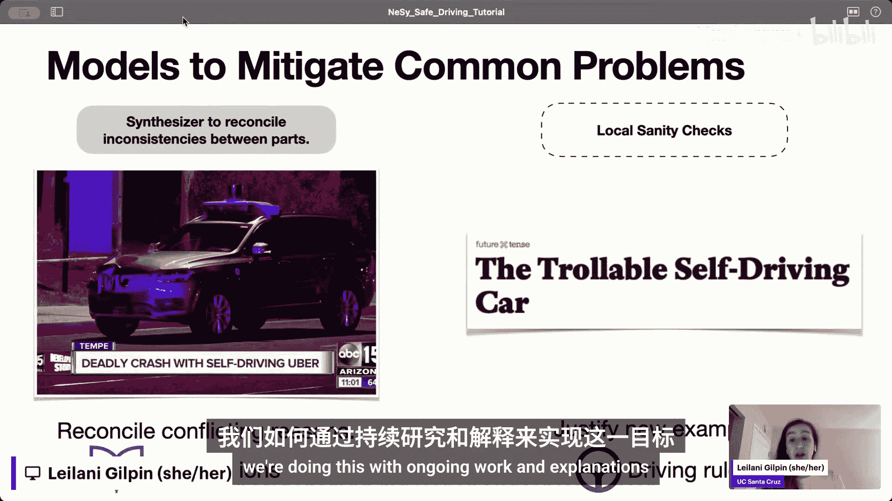

So let me kind of give you a preview of the type of scenarios that we're looking at。

 I am going to give a disclaimer or trigger warning this is the front- facing camera of the Uber self-driving car incident you will see the pedestrian crossing the street right before they are struck but you will not see the collision but just to get an idea of kind of what these scenarios look like so you'll see the car is going very quickly it's going 47 miles per hour and the person is crossing the street。

 the vehicle doesn't make any type of other maneuver or anything to try and move out of the way and again the reason that this happened was because the vehicle was focusing too much on a single modality it was focusing too much on the vision system and not processing the LDAR system and so the types of systems that were're building in my lab and this is published in you know a few different things including my PhP thesis is basically to create these types of hybrid architectures around the existing parts of the vehicle and of course this is an extremely simpl。

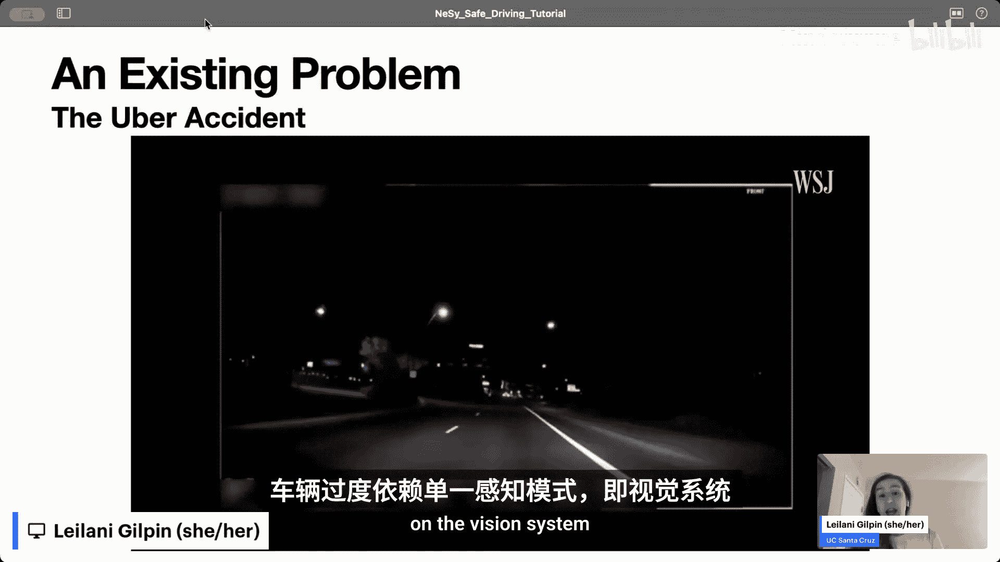

Vi of a vehicle of course there are more parts than just vision LiDarR tactics but for demonstration purposes I'm showing what this looks like and so what the output of my system does is it actually finds that the best option is to veer and slow down it gets information from the vehicle tactics that the vehicle is traveling too fast a suddenly stop that the vision system is inconsistent it's getting that from the vision system directly but that the LiDAR system has provided a reasonable and a strong claim to avoid the object moving across the street now this was generated long before the days of chat UBT you can look at the date stamps on this work and now what we're doing is trying to make this work more accessible to other types of complex systems as well and I'll be talking about that today。

So that was motivating the problem Now let me talk about some of the actual techniques that we use that you can also employ for your own systems as well and I'm going to start with the local sanity checks so when we think about how complex systems fail they largely fail in two ways so the failure can either be local to a specific subsystem or it can be a failed cooperation amongst subsystems and we just talked about that with the Uber self-driving car accident but we're going to focus on the first case here the local failure and in particular we are going to look at one particular type of failure which can happen with the camera data and so I guess you know computer vision and you a very simplified slide so what happens is some type of neural network will label camera data and so what this is going to look like in the self-driving car case for us is that you're going to get some image you're going to put that through some type of neural network for computer vision maybe the inception network from Google。

And then you're going to get some label which is going to say that this is a pedestrian and of course there are many bells and whistles that can also occur here。

 for example， you might also get a bounding box and other things too。

 but this is the basic process that's done for the camera unit of a self-driving car。😊。

But there's a big problem with this neural networks are very brittle so they've been shown to be susceptible to adversarial examples we already talked about some of those but you a particularly cute example of that is you have a picture of a pig you add a little bit of noise to that so 0。

005 times this noise and all of a sudden the computer vision network thinks that this is an airliner。

And of course we saw the physical attack here where you can do the same thing in the physical world and again these are happening all the time。

 this is just one example， there are other things with different textures you know that you could put on signs and other things that have similar types of adversarial behavior。

And so the real key that I'm trying to illuminate with these problems is that when we're talking about self-driving and other types of mission critical safety。

 critical applications， these mistakes have consequences and so we really have to basically monitor these systems to make better decisions ones that make common sense with the types of knowledge that we have as people and so what we've developed is basically a monitor for reasonable behavior within a particular domain and so I'll be talking about that in the self-driving card domain and the way that we do that is fairly simple。

 we just say okay we're not even actually going to look at the network and I'll talk a little bit later in the talk about how we're actually trying to bring in neural network interpretability into this pipeline so but right now what we're going to say is note we're just going to treat the neural network as an opPque mechanism and we're just going to look at the output label here。

Okay， and basically we're going to supplement that with some type of common sense knowledge base along with a flexible representation that can identify whether that is unreasonable or not。

And then we will use that to justify whether it's unreasonable or not。

 and so the output of the system is twofold， you have a judgment of whether you think that that's reasonable or not and also a justification of why it is and so we can use that to basically say whether we should interrupt the computer vision system or not。

Okay。And so we call the system reasonableness monitors and this is basically what it looks like。

 so again it takes the output of an opPque mechanism which could be anything that could even be a mechanical part of the car that you're not sure how it works。

 you then represent that with a flexible representation， you identify unreasonability。

 you supplement that information with a common sense knowledge base all leading to why it's either unreasonable or not reasonable。

I'm particularly going to talk about the flexible representation just for this tutorial so that you guys get an idea of how。

 again， you could apply this to the particular problem that you may be interested in。

So what we're going to use here is a primitive representation and that is going to encode this type of understanding and of course there are many different types of primitive representations that you can use I'm using conceptual dependency theory or CD from Shank in 1975 and what heat came up with was basically 11 primitives that would account for most actions and you can look at the actions here and what I focus on for this work is basically representing this particularly for the vehicle domain so instead of looking at all 11 primitives to account for most actions I'm going to look at the five for physical actions that are highlighted here and then I extended this to different vehicle primitives so those could be turning yielding etc so what our big problem then becomes is that we basically have to parse natural language into this representation and what's particularly nice about this representation is that it's explainable by design and' describe I'll describe how that's done。

In a little bit， so we're going to parse this natural language into the representation so let's take the example we were looking at earlier。

 this is an actual data point from new scenes， this is a self-driving car data set and let's say that we have this labeled as a woman and the description of the scene is that it's a woman crossing the street。

Then what I'm going to do is I'm going to take that okay。

 and Im going to I'm going to basically parse this with a part of speech tiger to get， you know。

 the noun phrase， the verb phrase， et。😊，And then what I'm going to do is I'm basically going to bound the particular parts of interest of this representation using a common sense knowledge base so basically using an ontology I can say okay。

 actually it doesn't matter that this is a woman crossing the street this is a person moving in the direction of the street and that's how I'm going to represent this so that you know I'm not looking at all little tiny instances I'm looking at kind of a higher level representation of this particular scene so again I bind those with I bind those with a common sense knowledge base to look for what are called anchor points so we have those designed as a person the particular primitives and other objects that we're looking at and the way that we would actually represent this in conceptual dependency theory is basically this would be a person they're moving in the direction that's what the de corresponds to of the street and the object doing the moving as the person。

Okay， now you don't need to you know understand particularly how this sort of representation works。

 the important part of using this representation and why we use this for autonomous driving is that this representation has implicit rules built in。

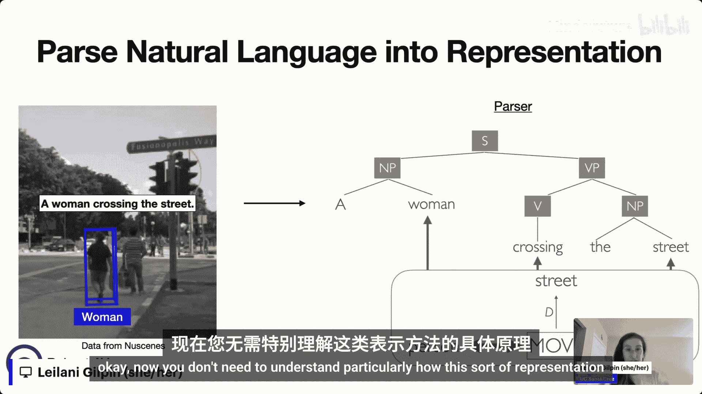

Okay and that makes it really attractive for again what we're trying to do with looking at reasonable and self drivinging cars for making safer decisions so for example。

 if we have detected that somebody is moving move has certain rules attached to it so。😊。

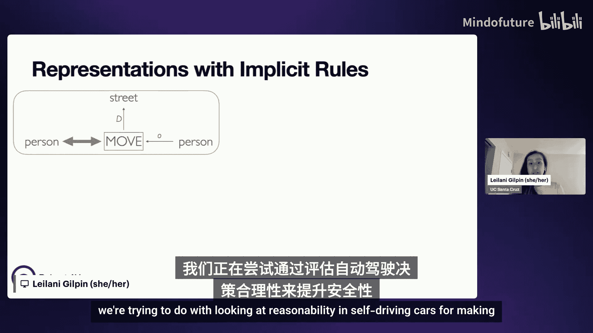

Primitive for reason has an implicit rule built in that。😡。

Moving is reasonable if you have the property that you're adamant and you're located near the place where you're moving right so we're saying that for a particular actor and location x and Y right and you can see that the person as the actor here the location here is y and again it has to be that the actor has the property that they're adamant or they're located near of course there are all different types of corner cases of this you could you know be pushed in a certain direction and that could cause movement but here i'm showing for one example one type of reasonable inness rule that we would have。

And what works really nicely here is that if we are looking at you know autonomous vehicles that's sort of a frame by frame basis。

 so we can then say that a perceived frame is reasonable if all the if all the reasonableness rules that we have are triggered as reasonable for that particular scene。

 so I think that that's really nice because then we can actually have an explanation of why we think it's reasonable or not。

So let me show you guys a little bit about you know what that looks like now for doing this type of monitoring on real data and again I am showing this for new scenes this is an autonomous vehicle data set so。

When this is actually in the data this is labeled as a human pedestrian adult and you can see you know there's a bunch of information that we have here about this person。

 the number of lidDar points， the category you know how visible they are etc and again what we're particularly using here it's just the category name and we're also using some of the sides and other information but of course you know in future work we're going to be looking at sort of the whole metadata that we can look at and I talked a little bit before about how we're incorporating common sense let me describe why this is a particularly difficult problem just to apply here in the autonomous vehicle world so if I am to just apply concept net to this scenario and I say okay I have a human pedestrian adult and I want to see if I can use this common sense knowledge base basically prove that I think that this is a reasonable scene so if I just use this without any type of representation and just query concept net you'll see a bunch of you know interesting information what an adult is capable of so you know。

A bunch of information here I think you can read through it is that is not very useful for this case。

 for example， drinking beer or you know explaining rules to a child that's not exactly what we're looking at here in the scene。

 but there's also a lot of information that is very useful for an example an adult is type of animal and animals can move on their own。

Right and adult is a type of person and those have certain properties and so one of the contributions of our system was really to find the right type of common sense knowledge that we'd want to represent in the vehicle world so basically what we did is we took conceptnet we would query it for a particular term and then filter that down to a very small subnet of common sense knowledge that we would want now we had to do that hard coded for this particular system and again I'll talk a little bit on future work how we're trying to do that automatically how we're trying to learn that network as we go。

So let's see a little bit about you know what the reasonableness monitor actually looks like for this particular scene。

 so it will output a judgment and a justification of why this is reasonable and so we put that through our system it finds that it's reasonable and here is the reason why so it says okay great this perception is reasonable and adult is typically a large person they're located walking on the street and it's。

Dension， which we give here is approximately the correct size and meters。

So that works really great right so and if we look at actually the New scenes data basically 98% or more of the data is reasonable and the reason for that is that know these are handcur data sets there aren't any wrong wrong labels and so what we had to do to actually validate this system is we had to basically add and validate errors so instead what we said is okay what we're going to do is we're going to take some of the existing labels that we have and we're going to scramble them and then we're going to see how how the reasonableness monitor does with basically finding that and so instead let's scramble the labels if we label this as a moovable object traffic con it clearly finds that it's unreasonable and it basically says it's not a reasonable size it's too tall and that there's no common sense supporting this judgment so discounting objects detected in the same region so again what's happening here is basically it's saying okay I have you know an idea of how big a traffic con should be and it definitely shouldn't be。

Call as a person is so in this case， I'm going to say that this is unreasonable and I'm going to look for other sensor I'm going to look for other sensor information for this point。

Okay so that's you know one type of solution that we're working on for autonomous vehicles let me talk about another piece of work that we're working on which is basically on encoding driving rules so this is part you know of a large effort that we're working on at UC Santa Cruz on building robust autonomous vehicles which is part of a Department of Trans National Center for Transation。

 cybersecurity and resiliency called tracer this is led by Olivervaro Pergs one of my colleagues and we're also working with Siangzi and Daniel Fremont you can read more about it in the news story but just that this is a very small part of like a much bigger effort so we're looking at cyber physical system security cyber physicalsical system verification I'm looking mainly at AI for vehicles and Xng is working mainly on adversarial machine learning so when I kind of show these driving rules they may sound like they're fairly naive but again they're being used for a lot of different parts。

the system so let me kind of motivate what that looks like what i'm going to be talking about right now is the driving rule specification so basically how can we create a specification of driving rules which can then be used to basically automatically generate maneuvers or simulation scenarios for driving tests and of course that's going to be used in many other parts of the system including the fer which will be passed into an autonomous vehicle simulator to generate these different types of scenes so again i'm going to talk about the specification how we do that。

 but this is part of a much bigger system as well。So let me talk a little bit about what the vision for the system is。

Some of you may know some of you may not know but you know autonomous vehicles are not held to the same standard that we are held to when we want to get a license so I don't know I feel like I'm always going to date myself but when I went and I got my driving test or I got my driving license I had to physically go into the DMV and there were two parts right the first part was that they would give me this driving handbook some you know paper actually a paper document I think now they don't do that anymore and I had to take a written test saying that I knew what the driving test or knew what the rules of the road were and then there was a dynamic driving test I would have to go in with a vehicle and I'd have to go with somebody outlined here who is making sure that I'm making the right decisions now the problem is that autonomous vehicles are not held to that standard if an autonomous vehicle wants to be on the road at least in the state of California basically the governor just has to sign a piece of paper and so what we have really encouraged is that okay autonomous vehicles actually have to take these driving tests and。

I inspired by the way again we we are evaluated as good drivers we have to go and we have to take this test we argue that self-driving cars should have to do the same thing the only problem is is then we have to codify these driving rules and so what we did is basically created a way that we could learn those driving rules from text。

And eventually what we want to do is dynamically generate these driving test scenarios in different environments。

 and again that's part of the larger vision that we have with this tracer grant。

So let me kind of describe what what that looks like and this is all done you know there is no generative AI in this pipeline at all we are working on validating our approach with generative AI to see how well that they do with generating driving rules versus our approach but this is all with a very classic nLP approach so basically what we did is we collected a bunch of driver handbooks for different states and different countries we filtered that so we looked at the particular chapters that focus on safety we then。

preprocessed the text so we removed images and other things and then we created rules and we represented those as both natural language rules and as RDF rules so in symbolic triples and I'll show a little bit about what that looks like and then we did a validation so semi so this is a semiupervised process so making sure that we found rules that make sense and then we did both a manual and an automated in that analysis so some of the analyses that we did was looking at you know how different driving rules are different in different states I think a good example of that is you know I now live in California I had lived in California before I moved to Boston but when I moved to Boston and I drove there for the first time I learned through experience that Boston drivers are a lot more aggressive than California drivers and what's nice about these types of you know if we had these driving rules codified is that could be something where that could be something in your autonomous vehicle if it's trained in California you can then transfer it to Massachusetts and it would have you a particular type of driving style。

Notified for that department。So these we then represent these so the sort of RDF framework so it looks like we have a driving handbook that used to look like this at least when I was learning to drive and basically we represent these in a variant of a web rules so this is called air a more than RDF you can kind of see what these look like so basically they have an ontology built in but you can define the particular type of rule you're looking at so you can ensure that pedestrians are safe and basically it will tell you whether there's a pedestrian in the way or not and what's really nice about this and representing these as web rules is basically two parts so one is that these rules could be shared between vehicle so again like if I'm driving around and I have an autonomous vehicle then I can basically just transfer my rules to the person next to me so you can basically be aware of what they're doing for safer driving。

The other thing is you can also combine this with a production level reasoner。

 including the dig reasoner here for air to basically be able to prove different types of scenarios so you can basically see what types of things you can infer from the rule set that you have。

 which I think is a really nice property again for thinking about safety and trustworthiness of autonomous driving systems。

Okay， so let's see a little bit about what these rules look like so these i'm just showing a couple of these rules we also have them all we have them all publicly available on GitHub I can share the link after but these rules can identify a lot of conditions that maybe are things that we actually aren't aware of as drivers but would probably be important for us to know and also definitely important for our autonomous vehicles to know so one thing that we were able to learn is that if self so that's the vehicle that you're in right if you encounter a death storm then you reduce your speed。

so what's interesting here is again if we kind of combine this the neurosymbolic approach。

 if the AV is able to get weather reports and other types of examples there。

 then you can correlate this to a camera feed and then adapt your driving behavior right so if you see you know if you know a dust storm is coming and you're able to detect that then you take some action to adapt your driving behavior in that situation which I think is a really nice result。

😡，Other one you know for those of you that don't know Santa Cruz is along this really one you rode Highway 17 and there are a lot of trailers and I'm always very cautiously driving around that and I always think one of the biggest challenges is for vehicles to be on that highway and so one thing that we were also able to discover through this analysis is that if you have if you encounter something with a trailer then that can cause a jacknife so autonomous vehicles can identify if they're pulling a trailer or not and then they can drive accordingly again there's a way that we can identify sort of the length and the depth of the vehicles in the front and the back and then the autonomous vehicle can basically preemptively drive accordingly so that they're not going to run into these types of situations this is a jacknfe manever so I think these are these are just a couple of the rules a lot of people ask how long this rule set is。

It's， I think we have 85 rules through three different states and again that's just because we're looking specifically at the safety rules and I can talk about some of those after as well。

Okay， so I talked about you know two types of techniques that we can use to kind of combine neurosymbolic approaches for making autonomous vehicles safer。

 let me talk a little bit more about the ongoing work that we're doing with basically doing explainable AI and neurosymbolic。

Okay so you know what our vision is largely in my work and my lab is really facilitating coherent communication and that's with other systems but also with humans so you know what I talked about today is largely how you can take some type of learning system that can be a deep neural net that can be。

😊，you know， a generative AI， et cea， and basically how you pass the output of whatever that system is doing to some type of symbolic system to catch the different errors and failures that that underlying learning system can make。

Okay。But really what we'd want is we'd really want them to communicate better together and again I think that's exactly what a lot of us are thinking about with neurosymbolic AI and what I argue is that we could use explanations which is largely my area of research and explanatory AI as a common language to complete these tasks this is important for things like redundancy so that you have systems that can solve problems in multiple ways。

 taking what we saw with driving role using like a very rule-based sort of natural language processing system。

 we can also again compare that to what a generative AI can do so that we have multiple problem multiple systems that are solving this interesting problem。

 maybe the generative AI finds rules that our system doesn't end vice versa。

This is also important for having hybrid processes so systems that learn from each other。

 there's a lot of things that symbolic systems do that are better than learning systems they're in a lot of cases they're self-explainable and other things that we'd really want especially in trustworthiness。

 so how can we create systems that really learn from each other and again using these types of explanations or this symbolic language as a common language。

😊，But this is also really important for learning with humans so I argue here we're using explanations as a debugging language so for debugging I mean that humans can improve complex systems so one of the applications we're also thinking about in my lab is how do we develop this for educational systems but another part that I think is important is this sort of you know capital E education approach so that complex systems can improve or teach humans what I think is really interesting about this is that you know it's been shown that a lot of AI systems。

 a lot of opaque AI systems are better at humans at detecting certain things for example it's been shown that there are a lot of computer vision systems that are better at detecting cancer earlier than humans alone can we use these systems can we use explanations to basically teach humans how to detect cancer and other things earlier so you know this is kind of the the sort of next steps that we're working on。

For developing neurosymbolic architectures for coherent communication always thinking about that in safety critical situations but also just in general so you know how does that kind of fit in the larger scheme of things I don't know how many people have talked about the Gartner Gartner chart but many of you guys know neurosymbolic is there for 2025 which is very exciting and I think there are just so many questions and so many problems that are really occurring here and one thing that i'm trying to do is to think about how do we generally solve some of the problems that I showed in the beginning of the talk right so for example you know we have a Tesla's driving here there's the moon here and it thinks that this moon is a yellow light。

😊，What I think is really interesting is you know actually if we just query a a commons sense knowledge base like concept that what we find is actually the exact information that we need。

 that the location of a traffic light is you know at the corner of two streets and it's on the street this would you know very easily take care of the case that there can't be a traffic light located up here the problem that we have is basically you know how do we come up with that representation。

 how do we build that into our system and this is something that we're working on now so a lot of the current work in my lab is in taking internal neural net explanations and then combining those with information from knowledge graphs to develop better reasoning of why why certain outputs from neural systems are again reasonable or not so taking what we did in the previous part the sort of reasonableness monitors but actually passing that back into the neural network itself I'm happy to talk about that a little bit more after。

Cool so in conclusion and you can read about all the work that my lab's doing at our lab website or feel free you know to visit my personal website or send me an email so you know I started by talking about the fact that complex systems can fail in complex ways and I started by particularly motivating the self-diving car case。

I then talked about local sanity checks so how we can develop a rulebased system around a deep neural network to handle the different error cases that you could run into in a self-faing car I then talked about how do we encode these types of driving rules。

 how do we learn these from natural language text and how can we use that to share information amongst vehicles and hopefully use that to codify what we would need in dynamic driving scenarios and then I ended with some ongoing work that we're doing in explainable AI and combining that with neurosymbolic behaviors and the goal you know of the work that I'm doing and this talk was basically you how do we make sure that our autonomous vehicles don't act like this。

Great， so I think that was all I wanted to talk about today and I think we have some time for questions。

All right， thanks so much Lelani， great talk。嗯。Hopefully everyone can tell super important stuff。

 not enough people working on this， you want a great topic to work on that helps the world go work with Le Lani。

So。Now。Let me pass on a few questions。First of all， comment， George S from Boston says hello。

 but he didn't actually counter your claim。Boston drivers are more aggressive。

 so I think that's implicit agreement， okay。How would the representations with implicit rules work in the initial Uber crashash example in that case。

 wouldn't recognizing anything be helpful， for example， a cycle or woman？

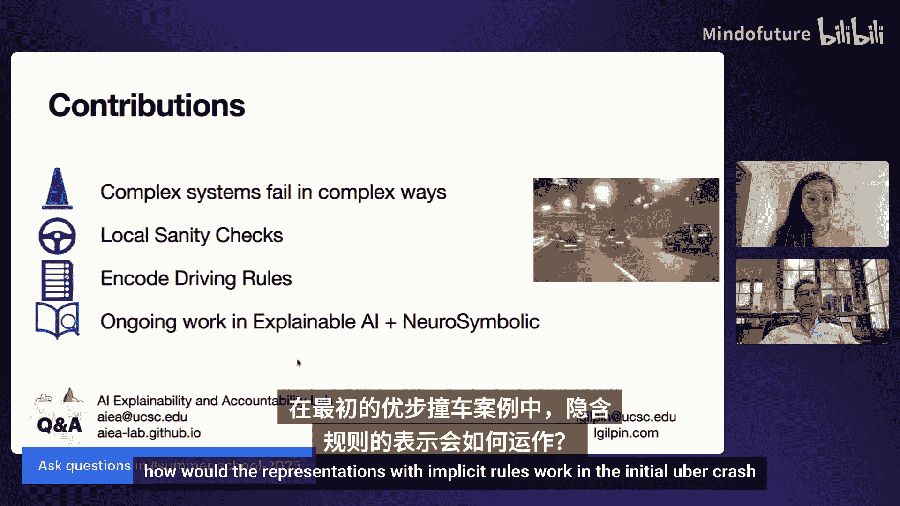

Yeah， so I think you know what one of the problems is is that a lot of these parts of a self-driving car and I didn't talk about that in detail。

 but a lot of them are opaque and some of them are opaque because they're trade secret。

 some of them are opaque because they're computer computer vision systems so one of the things to note is that you're absolutelyole right if we detected anything that's that's definitely important。

 but the vehicle planner is not incentivized to do that so in a lot of selfdring car architectures they are only incentivized to stop for objects when they're。

When they're very certain of what they saw so they're past this certain threshold yet when we see something as drivers I don't care if i'm 95% sure that I saw you know a person crossing the street if I see something moving i'm going to stop for it and that's what the implicit rules are for so they say okay I don't you know I don't care if you told the vehicle plan or not to stop if I see any type of detection and it's of any type of size that I care about if it's any type of threat that we call that's something that we stop for so a lot of these are a lot of these approaches are important because again the。

The existing autonomous driving vehicle stack that we have doesn't allow us to make those interrupts。

 which is why we kind of build our own system on top of it。Okay。I'll just mention something。

 so I spoke with a self driving car company not long ago and。A person was very stressed out。

And I mentioned neurosymbolic AI。They had never heard of it， but also person was telling me。

We're trying to get rid of all the rules actually we have some rules where we're trying to get rid of them likeoo it sounds terrible so I think there's a deep hint at a deeper philosophical divide you know and。

You's at one extreme， it's actually been declared by some。We need to drive knowledge。

 human knowledge to zero。Drive data to the max。And let the data speak。For themselves and so on。

Now what and I you know， I think the self driving car， you know。

 ethos that's in many of these companies right now， it sort of seems like it's that。

So what first of all， are they using rules， what's the real story and you know what's your take on this philosophical kind of。

Issue。Yeah， so I guess one thing I should say also because I'm seeing some of the questions and I can't talk about particular car manufacturers't I don't work with any autonomous vehicle companies right now。

 I would love to if anyone has contacts that's interested in this stuff let me know。

 but you know again a lot of these algorithms are trade secrets so I can't tell you exactly what they're doing even in the Uber selflf-driving car accident which is something that I spent you know the majority of my PhD piecessis analyzing and working on。

I still don't know exactly what I only know from the vehicle reports and the testimony。

 what we have I don't have like a complete spec of the system。But I guess to your debate question。

 I think it's very， I think it's very interesting and of course you know I'm kind of on the narrow symbolic side I think u you know。

 by design and that's why I'm here I mean。I just don't think that we are ever going to have enough data to represent all the cases that we run into I mean I think a great example of this is。

So again， plug for NSE at UC Santa Cruz。Santa Cruz is a beautiful area with a lot of different microclimates and so what happens is is we have a lot of really interesting animals on campus。

 I think one one of the best examples we have a lot of turkeys and there are a lot of students that have never seen turkeys in their entire life and all of a sudden there's a flock of turkeys crossing the street。

And these students who have never drove in Santa Cruz before， they've never seen this data。

Autoomatically know what to do in the case of a turkey crossing the street， they all stop。

Right and I just have a hard time believing that there's going to be additional data for turkeys crossing the street for other types of common sense scenarios。

 I think one that's that's really interesting I always point to is。If you see a skateboard。

 go across the street like a skateboard， you know， without a person on it。

I automatically think a group of kids is coming。Even if I haven't seen that exact scenario right I'm always very weary if I see that because then I think there are going to be children and you know they act recklessly and again that's something that we can represent with rules。

Even if we haven't seen that data point before， so that would be my argument， but。

But I know that the， you know， it would be wonderful if we had that type of data set。

 but I don't think we're going to get there。Here's a question。

 how adaptable are these sorts of rules based systems when presumably the knowledge bases contain a finite set of operational slash visual slash behavioral conditions？

Yeah， no it's a really good question it's what were we are investigating that right now I mean that's our exact approach is basically like how can we supplement rules with knowledge bases with the existing computer vision system。

 you know， for us， it's been very adaptable but we have a very we have a very interesting scenario because we're assuming that these computer vision systems that we're typically monitoring are like over 95% accurate。

Right， so we're just looking for like very particular parts of knowledge to supplement that like5% of errors。

 of course that's not going to work if you have a。A system that's always wrong but because of you know the types of scenarios we've looked at which have mainly been in simulation with different types of threats for us it's been adaptable again we haven't deployed this in like a real- worldor robot that's something we're hoping to do but I think you know to your question you know for this issue of like I guess you would call it coverage or enclosure we would ideally want a human in the loop I think that's something that we're going to have to build in that was kind of part of my last slides but we haven't gotten there yet but again for the scenarios we've looked at because it's been in simulation because we have these certain assumptions it's been pretty adaptable but of course for any type of real- world deployment we're going to meet a lot of other people in the system。

I'm going to paraphrase a few questions。呃。Would you learn this knowledge based slash rules from the real world？

And is one。Maybe start with that one。嗯。Yes and no I mean it's been very interesting this is maybe an aside side point you know I spent a lot of time talking to expert drivers to try and learn their behaviors for both the codifying but also for validating our system and I think there is。

There's some importance in that and then there's some not a lot of us are actually very difficult it's very difficult for a lot of humans to explain what makes a good driver。

And it's very hard I know there's another question about the semantics it's very hard to say。

 oh you know a good driver is very cautious and then take that and represented in the rule so again I think a lot of it you know I think a neurals symbolmbolic system can also be a system where the you know neural part as a human right so I think part of that is also taking the human explanation and then representing that as a rule and not in itself as an open problem but I would say we can get so far but we also need you know formalized knowledge which is a lot of what we're trying to develop。

Here's a question， do different you already partly answer this do different car companies have different knowledge bases and is the government involved in setting standards for symbolic slash explainable AI。

 should all these stakeholders be involved。K。So again I don't know what what car companies do I assume that they all have their I assume they all have different knowledge bases if they exist。

 some of them may also may not again you know as Alexander said。

 a lot of these car companies really want to go just data as like a first。

As a first pass so so that I don't know about。So the government is involved in describing some standards for explainable AI。

 but not as much as other places around the world， at least the US is very behind in the EU。

 they have the right to explanation and they define what that means。Of course some with the AI act。

 there is some language in there but。I think it would be really useful if we had you know standardized knowledge that autonomous vehicles need to have to be deemed safe and i've actually I've done I do a good amount of work with policy as well I want to talk to congressional staff exactly about that that we need driving tests for autonomous vehicles。

I don't know where that's going， but as of right now there's from what I understand and again。

 you know， I'm not in the internal discussions with autonomous vehicle companies。

 there's not a whole lot of regulation around autonomous vehicles and not a whole lot of government oversight。

Question， regarding driving tests， shouldn't we rather make an effort to avoid testing of autonomous vehicles analogous to humans？

As this would be projecting metrics based on human cognitive structure and errors onto a system that is fundamentally different in how it learns and acts。

You're absolutely right。And I think we need to start somewhere， I mean， again， the fact that。

If I had an autonomous vehicle and I wanted it on the road。

 I just have to have somebody sign off on it， I think is。Not okay right we should have everybody。

 you know everyone who's on the road whether that's an autonomous vehicle or human has to be held to like a similar standard of safety。

 so I totally agree with you， but I think we need some type of。

We need some type of test and I think we can start with similar to what humans do for tests and then we can make that you know a much。

More grandiose set of evaluations， but I do think a big part of that is a dynamic aspect because I even remember from my driving test I had to go through a construction zone and I was sweating I was so nervous right this can't just be something in a simulation that you could hard code this should actually be some type of dynamic environment that's different day per day so that there can't be any type of memorization or other hardcoded situation but I agree I mean I'm talking about the driving test as like a first step and then we can get to you know a more holistic evaluation。

Does the evaluation of rules help the latency of the system because their computational easier to evaluate than our neural net or do they actually add weight to the system？

That's a very good question we haven't had any issues with latency but that's also because of the that's also because of the abstraction that we have for the rules so again were we're only looking at like a set of80 rules at a time so we don't have this type of rule blow up situation that you would get of course i'm sure if that was a larger set you would have you'd have a lot more latency。

And again， they are computationally easier because it's usually just one rule is triggered at a time。

 it's not like you're looking at a huge set and again that's by design that's how we designed it。

 I think if you're to learn rules through experience。

 which is something we started looking at you would have that problem。

 but we haven't run into that yet。Okay， one more question for me。Yeah。

 you showed a little bit of your。Common sense， rules and so on。

Could you say a little bit about sort of from a symbolic AI standpoint。

 is it or using a kind of situation calculus or is it。You know。

 to what extent you have temporal logic in there or you know and so on。

 also the relationship with probabilities， I really like the reasonable。

Kind of reasonableness calculus or whatever you' call it， but it makes a lot of sense。It's you know。

 maybe helps put in lots of knowledge in a much more intuitive way and therefore makes it faster and easier for people to put in that knowledge。

You get more detailed though， with probabilities and even causality。

Things in my experience tend to mushroom as far as the complexity to you know knowledge engineers when you do that。

 but obviously would have advantages。Can you comment on the form of your kind of knowledge language？

Yeah great question so I mean everything I showed today was like first order logic so nothing nothing today was in any type of temporal logic we do have other systems that do that in fact we use a tool from my from my collaborator at UC Santa Cruz also on the grant Daniel Fremont Scenic which is using a temporal logic modal logic which is which has been really interesting so we've been trying to translate this which doesn't always work out but yeah everything I showed today was first order logic moment in time but I think that there's there's a lot of space for exactly what you said which is you know incorporating different probabilities or confidence measures I would love to do that we just we haven't had the time too and then again we are working on different working on higher orlogs as well as temporal logic but today I showed it just for single again looking at things frame by frame。

Which has worked well for us。In the past， but now we're thinking about that more dynamically。Okay。

 leave it at that so let me just say for all those people who are like。

 oh AI needs to have a world model thiss exactly what Le Lani is doing okay。

 so and she's you know for very well motivated reasons so it's a poster child for why we need world models。

So thank you so much， Lelani。And follow her work， go be her PhD student。All right， next up we have。

We have tutorial， this is Mateo and Pitro from Cambridge， are they here？Hey， all right， hello， Okay。

 so this is。😊，I saw an earlier version of their tutorial， which I thought was great。A。

 so I'm going to talk about。Concept bottlesneck models and more。So let me pass it to you guys think。

This will be a nice setup for other things later about interpretability。And so fantastic stuff。

 take it away guys。Okay。Let me share my screen。If I can make it。No， I。Why I can't。

I actually don't see my slide deck， but I can share my whole screen， okay。嗯嗯。Can you see anything。系系。

Can you， can you just ping me with I can walk on feedback that Thanks， thanks。 Okay。

 so this talk is about foundations of interpretable models。诶。I'm Peter Barguero。

 I'm a Swiss postdoctoral fellowellow at IBM Research。

 and I will give this talk with Mateo Espininos as alenga final year PhD student from the University of Cambridge。

I will discuss the first part of this talk and we'll dig into what interpretability is the foundations of interpretability。

 so what are the underlying assumptions， design principles and we provide the structure of blueprint for interpretable models and in the second part of this talk Mattteo will talk about the instantiations of this blueprint and discuss a few open questions just a heads up we'll give at the end of the tutorial the link to the slides so you can also download papers and materials that we discuss during this talk。

So let's start about what interpretability is and why do we need interpretability in the first place？

I think the previous talk was already giving us a few hints on why do we need interpretability in the first place。

 so I will be a bit quick on this part of the talk。

 the main reason underlying reason why we may need interpretability is that a few modern AI techniques are highly parametric。

 they have complicated inference steps， so we don't really know how decisions are made inside these models。

And using blindly using these models mainly lead to all issues。

 as we have seen already in the previous talks， including hidden biases that we may not be aware that the model is using in order to make decisions。

And as we mentioned already in Europe， at least we have now the right to the explanation and so users of AI models now have the right to ask for a clear and meaningful explanation for why a decision was made。

 so these are I guess the two main reasons for why we need interpretability。

But when are we looking at the interpretability in the literature？We may ask， well。

 what is how is interpretability defined in the current literature？

And we have been looking at papers that tried to define what interpretability is and we were struggling to find a formal definition of interpretability。

 which might be one of the reasons why current research and interpretability is struggling finding a unifying view of this field。

 and in finding the design principles that are an assumptions that are required to build interpretable models。

 like recently in 2023， there is also a claim in a book saying that there is no universal mathematical definition of interpretability and they're never will be。

 and I think we think this is actually scary for the field because we cannot even define what interpretability is then what are we even doing。

It's worth mentioning that in other fields， like informal systems。

 interpretability is actually well defined and and has been formalized for since like 80 years ago。

 but if we just plug and play these kind of definitions into modern AI。

 we might run into issues the first one is that we these kind of definitions usually come with a substantial background theory that we may need to consider they may not be relevant as a whole for modern AI。

 definitions are not they have not been contextualized in modern AI so we don't know how to drive conclusions for modern AI to how to use different definitions to drive research in modern AI。

So the first problem that we are discussing in this talk is。

 can we then provide a general and simple and action definition of interpretability to make this space a bit more and like well defined？

And to do that， we are going to consider a simple setting， a very general setting。

 we're going to consider a probabilistic model that and the task of predicting a target Y。

 given a set of features X， describing a few objects。And we're going to use a probabilistic model。

 a probabilistic function that takes inputs these features as inputs and tries to predict the target。

Now， and the kind of question we are going to ask is whether this model。

 this probabilistic model is interpretable and one way to approach this problem is to start associating semantics。

 a meaning to the features and the target that we are going to that we are discussing now。

 so we can associate for instance， the string 1 to x1， red the 2 x2 and even to the target y。

 and in this way we can establish a relation between what the model is doing and human knowledge for instance。

 number theory。And if we are looking at how the model is making inferences on objects。

 then we can observe that we may also make an inference that is similar to given the same input we are reaching similar conclusions。

And when we can formalize this with the mapping that we established between the features and the strings that we defined。

That basically define a translation function between the way the model is looking at objects and the way we describe the objects。

AndNow， if we look at this diagram that we have just built。

 you can see that if we make inference using the model first and then translate the result in our reference system。

 we can reach the same conclusion as would if we first translate the features into our own reference system and make inference ourselves。

And if this diagram commutes， so if we reach the same results given the same input。

 then it means that the inference mechanisms of the model and our inference mechanisms are the same for the same inputs so it means that kind of we can kind of understand what the model is doing because we make the same decisions for the same inputs and we call this property inference equivaris。

 and we say that if a model is making inference that are equivalent to humans for any possible input then basically we are equivalent in this kind of task。

And we can understand the model。Now， if we take this as a definition of interpretability。

 there are at least three consequences we can consider。

 one is that any function in theory is interpretable。

 we just need to verify inference equivariance for any possible input。

The second one is that interpretability is a spectrum。

 it's not a yes or no property because it may hold inferencevariance may only hold for a subset of samples。

 so we may only partially understand the model。And postdoc methods that we used in the past for explainability actually complicate interpretability because instead of having one diagram where we need to verify inference equivariance。

 now we need two diagrams， one where we have a surrogate model that is trying to explain a very complex model like a deep neural network and then we have another inference equivariance to verify that is the one between the surrogate model and the human。

 so it's actually more complicated that we're introducing more checks that we have to make。

And there are the three consequences that are the three main topics of the first part of this talk。

 The first one is that if we want to naively verify inference equi biasance。

 this is an intractable problem because the size of the table that we used to describe the function that we just discussed is exponential in the number of features in inputs so if we consider like problems that we just discussed like image recognition tasks where we have a high dimensional input。

 this is already intractable like we are we need more checks than the number of atoms in in the observable universe。

Second problem is that many translations might exist and we may need to a way to find the right one and it's not obvious which one we would prefer。

 and then some translations are not sound so they don't preserve some properties that that we may require so in this case we are actually misinterpreting what the model is doing。

So in the first part of this talk， we are going to discuss these three questions。

And the first one is， can we identify underlying assumptions and principles to make principles to make inference equivariance more tractable？

And to do that， we are going to into representation learning。

 which is the idea that if you have a high dimensional space and you want to predict the task。

 the underlying assumption is that you might you can solve this。

 if you define an intermediate in another space that is lower dimensional。

 so we are compressing information， but we are preserving the information that is needed in order to solve the task。

Now， then in some cases， we may be able to condition the task on this intermediate subspace。

Such that any feature that is not any any information that is not in this subspace is unnecessary to explain the task。

 So basically the task is independent on the input， high dimensional input now。

 given this intermediate subspace。 So the high dimensional input is not needed anymore for understanding what the model is doing。

If this is true， then we can factorize the joint probability over these three subs these spaces as two factors。

 one where the task is conditioned on this intermediate space and the second factor that gives the dependence of this space with respect to the input space。

But when we want to understand how the model is making inference。

 we can verify our inference equivariance only on the first factor that is exponentially easier than with respect to considering inference equivariance with respect to high dimensional input。

So this is the underlying idea that we can take from representation learning。

To make inference equivaris more tractable， we need to project the input into a low dimensional space。

Now， can we the second question that we are going to discuss is。

 can we characterize sound translations？And to do that。

 we are going to use a structure that we call concepts。And so before digging into some translations。

 we are going to need a definition of what a concept is。

And to do that we are going to we are going to do this by example。

 this is a table that describes a set of objects using a few strings where we have one if the objects satisfied the property of the string and zero other ways。

And if we consider a string column of this table， we can define a function of a column of this table that given a column it gives。

 for instance， red， it gives us all objects that are read。And at the same time。

 we can define a function of the rows of this table that given a set of rows。

 it gives us all the subset of sentences of strings that are satisfied by all objects in this set。

And we are going to use these two functions to define what a concept is。

And we say that basically a concept is a set of examples。

 so a set of these objects and a set of sentences or these strings that satisfy a specific closure condition so what is the concept read。

 the concept read is basically a structure that is defined by these equations so its it's a property that given a set of objects。

 all these objects satisfy the string red and given the string red。

 return we get exactly the same objects that we given an input so when we compose the function gam and beta we are basically in this closed loop where we compose these functions and we already return to the initial point it's a fixed point basically。

Well， given this definition of a concept that is grounded in institution theory。

 we can also give practically， we can extend this definition into a probabilistic setting where we can then construct probability distribution of concepts when we condition them on a specific input。

 and Matto will talk more about how we can do that in practice。But our question was。

 how can we use concepts to define when a translation is sound？

A sound translation preserves concept closure。 So basically if we have a set of objects and in and we describe these objects in a specific language。

 let's say English and we translate this sentence into another language， let's say lighting then。

When we map again using the beta function that we have in the later language back to the set of objects that make this sentence through。

 then the initial set of objects and the final set of objects are actually the same。

While a non centralronization that is not sound doesn't preserve this property。

 doesn't preserve concept closure， so if we compose a gamma by a beta function of different languages through a translation。

 the initial set of objects and the final set of objects are different like in this example。

So now we have like representation learning that we used to compress the space and the idea now that we discussed how this space should。

 how can we construct translations such that we have trans soundund translations in this space。

 the last question that we are going to discuss is how to choose among a set of sound translations when we have more than one that is viable for our problem。

And the idea is that for a given set of instances， you may have different ways to translate what the model is doing into another reference system。

And unfortunately this happens whenever the model and the data together satisfyises Samsung conditions that basically allow this to happen。

 and when this happens， then there is no way to augment the data or find other or train longer the model。

 it's actually a property of the structure of the model and the kind of data that you have that are just observational data。

And we say that in this case， finding the aligned translation so the ideal translation is not identifiable。

 there's a whole field that is discussing identifiability theory。

 especially in causality that says that whenever we don't have enough information or specific data in order to to identify causal structures。

 the only way to proceed is to define a prior over in this case align translations。

And this is basically where an neurosymbolic or background knowledge can come into play and based on what we have said。

 so based on the principles of representation learning。

 we can now discuss a few design considerations briefly that we can make on the models that that we say that they are interpretable。

 there are some underlying principles that we have in any uninterpreable model。

 basically interpretable models need to compress information so they have they need a sort of principle of concept invariance so can discard information。

 the functions that we need in order to compress information also need to preserve the information that is needed for the task so they need to respect some sort of concept equivariance。

And when we discuss the function that from concepts solves the task。

 we use we can describe the main properties of this factor using categorical structures like here one possibility is to use copy discard categorical structures that allow sound definition of compositionality and sparsity。

 and they also model very well and formally different kind of human model interactions like do interventions to estimate causal effects ground truth interventions that allow users to improve model predictions and Mao will talk more about these kind of interventions。

Now based on all these assumptions， principle discussions。

 we can give a very high level description of what an interpretable model is in summary and the idea is that you need three blocks first a lossless compression in order to get to from a high dimensional space into a lower dimensional space that is still informative of the final task。

We need an alignment prior to and pick an aligned translation to translate the representations of the model into a representation that is aligned with the users。

 and finally we need a compositional and sparse predictor that given this aligned concepts。

 it returns the final task。And in the second part of the tutorial。

 Mateo will talk about instantciiations of this blue。

 So I will stop sharing my screen and I will give。My will give the floor to material。Sorry。

 can you guys stream my screen and you hear me， I hope。嗯。Fantastic。All right， Pitro。

 you may have to stop sharing yours， I think。It's a bit of a。Cool， amazing， awesome。Well。

 thank you so much Prato， all right， so now that we've talked about a blueprint for how can we construct and build interpretable architectures。

 particularly deep networkss， which is the thing that we're going focusing on today。

 let's try to see actually how you can do this in practice。

 how you can actually build models that can make predictions and you can explain thes with what we call concepts。

😊，And for this， we're going to be looking at this into tours we're going to be。

Looking we're going to split at the model the methods that we're going to be talking today into into the based on the main component of the blueprint that they modify it is going to leave us to first talking about the first two parts of the blueprint。

 this is the what we call the concept encode which is this probability of the concepts and the given X and the alignment mechanism so this。

So this actually we're going to be focusing mostly on how do we represent concepts and how we align those concepts and then on the second part of the talk or of sort of the section we're going look at the last part the of the blueprint which is this labeled predictor we're going to be focusing on how do we predict tasks once we have these concept representations now this is an incredibly rich and large field so there's absolutely no way i'm going to be able to talk about all of these things。

呃。However， as I'm going to be giving some of the examples i'm going to be provided in a lot of links which you can follow through if there's a specific area that you're interested in and you would like to follow through on this now i'm aware that my name may be on some of where I put the references as well as correct codes as well as my image so if that happens don worry we still have we're going to put these slides online so you can actually look at them at your own pace later on。

Okay， so without further ado， let's go ahead and start looking at the first part of this blueprint。

 like how can we instant that like concept encoded the P of C given X？Now for this。

 we're going to make a few assumptions that I hope will sort of make it a bit easier to build into this discussion。

 but we're going to slowly。Start removing these assumptions。

 but the first one is that for now we're going to assume that the task predictor。

 the P of y given c will be parameterized as some interpretable say a linear layer like spa linear layer it's going to make things a bit easier for now and specifically we're going assume that the parameters of this model are going to be deterministic and learnable meaning that for all samples X we're going to use exactly the same weights this is another ways of saying that these P of c and theta given x so the P of the concepts and this parameters given x can be decomposed into the P of the concepts given x which is the thing that we're going to be focusing on for now and the P of theta given x and the P of theta will be just be some delta situation that is the same for all samples so all samples will have exactly the same weights in the level in the task predictor。

And then finally we're going to be parameterizing this P of C given X as a deep neural network G of X。

 and this is the thing that we're going to be focusing on how do we actually represent concepts within network and how do we do this in ways that achieve some objectives that we have in mind。

😊，Now。The most naive and simplest way that you can do this the thing that probably most would think madly is if you want to encode a bunch of concepts。

 why don't we just use some sort of big boundary scale concept representations in other words。

 why don't we use probes where we have a G model for each of the concepts of interest for example we're interested in the concept of stripes and we interested in the concept of clause we're gonna have two separate models G of stripes G of clauses that take the input and whenever the input has stripes the outputs of value close to one whenever it doesn't have stripes。

 the outputs a value close to zero like we see here and whenever we have for example clause a value that load to0 it means that there's no clause and we has close to one means that has clause Now this is the simplest thing that we can do and if you have a bunch of these little probes a bunch of all the concepts that you care about your task then you can construct something that's called a concept bottleneck model or a CBn for short which is a sort of quintessential architecture in this interpretable space and this architecture box by C in three main things and again we're gonna to start slowly relaxing this later on but for now we're going assume that we always have a set of binary concept。

Label C for each train sample。And we're going to assume that each of these concepts in this set of concept C can be independently picked from X。

 so just like with the pro we can independently pick stripes done from clause as well。

And then the last assumption is we're going to assume that the downstream task label Y can be perfectly predicted from C alones。

 so we have this very simple structure with observing the input featuresatures x。

 we can predict the concept C and from C， we can predict perfectly the downstream tasks y。😊。

If we assume this the way these maps to an actual Lib down error is by having a deep error that has two components The first component is the concept encode G of x that takes a set of sort of input features x and maps into a set of highle concepts See hat which are concepts are of interest to predict in the downstream task that we care about so for example if we're interested in predict the osteoor is great based on the x ray of an E this could be things like where there's the scleres on the model in the image where there bouncepers in the image oified now joint space and so on things that radioologistists would care for this prediction and then the second part of the deep error takes this set of concept predictions remember these are going to be activations where they have there are either zero or one or somewhere in between takes this set of concept activations。

 puts them into a single bottleneck and then it makes a level prediction using an interpretable model like a linear layer for now。

😊，Now， because this level player can only see the set of high level concepts as its input。

 you can think of this concept as an explanation for thestream task prediction。😊。

So how do you actually train the CBM， how do you do this。

 how do you do these alignment that we were talking about now we have these concept representations when I'm make sure that there are aligned with notions that we actually that the ophys is always on with our oides an image and of otherwise so the way we do this in this mind CBMs is we're going we're going to encourage this alignment by using the training set and we're going to use also some losses to actually encourage alignment so the most simplest way is given a training set where they have for every sample X you have some concept annotations as well as the downstream tasknotation you can first。

Now most simplest way to do that is to train them all independently。

 you first train the concept in color G of x to be able to predict is concept the downstream type the ground truth concepts from the input X and you do this by aligning the output of G of x through a say a binary course entropy that makes sure that the output of this model。

 which is going to be a bunch of binary neurons for each of the as many concepts you have it's the same as the output ground truth concepts。

And then separately you also train the task predictor F ofc so that it's its output when given the grant truth concepts is aligned with the ground truth task label and use this independently you can train this separately and you put them together and you get up with your CVN that's the simplest way to live now the sort of next step of this would be to do a sequentially where you first train G ofx just like you do independently penists you train to minimize the alignment between the output and the ground truth concepts but then you freeze it and then you train the level predictctor F based on the outputs of G of X the idea here is that this model can actually be more accurate at test time when the moral G ofx is not able to always properly learn this concept so're not always going be accurate but you can still use this sort of soft representations to make it downstream task prediction。

And then finally to take it even a step higher， this will be the joint the training where you train both G ofX and FFC at the same time through weighted loss and this weight loss has a component that encourages alignment with the bottomneck layer and the concept activations and makes sure that the output just like any deep network is aligned with this like expected output in this case level Y。

 and then you have some sort of regular cellular parameter lambda here which controls how much we value concept alignment versus task alignment。

So one of the things that this sort of architecture， this very simple architecture by the way。

 allows you to do is suppose sort of human powerful human eye interactions that Peter previously mentioned specifically support something called test time concept interventions whereas an expert interacting with the CBM at test time can look at the input it can look at some of the concepts that they model predict for example the concept of Brown and realize that some of them are wrong。

 so you can go ahead and correct mispreiced concepts switching the prediction of concept of Brown from one to zero and then allowing the leveled predictor to update this prediction from monooccappi to azebra getting the correct label now you may be wondering if you already have the expert。

 why don't we just ask them to predict the downstream task well the usefulness of this is that you can think of concepts as a bit of a sharebroocabulary between the model and experts that is much much simpler to solve on the downstream task so I would argue that most people would know what the color brown is but a lot of people would know what aoccappi is but however people that only know what brown is can actually fix the model and help。

😊，Acurly model just by fixing the things that they know。

 the simple things and let the heart task prediction be done by the model itself。😊，So in practice。

 it is two very powerful interactions where the more you intervene so the x axises of its plot。

 the higher the task accuracy of the model becomes at test time。😊。

And if you're interested in this area， there's a lot of interesting papers。

 sort of it' quite a developed area of research that look at， for example。

 how you picked the best concept of tri next or how can they all learn to do so and I put some references here if you want to follow up on those。

😊，Okay， so so far we've talked about CBMs and CBMs are a very cool useful framework。

 however as you can imagine they have theyre highly coststrained in practice because of this informational bottleneck that their boundary skill are encodeds imposed so if you have some very complicated test like data distribution and we try to encode it into a very small number of sets of concepts from which then it need to predict the downstream task if this set of concepts is not informative enough about the downstream task if it's not what we call complete。

 then the mold will really struggle to perform accurately in that task and we see this in practice as follows like if we change the number of concepts used in training and we reduce reduce it so we go left in this plot。

 we see that the test accuracy of the model becomes war and worse as we go and it really really tanks at the end when you have very little concepts and that's because the set of concepts in your bottleneck is not going it not going to be informative enough to be useful for your task and the mold has this this struggle between being accurate in the concepts of being accurate in the task so you end up with this trade off that it really limits its ability to be useful。

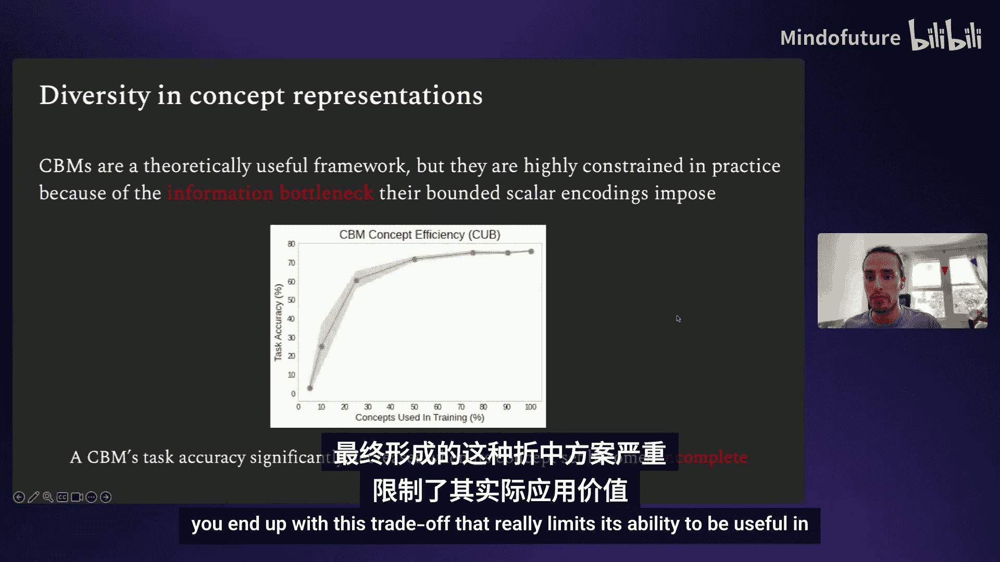

In practice where most of the times concerts will be incomplete。So this begs the question。

 then how can we actually assign consumer representations this P of C given x that operate in incompleteness？

😊。

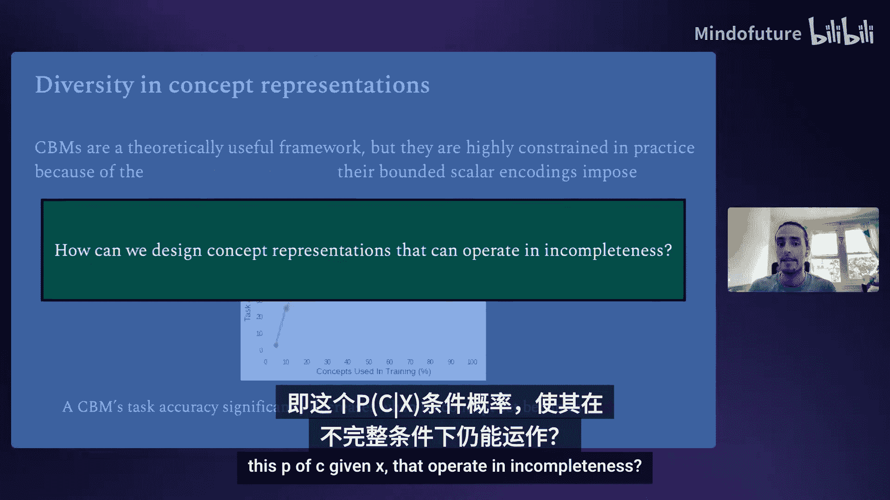

And the simple way to do this is by learning instead of a single scalar per concept。

 learning a dynamic embedding representation so a high dimensional vector for each of the concepts for so for example。

 each of the concepts existss， instead of having a single neuron for each other concept we're going to have a bunch of neurons and those neurons are going to be generated by a concept generator an embeddedbedding generator which in this scale called we call p of I。

😊，And this is useful as long as two properties are satisfied the first of these properties is that we want these embeddedbedding space that we're learning this dynamic embedded space。

😊，To be very separable when between samples that have the concept and samples that do not have the concepts so for example the bone spurs we want to have very different spaces for when the sample has the bones spur and when the sample does not have bones spur。

 why do we want that because if we are able to clearly separate samples with bones spurs that know boness in this embedded space we can really we can easily identify where the concept is on or of and we can construct an explanation a concept based explanation for our prediction and the second space is that we random the model to use this extra dimensional the dimension space that is' learning to actually encode things are useful forstream task prediction but we're not given during training so encode concepts that we're not given into training but are really necessary to predict task for example。

 we can learn to use a very separate subspace to learn about marginal bos spurs and it can learn a completely different subspace to encode for example central bones spurs both of which are very important to be able to also society great。

AndIn fact， this can be done with something called a concept embe model or a S for short where what we do is we're going generate a concept embe c of I for each of the concepts and we're going write it as a mixture between two representations a positive representation which we use to represent the concept when is on or our present and a negative representation C of minus which we use to represent the concept point is off or absent and we're going to mix them based on whether we believe the concept is there or not there so we think the concept is there so p of I of x is high is cost to1 then we're going to output pretty much exactly the positive embedding and if we think it's not there so P of I is0。

 we're going to output the negative embed we're going have this sort of mixture where we get closer to distribution a positive embed if it's on or negative to the negative distribution if it's off and the nice thing about this is that c of c plus c negative P of I all can be learned as interpret can be learned into using very simple differentiable digital networks。

And more importantly， you can actually intervene on this model。

 you can intervene by just fixing the embedding that you pick to the one that you think is aligned with the concept that's on or or off in the image。

 so you think the concept is present you can fix this guy to c of plus and if you think the concept is off in the image or in the input you can fix that to c of minus so this model allows you to have high dimensional embeddings that allow high performance in the downstream even when you constantlycomplete and it still remains intervenenable which is highly desirable for the type of models。

Now more recent works， obviously I don have time to talk about this。

 but more recent works have adapt to concept benefits to for example。

 enable very calibrated uncertainty estimates through something called probilistic CBMs to also compute arbitrary conditional distributions between concepts and tasks。

 these are called energy based CBMs。😊，Some of the words that we've been involved also have used embeddeds to learn to ask for effective con interventions because when you have embedded representations。

 you can represent interventions in a differential manner so you can optimize over them and it's are called intervention or word Ss and then more recently we had our work for example in XML where we show how you can use these sort of representations to pair generalized within our distribution shifts。

 something called mixed Ss。Now one final way of representing concepts so we talked so far about bounded concept skeal concept representations。

 dynamic embeddings， and the last one that we're going to talk about is to use unbounded skeletal concept representations in particularly large set of those representations。

One of the earliest approaches to this is something called concept bindingine， sorry。

's something called concept widening where。The， for some reason， this is not playing。

 but that's okay。 It should be looking like that。嗯。😊，Yeah。😊。

something called concept pointine where you use the output of you sort of rotate the output of a batch normalization layer。

 particularly you actually rotate the output of a white net layer so that each of the activations are aligned with the latent space with a specific concept that you care about。

And this has been taken to a different step with something called postoc CBVMs or PCMs for short。

 where you take a pretrained deep network in in the task that you're interested in。

 you use this latent space and then you project it into a concept space using some sort of linear concept probes so you have these very powerful model that you train you look at this latent space and you learn probes to separate samples that have a concept versus example that do not have a concept and then once you have that you can actually project the latent space into a scores into unbound this scores from which you can then learn an interpretable predictor like a spars in those area as before。

What I think is more interesting in this area however is the fact that you can do the same thing without pro by using actually language textual descriptions of the concept so if you have access to a multimodmal like clip。

 so for example you can have descriptions of the concepts like the concept of strips。

 horizontal main， you can map them into a clip vector using a text encodeder。

 you can map the inputs of the images into their image and vectors vector using the clip image encoder and then you can generate scores by doing the top product or the constant similarity tip2M between them and you can learn an interpretable picture from that。

😊，And in particular this is very useful because it can sort of really easily be turned into fully unsupervised pipeline if you exploit language models as knowledge spaces and multimoral emies as annotators so you can literally go ahead and ask ChaGT hey ChaGT list the most important features for connecting something as I don't know what dog and it'll tell you a tail four legs snout and so on。

😊，And then you can go ahead and generate clipping buttons for each of these keywords and then use those to generate scores free image and you can have a model that is concept interpretable without having the concept annotations。

 which is a huge is a huge pipeline sort of bottleck。

These approaches are called level 3 CBMs or language guide bottlenecks and are one of the most popular approaches nowadays。

 so there's a lot of research going on there。😊，Now， so far。

 we have assumed that we align concept representations and human understandable concepts by either minimizing across Enpyam like in the boundary scar representations or by projecting samples into the direction correlated with each concept。

 like in clip in the post hoc C example。However， I'm not going to have a lot of time to talk about this。

 but there is a lot of issues about aligning things， for example， with choenttropy。

 particularly which leads to these representations leaking a lot of unwanted information about each other and about the downstream task and this is because chocenttropy requires you to always make predictions and accurate predictions even when the concepts are not visible when they're opaque or when they're really hard to predict。

 so the mall undoubtedly learns to exploit dispers correlations and it learns to leak a lot of things in these representations that you do not want。

😊，There's been a lot of research to sort of try to rethink how you can do alignment to avoid this so for example some works like glancenets try to frame this alignment as a dis entangle learning task and more recently after regressive CBMs or schastic CBbMs have sort of exploited the fact that have included in the architecture the modeling of concept relationships so the model doesn't have to encode。

Carcount relationshipss as part of leak catch in the representations。Awesome， all right。

 so so far we talked a lot mostly about how do we encode concepts and how do we align them now let's talk about the last part of the blueprint。

 how do we predict tasks once we have these concept representations。😊，Now。

As mentioned one of the initial assumptions that we did in this part was we're assuming that the little predict Y was always a linear layer however as you can imagine linear models are not very expressive and they may travel to actually learn complex on linear relationshipss between concepts and labels which makes it not accurate in a lot of complex tasks。

 so let's now look at different ways of parameterizing these P of the given X and the P of y given and C so that we can learn more powerful but yet still interpretable architectures that predict things from concepts。

😊，So the simplest way， the first thing you can do is linear models work well so why don't we just try to make kind of modelss are linear is at least in the local neighborhood of the concept of a sample。

 so a linear model as before was just given the concept predictions you just output the top probability between the ways that you learn and the concept prediction and you may have some sort of sigmal function after it or like that。

😊，What we want to now is a linearish model where we do this but these weights are going to be a function of the input itself so they can change based on input and this is useful so long as the distribution is primarily charging something that we can learn like a D network and is also encouraged to be stable for samples with similar concepts so you have X and X prime and they're very different feature spaces but they're very they're almost exactly the same concepts then they should be mapped to almost exactly the same linear weights with theta of X and you can encourage this by using those sort of gradient matching and if you are interested in this approach I would recommend going to the paper of self-explain neural networks I will link right here。

Now another way to do this is to take more of the neural symbolic approach and its to exploit different parameter spaces such as logic rules and this is usually done in this space in a two step fashion to the first step is what we call neural generation where we usually have a one neural our book which is the concept in color just like in CVMs that generate some concepts that are semantically transparent concepts that we understand and in this case because we're working in logic rules that arere going to be bounded concept representations just like in the CVM。

😊，And then you have a second in neural network， which we call the rule generator that K X and in generate sensor rules for that sample that we're gonna about to execute and then the second part is inter interpretable execution where we have some sort of symbolic engine that execute rules using thisd concepts and then generates an output for example this case determining whether the cache should break or not given the concept of the green light and the light and design levels hiring Now let's actually see how you can do this in practice So as an example we're going to look at something called concept based memory reasoning or CMR for short and here the first step as before we let's just predict the concept activations let' just big the conceptar concept representations and we're going to do this by aligning them just like in the CDM case we're going to just align them using a crescenttropy we're using a training set Now the second step is we're going select a rule embedding from a learnable rule book using a the neural network so we're gonna have a rule book of rules and these rules are going to be encode as an embeddedbedding。

And then what we do is we're going to have this rule selection model where given X we're going to select one of these rules。

 we generate a probability solutionion over the rules and when we sample one of these rules。

 in this case we sample， for example the rule with embedding E2 because that was more likely than that one。

😊，The third step we use a learnerable model to decode is embedded into an actual rule that we can execute and the way to do it is quite simple you go ahead for each of the concepts that you have in your set。

 you go ahead and you try to generate three different scores you generate whether the concept should remain positive or as is for the rule that you're about to decode whether it should be negated or whether it should be irrelevant or ignore for the rule so in this example C1 the concept of cache card was put as negated so we're going to make a rule that has no C1 or not C1 and then C2 says positives we're going to pass it as is so you's going to say not C1 or C2 and C3 says ignore relevant we're not going to even include it because not relevant for the task that we care about right now which is to predict whether we should stop or not。

😊，And then the last step， we execute these rules using the sort of differential mechanism like atheor where we look at the concept states that we predicted from the concept encode。

 we look at the rule that we just sampled and we actually execute it。

 so not c1 becomes the value of c11 minus the value of c1 or C2 becomes times the value of C2 and this gives you a score that you can actually then use to predict whether you should break or not。

😊，These steps allows CR CMR to become a universal appximator similar to like OaEC the networks。

 but more importantly in my opinion， it also allows you to provide by design local and global interpretability。

 which allows you to formally verify the travel properties because you can actually look at the rules。

 the global rule book that you learn and you can see that they satisfying properties that you want like for example。

 fairness by looking at the rules on seeing what it's actually learning。😊。

Other neuros symbolic approaches that you may be interested。

 obviously don't have time to talk about this， including things like logic explain neural networks。

 deep log， deep concepter， neural language with bigger and so on there's a lot of very which space I I would actually highly recommend following it because there's a lot of things coming up every day。

😊，All right， now let's wrap up a bit of open questions here。

There's still a lot of significant challenges。open emergency concept interpretability。

 particularly making these models more real world friendly。😊。

In particular as mentioned level three models is open there already for a bit more practical models because you don't require the concept annotations which is the biggest photo in this issue in this sort of architectures。

 but they's still not currently as reliable as supervised concept modelss。

 for example it's still very unclear how you can use level three modelss without domain specific foundation modelss to do the labeling for you because we still required to have some sort of labels where these modelss do it that you use foundation modelss and multimodal modelss to do the labeling and if you don't have those modelss available for you for your domain of expertise or your domain of interest you're sort of doingom for now so this is a really really big open question and it's probably one of the most challenging ones here。

The second one is that interventions in this sort of label free approaches are still do not work very well。

 this is because we're using unbounded sc scores， which are not very easy to intervene because you have to select a threshold to intervene and that doesn't work really well as in the case of supervisor purchase。

😊，And then more generally there's some issues with scalability most of these approaches have been done in moderate sites models and data sets so it's kind of unknown whether we can actually scale them to large scale or multimodal approaches and there's a lot of questions there like for example。

 if you look at transformers or error limitss， where do you even put the concepts or what does that like do you do these at a token label or sentence level paragraph level text level like where do you actually introduce a concept in in the transform architecture it's a bit of an unclear question there's some clear domains where this could work but the general approach is very unclear？

😊，And then what does the concept even really mean like what does the concept it really mean in some domains like text and input。

 does mean sentiment， doesn't mean topic does it mean some sort of。😊。

Gramatical feature or something like that it is unclear and again it's very domain specific similar with all domains like genomics finance and law and there's been been some works where they try to do specific models for specific domains like graph data tagger data Ar or time series。

 but there's still a lot of room for improvement in making this sort of use of a concept more general across multiple domains。

😊，And then finally the sort of elephant room is whether we can actually even scale these architecture to very large model standardss。

 there's some recent works that have shown that you can do this least in the fine tuna level like something called conceptpotonic L&Ms。

 which was published here in a this year， it's still preliminary work it's sort of in the sense of it's very early stages so it's unclear whether it can actually scale where you can train them all from scratch。

 but it's sort of still nonetheless a bit encouraging。😊。

Okay so just to wrap up today we argue that interpretability can be thought as a form of inference invariance between the predictive process of a machine and the predictive process of a human that is sort of handled by this sound translation between the features and something notions of interpretability in the humans we showed that very these equivariance is intractable and you rely on compressing your input in a set of concepts which you would like to align with notions of interpretable human concepts through some alignment mechanism。

 and if we propose a blueprint for assigning interpretable mo which is formed by a concept encoder and a alignment mechanism and a level predictor and then finally we discuss like several instances of this blueprint across the literature。

😊，If you want to have more you're interested in this data， I want to learn a bit more。

 we have a website here that you can go into where we have a longer version of the tutorial with extended biographing slides and we included the slides for the stock already there so you can go ahead and open them if you want to follow some particular reference there and we also have a library called Pyth concepts of I see where you have constructs to build concept based interpretable digital networkss。

All， thank you so much for your time really really appreciated and it's been a pleasure to be here and yeah thank you let's now open the floor for questions。

😊，Awesome guys， great job， by the way， big leap from the IIIAI tutorial。や。

Which I thought was good already， so this is。So questions， by the way， for everyone， something very。

 these guys are asking something really foundational， what is the concept？

And then so， you know， this was at the heart of any world model， so many people are not。

Sot of skiping。改一下。Starting there。 so that's。Very。Good so this now here a question。For Pitro。

 you finish your part saying that lossless compression is necessary in the first place in the transition into the embedded space。

 however is there some leeway on the lossless part。Since， for example， modern computer vision models。

 there's likely some loss during compression。Yeah， sorry it was a bit thing。

 but I can explain a bit better so these we are always compressing information。

 so it won't be lossless compression in the sense that we can always recover all the information that we had in the input it's an approximate lossless compression where we can encode in this projected space as much as information as possible that is relevant to solve the task。

And we can either encode it in if we have a set of concepts that you're complete。

 so if concepts are themselves can encode in their scholar nature enough information about the task then we just need we can use just the concept space if concepts are not enough then material discuss a few ways like we can either consider higher dimensional representations for concepts or we can introduce a side layer where we can also project some information on parameters over a rule that we then apply on concepts and in both ways we can preserve more information then。

Then we have actually in our training labels。Okay， is there a way to automatically generate slash validate concept slash features I think this is。

Referring to when you don't have them manually。So maybe partly address that with some work。

 but go ahead。I you go。I guess for for now just to just let me sort of caveat this discussion with saying that these are quite。

Early sort of era of this set of approaches so it everything is been done very at ho and it doesn't have a lot of formalisms。

 including the evaluations I think particularly in evaluations sort of things so today as of today most of these approaches when they are unservised they way to verify the concepts is just go ahead and do a lot of filtering with some sort of expert in hand I do not think that is a crazy thing in my this may be just my opinion but I think I see concepts as a very domain specific thing most of the times very。

And they should be tied with an expert I expect to use system。

 so I do not think it's crazy to have an expert having a lot of verification now whether you these scales obviously it does not scale。

So there's a lot of questions how you can maybe actually describe graph field works more recently they try to do very large set of concepts and they try to do selective of them so you can only show a few of them to experts and so through this approaches you can make it a bit more。

Process it like something you can process more easily in the cognitive side of things from an expert actually interact talking with the system。

 but to answer the question the evaluation is still very much qualitative today in terms of the quality of the concepts you can look at the information value and that's just you can do this quantitatively but looking at how can you pick something based on the scores that you get out of it but that doesn't really tell you much you can get really high accuracy scores with very nonsense concepts so the quality side of thing is quite crucial still today。

I'm going to paraphrase one question。The nature of concepts is also profoundly hierarchical。

What about that？Right， so we didn't have time to go to discuss this。

 but the actual formalization that we have in institution theory and category theory of concepts is enable formalization of how concepts can then be composed together to in a hierarchy of concepts that are just a composition of simple concepts and this is basically done by defining a lattice of concepts where you have some basic concepts and then you have you can recursively combine elementary concepts to build more complex one。

 but the semantics of concepts of elementary concepts similar to the one that we discuss today so an elementary concept has this property of relation between a set of instances and a set of sentences。

More complex concepts， hereerarchical concepts can actually generalize this idea。

 but the semantics is always the same。Okay， great， we do have a few more questions。

 but we're at time， but we'll send you these questions。

One of them is about the context dependence of concepts， but anyway good question。

 but well so one possibility is if you guys have time。

 we can jump on Discord and we sent you that link so they can so all the speakers and now have the discord so they can see if there are any questions that didn't get answered。

Okay， appreciate it guys， great job。Thank you so much，🤧。Okay呃。Next。Do we have。Next speaker。Pa， yes。

 I'm here hi Gary， hi Alex。Hey， Pera， okay， so。Pasa， it's great to have her here。

Professor at Michigan State， and she's been building some very ambitious super interesting systems。

She will tell you maybe about。At least one of them， but she's going to cover this， we have two talks。

On this compositionality thing I mentioned in my overview， which is incredibly important。U。

For it may not seem obvious， but it's directly， you'll see， well。

 it got mentioned just now in the context of interpretability。

 but also really leading to this issue of cost， cost and efficiency of data。And ultimately compute。

But many other things， so many other core benefits that we want come from this core idea of compositionality。

 so with that take it away Parisisa。ok， let me see啊。If I can share screen。嗯。How this works。

Let me do entire screen a second。Okay， so you see my entire screen， I think， yes。

 and do you see now my slides， Yes， perfect perfect。So hello everyone。

 I'm going to give a tutorial actually as Alex asked me to cover like kind of basics of compositional learning。

 I try to like do some presentation based on the survey that we did on compositional learning of AI models。

 theoretical and experimental practices， but I'm also giving a few downstream tasks and little bit about the frameworks of solving problems in vision and language。

So let me start with this example that I'm using to show the challenge of vision and language understanding and related to compositional learning abilities。

 so here is a kind of， let's say classical problem of nowadays a classical problem of vision and question。

 visual question answering and the problem is as follows。

 there is a natural language sentence like the red bike is to the right is the red bike to the right or to the left of the Asian people。

And there is an image that the models need to answer these questions given this image。

So this example is taken from a dataset that is called GQA and this was introduced in 2019。

 so we gave this question to the state of the art models at the time and then we see。

 okay the model is kind of excellently answers this question correct。

 the question looks actually difficult， the model needs to recognize the red bike， the bike。

 the property of the bike that is the red and also the relationship between bike and Asian people and then answers this question。

So this is great and interesting， but then we ask similar question like is the red bike to the left of the Asian people so the same question just paraphrased and now the ground roots should be no and the model answers wrongly as yes。

So this is a bit disappointing at the time so this actually makes us to think does the model understand objects。

 properties， combination of the relations and the composition of this old concept you might say this is an old old kind of example and the model is kind of six years ago nowadays we have very large models we increase the data even all types of questions are input to the model and we have larger model that can answer this questions so that is correct okay we have better models right now but now I'll show you a model that is like kind of four years later and this is 2023 also a sentence like a woman with an apple in her left hand standing to the right of a car again we have objects properties and the relationships here so again this is Dolly and this is 12 billion parameters very large model a huge amount of data observed but and we see actually it's interesting。

Think that the objects are recognized well the woman is there Apple is there car is there but if you look at the relationships actually the left relationship like in the left hand the apple is in the right hand of the woman in all the top generated images and the relationship between the special relationship between the woman and car is actually kind of random so now this is again okay a couple of years back so you might say this is still old but the point that I am trying to make with showing this example is that so can we really feed all possible problems and all possible solutions to the large models nowadays should we create examples of all possible combinations of the concepts in the world and say okay now the models learn everything so they can answer every question。

But isn't the world dynamic， is it possible even to create all possible combinations and be futuristic。

 humans can learn compositionally and generalize every day we have new problems emerging and we need to be able to solve new problems based on our basic skills and composing those basic skills。

That is basically to show you the problem and challenge of compositional understanding in vision and language。

The models lack generalizability， I mean compositional learning is one aspect of generalizability that is we see obviously they're lacking this and then of course there are other issues that are not the focus of my presentation here like lack of interpretability and when we the need of the huge amounts of data。

 the data always can make the models improve and give us better acuracies but do they really capture these compositional structures。

 that is the question。So now I'm going to with this introduction of showing the challenge for vision language understanding。

 let me go back to the basics of what is compositional learning so compositional learning is actually a crucial aspects of human cognition we use it in everyday life to be able to solve problems。

Taking this sentence from Barbara Part 1984， the meaning of a whole is a function of the meaning of the parts and the way they are synthetically combined so that is the definition of the compositional learning provided and again i'm showing some examples of the current model trying to do these compositional understanding this is Dali to again and then it tries to combine red like create a red circle on top of a blue square and a yellow cone to the left of the red circle with a small pink triangle on top of it and miserably failing to do that or another example of compositionality like here it's an arithmetic expression like three by three by four by5 plus two by two and so on so the model needs to actually do this basic operations and compose them to be able to solve the whole problem we see that in some cases actually the model also is kind of like simply。

To do these arithmetic operations， but in some places it does it well。

 so it's really uncertain like what the model is doing and how it gets things right or wrong here。ok。

So actually defining a unified formal definition of what is composition compositional learning。

 I think it after looking at the literature to me it seems challenging to define a unified framework and define it formally。

 but actually the studies of linguistic， cognitive and cognitive linguistic studies try to look at multiple facets of compositionality。

 and that is why I'm using this cited papers here to tell you about what is like assume as kind of aspects of compositionality in the literature。

 mostly literature about language actually linguistic and cognitive linguistic。

So the aspects of compositionality are divided to this like systematicity or novel compositions productivity or lens generalization substitutivity or synonymity localism and overjoralization and i'm going to explain this so basically we look at the aspects of generalizability from the cognitive perspective and then。

So I will explain like how people try to evaluate models from these perspectives。

So systematicity here is how the models generalize to novel compositions and unseen combined concepts like here this is an example you see in the right side of the like slide we have assumed the model has seen green circles blue circles triangles white so it has been observing different kind of colors。

 different kind of shapes， but the model never observe blue square so this is basically a new composition for the model and if a model is able to do generalize and combined concept it should be able to recognize a blue square though it hasn't seen a blue square at the test time。

That is a kind of systematicity or an ability do to understand novel compositions。

 this is one one facet。Second is like productivity or lens generalization so the models actually have seen like sequences of two words。

 three words and so on and then now at the test phase we're expecting the model to generalize over arbitrary number of the words so this could be like sentences in natural language with the longer lens or even if we have like nesting structures like more like we shouldn't be limited to the depths of the nesting structures that is basically generalization to longer or larger structures or longer sequences in the case of sequential structure so this is called lens generalization or productivity。

Then we have substitutivity or synonymity the models are able to do compositionally generalize if they are able to recognize similar concepts。

 for example， the model needs to recognize if the model like knows about the red circle if you replace circle with rank then the model also should relate this concept or purple circle or lavender circle if the model knows the concept of purple it should be able to recognize and substitute this with other synonyms of this word in the context so this is also one defined as one aspect of compositional generalization。

Another aspect is localism。😊，So here is basically the model needs to recognize whether the meaning is composition of the parts or actually changes based on the whole context so this is actually something that humans might really recognize is not that okay we talk about ability for composing concept but sometimes depending on the type of the concept that you put together actually the meaning of the whole is totally different from the meaning adding the meaning of the parts so this is called actually localism here I have an example on this slide that say we have two facts like X and y and we know that this X is true the fact like for example the weather in Montreal is sunny today that this is true another fact and I don't know the weather is called then another fact that is true now we have this new sentence that says Peter thinks X or Peter thinks Y so based on the truth of the fact in the previous。

Sentences， we cannot really infer if Peter thinks X and Peter thinks Y， also they are true。

 though we know that X and y are true， so basically if we bring these sentences in the context of Peter thinks then the truth values totally change this is a kind of an example of localism also I take this example from the work of Hawkopkins and all so this is the notion of localisms and we expect the model to recognize the level of locality or globality for composing the concepts and getting the meaning of the whole。

There is another interesting aspect of compositionality that is over generalralization so for example。

 the models from the data can capture patterns if you see a lot of the a lot of data but then there are a lot of exceptions depending on the context and the models need to recognize that and not overgeneralized to the patterns that they have observed over and over in the data for example if the model can recognize a cat okay or recognize a dog the model can recognize it's raining outside but then the model if you want to generate its raining cats and dogs obviously this is not the picture that we expect so this is basically a case of overgeneralization or in we have in linguistics we have a lot of exceptions like you add ED to the past tense of the verbs but for some verbs you have exceptions so this is basically the models if they overgeneralize then they cannot handle。

Those exceptions。So to just put back again， go back to the main picture。

 these are actually the kind of common aspects of compositional generalization that are introduced in the literature。

And then based on this for evaluation of the models to see if they are actually have these generalization abilities。

 there are a lot of datas generated， like including language vision so a combination of language and vision to be able to evaluate these aspects of compositional generalization however the current benchmarks do not cover all aspects necessarily or some aspects actually maybe are like reformalize or rebranded for example to my understanding。

 I think overgeneralization could be something like hallucination as well because you combine concepts in a way that they shouldn't be or they don't make sense or it's kind of could be seen as kind of the problem that we talk about it nowadays over generalralization。

 but some of this more older like data like a few years earlier they actually cover different aspects mostly focusing on systematicity。

Productivity。So you can see the details in our survey paper here， for example。

 we have PCG clutter scope， CFQ， scan is textual dataset。

 Cox is GScan is like regional and language data risk and regional language。

 regional and language is CRP， cvary regional and language。

 MIT set is composition of objects and attribute， so here in this table actually we provide a summary of what kind of aspects of generalability they cover if for example here you should read this like PCFG covers the systematicity。

 productivity， subsivity， localism and overgeneralization and you can see all these properties for other。

Existing benchmarks， as much as we could cover， of course this is not exhaustive and there are things that might be missing here。

We also look at like if they are multimodal or only textual。

I try to highlight two of these dataset set， one of them that is focusing on text and is kind of it's CFQ compositional freeb questions。

 this is a work of Daniel casesrs and all they try to do a benchmark that is realistic compared to the previous one and this is 2020 ICl。

 so this is basically the task is to translate natural language sentences to like queries in sparkQL language that is basically for  querying knowledge bases like freeb questions。

 the knowledge graphs like freebase and here are are examples of this kind of parsing for example you have the sentence like the gel so the hedgehog and then the gal is like there is an X that GaL X and so on so we map the natural language sentences semantically parsing their semantics and formalize them with this sparkQL language。

And here in this data set， they try to cover different aspects of compositionality of the models in terms of productivity and systematicity。

 So if there are combination of the。Like expressions or combination of the concepts that are not observed in the training。

 or if we have like longer sentences that needs to be matched to this spark formalism。

 then can the models do the long sentences when they are trained on smaller sentences。

 so these are basically the aspect of generalization that this data set has provided basically test the splits to test this aspect of compositionality。

To just give an example of the vision and language dataset set， CRE is another dataset set。

 this is CVPR 2023 and basically it say can vision language foundation model reason compositionally and then they try to give like these kind of images with multichoice answer captions and here the model for example in the systematicity again the model hasn't seen cr on a skillet。

 maybe it has seen vote on something of skillet including like eggs but not CRP。

 but the test time the model needs to recognize these novel composition of the CREP on skillet so that is basically one split that they provide also they have productivity and again lens generalization if we have like longer captions like brown CE next to leafy salad and in front of the metal fork can we have recognize this caption。

aligned with this image and they try to create really hard different types of hard negatives to make this task difficult and evaluate the compositional reasoning of the models。

 vision and language models。So this just wanted to mention explain the nature of these data sets and benchmarks。

 but there are so many of these， as you saw again， part of them in the table that I showed you。

So there are also some parts of the like studies in the literature that try to talk about starting from the models and see if various models are able to do compositional reasoning and this studies again。

 there are two types， some of them empirical focusing on the data that I mentioned。

 they try to apply models to those benchmarks and evaluate and see how they perform and there are also theoretical analyses using mathematical formalisms and try to make assumptions and try to prove if there are some compositional generalization ability in the models。

So again in the survey that we we were studying， we look at the literature and so okay。

 there are some basic neural networks like RNN， CNNN。

 LSTM that people evaluate both theoretically sometimes empirically and sometimes both theoretically and empirically there is also transformer based models that people try to again evaluate can they generalize compositionally again both from the theory and practice and then there are also customized models architectures propose like neuralmod networks or neurosymbolic architectures and people try to address aspect of compositionality from the modeling perspective。

 I'm also briefly trying to give you an overview of what kind of studies have been done。

In the past and also some of the recent works。One thing that I should mention before going to that actually here the list that I have is mostly focusing on neural architectures what about classical symbolic AI models like logic grammars so I should mention that actually logic and like for example first order logic these are inherently compositional structures in logic you represent objects explicitly you represent their composition with logical operators and can you don't have any limitations of representing any nesting architecture or nesting reasoning so the logical formalisms or classical in general symbolic AI formalisms like grammars they are able to actually express the compositional structures inherently so no issues on that however why we are not using them now for compositional learning you know all these like classical problems of like symbolic processing in terms of like not robustness to the noise like basically。

handandling uncertainty all those classical issues that if we are going to go to use symbolic AI。

 pure symbolic AI， we have the compositionality naturally but then we don't we have the issues with the perception and dealing with the noisy data and variety of concepts in the real world but now actually I will go get back to this that's why I don't talk about like the studies of the expressivity of the classical symbolic AI for compositionality because that is an obvious thing for those models but I just overview the studies that have been done for the neural modeling because everything is implicit there so it's hard to see if they can really generalize and can do compositional learning。

So here is like some studies are done with Hki again at all， they try to look at models like LSTM。

 CNN， even transformer architectures and try to evaluate them on various benchmarks to see if they can generalize so they not only like just basic architectures but also some modified architectures。

 like here for example， this is an architecture that is based on LSTM and then like like kind of buy LSTM into directions with some modifications and they try to do attention also and then evaluate this model to see if they do compositional generalization there are also architecture like sequence to sequence convolutional neural networks on the right side of the slide that they use CNNs for doing sequence to sequence modeling with some again some architecture built on top of this convolutional layers and try to evaluate。

There is also evaluation on the transformer birth architecture in the same work。

 this is Hoki and 2020 and then the key message actually。

Of this is that compositional reasoning is challenging these models like for example transformer based in this architecture this study was doing much better than CNN and LSTMs CNNNs actually the sequence to sequence CNNN based on this study was even better than LSTM in terms of compositional generalization in terms of the results and data that they provided。

 but at the end actually they say okay， they perform the models perform to some extent have this generalizability but we need more sophisticated architecture to be able to address this problem in a more reliable way。

And also I point to other studies that they try to actually evaluate these neural models for this general compositional generalizability。

Specifically about transformer based architectures。

 there are also very interesting results empirically。

 so empirically people try to test on these different benchmarks again that are designed for compositional generalization some of the findings related to transformer based architectures that they relying on memorization of some subgraph patterns。

 they do actually shallow reasoning and they look they linearize the surface of this compositional structure and they remember it。

 that is some some results that you can see actually in like here yangsang Chang and they look at the counting problem and this the model actually have a hard time to generalize over counting。

 there is other studies that also like making transformers solve compositional tasks。

 they try to look at different architecture components of the of the neural models。Like for example。

 can positional encoding help us to generalize better can the size of the model or the encoder decoder architectures change can can help us like parameter sharing and many different like this kind of small architectural tweaks I would call them can those help us to do。

Compositional generalization。 So the results show that all of these actually impact the performance。

 these are all empirical findings。 The performance of the models and compositional generalization。

 like positional encoding certainly influences that。 But then again。

 these problems are not totally solved。And one interesting result that actually shows that there is always a gap between in domain and out of domain。

 there is an gap between low complexity a high complexity tasks。

 so the gap between this to always shows that okay， if there is compositional generalization。

 there shouldn't be a gap because they should be able to generalize and there shouldn't be a difference between like tasks that have like lower complexity and like more complexity。

 all these results though they show that okay all architectural patterns impact the result。

 but they also indicate that what happens is mostly memorization and shallow reasoning not really like essential or in principle compositional reasoning。

So these transformer based architectures are the basis of the large language models nowadays like from the encoder-based models to decor- based models and now going back to large language models。

 they always also the studies show that inherent these limitations from transformers and they have this lack of compositional generalization。

 there are studies that actually maybe not specifically focusing on the compositional generalization but in general talking about reasoning abilities or generalization abilities of the large models。

 but again thinking about compositional generalization is one aspect of this generalization in general。

 I think can we can speak to okay this lack of compositional generalization also is inherent in these models there are some interesting studies again I have listed some of the references。

 I briefly overview。You can look at the survey paper for a little bit more information about these findings but also the original papers of course。

 some of the interesting findings here is that okay in context in context information or the long context can help or improve the composition or reasoning ability of the models however in this work I think this was neuroipPS like this paper 202023 they show that actually this emerging abilities with the large data doesn't mean that the models suddenly are intelligent and can really solve complex problems suddenly but it's an artifact of the actually evaluation metrics and the fact that the evaluation metrics are nonlinear and they are noncontin compared to the like loss functions that the models are trained on so this is actually one interesting。

Finding there， however， some other studies like especially recent studies show that like chain of thought actually increases the excivity and computational power of the model in the decoder only transformers so basically when you generate the outputs the longer output low to the model to do more complex computations and if the model even is linear based on the chain of thought the model can really address more complex and non nonlinear problems So these are actually some interesting findings they are based on different assumptions so that's why sometimes they are actually contradictory for example。

This is an issue also of the theoretical analysis of these like language models because there is no unified mathematical framework that we can evaluate them。

 for example there is some studies in one and two one of them is theoretical limitations of self-atten neural sequenceence models and another is like on the touring completeness of the modern neural architectures and actually this is studies one of them the first paper says that hard attention transformers okay they are hard attention models so ignore most of the input and that's why they cannot solve problems requiring full input processing that includes kind of logical formulas that is a lot of compositionality there or parity that they are really complex patterns over the whole sentence so they cannot address that while actually the earlier work says that okay they are touring complete because they make an assumption that the hard attention has full access to the input。

information and then provides toing completeness evidences so again it's really all the theoretical analysis sometimes are based on different assumptions。

 different mathematical frameworks and that's why sometimes the findings are a bit hard to connect but also there is another study that shows that okay transformers actually basically if the lens of the input increases or there are unseen lens of inputs transformers cannot really like generalize and they have the limits of productivity aspect of compositionality so they can really deal with the lenses that they have observed during the training data。

Actually， this is I add some information panhes that this was interesting that in our research。

 we also realized even for like vision and language navigation models that you instruct the model if the model has been instructed with sentences of like five steps of navigation。

 then the model cannot generalize over ten steps or even two steps sometimes。

 even the smaller steps or problematic for the models。

 and this is actually seems to be a kind of more fundamental limitation of this architecture that might not be able we are not able to solve it with data。

Again， to go back to the overall picture of the survey that we are providing here in this survey we cover compositional learning facet as I explained them to you。

 and then we also overview some data sets that are trying to help like empirical evaluation of this aspect of compositional generalization。

 we have the studies on compositional ability of the learning models looking at basic neural models like RN CN transformers and on to large language models。

 we have also。Evaluation of neurosymbolic models for compositional generalization。

The findings of these empirical findings is that okay。

 there is lack of evaluation for the covering all aspects of compositional learning， the benchmarks。

 not always covering all aspects， even the theoretical analysis are not necessarily connected to these aspects of this that come from the cognitive bases or linguistic bases。

 the theoretical studies not do not really connect to these different aspects。

 because the mathematical frameworks are rough more talking about excresivity and stuff。

 not really aspects of。Compositional generalization。

Then empirical studies have really challenges and problems as I mentioned the first is the lack of coverage of the different aspects and the second is like actually is the data contamination is really a problem that's why for compositional generalization most of the cases like systematicity we want to evaluate the model for unobserved cases and with the current models is really hard to recognize if this case this scenario is observed or not so data contamination is a problem and also most of the benchmarks that we're having mostly are toys this is also debatable is really should we go with toy settings that is controlled and it's like lab setting that we are really sure what the model is trained on and what is tested on in other like what other challenge is that sometimes you do the lab setting。

You cannot express the challenges of the realistic environment。

 and then we need to have really realistic environments that come from outside world and then again we go back to the problem of data contamination and all。

So these are basically the challenge of empirical evaluation of the compositional learning facet。

 theoretical evaluation has a problem because we don't have a uniform methodology and also the current studies don't make a clear connection to compositional learning facet and also lack of connection to the compositionality in practice because in practice we see a lot of like emerging behavior happens and then theoretically we might show the limitations。

 but then the explanation of the gap and so on is not always clear。So this is the big picture again。

 you can look at this the details of each part in our survey paper。

So now I'm trying to go back to the theme of the like summary school promise of neurosymbolic solutions in LLM area。

 so era， so actually I talked about like classical models。

 symbolic AI inherently address the compositionality。

 we have the LLMs that are really like huge with perception capabilities， observing a lot of data。

 remembering a lot of patterns which make a lot of problems solvable that they were not solvable before now for addressing this compositional learning in a principal way。

 can we combine the two world。Now I'm sorry I'm going to some of the works that we did briefly in like five minutes that I have five or10 minutes that I have so here I'm trying to explain you like how we can combine the two and I think actually the now we are in a good era of large language models that enable us to go back and better make better use of symbolic AI for addressing this kind of fundamental problems and here I'm going to explain one specific framework that is trying to do this compositional generalization in like vision and language grounding setting so let me explain the problem setup and then go back to the advantage of this combination of neuralland symbolic so basically the problem set up is again this can be visual question answering for example that you have a complex questions with objects attributes and。

We can also have grounding like point to the blue square that is in the same column at the yellow square。

 so your model needs to point to a specific place that you really have a complex and compositional explanation of it。

So this is the kind of problem setting Now the advantage of language models。

 the first actually advantage of language models nowadays that they can help us to go from this natural language sentences to formal representations with an accuracy that was not imaginable in the past before this generation of technology so that is really great because now we don't one of the issues of the classical logic and symbolic processing is that we need to have a set of predefined predicates and we need to cover all aspects of like real world with those predicates which was impossible to scale up for solving realistic problems but now we can actually go with this。

What I call linguistically motivated preddiiccate， so I'm going to say when I say point to the blue square。

 I don't care， I just create the predicates based on the word that happen in natural language like point blue X and aquas。

 I make every word app prediiccate。And then I get this formal representation with the operations and I express this compositional structure with operations like and or and all this logic in this case so I I can have the compositional structure my predicates are lexically motivated so I'm not limited to that this framework actually is based on the work of Josh T and Ba in his group called what's left and they have a lot of relevant works related to this same framework but I just cited this one so you map you use the language model to map from language to formal representation。

Now you have the perception module， you have again vision models。

 strong vision models that can give you， they can detect objects and give you not only object labels but also probabilities or the scores of like what is the probability or soft scores of like what is possible object in this space is that this is 20% like blue 80% green and so on。

 so we get kind of probability distribution of the specific predicates for each of the elements of these visual modality。

Now we actually have a basically kind of probabilistic program because we have the predicate。

 this predicate is linguistically motivated， we have xx is a piece of this image could be bonding box here and then I have a vision model that gives me the probability of like basically this predicate blue and probabilities of this x with this visual representation being blue so I get the distribution for x being blue and I get a distribution for x being a square and then I have this end operation and I can do explicit composition。

So now I don't as far as I am good in the perception and probabilities for each predicate。

 I can do the composition explicitly， so that's basically the compositional generalization will be soldd inherently as far as we are good at these predicates and as far as we are good at the translation to this formal expression。

So basically， this is a powerful framework potentially。😊。

And it shows that actually it does very good in some toy environment。

 it does very well because in those environments， the language model can give us perfect kind of formal representation。

However， there are some challenges， as I said in the realistic setting like mapping from this language to formal representation still is a challenge for language models because it also relates to compositional generalization and understanding I showed you the problem of CFQ is the same problem basically you go from natural language to Se well queries here I go from the natural language to kind of formal logical representation for a different purpose but still the model the language model itself needs some generalization to be able to do it but here actually based on the huge amount of data this translation has become more accurate and we can do this translation here and we can exploit the classical NLP tools for semantic posing and all those structural representations to help the language model capture this formal representation more accurately so this is actually the addition that we we did on top of the。

and Bo work that we tried to actually exploit the semantic parsing and put it in the context of the sentence to get better formal or more accurate formal representation of the initial query。

That is one challenge here。Another is like as I mentioned。

 the lexically motivated predicates now become huge because now we are not limited to predefin set of predicates we can go for any predicate that is for every domain that you go you can get new predicates and now again another classical challenge of symbolic processing is that the connection between the symbols if you don't write it in logic it's lost so we are we are in a discretere space and I don't know blue is similar to turqus or I don't know circle is related to ring or anything that has similar meaning so that connection is lost and here is another like。

Challenge that we can solve here we actually in this world that we propose this Nesi Coco and in Nes Coco we try to actually not have a model per predicate so I'm not going to look at this blue as a kind of neural model that is going to recognize blue given this object representation but I'm going to use a visual and language model that gets a representation let's say word representation of the blue I have a language encoder that gives me the representation of the blue and the visual encoder that gives me the object representation and then I can get a decision or the softm or distribution of blue this visual object with this combining visual and language now if this blue representation is embedding a space is close to the turquises representation if I learn blue certainly I can also connect this to turquise and recognize this object actually it tuo。

Or it is light blue or it is dark blue so they are very similar so if I learn one predicate that has a similar representation as the others。

 it helps me to really。Scale up and not being limited to individually learn and seeing a lot of examples for each single predicate。

 so this is actually a very simple idea， but it's very powerful and helps us to alleviate the issue of like this lost similarity between analogy between different symbols。

And then another thing is like okay， if we want to basically we want we have the program we get these probabilities and softmes and now we want to execute this program to get the solution and we want to put it in the whole framework of neural learning because we want to learn this predicates at the end by getting the answer to the question and backwardbating the error。

 so here is another aspect that we need to see， I mean it's a kind of challenging aspect of neurosymbolic training how we are dealing with non-differiable like operations like and or for all exist and how we can translate them to some soft surrogateates that they can be end to end differentiable and this is again like there is a lot of studies on this like using the soft logic like or locovic operations that products Torms。

 t con normms those are kind of different types of Tors and t conors can be used as a soft surrogate replacement of this logical。

Operations here I just have a table of possibilities， but this can go。Even more。

 but then with those replacement then we can train the models end to end and now we see that actually the models that are they are having much better compositional generalization on like challenging compositional split so this is Kelvertco is a Kelver is a kind of well-known data set and it's kind of kind of simple is kind of synthetic。

 the queries are synthetic but Kelvertgengen is kind of a version that is created for evaluation of compositional generalization and actually the split B is the one that has a novel composition which is hard and we see now with thisnessi coco framework that we deal with this basically explicit composition and neural learning we see that we can actually do much better in the split B which is compositionally challenging for the split A that doesn't have the compositional novel compositions or the models actually vision。

Models also can do very good。But then we have also like another dataset that is Re scan that has also very complex novel compositions。

 Rcan is actually one of the it was listed in my table of data and actually it very it has very challenging splits for compositional generalization and here we see even much more improvement when we use this frameworks like like Nsi Coco and left compared to the classical or more like neural vision models we see that we can even improve like5% accuracy which is a lot in the higher on these tasks。

So I'm going to escape because of the lack of the time。

 so we have also recent work that we show that okay instead of using the vision models and training them。

 we can also decompose questions and exploit the large vision and language models and thecomposition explicitly at the inference time but just getting the basics from the language models and composing them explicitly at the inference time。

 but actually there is not time to talk about this。

 but this is actually not easy due to the inherent problems of these language models。

 they are biased towards the training data and sometimes answering the complex questions actually is harder for them than answering some basic questions。

 these are some surprising results that actually we see that with this new data that is gaming environment。

 this is an example of the new data that I think it's kind of less prone to the contamination of the training of the large current large models because it's a gaming environment but still really。

And we see like for example， InterL that does 75% in referringing expression MS Coco。

 it does 7% on RefGTA， which is very surprising， so these are actually some current results not published yet but still it' very interesting to see how the models are biased and find shortcut based on the context to answer questions or ground the information ground vision to the language compared to like really having compositional generalization。

Just the last moment if I have time， Alex。Super super super quick Okay one minute and then I just do the conclusion I just wanted to say okay neurosymbolic is really promising。

 that is what I wanted to show you with the application that I showed especially given the emergence of this large language models but now another issue that I want to raise here is that neurosymbolic modeling is challenging is more challenging than like working with large language models or designing neural architectures because of the current libraries that are so advanced like for the neural modeling and that's why I wanted to point to this some briefly to the framework that we develop in my group is called dominoes and we try to connect some symbolic language to Pytorch library and try to facilitate this logical representation and abstract away the logical representation and problem declaration from the neural model that is running underlying the system and。

algorithm that actually tries to combine neural and symbolic aspects due to the lack of time I'm going to skip this。

 but we just have like different algorithms are covered for combining neural and symbolic and getting differentiable executions and we have declarative language that we can define concepts and relationships just if you' are interested I have included a link and we have a demo also about this。

Just to summarize my like tutorial today， I tried to cover basic concepts and definition of compositional learning and I overviewed some of the benchmarks for evaluation of compositional reasoning。

 sorry for the typo here。And I overview well known architectures and their compositional expressivity so and then I pointed to some downstream tasks and generic frameworks for compositional reasoning I think this slide has some type of sorry for that I did it quick。

And future directions is like okay LLM's evaluation for compositional reasoning is challenging due to data contamination memorization and theoretical analysis also is hard。

 variety of mathematical formalisms with different assumptions and then we need more benchmarks the diverse theoretical methodology makes the evaluation hard lack of integration with cognitive science and especially with theoretical analysis and cognitive aspect of compositional generalization is something that is missing and we also need of course new expressive architecture that inherently hopefully are able to address the compositionality thank you very much and thanks to my students help me to do the study and do the survey and then I would be happy to answer questions。

Very great， thanks so much， Peresa， very chock full of good stuff， covered a lot of great ground。嗯。

So we only have now。Just a minute for questions for the next talk， but let me you brought up。

 I'm going to paraphrase a question。呃。Is that？We have these terms compositionality that maybe we could imagine mathematically。

 but what about the cognitive kind of interpretation， what we know there？So yeah。

 that is I mean I think these aspects of compositionality are kind of inspired by the cognitive linguistic studies like lens generalization nesting structures and parthole definitions and so on。

 but I think the issue is like and then I think the benchmarks try to again the vision and language benchmarks。

 especially the language benchmarks try to resemble those abilities in the benchmarks。

 but I think the connection between the benchmarks and these cognitive studies is much stronger than theoretical studies and these kind of cognitive aspects。

 so the more mathematical formalisms of generalizability and expressivity are less connected to this cognitive aspects。

 I think this is a really challenge here， I'm not the expert in that area but I hope that there are studies to address those challenges from the theoretical perspective。

で。We'll squeeze in one more question。Which is are there？

Ways of measuring which are not benchmark based。data set。

So I think this is theoretical studies like basically looking at the expressivity modeling modeling these architectures based on mathematical frameworks like okay this is a linear model or this is a- nonlinear model or how I mean modeling their input and output and expressivity from different mathematical perspective。

 sometimes they are mapped to let's say algebra structures。

 sometimes they are mapped to some other kind of functions， functional kind of representations。

 so as I saw in our survey as I mentioned also during my talk。

 there are different formalisms used and they make a lot of different assumptions depending on the like formalism that they use for evaluation of the computational complexity and the assumption that they make that's why I think there is a way to do it but it's not a standard。

And it's not really helpful in terms of connecting those different studies to each other。

 that is a problem that I see there。So yeah， I think this is actually the gap that hopefully there are more research in this direction。

 like what will be the best way of evaluating these systems and making clear assumptions than possible assumptions and making these connections between the theoretical studies is something that is missing and I think for me myself also will be helpful if there are more works in this direction to understand this。

Okay great and that's a great segue to our next talk。

 so thanks again Therea there are more questions but we'll send them to you or jump into the Discord if you have time。

😊，Okay， sure， thank you so much。 All right， thanks again， Terrisa， thank you for having me， Bye bye。

😊，Okay， next up， do we have Parri？There he is， okay， great， welcome Pari。Now， this is a。

Was deliberately adjacent to Perrisa's talk。Because Harri is going to talk about mathematical definitions。

Of compositionality and how it relates to ferization。I'm a little biased。

 but I think this is great work。All right， take it away， Parri。Okay， thank you， Alex。Okay。

 so Patishsha gave a great introduction for compositionality and what it means to generalize compositionality compositionally in this。

 the work that I will be presenting。😊，We take the theoretical view。

 we try to understand what it means to be compositional。So it's a little theoretical。

 but we do take the next step of using the theoretical insights to understand how it can help us。

And this is joint work with Tim Klinger， Ken Clarkxson and Sashahan Kubaru from IBM Research。

And Alex Gray at Car Institute and this work is based this presentation and based on a couple of papers that we have out。

 you can find them at the QR code on the bottom。So。

To kind of motivate what it means to be compositional， I always like to think about this。

 this problem。 This problem was。Presented in this 2018 workshop paper。

 it's called list operations or list ops for short where essentially we are given a sequence of of tokens。

 So you have opening and closing brackets， you have some numbers and as human beings we understand what these numbers mean。

 there are some operators in in in like min， which implies minimum Sm。

 which implies some mod 10 max median。 So these are concepts that we understand。

So then when we are given as humans， when we are given this problem to solve。

 we can solve in many different ways， but for example， one algorithm we could use。

Is to just find the smallest enclosing brackets and then resolve them。And keep doing that recursive。

So we keep doing that recursively and eventually we get back to get the final answer what the solution of the sequence is and the answer is always between0 and9 so for any sequence of such opening and closing brackets and digits and operators the answer would be between zero and9 so as a modeling problem we can also think about it as a sequence classification problem given a sequence of tokens and I want to predict a labeled between0 and9。

But as human beings we have， we know what these symbols mean， so we deal with them in specific ways。

And what this， the way we resolve this sequence kind of highlights what it means to be compositional。

 as Perusa mentioned in her tutorial， a compositionality is often described as the meaning of the whole。

Is a function of the meaning of the parts and of the way that they are syntactically combined。

So that's what compositionality is kind of thought of and this definition comes from linguists。

 I think Barbara Partry is attributed， this definition is often attributed to her。

But you can actually somewhat write this definition in math。啊。

So one way to write this is given by this formula and I will kind of walk through what it means。

 but effectively we have a meaning function meal so you want to understand the meaning of some sequence。

And the sequence。Is has subterms is U I to U。 So the sequence is made up of subterms。

 and then they're combined using some rule， probably possibly an unknown rule。 So。

 but the subter are combined， and then we want to understand。

The meaning of these subterms combined with the rule。And the way it's defined is that。

The meaning of the subterms。Depends on a rule dependent function of the meaning of the subter。

 So the meaning of the full sequence。Depends on the meaning of the subterms。

 and then they have to be combined in a specific way。And this is a very general definition。

 but one important aspect here is that this definition is recursive right so the meaning function appears both on the left and the right hand side。

 So to understand the meaning of the whole， we have to recursively understand the meaning of the subparts。

Just as we kind of walk through in this example where we to kind of resolve the whole sequence。

 we have to resolve individual sub parts of it and then combine them in a。

In a problem dependent manner to get to the final answer。

 and you can think of the rule here as the operators。

 like whether it's a max or min or some mod or a median。 But these。

 the way we combine the meanings of the parts also depends on a kind of a rule dependent function。

So this is one way to kind of it's a high level way of thinking about what's a compositional function。

And then if you want to kind of understand more definitions of compositionality。

 there's a paper about 15 years ago and they have two papers at Pagan and investor style。

 they talk about compositionality and then all kind of related definitions and variants of that。😊，嗯。

啊，不。Why is this interesting， right？ So why is it compositional， So as as as humans and hopefully。

 as any machine which learns to say， understand what these digits mean and what these operators mean。

It should be able to immediately solve a different problem where I say switch one of the digits。😡。

Which I highlight as a3201 the moment I change it， it should still be able to solve that problem right like it's kind of fail falls into that systematic generalization case that Parisha was mentioning of unknown combinations of known parts so I know what a one is I know what a three is if I swap the three with the one I should be able to solve the same problem without any issue my solution path will change a bit。

 but it should be solvable。Similarly， if I swap certain sub partss， right。

 So if I took the left sub part， the max 3，2，2 and the right subpart min 86。

2 and swapped them in the sequence。 I know how to solve this are。

 I should know how to solve these sub partss。 And if I can。

 I can still solve this new problem where these sub partss are are。嗯。So。

 I should be able to solve them So that's kind of。This is also a version of systematic generalization。

 and this kind of highlights the property of localism that if you make changes in local parts。

 your overall answer can change， but you can still solve the local parts and translate the answer accordingly。

So that's why I like this list operations problem a lot because it kind of highlights a lot of these。

A desirable properties that we want in models which are solving compositional problems。Again。

 another version of compositionality is productivity where I'm given I'm only trained on sequences of length say 15。

 but then I'm given the similar sequence using the same digits and operators and brackets but they just happen to be of length 50 I can still apply this overall implicit algorithm I matching the smallest the smallest enclo brackets and solving them recursively to get my answer and so this problem also has that property of productivity。

嗯。But when I'm applying that algorithm to solve this problem。😡。

The algorithm to solve each problem of this form is the same。

 like find the smallest en closing bracket and resolve it。😡。

But each specific solution for specific input kind of induces this computation graph， right。

 So in this problem， for example， I。I kind of。Take kind of the max the max 322 sub sequenceence。

And then if I think of them as nodes in nodes， then I create effectively are using these nodes to create the next level solved three。

 so I can effectively create like a computation graph of how I solve this problem。

 I have been processing the subsequences recursively to get to my final answer。And so。

The algorithm that I'm using to solve this kind of。Induces implicitly this computation graph or this。

Or this kind of a trace if you want to think about it。Now， in contrast， how would。

Neural networks based models like sequence processing models solve this problem。嗯。

A common technique is where we kind of。Think of each of these terms as tokens and learn like token embeddings you can do position and codingding and whatnot。

 but you can think of them as token embeddings。And then you can kind of。

Past them to some giant models。 So， for example， in in this picture， I'm trying to highlight that。

The first level does some kind of a convolution of the tokens so everything is looking at their。

Previous to and post to。Tokens to get the next level representation and then I do some kind of a pooling and then then you do some kind of a convolution again and pooling and then certain level。

 and then you eventually arrive at some representation。Of the sequence。Which。

Which we can then pass it through some kind of a readout layer。

 So you can think of it as like a final classification layer。

 which takes a representation of the sequence and tries to predict the label。 And in this case。

 like creates a。A probabilityistion over the over the possible labels and takes the。

Kind of the max probability output。So that is the way that neuraler networks would solve this problem it's different than how my implicit algorithm that I had in my head was solving the problem。

 but it is still also kind of creating this computation graph to solve this problem instead of using a convolution network for example。

 I could do a recurrent network where in fact I could do a bidirectional recurrence。

 I can recur through the whole sequence in the forward direction and then recur through the sequence in the backward direction。

And then again， take the final representations， pass them to a classifier， try to make a prediction。

This is how。Some kind of a neural network based model would solve this problem。But。

What is interesting to me and kind of a connection to the way I was solving the problem。

Is that in both these cases。We have this computation graph。

Which is implicitly defined by some some algorithm so。

In the previous case where I was solving it as a human。

 I have the algorithm of finding the closest smallest inclosing brackets and solving it。

 and with neural networks， the algorithm just is convol look at your next neighbors and create the next token or wors。

Through the next token as in a recurrent model。 But youre all we are all still kind of computing this computation graph。

And to me， this computation graph is kind of。I see that as a connection between these two ways of solving this problem。

 I'm not saying that the modern neural network that creates this computation graph is。

The right way to do it， in fact， it's kind of based on the inductive bias we give to this model。

 a recurringcurrent model we can only create a very specific computation graph and with a convolution model。

 we can again create a very specific computation graph。But given these components。

 I like to think about how would I define a model， right。

 I would define a model with these components。 I have the token encoder。

 basically tactics tokens and turns them into some kind of representations。

 I have a span processor effectively， it's telling me， okay。

 I'm going to give you a sub sequenceequence。 part of the span sub like a。

Sub span of the sequence and I'm going to ask you to combine them and create a new representation So in a recurrent model you effectively take your current token and your previous token or previous hidden state token and combine them and create a new representation with something like attention you look at everything in your history and then combine it to create a new representation so you can think of those as span processors。

Then there is some implicit。Algorithm or model modeling choice we have made。

 which generates this processing hierarchy。So one can think of this as a computation da from function。

 a function which takes an input sequence and tells me how its computation graph should look like。

And it's usually going to be a tag and directed acycl graph， so how should that graph look like？

Usually we don't like run models like this， but implicitly I can think of them as having a function which looks at a sequence and tells me what the computation graphs should be。

啊。And what this effectively is is giving me the processing hierarchy。

 and you can think of it as the trace of the underlying sequence processing algorithm。

 So whatever my sequence processing algorithm was， if it was the problem specific。

Smallest inclo bracket matching or whether it was a recurrent processing or whether it was a convolutional processing。

 there is some underlying algorithm I choose when I choose my model。

 and then this function is effectively giving me the trace of that algorithm when I apply it to the problem。

To a specific problem And this。The algorithm is probably the same for all the inputs that is implicitly applied。

 but the trace can be input dependent， and as we will look at some theoretical results。

 the trace actually should be input dependent。And then I'll tell you give examples of situations where the trace is input dependent or not input。

And then finally we have the readout function that I was saying like it needs to take this final representation that we kind of create recursively build up through the model to use to make the final prediction whether it's like the what's the meaning of the whole sequence in some cases it should be a label like is it between zero and nine it could be a number or it could be the next token like I'm looking at this sequence。

 what do you think is a reasonable next token that that would be the readoutt function can also be a simple classifier that predicts that。

😊，So I kind of say like any model sequence processing model has these components。

I'm not claiming that any model that has these components is compositional。

 but rather that any sequence processing model has these components and based on these components。

 we will talk about compositionality， what it means to be compositional。But first。

 I'm defining this function as something that kind of applies these。

The span encoder recursively over the computation deck。

So you can you can so essentially you take your sequence， you do a token encoding。

Then something gives you this computation dag in practice it's often built on the fly。

 but imagine you were given。beforehand you can apply your span encoder recursively up the computation drag da to get your final output。

 so that would be what I'm calling a compositional function。And like， in， in， in。

In light of the summer school focusing on near symbolic architecture。I like to think。

Of this definition as having kind of a neuro symbolic structure as well。

 where one can say that these token encodings that I'm creating are the way I'm processing tokens in the subpan using the span encoder or the final classifier as neural components of this model。

And the。The， the function that is giving me the。The actual computation graph that kind of implicitly or explicitly is giving me this computation graph is what I consider as a symbolic component of this model。

 Of course， like， as as discussion of previous。😊，And Alex's introductory of Ne symbolic can mean many different things。

 in fact， Henry Ktz gave gave a talk， I think， in 2020 when he classifiedified Ne symbolic into various forms。

And the way we are interpreting any model in with this。

 with this neural components and a symbolic component。

Where the symbolic component is actually an actual graph， it's a graph it a DG。

 kind of one can argue that this way of thinking about models falls in these specific categories of neurosymbolic as per Henry C's classification。

😊，But I won't get too much into detail， it's just a small comment just to make it relevant to this summer school。

But。Here's here's a kind of example of how such a model could be executed。

 right So say imagine I have an input of sequence 5 and I'm given something gives me this computation graph。

 so it's just a very simple graph that's shown on the left。😊。

And then the way I would process this function。I is the fallen right like first given my input of N5。

 I would create token embeddings for each of those inputs。

And then I would recursively apply my span encoder G over this computation graph。

 so I would take the first and second token create a new representation， third and fourth token。

 create a new representation， and then I would use that new representation and the fifth token to create yet another one。

上你。Processing through the computation graph recursively。 And finally。

 I arrive at a single representation highlighted with the the brown node， the sink of the。Dag。

 which I will then pass to my final classifier H， the readout function to make my final prediction。

So that's the way that we are kind of defining an abstract function。

 like you think of this as an abstract function。Which it processes the input in a compositional way。

 given this computation graph。You can but you can also like have very complicated functions here's an example for very complicated computation graph。

 I'm not going to get into the details of how this is evaluated。

 but you can see like it can express very complicated problems。And complicated functions。嗯。

But going back to the original definition。Or the verbal definition of compositionality that the meaning of the whole is a function of the meaning of the parts。

And of the way that they're syntically combined， the way we are thinking of a compositional problem。

 the way we defined it kind of hits upon parts of this specific。Verbal definition。

 like the meaning of the whole is the function F， the composition function F that we want。就。

To define is a function that the radar function of the meaning of the parts。 So the subspan。

encoder G， which takes parts of my input and creates a new representation as the function which is computing the meanings of the parps。

And then the way that they're syntactically combined is given by this computational Dg function。😊。

Again， this is at all a abstract level， but I'm just thinking that I'm just saying that if my function had these components。

 then it would fit the definition of a computationalal model， which is。Good， but it's also。

Kind of problematic because we can show that many existing models。Fit this definition。And。In fact。

Most of the shelf models fit this definition， so the definition is general enough that it's like recurrent models fit this definition where you think of the computation da to look like this。

 so on the left I'm showing the unidirectional recurrent neural network and it will have a computational drag such as this for input of length4 bidirectional computation graph will have the one showed in the middle whereas a tree RNN basically an RMN which first creates a tree for the input。

 like say using some kind of a parser or learned parser creates a tree and then processes the input recurrently up the tree will have a computation da of this form。

Convolution network where they are convolving， neighboring tokens and then pooling over them and doing that recursively can also be shown to fit this framework。

 which like if you think of the convol convolution and the pooling as a single operation。

 then you can also like get a similar dag for this。For this model， even transformers with this。

Fit this framework。 So imagine you had a selfatbased transformer， which is looking at everything。

 every token， every token looks at every other token and you do it in a multilayered way。

 Then you end up with a computation graph as the one showed in the left it has a lot of edges because every node in one layer is connected to everything in the next layer。

 you can also have sparse attention transformers， there are many different kinds where the number of edges go down the node number of nodes remain the same but the number of edges go down。

 but this。DAag is highlighting the actual computation that will grow or go into a transformer。

 and then you have causal attention transformers on the right。

 which have a specific structure where the edges only go to the next token and the next level。

 not to any previous token in the next level。So our definition， on one hand。

 is very broad that it includes。A lot of existing models in this framework。

 But that also means that it's。It's kind of it can be kind of vacuous， right。

 because if that's how I'm defining a composition function and all of these are composition function。

 then。That's kind of counter to what we we've seen， right。

 like these models are inherently kind of not compositional。啊 so so。To。To kind of。

Understand that fact。 What we argue is that compositionality is not an individual binary property。

 It's not like either you're compositional or you're not。 It， in fact。

 is something that's on a spectrum。 How compositional you are is on a spectrum。

 Some models can be extremely compositional and some models can be very complicated。 So for that， we。

We kind of develop a notion of compositional complexity， not computational complexity。

 but compositional complexity， how complex is this composition that your problem that your function induces on the inputs to solve it。

How complex is this composition and it kind of is we quantify it。With this notion。

 we call the locus of influence， or LOI of a source node in this computation graph。

And the neat thing is that this complexity measure measure。

 the composition complexity measure based on this locuss of influence takes in the complexity of both the neural part。

 the span encoder， the neural network model that would take a small part of my sequence。

 a subpan of my sequence and converted to。A new representation， that's the neuraler part。

 but also of how complex is this computation dag that is implicitly generated。

 so it combines the complexity of the both both these components。Um。

 but before I kind of talk about what these complexities of existing models are。

 I kind of want to highlight what this locuss of influence means。

So the locus of influence effectively quantifies the sensitivity of the output given changes to the input。

 specific input tokens because input tokens can of correspond to sources in our Dg。

So if I change a specific input token。Then how。How much effect can it have on the output and then in some cases the effect can be pretty significant。

 it can change the whole meaning of the input in some cases it should have no effect because it was something that was ignored previously anyway。

So locus of influence quantifies the sensitivity of the output given changes to the specific inputs so for example。

In these two exam in this particular computation dag， it's the same one。

 the one on the top and the bottom， but we highlight kind of the effect of the first node with the yellow highlight showing that's the part of the daAg that this particular source node has effect on。

 whereas the third node effects a little bit more larger part of the computation graph。And。

We have two notions of this lo sub influencefluenceza， absolute notion， basically。

How sensitive a particular source node change is to the output。

 How sensitive the output is to a change to a source node。 and then relative， which kind of。

Evaluates how important is a single source node compared to the other source node。

 Are there special source nodes which have really high importance or are all source nodes equally important。

And that that is important because。If source node is very every source node has high sensitivity or high LOI。

 and all source nodes are very， very complex， then your whole relative LOI is actually as low as it can be because everything is equally important because everything is equally hard。

In this example， it doesn't look like any specific source node will have a large effect on the computation graph。

 but if we have a different computation graph such as this you can see that some source nodes like the one the fifth source node highlighted with the blue has a large effect on the computation graph it pretty much touches all source node internal nodes in graph because of it's a very critical token and in this case the relative LoOI will be high because some specific source node has a higher effect than all other source nodes。

😊，And then。The the why is this important to characterize right So when we characterize it。

 we can think about what it means to have small absolute or and relative loi。

 It just tells us that we have really simple compositional functions。

 One example is where your dag is always a tree。 always a nicely balanced。

Nicely balanced binary tree。 Those models will have very。Small， absolute and relative loOi。

 as long as a neural component and not super complex。嗯。

But it's not an interesting class of problems right because class of function because most problems are not solved through a nicely balanced binary trees。

 you can also have one where every source token can be very important。

 and then that means you have small relative Li， but large absolute Li， but this is a very。

Extremely complex class sub function composition function。 sorry。

 extremely complex compositional function。 They're very， very complex。

 The composition complexity is extremely high， and then。😊，There's not a lot we can see about that。

 but there's a sweet spot， there's a class of functions we can think about where you can have moderately large absolute LOI。

 but also large relative LOI， which means that we allow some tokens to have a lot of influence。😊。

Like we do in language， right， Like we say something， but something。

 sometimes we change a single word， like not our。Or change something to is not to not is and that changes。

The whole meaning of this of the sequence， we can see that some tokens can have a lot of influence over the whole whole input。

 but most tokens have a simple compositional structure。 So they。

 they have these properties of localism and then synonyms and systematic generalization that and that Persha will mentioning。

 So this。This middle class of functions is what we think is an interesting class of functions and our formalism kind of allows us to distinguish between these different classes of compositional function。

 but we can also kind of analyze the compositional complexity of existing models like the recurrent models or the convolution or the transformer based models。

And， and the。what these numbers and without going to the detail。

 you can see that the quantity C actually is which shows up in the absolute LI is something that encodes the complexity of the neural span encoder。

 so there's a neural component and you can think of the C as how complex this neural function can be how complex functions can this neural encoder model。

And the more complex it can model， the higher the complexity。

But the remaining factors like L and M these correspond to the sequence length and properties of the combinator properties of the dag that that the the function induces and if these dags tend to be really。

 really complex， then。Then these compositional complexity will be very， very high again。

 these are theoretical quantities， not something we can compute by hand。

 but for a given model we can kind of compare between models。

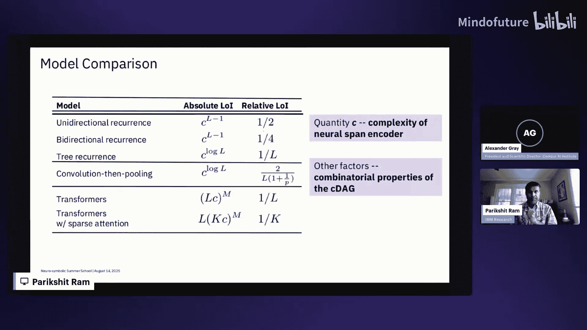

Another factor beyond compositional complexity is kind of like can these models operate on any length sequences and nowadays a lot of these over ortho three。

然后。Of the shelf models can， in fact， do that except transformers have a tiny issue of position encoding if they are doing。

 if they need to learn the position encodings or if they are position encodings or something。

That they have to explicitly store then for longer sequences。

 they end up with like out of distribution generalization and start struggling with they're given longer sequences than what they have seen at training。

 their are ways to mitigate it。Of course， the other thing is can do these。

Any of these models induce an input dependent computation graph。

And the sad news is almost all models do not。Some specific form of convolution and pooling models do。

Give us input depend seeDs and transformers with specific form of sparse attention give us input dependence computation graphs。

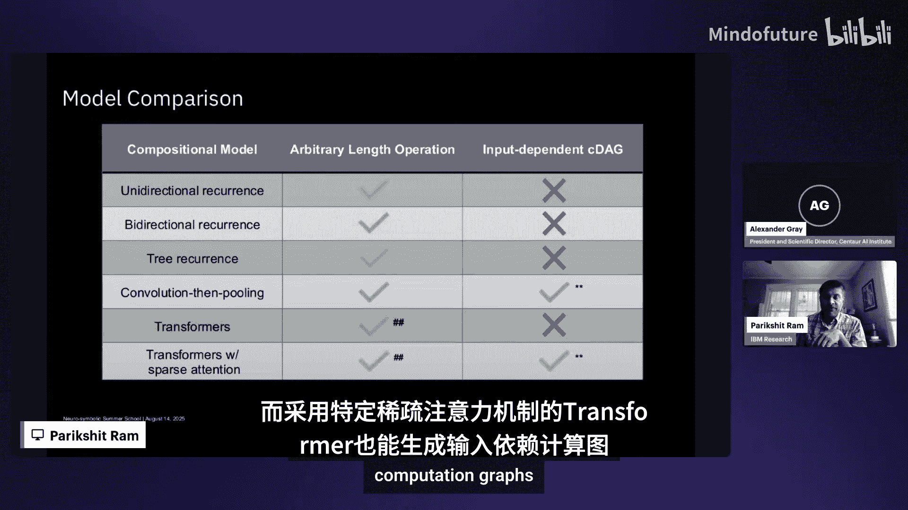

Now we might ask why is is this important， why do we want an input dependent computation graph and to kind of understand that question we understand the effect of an input dependent computation graph。

 we asked the question， how well can a compositional function with the input agnostic？

CDG approximate composition function of the same complexity。

 everything else is same in terms of their complexity。But with input dependency theres。

And this is a lot of math， but what this is just writing out is what is this approximation where I'm letting the functions have the same level of complexity。

 but one gets an input depend seeDG and the other gets the input agnostic seeDag。

 but the input agnostic one that it chooses， it can choose the best one for itself。

So it's this min Max kind of result and what we can show that this approximation has both a higher sorry upper and a lower bound。

 which means that the lower bound means that you can never do better than this and the upper bound means that the gap between the fixed input agnostic seeg models and input dependent ones is upper bounded as well。

 but in both cases this upper bound these bounds that depend on this locus of influence。

 the absolute locuss of influence So higher this is the larger the gap。

And more so if more complex the composition， the more complex the compositional complexity of the model。

 the worst approximation and input agnostic CX cannot sufficiently approximate input dependent ones。

So you don't have expressivity connecting to what Perishelle had mentioneding previously。

But for the same absolute， you also want higher relative locals of influence for better approximation。

And so input dependent ones are just more expressive。

But beyond that can what can beyond expressivity， can we say something more and one of the things that we。

🎼We kind of try to analyze this generalization。 What can we say about generalization of such a compositional model and we have to this kind of studies this systematic generalization。

 So it's kind of。Analyzing that situation where we have to。Talk about generalization。

 an unknown combination of known parts， but we simplify the setup where we are even giving the ground truth function。

 seed function。 and we only need to learn the span encoder and the readout function。

 everything else is given to us。 And in that case， we can kind of theoretically show that the gap between the generalization error。

 which is usually the gap between the training loss that we see and the true loss。

Is bounded by a bunch of different quantities。 One of them is a number of training samples。

 so more training samples help， but the other quantity is this absolute locus of influence。

 larger this is the worse your bound。 So again， as your compositional complexity of the model goes up。

 your generation bounds also go down。So again， overall， like what do we have now。

 we have a novel definition which tries to kind of tease the symbolic and neural parts of a composition function on sequences and the definition includes。

😊，Many of the shelf sequence processing models and this abstraction allows us to quantify kind of the complexities of the models。

 So we kind of we try to argue that compositionality is not a binary property。

 but rather something on the spectrum。 and this abstraction also allows us to develop expressivity and generalization guarantees And this was kind of part of our paper that we presented at each guy last year。

嗯。But some of the insights from this paper from this work will also the kind of。Imped why。

Give us insight why transformers are just more explicit than sequence models like RnNs。

 It's because transformers with their softmax attention， kind of implicitly。😊。

Give us an input dependencyD implicitly， not completely， there's a subtle difference there。

 but they also have higher complexity so they can just model higher more complex functions。😊。

They also answer。An observation from very old So in old vision models。

 One other thing that was observed was that max pooling was always practically。

More performant than average cooling， and I don't think I've saw any answer in literature which tells us why this happens。

And art theory， kind of。Indicates that this is because。

Max pooling actually induces an input dependencyD whereas average pooling does not do that gives giving more expressivity to the max pooling based models。

And then we hope that this kind of analysis opens up a new way of thinking about models as。

Existing models as being both neural and symbolic。 Of course。

 it doesn't fit all near symbolic models， but just specific class and。Thinking about this。

 we hope that can also help us improve these models。嗯。But beyond that， we also want to see like。

 can does this practically help us for anything？And and we we kind of do a case study with with transformers here where we we take like the full self attention model。

 which looks， everything looks at everything。 The softm kind of tries to limit how what it looks like。

 but it's stilllicit explicitly looking at everything。 So you kind of have。

Think of the picture here as kind of the attention mask。

And in an alternative way of kind of looking at attention is you do sparse attention for you have different kind of sparse attention。

 whether it's banded or whether it's locked local where you only look at a certain window or youre stride it。

 you look at every third token and so on， but there's another way of doing sparse attention where you look at only the highest attention score like a top five highest attention scores and ignoring everything else。

 So in that case you don't have a nice pattern in your attention mask， but you still。

A kind of looking at the highest attention scores。And from our complexity analysis。

 we can kind of say that the full attention model has a higher complexity than and。😊。

The sparse attention model going to reduce this compositional complexity。

 So when you reduce compositional complexity， remember that meant better generalization。

But even within these sparse attention models， these input agnostic masks kind of are input inducing input agnostic computation graphs。

 so they' are less expressive whereas this top K attention kind of induces an input dependent CD so they are more expressive so。

Further we also had this nice distinction。The question is， does it matter in practice？

And what we found out when we did targeted experiments to understand this is that it actually does matter significantly。

So this is the training of a model， the same transformer model， everything is same。

 every hyperparameter is same between all the models。

 the only thing is we change is the attention mask。

 we either do full attention or various forms of sparse attention and then we train the model and this is for the list ofs problem that I was previously showing you。

And the full attention is the black line， whereas the top case parse attention。

 where it's only looking at five。Highest attention scores。

 And then the other forms like a bandai or block local are different versions。

 You can see that the top K actually is。Is converging faster because it both has the expressivity it needs combined with the fact that it's just a lower complexity model and is faster training。

 You can see it's converging the training loss is converging significantly faster。

 And this faster training is also translated to generalization。

 So this one is the plot on the bottom is showing the accuracy on the heldout set。

 And you can see that the top model very quickly starts generalizing faster than the full attention model。

 Of course， none of these models are doing very great because they at 35% accuracy。

 So they are not systematically generalizing as you want them to。

 So that's still an unsolved problem。 But here's another problem where this comes from a context sensitive language problem。

 It's called missing duplicates you're given in the sequence2。😊，Two copies of the same sequence。

 and then one of the the second copy has one token missing。

 and you have to look at the previous sequence and find the missing token。And in this case， again。

 the stop care attention converges in training loss significantly faster than full attention and generalizes significantly faster。

 And in this problem， transformers actually can solve this problem and the stop care attention gets to 100% accuracy significantly faster than the full model and。

Input agnostic masks are actually failing in this case。

 and they either don't have enough expressivity。 And so they don't converge or they converge much slower than the full model。

 And this is， again。Something that was predicted by our theories， overall kind of。

Our theory that we was making certain predictions which we were able to validate empirically and there were many other theoretical insights that we validate empirically。

 which was very it was very good to see that we made some predictions that it was validated and this paper you can go to this is on archive right now to kind of understand our results more deeply and this is with K Carsson Tim Klinger。

 Sashankru and Alex Gray and with that I thank you for your time again just as a reminder。

 this is joint work with Tim Klinger Ken Sashank and Alex and you can find the papers that have more details at these QR codes and thank you。

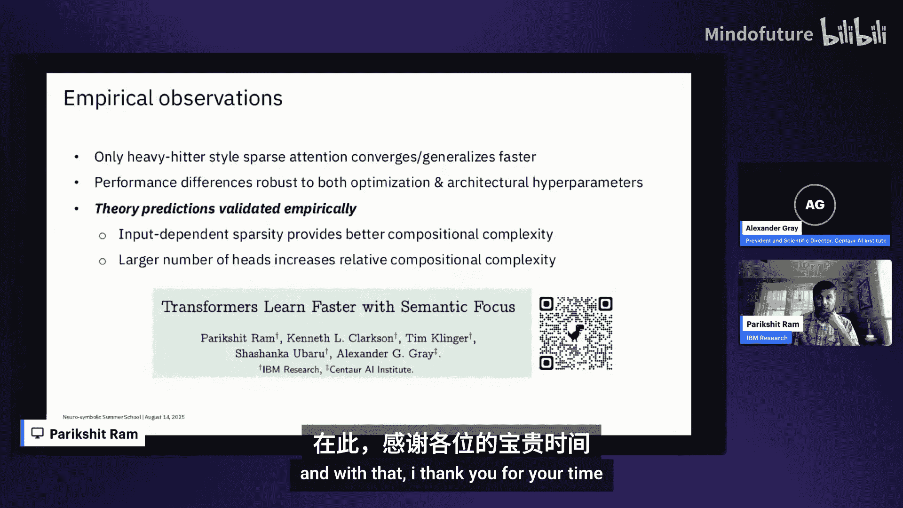

All right， thank you so much， Parri， just have a few minutes。But just want to comment。

 so this is the first in our mathematical foundations block。And。Sometimes theory lags practice。

 but sometimes it points the way。

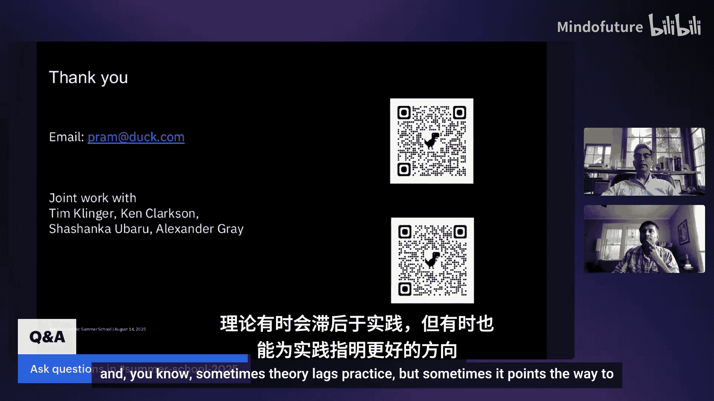

To better practice。I think。开。So that says。The punchline of this carucus。

Starting to do that so you show the way。And Arvin warned us about。His talk， we may need， in general。

 as。AI researchers too。Figure out which ideas you give us back。Not to pick on transformers。

 but maybe that is the way， but if it were not transformers。

 this is the kind of tool that might cure us the way。Let us imagine it's an abstract profit。我不个行走。So。

So。You know，As a early researcher， especially getting into the neuroymic A。

Now these are the kinds of things I would look for。Fundamental。

Concepts that could be used to build able a new。A new Syria is England。

So really have that compositional complexity。So here's a question from Benjamin Grossov。

One of the leaders of our community at DARPA。So。Locusum influence in the computation graphs is quite related to dynamic dependency graphs in the cl ge logic programs that use。

 for example， tab and algorithms。Including incremental tape。诶。

And that's a way to extend the most symbolic。Further into this solid one。

And if you have a comment on that， right？I mean， I would say that。嗯。

I I would say that there probably are connections， I don't claim that this might be a completely novel idea。

 and I think there is a lot of existing literature that we need to look back at and understand and apply。

Apply that to understanding new models then and。This is just preliminary work and we want to build upon on this。

 and I think some of the connections I would love to look into them and because I think it will be very critical in then making these more more broader and I saw some relative related。

Question on the chat as well on this。IAgain， I don't have any straight answers on whether these can be exactly computable or not。

 but at least theoretically we can combat different models and understand what can I change in the architecture that we reduce this at least theoretically？

And that can then give me a new new architecture。 And that's what we did with transformers。

 we looked at what needed to be changed。 We tried and changed it and we tried the experiments。

 and it turned out it worked。 I mean， we didn't have to do any tweaking to make it work。 Again。

 it's not solving all problems everywhere。 but I feel like this is a way where theory old and you can help us get new。

architectureectures。One super quick last question。 If I remember， Well。

 Tim Kinger had to talk here about generating output in。

Somewhat simple grammars from Gin A I is the bigger picture of your endeavor， an effective system。

For translation。H。According to Cots， for example， L M2 prologue。It's likey Elen。I mean。

 I don't think like。I think we my goal， our goal here is just to understand what's going on。

 I wouldn't claim that we have we want to do any specific kind of。

Specific method or specific goal is just to understand what affects。

The expressivity and generalization of these models and if we can understand the factors we can target those factors in the architecture and see if it helps that's a bigger abstract goal and the examples given here could be one specific application honestly I don't know much about that specific application but it could be could be one such application。

Okay， we have a few more questions， but Pra， if you want to jump on Discord。If you have time。

That you can jump on those questions。 Otherwise， thank you， Parri， great stuff。

Is our next speaker here？Thing am I here？All right， welcome payhouse。Now。This is， I think， very。

 very interesting。Payhow is going to see。One thing I。Was going to mention in my overview is that。

You have various approaches to neurosybolic， many of them are actually things like what we'll see tomorrow。

 where an LLM is guiding a symbolic solver or something， so there are still two systems。

 you could say。But the deep， deep kind of connection and intersection of neuro and symbolic to me is a very。

 this is extremely promising and。Where we should be looking。Heavily， and it's difficult going。 Okay。

 so I think what pay how is。going to show us going to give us some insight there。Okay。

 this requires a little bit of mathematical background， but PayH will guide us through。

 so take it away PayH。Thanks Alex for introducing， so can everybody see my screen？Mmhm。😊，Okay。

 cool is it like in a full screen mode or is still in a。It's not fulfill yet。Okay， yeah。

 maybe I should put it。And。嗯。Or right， yeah， maybe I just yeah， presenting this way。 Okay， cool。

 so yeah。😊，So yeah， so as just Alex introduced today。

 my topic will be about how can we train new networks。

 but can still discover these symbolic structures with gradient based training。

And this work is done with Professor Z Ats Wang。嗯。Rightright。Sorry。튜려。Okay， cool， so。So today， yeah。

 we have witnessed the surprising success of LLMs like， you know， just a few weeks ago。

 I was just witness the success of the LLMs in the IMO competition。

 So basically there's like official announcement about like deep mind open ice modelss can problems at the top level of students at a level of competition level math problems。

And there's like a lot of like courage about these newss and at the core of these mos like for example。

 in the last year people still think of like they want to just embed all these symbolics into the language modelss and luckily they have some progress and they produce proof and alpha geometry that has like I think they only the silver metal but this year they just make it totally language Mos。

 pure neural while only the gold metal， so but what we all know about this mo is that it's just like this type of new architectures a pure transformer energy end。

So now it raises up the question is。Since the L armss are like pure neural and it trained objective with still statistical pattern matching。

 we're thinking of like how you can actually do the reasoning so because。

Like reasoning is very quite symbolic stuff because for example。

 there's like very simple reasoning tasks so in a text should be read like this。

 but it structures should be have this type type of like very complex logical deduction。

So at least each step you will see is deterministic and programmatic。

 and each step also follows a set of logical rules。

While we are training language models we still asking language models to predict next tokens and trying to minimizing the likelihood of the data。

 so the natural question is it looks like the neural networks。

 learn to truly perform logical reasoning， while this type of statistical better matching。

And this type of mysterious， we're going trying to figure out why this might happens and under what kind of circumstance it will happen。

okay so so maybe we just start with some like arithmetic reasoning examples and this is what people have observed before so by saying what we care about like symbolic new network has already exhibit these kind of capabilities for example。

 if we want to teach the new networks to perform arithmetic calculation people have observed that if you train modelss to perform like 50 digit operatorss it can generate perfect to operates with like hundred of digits and more importantly it shows like very important compositionality it is when you train a transformer。

 for example， addition and the multiplications separately and's like nearly new data or even like future data you can generate the whole modelss to to evaluate the expressions with mixed operators so this exhibit some of compositional when you're training new networks Also people also find out those new networks。

Quite interpretable because when they probably some like intermediate layers。

 intermediate activation， they saw some like interesting patterns， for example。

 this is a visualized tension map we are doing some reasoning task and it exhibited some very spa structures that was trying to like doing very strict and rigorous calculations among those symbols。

So people maybe feel like these type of attention values can manifest as a symbolic rules among the tokens。

So despite this's like very stereotypical dichotomy of symbolism and collectism。

 like before people believe symbolism is rule based。

 so it's more like generalizable and it's more robust in symbolism can have like better compositionality。

 but the downside of the symbolism is trainability。

 is hard to find optimizing algorithms to find out those symbolic expressions that is applicable to all these data。

But while in the past people believe connectingism， while it's very trainable。

 people fail it maybe it's very hard to compose different components to form new new networks to perform on new tasks。

 and people may also fail a connectingism is still doing statistical pattern matching。

 so it's not that safe， it's not that robust when you change the inputs it's likely they will change the behavior completely。

But now people surprisingly find out the connectingism is just like sates all these Buddh altogetherthers。

 they're pretty robust and they can compose， they could do very compositional reasoning on various of tasks and definitely they're very trainable and quite scalable。

So were trying to figure out why new network training can actually achieve those properties。

 like you were training in new networks， but it manifests as some like symbolic architectures。

So to begin with， let me define the problems we want to tackle here and despite this is kind of like very narrow setting。

 but this actually already shows some like insights how neural networks can discover those symbolic structures。

So the task we care about is the modular addition， so formally given a final IBN group A with a commutative group action。

 we are trying to train new networks that takes two inputs in this group encoded as one hot embedding and using green and train networks and trying to make sure that they're composed of these two。

Hediments outputs the target values under the defined group action。

And the new architecture we care about here is just two layer MLPs again it's not a transformer。

 but we want to use these very basic settings to show why steel training such simple networks can still have symbolotic structures。

Again the first layer is the embedding layer， we embed the finite groups elements into Wangha embedding and we have a new networks layer so each for each input like A1 A2 we have like separate wind matrices we apply them to the inputs and here we adopt the addition that we combine the outputs of these two branches and we also assume the activation is quadratic and later we obtain another layer it's called WC in and this there gives the outputs hopefully in the one embedding space and here is some like notations。

 so the first is n so n is the number of the group elements a so since this embedding layer these wind matrices should have M many columns in the Q this is the hidden neurons which means。

The hiddenated dimension of neural networks。It's just I have a parameters while I' doing the training。

In a。And the further step beyond is we want to represent those weights in their four space。

 so that is we do the four transform over the Ws and we convert them into the Z。

 so the or weights like the column of the weights will bere as the Z times the four basis。

And we just flatten the basis for each neuron as z J here。

 which is connlation of each columns of these matrices。

And now we our training objective is we are trying to minimize a square loss。

 mean square loss over all the pairs of A1 A2， so it is this is output of neural networks and we do some normalization and minus the crunch that is the A1 composed with A2 that we hard embedding。

And we also apply a centering matrix， and then we to make it unbiased and we adopt the alT alarm to compute the losses and sum over all the pairs。

And optimization is still very standard， we want to we want to minimize the loss defined here using gradient descent and in a continuous regime we consider the gradient flow。

And with all this setup we can reach out reach the first result。

 which is a very interesting decomposition of the loss。

 so what we have shown is that given this loss H we can reformulate the H as a sum over all these small Ls in a constant values here and all these L there's like lot of terms like row here so despite this is actually a very complex expression but later we will show is have very simple solutions。

 so the core component here is those row here so the key observation is the loss functions solely dependent on those rows and in those rows we can observe those row those rows are the。

A some like functions depends on the empirical measures of this of those neurons。 So basically。

 the empirical measure measure basically means we just sum up all these Delta measures of the。

Of those neurons and furthermore， the age depends on the measure through a average subset of monoials。

 so basically monomials basically means it's given the vectors。

 we're just trying to find the subset of those elements in the interest in the vectors and the products of them together。

And you can observe those are just like basic millials and indexed by the PK andJ here。

 and we are first evaluating the milllanials over this over one neuron and we compute the expectations over all the neurons indexed by J here。

So by those key observations， what we can general is that we assume that the reasoning tasks admitted like very similar structures。

 so we define a more generalized to called mononomial potential so the mononomial potential is basically a mapping between the measure to real value that is given the measure mu here。

 where the the associated monoial R evaluates on the sample Z and we take expectation over over all these these and evaluated on the R's so mathematically can be written as the expectation of R z here。

So by this kind of generation what we mean is we want to analyze an limiting measure。

 so even maybe this yeah this formation is still on the finite neural space。

 but here we generalize to the infinite regime， which means we have like infinite wide neural networks and then this。

Those rows will be redefined as the monomial potentials evaluated on a like like arbitrary measures over the neurons。

You know。Then the whole loss functions can be written as some functions of like rows of like many roles here。

 for example， in the know or task， we define the roles like the index by case。

 So those are just like set of like monoials。 so we we just define like many monomials and we define the mononoial potentials associated with those monomials and we can transform these laws to like functions define over all these mononial potentials。

And now the optimizations transforms from the standard gradient flow like this one to the met space optimization。

 which is naturally the wast standard gradient flow it is defined as this so intuition of this formula is that at a very like small steps we take very small steps you we want to minimizemizing the loss functional H here defined on mu such that the minimizer has like very closed distance。

 was scan distance to the to the mu t at last from last step。

And this formula itself is basically what than gradient descent。

 so it measures how the mu evolve under the gradient of the loss under the gradient or the first variation of the loss function in terms of the mu here。

 so it's just like a natural gradient de but over the geometry of the measured spaces。

So all both we have aization we have a summary of the generalization。

 so first is from a motivating example， we know that loss function depends on the empirical measure of the neurons。

 so now we generalize this empirical measure to arbitrary measure。

And we know those functions can be decomposed as the functions over some like expectations evaluated on some monomials。

 so those expectedmonmials is dennoted as mu here， so we general it to a mu of arbitrary monomial and evaluated on arbitrary measures。

 so it's expected a monomial。In it allows functions we define over the disease。

 now we can transform it to define over the coordinates of the rows and it allows functions and there's another terms called L。

 it like a functions but those functions solely depends on the rows here。

And the gradient end is generalized to the water s gu fi over the metter space。

So by all this generalization， we can start our analysis to the whole framework the first the first very interesting results we show is that if we go back to the modular audition example。

We can feel we can find out that there's a minimizer of the whole functions。

 but which is like pullinging assignments。 So the basic solution is that these kind of like mules will equal to one if if the case is not0 and all other solutions are just like all other like rows are just zeros。

 So there exist pullingying assignments of those rows， such that it can make these loss to be0。

So what we can find out is that if we solve these problems using gradient S。

 we have another server which is served on the row space by assigning like bo assignments or。

 make sure they are bo variables， we can still solve the problems on the row space。

So those MPs likely place a very similar role to the boying variables or the logical variables in the symbolic tasks and and then the L actually encapsulate all this role is actually a logical expression or symbolic expressions over those boying variables but this is just like a very quick intuition so maybe we can just define more rigorous for example。

Suppose if we suppose if a measure meal here in our general setting。

We define the zero set in the one set as follows。So， basically， the zero set means the。

it is the a set of like monomials that that has like zeronoial potentials over the mu and similarly the one set means where defining a set of subset of like mononoials that has that has mononoial potentials equal to one。

 So we define a set of R R1 and R0 and R1 in。So there one set testifiability of HMP for the matter meal here。

So the solution of the test we saw before the aN group reasoning can be written as it has zero set。

 which is a set of monomials that is nuified as the intersections of those three sets or it has one set of these forms。

 so basically we decouple the effects of each monoms to different sets that make sure that makes those monoms zero and once。

So but what is but further on， we can saw something that is even more interesting it is given two measures we can find out did you have composition added structures over their waste spaces so first of all one thing we want to know is that those mu andmives we can regard them as weights so they are defined over waste spaces and doing composition on the mues basically means we're composing the neurons in the new architectures。

And but the effects the effects are composedos in mu and mu1 U2 is actually very interesting。

 but first of all we let's just define some operations we trying to compose those measures the first is we want to trying to like do something like addition so where mimic addition。

And it's very simple， we just add those measures evaluated on As separately and add them together。

 and this is what we define as the additional operations。

 so we created new measures by adding two measures together。

And we can also define the multiplications， this is a little more complex。

 but intuitive we can understand in this way we first sample neurons from the mu1。

 we sample another neuronsn from mu2 and we perform the animalwise multiplications between these two samples that we sampled from mu1 and mu2 and then we forms these star here。

And this and the distribution of these stars， we define it as the products of the mu1 and the muT and also similarly。

 we can find out there's like identity elements， which is like one。

 that basically means if we multip one job or other measures you still the same measures and there's like zero elements。

So after those algebra probably define between measures。

 we can find like very interesting structures first is。

So these structures a those algebras actually form a communitative semi ring that is those naturally follows some ring structures and the MPP in the meumnial potentials is actually a rim homomorphism。

That actually preserves these operations between measures and converts it to the space of those MPs。

 the monoial potentials， so let me be more specific if we add those two measures together and feed them into mononoial potentials。

 its value will equal to we first we evaluate the first measures over mu R and then we evaluate the second measures over mu R and plus the final values together。

And if we multiplies those two measures together and it will manifest on the mono potential space as we multiply those two mono potentials evaluated on each measures。

So this actually shows that the compositions under the matter space， which means on a weight space。

 can be transformed to the row space as the same operations while this plus and these this addition and this multiplication just for the most basic algebra on the real space so this can we can store some like very interesting analog。

 so on the matter space， we're composing the neurons。

 we are doing addition type composition which is where it's similar like we are stacking the neurons together。

 we're stacking to architectures togethers and multiplication means we are coupling the neurons together we compute on the weight space and we form a new neural networks and after we compose those neural networks。

 it's functionalities can be composed as if we are doing additions， which is like the all operations。

Over the Ms， and we are doing the multiplications between Ms。

 which is like the add operations between logical variables。

So this actually shows that if we have partial solutions of those neural networks。

 we can just compose them together and it manifest on the MP space same as the corresponding logical operations。

And heres just like some very basic examples， for example。

 if the mu 1 has 10 set as as the R R and R1 and mu2 has O and S1 if we compose the weights。

 they will have the0 and one sets as this expressions expressiones。

 so that basically means if we compose their weights of those two neural networks。

 then there are0 and one sets will also change accordingly through a intersection and union operations mimicking as as the logical operations。

And we can just compose them to maybe follow some any logical expressions as we want so or conversely if we want to form a logical expressions。

 then we can convert it back to the waste spaces， by using algebra， we define over the waste spaces。

So the main takeaway， first main takeaway is that actually those symbolic structures are hidden in the neuraler weights。

 for example， the symbolic variables is actually the Ms because Ms encapsulate the weights and abstract weights as a symbol as a zero and1 symbols and we also find out logical connectivities。

 it is maybe the algebra we defined over the Ms and then it can be translates to composition over neurons weights and and those algebras actually admit those composition analog so it is we can do composition on the weight space and it manifest as wecomposing the MPP representing symbols with the N or logics so by all this we find out okay there's some hidden structures hidden。

Variables defined over neuraler weights that can manifest or behaves as a symbolic variables。

 and we define algebra that can make them geological computations。Yeah。

 but with all defined bill we still like an understanding that what happens during the training because during training we are still doing optimization over the weight space。

 but what do we know is if we regard the rows as the robot variables what happens on those variables so here is here's the first step first step we want to answer like can we do new network training。

 but still kind of like doing the optimization with the regression over the symbolic space。

And we have the second theem which shows that under like a very certain condition we can achieve this so so let me just first pull up the main results first so it is if we were using the offset the green flow to update the measures here and under those three conditions I will elaborate later。

The the dynamics of the malarial potentials， which is regarded as symbolic variables。

 we also will admit a trajectory that is we are doing coordinate wise optimizations of each rows in terms of the gradient of L。

 So here is L again means we are combining all these roles together。

 So it plays a role similar to symbolic expression。

 and we are trying to use the gradient of this L to minimize the roles and trying to align with the symbolic symbolic solutions here by the pure gradient des over the。

Symtic variables。 So first， so this is gradient on the waste spaces。

 and this is the gradient distance on the row space。 And we find out under these three conditions。

 this dynamics actually naturally translates to these dynamics over the symbolotic variables。

And those three conditions are the first is we start from gaussian initializations of those mules。

 which is very standard and second is we assume that all these mononoials we used in the monoial potentials are of degree of larger than three and it is odd。

 it just unlike regularity conditions and fortunately this is actually naturally satisfied by the moderate addition examples we showed before。

And another very important condition is that the gradient flow or the velocity field induced by the water gradient is OD equivalent that basically means if we transform the if we rotate the measures inside of this bracket then the whole velocities will admit the same rotations or transformation orthogonal transformations this is not usually satisfied。

 but in our example were still satisfied and。Yeah， yeah， we can check more details in the paper。

 but it's still satisfied。 And and it can also be used as the additional conditions for the generalized task。

 For example， use it as a principal design architectures to make sure their Wall fields is O equivalent。

 And I'll show example later。But back to the main results。

 while we show you that under these two conditions a neuro weight training translates to symbolic regressions so that is a gradient flow on the matter space translates to a gradient flow over the over the symbolic variable space so here's like more intuitive illustration。

 so basically if we are trying to use green updates over those lost landscape and at each step we're actually trying to transform we're actually also have a corresponding symbolic updates in the symbolic space。

Yeah， and the critical constraint that those velocity fields is OD equivalent。

But but what's the benefits of this symbolic gradient extent。

 so a very direct example is if we again go back to the modular addition example。

 what we can find out is that for example for these for those MPs like the row KKK in if we derive their gradient treasuries under its framework。

 we find out is follows its treasuries。And its convergence is its convergence is that those variables converge to the ones。

 converge to one， which is the binary results we expected before the particular solutions we saw before。

 so this actually guarantees those variables converge to binary assignments we want before。

And and here is another very important insight。 It is during the whole attractive of optimization。

 there is a very natural dimension reduction that is。If we are minimizing the differential entroies。

 we make sure those variables converges to the MP constraints to satisfy those MP variables putting assignments。

 then we can show that the solution space can be the solution space over the in the measures。

Can be constrained to to a finite dimensional relaying Romanian anyfold。

 So like the original matter space is infinite infinite dimensional。

 While if we convert the whole optimizations to the symbolic。

Space and by this concept and by this means we can show that where we can also constrain the whole new solutions to the very low dimensional space and this actually guarantees the neural weight has like very limited treasuries during optimization。

And yeah here's another series about normalization group type degree of freedom reductions。

 but I'll skip here to say sometimes， but the main message has already been delivered it is that the measures represent a new wave space will go through a dimensional reduction process as we show in these slides。

And simultaneously， what we can find out is that the new and Network training can review a symbolic learning process at the MP level。

And another very， very important message that we need those models to follow some geometric constraints。

 So here's another insight is geometric constraints is more like a continuous version of the symbolic constraints so for example。

 graphs are a very symbolic stuff so symbolic subjects but we can and graph know topological nature but we can translate those graphs to their geometric embeddings。

 for example， doingplian decompositions and we then obtain their geometric constraints geometric embeddings and if we put the geometric embeddings to neural networks then it starts to works because it embeds those symbolic and dis with structures with continuous embeddings so this is a core components here and we again show that those geometric constraints actually can facilitate our new network trainings to follow in symbolic regression process。

And a we also provide a results to show that we can do the symbolic we can do the environment learning with with new networks with some like simple complex guarantee and。

But what I want to really emphasize is that there we recently we come up with a instantization of this idea that we try to embed those OD environments into architectures by improving the position embeddings of transformer architectures。

 so we think of this is one step towards we want to enhance some like geometric constraints in the new architectures that to discover the symbolic structures better。

And here are like two slices of a very quick summary of what we did so we proposed a position em bebedding called tape and the tape is actually position embeddings jointly nerd with the token features and how it was joint and nerd with token features it is we use these position embeddings and specifically their inner products to modulate attention weights and this is quite standard as used by lots like tensions but simultaneously we also use the attention weights to updates the position embeddings and also use the feature value feature of the tokens to updates to inform these position embeddings。

So by these two mechanisms， we actually inform the position emddings with the token features what we start from is that we actually want architectures to invest on geometric constraints and all these steps naturally follows the OD equivalent with respect to the position embedding part。

嗯。😊，So this gives us a geometric constraints in transformers and theoretically we show some interesting results。

It is if we consider the attention with our proposed position embedding and attention with some for example rope。

 the very standard position embeddings we can show that the pure attention is known to be under TC zero circuit complexity。

 that means those attentions can only simulates a very limited class of algorithms in those complex classes while we can show that if we contextualize those position embeddings under those geometrymetric constraints as well。

 we can enhance this algorithms reasoning capacities by probably show that the architectures equipped with our position embeddings has N1 complete expressive powers of the algorithms so if N1 is proved to be strictly。

 strictly stronger than TC0， then we can also find out that our architecture is strictly more powerful than。

And it can simulates a lot of class of algorithms。And also kind of like inspired by last presentations。

 I just find out that we're talking about competition graphs and there's like mechanisms。

 we actually contextualize the position bes with the sequences and we find out those structures those context dependent structures can probably enhance the origining capacities of those transformers。

And also the another rule of geometric constraints is that we can。

 make sure that this position embedding is still a relative position embedding。 So。

 so it has like better noise explorationlation and generalization because it encodes position information in attention with the relative distances between the tokens。

Okay， so finally， just a quick summary of today's results。

 first is that we show like very strong algebraic structures that is inherent in neural networks and by this we define what symbolic variables hidden in the new weights and what are their logical connect and how can we achieve compositionality over the waste spaces。

And the second result is that if we use the neural network training on the waste space。

 it can still lead to be symbolic solutions but under themetric geometric constraints。

 so by these results we show that under geometric constraints。

 the evolution of the neurons distributions will manifest as a symbolic regression processes that we are doing the gradientcent in terms of those logic variables through the logic expressions here here。

And next is that we want to call for the geometric constraints in those architectures that embeds discrete structures and symbolic structures into those continuous architectures and that actually enhanced and facilitate symbolic learning in those new architectures。

And now beyond， yeah， thank you for listening， maybe we can take a few more questions。Great， great。

 Okay， thanks so much。诶。Questions。ok。We people are still。Looking up concepts in their math books。

 I think。But I'll ask you a question question。呃。Just to be clear， so reasoning for one thing。

 you're mapping to solution of Boolean assignment in the sort of relaxed。

So some kind of relaxation objective， right？But that's， of course。

 different from how reasoning is done in the logic world， do you sort of apply some inference rule？

Or a set of inference rules。It seems on a search process。

 this is a still a search process you could say， but it's a gradient。Search process。So but。You。

 it doesn't have to sort of apply inference rules or you could say doesn't have the opportunity to apply inference rules。

 so is it a pro or is it a con？How would you compare them？Yeah。

 so so maybe from the very beginning of the task we're trying to do module addition and I believe this is a very rule based and it is very symbolic task here and but if we translate to neuro space it is still a new network optimizations but what we review from those training process is that we saw there is some like putting variables that is hidden in those structures and the loss functions that are organizing and enclosing all these variables is what we believe something like the symbolic symbolic expressions over those variables yeah I found this is not exactly yeah exactly this is not exactly what people used to believe the symbolic expression。

And symbolic rules in symbolisms。But still， it reviews， I think。

 why those symbolic structures still emerge or inherent to neural space， so I think。

Maybe yeah still need some efforts that we want to translate those languages to those rules or even thosemp space or those zero sets operations back to the somebody constraints because here when downsides drawbacks of those interpretation is that we still don't find a meaning of what those monoial potential means here。

 so it's some like potential variables it looks like some logical variables。

 but it's not explicit variables that people can really comprehend so all these logiclike expressions over those variables maybe it's very hard to interpret but we find out one thing we find out interesting is that so the logic may not be the same as what people believe what people think but the logic might be something else。

For example， defined very implicitly using those potential functions。Well， I think。

And one reason I wanted to highlight your work here is。

I think this is really at the heart of you know what many people think is sort of the true interface between neural and symbolic so for example。

 Yaho Benio we had a few years ago。And。In our panel and the he was was a lot of fireworks in that one。

 so that's still my gold standard for hot friendly debate， but the debate was about。Basically。

 do you need symbols or you know， in the in the symbolic highway way or is it because that leads a combinatorial search or is it better if you could。

And somehow necessary even。For efficiency reasons to。

Do that search in a continuous way where translation roughly gradients？

So this was Yahu is sort of if I'm translating him right。You know。

 so I think some people definitely have that intuition that。

which you can use many ways that well neural nets have the ability in principle is kind of what you're saying。

 I think， to represent。Things we want that are discrete now that leads to this next but do they necessarily do it well is the next question or can they be made to do it well that's。

Maybe a transition to。Carlos has a question， if this work shows neural nets are able to encode symbolic constraints。

Why do you think that popular LLMs fail some logic， simple logic puzzles， for example。

 is it a problem with the training data distribution？Yeah， yeah。 I think， yeah。

 this this is a good question， so。Yeah， so indeed we need those symbols I feel like maybe the symbols for the machines maybe sometimes different human maybe but indeed we need to enforce those new attackers and new network training to find those symbols and this is why we have the second part that when we if we are doing the waste based optimizations when it can translates to the symbol space regression even though still when we're doing like continuous it's not like comb search。

 but still we find out that if we follow this simple gradient on the symbol space it converges to some boole assignments so at least for the modular addition examples we mentioned so this actually gives us the evidence that it actually converges but again it's under。

Condition that some geometric constraints is encoded in those architectures with loss functions and that's why we have this third part that we want to embed those structures into the transformer architectures for example。

 if transformers feel hard to save all those logical reason or the puzzles probably because basically does not really satisfy those geometric constraints here and our efforts here is we want to embed we bring back those constraints into these architectures and again as I mentioned before those environmentvaris and so these environmentvaris for OD requirements actually can translate to like for example。

 on computational graph it's very discrete and symbolic structures and it has some the top logic and or maybe geometric constraints it is some like。

environments or graph environments。 and this is like very discrete structures。

 and O requirements actually translates these discretecourse structures back to the continuous space because it actually operates on the continuous embedding so that's why I believe those are very necessary steps we want to for example。

 inform attention map or any continuous embedding or activation in neural networks with those constraints even though these constraints looks very weird that essentially。

 or I think theres might be something deep connected that it encodes the discrete structures that that we need for like even harder and we want to generate the transform any scenarios that we want to generateize transformers to solve like even more complex for example。

 puzzles and reasoning problems。Okay， we're a few minutes past time。

 but I had do have a one burning question you give a yes， no answer， really if there's a yes。

 no answer， give it otherwise we'll take it offline but。It seems that when you're defining symbols。

My impression is that what you really mean is a point mass on one dimension。

Or and then when you're talking about these geometric constraints。

 which you mean is a something like a knowledge graph has to be put given as input。

True or false in both cases， that would mean you sort of already know what the symbols are。

 you want the thing， so symbol discovery is a different thing。

So basically as you set up that you already know what the symbols are。Yeah。

 my question is we I don't really want to assume the symbols are unknown here。

 so I think yeah this is also yeah my big assumptions over all these works and and this also motivates us to find out one are the symbols in those new nets for example。

 what we discover what we derive from those frameworks okay those symbols can be had those bo variables。

 but those are all hidden in the new network training so when we training new networks。

 those symbols are not known to us only when we do in mathematical investigation with all these architectures。

 we can find out okay those are those quantities where those variables manifests as some like symbols so thoses I feel like this is not suggest you don't need to know the symbols up front good enough emerge。

Yes， it's hidden in the parking structures。 Yeah， yeah， very good。Okay， awesome， super fascinating。

 I really want to ask you about the renormalization group stuff。

 but anyway we'll do that another time thanks so much I appreciate it and I think hopefully this will inspire people to look close more closely at this connection。

All right， thanks， Payhaub。Yeah， thanks， Alex。All right， do we have the next speaker？清蓝。系诶。Hey。

 all right。 yeah I'm going to share my。Okay， so Changlong， another one of our early stars now。

I mentioned it。 Can you see my screen， Yes， okay， okay。Let me just quickly introduce you。

So this work I'm excited about because， you know， a lot of people。In general， in any paradigm。

 we sort of need to wait a while and see if certain things that seem to be deep issues。

Potential blockers， you could say。you know， will they shake out。

 will the paradigm eventually find a way within paradigm？To shake them out， but at least one。

 I argue several of them， but at least this one we have now a theoretical answer of no。

 you can never get rid of hallucinations with at least this next word prediction type model。

But Changlong will elaborate on that and Emma。As show us。Not only negative results。

 but maybe a positive way forward it。I'm excited about this， take it away， Changlong。

Okay so thanks Alex for inviting me here and this talk I'm going to present our work on understanding the fundamental limits of learning non halllocity generating models and this is he joint work with my advisor Ana and watch when I was at Purdue。

So this talk may be more conceptual than the prior talks， so it is more highnavel talk。

 so let's briefly discuss some of the motivation of this work。

 So we all know that the generating models， particularly the large language models are very powerful。

 for example， it recently achieved the gold medal in the IMO competition。

 but it also can generate something possibleus it is factor in constants inconsistent， for example。

 when when you ask the large language model to summarize some works to do some literature review。

 it it will give you some fake references So the hallucation in some cases， it is mild， for example。

 if you so a fake citation will not hire much in your paper， but in some other domains， for example。

 in the medical diagnosis you do not want the hallucination happens， for example。

 you do not want the large language model to give you。

To make up some patient data this will be a disaster。

 so there are some engineering fixes that has recently developed， for example。

 the reinforced learning from human ph and also the rug or more recently the tool use for example the agent AIs but all of these kind of solutions are heuristics so it can feel in some an unexpected way and it is hard to verify whether it will work or not work it may be work in some domain but it not work in the other。

So this motivate us to ask this more fundamental question。

 so what is the principle understanding of when learning the structure correctly is even possible and what is the conditions that allows us to do so？

So now let us go to the big question that everybody would want to understand。

 So where do the hallucination come from？ So here we are not going to give a single answer to characterize for for for everything。

 So there can actually be lot of reasons that cost the hallucination。 For example。

 it may be deal to the quality of the data。 It also may deal to the knowledge standards。 for example。

 maybe your knowledge is is old。So it can also happens， for example。

 because of the computational limitation because your maybe your transformer can compute the function that gives you the function that do not hallucinate。

 So here we take a different route so we consider a more a fundamental problem we will we will understand the hallucination from a statistical point of view So we want to understand so。

We will consider some scenarios so that even you are given a completely fixed for data。

 and even you have even you have a unbounded computational powers。

There can still be some learning scenarios where you cannot learn with Nhalasation modelss this impossibility is information relatively hard。

So in order to do so we will develop an enormous severity framework。

 so there are two reasons to develop a an framework。

 the first reason is to understand why the hardness happens and another reason is more important is to identify the minimum extra structure that allows us to learn a model that is long hallucinating。

Okay， so。Here I will give a quick overview of today's talk so firstly I will define formally for what do we mean by hallucination and then I will define the learning goals so what do we mean by learn and model that does not hallucinate and then I will show you some impossibility results in what we call the a proper learning nervous and we will show that even for very simple classes you will not be able to learn and model that do not hallucinate and then we will introduce our con so we will introduce some conditions so that if you set condition you will able to learn and model that do not hasinate which will call a cons class on the factor set we will discuss later and then we will present some a positive results。

And also some lower bone。And finally， I will show you some potential new learning periods that can be derived from our theory。

Okay， let's begin with the formal definition of our problem。

 so firstly we will have a class x where x is the set of all sentences， for example。

 or the correction of all English sentences。Now， we also assume there exists at T where t is a subset of x。

 we call the T to a factor set。This fact set is we just assume there exists some fact set maybe we don't know how to represent it。

 but there exists some sets。Okay。Then with a generating models a generating model is simply a distribution over the sentences。

 so you can imagine the distribution generated by autoregressive transformers。

 So here the distribution is over the entire output it is not a conditional probability。

So every every generating model is just a distribution over the sentences。

Then we define the hallucination rate to be at the probability。

 So for any given model P and for any factor set， the hallucination is defined to be the probability you assign outside of the fact。

Okay。Then we define our observation model。 So what， what do we observe here。

 So we will assume that your sample is generated from a face demonstrator where。

 where a demonstrator is also a a distribution over the data。

 So we assume that the the demonstrator is faithful， meaning that it has no hallucation。

Then what is a learning rule， a learning rule is a function that mapping from the data。

 The data is a collection of sentences to a model to registration over the sentences。

By using the data just generated IID from this demonstrator here。

 we just assume it is IID for the easy of a the analysis。

 but we do not have to be if we want to generalize this framework。So given this data。

 this learningd rule will generate a a model he hat。

So our our core goal is to learn and model from some model class， for example。

 from the class of transformers。So that it achieves the minimum hallucination rate。

 So we are not going to learn a model that achieves absorbing zero hallucination。

 We just want to learn a model within this class that achieves the minimum hallucination rate。

 So this is a weaker goal。 but we will show that even for this weaker goal。

 it is it can be impossible in some scenarios。Okay， now here is a picture of our definition。

So the big ball is the entire sequences entire sentences and this green ball is what called a f set。

 which is unknown。 So from this fact set we can there are some a demonstrator which is supported over this fact set and it can generate some samples and then learner will use this sample to generate generating models and this generating model will will supported over this circle。

 this small circle and the hallucination will be this red part part this red part will be a hallucination for for the different P hat。

And here is a picture to illustrate the entire learning period。

 So we can see that we have a model class P。 and there are not models。 And if we know。

 if we know this fact set， then we can search through from this from this model class and find the best one that achieves the minimum hallucation rate。

Okay， but this is this is just the ideal case， we never be able to know the entire effect set What we actually know is some samples generated from this fact set and we will use these samples to learn to search through this some model space to find some P hat so we want to learn model P hat that is as close as possible to the best models and our question is how can we use this sample to guide the search to find a low hallucination models and on what conditions it is possible and under what conditions it is impossible。

Okay， so now here I will highlight some of the of our setup。 So firstly。

 the hallucination rate will depends on some fact sets， which is unknown， even though it is exist。

 but we don't know。 So we only we only observe samples from some demonstrator that is supported over this effect set。

 So we consider the most clean setting where the data is completely fact。So in in order to。

 for the learning to to be success， we will， we need to consider following three conditions。

 The first is the expected power of the model model class。

 And second will be the structure of the effect set。

And then we will consider the informativeness of the demonstrator。

 which allows us to handle the generalability。Okay， so。Before we go to our technical result。

 we first define some of the technical term。 So the first term is what we what what。

 what do we call the proper。 So what does it mean for proper。

 proper means that your learner must must output a， a distribution。 That is within the class。

 So this is most common in the practical settings。 for example。

 when you when you learn a transformer， your output output will be a transformer also。

And in order to understand the problem from a more more principle of view。

 we will also introduce another notion， which you call an improper。 In this case， you can。

 you can output arbitrary distribution in the in the class。 So this is not realistic。

 but it will give us some baseline to， to understand what is possible and what is impossible。

And here is a quick effect that we can observe。 So firstly， if， if we can learn。

 if we can learn a distribution that is close to the underlying distribution close to the demonstrator on the total version on the total variation distance。

 then this learned model will guarantee to be non hallucinate。

This is an easy consequence by definition of the totalation。 But this。

 this is actually a quite strong requirement to learn to to be close to the。

To the demonstrator because the demonstrator is unknown and it can be outside of the model class。

So in order to appreciate it in order to say that this is actually actually a longtriview problem from a statistical point of view。

 we consider the following examples in this example this is very simple so we have three distributions。

 P1 P2 and Q where Q is your demonstrator P1 P2 will be your model class so your model class will consist of Q models P1 and P2。

And we can two words。 So in the first words， this the T A， the the fact set。

 the real fact set will be the union of P1 and Q。So in this word， in this word。

P1 will not hallucinate， but P2 will always hallucinate。Right。

 because it is outside of this fact set。And the second word， we call word2。 in this word。

 the real and the real fact set will be the the unit of P2 and Q。 So in this case。

 the P1 will always will always hallucinate and P2 will have hallucination0。However。

 in both of this case， this Q， this Q is your demonstrator。

 This queue will be faithful in both settings。So Q will have a hallucination 0 in both of settings。

So in this case， any learner that does not know that does not know this fact set will not be able to distinguish between this word either word1 or word word or word a or word B So because so because the learner must be proper so it must select one of this P1 and P2 so it must make it must make in one word。

The， the hallucination will be large with constant with constant probability。

So this is a simple example that demonstrates that the proper learning can be statistically challenged。

 even when your model class has only two elements。So this will be our base example to demonstrate the impossibility results why a non hall model is statistically challenging。

Okay。Okay， now。So one may， one may argue that the the reason the impossibility happens is because your Q gives no information because the Q the Q can the sample generated from Q will not be able to distinguish whether the sample is from P or P2。

So in order to resolve this issue， we introduce a new notion of hallucination rate。

 We call the relative halluccinination rate。 So in this setting。

 we we will define a relative halluccinination to be the to be the maximum probability mass assigned by P your learn model。

On any event so that your demonstrator has a small mass。 So intuitively。

 what we want that we want to paraize the mass on any real event under queue。

So we see that P and Q P is relatively non hall state with respect to Q if for any real event of Q。

 for any real event of the demonstrator， the probability assigned by our noded model will be small。

So this is the weaker notion in the absolutes hallucination， so it is easy to show that。

So if the demonstrator is faithful with restrict to some effect that， the hallucination rate。

 the absolute hallcination rate will be upper bounded by the relative hallucination rate。

So it means that the relative halluccinination is a weaker lotion than the absolute hallucination rate。

So I agree that perhaps in this weaker notion we can learn because this notion will depend on the ins of the demonstrator。

So the question is。Can we learn a model， Can we properly learn proper means that we must output the model within the model class。

Zft achieves the minimum a relative hallucination rate。

So our first main result shows that this is actually impossible。

So we showed that there exists a class P， where the class has only two elements。

 such that for any proper learn， proper learn again is just you need to output a model that is mastered within the class。

And for any given sample and for any given error probability data。You can there exists a face world。

 There exists a face world， such that。So such such that in this world。

 there exist a there distant model in the class that has no hallucination rates for both of the relative hallucination and also the the absolute hallucination。

 but your the model you learned the model you learned must has a large large hallucination rate。

 it is actually the maximum hallucination rate， it is one。

So this theory tells that even for a class with only two elements。

 you will not be able to find a learner if you don't know if you don't know the word。Okay。

The idea is is very similar to what we did in our first example。

 So we will also pick two a distributionion P1 and P2。 So the mod class has only two elements。

 But instead of construct a a deterministic world， we will construct two random words。

So in this case， in one words， the P1 will be bad， in other words， the PT will be bad。

 and will also construct we will also make sure this。

 this Q will be indistinguished by between these two words。

So in this case we can show that even though there exists a model that do not hallucination within the model。

 you will not be able to learn it from the sample。So what what what can we learn from this from a practical point of view this tells us that by simply constraining the model family alone we are not prevent hallucination。

 So if you are familiar with the standard as a case learning theory。

 we know that if you have a small model， you will have better generalization。

 but in the case of in the case of non hallucination learning， this is not the case。

 even if your model class is only too。You cannot prevent howlessness if you don't know the underlying process underlying model。

So this means that we must require some prior knowledge about the facts set itself。

 so we need some inductive bias into the learning process， just using the facts set itself。

Rather than simply choose a smart model to make the hallalucation small。Okay。

So so here I will give you some in order to demonstrate that the result is non trie that I will compare the result with some classic result in the in the alo pattern learning。

 so here we consider a second that it's called the alo density estimation so in this case we are giving a sample that is generated ID from some demonstrator and our goal is to find a model within the model class such that the total variation distance。

Between the learned model and a demonstrator is not much larger than the minimum totalation distance。

 So so this is the minimum totalation comparing to the underlying demonstrator when the N goes infinity。

 So if if if if we can find a learning rule just achieve this we will see this model class is a gl pattern learnable。

 And it can be shown that there is a classical result。 that shows that for every finite class。

Every final class is a Western pack honorable in this sense。

 actually we can take this constant K be3。So in contrast， for the non hallucation learning。

 we Ill see that even for a class with only two elements。

We cannot learn a model that is achieves minimum hallucination rate。

 So the means that statistically learn a model that does not hallucinate is is harder than learn a distribution that is closest to the underlying distribution under total variation distance。

This this holds for both absolute and relative evolution rate。OK。

So this result tells us that if we want to restrict to the proper learning。

 if we want to restrict to choose a model within a class。

 it is statistically impossible if you don't have knowledge about the word itself。

So what about the imperer learning we just mentioned before the improper means that you can output a model that is arbitrary so you do not have expressive power constraints on this。

 this is ideal case， but we will say what happens when you have this unbounded expressive power So in this case we can simply output the empirical distribution over the observed samples。

So case in this case that we can say that the empirical distribution will achieve zero hallucination rate。

Because we assume that your demonstrator is faithful。 Everything generated from Q is the fact。

 So if you if you reproduce， if you reproduce this improv distribution。

 you will have no hallucination。But this simple rule will gives us no generalization and just reproduce your sample。

 there is no generalization。Okay， so the key question here is that can we design a learner that generate novel content will remain a fact consistent and what is minimum requirement for this to happen for this to be possible statistically？

Okay， so now our key idea is to constrain the fact set itself。 just。

 we just mentioned that if you don't know anything about the fact set。

 there is nothing you can learn。 So what about we con this set。

 So we assume that this set is within some concept class where this concept class will be our design choice。

 So here you can think about this a concept class to be a family of fact checkers。

 the fact chart can be determined by， for example， rules or constraint or or simply in neural network that tells you whether a sentence is a fact or not。

So here I will not make specific structure or something like this。

 and I will give characterization for what kind of structure is guaranteed to make you to learn what it is to not how need。

O。So conceptually this class C， this concept class will ense our prior knowledge about what counts as a fact。

So with this definition， so yeah， this is a definition that we want to assume over this effect that in order to achieve some possibility results。

And as we just mentioned before， if you， if you don't want any general visibility。

 we just reproduce the improved distribution。 So in order to quantify how generalized of our learned model。

 we will introduce a notion we call an information measure。 This will quantify how novel。

 how novel your or your learned distribution is。So a information measure is simply a mapping from your model and also your your data set to some number。

 for example， you can think about this to be a sh entropy。

 it just measures how much information content in your learn models。And also。

 you can think about it to be like， for example， it out of mass， out of sample mass。

 So it is basically the mass you are designed out of your training sample。 So we want。

 we will use this quantity to measure how novel yourner body is。

 record that we want a model to be both novel and factual consistent。

So now the question is what kind of structure that what kind of structure of the of the concept class C that allows us to learn factly consistent models and informative model。

 both function consistent and informative simultaneously and what what is minimum structure that allows us to do so。

O。Now we' are going to give our second million results。

 our second million results that if your concept class because this is just a set of sets。

 what you can define the a V dimension， so if the V dimension of this a family of sets is finite。

You can show that for any， for any information measure， whatever information measure you choose。

 either entropy or the out of sample mass。 So you can always find an improper learner。

 an imper learner is an arbitrary， you can arbitrary distribution。

 such that if if you observe this number of samples， then with probability with high probability。

 You will generate a model。 you will generate model that has hallucination rate。

 upper money by the eence， what you can choose， it can go to zero arbitrary。

 So it means that your learn model has no hallucination rate。And also。

 this learning rule will also guarantee that the information。

 the information measure of the learned model is larger than the information measure of the demonstrator。

 it means that the learn model is as informative as the demonstrator。So actually。

 we can construct a learner if wetrain， if we constructtrain them the concept class。

 then we we can achieve a learner so that it can achieve simultaneously no hallucination and informative。

Compareing to the demonstrator。Okay， so the donor is actually quite simple。

 So what we are doing is that we will， we will choose a family。

 So record that the C is the is the all the facts that that is possible。And so。

 so we have a set of data X1 through X N， and we will choose a subset。

 a subset C N of the of the original concept class by choosing the fact that that that is consistent with all the data。

So if if you're a candidate， if you're a candidate the fact that do not include some of the true data。

 then I will exclude it from the set， so this C will be all the remaining consistent effects set all I'm doing is that I will choose a distribution and up distribution that maximize the maximize this information measure subject to the concern that it has the hallucination rate over over all fact that over all the consistent effects to be uped by Eppsson。

So with this rule， we can achieve these two guarantees。Okay，Okay， so。

So here is a brief sketch of proof， but I will quickly and go through it。

 so what we're doing is we first define a version space。

 which is the consistent effect that it is consistent with the current data and then I can use some generation theory from the VC theory to show that。

If you， if you observe this number of samples， then。呃The the the actual， the actual。this will be Q。

 sorry， this should be Q。 The the， the， the the， the demonstrator will will have provide investment option for all the effect sets。

And then the the key， the key point is that because， because the underlying truth。

 the demonstrator is within this class。 And if you maximize this this quantity。

 your information measure will always represent。Lger than the comparator， your the the demonstrator。

 So this will guarantee that you will。So this condition， this condition will。

 will guarantee your your model is is as informative as the as the demonstrator。And this quantity。

 this， this restrict set will guarantee that anything you choose from this set has low hallucination rate。

And we can also we can actually show that this sample complex is tight。

Our third wheel shows that if you choose this information measure or the out of sample mass。

 it means it is the math you assign not on the training set。Then we can。

 we can construct a V class such that your sample condition must grow us like this。

 This matches our upper bound。So this means that the uncertainty of your fact set will determines how many samples you need to observe in order to learn and what they do not hallinate。

Okay。So， so we just say that in in the proper learning in the improper learning case。

 if we restrict the fact that to some concept class with phhi and visual dimension。

 we will be able to achieve both non hallalination and generalizability So the question is。

 can this rule be generalized to the proper learning which is more a practical relevance because we want to learn about this that is within the model class。

 so a simple way we can do so is to。maximize over the we do not do an unlimited unbounded optimization。

 so were just searching through a model within the model class。

 so this is a very simple way that we can think about so unfortunately this rule will not work in the proper learning case。

 the reason even if even if we restrict this fact set。

So you can think about our very first examples in the very first examples。

 we have the concept class and both the concept class and the em model class are of size of two。

 yet any of the proper order can feel， particularly this rule will not work。

 even though it is natural。Okay， so here takeaway that。

So even though the uncertainty about the fact checker is minimal here， only choose between two。

 we only choose between two of the the fact checkers。

 the proper nowhouseation can be information theoretically impossible。So here is。

 here is a practical lens that we can， we can see from just of of this theoretical results。

 So in order to successfully pre a non hallucation modelss， we need both。

A informative demonstrator and also a suitable structure on the model class and the factor consistent class。

So now we are going to introduce our final condition on the， on the。

The demonstrator and also the the the concept class and the model class。 So we。

 we introduce a new notion which we call the sufficient informative。

 So we see that a demonstrator is sufficiently informative if。For any given epsilon。

 there exists a neighborhood whereas neighborhood consists of all the fact sugarers that do not violate。

The demonstrator up to some parameter， this parameter is determined by some function。

So if there this is such a neighborhood such that for any em model in the bottle class。

 the worst case fact checker will have the hallucination rate upper only by epsson。

 then we will be able to construct a proper learner actually I just this learner we just mentioned before so if this condition is satisfied and then we can use this learner to produce a model that that achieves the hallucination rate upper only by Epsilson。

Okay。So another question is whether the sufficient informative is a industrial condition or not。

 and we do not have a complete answer for this problem。

 but we have an argument that shows that the sufficient informative is close to minimum。

So for example， suppose you take a demonstrator that does no sense a condition。

Does not serve a sufficiently informative condition then in this case we can see that there will exist as some eps subset for any threshold this this quantity this condition what happens So in this case。

 any any learner must output some models， any problem learner must must output some models in the model class。

With this probability。So in this case， we can see from here that this model that you output must have a large hallous rate if we choose。

 if we choose the it real fact set to be to be the cell that's corresponding to the P that satisfy this lower bound。

Okay， so here is a open problem， the open problem is whether our sufficient condition is necessary for the proper nowhouse nation learning in the general case。

Okay。Okay， so。Here are some of the future directions that I can think about just can be derived from our work here。

 So the first future direction is just to develop some representation of the T so far we just give some condition we see that if your T has a fact visual dimension then you can learn the hallucination nonhalation models the more attractive problem is how can we represent it So one way we can do is to use newer networks and also we can use maybe new methods which I not the expert at but I think it's。

There are many experts in this workshop that came that knows how to do it。

So another problem is to is to handle the in the case when the demonstrator are not a lot feasible。

 So far， our Os theory will assume that a demonstrator is a a Facebook demonstrator。

 It has no hallucination。 So what happens there are noise。

AnotherAnother problem is that we can we can study some a kind of a scenario where the sample is not ID。

 for example， if we allow the sample to be active choosing depending on on the fact checker。

 so what can we achieve。The final thing is I here I， I can。

 I will propose some of the more practical way to to for the for the northern world。

 which we call the George training of the。A generator and fact tracker so here is this is ongoing research we are currently doing。

 so here we propose a method to jointly training the generator and the verifying。

So here we are parameterized by the ver of the neural network。

 which is simply a function mappinging from your sentences to the01。

 so we don't know the actual verifier， but we know there exists someone in this class。

And also the generator is parameterized by some Cta， for example， this can be a transformer。

 and we also choose a information measure。And we what we are doing that we will training a model that minimizes this objective。

 so this objective has two parts。 The first part is the information in is the your novelity of your model the second part will catalyze。

The whether it is a apologize the fact。So what what we are doing here is that in the autumn minimum。

 we will increase the informativeness。And in the inner minimum in the inter maximum。

 we will paralyze the strongest ver that is consistent with our data。

 this is basically derived from our server2， but in a more competition efficient way。

So this problem is generally a non convecx and non concave in general because the model class is not convex。

 but we can approximate it by using a automating the outer gradientding descent and the inner gradient ascent。

 so this what gives us some heuristic approach to solve it and this is actually inspired by by the gang。

And again， this is still a proposed and ongoinggo research and we haven't validated this approach yet。

And here is the end of this talk。 and you can find the full paper from here。

 the no next the fundamental limits is。

And it is appear in the ICOR this year。Very nice， thanks a lot Chenglong， excellent stuff。So。呃。

Just I'll have a few comments， but first。So let me just say。For everyone， especially students。

This demonstrates how did Changlong get to these results。

 this is an extremely skillful use of learning theory among other things。

So learn your learning theory is one lesson from this。

 it's you can see when if we were really trying to get to AGI， for example。

 the G is general or general， you know， generalization。Then we have to be talking about， you know。

Essentially learning theory， right that is our theory for talking about generalization。

So just for those kind of looking to figure out what to learn。

 this is you've noticed learning theory used in a number of our talks。Now。On learning theory。

 here's a question， I'm going to take this in a way as a general learning theory question。

Given to neural net models， A has 10 times more parameters than B。Both get identical accuracy。

 let's say， on indifferent tasks。Is there a formal way to prove B's representational capacities？

About the same or almost the same as AIDs。Okay， sir what was the question so you have two what those what one is 10 times bigger in terms of parameters but you don' get the same accuracy on the training accuracy or the casting accuracy the。

Let's say it's testing accuracy on some tasks is there a formal way to prove B's representational capacity is almost the same as A's？

嗯。I'm not quite sure what does it mean for representation power here in this context。So ideally。

 if you have a more than least more parameter， then you will have a larger repet power。

And then in this case， you see you are training this model and then you achieve the same testing accuracy。

Then you're asking whether this two model will have different ability。Right。嗯。Action。

 I'm not quite sure。Yeah， possible。Okay， Era if you want to。Refine your question。

Maybe we think about it。Let me ask so。So in your setup。Well， what I'm wondering， well， first of all。

 let me point out that Chnglong is is another great example of。Theory possibly leading practice。

 meaning from the theoretical understanding， and it's also potentially giving insights about how to make a new method。

It's not quite there yet to show us evaluation of that method， but I think you know it's a。

What he's shown is a nice illustration of how what it could inspire。

Just a little side note now in your setup， you have the concept class of us。True stuff now。

I'm just wondering you know about something， so one thing that could make that。See。

 the problem as you point out is。You want as many true factual statements as you can get。

 but it's sort of hard， I mean you're always going to be limited by the size of that set so。

But one thing that。We can sort of do it leverage the power of reasoning。

 meaning or some compositional model。Let's say， but logic is the ultimate compositional model。

 you could say， meaning if you have some facts that you know are true。Whatever size that set is。

Then reasoning can basically prove a whole bunch more facts that are also true Yeah。

 reasoning is actually one way to build the verifier is a one way to incorporate the inductive bias into the learning process。

Okay， do you want to elaborate a little bit more？So。I'm not sure。

 So there there are two ways you can incorporate the reasoning。

 one way is to incorporate in the architecture itself。 The other way is to in the data。

 like what the people doing in the chat reasoning， I think most of this will will give you some inductive bias when you're training the model。

So it will favor， so if you have some architecture design on the bottle class and when you're training it。

 it will automatically favor the sentence it is more a factor。More logically consistent。응m 응m。Okay。

 and this is a different way by designing outside checker， this is a different way。啊哈。

Oh so Ara has a follow up。呃。So let's say they both model A and B have the same test of results on some arbitrary cases。

Sorry， we're talking about test accuracy。 So how can I prove mathematically that these two models are equivalent somehow。

Okay， so let me， let me， let me look at this problem。 So A has 10 more parameter B。

 and both get identical accuracy on and different task。

 Is there a formal way to prove Bs representation capacity is almost same as a。

I think we need to first define what do we mean by representation capacity here I think it's asking。

You know， I think。What you're saying is capacity， it goes with the size， the number of parameters。

 but he's he's asking。Yes， but。Since they both get the same predictive accuracy。

 there must be some other quantity。Other than the normal kind of capacity measure。That， you know。

 is there another quantity that captures？More faithfully， the fact that they get the same。You know。

Accuracy。So I think what he was asking is if you testing on end task， whether it can。

 what happens for a different task？So I think the representation capacity will be if you test on a different task。

 whether these two models will behave differently， right if I're understood correctly。It could be。

 It could be。I don't know。 I don't know the answer， okay。Okay。So。诶。We're at time。

 but we don't have our next speaker。And I'm told。诶。We're trying to get a hold of him。So。

That could be。诶。Could be that。We wait， or it could be that we。Try to squeeze him in tomorrow。So。嗯。

But any last questions for。呃Changlong。Okay， I think what we'll do is maybe give everyone some time back。

 we'll provide the video。Later， anyway。For a。Streetars talk our tutorial。

 it's a shame another exciting one category theory， but anyway。

And maybe we'll view it as a bonus after the panel tomorrow。Okay， well， thank you so much。

 Changlong for。We'll see everyone tomorrow， same time。And we have a very of course。

 another exciting lineup tomorrow， ending in our finale。

 some great results in mathematics and then finally our star Stud panel。Thanks everyone。

 to see you tomorrow。🎼。🎼The。🎼，🎼，🎼，う？🎼。🎼The。