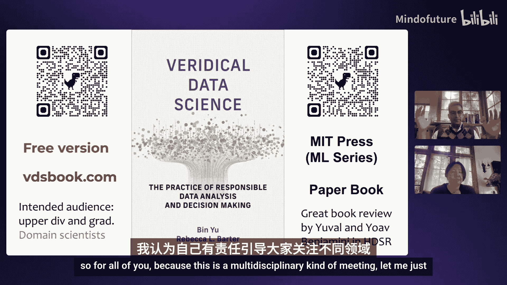
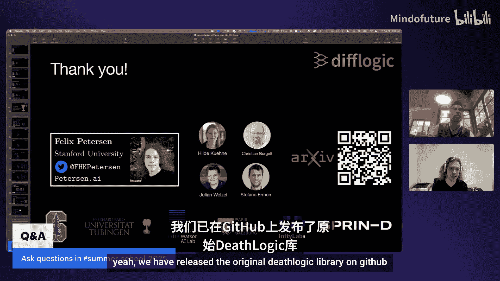
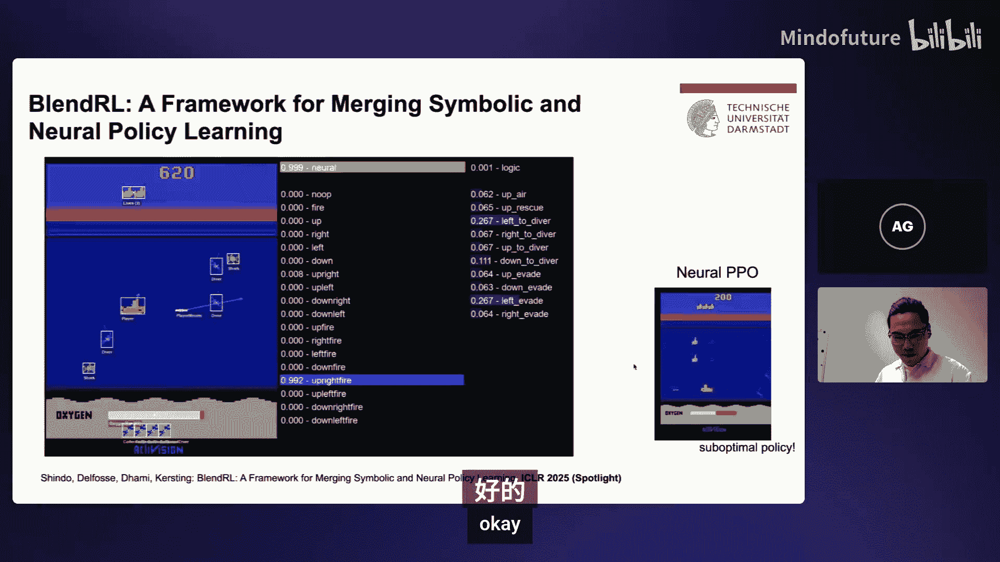
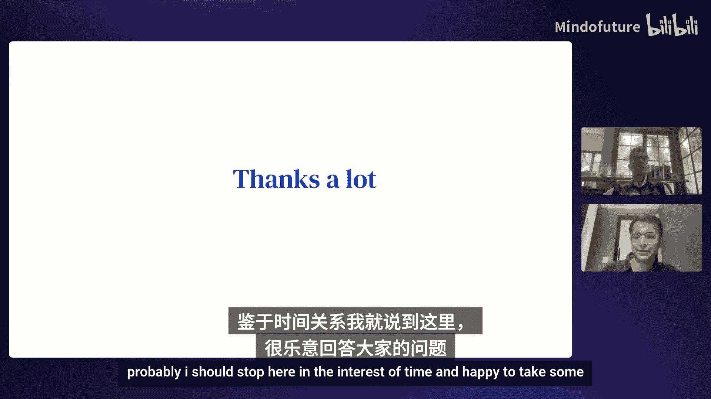
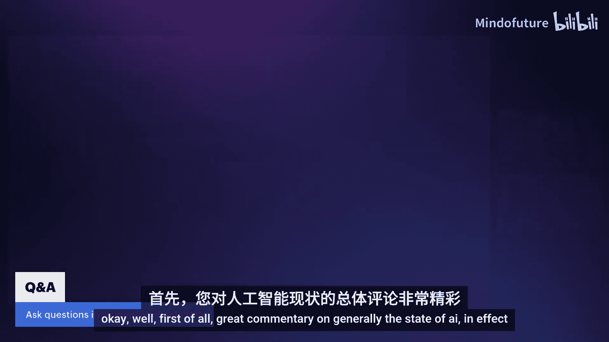
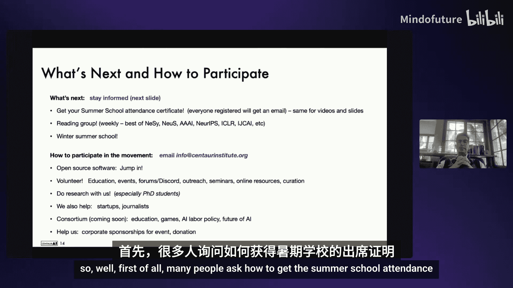
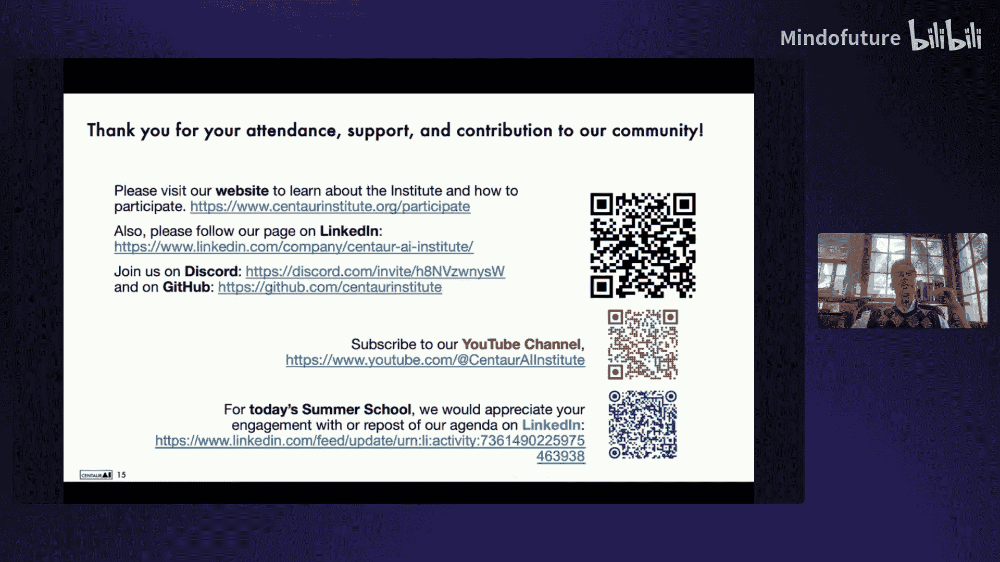

# 神经符号夏季学校 ｜ 理查德萨顿 ｜ Neuro Symbolic Ai Summer School 2025 p02 P02_Neuro-Symbolic_AI_Summer_School_2025-Day_2-Centaur_AI_Institute -BV1iAH8zEEDv_p2-

Yeah。嗯。Yeah。Okay， welcome back， everyone to day two。We have an exciting lineup once again。

Unfortunately， if you're looking for a break， this is going to be great stuff action pack beginning middle and end。

 no boring parts so。呃。Now we're going to start off with neurosymbolic software。呃。

You know the in previous years， people are always asking， so， you know。

 what are the tools we can use now is neurosymbolic AI sort of something that's still coming coming No。

 it's here so。We're going to show off some tools that actually do great stuff that。

It's difficult to find the same kinds of capabilities。With say pure neural software。

Now this is also a beginning of a for centaur， beginning of sort of a big effort that we'll be doing in open source。

So these are our first two several pieces of open source。

And we plan to put a lot of energy into them， but we need help from the community。

 and we'll be putting out more things as we develop more things。

But we'd like a lot of help from who I was interested in beefing these things up。

And making sure they work and so on， okay。Now let me first。Introduce Bowen。

 so Bowen was our summer intern in the insute and you couldn't ask for a better summer intern。

 fantastic results。His。You'll see pretty stunning gap in his results between。

With the state of the art。His work was highlighted at RSS top robototics conference recently。

 maybe a month ago， got a lot of attention。Take it away， Bon。Heello， can you guys hear me yep？

Okay great， so hell everyone， my name is Bowen Lee and I'm currently a PhD student at Carnegie Mellon Robotics Institute。

 working with Professor Sebastian Sheer and I'm very honored last year to work with Alex on a prediiccate invention work and this work has been accepted at robotics science and systems。

Recently， so as Alex mentioned， we are open sourcing everything in this project。

 so we provide a software， so if you are interested feel free to scan the website QR code。

 you can access our pretrain neuro symbolbolic models and I also provided a tutorials what means planning and what means learning neural models for planning there。

Okay， so shall I start my talk， Yeah， go forward， okay。Let me get started。

You guys have seen my screen， right？Okay， cool， so I'm very glad to be here to introduce our recent work on bilel learning for bilel planning。

It's a collaborated work with Professor Tom Silver at Princeton， my advisor。

 Professor Se Pa Sheer at Carneick Mellon and Alexanderand G， as you know。Let's get started。

So at first， I would like to briefly introduce the big motivation behind this work and the limitations of previous work。

Let's start by considering this robotics task， so we hope this robot to transport an object that is placed high on table。

To a container that is placed low by leveraging a platform。Sorry。Okay。

So we hope the robot to achieve this task。During training。

 we collect long horizon demonstration for this past right so like we have the high level actions like move to。

 gaze， peak， place， work on， gaze， grasp， move to and drop。With this demonstration data set。

 we provide the high level actions and the low level sensor data like images， point clouds and poses。

So we collect many such demonstration data sets。With this data set。

 we hope to train a model that can achieve high level generalization where the new tasks can have new objects。

 new goals， new initial states， and require longer action sequences to achieve。For example。

 during test， the robot may have seen this never seen before scenario where both the objects and the container are placed time。

 how can the robot still achieve the same task？If we are doing naive imitation learning。

 the robot would learn to first peak and place the platform to somewhere near the object。

 what come to is to grasp the object。ButHowever， at this point。

 the container is still not reachable because it's placed high， right？And what's worse。

 the robot also cannot move the platform around because it is holding an object。

 its hand is no longer empty。If we have a high level predicate， the symbolic predicate， hand empty。

 which is the precondition of a high level action peak and the delete effect of high level action grasp。

 the robot can zero shots know that it needs to first rearrange the platforms before grasping the object。

 right？So even this scenario is totally totally anything。

 robots can leverage reasoning and planning to generate this zero shot generalized climb to solve the an task where it first rearranges these two platforms。

To somewhere desire。Welcome to one of the platforms to grasp object。And finally。

 drop it into this container， and this happens fully zero shot。However， as mentioned。

 what we provide is actually the low level demonstration right。

 so what the robot see is not some high level particless like hand empty on reachbone。😊。

It actually sees the images on the point clouds， it has high level and it has a high level of actions。

 but low level and continues in even high dimensional observations。

How can we automatically create those high level representation。

 the predicates from the low level demonstration？😊。

This problem is well known as the predicated invention problems in hierarchical planning or by level planning。

 so in previous work。They have defined some class grammars as classifiers for the preddiates。

 and they can invent grammar based preddiates to achieve the long horizon generalized planning。

However， in the previous work， they usually needs to predeefine unexpressive grammar functions。

So they are limited to very simple vector states like in a very clean blocks world environment。

So the biggest contribution of our work is that we develop a brand new bilel learning system that can automatically learn neural prediicates。

 the neural classifiers as the symbolic prediicates。And with these neural representations。

 we can enable the learning of a compositional planning model， including the planning operators。

 like the preconditions and effects of high level actions and the sampleemblrs。

So our bilel learning system can invent neuraledicates from the low level demonstrations。Next。

 we will dive a little bit into some methodology details on what is planning and what we are trying to solve and some examples of our bilevel learning system。

To start， when we are talking about planning， we need to know where we are working on。

 we are actually working on something called the planning domain。

 so for a domain we have some provided knowledge。First the knowledge is the types and features in a planning domain。

 for example in the robot example you have seen there we have three types， the robot type。

 the platform type and the target type right and for each type it has a feature representation for its features right so for example the robot will have its body pose and hand pose and joint position as the representation of this type object。

And for the platform， we might have their pulses and their widths and head for the target we have their 3D locations and 3D posts。

In addition to the types and features， a planning domain also comes with the high level actions。

 we call them parametrit relational actions。So in each of this action we can actually see it takes basically three inputs right。

 so the object， the typed object has input and the continuous parameters， for example。

 when we are trying to move to somewhere to gaze the object we need to know what X Y position and orientation we hope to achieve to gaze something。

So for this parameter tri action。We need to decide their discrete object input and continuous parameters as input。

And finally for sure， when we are doing planning we surely have a goal right so for any planning problem we will need to achieve some goal and the goal is represented as a pedicate like。

😊，In this domain， we always want this target object to be in the target container。Yes。

And when we are talking about generalization， what we mean is that we train on the tasks sampled from the training。

Distribution and we hope the model can generalize to tasks sampled from the test distribution。

 but they are all within the same domain， so train and test has the same types parameterized actions and goal predates。

 but the object compositions and their low level features can be different。

Second is that let just say we are humans， if we are as a human。

 how can we actually design a planner to solve the task？😊，So as a humor。

 a famous framework is called hierarchical planning。

 or here is a special case it's called by levelvel planning。😊。

So let's us say we observe the first image x0 it is an image right and we have five objects。

 the two targets two platforms and one robot， we have a goal where the target object is to be in target container。

Let's first assume we already have some oracle pelicates。

It helps us to abstract the image into some discrete representation， right， the ground items。

And first， we will design a task planner for the planning operators。For the operators。

 it basically defines what is the precondition of an action and what are the effects of the action。

And once we have this information represented in predicates。

 we can run the task planner to generate a high levelve action sequences， for example。

 in this scenario， we might want to first move the robot to the first platform。

 pick up the first platform and so on， and finally drop the container into drop the object into the container。

AndNext， in addition to the task planner which just generates the skeleton。

 remember that parametermetrictri actions actually also take the continuous parameters。

Here we need to alternate between the task planner and emotion planner to deal with the continuous parameters。

 So here is an interesting question is， why do we actually need to alternate。

 Why can't we just generate one task plan and stulate and just sample each step's continuous parameter。

Why do we need to actually alternate？So the reason is that the low level sampler or the motion planner。

 it is usually stochastic and it can sometimes fail。😊，And generate a wrong parameter， for example。

 when we are moving the robot to somewhere to place the platform。

 we can generate a wrong position and that position might be not actually valid for the following actions to be feasible so。

We will also meet the predicates as classifiers and to use the predicates to do rejection sampling on the motion planner。

Okay， so here we know if as a human， we have already defined the predicates and we use the predicates to define task planner。

 then the preddiicates will take to。😊，Usage in a bile learning system， a bile planning system。

Where the predicates are first the configurations to the task planner。

 and second they are guidance to the motion planner。

Next comes through the key idea of our work that is how do we actually define the preddiicates。

 how can a system automatically create those preddiicates？

So our bilevel learning system consists of three stages in the first stage。

 we refer do bilevel learning which create candidate prediicates right。

 so we imagine that the state space is a continuous and high dimensional state space and we first create some region which is possibly a good predicate。

 the classifiers。So in the first stage， we use bile learning to create the candid creditdicateates and we do this group by group。

And in the second stage， we use some planning objective to select a subset from the candidates as the final set of preddiates。

And finally， with the final predicate set， we can conduct operator learning and sampler learning。

So within this system， the most important thing is how can we actually create the candidate predicate set from the high dimensional states？

😊，And this comes the most important insight of this presentation， that is。

 if you want to invent predicates for planning。It is equivalent to finding their high level effects across actionsctor。

😡，Let me repeat this again if you want to invent triates for by level planning。

 then it is equivalent to finding their high level effects across actions。

I'll introduce in detail what this means。So our system is a bile learning system。

 it consists of two level of learning， first is neuraler learning of the prediiccate classifiers or functions。

And we also have the symbolic learning of the predicates effects。

 and this two level of learning is alternating to create the final Can set。During more specific。

 the input to our system inventor is the lowlevel transition pairs， so the x and x prime。

 they are the states before a high level action and after a high level action and they are continuous and they are high dimensional like images。

And in the middle， it's the ground high level action。

Let's first say we already know we hope to learn a predicate called P2 right and we already know P2 is the add effect of gas。

 P2 is the add effect of grasp and P2 is not an effect of peak。

 then we can use this effect to provide supervision on the neural classifier， right？

So this is the neural learning part。After we train a neural network。

 we find that not all such effects are good， some of the effects are actually not consistent。😊。

And we use and we measure such inconsistency by the neural function learning loss。

So we used the loss from neural learning to guide our search on the symbolic effects。

And such by level learning system。It's alternating。

 so we first generate in fact to train a neural network。

 neural network tells us what to propose next as the effect， and we do this in a bile way。

And finally， we can generate all the neuro predatordicates with low loss and all these low loss preates becomes a pool of prediiccate candidates。

So far we have been very abstract on what our algorithm is doing。

 so next Ill take about five minutes to do some technical example of what we are actually。😊。

Sure are you trying to train and。Let's just say the transition pairs I mentioned before is like this。

 right， so the robot wants to first gaze the target and then grasp the target。

Let's say in this example， we have two transition pairs because we have two high level actions。

 right， so gaze is a transition pair grasp is another transition pair so。

The two transition pairs will have four states， right， as zero as two as two and S three。

 so two transition pairs， four states。So let us say we hope to train a classifier。

 it is a neural network， it takes in the four state images as input， so these are images as input。😊。

And the classifier outputs eight ground at prediction， right， because we are learning P2。

 this P2 preddiates， it can be grounded to robot target one and robot target2 in each state。Right。

 so if we have four states and in each state we can have two ground at。

 that means we totally will have eight ground at。So the input will be the four states and the neuraler network will predict eight binary classification predictions right and they correspond to the groundings of the predicate we hope to invent。

And now we know what is the input output， then how do we actually supervise this neural network？😊。

It's by the effect vector right so remember I said that if I already know the effect of this predicate。

 then I can provide the supervision signal。What do I mean。

 so basically let's just say for these two operators， the gates and graphs。

 they all add the predicate P2。So gaze at P 2 grasp also add P 2。 they are all add effect。

 Then we will know that because we observe gaze R 1 T 1 grasp R1 T T 1。

 Then we know that this ground item， P 2 R 1 T1 will transfer from。

False to true in the first transition and transfer from false to true in the second transition。

 So we will get the supervision signal for P2 grounded to robot1 and target one。At the same time。

 we know that these actions are not granted to robot1 and T2。

 then we know that these ground items will stay the same。So once we have the lifted effect vector。

 if we know it， we can provide supervision signal on the eight ground items we predicted from the neural network。

 right？And this is what is happening in the neural learning part， if we have a lift effect vector。

 we provide supervision signal。At the same time。😊，After we learn the neural network。

 actually we find that not all such effect factors are good effect vector。

 there are bad ones and there are also good ones， what we hope to do is to find the good ones as fast as possible the way to do it is by using the neural learning validation laws to inform our next iteration of symbolic effects proposed。

😊，So like just if we train a neural network， it has some validation laws。

 and we use this validation loss to form a tree expansion algorithm to find the good effects as fast as possible。

An example is like this， let us say in the robot domain， we have four high level actions。

 so we will know that for a predicate its effect across the four high level actions will be the exploration space of minus1 means delete zero means no effect one means id effect and it will be three to the power of four。

😊，This will be the entire exploration space， right。

 so we hope to find what are the good vector from this space。

One insight from our work is that we assume effects actually spae。 So we start from all no effect。

 and we do this tree expansion from just one effect and just two effects and do this level by level。

So imagine the whole system will be working like this。

We start by proposing an effect vector all zero to supervise a neural network。

 and we provide some feedback to the symbolic tree and with this feedback。

 we determine where to expand next and propose the next node for train another neural network and it provides some feedback and and we propose the next symbolic effect node to train another neural network and this will be running in a bad levell way until we find all low loss neural classifiers and their corresponding effect vector。

Okay， these are all the technical details of our method。

 maybe it's a little bit fast so you can maybe take some time to revisit what I just said。😊。

For the experiments as I mentioned， for planning we have a domain to work on right so to verify the general capability of our learning system。

 we have evaluated our system on six different domains。

 they have various states representations and complex creditates。😊。

The simplest one is called satellites， it features IC2 poses on the robot and target on the 2D plane here we have a predicate called Cs。

 which means if the target is within the field of view of a drone and that is something related to the field of view and we hope our neural predicate can capture this field of view function。

Blocks is something we were very familiar with， it basically is 3D locations and we need to invent something called on and something called holding from the 3D locations。

And I3 pose， this measure multiple object and the climb measure。

 the robot is using a platform to grasp object and drop it into a container。

 it includes the I3 pose and here we hope to invent creditdicateates like viewable and reachable so viewable is a very hard tridicate because it needs to learn。

If the platform is at a correct location， such that when the robot walk onto it。

 it can see the target。And finally， it's the point cloud domain where the robot is doing some 3D printing like function to add some ups and downs to the blocks。

 and we sample some point cloud from these blocks and try to figure out。

The matched of two blocks and face down and holding the blocks from point cloud only。

In the six diverse domains， we achieve a very high average accuracy across different domains in the an tasks。

Because we are actually learning a compositional neural model to solve the planning problems that sampled from the test scenario where the objects are different and they have different compositions。

 so your needs to generate different actions to achieve the same goal。However。

 most other neural baselines imagine because our number of objects is changeable。

 so we need to use some architecture that can accept different lengths of input like graph neural networks。

 transformers， and some of the previous neuroraated learning framework。

 they all fail to generalize well in this scenario。

There are two ablation study I hope to highlight one is that。It's very interesting right。

 so imagine as a human we can actually hard code the ground truth predicate and use them to learn operators and samplers。

Then the question is， what if we use ground truth effect vector to learn predicates。

 it's interesting that our system can sometimes find out non ground truth state abstractions that are actually easier to learn in the lowlel demonstration data。

So this is captured by the planning objective right， so if we use the ground truth vector。

 the final objective， the planning objective be sometimes higher than if we use an inventor based search based algorithm to find out the predicate that actually human engineer cannot actually imagine that will be easier to learn。

second abl study is that remember I talk about the tree expansion algorithm to find the good effect vector right。

 so how about we are using some other search algorithms like we have tried Brad first search depth first search and some greedy search。

 so what we use here is by calculating the UCT score。For each node。

 when we are selecting where to expand and where to explore next。

 so our informed tree expansion is balancing this exploitation exploration。

 so it is at least two times more efficient than we are doing greedy or we are doing uninformed tree search。

And these are all the experiments and the methods I would like to introduce today。

 so hopefully you guys get interested and you can。😊。

Have a visit of our website and see the code there and run my tutorials and understanding in detail how do we actually learn neuro classifiers for bilel planning？

There are some limitations of our system which we leave for future work and if you feel interested。

 you can also explore this direction。😊，First question is what we are trying to do right now is to learning from demonstration。

 so we have a demonstration data set correct and we invent creditates from there。

The problem is that we have no first we have no negative data。

 so fundamentally we will have some practices that actually do not have planning but we don't know because we don't have negative data second problem is that we actually cannot see a surprisingly smart abstractions so the abstractions are different from ground truths they are easier to learn but the highest thing they can do is to reproduce the demonstration we can see they search algorithms find out some surprisingly smart abstractions that human engineer cannot imagine。

Some。We are actually actively exploring if this kind of predicated invention can be learned by reinforcement learning or online learning。

second problem is a longstand problem actually in hierarchical planning。

 that is we kind of don't know what would be the pineable plus learnable plus expressive in mouth。

 high level representation。Right now， I think most of the work is featuring PDDL that is planning definite domain language。

It is planable for sure because it's developed by planning people and it is learnable because its structure is easy。

 we can use some classic program induction algorithm like intersection and clustering to learn the components of PDDL。

But it has a very strong strip assumption in at a high level that this means we can always use finite number of PDDL operators to represent a domain。

 but that's not actually not true in some domain， like if you if you want to generate some repeatitive actions。

 repitive behaviors。PDDL will generate infinite number of operators so。

It actually cannot capture all the possible domains。

Then what will be a planable and learnable and expressive enough high level representation for planning this is another problem we are considering。

 there is a recent work which is interesting from Jan it's called a core definition language it is planable。

 it is expressive enough but it is very hard to learn so it's still a very hard tradeoff between these three features when we are choosing a high level representation。

And finally is how to discover and learn the option model or the motion primitives for planning these are called temporal abstract fractions in reinforce and in our work now we have the given skills right remember as I said in a domain you are provided with the parametermetized relational actions they are part of the domain language part of the domain knowledge but actually these skills its hard to define right if we just define the skills for all the domains it won't be scalable so。

Is it possible to discover and learn the option model together with the state of structuress。

 its another thing we are actually exploring。I think that's all for today's presentation。

To summarize the key takeaways。First is that we find inventing predicates for bilevel planning equals to learning or searching for their effects across operators。

 and second we propose a bilel learning system that can jointly learn the neural predicate classifiers and their effects by alternating between expanding a tree to find the good effect vectors they can provide supervision labels for the neural network and the neural learning where we use the proposed effect vector to learn the classifier。

And finally， is that we need such relational abstractions to achieve the high level generalization on tasks with low level high dimensional states。

AndI think that's it， thank you。I would like to take questions from here if any thank you all right。

 excellent Bon， so you're unusually efficient you have a little extra time even。嗯。

So I just want to point out that。First of all， this is you know a super difficult task。

 so not only is this a normal kind of planning type thing， which is already kind of hard。

 but it's got continuous parameters too， so it's figuring out。Everything at the same time。

 discrete and continuous。🤧So。U。And。Uh， just to， I think well， and you didn't emphasize it strongly。

 but the gap with the whole of the art were extremely large。So。Now here's a question。

You mentioned tree expansion， would you please elaborate on creating the state space with a symbolic system？

You define pre and post features for training those neural networks。嗯哼。😊，Very good question。

 So I think this is actually it two question， right。

 So first it's about the tree expansion algorithm。 You guys can see this slides on tree expansion。

 right。yeah， and now we can yeah。 Okay， good so。Also for mention。

 the tree expansion is trying to figure out effect right， so effect exists in operators。

 so the space is actually defined by how many operators we have lets us say we are trying to invent a predicate called P2。

And we have we have four high level actions or high level operators。

 then the exploration space will be minus-1，0 and one to the power of four， right。

 because for each high level action， the predicate can be delete no or add effect so the space is actually three to the power of number of operators you have in the system。

And we will start from all zero and start to explore this tree where the first level will have one entry 9 zero。

 so they are all from they are all children from the first level from the zero level。

 which is all zero。And in the second level， we have two entries that is 90。

 and they are expanded from the first level nodes。 So when we are trying to expand this tree。

 we will first identify which parent is the most promising to expand and we will select its children by looking at the value each entry can provide。

 So this is a little bit involved。 So I would recommend also looking at our source code to understand how this tree expansion algorithm is。

Doing I hope this answers the first question second question is about the neural network training。

 what are the input and output right so。For neural network， for neural function。

Its input is the continuous and high dimensional states and what a predicate want to do is to abstract these continuous and high dimensional states into discrete binary states right so the input will be continuous states and output will be the binary ground items of these predicate grounded to。

All the objects in the sink。So for example， in this scenario。

 if our input are four images of the classifier， the output will be eight ground items because P2 can be bind to。

Two possible object pairs in the scenario。So this will be the input and output inputted state。

 the continuous state is different from the symbolic search state right so it's the actual state observed by the agent and output will be the binary discrete。

Atom prediction。And also for mentioned， we can use the effects to provide supervision on this binary prediction I hope this to answers your question。

Yeah。Okay， great。I just want to relate this， what Bo you showed us to things we've been talking about yesterday。

We talk about many people are talking about world models。

 that's what we need is AI systems that learn a world model。

 so world model you know roughly speaking is something like figure out the nouns in the world and the verbs in the world so。

Well， this is actually figuring out the verbs in the world。Okay， and also we are from Le Lani's talk。

About self driving cars and what can happen？You know， we we want。

 especially physical things acting in the real world。

 we want them to be able to handle new situations。That they haven't quite seen before in training data。

 and that's exactly what。Bn is showing。Robot is presented a new situation and it can figure out what to do so this is this is the true kind of。

Edge of the state of the art that we need to be at。 So inspiration for future researchers， this is。

I believe where the action is， a lot of the action should be okay exactly what bone is showing。Okay。

Great， so so Bo as amazing as these results are。 and as far beyond the edge as you' pushed。 So what。

Maybe tell us a little bit about what can the system not do quite yet， but what are they kind of。

You know， a hard edge， hard。Boundaries here that still need to be pushed。Yeah。

 so I think there are two things I feel not well addressed in our previous work one is the efficiency of learning。

 so we kind of sacrificed training efficiency in exchange for a more stronger model right because we need to alternate between search the tree expansion。

 which has no gradient and training neural networks which has gradient but take some time to train so。

I'm thinking if we can merge these two things into a hybrid model where you can parallel train many neural networks with different symbolic effect supervision that can make things much faster and the tree expansion happens within the neural training it is one thing I'm thinking about but hasn't addressed yet otherwise you can imagine it is like when you have many。

 many operators， the planning system becomes extremely complex we will take many time to find their effect so is this is also by the way。

 this is also why predicate invention for hierarchical planning is fundamentally hard it's because there exists too many possible regions in the state that can be the predicate truth value so we need to find these regions and at the same time find the value so it's a little bit hard to efficiently do this。

In our system it's currently is doing this terribly in multiple GPU。

 but I think there is a way to make it more efficient also we have some ongoing work in introducing LMs to use their reasoning capability to find the effect vectorers faster。

I think this is one thing I would like to mention second thing is some something I mentioned in the limitation slide right now we are working on integrating reinforcement learning with the planning model right so currently we are trying to learning from were just learning from demonstrations that means we cannot exceed the human knowledge presented in the demonstration is' upper bound is what we demonstrate and maybe it can find some。

Obtractions that is different from what we expect， But the high。

 but the highest performance it can can achieve is bounded by the demonstration。

 So I think in the future， we are。We are actually actively working on intersection between planning and reinforcement learning。

 they both has distinct advantage and limitations and I think a future model if it can leverage the advantage from planning that is generalization and efficiency and at the same time leverage reinforcement learning that is exploration and。

And some capabilities to handle stochastic environments and nondeteristic environments and partial observability that will be a very promising direction we hope to explore and which is not good well addressed in over the current system because planning really requires a perfect simulator to run that is usually not the truth in the real world and to recover from failure it is very inefficient but ourL they usually can。

Do this without a word simulator and it can actually generate some behavior that is surprisingly smart。

So I think these are two major limitations we have and two major future directions we are actively exploring the efficiency problem and incorporating with RL to find surprisingly。

Marge abstraction。Okay， great， another question。Could parallelization be the solution for extending those models。

Yes， I think right now we are doing kind of parallelization。

 remember I said for each predicate is a tree expansion， right。

 So there exists many types of predicate in a domain like we have， for example。

 predicate takes just a robot as input。 Predicate takes just a target as input。

 Predicate takes a robot and a target as input。 all these different types of prediates they are currently invented parallel。

In multiple GPU， this is the parallelization we are doing right now。

 but I think there is a chance to do this even faster， like。We。

We are just paralyzing the invention of different types， but even within the same type。

 we can do the same parallelization， right so we can actually propose， for example。

 10000 effect vector and train 10000 neural network at the same time plus a batch and after that we do another round of tree expansion so that can handle problems with many。

 many members of operators this is another parallelization。 It is not implemented。

 but I think it's possible to do this。Thank you for the question。Good good。

 so can you just maybe elaborate on exactly what information and practice do you have to put into your system obviously ideal is。

somehowhow everything is fully automatic but yeah what do you have to put in at the moment yeah so there are there are two I think there are two things that would be the input one is the types of a domain but what is the type right so when we are trying to deal with real world problems we see many cars running on the street we see a random people working on the street how do we define their types what is a good driver。

 what is a bad driver， what is a weird people what is。

Well behave people these types are currently predefined in a domain。

 but I think in the future we should be able to invent prediates as types and assume all the entities has the same type。

 so it becomes basically firstile logic with the untad objects but the preddiicates become the type。

 and that means the predicate is becoming a precondition only predicate。

 so it's something we cannot invent by all。I think this is the first thing that we have assumed it can could be addressed in the future second thing is something I mentioned right so we have assumed the option model that is the temporal abstractions of MP。

一。So like turn the grasp， the reach to grasp， the move platform。

 these are defined option models for a decision making system。

 I think there is a chance where we can also discover these option models at the same time with the state abstraction learning。

These option models are actually temporal abstractions in RL and there are some there are many I would say there are a lot of work on how to discover this option model。

 they are called scale discovery， and I think another promising interaction is to seek for an intersection between scale discovery and pre image。

These are the two things we have assumed and some potential ways to address them。

 we have assumed types of a domain and we have assumed motion primitives or the option model of a domain。

 but this could be learned， I think in the future。And one little hint at the future is。

 what about lifelong learning？Yeah I think lifelong learning for sure is a very promising direction for all these works。

 I think most of the existing planning planning work they work on the fixed domain but I mentioned at the very beginning that we are talking about planning we really need a domain and we are working on the domain we try to solve the task in that domain but。

The world is a super huge domain and we cannot predeefine this domain in any in any case。

 so a very promising direction is to gradually build the domain of the robot So imagine the robot is like an animal。

 it goes into a home and has since seen anything in your home and for him for him for her。

 that is like a very minimum domain he had in his his mind and after exploration in your home。

 he might find oh， that is a shelf。 I can walk onto it that is a chair it can move that is a book it is heavy it can hurt me。

 iss like gradually building this domain is another very interesting direction where actually we are actively exploring and。

I think there are some very recent work exploring the same problem。

 like gradually building larger and larger domain knowledge and use it to plan。Yeah。Awesome， well。

 thank you so much， Bowen， we just heard from Rising Star we watch for more great work from him。

Thanks。嗯哼。😊，Alright， do we have our next speaker。ok。All right， so next up， we have。

Steve Olga and Kevin。We weren't sure if Steve would be able to make it。

Fantastic you could make it Steve so now this work this is our second piece of open source that we're highlighting。

 of course the method is what's interesting we will present so。Now this to me。

 is in this realm of a magic trick we would all like。Which is。1。Somehow， state of the art。

Competitive， predictive accuracy。But you don't want a gigantic model even if it's。Interpreable。

 like readable。If it's too big， it's not a。And here we sort of。I think we were。

Achieving that holy grail。嗯。That's my exciting buildup， so these folks will show you how it's done。

So。Take it away， oh say Steve is at IBM。Oga is our head of operations。The inute。

And Kevin is about to start at UCLA。DHD and has been hanging out with us doing research。All right。

 take it away。Hello everyone， I probably can see my screen， my name is Olga。

 today is Steve Kevin and I will tell you about expability while retaining predictive accuracy。😊。

This our talk is based on neural re networks or NNs。

 a framework presented at AA conference earlier this year。

 at first Steve and I will tell you about NNN， the architecture applications to explain both tabular data classification and we will also show you a notebook how to use it and then Kevin will also share his early work in applying NNN to causal inference。

So water and eventss， you can think of them as something similar to traditional neural networks。

 there are some important differences though， and we'll speak about them one at a time。

So first the logic based， what does it mean， it means that every node in the neuralNe has a logical meaning。

 either a conjunction， a logical end or a denction， logical or or negated versions of those。

So how do we achieve this with a special activation function。

 it's called modified weight Ca logic activation function。

And these are a corresponding formulas for conjunction and dejunction。

 they may look complicated but actually not and you will see it in a minute。

 so here in each formula you can see XJ and WJ， these are just inputs and weights。

 the same that you would use in traditional neural networks， the U variable here is MJ。

 you can see over here， it is just the indicator that a corresponding weight is positive。

And that's actually where the modification comes from。

 so in developing this activation function we draw inspiration from。😊。

Lo neural networks elements which use weighted lu which logic activation function not modified and their weights cannot be negative。

 so we modified it we allow weights to be negative， which gives us these。

Nigation logical negation opportunity， that's where modificationification comes from and for now for simplicity let's assume that all the weights are positive。

😊，And this way these MJs as they will be all once right and then if theyre once then these terms on the right can be simplified so the formula will look like this it's already much simpler and now parameter beta is bias it it does have special meaning but it is often set to1 so for now let's assume that it's equal to1 and we can get rid of those as well and now you can see the formulas are really simple and these function f it just clp the results in the range between0 and 1 so that the input to the next node is in this range and all the xJs also has been in this range between0 and 1 that's why we need these f。

And let's see this formula on the bottom for example and trying to understand when it is equal to zero and remember we just assume all the weights are positive right。

 it is only zero when all the xjs are zero obviously and that's exactly the definition of destruction。

😊，And same way if you take a look at conjunction on the top， when is it equal to1。

 it is equal to one when this sum is equal to zero， meaning all these xs must be equal to1。

 which is a logical conjunction so you can see these formulas do make sense these additional parameters I just add some flexibility to these。

 but that's actually what we mean by。Logic based。Next， neural reasoning networks are human visible。

 it means that you can actually look inside the model， for example。

 you can print it and you can look at neurons connections。😊。

It could be that the model is long and complicated， it really depends on your data。

 as the logic in your data could be long and complicated。

 but it is possible to look inside so to me it resembles a mechanical watch which has some it can be complicated but you can look inside actually you can look at different parts and potentially you can even fix something and here it is also possible。

 let's say you have some domain knowledge and it's also possible to look at particular neuron and make sure it matches your domain knowledge and potentially you can even eliminate a neuron or like a particular connection currently we don't do it in NRs but the architecture totally allows it and that's what mean by human read。

Okay， now it automatically generates text explanations。😊。

And here are a couple of examples for a positive class and negative class sample for California Hous data in this data houses classified and expensive and inexpensive。

And if you look。Deper inter explanations， you can notice that they do make sense， for example。

 for positive plus， more expensive house， there are more rooms， newcon， high mediumn income， etc。

So how do we do this， a trained NRN is a three， so we do recursive that first reversal of these three and we skip notes that don't affect the parent' outcome。

Then we simplifies as explanation based on logical rules， for example。

 not end of A and B is or of not a， not B， etc。Then for a particular sample we'll also ignore all the statements which are false for this sample。

 for example， in this top branch it could be something like number of rooms in the house is more than three or。

Medn income is above something and let's say for this particular house。

 this median income statement is false only the number of rooms。

Above three is true so we will just ignore this statement which doesn't hold for this particular sample and this way we get rid of all the disjunctions so we are left with multiple layers of conjunction which can be just collapse aggregated to a single end so as a result it a final sample level explanation is guaranteed to be a single level conjunction and of something something those these node could have negations。

So when you see these explanations， like all of the following a through。

 meaning end of these statements， it's not a coincidence in these both cases。

 for simple level explanations， it's always be like least guaranteed to be simple conjunctions of a number of statements。

I hope it makes sense。Okay， we also generate future importance。

Each edge has a weight in a trained N Rn and then we just aggregate those weights on the future level。

And now let's look at explanation quality， we compare N Iran versus Nims， it's another explainable。

Clifier as well as random forest and shape of random forest。

 so we compare explanations in terms of the size which is a measure of compactness。

 the small explanation is easier to understand that's better and for an run it's smaller than faster models then we'll also look at single deletion correlation。

 what does it mean imagine that a particular feature is very important in your model。

 so if you delete this feature then your performance should drop significantly。

So that's basically what we do for a particular feature we shuffle its values in the dataset。

 basically kind of deleting it and then we see how much the performance drops versus the original data and we measure these correlation of these drop in performance against future importance is that we calculated on previous slide and obviously the higher the correlation the better。

 it means that important features identified correctly and we measure sp and person correlation and you can see that。

Its for Nren， it' better than for other models， except for just recent correlation for She。Model。

 but at the same time， it takes 20 something times longer to calculate versus NRM。Okay。

 and with this， I'll pass it over to Steve to speak about end performance and architecture。Awesome。

 thanks， Olga。So yeah， here what I'll do is take us through the training methodology for NRNs you can see here that the network is fairly similar to you know a traditional feed forward neural network。

 there's some slight differences， one is that in this network we actually don't want it to be fully connected and this is because if we had a fully connected network。

 it would be near impossible to learn anything。And we can see this by considering the example of conjunction so see here on the network the first layer is a layer of conjunctions and if we had all of our features going into these conjunctions。

 then we would basically require that every sample is entirely true for that node to return a true value and you won't be able to learn anything with that。

With that。Oh， sorry， are you unable to hear me？I'm able to hear you， actually。Okay， that's fine。

Al right， so you'd be unable to learn anything with those with that setup。

 So here we actually don't have all of the nodes connected。 And if we go to the next slide。

 we can go through the remainder of the。Okay。Okay， so。

We'll start out by looking at the performance then of the training algorithm。

What we can see is that the RNRN training algorithm is。Very similar to the state of the algorithms。

 random forest actually boost and gradient boosted trees on tabular classification problems。

And we also compared this approach with other classes of algorithms， so those that are explainable。

 but not neural， those that are neural based and explainable and those that are neural based and designed for tabular data。

And we could see here that the RNRN algorithm is actually quite a bit better than most of those other algorithms like FTT and Dan。

 which were neural and designed for tabular data， and of course we have explanations as well。

One of the other。Okay， so。The algorithm to actually train this system。

Starts out very similar to a neural network and we're going to initialize it with a random set of connections in the NRN。

 as I mentioned。And we'll also randomly initialize the weights。

We also are going to use a multi armed bandit。And initialize the policy of this bandit over the preddiicates or the features with the maximal information coefficient between each of the features and our target。

So that's our starting point for the algorithm。And then。

The next step here is to perform gradient descent on the NRN。So through this process。

 we're going to be updating the weights of the NRN and we're going to check the loss as we progress doing gradient descent。

 This is very similar to typical neural network training。

 and if the loss has improved Then we're going to update our multi-armed bandit policy by using the weights on the predicate。

As rewards for the multiarmed bandit。And what this does is to basically learn which of the prediicates and which parts of the logic are useful in making those predictions。

Now， as we continue training， we're eventually going to get to a point where the loss plateaus and at that point we're going to enter a sequence of three steps。

The first step here is to prune the NRN。And。😊，To do this， we're going to predefine a threshold。

Below which the absolute value of a weight on a predicate will indicate that that predicate is not important。

That part of the logic is not helping to make predictions。

And we're going to prune that out of the network。Then we're going to sample the multiarmed bandit policy。

 which again is a policy over the predicates and by sampling this policy。

 we're going to generate a selection of new predicates that should be more useful for making predictions than those ones that we had just pruned。

And then finally， we're going to grow our network by using those sampled predicates in place of the pruned predicates。

 and so this sequence of steps is essentially updating the set of logic that the system is using to make predictions。

And from there， we'll just continue to iterate through this process， so doing gradient descent。

 updating our multiarmed bandit policy when the laws improves and then pruning and regrowing the network structure when the loss plateaus。

 we'll just iterate through this until you know we reach a stopping criteria such as the number of epochs or some other stopping criteria that you'd like to set。

And so the algorithm here is implemented on Pytort with GPU scaling。

 we won't go into the details of how that works， you can look at that in our paper。

 but essentially this entire system is running on GPU its doing it's making all of these logical neuron calculations in parallel and it can even run on distributed system。

 so multi GPU support。And basically， what that leads to is。

A much faster training compared with other techniques， so if we look at FTT， DanAM， NAM， CFN。

 these are all neural techniques that were designed for tabular data。

 some of which are also explainable and we that RNRN trains much more quickly。

And one of the other benefits here is that。The， the model is also much smaller， right， so。

Compared to those other algorithms， we can see that RNRn has100 parameters on average。

 these numbers are in thousands and this is orders of magnitude smaller than than these other systems and this really boils down to the use of logic here So these other systems are neural- based theyre using a large number of neurons in order to develop those systems so this is a really big benefit of just getting more compact models and obviously that allows us to even inspect the system like like Olgo was mentioning if we would like to。

😊，And then finally， I mentioned this a little bit， but the whole architecture here is developed on Pytorch。

 these logical neurons and even blocks of logical neurons as you see here。

These are Pytorch modules that can be composed together extended and developed into larger systems。

 so again， very similar to a traditional neural network in that way and obviously taking advantage of all of the capabilities of Pytorch like GPU scaling and autograd。

And I think Olga is going to take us through a demo now which shows us some actual running code。

So over you， go。Yeah， okay， now as Steve mentioned， we will show your demo。

 I'll stop here for a few seconds if you'd like to go through the Collab notebook with us。

 scan the your code， I'll be waiting for a few seconds for you to do this。Okay。

 I hope everyone is done。Okay咯。I think garage just an okay。Very quickly installing the library。😊。

Imports。Louding data。Standard preprocessing。Sa test lead。

 actually all the steps that you do for any other model。😊，Convering。

Ara to data frames for both features and for target。Okay， model training。

 here's a number of parameters we will mention them later， but now let's give those。

Clsifier and around classifier and feed and predicts the same way you would do for any SKLR classifier and evaluation。

Find it explanation function， explain sample， you provide your data features here and the index number。

Here the explanation for this particular sample quantile here means the percentage of the models that you'd like to explain。

 one means 100% and for example， if you think it's like too long explanation。

 you may decide that you want to explain let's say 70% of the data and the explanation will be short if you just decide to explain part of the data。

 gain decision boundary means，A threshold above which you consider is positive class。

 otherwise it's negative class like basically throw falses。

 that's pretty much it and just cave as Steve mentioned。

The library is developed in Pythtorch but this is as you can see there is no Pythch here that's a reper and that's not a thoroughly tested library yet。

 it's not mature libraries so you can try to play with those parameters we do not recommend those though I mean we have't thoroughly tested those yet for example we still working on multi multiclass future importance is but if you decide to give it a try we would really appreciate your feedback how it worked for you we did it work you maybe didn't work or it worked pad explanation。

 we didn't like them something anyway reach out to us we keep working on this and this is more like a teaer rather than mature library but we keep working from it and with these I'll pass it over to Kevin just speak about extensions of NRN to causal inference。

Thank you so much， as Steve mentioned that NRN extends Pytorrch。

 I have taken some of the fundamental NRN modules and sort of building causal inference frameworks with them。

So these are model classes I hope will provide compelling and useful national language reasoning traces about treatment and counterfactual estimates and expose that reasoning structure for audit。

For the sake of time， I'll have to assume that you already are fairly familiar with causal inference as a subfu。

So just a quick table of contents， we don't have a ton of time here， but just motivation。

 task and setup， go over the new model classes that I'm presenting。

 some early experimental results and some future directions I plan on taking this。

So to motivate this classical causal estimation frameworks often choke on high dimensional data。

 an effort to combat this causal machine learning as a field has had increasing attention with the promise to marry theoretical rigor with precise estimates in high dimensional problems at both the unit and population levels。

Opinions vary starkly on this promise， but the precision arm of this promise seems to have been met particularly with neuro based metal learners。

Metal learner is a flexible framework for causal estimation with any supervised learner which optimizes for factual accuracyctor seeing downstream counterfactual fit there are some explainable models with decent performance on benchmark data such as causal forests。

 but those with state of the art and precision offer no semantically traceable rationale。

Casal purists often won't consider these models meaningfully without interpretability and they're non starters in high stake fields like medicine and policy analysis。

The dominant neural approaches such as like Tna， Dragonnet and CFRnet achieved strong average performance on semi syntheticthetic benchmarks。

 but none are introspectable。So we're going to introduce neural reasoning architectures that retain performance while exposing treatment treatment decisions and counterfactual predictions as logical compositions of covariate level rules。

 and the goal is not just to predict treatment， not just to predict treatment effects but to justify them at test time。

So we're going to focus on estimating the average treatment effect under iorability formally as follows under unconfoundedness and consistency。

 we estimate the average treatment effect Psi under equivalence to the conditional average treatment effect in this particular data setup setting our plug est plug estimatorsi H Q is the average of the estimated outcomes for individual level treatment and counterfactual predictions。

Ground truth causal effects are rarely available in real world data。

 at least in real world observational data， so evaluation of new estimation routines tends to be compared against open source synthetic or semi synthetic data。

We assume this data has strong concordance with the real world while also giving us the ability to compare known deterministic effect functions。

The initial focus is extending recent state of the art and neural estimators that I believe have a good setup for NRN type explainability。

 treatment agnostic representation networks formalized by Shili etal in 2016 with state of the art for precision and estimates of heterogeneous effects until 2022 and Dragonnet by Claudia She et all released in 2018 with state of the art for precise average treatment effect estimates until roughly 2023 so we will be introducing NRN versions of both of these in testing against the more recent more performant Drnet。

 which has historically been a top contend contended on the most synthetic benchmark dataset sets for the past seven years。

So similarly to TAA， our first model TA NRN builds a shared latent representation with two distinct outcome heads。

 only the factual head is updated per example during training。

In 2020 the idea of doubly robust learners was formalized。

 these mental learners exploit the efficiencyuff of the propensity score estimation to close backdoor selection bias and observational settings and support downstream target and maximum likelihood estimation for treatment effects。

We made the choice to include a cotrain propensity head for regularization objectives with knobs for the problem at hand。

If we're looking at population level estimates， we can select targeted regularization。

 which guides prediction towards concordance with downstream TMLE estimates for average treatment effect。

Or for precision and heterogeneous effects estimation where the individual level effects are more important。

Each head is a symbolic reasoning module， sequential logical operations form that structured will set this makes each prediction decomposable into a traceable explanation。

Below this model diagram， you'll see just a quick example of a unit level explanation for propensity classification。

So for our Dr NN， the second focus was to test if a shared logic representation would work soundly for some diverg and shared objectives in this case。

 estimating both treatment and control predictions and along with the propensity estimation。

 so essentially just implementing Dr and NRN。Dragon Nn separates the training into two phases。

 so first a neuro propensity estimator is trained and frozen。

Then the outcome heads are trained on top of that shared base。

 each prediction is made by routing through the frozen representation conditioning on treatment。

This mirrors the dragonnet approach in the original paper with the。

MLP swap for weighted lucaologic layers the general idea is that information used for predicting propensity will also be used for useful for predicting causal effects and practice so far with sparse weighted lucache logicvic layers this does not appear to be the case。

The IHDP benchmark our models performed strongly with T N N on par with State of the art of the past few years。

Further testing needs to be done to see if this model class can be extended to some of the more recent neuromedal learner advances such as SERNe。

Interestingly， when using a separate propensity NRN， performance improved significantly。

Further research will have to be done here but on a face it makes sense that the logic needed to predict treatment outcomes differs from propensity estimation。

 and a joint model wouldn't necessarily be ideal。However。

 our model classes perform competitively on this cut of the data。

 our baseline that we compare against is the Dr network targeted regularization。

 achieves the mean absolute error of 0。17 under tight intervals for the out of sample average treatment effect estimate。

Our initial model classes's performance are shown below the baseline there。

So it's pretty competitive。Further to that effect， there's some implied advantages here。

 so apart from just explainability these models are computationally efficient training and evaluation time for the TR N N which is training separate training two separate models took roughly six hours compared to baseline。

 which was about 11 hours。As with prefius NN implementations。

 parameter efficiency is also drastically improved。

 so these models reduce our parameter count by roughly 40 to 50% compared to baseline while also introducing interpretable structure。

In summary， causal underren should enable nearest state of art performance and precision estimates for treatment effects with explainability。

Some future goals in the near to midterm， just some lines I'll be advancing。

We're going to make sure that we're getting good results on other benchmarks such as ASI， 2016， 2018。

 which are very commonly used。As far as continuous explainability is one of the issues with explaining these continuous outcomes。

For treatment and counterfactual I think I have a way forward with that which is just going to be quantile treatment effects so just breaking the you know the outcome the outcomes down into quantiles and using that treating as a multi-class problem so that'll be the first thing I try there we have to do a time series extension to enable some other causal estimators or a bit more traditional and that's going to be the time series extension and also we're going to need to enable a module to do counterfactual generation of time series as well。

There's some interesting possibilities here for using expert knowledge via DAGs for those of you familiar with causal or inference。

 generally you start your problem with DG before you even do any modeling。

 so you know adjusting weights based off of your DAG would be a good place to look for that and lastly we want to make sure that we're open sourcing this and making this available so either packaging this up in the NRN package or separately on its own so we can all collaborate together on this。

There's a lot to be done and I will definitely have my work cut out for me starting my PhD next month if anyone causally minded is interested in helping drive this line forward or if you just have a question feel free to reach out。

 thank you so much for your time。Okay， awesome job everyone， thank you so much。

Let me just comment a little bit here。呃。All three， it turns out of。Steve Olga and Kevin。

 in addition to their research prowess are also world class data scientists。

So and this is what is a little different here， so having the perspective of。

You can see some research we do in the inute is at the far end of fundamental research。

A pure math basically whose impact you won't see for maybe five or 10 years。

 I saw some of that yesterday。But I also ran a company where we sold high performance data science tools for data scientists all the way at the other end of the spectrum。

So we really want to have impact at both ends and it's quite different there's many academic packages put out。

Mainly so you can reproduce their paper。It's one more level to make it useful in actual industry data science。

That's what we intend here， okay so and really。The reason it's one more level is because a lot of things have to kind of be there at the same time to work。

The efficiency。Of course， the usability of the software， which we'll get to。

 but also the you have to it can't be like everything has to be。

Kind of good in every axis so this is a tricky zone。

And here what this effort is trying to attack is this。Big。

 big problem of explainability without sacrificing the predictive accuracy。

 so that has eluded you know， and as I mentioned yesterday。

The field of explainable AI XAI sort of overlapping here。But the reasoning。

 we think the logic and reasoning。Sor of adds a whole another sort of superpower to aid in that battle。

now u。And Olga touched on this， but also the explainable is one thing。

 but then the use of logic means that you can connect into deep domain knowledge and a world model which。

The group here didn't show in these results， so maybe that's something we'll be showing later is an example of how you can add your domain knowledge about and do even better basically predictive accuracy。

And generalization。Okay so it's something you can't do with a normal explainable model。Okay。

 and we have a bunch of questions。So。What is the is getting what is the intuition between or and and in the NRN diagram。

 is it because and and or are always sufficient to represent smaller logical reasoning related operations？

I think the intention is that it should be enough， it's like minimal operation if you like to create like implication or exclusive force something。

Then ideally， the model should find this logic。嗯。Oh，So。

The architecture should be enough with these minimal pieces， negation， conjunctionn and distraction。

For all the other operations， but natural trust if you have something good。Yeah。

 I think that's right and if you notice in the architecture there are alternating layers of or's and ans and so we're basically leveraging conjunctive normal form or disjunctive normal form type of structures to represent complex logic。

And actually， we did not。I think we did not have time for it during the presentation。

 but since we have time， maybe we should clarify a little bit how we define the architecture。

 so as Steve mentioned it's alternating layers of conjunctions and dejunctions right and in the beginning you said the maximum size of the network。

😊，which you may have like this number of layers， this number of neurons and then as Steve shown during the pruning process。

 some of these may be removed and ultimately you may be left with small network and not necessarily these alternating layers of conjunction and diss anymore。

 but you kind of said the limit okay， I have some intuition like my logic shouldn't be bigger than said。

 and then hopefully somehow this process reinforcement process as Steve showed it converges if this is the right word to these potentially different operations like we started with layers of conjunctions andnctions and maybe then some piece will be im。

 some piece will be excluded for or maybe conjunction and。Follow up to that question。

 can't it be Xor right away instead of andonor？Maybe potentially we can add it。

 but as we mentioned we draw inspiration from elementss and we use these special activation functions for and and or so it was natural for exor maybe we need to come up with as activation functions I don't know。

 we just we didn't think about it， thought it was enough because it's already kind of known。

 we just modified it to introduce this negation， we didn't modify it for exaucation。

Potentially it could be possible， I don't know we can tried it， I don't say why not。

 but I would say my comment on that is And and or kind of intuitive， I mean。

 maybe other logical operations like NN or something are a little harder to think about。

 but yeah I think XO is maybe you lose a little bit of that explainability and interpretability for the general public。

And maybe even those that are familiar with those types of operations。No。

 one question about explainability is you know， who's the audience， I would say。

Who are you explaining it to， I would say。诶。I mean。

 I personally would say probably the data scientist who's going to check for errors and whatever and see how to improve the model。

 but it's possible if it's intuitive enough。You could explain it to a manager or even the general public。

So the more explainable you can be， the wider your audience is。嗯。

How would you apply NRNs to unstructured data？Currently， it's not affordable， I think， Steve。Yeah。

 I think it would take。Some additional components into the system right now it's the system is only taking in tabular data。

 so。What I would think might be a direction you could go is to have some other system， right。

 maybe it's a neural network。That takes your unstructured data and converts it into predictions about the。

嗯。Information that's in that data， for example， you have an image。

 you have an object detector that you trained for that image and then。

The detection of objects can be the input to an Nn。

 and you actually want something like this because the NN is intended for that explainable。

Rule set over the data。 and so you need your inputs to be human interpretable to leverage that capability。

Can we incorporate prior knowledge directly in the architecture？

We've done some very early experiments with this this idea。 And I think in theory。

 it should be possible and it should even be possible for the system to。

Modify those priors based on data that it is then subsequently trained on。

But it's not a part of the system that's， you know， fully developed at this time and。

 and well tested。So on that， that was related to what I was saying about domain knowledge。

So over time， we'll be building up。This is a little。Hinted the future。

 a domain knowledge sort of language similar to what Lelani showed in her talk。

So it's a very big effort Theresa also showed in her domino system， something like that。

We're gearing up for a big effort on that and that a natural thing would be to kind of。

F that with NRN。Um。Now。Would it be possible to turn NNs from fuzzy logic to probabilistic logic to better model inference uncertainty？

I think it would be possible， and it's certainly。😊，You know， useful in the。

Interpreting a probabilistic model is I think， more common and more straightforward for many folks。

So as long as the logic can be developed into。You know。

 the same type of operations within Ptorrch that that we're using for the Kaitz logic。

 I think it should be possible， but it's not something again that we've done at this time。

And I was thinking。For。Probabilities to work fine， we kind of need to assume some distributions which we do not know about the data and we do not do。

I mean， currently we output these value in a between zero and1。But。

We don't know anything about the distributions。Yeah。

 that's why it's hard to say if these are like probabilities or not。It's a good question we've。

 I think the group hesitated because just we't quite sure what to say about it because。Yes。

 he started thinking about it。It's definitely something we want to do， so I think。You know。

Some of the interesting questions are which probabilistic logic， for example。

Things like questions of priors， as Olga mentioned。So on so， there's a lot to it。嗯。In particular。

 because we want to maintain this sort of sweet spot where you have a practical tool that can't be bad in any area。

Our academic tool can be very bad in a couple of axs as long as it just shows。

Whatever your result was in your paper， not a something that's intended as a practical tool has to be sort of good all around。

So that's a trick then with probabilistic models， you get into well， as much as in principle。

 you know， they're kind of understandable。It's somehow or another just practically。

They quickly become。It can quickly become not so understandable。For various reasons。

Especially may have complicated priors and all this stuff。So it's a lot of thought required。

 I think to do it properly。But nonetheless， something we're going to do。呃。

And your work depends on a set of possible templates。Just as with discovering rules with neural nets。

Do you have any ideas of hierarchical structures of NRNs？With dynamically rewiring them。

I'm going to try these kinds of question what is learned by possible templates。

I guess sort of do you require？Youre， are you。Starting with some templates。To initiate learning。

So yeah， I'm not sure I fully understand the question either。

 but just to clarify there are no templates in the system other than the structure of the network itself right so we have those alternating conjunction and disjun layers that are sparsely connected。

And。That structure is randomly initiated right， so you have a random set of connections。

 you have random weights similar to。Traditional neural network and then through the training process that we described。

The structure of the logic that is represented in the network is modified and learned， right。

 So there is a dynamic kind of。Induction of that logic throughout the training process and that's the power of the system right。

 it creates those the logic from the data that it's being trained on。Roughly speaking。

 the answer is no， in many systems you do have to。All it can learn is within some specific template form。

 but it's not the case here。so。For Kevin on the I'll just comment。

 so one other holy grarail that it may not be obvious here， but that Kevin is opening up， you know。

 is。You，It's been a dream of people who work in causal inference that。You know。

 one day all data scientists should be thinking causally and using what that requires that they have。

Real causal tools that scale up and you know are easy to use and so on have good overall practical properties like we're aiming for here so so that you could say is another holy grail we're attempting。

Here is there are some causal tools， especially in econometric stead。You know or use。

 but maybe not widely in the wider kind of data science community。 so this is some another sort of。

Very important。You know， big direction we're heading in。Kevin。

 do you want to comment so in your is there still early explorations。

 but you know what are you seeing as kind of the hard zone。

 what looks kind of doubla and what looks like the hard zone？

Yeah I can comment on that for sure so I think the biggest opportunities we have right now tend to be around the time series implementation。

 how we think about time series with logic you know I've been spending some time drawing out what that might look like but I think there are some ways we have to think about how the logic interacts temporarily that might need to be rethought a little bit especially around explanation so you know most of the traditional econometrics。

 causal inference tools that we used or you know econometricians tend to use tend to be all on time most on time series data So there's that aspect of it as well but then also apart from that you know if we start getting into more like you know。

The structural causal model approach you know like not just backdoor criteria closing you know just conditioning on the right covariates but also you know identifying some like you know identifying confounding and adjusting for it and mediating for it in some some way I think there's a way to split the model automatically on confounders to you know actually run like formal front door front door you know front door adjustments might actually be possible as well so those are a couple of the big ones and I think you know for the most part causalLl has been。

Expanded but also a bit neglected because of this interpretability and i'm really hoping that these efforts will really start pushing people more into the causal ML and exploring this and building this out so。

阿想。Yep， thank you team， excellent job。All data scientists out there help us out。

 this is fresh out of the oven so we expect it to be imperfect in multiple ways， but hammer on it。

 tell us what sucks。If it sucks， help us fix it。All right， thank you guys。Do we have been。Hey。呢边。

Alex， to you。 All right， so。Now， not coincidentally。

 our next talk is by a true master who will tell us all about explainability and even more deeply。诶。

I think deliver some advice on data science。Now Ben's a National acadeies member。

 and we go back a long way， when I recently came across one of her papers， I'm like oh my God。

 I need to invite Ben， she has a ton of great stuff you should all look at。

Hes going to tell us about some of it here and how do I share my screen actually？

There's us little like TV。Now， at the bottom， there's this little。TV looking symbol。Oh， and like。

 upload。Share window。S screen。呃。Unable to share the screen。 So oh no。Presenter overlay。

Can you see it yet。Oh， we got something。And that's the whole。对。It shouldn okay。

 we see your actual screen。But。There you go。😊，Does it work， yes。Do I。

 do you see the whole screen or only see my slides。

 We see can can you make it so that it's mainly the slide。I'm now sharing the R screen。

We see your face and your slide。But。Is that working， I should try another button。

 It's not quite working。So I have two。How about if you turn off your camera？Okay， maybe that'll work。

Does that work。呃。Looks promising。Do I share the window or share the screen， I think share the window。

I that， does it work。So far， not yet。Can you see my slide no。嗯。

It would look like it was about to work， though。So then I need to share the window。 then。 Yeah。

 the window。Is that better。IStill don't see it。嗯。Maybe turn your video back on。I don't know。

And then try it again。And share a window， share window， yeah。And then do I take small or large。

Probably large。So screen share is not allowed oh， that's a problem， okay。Not allowed。

Can why might it not be allowed？呃。But it did look like it was starting to shower。呃。

You can also send us the slides。Oh gosh， I should have done that。Yeah。

But last time seem to have worked。 Sha I change。How about if you tried not sharing the window。

 but try to share the whole screen？Let me just try。Try maybe using Chrome。哦。

Is that part of the problem？Mu。It's worth a shot， I would say。Sorry about this technical problems。

 No worries。 There always has to be at least one。Is that better， Can you see things？ No yet， nope。

Unable to share the screen， okay。Why don't you just send it？And then I'll show it。Send it to me。Okay。

Let me just share。The lesson。Yeah。So I just share the slides。To get yeah，下 the link。Yeah。I see it。

Yeah。So go to the。冇。嗯。To Google Doc， yeah， okay。嗯。Let me just。嗯。Okay， let me share now。Okay。

 can you all see this？Yes， somebody said， yes。 If you go to the slidehow， that' would be great。 Yeah。

 said。Okay， perfect。 All right， what do like， yeah， no problem。Okay， take it away。Well， thank you。

 Alex， for having me here。 And I'm really pleased to be here for the summer school。

 And also I have always believed that the symbolic AI and the deep learning driven AI should really come together。

 I think this is a great opportunity to do that。 So here I will just share some work like have been going for the last 10 years。

 actually， and both towards interability。 but also more our vertical cover verticality。

 which means truthfulness of the result we get。😊，Now， I have to know how to。

 you have the dance for me right now。So data science， I think most of the grade。

 This is computer science massive stand away knowledge。 and the best have all three。 next please。

But radical you haven't heard about。 Its really a friend of mine Aunt Tian Zheng suggests to me。

This means truthful。Next， please。And in the vertical data science counter， it means two things。

 We seek truth。 We're also being truthful to the data science life cycle。 Next， please。

So the paper5 years ago came out with my former student Cancom beer。

 Its really an evolving philosophical conceptual framework for practicing data science。

 for responsibly and reproducibly with rigorous documentation。

 So the relationship with data science were real data center AI is that most AI work actually a data driven。

 So that's why I makes data science appeal pillar for AI。 next please。And it's a framework。

 And it's evolving。To really seek truth and also provide guidelines for critical assessing the truthfulness or trustworthiness in the domain。

 in the context of domain problems。 and based on three fundamental principle data science。

 predictability， compability and stability， which is really integrating machine learning statistics and hugely expand the uncertainty。

 configuration from statistics。 Next please。Oh， I have that already， next place。

So why do we need our vertical data science， next place。

I was really driven by this re duibility crisis started like 15 years ago。

 where people really have low replication rate in oncology research。 Next place。嗯。

Even 10 years later， we have this 73 teams of scientists writing papers working on the same data for the same hypothesis and get very different result from the very positive to the very negative。

 If you aggregate all this different basis， you don't have conclusion for this particular part about immigration impact on social policies support。

 Next please。 And similar in。Biology， right， teams， hundreds of team biologists， same data。

 different analyst。 and they get different results。 So this is an accounted for uncertainty。

 which impact trustworthiness。And we need to formally deal with him。 next， please。

And if you go upstream for data cleaning， right， we did this exercise in my class。

Different teams of student clean the same data about trauma brain injury with， you know。

 collaboration with doctors。 or at least consultation with doctors。And they get different results。

 When teams clean away 23% of data， and they get better result。

 So this uncertainty from data cleanings actually can be major and should now be ignored。 next。

 please。So put together that， you know， House uncertainty。

 which is very much a topic of interest for trustworthy AI。It's actually。

 we're missing uncertainty from data cleaning and missing uncertainty from different choice of model。

 We， we really have been following the traditional statistical framework。

 You have a good probabilitybabil model。 you do sample sample variability。 that should still be in。

 but we need to expand the scope of uncertainty consideration。

 really to have more trustworthy results and therefore， say eye and also for interability， right。

 If things are very uncertain。You cannot really trust it。 I don't know why we want to interpret it。

Next， please。So data science life cycle is not just one step。 right。

 This process view has been written statistics before， but now have a new name。

 data science lifecycle and humans right in the middle of this enterprise。

 people make choices about how and who collect the data。And how the data is cleaned。 And people。

 as I showed you in this paper from social science biology， make modeling choices。

 and they all create uncertainty。Next， please。So the PC S framework as alluded to next， please。

Was really developed to mitigate the challenges of replication crisis。 As I mentioned， right。

 we take predictability from。Machsine learning and stats to a certain extent and compfiability and huge expand and build a big tent to consider uncertainty。

Sample sample uncertainty。nuummerical uncertainty。So we really consider a whole salute of reasonable perturbations。

 which are documented。To look at how they re might change assessment and also later to add stability ability to make it more stable。

 Predicability come clearly comes from supervised learning。

 but now has been extended in the framework to unsuper learning and also transfer learning just become reality check。

 next， please。Next yeah。So it's a new paradigm to unify。

 synthesize and expand on ideas and best practices in both machine learning statistics。

 It's really intended to build a unified language and platform for people across different fields。

 working on data science and AI。And assess improve stability and robustness。

 which are prerequisites for interpretpability。 And look at the whole data sign lifecycl。

 It's really a system engineering approach for data during result for reproducible scientific conclusion。

 Comput reproducibility is only one part of this revertible data science。 And we really。

Look at end to end， trustworthiness and。Reproducible scientific conclusions。

 So this has been developed by me and my group for the last 10 years。 And in hindsight， actually。

 they are very， very common sense principle。 I didn't see it 10 years ago I embark on this past。

 prediction check is really a reality check or model checking。

 And S really covers new source uncertainty。And compability is indispensable。

 And we expand it beyond the computer science。 Compability to data inspire simulation。

 which is very much connecting well with the recent push on digital twins and synthetic data。

 We also have to follow principles before contrast synthetic data， right。

 You want your simulation to be truthful or。Reality checked and want to be stable in the particular model you choose。

 and the input data has be high quality。 So all the same principle really apply for synthetic data generation as well。

 next please。So I fell you now a stability principle。About 10 years ago， this this paper I had。

 I wrote for the two key lecture I gave up a nuly society at the time， I was a modeler。

 completely a modeler。I try to put together model perturbation together with data perturbation and say we need to be a reason perturbation decide by the context。

 And it's a minimum requirement。 next， please。And the principle is actually fundamental to theoretical foundations。

 right， If you look at central Li thereium with， with the bedrock of classical statistics。

 If you look at an inverse。Swing trick to prove central the theem was really a stability argument。

 And you look at random lit result。 Again， you see the stability argument of condition underneath or the result。

 And you don't have Gaussianity there。 So the more fundamental， even central the the is about normal。

 The central part is actually stability， not the Gaussian part。

 And you have uniform stability machine learning。And over the years。

 we have expanded the principle to every step the data time lifecycle。 And as I mentioned earlier。

 it's really prerequisite for interability。Next， place。And people often ask me， how do you。

Do perturbation first to be in context。 Some things are reasonable。

 Some are not depends on the context。 That's why you need documentation。 And later。

 maybe we'll even take a motivation view to put weights on different steps， right。

 And we don't have enough resources。 We most have been just perturbing marginally。

 There might be combinations a lued。 it really affect our design problem。Next， please。

And you document， there's no magic。 You have to really argue why some。Perturbation resume。

 right I'm sitting in my living room， my phone， my job and shouldn't break。

 That's a reason perturbation to the use of my phone。 I go to top my house。 drop it。

 probably it will break。 And that's not a reasonable perturbation for the use of the phone。

 So you really have to have contact instead of ubiquitous kind of perturbation。

 You can borrow from different views。 But contact and documentation， huge important。 Next please。

So theres this lie reason relate to multi called multiverse and fking but Gaman and Oken at all。

 there。 They really recognize the same phenomenon of different choices。

 but they stop short of giving principles how to work at this past。

 But it's recognizing the same same phenomenon。 They call multiverse of fking。

 when you it's called human judgment calls。 at different points of the process。 Next， please。And。

There's a design issue which the principles help to guide us to know which like fog we shall work and how we should cut out some for。

 Thank you。 next， please。 And documentation， documentation， my website， we have a template。

 You can borrow all our papers。 have a documentation。

 is really connect a mental construct of model to reality。 data is the approximation to reality。

 And there's also a future， you should think about。 And the model is really a mental construct。

 until you establish the connection。 right。 Do you see the Golden Gate Bridge。Actually。

 its under the fog， right， You have to establish the bridge。

 the connection Instead you sing the pose and think there is a bridge。AndOtherwise。

 we're not on solid problem。 next， please。So for the last 1015 years。

 we have seen many successful stories， both in my group and some colleagues。 I will mention the two。

 I will discuss to about finding genetic driver the end of the talk。

 discussion last session about causality， right， PC S actually has been very effective in our work towards causality。

 We don't claim causal。 we want to work with experimentalists to the experiment but can reduce the scope of experiment。

 So the experiment more cost effective。 And first to interact with scientists need to be interpretable。

😊，Saying for the second success story is about cutting the number of genes for prostate cancer detection algorithm by half。

And we're also working on neuroscience， find new， meaningful sub area brains。And also。

 we have worked on evaluating clinical decision rules。

 And we've actually done quite a bit new machine learning algorithm development by adding stability appropriately for the problem and pushing both the domain field and also methodology。

 we the norm in my group， we develop new methodology in the context of solving a particular problem most of the time。

 And then we generalize。 and other people have expanded on the framework to other fields。

 such as reinforcement learning and spatial data science and network analysis。😊。

And we have a show paper about PC S and language model development。 Next， please。

So let me now delve into the two case studies。We want interpretable， because we want to。

Interact with humans to do experiments and want to be cost effective。Next， please。

So here I'm really working toward a causality。 right， So for me， causality means a whole spectrum。

 It's really about the evidence to our causality instead of yes or no。

 And you can look at the spectrum。 on one hand， you have physics laws like hooks law。

 you put lower the end of the spring， you become certain length and the lower predict that。

 On the other hand， you have statistical causality using epidemiology。Economics。

 political science and medicine and machine learning。 So all of that。

 And that's really a concept of a group effect， right， Even you do heterogeneia treatment effect。

 estimation， you still kind of borrow strength。And even you have randomized clinical trials or A B testing。

 you still have to make assumptions。 So you basically cannot get causality without any assumption。

And predictability naturally follows from causality。

 and stability is very much related to invari principle。 and we need to compute。

And I really like the definition by philosopher， Nancy Carright。😊。

Causualality is you have enough acting evidence to act here。

 I'm very much want to do recommendations for experiments or for follow up。

 for clinical decision about prostate cancer。 So here。I don't have different environments。

 as in the environments field in。 but I'm using different models as pseudo environments。

 And when we see common structures or features。Then we include them in the。Hypo generation part。Next。

 please。So this is a project has been。Going on for like five， six years。

 the paper finally appeared in nature cardiovascular research and was first supported by the Chan Zuker Ha Bhub in the Intercampus Award Biten Burke UC F Stanford and many people engaged in different stage of the process。

 I just have a shout out to Cha Wang， who opposed post U N Ash。

 the guy on the left with a red tie whos a cardiologist at Stanford Medical School。

 my former student Che 10 with the redname now at University Notredam。

 assistant professor and the guy with a Y coat and James Pri。

 was working with us in the first stage using a different trade so。Function genomics or human。

 is's very challenging for complex human diseases， right， So the first trade we worked on。

 we demand matter research Pa Brown， the guy on the top left with black a shirt。Called E random fire。

 So that was one of the motivating example de of ver。

We added stability through soft dimension anti reduction to random forest so we can go after J G interactions there。

 we didn't use deep learning。Because we believe that decision tree。Mattro biological。

Theory or evidence that for biomolecule to interact。You need abundance。 Therefore。

 you have this thresholdholding behavior。 That's far it a better mathematical entity2 to use than deep learning。

And there we added this stability。 We start with random forest。

 and we look at the important measure M D I for the next round， we up sample important ones。

 down sample less important features， and we keep going usually three or four times。

 So that we stabilize。The features on the past， the idea of looking at the features and past this interaction was there。

 but people couldn't make it stable。 So that's what went in。

 And we did a simple human trade right there。And then we went to the very complex human disease called HCM。

 So this is very long term work。 And we have experiments。 Next， please。So， HCM is。

A heart disease has a gene0 genetic component and happens by in 500 people in the US。

 So if you have this disease， your left vent heart war get sickened。 So you have hard time to pump。

Your heart Talk the blood。And prior work says that the cell size in this。Hard。Chamber war。

 iss bigger。 So that's very important。 So we know what's the phenotype we should look at。

 And there's a important genetic component。 And when we wrote the proposal。

 we actually had another heart disease in mind。 So a， sometimes things don't pan up。

 We actually switch the heart disease we study。 and we aim at using UK biobank data。Next， please。

So the UK buyback data on something got disappeared。

 You have to imagine that the data now is missing is。We all have。Each data point corresponds fun。

 So you have rows corresponding to patients， and the number is 0，1 on2。

 So it's the number minor annuals at a given。Like position on your DNA。Sequence。

Most people have the same。 And so if you have the same for both values， you get 0。

 you have one different。 You get one。 You have both different from the majority。 You get two。

And we want to predict。The heart disease。 And actually， I'll tell you later， H M label didn't work。

 We have to get a new phenotype， which is the volume of the heart wall。 And we have to binize this。

 And that' in this pipeline。Can be useful for other phenotypes。

And especially when for complex human disease， the signal noise ratio is very low。 Next， please。

So give you a high， high level of this price。 It a very low signal to noise problem。

 unlike the red hair， which very important G components。 So that was the， the kind of pilot study。

And。The problem had to be reformulated because ACM label didn't have signal because we think in hindight。

 many people had a disease were not diagnosed。And we have to add even more stability to our eat random forest。

 We have a new version。 It's a sign。 So when you split， you have actually positive and negative。

 and that become the sign random forest。 And we really have to add more stability on top of that。

 for90 drivers。 And then Ula in did the experiments。😊。

And then we helped also work analyzing the data， and we did much functional interpretation。

 introduce other data and network analysis。 And we actually run traditional statistical methods show that our method was better。

 So all of that was in the process of like part of the working with the referee。 Next， please。😊。

So a in more detail， as I said， that。A couple months went by the AM labels have no signal。

 We couldn't beat 50% random tile。 It was a balance case。And then Western， from。U Slab。

 use some other people's deep learning algorithm to get the volume。

 and we normalize by higher and weight sensibly。So we want to follow the PC S framework。

The predictability of the P screening is really about model checking， reality check。

 So for binary classification， balance case， if we cannot beat 50%。

 we know that we don't have any signal。But for this size of the heart wall。It's a regression problem。

 And we don't know the signal level。 So we don't know whether we have。

But we decide to both increase a signal noise ratio withron binaryized。The continuous measure。

Into the top 20%， bottom 20% also distributed analysis for other percent 1525%。So， we made。

A binary classification problem。 So we know we have to beat 50%。 Otherwise， we have no signal。

 next place。So here's a summary of the pipeline。 right， We use everyday individual。

 So we did a random split。 next， please。And we actually use Gwas。To screen out。Many of the。

 the snis or snis。Because we want to do dimension answer reduction。 So end up with two。

 We use two software packages for Gwas， both linear model base， kind of random effects。

And then we combine the results。 So we can see we the stability analysis。

 but we didn't do intersection because the beginning of the pipeline， we want to be inclusive。

 So combine the unique ones。 We get 1500。And then we did the random forest。 We add more noise。

 We have low surf， next， place。And we did， as I said， the checking。And we barely beat 50%。

We beat by 5%。 So that was kind of one of the lowest prediction problem ever worked on。

 But it's stable across different methods。 So that also give us confidence it's real。

 It's not just because particular message。And cross different binary relations。

 Right for 15% and also 25%。 Next， please。And。We now do stability check across different binaryization thresholds。

And we find。Like。I think three genes ended up with five experiments because we also have interaction。

 next， please。And we did。Prioritization。For web experiments。 Next please。So a bit detail。

 we find these genes。 Titan。 T T N is a well known。 hard muscle gene。 I GF is a growth factor。

 CCDC is a gene very close to Titan。 We find have interesting discoveries because people think they work together。

 as a team they do。 but they don't always work in the same way。 And we also find interaction。

 That's kind of frontier epita interactions。 Next， please。😊。

And in the review process of the manuscript， the reference really asked us to do conventional methods。

 and we did。And the two fall。Frank runners。At least in minds map it， ones para interesting scan。

 they didn't yield a sensible as。Good result， compared with the annotated database， right。

 They usually find some single one， but the interactions are not validated by annotated database。

 So that's how comes into the refer。Next， please。And one thing， oh， this method。

 don't do model checking。 They just do fitting and interpretation。

 So the next step is change silence experiments。 and we can。Do in the dish for basic stem cells。

 Next， please。 And then we can look at the size。And can you click。

 So we really help them quality control the process。 and you watch。

Because this machine just push the cells through。And you see a huge plum plum。 And that's not a cell。

 It's really because some cell didn't separate and get counted for 40 times。

 So if're gonna to use the size。As the cell size， you can see that you're gonna overest the size。

 next， please。So we， we actually do some robust statistics。

 And you can see that for this particular experiment。

If when you silence this interact two of them and you see a whole shift of the cells。

 That means this could have protective effect。 if have a drug target， these genes。

And we did some formal testing， too。 But evident to me is this Q， Q plot。

 You see the size you shift cross sizes become smaller。 Next， please。So to summarize。

 we did five sets experiment。And4， we find either causal genes or causal gene interactions。And。

The interactions are really the frontier functional genomics。

 And we hope one day maybe somebody will develop some drugs。

 and the paper appeared in nature cat research。 So it's really a substantial amount of work。

 But if you want a drug， I think this is probably all worth it。5 half years and work。 next place。

So the next thing is really about stress testing and improvement。

 So we work with Chenaan's group oncs from Michigan and。

They already had a paper while we introduced to them。And to improve prostate cancer detection。

 And the paper later appeared in Jma。 So we're not part of this work。

 but we start redo analysis and actually improve the result。 Next， please。

So this is a simpler problem。And they developed。 they use skin expression 54 of them and clinicalto variables。

 try to predict most serious prostate cancer。 So prostate cancer， if P S A test， youre positive。

 your sign for a biopsy， which is costly and painful。 So the what we try to do is。

 can we reduce the false positive rate。 next， please。 And we。😊，In medicine。

 we do external validation。 So they use those elastic net and find 17 genes。And K， L。

 K 3 is the gene behind the current test called P SA。

 They use a protein that's the used for testing prostate cancer。 So they always keep it there。

 I add 17 genes。 Next， please。So this is result。 This is huge improvement from the current standard。

60% A U C and the new test is 80%，20%。About so this is a huge improvement。Next， please。

So we talked to them Yu Ping， who is a data scientist like Tiffany and Anna， who said you Irvine。

And we said， could you have processed the data differently。 This is relatively smart。

 like 800 data samples。 She said， yeah， I could have processed differently。

 So we work with her identify three other reasonable ways to process data and run through everything down the pipeline to see whether make a difference。

And then we follow the P framework that we want to look at more models。

 It's not like these linear models says science support。 It's just a machine learning master。

 You could， they could have used the suit。 They could have rich。

 They could have random forest and so on and so forth。 she agreed。 So we introduced other methodss。

 After prediction check。And we look at all the methods。

 which I can interpret that interpretability comes in， and we do stable ranking。

And we're able to reduce the number genes， next please。So， this show you that。

The first block of lines is really the test because we have external validation。

 So we just look at the test data。 look at the A U C， right， You can see that。95% interval。

 pretty stable。 So the four lines give you the intervals。Related to elasticnet。

And the first ones were she did。 And the three other methods she agreed。

 she could have done others basically about thresholdholding and sample choices。 So she said。

 I could have done the other ways。 So pretty stable。 and so and so we introduced other。8 methods。

And the last one， apparently， there's a performance gap。 So it's actually without averaging。

 It's a new method called fixed additive trees can be very useful。 but here we didt average。

And the other methods are kind of O， O， except you might say the last two a little worse。

 They also don't have。Interpreability or importance measure。 So we deleted the last three。

And we take the top。6。😡，Next， please。咁对。We， after the screening。

 each method have intererability on importance measure。

And we just rank the different features because the measure of importance is not comparable。

 but the ranking are comparable。 So we average for the ranking。

And then we say the first top average rank and so on and so forth。

And we'll look at the validation set， and to see。Which one will give good performance。Next， please。

 And turns out that the 7 genes plus the the gene we always use K or K 3。

Give very similar results to the 8 engines。 So， you， way we bypass。The perory search。

 they try to reduce。 And with one method， you have this dependence in your way so that you might not have。

The most important variables here， we may see causal。

So I believe these agents are more likely to be causal。Then the 18 genes。

And the performance very similar。 next， please。So we did external studies。

 We do lose like 1 close to 1，1。5%。 But remember， data cleaning give us 1 to 2% uncertainty。

 So we're basically feeling that this is very comparable。To18 genes。Next， please。

And now we're part of a patent with Shennaan's group。To make this use， and。Conflict interest。

 he does have a startup on the site。 And we hope this one day will be de into a clinical test。

 And this is more likely to be approved by FDADA because we cut the cost by 55% each gene measurement。

 probably called $20 to 30。Next please。So next want this is small methodology。

 The first two really much in context working with domain scientists here is small methodology about uncertainty quantification。

 right， You cannot have trustworthy A AI without trustworth and quantification。 There are many。

 many people talk about uncertainty quantification。 We need to move。

Our discussion to trustworthy and surgeon qualification。 Otherwise。

 any interval doesn't mean it makes things better， sometimes better not to give an interval。

 not trustworthy， You can meet lead people。Both ways。

 So we need to have calibrated uncertain quant and well validated in benchmark data。

 So uncertain quantification， we need to really start having benchmarking data and comparisons。 Next。

 please。So I wrote this book。 It took nine years with my former student。

 Rebecca Barter who at University of Utah。And the book， there's a free version， V， T， S book dot com。

 Everybody can use it。And a Chinese translation is a， is going to appear pretty soon。

It took us9 years and really a big shout out to Rebecca for joining me as a P student later stayed as a postdoc。

 And the paper version came out by M A T Press October 15 last year。 And the online version was。

 of course，Permitted by M T M N T press in the machine learning series。 Next please。

In the last chapter of the book， we already。1 to uncertainty quantification for regression。

 And afterwards， we continue the work， and the paper is on archive。 Now that by Abby and Michael。

And also， other student engaged。 next， please。So here。

 stability and that has been kind of qualitative， right， We do a few。

 and we write documents holistic。 Some people like that， because it's。

YouYou force that you should bring in negatives and really have a more qualitative discussion。

 That's the purpose of a data science。 Its bringing liberal art。

 qualitative critical thinking together with quantitative。

 because to connect with subject matter with data collection。

 You cannot use the X and Y only you have to use narratives and stability and allows that。

But here we're getting quantitative。 We want to talk about interval。 We want to talk about coverage。

 and when to consider。Other sources， and searching beyond。Sample to some variability。

 which you try to。Capture。The data collection process， uncertainty， data cleaning choices。

And even you precheck the data， precheck the model， you still have multiple choices。

 So the interpretation probability is very much in the same spirit as Bostrrap。

 If you do bootstrap analysis for inference or for uncertain quantification。

 you effectively created a collection of pseudo data sets。And you value everything really to that。

 So in this spirit， we creating an enlarged collection pseudo data set。

 including cleaning choices and also model choices， the good model choices。 So in that sense。

 we are very discrete， empirical and the document will help to argue why this pseudo data set or the collection reflect the different uncertainty sources。

 So it forces you actually to write a document to argue why this is a good representation of other data sets or other result。

 you could have gotten concerninging more。And sources。

 So I want to say that data visualization exploration。 also。

 you can use the PC S principles because you could use different colors。

And you might have different impression in data visualization。 So， but it's hard to quantify。

 at least we don't know how to quantify right now， but maybe in the future with computer vision。

 But right now， it you encouraged to try different ways of plotting the data with different sizes so that the pattern you recognize are stable and also capture reality。

So you can also compare with domain knowledge right there。 Does this classroom make sense。Next。

 please。 So the principles are applicable across the whole data S life cycle。

 So conformformal has been getting a lot of attention。

 And I just want to compare with the most basic formal conformformal。

 which is actually one the one works really well。 They split conformformal。So。

 they don't consider cleaning。And usually， they consider one machine learning models。

 we consider multiple。 and we do screening for model checking。 And since they have one model。

 they don't do explain actually， in the comparison， we did it for them。And the calibration step。

 which is important for both。Let me just articulate the difference。 So for conformal， because。

The methods usually design under exchangeibility。 You take the residual in the validation set of the prediction errors。

 and you find the quantiles and you just use it for every data point。For us。

 we consider different sources。And for each validation point， you have to fix data cleaning for now。

 unless they use it in features。 Otherwise， they won't be comparable。

So suppose you fix one data cleaning method。Then。You bootstrap your data。 So you have multiple。

Prediction for the validation point。 And you have multiple positive。

 multiple good prediction check models。 suppose you have three， and you have 100 bootsts。

 So for each validation， you already have an interval of 300， you know points。 you can do interval。

 You can get the quant and get say 90% interval。And there are different sizes for each validation point。

 And then you look at the coverage。 If the coverage is under， say 90%， only 85%。

 you use a multiplicative。 that's an scale lines to achieve imp pureial coverage。

 And that's different from conformal。 Next， please， and the existing conform say。

 So these are the methods that the people are more engaged in the conformal。 have recommended。

 That's what we compared。 Next， please。😊，So here are the experiments。 First， we actually cur it。

 I mean， collected。 I shouldn't say cur it collected 17 data set from other data， open data sources。

 I think we should really have。Now， benchmark data for uncertain quantification。

 we measure the width and the subgroup。Performance， coverage and width。

 and we general to multiclass classification deep learning。

 actually make it clear that we here we fix one， we're not dealing with data cleaning measure。

 Even the book did some this evaluation to make it simple。 We only。

With now dealing with data training uncertainty。 Next， please。So hyperper parameters for PC S。

We have a collection of models， candidate models。And for other methods， you have to choose a model。

 too。 So it's， so it's a hyperper parameter。 And then we chose the top three best performance。

Using 5。Pilot data sets。So that's how it。 So there's no contamination。 Next， please。

 that's a hyper prime right。 What's the， the prediction check。And for the， for the conformal。

We also allowed them to consider。Of the can models。 And we choose the best one。For conform。

So basically， we did the model checking for them。 And for majority， we tried all candidate models。

 Next， please。So this is just是啊。All on the dimensions， you can see mostly P less and N。

 like fewer features， a few kind of close。 So tabular data。 next please。

Look at the over coverage and width。So， this is takeaway。

We get the desirable coverage all the methods， because we calibrate and the PC S approach reduce the best conformal。

 We model check for them by 20%。 for subgroups， the students are conformal。

 They say you have different width， can adapt。😊，But the speed comes almost still shorter。Next。

 please。So I would just think I'm tarta。 I I would just， this is just give you the details next。

 please。And then this should give you the reduction。Next， please。And subgroup Muslim cinemama。

 because for precision medicine， medical AI， subgroup analysis is very important。

 So we don't preide which subgroup this is post hoc。If there's discrete variables we just use。

 Otherwise， we look at the marginal and we cut looking for molds。 next， please。So。

 this tells you that。The left panel says that all the different methods basically hit 90%。

And for the。2 groups， you can see that。Display conformal now under coverss the maroon。

And they both adapt by PC S with a shorter for subgroups as well。 So this is take home。Next， please。

So now this is not in the book。 We're gonna general multily and deep learning。 Next place。

So take away a very similar that。Desirable coverage marginal lady。And we。

Subgroup analysis is now done because it's not clear what's the subgroup analysis。

 We speak data sets。And we still do 20% in the future。 We will look at sub group。

 So here is only for the overall coverage and the width， next， please。For deep learning。

 the bootsrap。It's too expensive。 So we find two good approximation schemes and still areperform conformal variant。

 Next， please。So this is a different methods people use next place。And this is the data size。

 So we have fewer data set。 We have 6 tabular multiclass per and 3 deep learning， because takes time。

 next， please。And similarly， we， we take the top tabo methods for classification of I deep learning which is N up using Rasnet。

 which is a very well performing for release。 So here we still reduce the size by 20%。

 but one data set will worse。Next please。And so the push。

 I think the deep learning is very interesting， right， We cannot do 100 feeding。

 even for small deep learning is too expensive。So we try to wait it。 So we fit one model。

 you have to do。And then we did， way to drop out。And yeah， another project I already said。

 we can just add Gaussian noise to which Since we pretrained， we have some initial noise variants。

 We use the same size。 seems reasonable because we have calibration to really help bring things back。

 if it's too big。 And then we also have this random embedding。

 We can take one embedding and do logistic regression or something to make things simple。

 So that's a little more expensive。 So this is the three approximations for speed up。 next， please。😊。

So here you can see that the top three lines are different versions of conformal。

And you look at the first C 100，100 classes。We get。The size is 3。7， the best conformer 6。5。

 But look at that time we are like a few hundred times more。

But when you look at the job cloud approximation noise。

 and we don't do as well as a original bootsrap， but the computing time become very reasonable。

 especially if you add noise。 We get very decent performance，4。2。

And then it takes about 1 point time，1。5 times。 If you want have spend a little more。

 you can get a little gain， but gets a little more expensive。 So this is very similar。

 Like you should choose between noise and embedding。if you后呢只 more。Compte。

 you go for embedding otherwise noise is quite satisfiable。 So this is a good approximations。 Next。

 please。 we should we're at time。 So we should okay。😊，So let me just finish。

 So I want to make one point that。We can actually show that multi version is a form of conforma。Yes。

 let me， why don't you just go to the。The very quickly。About design。 just go to the。Current research。

 So we have done neuroscience。And single cell and protein prediction。

 So we both are doing science next。Next。And we also can improve the performance。

 combining with Q regression。And。We have this paper。 Take a look about foundation models。 next。

 please。And we have some software you can use for simulation guidelines。Next， please。

And we help you to streamline the stability analysis。And multiple simulations。And thanks， please。

And the book is free。Version， and we have very good positive review by you of your Benjamin。

 Harvard data science。Next， please。And how different。It mimic mimics the data sign lifecycl。

 and we don't start from a true model。 We move further that It's very empirical。

 We help you to face the choices you have to make and how to make it rigorous。 And also。

 we have different codes and different kinds of accesses all on the Internet。Next， please。

 And we have a new workflow paper so that you can really。

 iss in between the original paper and the book， have a quick starting point。

 It's kind of revised for the special issue for applied data analysis。 next please。

And we have  done three workshops。 And the last one。The last year， the video is available。

 We hope to do one next year in Europe， as well。Thanks， and here the book。 Thank you。

Maybe you leave for the book for people to take a screenshot。 yes， yeah。Thank you。Okay。

 thank you so much， Ben。So。We just have a little bit of time。We have the tech technology。 No。

 no that's。The gods decide whether there's going to be a technology issue。Fantastic， let me just say。

😊， you know。Having。Having been a data scientist at NASA。For six years or so， you know。

 I have a special affinity for everything that Ben is saying。So for all of you， you know。

 because this is a multidisciplinary kind of meeting， let me just say。

And I see it as part of my role to in a way point people to different fields。

 so if you're anybody who's touching data and analyzing data。

 this is what you should be doing Okay the confidence mode。

Every human who touches data should probably be doing， you know。

 considering all of these factors that are normally not considered that Ben is addressing explicitly in her process so now。

So said no， I'm going to talk to you being about some thoughts that I had watching your talk。

One of them is that domain knowledge。Well， a key connection here to neurosymbolic is that。Well。

 one of the key motivators for neurosymbolic is， you know。

 interpretable models now now B has shown us with very。

Challenging and a very challenging setting actually of genomic data analysis where you may have a very low signal to noise。

 as she showed 55%。You know， as a signal， so yeah， most machine learning really just。

Doesn't do much there and normal you know， you might just like give up， but B is shown for example。

 with you know， a stronger and wider set of tools， you can actually handle these kinds of nuanced situations。

Just as one example， but basically if you're going to interpret data。

 if you're going to make it interpretable models， you have to actually consider everything。

Bin is talking about。So I think， you know， for the XI community， normally we just stop at。Well。

 here's a model， it's kind of readable， but you have to go further and we will be doing this in our approach we just showed。

 I think we need to really couch this in the kinds of methodology you're talking about。Yeah。

 let me just one more thing。 We do have another line of experimental with deep learning。

 We specs and contextual decompositionisation there， exactly。

We feel like we don't have enough validation， right， So we developed this general methodology。

 And the next phase is how useful they are， for whom for what， right。

 But we do have this mechanismchan interpretation line。

 It's really attempt to bring deep learning and the tree based method together。And it's really rate。

 related symbol like a neuro symbolmbolic。 A I， I do believe that's gonna be the important and also modularity of the different models will really help us move forward。

The other thing I'll mention is you you had in one of your slides reality and mental construct in another slide you had domain knowledge and that's maybe where neurosymbolic。

Ideas can really help is to formalize that domain knowledge。You know， further than is normally done。

And you know so。Fture work to be done， but I think a fantastic job been to。

 how should you if we're going to be making explainable models。

 then what are the deeper issues we really need to be modeling so？Thank you so much， Ben。

 you for having me All right， we'll catch you up soon， take care， Thank you。😊，Okay， do we have Felix。

All right， hey， Felix。So。Next。Now， you， I heard about Felix's work， I came across it。

 but then somebody else said， oh， I know about this work， this is fantastic work。

And behind the scenes， I found out super high paper reviews so he was going to show you some stunning results。

And Felix， you're at Stanford and transitioning soon。But go ahead， take it away。Thank you。😊，So。

Thanks for the introduction today I'm going to talk about。

Differentiable logic gate networks towards hardware foundation models。So first of all， let's clear。

 why are we thinking about logic A networks？Ortra gate networks is basically just a logical circuit design。

Like， for example， an basic design。We design that we wanted to deploy。Onto an FPGA that exc excs FPG。

And by looking at machine learning， not from the lens of a neural network。

But instead from the lens of an arbitrary logicger gate network that ends up executing。

Potentially an neural network。Byre looking at this generalized lens。

We don't have the inductive biasers of the neural network itself。

So even when we have a binary neural network， there's still a matrix multiplication approximations and that still gives one the inductive bias of the neural network or what we find is that when we look。

Through the lens of an arbitrary logic network， we can actually have much more exclusivity within the same amount of space。

And for hard influence on FGS and Asics， models are already being converted from， for example。

 binary neural network into a logical network， so that inspired us。To directly。

Train logic network here， for example， we can see an FPGA placement on an entry level FPG reaching 99。

23% accuracy， which is the best reward ever reported actually for FPJ we have better results later on。

 but that even fits within an。Entry level at PGA。Using a single clock cycle and we can actually do things like run inference within only a few nanoseconds using these types of models。

So let's define what a logic gate network is a logic gate network is a network of logic gates such as Nant XO and and。

And to construct a logic gate network， we arrange a number of gates in a number of layers。

We have an input that we process into a binary encoding。And。Then we can wire up our logic network。

 for example， using randomized and fixed connections as we did in our original work。no。

Having such a logic network， we could of course， run extremely efficient influence on it。

But this model isn't traineded yet。To use such a model for classification。

 we can just at the end of the model， count the output bits corresponding to certain groups of certain classes。

 so run a group sum operation and then we get a score for each of our classes the challenging part is now to actually find and optimize the Lo gate network。

Here we are interested in identifying the optimal choice of logicade operation for each of our logicites of each of the nodes。

And of course， we could look at this through a combinatorial lens。

But this breaks apart when we look at more than just 12 logic gates， particular。

 optimizing disc combatorly as an NPhar task and we're dealing often with millions or potentially even billions of logic gates。

So。Rather than optimizing it combinatorarily and going through all the options。

 we want to leverage deep learning and therefore make the LoA network differentiable。For that。

 we introduced two different relaxations。 The first one is to use real valued logics instead of。

Het logics and this enables us to propagate real values through the network。So for example。

 we can replace a logical end with a times p or an n by1 minus a times b。

 and this also corresponds to the output probability given two independent annuity input distributions。

This enables us to。Forward propagate the real values as well as by propagate the gradient through the network。

But it doesn't yet allow us to actually optimize the network。For that。

 we need a second relaxation and that is the relaxation over the choice of Log8 operation。

So within each node， we construct a probability distribution。Over the choice of logicgate operation。

 for example， through softmax transformation of a vector。And。This corresponds to。

Here we can just compute the weighted sum of the outputs of the individual gates and that corresponds to the expectation value under that probability distribution over choices of logic aid operations。

 and then we can optimize that probability distribution to optimize the choice of Log8 operator differentially。

Zooming back out。Here， for example， we may want to maximize the score in the top right。

 so when we run gradient set with respect to this logic gate。

 we can optimize this logic gate and we see it converges to an expO operation。

That's also what we observe in practice， so in practice the logic gates typically converulge to concrete choices of logicgate operations。

Which means that。We can then， after the training discretize the model from a differentialable logic aid network into a regular logic aid network without loss in accuracy。

So to kind of summarize this。And with differentialiable logic interfaceverse。

 we have no weights and no matrix modifications， it's also not binary in neural network。

And instead we learn the choice of the logic gate operation， for example， out of 16 options。

And we can train it as a differential network and run the inference with the discrete network。

And because the probabilities typically con to the concrete gates。

 we have no significant discization error。And from a theoretical perspective。

 why exactly they convert is still kind of unknown。

Training is of course expensive because we need to compute multiple probabilities and float to just get to a single gate。

 but the influence is extremely cheap。As we just have logic gates。

So let's look at some applications of this。So at the La Hadron Collider at Cion in particular。

 at the FF experiment。We can observe beam collisions in every 25 nanoseconds。Indeed。

 one petabyte of raw data is created every second and this is not just running for a few milliseconds。

 this can be running for days so this is。Way too much data to store。

 it's way too much data to fully analyze retroactively。

 especially storing it within that speed is completely infeasible。

And so what has been implemented is so called a one triggers that decide which data to store and these triggers rely on analysis of the detected raw data。

For example， a classification of a particle based on the observation。So。We may want to classify。

 for example， if a particle is a top walk a Z boone， W boone or glu on。

And HLS form L has established a benchmark here， and they were able to solve the task within 88。

000 lookup tables as well as some additional DSPs。Then。

AD and Stlings with Logic Nes was able to reduce that by a factor of a little bit more than two to just shy of 38。

000 lookup tables。And with this logic， we can actually match the accuracy with a model that synthesize onto an FPGA within only 83 lookup tables。

Making our model over 200 times smaller than the next smallest and the latency is not even a full clock cycle of the PGA。

 so we actually have a latency of sub one and a second。But let's look at more lateral tasks。Next。So。

In our New however we extend it。Different triological networks to convolutions。

To gives us a little bit of a background convolutions。诶。

Basically the backbone of computer vision models and they comprise two very important characteristics one of them is the local connectivity。

And the other one is the weight sharing so that every time we apply kernel。

 we use the same weights because we don't have any weights， so what can we do？

Rather than sharing the choice of weight， we share the choice of logic gate operation。

So we construct a tree of logic adss。So for example。

 here a binary tree of steps to two with total of three gates。

 and we share the choice of logic gate operation or the probability distribution that underlie each logic gate。

Between each placement of the respective logic gates。And then to adopt。To adopt max pooling。

 we introduce。Logical or pooling。Wherein we keep the choice of Loggate operation fixed rather than optimizing it。

And so here， the orange gates are v gates while the pink gates are fixed gates。

Then we have multiple of these blocks stacked up。But that gets us to actually quite deep logic gate networks with tens of layers。

And in our original work， we really struggled to go beyond six to eight layers of depth of logic and optimizing that well。

And to accommodate that， we made another introduction。

 which is residual initializations herein we initialize all learnings。As just being a wire。

 so just feed forwarding， just a logical choice that fit forwards the input from one of its input。

And we initialize oil gates to， for example， a 90% extent。

 just forwarding this and then a little bit of residual probability for the aggregate choices。

And that completely removes the issues we had previously with the Vening gradients as well as the loss of information during the propagation through the network。

And actually lets us scale to tens of layers。And additionally。

 by looking at trees of logic gates as well as fusing them in the kuda kernels。Together。

With the pooling gates， we can make very deeply fused kar kernels that significantly improve the。

Fraing time。and by adopting a convolutional architecture。

 it also becomes much more hardware friendly with regards to routing as well as hardware friendly by enabling the ability of reusing individual cards。

So this is the architecture of our spher example model here we used convolutional logicated trees of depth three。

 so this corresponds to using seven low navigate gates in every convolutional。搞咩。

And what we found best regarding the connectivity is not just randomly initializing connectivity from layer to layer。

But instead， explicitly connecting each kernel to only two import channelss。

And connecting it to four pixels in the respective input channel to have a good trade off between having a more holistic understanding of the image through looking at multiple channels。

 but then also having an explicitly emphasized spatial understanding by looking at。

Four pixels within each of these channels。Then of course。

 we are using logical outputpoing after every bug to reduce the resolutions。And。

What's very important to note is we have here an extreme level of sparsity。

 so we have two inputs per gate。But we have many channels， so for example， here we have。Almost 82。

000 channels in the last layer， which compared to regular neural networks would be an unprecedented level of sparsity。

Then through the residual initializations， we actually enable much deeper networks。

And another important point is that after the training of the entire model。

The majority of the gates can be pruned away。In logic synthesis。嗯。

Just checking since I can't see you， can you still hear me？And only see my own screen。

What was your question， Felix？I'm still here but oh yeah， we can see you。Okay。

 let's look at some results that we can achieve with the convolutional differentiali Lo A networks。

 so we started off with MNT。And here we have the table of the previous state of the arts。

Which includes the original randomly connected of logic models here at the top。

And as well as some very efficient models that have been running on FGAs。

 notably here particularly the thin model from AMB and Cylings。

 this is a bit over5 million gates requires 640 nanoseconds of inference time and has 98。4%。Accuracy。

And then the best model ever deployed on FPGAs， according to the literature， is a 99。

2% accuracy model。Which requires 152。M forseconds。Offer inous time。

And this is not even a binary neural network， but instead just a low precision。Ne network。

And adding our results， even with our small model with 147，000 gates。

 we improve over the thin convolutional neural network using the same FGA we can bring the inference time from 640 nanoseds down to only  four nanoseconds。

And。Then with our medium size model with 199。2，3% accuracy with。Just a bit of half a million gates。

And five nanoiseconds influence time， we still improve over the low pit neural network。

So that corresponds to 31，000 times faster inference and low neural network。

 even though we're using a lower NFPGA compared to low bit neural networks。

 as well as 160 times faster inference than FIN by maintaining higher accuracy。

And with our large model with 99。35% accuracy accuracy end。A little of a million gates or 1。

27 million gates。We also have the most scalable and best accuracy model across all FTJ and models。

Then continuing to sipher here we can see the plot of the previous state of the arts。

With regards to gate counts， which is proportionate to the jet area as well as accuracy。

And here on the x axis， we have the logarithm of the number of gates。

 so every vertical line corresponds to one out of magnitudeature factor of 10。

And we've been able to shift the state of the art curve by a factor of 29 to 61 times fewer gates to the left。

Resulting in from 9 to61 times smaller models and when we look at the FPGA inference times。

AndThe previously fastest model with at least 80% accuracy was the thin revolutionvolal。Architecture。

Having 80。1% accuracy。And that require 45。6 microseconds of inference time。

 we've been able to reduce that。While slightly improving their accuracy。

 but basically it's the same accuracy。And。From the 45 microseconds to 24 nanoiseseconds。

 so this corresponds to 109 times 1900 times faster inference speed than state of the art going from 22。

000 to 42 million fs per second。And now probably the lingering questions， this is Spher。

 is this approach also scalable beyond that？And there， we can say yes。

 we also have preliminary imagenet resides when able to scale architectures up to 250 million gates。

At which point we slightly improve over all the binary neural network architectures that build on an Lnet scale。

So each of those binary neural networks requires 15 billion gates and we slightly improve all that using only 2150 billion gates with a third logic layer model。

achievingchieving。And efficiency that is six times higher than the comparable state of the art。

The challenge here and the reason we haven't scaled beyond that on English I yet is the training cost。

So let's talk about energy efficiency and the comparison。诶。Based on N and filingings。

Where they compare both their own AMD。In eight GPU and France。As well as the existing models。

 they achieve a 4，500 times energy efficiency。And compared to these models。

 we have on average conservatively or 50 times more efficient。

Inference than those best handlinging methods。And with that。诶。We' aren't fixed to using an PGA。

 it actually becomes very feasible to manufacture an AsI with those much， much smaller designs。诶。

And that depending on whether one goes for a very cheap is manufacturing node or very fancy one gives another factor of 10 to 100 in energy efficiency leading to the total energy efficiency gain over AMD into8 GPU inference of。

Around 2 million to 22 million， so six to seven orders of magnitude depending on the E manufacturing note。

And we also have some additional resultss for applying this to reinforcement learning。Here。

 for example， a simple agent that。Deidedes on a classic control task whether to move left or right just to keep its arm up。

And we use a di logic model here as the reinforcement load agent。

And we can actually solve these type class control tasks using only a handful to up to tens of gates。

 so even these models are extremely interpretable， these can be very easily completely manually verified。

And here we build on student teacher learning， so first we learn a regular neural network。

As the teacher model。And then we train the def logic model to imitate the。

Teacher with as few gates as possible。And then on the classical control tasks。

We have found that this procedure actually improves the reward consistently compared the to the previously learned teacher。

 while extremely simplifying the equation or simplifying the model of the agent。from。然后。100。

000 floating point operations or something like that to only a handful of gates that then much more consistently。

诶。Perform the respective inference task。And。Another benefit here is of course it's more interpretable but also we can bring the latency down。

 you can run this always within basically a single instruction。

 the entire theologic model latencies are much lower than5 nanoseconds even on extremely low N FPGs。

And with that， I'd like to thank you all very much for your attention。

And I'm happy to go into questions。Great， awesome stuff， Felix。😊。

You left a lot of time for questions。嗯。We have。The ability to take many， so let's see。Well。

 let me so probably people will be very excited to try this out。

And validate the results and so on so tell us about your open source and all that。Yeah。

 we have released the。Original thethologic library on Gitthub。

诶。Yeah。Okay， I suppose all the hardware stuff， so little what I mean。

There's a lot of things that use us tools。Downstream， which are in the basic6 space on the。

Quite strict NAs。So there's a bunch of things we can't directly。Make available。

 especially when they are falling out of。Those tweets which onna in the As。It's limitting。Okay。

 great。Um， but u the part that's in open source is it also fast or do you only get the speed once you go to？

Yeah， you can directly convert into an FPGA design and then。诶。Run it on an FPGA， so I mean。

 FPGAs are there's even open source FPGs so you can run it on。Oh， great。And before going to FPGA。

 just， is there a version that just in software and is that how does that。

 what are the performance characteristics there？So we also have published efficient especially with the original paper。

 we focused also on running very efficient inference on CPUs， especially single a threaded inference。

诶。Yeah， so fall CPUs， one can also get state of the artfi。There。

 and then basically the logic network compilees into a binary that just instruction based executes the logic directly on the CPU efficiently。

Fantastic。So let me just point out that， you know， of course。

 those of you have been following some of our work， you know we've。

Been doing things with a real valued logics。And very similar kind of。

 and we attracted to it for similar reasons， it's differentiable。

We had these logical neural networks。Now， and by the way。

 for those of you who want to go deeper on these real valued logics or differentiable logics。

One thing we。I sort of realized is that we wanted to do reasoning with them like， you know。

 formal reasoning。We realized that it was not obvious from the literature。At all。

 maybe there was no algorithm for how do you do reasoning with at least that we could find some of these logics。

 So we published a paper and PS on that。 So shows how you do how you get。You know。

Sound and complete reasoning with the common logic。For those of you interested in that， take a look。

 it's also been generalized at first order。I'm going to have those folks maybe talk in a future meeting so so this whole space of differentiable logics now you know one complaint about differentiable logics and real value logics is that。

Well， sometimes they don't follow the things that we're used to like you know。

 to Morgan's law and whatever， so that we expect， but then again。When you get close to， you know。

Values  one or 0 sort of behaves like a normal logic。 So， yeah。

 and I think it's so my question for you is。I think you were saying that in your search process。

 you tend to sort of get to one clear logic gate。Often， so， but does that also mean it's。You know。

 near zero or one。Yeah。诶。So that's kind of part of it you one way you can think of。

And intuition why they tend to converge so strongly is if you have 10 layers of logic or 20 layers of logic。

And each layer introduces， even though each layer introduces like 5% of uncertainty。

Then over those 20 layers， you will basically at the end have an output that's。Vattually always 0。5。

And in that scenario， it can't solve the task in the real value domain。

So in order to solve the task in the real way， you domain， it needs to have the。

Output be already very close to0 and one， and accordingly it needs to have oil gates。诶。That what。

Be very discreet。Co cool。Here's some questions。Could one of these be？啊。

Used to pickle existing neural networks。For example。

 would I be able to load deep CR1 and run it efficiently on my Spartan board？诶。And not directly。诶。

It's a very different architecture at the beginning we went into。That。

We the way we get this efficiency is kind of by abandoning the inductive bias of the。诶。

Of the matrix notplication。Wch。Refine isn't really actually helpful for the learning。But instead is。

Mostly just expensive for your inference， so if you take your major qualification based model and convert it into a logic network。

Then。Who may still have ine architecture but you are leaving。A lot of efficiency on the table as in。

Or does I have it？On the table。ok。Another question。

 do you think any neural network can be substituted by a logic gate network。

 just as Von Neumman suggested in his Yale lectures？诶。おいござします。Whats repeat question okay。

 do you think any neural network can be substituted by a logic gate network。

 just as Von Neuman suggested in his Yale lectures？I think so。

Are there some kinds of neural networks you basically don't treat or？

Could you treat any neural network？Basically， we can do this with any network and every kind of network and domain we've looked into。

Including things like time series language and like video。And sense data。

We've been able together get to work on all of them。Co， cool。嗯。

So I just want to point out something really particularly interesting about this work。So well。

 first of all， this mention。Of earlyar history of computer science。

 I also think is very interesting because。And that was part of our motivation for looking at these kinds of logics。

Is that， well， what was the very first neural network paper， the very first one not？

The 10th one number one was basically saying。Let's model a neuron as a logic gate，Right away。

 you could say that was the first neurosymbolic paper。You know。

It was both logic and neural net at the same time。And then， of course。As we hopefully know。

 all of computer science is based on logic gates at the end of the day。So you know， I really think。

You work is kind of， you know， exposing that。A kind of observation。

 even in a very clear and extreme way。嗯。Another question on the reinforcement learning。

Results that you showed。Another remarkable thing you mentioned is。

You achieve the same or better performance， but also with just a handful of gates， potentially。

How much smaller was that was a very striking result actually we thought yeah。

 we're going to just reduce the latency right， we're going to just be a little bit。

Have comparable performance what you expect when you delay student teacher learning。But。

What turns out was in our hyperparmeter exploration when we did these extremely tiny networks。

This network actually led to improved。R whatts。诶。Which we explain simply with the fact that。

These networks with a handful of gates can just look like， okay。

 it this value larger than this value or， this value hosts some very。

 very simple relations you can find。And then。These relations， very consistently。

Kind of solve the task。And while the neural network might have。系 saw嗯。Almost like aversarial input。

 even for like the cardpo。Example。Where suddenly it fails and it has never been observed if you reduce it down to。

Tim Gates or something like that。Doess not， does not。

Going to be really anything that hasn't even been observed in the training because suddenly your entire space and your your roots are very simple。

 so by simplifying。These to。Extremely easy rules。诶。It's kind of。Comes with the， oh。

 it's discarding these edge cases that weren't even intentionally in the neural network。

But instead are just occurring based on yeah， this is a large black box in neural network and I mean for the learning things not that large but still。

Like hundred thousands。Power meters or something like that。诶。And。Yeah。

 it's a very complex function that may sometimes misbehave。So I mean。

 I think what it shows also is that。I mean， something like the cartpo problem。

And he feels like it shouldn't be that complicated， so you shouldn't need 100，000 parameters。

And you're showing that right that actually you don't， it has an underlying simplicity。呃。

So I thought that was great。Another question， do you think xylelinks will now become the new NviDdia now that this is out？

Is in video， do they have assassins out for you right now？I don't think I have assassins， but yeah。

Yeah。And。They are certainly very interested in this' both excile links and N video。Cool。Okay嗯。Well。

 we have a little bit of time oh well let me ask you first Felix so。What？Where do you see？You know。

 and the things you've explored， what's the hard zone that you've tried to push on。

 maybe or you think should be pushed on， but。You know。

 what are some of the challenges that you've encountered？诶。A big challenge just there。

Kind of compute。Cost of trying these models and I already see in the chat that also someone's asking about this。

So。Of course I mentioned like it needs a much larger number of GPU hours， but that actually。

Like from like first principles， it's a little bit more expensive to trend。

 but that's not really the。Issue， the issue is that， of course。

 we're not using nature's modifications and our GPUs these days。Primarily。

 matrix multiplication tendsor。Unit。Rather than actually， the classical。GP use。

That we were for general purpose， compute used to so GU introduced general purpose。

Compute with cooler。Then people started running neural networks with pay applications they first started implementing the matrix modifications on the GPUs。

And now。The recent generations of the GPUs have all of these me applications already additionally accelerated。

so。That means that。While it's not directly more expensive， it doesn't。

 because we don't use the matrix qualifications， we can't directly leverage these additional accelerations that come into GPUs over the recent years。

But the same kind of accelerations would be possible also for the logic based architectures for the training so it's。

我费。If we had done logic networks from the get go。We could have also scale them up at this point。

To the same scales。诶。Okay。We've done measures multiifications。So诶。

The hardware isn't particularly made for us。Right。Since he also askeds。

 have there been improvements since the 2022 paper？The Europe's paper， Yeah。

 drastic drastic improvements， I think one of the。I mean， the convolutions thusify。

 enabling these much deeper models and the residual initializations。

The residual initializations really have been a game changer for。

Really scaling these models up previously if you wanted to try and attend。你啊 model。

I probably wouldn't even have finished。诶。It was。There were like some vanishing gradient issues。

 et cetera， and by initializing it as residual connections。诶。

You kind of get around this entire problem。And also we tried explicit residual connections and doing the residual initializations is so much more powerful than the residual connections。

Then expresses residual connections。What about making logic architectures parallelizable just as transformers did to RNANNs？

诶。I think Ruth。You don' even't necessarily need to directly have a loss。Thanks。Which stems from。

The nature of the efficiency。So。I guess it depends whether you are fine with having。

10 or 100 million tokens per second or whether you want to push drastically beyond that。

But the speeds are already so high that I think the additional parallelization at the cost of。

 you know， larger chips， et cetera is probably the。li comesson。Okay， awesome， well thank you so much。

 Felix， amazing stuff， another rising star， Felix Peterson looks for more of his work。All right。

 and we'll maybe chat about some， I have many ideas listening to your work。Okay， thanks。

Do we have Hcaru？Hey， good to see you， hello。All right， on1 sea。Yeah。

 long time see nice nice to meet you here again and do you show me now yeah。

 so next we have the caru go ahead and。That sharing。Let me share。Please。

 gods don't give us another technical issue。Do you see my screen right now or not yet？I think。

What about now。Nope。Then I can wait yes好不不。Beautiful， okay， something was going on。

And you see my full screen that we do check perfect。Okay， so now Ni。

So I was doing some great work at K Darmset with Christian Kirsting and crewew。And。In particular。

 I want to highlight， there's all this work about。Pagentic。This and that。

It seems we have our own version in Neurm well AI， and lots of great results， so I take it away。

 thorough。Greatre。Thank you for introduction Alex， so today I'm very delighted to share our recent progress on neurosymbolic agents that can reason act and learn faithfully in the complex world。

And let me give you a brief overview before going to details。

 so in this talk I would like to talk about agent systems intelligent agents that can put forward faithful reason on noisy observations that means like observation from cameras and sensors and road data。

And also， I wish these agents to act effectively， I mean。

 to learn better to act by interacting with complex environments on top of that。

I suppose that these agents should learn efficiently from less data， like sample efficient matter。

 like humans do。So啊。In this talk， this talk includes three key components here。In this talk。

 instead of like going very technical dutiesities of each work。

 rather I would like to give you a brief overview of each work and connecting each other and also deliver the message of our neuros symbolmbolic approaches。

So I'm happy to answer any kind of questions you may have after the talk yeah。

Let's get started so the first component is about reasoning， so we call it as differential reasoning。

 so we would like to have a reasoning function basically it is a neural network but yet it functions as always reasoner。

This is needed in a sense like we want to integrate symbolic reasoning in a system。

 but I mean having discrete logic in the middle system can break the learning pipeline within your network。

 so we aim to first establish the reasoning pipeline that can deliver the gradient signals properly but also that can be interpreted as a valid logical reasoning and by having this fundamental reasoning pipeline I would like to share about like two critical applications about vision and action for vision we would like to talk about segmentation over abstract complex prompt and also for neuros symbolmic reinforcement we'd like to touch about how we implement agents to learn from reverse signals by interacting with actual environment so。

I would like to start with differential reasoning part。So what when I say reasoning in this talk。

 I mostly refer to the logical reasoning specifically with farto logic。

So this is a kind of very typical setup that we have rules about having variables that generalize to different entities。

 for example， all humans a model， and also typically we also observe some facts and atoms without the variabless that tells us that basically some kind of facts in this case。

 Sous is a human。So。When I say reasoning， so like in this context。

 I' would like to see this deduction， so like for example by applying this rule together with a fact。

 obviously we can deduce the supplier the model because of the role and fact input。So。

In our work in a differential reasoning work and we established some methodology how to conduct this kind of forwardaw reasoning in first solar logic in a differentiable way I mean differentiable in a sense like we can conduct the whole reasoning process utilizing GPUs I mean using only neural network friendly operations like matrix multiplication。

 tensor operation whatever so for that purpose some methods established to encode these lost programs to tensors and after encoding to tensors we refer to encoded tensors repeatedly and then achieve reasoning in that sense like we don't do discrete to like nonde operation。

 we just refer to tensorors， extracting information and multiplication addition。

 whatever we achieve reasoning function and also we propose some kind of how to make this reasoning differential reasoning function and memory function manner by encode。

These。Programs as a graph regarding it as a graph neural your network and do message passing。

 of course again U like GPUs and so on， so by doing this what we can achieve is that it's they can perform gradient based learning and also they can perform in inference and scalable way using paralyzed batch computation and so on。

So the typical usage of this reasoning function is like for example。

 we get some raw input like image and text and for example， if we take some time in your network。

 the output can be interpreted in a way like in what some amount of sentences。

 some atoms with some confidence， for example， this atom is likely to be true with this confidence like 50 chance 0。

5。And typically we call we fed this information to the reasoning function that we have developed and this reasoning function typically encodes some kind of rules with some confidence as it weights。

 so the task here， the output of this function is supposed to be the outcome of the reasoning in this case by performing forward reason one step with incorporating with these confidence they can deduce this new information from the input with some uncertainty。

N thing here is that if we compute some loss function on top of this reason outcome。

 we can compute the grading signal right and then this grading signal can be propagated properly to different modules for example。

 we can optimize weights assigned to the rules which can achieve we can achieve structure learning and also we can think of propagating these signals to the input input atoms that means like we can even propagate these signals to the neural network to perceive raw inputs so I mean so having differential breathing function。

 we can achieve these kind of nice features。About graduate based learning。And。

Nowd I would like to move on how this system can be applied to different grid applications and then now let us talk about vision so in this work we handle we address a very challenging task with image segmentation but with very abstract and complex prompt。

 for example， we assume that we have this kind input of the visual input that complexity。

 we have object multiple relations of them and also textureual prompt is going to be given in a way like an object that is on the boat and that is holding umbrella So given these prompts like as a human。

 you can easily identify the object as a target because I mean you can go through each person and then you can identify if they are holding umbrella or not and then you can segment as a human it's pretty easy task but like a tricky part for data purely data model is that we are specifying with not the nouns of the target。

It's more about the an object that is on the boat and that is holding an umbrella so in this sense this segmentation agent should be really able to reason over obviously representations and deduce the reason over the correct answer to be segmented so the typical。

So I mean for humans it's very tricky task， but actually it's not for some large segmentation models。

 the typical failure is like reacting to the noun with boats and stay segmented boats instead of people this is basically I mean。

 this is how these models are trained so like somehow we expected， but like。

Here we see some kind of gap between these data driven models against like human intelligence。

 so I would like to address I would like to view this gap by having a newer symbolic approach。

So approach so instead of having one gigantic segmentation model。

 we'd like to make use of large language models first to instantiate the branch logic reasoning function that we have in talking right so by having natural language input this LLM can somehow dennos the input and generate the formalized representations out of natural language and by so we somehow lift the information out to the abstract space and we conduct the reasoning over this space using weighted logic and then we cast the outcome of the reasoning back to the segmentation space by calling out the large segmentation models on top of the deduced targets by the reasoning function so this is the overall overall architecture that we are proposing and here is the concrete pipeline that we have in we are proposing we call it as。

segment anything model and we call it as Dson and the key idea here is。

On large scale networks plus combined with different reasoners， so let me explain step by step。

So first visual input is given so like this information needs to be structured to some sense。

 so for this purpose we employ a syn graph generator。

Models that basically this is syngraph generationation has been studied pretty well in a computer vision community and the task here is given the broad input and generate the structured information as that graph so you can imagine like this system can detect each object and predict the relations between them this thing can be converted to a formal graph like person is on the boat and a person is holding umbrella and I mean we can interpret this graph as a single fact so I mean this is kind of appropriate form of input for an appropriate format of the input to the reasoning function later。

The meanwhile we also have natural language so we have to take care of them as well。

 so for this purpose we call a large language model for this purpose， for example。

 user can give a natural language text like an object that is on the barge and that is holding umbrella by having this textual input and this LLM is supposed to generate a high abstract representation。

 I mean more precisely a set of first auto logic rules that represents the textureual prompt。

So I mean， so LLMs have some shows the hallinations on the reasoning tasks and so on。

 but this is basically a reformaing task， so actually by giving some future examples they can do pretty much a great job there。

And so now we want to reason over these two different modalities but the practical issue is that they can have different terminology right so maybe S graph generator tells us that this person is on the boat but maybe users can rather use like bars or like ship on other synymous terms to represent this object。

 maybe floating one on the river， for example， and this information needs to be unified because in a symbolic way if they are symbolically different。

 it's going to be treating a different object， but we want we want to mean the same thing so like for this purpose。

 we again call another La landing model embedding model and we can somehow clean up these representations。

 hey actually this boat and bars should mean the same thing and after this cleaning up process。

We can call again the forward raising function we have in developing software。

And since Sgra contains bounding boxes as well， so after doing reasoning we can extract some crops to be segmented right and so this extracted crop is going to be fed to the final segmentation model and we can run segment anything model for example。

 for its purpose and then we get the final segmentation mask。

For the sake of evaluation where it developed also new benchmark dataset which we callductactctic visual genome dataset。

 so originated from visual genome， we created a texture points for example。

 an object that is wearing a wesuit and also we can have a corresponding bounding boxes is for each so the now task is to I mean segment object but also extracting the bounding box for each and we can evaluate how model are precise on this purpose so complexity one means like we only have one relation I mean wearing a wesuit。

 maybe which looks like more in ref coco data and so on。

 but also we can go even farther like an object that has handle and that is on the bench and in this case in the cooler on the right side of the image will be the target to be segmented and I mean we now we have two relations in a pro so it's going to be like complex too。

We test it at most complex three to see how these segmentation models can handle and let me show you some yeah examples。

 So are we are showing a call examples that to showcase that this newer symbolic approach can actually shine on this task here and on the top row the task is about an object that is on the table and that is behind a map I mean there are actually some possibilities。

 but one obvious one is this cable behind a Mac lying behind a Mac on the table right and then as a human I mean it's pretty easy to identify this cable is one the target and。

Our architecture does some successfully reason over the scene graph representations and also they successfully apply segment models and then almost produced the almost perfect segmentation mask over this occluded complex shape of object right but if we look at other baseline。

 for example， grounding dina which is a very strong established model the typical failure case is again reacting to the noun of Mac I'm saying that is behind the Mac。

But these models tend to react to the noun of Mac， I mean。

 if we look at the training setup of these models， it's more about like giving latest as a noun。

 so it makes sense and we somehow expect but as a human we can do even more and again the motivation is field the gap between these kind of reason capability of being humans and also the segmentation models and the middle in the middle and showing that again the initial example。

 but this is again since we saying like that is on the boat like this bolt can affect many neural purely data during models to react to the bolt。

We are saying on the boat。And the on the last example， which is a bit funny one。

 and the object that they own the car and that has ears。 I mean。

 which is a bit weird might sound a bit weird as a prompt。 but like， obviously， it's a cat on the。

Car， but like our architecture was the only one that could identify this simple task。

 but otherwise like the segment car or like if we look at the ground dno actually they nicely segment car and ear also for the can So like I mean these are basically telling us that the segmentation models are rather reacting to noun instead of doing reasoning。

 So we have shown that new symbolic approach can fix this behavior and since we are employ again。

 again， the reasoning functions， we can even demonstrate some learning。

 So this is one of the simplest demonstration of learning that we conduct is like let's imagine like we have like good single generators and not that good syn generators and the task here is we compose the way sa and learn this model from rewarding signal after the segmentation right so since half of the S graph is going to be very wrong。

 So before optimization weight of the simulation。The system produced very low accuracy with less and less confidence yeah。

 again， like because they are not understanding the scene， but after propagandating learning signal。

 I mean using these sin， then they figured out that the correct scene understanding and they are getting more confident and in then they produce more and more accurate segmentation so we demonstrate to basically our framework can even learn from this they can learn try out by trying out segmentation and get the signal if it was good or not not good and then and they can even reflect this signal to the parameters inside of the framework that this showcases the advantage of having differential reason function in the system that they can even trying themselves they can learn even better to act better。

And in the end， we also curated new tasks for demonstrating abstract reason capability。

 so on the top， for example， the task is about segmentation again。

 but the prompt that looks a bit tricky now because the second left most object after deleting the red object So this task again as a human is easy you perceive each object and you understand high level features of each object and maybe you can you know put a finger on the middle of the image and now red is supposed to be deleted so like if you come from left like one and two。

 it's going to be great and it's obvious yeah， but like you can see that if we test this kind of abstract front again with purely dated trim models actually they fail very easily this is because again the training setup has not been made for reasoning so it's kind of makes sense。

Again， for example， the leftmost object after deleting a gray object and these bottles tend to attend just gray objects。

 but I mean the correct answer is in the middle， so this also depicts some kind of why we should have neuros symbolmbolic systems of the unified pipeline and why we should push this vision together。

Okay， so so for we have talked about the vision test an application of this different reason function for the vision test and now let us move on to the action。

 I mean， reinforcement them setup up so we'd like to actually train the agent that can act and they can learn from reorsing I mean maxim and reward signal right so let me introduce first the work that we have worked we of proposed a fully logic agent that we call nu and in this work。

And the idea was very simple， so in reinforced learning the objective is to train a policy。

 I mean in a creative function， but also the main prim objective is to train the policy function and given the input state and the design action。

 right so we implemented this logic policy policy function as a differential logic reasoning function that we have in developing。

So typically they might have rules like if something enemy is getting close to the agent。

 then jump to go over to avoid to dodge the enemies。

 and as you can see actually these simple mechanism can actually address this kind of task where objects there are static enemy moving enemy and the task here is to get the key then go to the door。

 which is rather simple， but I mean you can see that these agents can successfully learn how to jump on how to reach the key and how to reach the door。

The nice thing about these agencies is that they are。

Interpre un explainplainable sure because the policy function is now again the set of weighted rules so we can somehow interpret what they have learned So。

 even like we can ask for the explanation for example。

 like when they made an action like right and then we can ask why you took right then since the policy function again using logic plus gradients。

 we can compute what was the critical factor for this action decision using the input gradient method right and in this case we highlighted some they successfully highlighted some important elementss and then they can have an explanation because the agent does not have the key and keys on the right that's why we should go right so these features are pretty nice I mean that's why we want to have neuros symbolbolic policies for interpretable and explainable enforcement learning。

But I would like to。Ask a provocative question this is like our new role or load of policies actually enough so this is a bit scary image generated by2GB for all we a pro like a robot making a cup of coffee so the reason is I would like to motivate by thinking this kind of Asian right？

I mean it looks pretty simple task， but actually it's very difficult and complex and it can imply a lot of interesting research questions for example。

 this agent first must perceive these each object like where the makeup and also they also have to understand the relation like a way the makeup on the table and to make a cup of coffee。

 we have to make sure the mock is on the coffee machine not on top but in the proper place and。

And also these agents should know about like where the coffee means。

 first of all how to make a coffee and so it's more about planning and for this purpose as humans。

 I would say we conduct high level reasoning on the abstract representations and that's why。

We can somehow generalize to different kitchen my kitchen and your kitchen and other other places like we can perceive objects and we can have a plan。

 and we can understand what's going on。 That's why we have such a strong generaliz to。

Dverse environments。But meanwhile， if you think about actions like moving to your fingers to grab the mug up。

 for example， it's actually more on the low level actions in a sense， like I even don't know how to。

Write down how to move my fingers in a logic and logic way。

 I mean even don't know how to move my fingers in which angle in which order or whatever so I believe or moving my leg to move to the destination So for this purpose I believe that neural network would be doing a great job to learn these subtle operations。

So I would like to address the research question， how can we model these different type of actions。

 reasoning and reactions properly， explicitly and jointly learn everything？So let me move on more。

Another example Atari game which is called kangaroo one Atari which is rather simple game so now the player is the yellow kangaroo on the bottom left and now task is to reach the child on top to save。

 but meanwhile you have to take care of this enemy that can eliminate you from the environment so to overcome you can do you you can even fire punch to eliminate enemy from the environment so even with this very very simple environment an example。

This implies different type of actions and reasoning and obviously the first one is about high level reasoning how to reach the goal。

 this is about more of a planning and also as a human it's obvious to go right in this case because we know that ladder is a thing that we can use to climb up to the next floor and like have we can do path planning as a perceiving this picture as a map like abstracting presentation but meanwhile we also have to take care of enemies right and in this sense like I would say this action is more lowle reaction in the sense like if。

I if I imagine myself train myself on this environment， I mean。

 I would train try again again and I have to know。The right timing to press this firing button this is because like depending on the environment。

 we have different enemies， different objects and also different velocities and so on。

 So like this is more about like I don't think logically for this purpose I rather just feel it to this is the right timing function and get reward and then yeah do it again So I mean we want to model this kind of different type of traces of reasoning。

So our idea is rather simple， so here's the input state right and then the first we utilize for high level reasoning。

 we utilize the logical policy work that basically I have it presented in the previous slide that basically phil logic using differentialiable reasoning and this system。

 this policy function can conclude one action can predict action based on high level logical reasoning and also we can even utilize neuro policy typically for example。

Convolution neural network， neural network that takes these pixel raw pixels on design action as out space。

 And now the question is like， how。How we margin， how can we make use of them like efficiently。

 how can we somehow switching between them or how can we propagate learning between them so we are proposing like a framework to have both and blend them to finalize the policy output and。

There's the entire architecture that we are proposing。

 so let me explain step by step so the first on the row pixel stage is going to be fed to the neural policy。

 typically convolution in neural network and this convol in neural network on apps space they can produce the neural and action distributions as a neural networks I mean this bottom part is the very typical implementation of reinforcement learning policy using neural network。

And at the same time， we also extract this kind of abstract representation object centric representation we called of the same state。

 but like now the representation is a bit different。

 we have for each object we have like XY coordinates orientation of the velocity and we have a bit more structured input here and this information can fit to this logicbased policy function here typically encoding some kind of weight weighted rules here to to define actions and since we have information about each object we can even reason over some relational information like above or like left of this kind of information and logicbased policy function can efficiently encode this information together with input space and then this upper part produce the policy action distribution as a logical reason。

So now the question is how to merge it so the key component of this framework is this blending module that basically this module is again deciding which one we should use on the state so taking the input state。

 the same input state but this agent this function is rather like meta-le policy that producing the distribution over like logic or neuro so this function decides like in this case like designing more hey puts an 80% more 80% neuro neuro policy function。

 20% logic and then we mix them then finalize a distribution so in this case a final distribution looks more on the neurostate。

So how how we realize this blend will do so it's rather simple。

 we again take a differentiable grzing function that we have developed。

 for example users can give some prior knowledge， for example， like I would say common sense。

 you know if something is dangerous surrounding to the agent。

 then switch to neuro to be more reactive to react to dot to fire whatever but like use neural or more instead of thinking abstractly on logic。

 but in other words， if there's no danger objects or if it's safe。

 then just rely on logic to conduct some critical task like pathplan for example。So， in。

If we test this module on this state for example， there's no danger。

 there's no enemies and so on so in this case this blending module should tell us。

 I mean we should rely on more logic side instead of neural ones。

 maybe we should be careful a bit about enemy as well as like make 20% of neural but otherwise just rely on logic for example。

 but in this case， I mean enemies just in front of the agent we really should react to eliminate this agent so in this case this meta policy blending function just you know react tells the agent like we should use more neural and in this case like neuro it more highlighted and then this agent we take the firing in action based on the neural network output。

And these rules how to blend different policies can be represented again。

 weighted rules and we can propagate the gradient signals directly to these parameters and we learned jointly everything this blending module CNN neural network policy and also logic policy。

 everything is learned joint via gradient signal to maximize the reward signal。

And here is some demonstration like of the blenderral agent。

 I apologize that the rendering is not perfect， but like this moving object to a player now I mean they are close to the child to reach top but you can see that this agent successfully firing the enemies and on the right side I'm showing that some confidence in internal policy representation。

 this is a way over neuro policy， this is a way from the blending movie right now neuro function logic function are equally used logic is a bit more and logic is telling the agent that basically we should go right because latter is on the right but I mean meanwhile they face the monkeys and the enemies so in that case this blending function successfully triggers the neural based policy more be careful be reactive and let's eliminate this monkey。

 the enemy from the environment by firing so you can see that now。

Beautifully combines different representational policies and now the neuro is activated and then again safe so it's logic again。

 but again it's dangerous with the monkey and neural then go up in terms of logic so by doing that this agent can conduct this tasks properly utilizing both of the high level reason but also low level reactions what typical thing if we train purely neural model for example here is that。

They stay in the same place。And like keep dodging objects。

 keep firing enemies to collect small objects this is because like the sparsity of the rewards and it's kind of typical thing and in order to overcome we have to provide we have to provide a really good quality of rewards but I mean so reward shaping something that we can do。

 but like if we think about like the real world application for example。

 should we expect always the high quality rewards everywhere as a human I think we can solve many tasks without we sparse the rewards and this is because humans can abstract things and human can generalize abstract knowledge to different domains that's why and I believe we believe that basically this problem should be taken care in the agent side instead of the I mean instead of giving the better rewards I mean ultimately we should have both but I mean this work aims at。

Like solving this。Program in internally in agent。And this is another example of the working agent of Bararrow and here's the environment is called sequs so now the yellow submarine is the agent that you operate and now the tasks is a bit more complex and we have to collect six divers which divers are represented as blue object and the task here is collect six divers and then go up to rescue and then you get the huge amount of rewards but meanwhile you have to take care of the enemies like sharks which are green here and also you have an option bar here that basically if you are running out of the option you should go up to breathe so。

It's kind of pretty much much objective and we got to think about a lot of factors in this environment and since we have more enemies here in this environment。

 you can see that neural mod is more activated to be reactive to firing enemies but。When you know。

 these agents successfully laminating the sharks， the enemies， then now it's safe。

 then logic gets triggered， for example， to come to the diver or even critically for counting for example。

 I mean six divers are collected now it's full now it's time to go up to get the reward I mean this is something that we can do in symbolic way right easily and as a human a say we are doing this as by reasonable over high level。

 I mean， counting is absolutely the symbolic operation and I mean， blender since we have。

Hybrid representational policies， we can do both。And。

You can see that logicg side is telling us to go up to rescue because we have the sixth divers already。

 but meanwhile， if this agent observes some like green shark which is dangerous if it's running。

 they instantly switch neural。Then switch back to the logic again。

 This is something that's very interesting behavior as a neuro symbol occasion。 And again。

 if we try purely neural agents with the sparse rewards。

 what happens is like against them in the same place and shooting sharks。 I mean， by doing that。

 they collect like small rewards like 20 of rewards by shooting one sha。

 And they conversege to the very suboptiimum policy that oh， this is the right thing to do。

 But actually it's not， I mean， as a as a human， we read instruction of the environment。

 and we keep that knowledge in oh mind and blind。 and then we know ahead。

 then we sometimes we refer to this abstract understanding of the environment and we can conduct。

The environments properly， so we believe that newer symbolic approach is the thing that we can push reinforcement learning framework towards more humanlike intellectual behavior and Bar。

 we believe that it's from the first demonstration like how we inject some kind of symbolic reasoning representation together with neural network not violating the learning signal based on gradients。

Okay。

Thank you for your attention and I'm very happy to answer any kind of questions you may have after the talk and my acknowledgeknowment to my best collaborators here。

 thank you so much。All right， very nice， thank you so much， Hcaru。呃 he。Questions okay。A few comments。

 so one is you're touching everything， vision， action， optimal action。Reasoning。

 so this is fantastic and I wonder， for example。I mean， one viewpoint is that， well。

 actually everything is an agent or you could treat everything。In a sense， as optimal action。

 what about if you took that？And went back to。They vision the problems you're talking。Is there。Yeah好。

Their version of the agent stuff that you could do actually because arguably you have to do some decision making yes。

 even to parse an image you have to do reasoning and。can do so。Yes， so。

I would say it's a really interesting question because so the reason I wanted to include everything we want to is that I think these components are deeply。

Connected， and， I mean， if we think back again， having the embodied agents。For example。

 these Asian should have very accurate vision and understanding together with reasoning。

 but also should have national making。 so in the current state。

Our system reinforcement learning system is assuming very high quality。

Of these object centric representations， so actually we are utilizing which is called object centric Qari environment that they can actually systematically provide us this kind of very accurate object centric representations。

That's why this system can work pretty well。But， I mean。

 if we do not have this high precision on these obviously representations。

 this reading system can easily fail because if think this input is different then， I mean。

 they can be easily failed。 So I believe that in the end， as an embodied agent。 I mean。

 they should learn everything jointly somehow， you know， ining， I mean， having some synergies。

 these kind of user understanding module and this action decision module as a policy function。

 they should。Be in a harmonious environment and they should learn together to enhance the performance that my gut feeling in somehowha。

Okay， great。Question， do you think we humans also have a switch between thinking slow or fast condiment？

How do you think and improved those decisions to switch？嗯。This is very。

Interesting question it's also deep Sometimes I feel we have switches。

 but sometimes I feel like I'm doing it both， but absolutely when I do exercise， for example。

 maybe I forgot。Like about like very high level stuff。 I mean。

 the famous example in the Kadiman book is like， if you ask somebody who is doing， I mean。

 who is running。Then if you ask them to solve like a multiplication of different numbers with multiple digits。

 and they must have。They must stop， for example。So I mean。

 for these examples may depict somehow we are switching each other， but it's pretty open question。

 I believe I' would rather， so in this setup like we did the waiting like in continuous waiting。

But we also tried some sampling to make it discrete and I'm pretty interested in the end how much performance we would to gain or we would lose or otherwise how much interprettability and explainability we would gain in the end by doing discrete switching between them。

 but I believe it's still open questions and even like we now we have two policies， right？

But I still don't know like two is the proper number for this purpose， maybe we have even more。

 we have maybe there are some reasons for the proposing life system 1。5。

 maybe we should have continuous variation between these two different systems。That might be true。Oh。

 thats what would be the 1。5 or an example of a 1。5？Sorry I missed it。

 so could you say again what would be an example of 1。5？So I think I believe it's kind of mixing。

 waiting like this， maybe。So I didn't go very deep on the paper。

 maybe I just looked at the poster which attracted my attention。

But I think the major argument was more like instead of like system one system2。

 they want to have like 1。 x on this x can be a numerical variable and they could tweak the kind of mode。

 I mean in LM we can have like reasoning mode and so on。

 but instead of discrete grid switch they want to tweak this numerical parameter to make it more abstract level reason or like more like a neuroci reason I believe that's pretty cool idea and I think our log is pretty related to this kind of approach。

So yeah， this brings up， you know。In general， this your blending module is。

One might say its playing the role of metacognition。呃，听好听。So we had in past years。

 we had Francesca Rossi present on metacognition where。I believe she actually worked with Kaneman。Um。

 where basically it is a switcher， but the the way what you use to decide。Now whether to switches。

Basically， how fast know you're doing the reactive type。诶 moduleule。

Because it's fast and if you run out of time， basically。先看下。Time utility analysis。Now， so。嗯。

You're not， I think， at the moment accounting for time or resource issues。Any comments on that？

So you mean about the meta cognition right Yeah yeah。

 so like you would decide which one use based on like maybe this ones done Yeah and so yeah absolutely this is very related as I was initially calling this module as a meta policy we decided to call it rather blending module。

 but like。Again， this is， this might。Impice。Again， the single question。

 maybe we should have more nest。Like modelling or like。我没。

Herarchy is enough or not this is also something that Im curious。 Maybe we should have three stages。

 four stages， even more meta and meta of meta policies and so on。

 I'm pretty interesting how I mean these are observing a human behavior for example I have to be updated about it more but like I think it's worth trying out different setups。

 having more even more blending， maybe now we have we assume the oneam blending， but I mean。

 this can be I mean， if we think about mixture of experts approach and then absolutely we can have different experts over how to mix these blend distributions from neurons symbolic side and then that will be interesting。

 And maybe that means like I mean。Again， it's going to be very open research questions but I'm very curious about what would be the great what are the best representations I mean as the architectctics are right I mean how many components we should have it continuous discrete switching and also this how to model this kind of metacoognition is also very interesting question。

Cool， so it's another one。Is the frameworkworks code published？嗯哼。😊。

do you have the code available yeah code is available on the GiHub we are yeah continuously uploading it and we are we welcome any kind of requests comments。

 critics whatever it's not worth something I believe like so we publish the code on the GiHub and you can check our code base。

 maybe so you can maybe even scan the code。Cos， and even you can， of course。

 you can Google the paper title on。Very good How would you relate your work to the highlevel planning introduced by Boewen this morning Yes。

 that's great question So in the current state we don't have planning module actually so in that sense like we are not doing that much better on the slow thinking in a sense like observe something and plan aheads and you know act better or like gain sample efficiency。

For example， this is definitely we need to do。 So the one bottleneck is like by having continuous。

By having the。Conテア三。And sorry， I by having multiple time steps， we I mean。Absolutely。

 we need more compressiontion resources， memory resources and so on。

 and we end up like for now we are not having planning。

 so absolutely the follow up paper or follow up work。For example， it would be very。

 very interesting how to perform planning in this framework and how to。

Make use of the outcome we're planning to learn better in this framework so far as I have shown that every time this symbolic module。

 why it's not going。Symbolic module I mean this neural function and the symbolic function always observe the same frame。

 but I believe that yeah again， as you said the kind of advantage of having symbolic representation is。

 for example performing planning right and absolutely we would like to have planning for example mod on top of this and like。

Make a one framework that can learn very efficiently using the outcome of the planning but again it's a pretty open question and I think it's a very promising in my opinion and that's again humans are doing imp this kind of in activities。

 so and I believe we should push for this direction yeah。Okay， one last question。

 if you're using an LM agent。By the way， there was a confusion about your open AI symbol。

 but I think there you're referring to the fact that you're using an LLM to learn the rules。

 but if you're using an LLM agent， how are you managing to get immediate feedback？

So immediate feedback， you mean so the context is more like used LLMs as an agent。

I think the question is if I can take a guess。Well。

 either you're using the LLM to learn these rules one time only。And yeah， or do you keep， you know？

Okay so yeah actually it's also it's a great question actually we assumed since we tested we I mean on the environment somehow we could expect a great form of rules already。

 but yeah true， I mean if it's open water question like we never know if the generated rules are in a good quality or not so in that case。

Probably this reward signal needs to be propagated to this gene module again， I mean。

 if they generate the rules and then we train our blendeno agents on top of that。And then。

I mean we achieve some kind of rewards and we can propagate and we can evaluate if it's good or bad and then we can propagate the signal to the gene model it's kind of maybe for this purpose。

 I can imagine like making use of GRPO for example。

 I mean as a reward function but like it looks like it sounds like a very computational expensive because like every tradition we need to train agent maybe we can have a pretrain agent and then maybe we try out their generated rules let's say I can imagine a system like having LLM that generate rules and then we have one agent fixed agent as an evaluator as a reward function and we get reward by running this environment several episodes and then we can easily applied this fine method like GRPO but I'm not sure how good it's going to be but it's a very interesting question Thank you Very good good well thank you so much。

Great stuff， another rising star， watch Chikaro's work。All right， see you next time。See。

Hey Sal how are you， all right， good to see you so well。Next， so。I。

Actually looking around for historical references on Cur AI。

 I came across Srushi's great piece on that and it turns out he's。😊，It's going to show us basically。

 see one of the。Well， why did we call ourselves a C AI Institute Well C AI refers and Sus going explain this to us。

 but it's referring to the idea that in particular neurosymbolic AI allows a human to put in knowledge。

And that's an extra input， you could say。In addition to data。

And creates more of a human machine symbiosis。And in particular， this。

woul be useful or really demanded by you know very mission critical type。

 you know things where you really need lots of domain knowledge like medicine and so Such is going to show us what it really looks like to make center AI systems into very important applications and I think we're going to be inspired by this。

Take it away， Susush。Thank you， thanks for inviting me， Glad to be here and shared some of。

The work that I've done with you so again my name is Suesa Afia I'm a faculty here at Harvard。

 I also have a lab it's called Public Iact Analy Science Lab。

 so in the lab we do lots of work on analytics science or devotion is essentially on advancing and applying the science of analytics for solving socer problems that can have public impact。

Our mission is essentially in improving societal outcomes by developing and integrating tools in machine learning big data operations research。

 decision making， statistics， artificial intelligence and related fields and we essentially apply them to different domains but a majority of the work that I do in my lab is on healthcare sector so I'm going to talk about applications in healthcare today I also have a book that is coming out this is my book it's about analytics science。

 it talks about all the tools that we have in analytics science and it showcases how they have made and impact in the world and talks about how we can you know use them more effectively moving forward so if you're interested in ideas in analytics science generally there are also chapters on subchaps essentially on center models and on AI and machine learning ideas so the book is。

Available for preordering on Amazon， these are also some of the reviews if you're interested in book endorsements and reviews from some of the people you may know and will let you just for 30 seconds to read this if you're interested and then I will present sort of the ideas of the center models that we've been able to develop in my lab。

Okay so allow me to proceed and the motivation that I have for the work today is based on a few sort of collaborations that I started many years ago with hospitals and this is me when I was young at the Mayo Clinic and trying to figure out how we can use AI tools in hospitals trying to help them improve their performances save lives and so on and so one of the problems that I started noticing is that the AI and machine learning tools essentially are not as impactful as they could be in the medical practice so you red words are important。

 you know I'm not talking about the fact that you see a lot of papers showing that or you media as well saying that this AI tool is doing better than the doctors and things like that。

 I'm specifically talking about making them impactful when they are used in the medical practice。

just you know for writing papers and things like that。

 so the question that I've had in my mind have been interested to answer in my lab is this。

 how can we enhance AI and machine learning tools so that they become actually impactful when they are implemented in their practice？

And so we've done a lot of experiments in my lab and so these are some of the barriers that we have found that exist there when we are trying to know use this AI and machine learning tools in medical practices specifically and in some other practices so the first one is algorithm ain。

 this is kind of the most wellknown one is that you know in this case physicians we observe that they do not put faith on the advice that they receive from algorithms。

The second is that is what I call human aversion， and this is the fact that recommendations from algorithms often do not match physician intuition。

And if you know the recommendation is not match physician intuition then asking physicians to actually follow those recommendations is a big ask。

 you can imagine that if something doesn't match your intuition。

 you're less likely to follow that in your in your daily routine and the third one is called causation aversion is the fact that a lot of these algorithms and AI tools including how LLMs are built essentially they worked on the association layer of analytics so they worked based on essentially associations these are risk prediction essentially models and if you think about LLMs you know transformers are essentially next token prediction and so they are all based on ideas of prediction but what。

We have observed we need actually in practice to help physicians is essentially causal reasoning this ability to do causal resing。

And this is specifically the case in medicine because physicians essentially they are dealing with decision making on their ambiguity。

 they need to know what would be the causal impact of you giving these treatments to the patient or as opposed to following a different path。

So these are three major barriers there are other barriers that we've observed as well but these are the three major ones that we have observed now I'm going to present two solutions that we have had to this two sorry to this three barriers but before I do that I want to emphasize a little bit about the importance of addressing those three barriers so in healthcare as some of you may know we are spending about 18% of the GDP each year in healthcare that's a lot of money that goes into the healthcare and a huge percentage of that about 10% in a couple of years ago is going to medical AI this is on using AI tools that can help healthcare sector so you the math it becomes about half a trillion dollar a lot of money is going through medical AI and developing these AI tools for medicine but if you don't know how to develop them so that they are effective then you know we are wasting a lot of money so this is partially why this。

It is important to add us dis barriers。So as I mentioned we have had two solutions to to address us in these barriers and one of them is what we call a center model of AI and ML so let me just briefly describe to you what this is so this is Kron this is a center so in Greek mythology these are half humanman half horses so they're thought to be more powerful than both so the idea is that if you combine humans and horses you get something that is more powerful than both of them when it comes to AI and machine learning this is the idea of if we combine the power algorithms with human intuition we can get something that is a lot more effective and a lot more powerful。

So as you mentioned， this is this is started from Garyy Casparrofields Gary Casparrov in 1998 to the Cheess master。

And so he has started this tournament a style of playing chess。

 which is called the Center style and in it， as you can imagine you can play by collaborating with the computer。

 but you don't have to listen to the computer if you don't want so since then he's been sort of。

Proponent of using this combined centur models and he has repeatedly said that humans paired with algorithms can do better than just the algorithms here is one specific codes from from him that says you know weak humans plus machines plus better processes he observed to be superior to a strong computer alone Now I was very curious to see how much of this actually translates to the practice and in this specific case to you know helping physicians make better decisions so we did a lot of experiments with mecholin and some other hospitals and let me summarize what we found and then I get to the details of how these tools are developed so we observed that if we developed these centers which is again the idea of combining human inition with the power of machine learning and AI tools so we get something better we observe that they do better than both the best human experts that we have as well as the strongest pure machine learning AI algorithms that you can develop。

So the best AI machine learning algorithms that we could develop were still inferior to centers this idea of combining human intuition with AI tools。

 and the second sort of main finding here that we had was that well。

 look centers address both algorithm a and human aversion。

 two of those three major barriers that I mentioned and there isn't here is that because youre incorporating human intuition into the AI algorithms。

 now the outcomes of this algorithms are closer to human intuition so there is then less algorithm aversion as well as less human a so that that the AI outputs are essentially closer to human intuition。

 therefore you the physicians are more likely to follow the recommendations that come out of it。

But unfortunately， it does not the center models we didn't find that they address the third barrier。

 which is the。Casal aversion that is still like all of these models were at the layer of association and they couldn't do well when it comes to causal understanding causal reasoning and so on。

 So the second sort of solution that we've had is to address you know this causal essentially aversion So there's a lot of technical。

Ideas behind how you know you create these centers。

 we have a couple of papers that I will reference here。

 one of them is published last year in Harvard data science Review。

 so if you're interested in the technical details of how this AI AI machine learning center models are developed。

 there's a lot of technical details that you can find in the papers that I will share with you。

 but here in the interest of the time I'm just focusing mainly on the broader ideas here。

 but I want to also talk to you about the second solution that we've had which is how do we enable these AI and machine learning algorithms to fundamentally do causal reasoning。

So let me give you a little bit background for those of you that might not be familiar with what I'm talking about here。

 so most of the AI and machine learning algorithms as most of you probably know they are working on the association layer of analytics or any types of analytics tools that you have needs to work on one of these three layer so it's either working on association layer on intermission layer or on the counterfactual layer so this is called ladder of causation。

 this was proposed by Ju apparel at the UCLA。AndMost of the AI and machine learning tools that are out there are developed based on the first layer。

 so they work on wrong number one which is this association layer。

 this is like know about conditional probabilities and that's how transformers work as well is trying to predict the next token and that has a specific properties based on the association between that toolken and what has happened in the past。

 but what we really need to be able to impact the practice in a lot of applications and healthcare mainly for this talk is that we need AI and machine learning algorithms to be able to address this need of working in the intervention or in the counterfactual layer and on top of that another challenge is that all of these algorithms are developed based on probabilities。

 probabilistic view of the system but when you think about what physicians are dealing with for instance in practice when you go to your physician and you have。

Special specific issue and they're trying to you know resolve your issue they have to deal with ambiguity this is what we call9e and uncertainty。

 which is different than uncertainty so uncertainty is risk when you have a you know probabilistic view you have specific distributions and you try to。

Make the best decision based on that specific probability distribution and if you don't have it。

 you try to learn it， but in a lot of cases in practice there is no distribution so if you go and ask your physician about okay so you gave this to me what's the probability that is kind of you remove my symptoms for instance they can't assign a specific probability they can tell you all I don't know it could be 30% could be 80% I don't know and that's reality and even if you have data it's very very hard to come up with a specific probability distribution and so therefore what I've proposed here is that have AI and machine learning algorithms that work based on 90 and uncertainty as opposed to uncertainty and you know you have also physicians who have different ambiguity attitudes and again ambiguity is different than risk so we have a lot of results on how to handle risk attitudes but risk attitudes or attitudes that are on their specific probability distribution。

And when there is no probability distribution， you know this AI and machine learning algorithms struggle they don't know what should be done so what we have done in my lab is that we have developed this essentially algorithm they are based on reinforceable learning algorithms essentially that can do causal reasoning under their ambiguity and what we wanted to do is to give them some observational data as well as some physician preferences and the outputs we want algorithm to give us personalized dynamic treatment regimes are treatments for essentially for patients that are completely dynamic they are completely adaptive so why observational data because you know in healthcare for instance the amount of observational data that is out there is huge but experimental data we have very limited experimental data they are not reliable because they have been collect them on a specific people and so on and so forth but the amount of observational data is huge or collecting objects。

Collecting experimental data for a lot of diseases is also extremely hard。

So these algorithms we implemented them in Mayo Clinic and again I would like to first summarize some of the findings that we have。

 we find that they provide superior treatment regimes。

 they yield causal improvements so they are not working at association layer。

 they are working at the causal layer essentially and that they allow for what I call two way personalizations a lot of algorithms that have been developed they focus on。

Personalizing the treatment for for each patient based on a lot of things that we know about that specific patient。

 but they。You know forget the fact that these algorithms need to be also personalized to the physician and to the attitude of the physician if again the goal is to make sure that the physician actually follows those recommendations and algorithms so our ultimate goal here is to which is what we are working on is to have this LLMs and this LLMs essentially are able to do causal reasoning and you know here for instance this is one example where you know the LLM is reading the patient profile this is you know multimodel model observational data so we have lots of information about each patient you know from their clinical notes from the test that they've been performed on them。

 lots of different sources of information in different formats。

 some of them are text some of them are you images。

 some of them are previous history of the treatments， etctera， etcter。

So the LLM can read that but also importantly provides treatment's recommendations through this idea of causal reasoning okay now the third ability of this LLMs and why we are using LLMs is that they are great to have conversations with the physician we find that this idea of having conversations with the physicians very important for convincing them that know that the recommendation that is coming out is actually going to help the patient and without this ability of you having the ability to converse again。

 physicians are not convinced and a lot of times they ignore the recommendations that come out of this AI tools but again because LLMs are really good in terms of having conversation answering questions and things like that they are really good tools to do this now you may ask me well can LLMs already do causal reasoning and causal inference。

And the answer is pretty much no and the reason is because they you know they work transformers is essentially they work based on the association as I mentioned。

 that's the wrong one of the ladder and they work based on predicting the next toolken so we've done a lot of experiments in our lab trying to figure out。

To what extent LNMs can do。Causal reasoning so these are sort of causal decision making scenarios that we've had I can summarize some of the findings for you that well pretty much they don't work well when decision making requires causal understanding between different things so the best algorithm that we have so far is the one that I mentioned to use and reinforcement learning algorithm that does causal reasoning essentially I published that a few years ago but this LLMs you know they don't work as well。

 but the good news is that with the specific fine tuning methods we can fine tune them so that they you follow the best causal reasoning algorithms that we have there。

Okay so we have some grants now we are working with Dana Forware Cancer Institute to essentially implement these algorithms based on these two solutions that are showed to you one is moving the AI tools to centers and the second one is moving them towards this essentially adding the ability to do causal resing by being fine tuneed on algorithms that are essentially developed specifically for causal res we are also working with Amazon and Harvard data science initiative right now to use their GPUs and TUs and developed this causal models and this is what the causal model is able to do at the end of the day。

 you feed image inputs， you fit physician notes observations。

 lots of social determinants of health that we have and this LLM is a causal LLM and what it can do is that it can provide highly personalized。

Inemic treatment regimes it provides also explanations and as I mentioned it has the ability to have conversations with the physicians so you know a lot of times physicians as I mentioned。

 they don't follow the recommendations because they say you know I've been doing this for 30 years is why is the AI telling me to do this doesn't make sense to me now they can ask questions they can say okay hey AI why do you think I should do this versus this that I have been done you know during my 30 years of practice。

 for instance and the LLM provides conversation？So these are some of the references that I've had on this paper。

 this is the paper that I mentioned we published in Harvard data science Review if you're more interested in the causal approaches specifically with reinforcement learning you know this is the paper that I mentioned and we have another paper that is specifically on using this center models。

 this is the paper that is specifically on using center models for improving practices so we have lots of results in comparing them with just human experts with human experts plus machine learning algorithms only comparing them to AI and so on and so forth so if you are interested these are references。

 if you also want me to email them to you please feel free to email me happy to share via email as well and then I've discussed this ideas of developing center models in media as well so if you prefer this technical things know。

can find also interviews that I've done to communicate those ideas。

So I want to move to solution number two a little bit to show you some of the specific results that I mentioned and specifically here we were asked by Mayo Cliniclin to develop AI tools for them that can improve the outcomes for patients that go on transplantation so these patient that need kidney liver heart etc and what the physicians actually do in practice is something like this so imagine like at time zero you need transplantation so this is when the doctors and the surgeon starts doing transplantation on you then what they do is that they put the patient on monthly followups and doing those followups what they have to do is they have to decide about giving the patient different treatments so they put the patient on this taroous sort of types of drugs where the goal of these drugs is to bring the immune system down so if they don't bring your immune system down what happens is that。

The body rejects the organ they say， oh this is a new thing to me， I I don't recognize this organ。

 and so it may reject your kidney or liver or heart or whatever you need。

So they have to use this you know immunos are called immunosuppresssive drugs and again they bring the immune system down but at the same time these drugs when they use it。

 they you have what we call theirogenic effects which means that they cause patients' blood glucose to go high so what the physicians do is that then they put the patient on insulin so they have to decide about you whether to put the patient on insulin or not how much of this immunosuppressive drugs to give the patient et cea as you can imagine this is a very difficult decision making and it requires the physicians to understand or any AI model that you develop essentially to understand cause the causation of these drugs and the challenging interaction between these drugs and so on and so forth for each specific patient you in a personalized way so the task that you we were asked to handle by meo clinic was this they asked us to。

We an AI algorithm that can recommend personalized treatments for each follow up that will eventually lead causal improvements in patient outcomes。

So when you're asked to do something like this there are multiple challenges as you can imagine let me summarize some of the challenges here for you the first challenges that will as I mentioned this requires causal reason you can just you know develop an algorithm that works on the association layer and specifically you need to have ability to your algorithm needs to have the ability to estimate counterfactuals and understand what the counterfactual would be right and on top of that this is you know these are non-binary and multitage treatments so for those of you that are familiar with you know causal inference for instance a lot of the tools that are out there are good for sort of single stage cross- sectional essentially analysis over where the treatment variable is binary but here neither of those you know typically hold in practice the second challenge is that there are lots of variables that are time varying and。

What I mean by that is that they are affected by the previous actions that you know I haveve taken so what the data is showing us in the third follow up about each patient is because of the you know what the doctors have done in the second or the first followup and so if the followups were you know something else that's the counterfactual then what you would observe now would be different as well so the algorithm has to realize this juice challenge as well and the third and the most difficult challenge is that。

There are lots of unmeasured variables that they are time varying and that they are confounders so confounders are variables that affect both the treatment variable as well as you know the outcome that you're interested to improve so these are you know very technical difficulties that algorithm right now are you know not able to address and this is you know usually the case anytime you're using a training data as observational you have this type of you know challenges unless you're working again in simpler settings where you know the settings for instance cross- sectional is not time varying and a lot of times you hear okay no you know my data is experimental so I don't need to be worried about this that's also not correct if you're even if your data is you know。

Experimental you still have to deal with some of these challenges let me give you one example with Susanzanne Murphy who iss a professor of computer science and statistics here at Harvard we wrote this piece for national Academy events a few years ago talking about this mobile health ecosystem so these are apps that are on mobile phones and they try to provide recommendation to the users about physical activity about diet about different things could be anticidentry behavior so on and so forth so when you are trying to develop this algorithm that can improve the health of users in this way。

 for instance a lot of time you don't have any experimental data if you are which we were here lucky you have data that is experimental so these are often collected under microrandomized trials but even that then there are still lots of unobserved time vary cofounders things like。

Useer habituation， engagement or compliance with the recommendations of the algorithms。

 these are the type of things that if you're trying to develop an algorithm。

 and the algorithm has to have an understanding of，You know。

It's time by income founders and how to consider them。

And you know the challenge is that they are not in your training data or there's no data on them as I mentioned。

 these are unobserved， unmeasured， completely unmeasured。

 but they play a role and the algorithm has to you know consider them。

So here in this case was the same as well， we had larger scale data from you know a lot of patients and you can imagine for each patient we have lots of variables like you know glucose level you know history of diabetes body mass lots of different clinical variables that we know about each patient but there are also lots of variables that are unmeasured and you know they could potentially be confounders and so you know any algorithm that you developed needs to have the ability again to consider them。

 but how did we address these challenges where let me summarize this again for use that will technically。

You could adjust for unobserved time where income founders。

 your algorithm can do that if you have a causal model， if you assume a causal model is correct。

 then your algorithm is working under that causal model。

But the problem here is that you cannot learn such a model just from your data and as I said is because data does not have the variables that you need there un measuredas variables that you would have you would need to have access to learn a causal model so how does an AI algorithm can handle these things well we can think of this unobserved variables as hidden variables so you can have algorithms that work with this hidden variables and what we do is that we allow the AI model to work not under one model but under what I call model ambiguity and in essence these models work with a cloud of causal models so imagine you have a cloud of models。

 each of either of them any of them actually could be correct model you don't know which one is correct but you still need to have performance that is good across all of those models。

And so I have introduced this notion of ambiguous dynamic treatment regimes in this paper that I mentioned to you and that allows you to you know develop reinforcement learning algorithms that specifically work with this idea of causal inferencefr and for those of you who are familiar with terminology here I have shown that you can transfer these ambiguous dynamic treatment regimes to ambiguous partially observable Markov decision processes so these are Markov decision processes that have unobsserved variables but on addition to that you don't have just a single PMDP there is a clo of PMDPs that you need to work with your reinforcement learning essentially has to work with all of those models so sort of the reinforcement learning algorithms that are out there。

 some of you may know we have essentially three types of reinforcement learning algorithms that are true learning a learning。

V learning and what we have done in this algorithm is essentially some V learning algorithm so again I'm not going to get to the details of the math here in the interest of time happy to talk more about that if there are questions but that has enabled us to develop two algorithms。

 one of them we call direct augmented V learning and the second one is safe augmented V learning they know try to learn the V function given that a cloud of causal models be could be playing a role for the patients。

But the important thing is that okay so do they work or not right so we implemented them in Mayo clinic and we try to see if they actually help the patient's outcomes or not and what I'm showing to you here on the Y axis I have the percentage improvement in the health of the patient these are measured usually by quality adjusted life years that the patient gains because of following because of know going through the recommendations that come from this these algorithms。

And so the summary of the result is are these two things。

 one is that while we see that these algorithms are very good in providing two way personalization。

 that is that not only their recommendations are completely personalized to each patient。

 but also they are personalized to the physician and so again like with the idea of having we want the physicians to follow them。

 but also if you just focus on what happens to the patient and whether the patients benefit from this or not。

 we observe that there are substantial causal improvements in the health of the patients。

So let me summarize here and then i'm happy to answer any questions that you might have so how do we make AI more impactful I have summarized you know sort of what I talked about here in this video you can see this video on YouTube or there are some results on my blog as well that you can follow if you're interested but here is what I talked about today with you one is that well。

We need to use center models of AI and ML with the idea of incorporating human intuition in specific ways into machine learning and AI algorithms and the solution too was to move or AI tools towards you causal resing and especially causal resing on ambiguity which is again different causal resing on uncertainty So these three things what we've observed is that they address algorithm a。

 they address human aversion and they address causalusation aversion as I mentioned if you' are more interested have this book the book sort of summarizes all the tools that we have in analytics science and lots of examples of how in different applications in different domains how they've been impactful in solving societal problems as well as solving problems for specific firms or organizations so if you're interested in analytics in general this book would。

Would be of interest to you with that let me stop here and see if there are any questions or comments or anything else that I can discuss with you thanks again for listening to。

All right， that's great， Soue， thank you so much。Excellent， so let me just first note you know。

 I think a lot of people are not looking at it this way。

 but part of what we're trying to help nudge this emerging neurosymbolic AI subfield toward is causal model。

Casal models， causal reasoning， its a kind of reasoning。We normally think of reasoning， I think。

 we're heavily influenced in neurosmalic AI by deductive reasoning。

 but we personally generalize that to include probabilistic reasoning and as part of that causal reasoning。

Now， one reason there's this bit of a dichotomy there is， you know。

 you often don't have logical operators in probabilistic models。

 but there is a sort of small set of probabilistic logics。I just want to mention Sroe。

 maybe we can talk about this later， but we have some work on a probabilistic logic。

 so it's more expressive than just your normal basenet type thing。Ha ans and oars and knots。

 but also allows this very important thing you brought up this niian uncertainty or epistemic uncertainty as it's sometimes called so。

And we're working on causal inference in the presence of that uncertainty。

 so I love everything you're saying you。呃。A few questions。

What is the level of causality necessary for patient applications like the ones you're dealing with today based on the scale you showed？

Is the intervention level with do operators considered enough？

Yeah so I think those are two questions to me one is that what level of causation is you know is necessary or causal understanding is necessary and so as you can imagine that depends on the application but in this specific application you know you need a lot of understanding of causation because there is lots of。

啊。On measured confounders that play a role and if you do not completely have a you know a great causal understanding of what's happening。

 you can do really bad for the patient so it needs to be and then yeah the operators you know are sort of like the one way of you know trying to estimate the causal you know effective of the treatment variables which you know kind of matches what I presented in my reinforcement learning algorithm so are you there are the operators that actually enable doing that if you stay with probabilistic view of the system now as I mentioned another challenge here is that。

Things are not probabilistic in the sense of you know working with a specific you know how with a single distribution。

 so if you assume that there's a single distribution and you don't know that distribution。

 you're still under uncertainty。But the fact here is that you know there could be a lot of different distributions and what you're observing in your algorithm and matches all of those distributions so then you cannot learn and say oh you know there's definitely one single distribution potentially there's no single distribution there could be a lot of different distributions so that's another layer of challenge that I mentioned9 uncertainty as you pointed out or ambiguity as I call it so that's an additional layer here。

Great， some human AI teaming research suggests that combined human plus AI performance can actually become worse than human AI individually。

Presumably because humans attention lessens as they over relyly on AI judgment in case you're familiar with that line of research。

 could you elaborate on how your central model differs from that regular human AI teaming？

And addresses that issue Yeah so that's a very good question and again like this paper that we have in Harvard datas review published last year talks about the specific differences between the center model and various other approaches to human AI integration essentially there are specific differences that are very important to note what we are doing here is that we are first learning the human intuition first learning about for instance how physicians are making their decisions then we fit those learned models of human intuition to the original machine learning or AI model and we essentially augment that by thinking about that as another essentially variable that plays a role for the AI model so there are specific technical differences here that you know。

Is a different view of， I would say it's a different view of looking at how you can integrate human and AI approaches I specifically have listed a few main differences in that Harvard data science Review paper that I mentioned。

Okay， great， another question。In general， fine tuning does not teach any procedural or causal deductive reasoning。

 but rather makes the LLM better approximate retrieves of correct outputs。

RL could teach procedural knowledge。So is the assumption that causal LM will be used only for well known and within distribution diagnosis。

Yeah so that's another good question thanks for asking that so we have a causal reinforcement learning algorithm that is specifically developed with WA to do causal resing right now what we are doing is that we are fine tuning the LLM to to sort of mimic that that causal orL algorithm right it's absolutely correct that we are not teaching the LLM now to do the causal resning and that's why you see still there's a gap between what the LLM does in terms of causal resning versus the RL the causal orL algorithm it gets closer as you mentioned but it's not。

I cannot say that it's learning to do causal reasoning。

 it's just getting closer to an algorithm that has been developed specifically with the ability to do causal reasoning。

Does your causal reasoning influence approach have some of the shortcomings of pure Mel systems like palantier。

 for example， is it able。Not only to produce。Current procedures。If not， why？

I'm not sure if I get the question， maybe if you repeat it all， I'm not sure either。嗯。

Maybe it's similar to the last question can you only reproduce current kind of。诶。

Diagnoses or whatever rather than potentially invent something new。No。

 because you know the oral algorithm， because it has the ability to do cause or reine。

 comes up with counterfactual treatments， it comes up with treatments that have not been given to the patients at all in the past。

As I mentioned， and that's why the physicians often question whether they should follow that recommendation because they haven't done that ever。

The RL provides you a counterfactual treatment for the patient， new patients。

 the LLM is you know learning what that oral algorithm is doing and is trying to mimic that to some extent it comes up with new things and it's not just that it comes up with what has been done in the past。

 it oftentimes essentially it comes up with new treatments that have not been followed in practice。

 never given to patient before， but because it has again the ability to do this causal estimation。

 it can come up with counterfactuals， it can also converse with the physician and say look if you follow what I'm telling you the AI says to the physician。

This is going to happen to the patient， but if you do。

 if you follow what you've done in the past or this is a specific patient。

 this is what going to happen， which one do you prefer and the physician says。

 oh of course but the outcomes that you're predicting will happen are better。

 the counterfactual essentially outcomes are better。

I think that's a really important point and its it's really not it's a very clear difference from PM because PRM is completely based on things it's seen before this kid we compose something new。

The domain knowledge aspect， so when you have this causal network， you got some variables。

You know where did they come from， they come from some I mean there's some obvious variables like treatment or not and so on。

 but but there are potentially many more variables you could add that or background knowledge about all sorts of things patient。

 you know knowledge about different areas of medicine and best practices and so on so I assume so far you're not putting that and that would make it very neurosymbolic you know but where do you see that kind of opportunity。

Yeah I think that's important so what we've done is that we have done surveys of medical experts and that's where I said we are learning about their intuition right we are the surveys we are giving them okay so this is the patient that is coming to you。

 these are the all the things that we know about the patient what do you think about this patient do you need you additional information so with this you know sort of like we are learning about again the physician intuition and then we are feeling that what we've learned today eye model to make it stronger and that's where you know the sort of the difference comes from。

So。An important part of your。So a man machine interface。

 you could say is the use of LLMs to have dialogue。

And that you could say it' how you potentially circumvent the。You know， friction between。

 you know some kind of AI representation and human you know understanding。

 so you could use an interpretable model。And I have the doctor read logic or something。

 but this is like， you know。Translating it to text， but doesn't。 So that makes a lot of sense。

 but then。Aren't you open to the issue of hallucinations and basically some kind of。You know。

 mismatch between what the LM is saying and what。The underlying causal structure。

 whatever you try and have it represent。Yeah， I think because here again， like you know。

 we've collected a lot of information about。Physician intuition and that is fed to today the AI model this what we are observing based on our experiments is that the layer the level of hallucination and other things is much lower and the other reason for this is that because this AI models that we have developed today are。

Put aware of the fact that there could be a lot of different variables that you know that they don't have access to or that they are hidden so they try to learn about sort of other factors that could play a role and that they don't have access to that if that makes sense so you know in a traditional bay we would think of them as like hidden variables right but this AI algorithm that we have double specifically learned and become aware of the fact that they could be a lot of hidden variables that you know that they don't have access to this is what you physicians are usually aware of that that hey'm I don't know whether this patient you know has had X or Y and Z but humans tend to ignore that to some extent a lot of times especially when you get you know you become comfortable in what you're doing you try to like have this blind spots essentially that's what I'm saying is like。

You must have this blindest spots， this AI algorithms that we've done we tried to make sure that they are aware of the potential blindest spots that there could be。

 are they perfect in that sense， no， of course not and otherwise we would be done by now。

 there's still a lot of research that needs to be done。Okay， well thank you so much Sa Roe。

 this is excellent， I really wanted everyone to see。

We always talk about interpretable models and were imagining humans interpreting or interacting with machines。

Here's what it really looks like。And so let's learn from what Sush is doing， follow his work。

 buy his book， thank you Sush， thank you for having me， we'll talk later， take care， take care。Okay。

 Pranava。Hey hey， good to see you there。All right， so I've been anticipating checking out this work for a while。

 so there's some great results for now is going to tell us about。诶。

If you those of you who were here last year， you rememberna was instrumental in。

Putting together the last event， so thank you again。嗯。😊，So。Now。We touch upon hallucinations。

And the sort of an impossibility theorem that we saw yesterday so and now but。And also steps toward。

 maybe addressing that。But now Prana is going to show us sort of more。

More serious system you could say if we're addressing it at the moment。All right， take it away。

Brilliant， thanks， Alex。I hope everything's visible and immorible as well。对。All right， thanks， Alex。

 thanks everybody for joining。😊，So yes， as Alex mentioned。

These are some horrible press sort of results in controllable。Text generation， however。

 the focus really is structured outputs， so these are LM models。

 but essentially we want to generate structured outputs of some form。So。

Probably many of you have already used some of these Ls to generate code， JO， configx。

 sort of structured format。XMLs， formal languages， so on and so forth。

There's usually a fundamental issue when you actually try and do it， it comes out most often。

But it's very difficult to guarantee whether the outputs are a valid。

And usually are they even correct？So I think there is this the attention， especially since。

Sort of structured outputs are becoming very important now， given that。

People are using large language models to orchestrate other things like other language models。

 perhaps other tools in the broad sort of agentic sort of field of LLM application。

 and to a large extent they rely on the ability to modulate sort of the structured space of input and output。

嗯。Also， we have seen lots of progress in terms of sort of formal methods and mathematical reasoning and advances in there using large language models。

 including tierimp where large language models are in some way translating natural language related sort of inputs into formal specifications that can then be handed over to solvers like tier improvers like leanan or solves of symbolic solvers of different kinds。

 people are also using large language models for structured data explorations so in the sense you have large sets of columns of numeric data and you're trying to understand that and perhaps language models。

actc as an intermediary， providing structured sort of code。

 which potentially is able to help you in understanding either by sort of trying to run some function calls or probably trying to actually generate visualizations。

 data visualizations and performing different kinds of visual analytic workflows。😊。

And in the last year or so， there's a sort of a big drive towards using process rewards。

For fine tuning and aligning models。 And again， to some extent， some of these require。

Sort of formal or code like outputs so that you can sort of go into dense sort of process rewards。

So one sort of weird thing that's happening over here is the dominant approaches in order for LLM to generate structured sort of formal sort of specification style outputs。

The dominant approaches are in some way， sort of。Suboptimal so if you see some of the methods that people use is prompted or use some context examples and try and engineer the prompts。

And hope that the model。Trice to generate outputs that are valid in some shape or form JSO。

 SQL or other kinds of programming languages or formal structures。If you see the frontier models now。

 I think some of these models。Have some way of。Imosing some of these constraints， so they do conform。

But they provide limited guarantees， so they do sort of mention that we are able to apply some of these constraints if you specify them in a particular form。

 but there are limitations so some of these frontier models have limitations in terms of nesting so if you're using JSON specifications。

 you should not have nestings more than x six to 10 and if it's beyond 10。

 there is a chance that the outputs may not be valid， we can't really guarantee you。

There are other tools that people are using or building on top of sort of generated outputs which do some kind of post hoc surgery。

 so in the sense they're trying to process the text or outputs that are generated that are in some way as far as a language model is concerned。

 textual， but there's a conversion process that you would perform using ad hoc sort of tools。

 function calls and other kinds of sort of procedures in order to extract the information and converted into a structured format。

Also， the recent work sort of shows or indicates at least that frontier models also have issues even with simple tasks。

 in the sense， if you consider a benchmark which is fairly large like this JSON schema bench。

 it seems like even the frontier models， the ones with，😊，Billions。

Of parameters and with other capabilities， test time training and all these other capabilities still fail to achieve hundred0 person performance guarantees over here。

 So it's， it's a good chance that。😊，De generate output may not be valid。So。

While I wouldn't say that these are bad approaches， but there are。

Probably some suboptimal sort of problems that perhaps we could address and that's where this talk would be oriented towards。

So。What we would essentially like to have are two types of capabilities。

 The first one is syntactic sort of control。 So that is we can potentially impose syntactic constraints。

Hopefully， by implementing these syntactic constraints without any further fine tuning or any other sort of surgery on the LLM itself。

 just looking at the output distributions， we should be able to obtain valid JSON， XML。

 SQL programming languages， etca， etc。U the important bit over there is that all these outputs strictly obey the rules of the grammar that actually these particular languages belong to。

The other bit that we want， at least from some of these big models is that we want them to be semantically correct as well。

 so what that means is when the outputs are essentially generated。

 we hope that the outputs are not only syntactically valid， but also the types of semantic elements。

 the types of things like type consistency are the variables declared at all。

 are there domainspec rules that they adhere to or not all these types of semantic constraints。

 perhaps if they are capable of adhering to， then we can be probably certain that the outputs are executable and they do the right things for probably the right reasons。

😊，So that's the sort of the broad goal of the work that we are trying to do。So。In this talk。

 I'm going to present an approach， given that this is neurosymbolic summer school。

 I would probably talk more about the neurosymbolic aspects that are some implementational details that I'll gloss over。

 but I will present some of the integrated details in terms of the neurosymbolic sort of fusion that we are trying to push over here。

 and essentially what we are trying to aim for is an approach that uses symbolic formalism。

For guaranteeing the constraint satisfaction， so we are trying to guarantee that the outputs are syntactically correct or valid and also they are semantically correct。

 so I'll sort of explain what these are in just a bit and to do this there is this broad set of methods that people have been trying for a while So it sort of uses grammar and the grammar is guiding the search。

 we are sort of proposing new techniques in that particular realm and what we would end up。

If we impose all these constraints， which I'll show towards the end。

 is that we can provide guarantees even with sort of smaller LLNs if they are fairly expressive。

So in the sense they are capable of expressing the relevant sets of information。

 then we can guarantee that the outputs are going to be syntactically valid and of course。

 are going to be semantically correct。😊，So sort of the broad talk is based on two recent efforts with Mohammad and Aandra Ruso。

 who was here last year in the Newos symbolmbolic Summer School。

 so these are two recent efforts in this direction。

So before I sort of present what is it that we have done。

 I reckon it'll be useful to sort of see some background to sort of digest some of these information that I'm presenting。

So we are really interested in the sort of the syntactic foundations of languages。

 so if we think about the Chomsky hierarchy。We know to some extent that regular languages。

Are fairly simple in order to implement and to control。So in this context， of course。

 they can be implemented using a finite state automata。

 a deterministic finite data automata is something that some of these recent approaches are applying。

 They are memory free。 They're fairly easy to implement almost all of our text editors have it document editors have it。

 So it's fairly easy， but they are fairly restricted。

 So of course you can do things like can we make sure that the numbers are of a specific type。

 So in the sense， they are eight digit or enddit， etc， they're all digits。

 they have a particular format， etctera， etc ce。 So we can impose some of these particular constraints and there are tools。

😊，Right now where you can basically use these tools to impose these constraints， including outlines。

 as opposed guidance， and even some of the frontier models have things like function calling or external tool calling where they're able to again enforce some of these constraints when they are generating the output so the output distribution is constrained in such a way that at least as far as some of these regular expressions。

 kind of things or regular languages or regular grammars are fairly conform to。😊，Now。😊。

Going up one ladder， we sort of enter the broad fields of context free languages。 And， and。

 in some way， if you think about it， context free languages are the backbone of almost every programming language that we've all used。

 so。You said if。In a context free language， the rules to define valid synintax syntactic structure to pass these。

 you would require a stack some kind of a memory in order to retain some information and I'll come to that in just a bit。

 but in general they can capture syntactic sort of aspects they can indeed capture nested structures。

 so these are fairly good in order to capture Json or XMl kind of languages。

But they cannot capture context dependent relationships so if you think about type checking and so on and so forth。

 there is a good chance that context free languages are probably suboptimal。

 you can' try and make them work in some sort of limited sort of regimes， but it is suboptimal。

 so context free languages are not meant for capturing context dependent relationships。😊。

Simply because well they're also called context three languages so before I sort of go further probably it's useful to have a quick look at the formal specification if we want to deal with languages of this kind。

 a formal language is usually specified by a set of strings from a finite vocabulary and that's what we would expect when it comes to generating syntactic or syntactically valid output that they conform to a sort of finite vocabulary so。

😊，To sort of write down a grammar then we would make use of some of these fundamental elements just so that I can use it in the next few slides so we'll have terminals this is usually the vocabulary of the language so in my sort of slides I would have ABC and things like that nonterminals again these are variables that represent parts of string that are production rules these are for replacing the non-termins so they are rules that essentially tell you how the language can be constructed and then you have a start symbol a non-terminal where the generation sort of begins。

So in a simple way， we can say that a string belongs to a language of a grammar if it can be derived from the start symbol by applying the production rules that are defined So if we think about a context free grammar。

😊，Then say we we are really interested in generating a language of this form， AI， DJ， CK。

 so over here what we are sort of saying is IJ and K are greater than1。Then I can sort of say that。

 well， let me define this grammar in this way。 I'll use some of these particular nomenclature for my non terminals and terminals and the start symbol so。

One on the right hand side are the production rules。

 so AS BS and CS are essentially the non terminals and then I have the terminal A。

 B and C and then have an empty sort of string as well which it can generate。

Now notice that the arrow is sort of pointing at the ordering。

 so what a context free grammar can enforce is essentially the order， so it can capture the order。

But it can't really go beyond the order， so that is if you want to enforce a relationship between the counts of different characters in this particular case。

 it won't be able to do it， so CFG is incapable of capturing those nuances。

So while that's true CFGs are still fairly useful， they are very good in terms of sort of thinking about passing a JSON so you can so here is a very sort of reductive sort of version of a JSON and here is the grammar for that and then if any JSON that satisfies this grammar then we would consider that to be a valid JON under this particular grammar so that's。

😊，CFGs and CFGs are useful in scenarios of this kind。Now， if you want to go further ahead。

 we would sort of think about having access to context dependent rules and that's going into the type one languages or the type or the context sensitive grammars where essentially they involve context dependent information。

 So we need to sort of。Capture the semantic relationships between elements and enforce sort of things like type consistency and variable scoping and so on and so forth。

 So just again， a reductive example。 So if you think about A N B and C N or A to the power N B to the N C to the power N。

 So that means you're producing you're writing n times a n times Bn times C， again。

 where n is greater than1， then in order to do that， here is how we would write the grammar。😊，Now。

 what I want you to see is in the very beginning， what we see is we are just generating A's。

 but we aren't really guaranteeing the orderss of B's and C's。

And then we'll use contextual information to sort the symbols。

That's what we are doing over there and of course， after that we'll clean up the non tu terminals and so on and so forth。

So this in some way， structurally， as far as the grammar is concerned。

 is more complex than the context free grammar。😊，But it has great utility so over here， for example。

 if I want to parse a complex language like this where I'm really interested in not only making sure that my syntax is correct。

 but the variable over here is declared。😊，Then I would need some form of type checking。

 making sure that the variable of the right kind has been declared and so on and so forth。

 it requires contextual information and perence。😊，A CSG would be fantastic in these kinds of cases。

So if I just show you a glimpse of how LLM sort of perform in cases where we are looking at both context freeness and context sensitive sort of aspects。

We take。Sort of sort of partially state of the art Lama 70 billion parameter model。

 then we sort of obtain 99 person context free grammar validity。

 but usually the case that we see is it's not very good with。

Conforming to context sensitive constraints。It's the same thing with bigger and better models as well。

 I'll sort of present more results towards the end。

 but just to get a glimpse of how these last language models would perform if we had to。

 then again even bigger models with lots of access to sort of tokens and token outputs。

 even then they'll have issues， when they go from CFG to CSGs。😊。

What we see is models in general learn synax better than semantics and there are some recent psycholinguistic work as well as some work in NLP where people are studying some of these particular issues and they see similar kinds of behaviors where context sensitiveness perhaps is not as straightforward as context freeness for most of the large language models which are autoreclively trained。

😊，So while I say that， I would also say， well， also caution that syntax alone can still be problematic because it's not guaranteed that the outputs are going to be10 persons syntactically valid。

 so there's a good chance that they may not produce the right syntax sometimes。

 so say one not of a thousand times， it may be that it produced an invalid synax。

 this can be problematic especially if you're thinking about orchestrating using these particular things as essentially elements for the purpose of orchestration。

😊，Now before I again go further and describe our methods。

 again I would sort of introduce Ant programming in a very adaptive way again I would also point that there was a fairly good tutorial that was presented by Aandro Ruso in the last neurosymbolics in the schools so please do have a look at that it's fantastic but in general An programming for the people who are not familiar with it。

 it's a declarative logic programming paradigm used for knowledge representation and reasoning so the core idea again is that you describe your problems using a set of logical rules and constraints a specialized solver then finds Anets which are stable models that represent solutions to the problem。

😊，Again， I'll give you a bogy sort of ASP example over here。

 So this is an example in the context of Simpson's world。 I just made something up。

 There are some issues over there in the way that have described minorrs just for the sake of sort of declaring it but if you run this particular program the first bit of it is essentially the declarative sort of aspects of the facts So those are the facts those are famial relationships personality traits and so on and so forth and then there are rules and then there are some rules which are applicable some of the rules which show that they shouldn't I mean that is a null sort of rule so over here if you run this particular program you'll get two。

😊，Answers。So goes to Mos， It's Homer and Barney are the two answers that you get if you run these。

 so I'll just stop talking about An set for just a bit。 Now， the primary ingredient in our work。

 is essential extension of An set programming， which is called An set grammars。

AndAn at grammars are essentially sort of an extension which combined the strength of both grammars that we were talking about。

 the formal language bit， and logic programming to express complex set of languages。😊。

So in a very deductive form again， ASGs are nothing but you have CFGs。

 you start with a context free grammar， and then you add constraints， you add rules using ASPs。

So a CFG defines the basic underlying structure of the language， that's the essence of it。

 and then the ASP then are annotations which are added in order to further enrich and enforce rich context sensitive and beyond sort of constraints。

 so I'll talk about what these are in just a bit， but essentially the power of ASG is that，😊。

In the formulation of A SG， if a string is valid， it will only be valid。

 if and only if it can be generated by a pastry of the underlying C ofG， the context pre grammar。

 and also the ASP program constructed from the pastory is satisifiable。

 So all the sets of constraints and the set of rules that you would be writing to enrich that particular C ofG are valid。

 So you can in a sense。Define context sensitive grammars using an grammars。

 So that's the general direction that we are taking now。

So the structure of the answered grammar involves the grammar rules， as I was talking about。

 these are the context free grammar rules semantic rules。

 these are well rules that are beyond context freeness。

 So here we are really looking at some of the context elements。😊。

And then there are other bits that we can also mention， and I'll talk about it。😊。

In a few slides and then as far as the validation is concerned。

 it has to do both syntactic and semantic sort of validation simultaneously so here is an example just to sort of convey sort of the result for a very toish example again A parN B parN C par N so on the left we have the anid grammar。

😊，So the first bit sort of tells you ASs B S CSs， which is basically the context freeness or the context free grammar bits。

😊，There is a recursive application of the rules。😊，Which， again。

 are defining some the aspects of the grammar， as well as the aspect of the context， sensitive parts。

And then。The pastory looks something like this。 It's a recursive application。 Again。

 it goes from bottom to top。Okay， so what does it give us。

 it gives us best of both worlds in some ways， so it gives us syntactic level validity so guarantees the past through validity can validate proper nesting。

 bracketing structure and so on and so forth， it also allows for semantic level constraints and hence it can allow for checking types。

 making sure the types of consistent logical constraints， satisfaction。

 also we can add domain specific rules。😊，So here's an example， just to illustrate that bit。So。

Imagine this is a blocks world sort of problem， so we have the initial state。

 those are RGB blocks on the floor and you are supposed to stack them。

Now you can write these vertical information。Towards the very end in the grammar and rules bit。

 you'll see you'll notice the background knowledge over there。

 So you can actually specify background knowledge。 Now， this is going beyond the context of。

Context freeness and context sensitiveness， we are now going to background knowledge of that particular task so there are some aspects of the goal。

 there are some aspects of the preconditions， so on and so forth。

 so you can actually do that and then that will allow you to actually generate the past three for that which conforms to not only the context free and context sensitive aspects of that particular task。

 but also the background knowledge that you will indicate which will conform to those background knowledge bits。

😊，So that sort of shows the power of anide grammars。😊，Now。

 what we are trying to do is essentially present a technique called semantically controlled decoding where what we want to do is decode syntactically and semantically valid structured outputs from large language models。

So。😊，The hope is that at the very end we obtain guarantees that the output is syntactically valid and indeed semantically correct so semantically correct can be both in terms of is the type and everything all the other aspects correct and does it also conform to other kinds of preconditions and satisfy all the other constraints so in terms of planning perhaps in the blocks world problem planning we have preconditions is it really adhering to these。

So at the very high level， we are sort of performing grammar guided generation。

So we are making sure that the sample is valid sample is valid syntactically。

 and we do that incrementally， we also do this AS speech constraints which are verified at each step。

And to do this， we actually use a search strategy， a semantic search strategy。

 which uses MCTS to explore valid solution space。So again， at a very high level。

 the technique is you input your prompt。We have we have to have some kind of grammar rules。

 so the work that I'm presenting now we would assume that somebody has come up with the grammar rules。

 they have the expertise to actually write the grammar rules in a follow up work。

 we have approaches to actually learn these grammar rules by exploration。

 exploitation kind of technique。But then once you have the grammar rules。

 you'll start generating the tokens and then you'll basically try and apply these constraints。

 both syntactic and semantic constraints， except or reject the tokens。

 continue and backtrack and finally you'll obtain hopefully semantically and syntactically valid output。

Now if you think about approaches that are currently dominant in this field of grammar guided sampling。

 usually what people do is pass the grammar into some kind of a state machine。

 and at each step only valid tokens are allowed， it sort of maintains a valid prefix property throughout the generation so this recipe sort of ensures that the syntax。

 but not the semantics， type checking etc are not really guaranteed。

 but at least that the syntax is sort of valid， so you have techniques like the X grammar one and there is a very nice survey paper that I have mentioned over here from Seanic so you probably if you're interested。

 you can have a look at that。😊，So what we need， however。

 is that we need some kind of deeper level constraints that can help us in making sure that the output is semantically valid。

😊，So。😊，In a very high level， the partial ASB evaluation during generation。

 what's happening is we are doing this incremental passing。

 so we are uping a pass tree and we are not rebuilding explain some aspects of these and we check the constraints on current partial pass tree with some level of constrained caching。

😊，And then we also try and aggressively prune out the sort of things that violate semantic rules so we don't maintain a huge list of things so we don't explore a lot of things and we don't maintain a lot of things in that way so if value solution exists our method will try and we'll find it if it doesn't exist。

 then it will detect unsatisfiability so that's the general sort of setup in our case so I'll probably not have a lot of time to actually discuss about all the implementational aspects of the approach。

 but as far as the highlevel detail， so we want the LLM to generate token sequences。😊。

What we want is that these token sequences are not highly probable， not only highly probable。

 but also guaranteed to be semantically correct， according to a formal language element。

And what we do is we modify the decoding process by introducing a constraint function。

 which determines the set of valid next tokens for every given prefix。

So if you think about a normal decoding process in a large language model。Where X and Y。

 y are tokens that it is generating an x is sort of the prefix。

 the sort of the prompt that you're giving and details of the tasks that you're providing as well。

Then what we are trying to do is we are trying to enforce some constraints， we are trying to sample。

 but the sample has to adhere to some of the constraints and QC over there or the C over there is the set of semantically valid next tokens and I is an indicator token so it just says that it is valid under the semantic constraints that we have under the ASG it is valid。

 if not， well you drop that particular token。So in order to calculate the ASG。

 the validity of that particular token under the grammar， will we actually do？

Is we sort of generate the prefix and we track the complete set of all valid partial trees。

 so we start constructing the valid partial trees and we only save the valid partial trees with that prefix and for each potential next token y I in the vocabulary we check if it can extend while maintaining the validity at least one of the existing partial past trees in the set of valid partial past trees that we have。

So finally， the verification involves running the ASP solvever to ensure that the new extendedository will satisfy all semantic constraints that are defined in the ancesstrogrammar。

😊，So to do this， we sort of。嗯。We sort of use the we cast this generation process as a Maco decision process。

 so once you have the Maco decision process there are a couple of things that we are looking at。

 we are looking at a domainspec reward function and we again use ASDs to obtain the reward function so it can allow us to sort of estimate how far away from the goal is a partial pass。

AndThen to do this again we use MCTS and we sort of modified the MCTS in two specific ways。

 so we constrained the selection and expansion aspects the tree only explores actions or tokens that are members of the ASG sort of grammar。

 so this reduces the branching factors to a fairly decent amount that we can retain and we then control the rollouts as well。

 the rollouts from the leaf nodes are also use to constrain the distribution making the simulated trajectory at least always semantically valid。

😊，So just sort of bringing the previous example that I sort of showed， so over here。

 so once we have these particular specifications， we get a tree and we start expanding the tree。

 the MCCTS search then allows us to actually obtain one of the one of the particular trees which essentially satisfies all constraints as well as the。

AsG is concerned。Now this is fairly quick as far as the implementational detail is concerned。

 but given the time I'll probably jump quickly into the experimental results so the types of tasks that we considered of three kinds so we have the synthetic grammar synthesis so these are the types that I've shown I'll specify it in just a bit and then we have the combinatorial reasoning tasks and then we have the planning tasks so the synthetic grammar synthesis looks something like this AN BNCN A BN C DN and then you have the copy one。

 the combinatorial reasoning includes some of the graph-based ones and pseudoku solving ones and then we have the blocks world for the planning。

😊，So I just wanted to show what happens if we take a baseline sort of LLM。

 which is an open weights model， So if we take Lama 1 billion and 70 billion versions。

 we see that yes， the 1 billion is not good， it probably is expressive。

 it has the information in there， but unfortunately it's not capable。

 but as you increase the capacity， it sort of seems like these models are better at this task。

 but still not。Always perfect。 And if we see the。Some of the challenging tasks。

 we see that they are not as good。Now we have a best of N。

 this is sort of a rejection sampling based approach where you again sample in our case 50 times and you see if at least one sample satisfies the property for the grammar so is the valid is that particular output valid under that particular grammar or not is that a valid language or not so that's what we are trying to do over there so we sample 50 times and we see that again sampling 50 times helps。

😊，But there are still problems with the open weight models。

Now if we go to some of the frontier models。They are indeed， better。But again。

 there are problems in some of these particular tasks。

So we again have a problem of sort of determining whether we are able to trust them or not。

 whether when they generate the sequences， can we trust if the sequence is always valid。

 that's probably a little bit uncertain。Now， with our approach， what we see is。

Even with a small model。We see that the model is capable， it is expressive， and if it is expressive。

😡，Then our approach allows for these models。To obtain valid and correct outputs。

It's the same case when we actually increase the capacity of the model and indeed when you increase the capacity of your model。

 they are more expressive and that sort of is shown here in the planning sort of task。

 where again the models are better than the previous ones。

 simply because they are much more expressive than the smaller parameter version of the model。😊。

So just to sort of further drill some of these particular things。

 we wanted to see to what extent are they good at expressing or getting valids context free grammars and again we see that。

They're typically okay with context free grammars， but as soon as we go into context sensitive sort of constraints。

Most of these models， including the frontier ones， have arts of optimal， have some issues。

So in terms of efficiency， if we really had to dig down and this is one way that we are thinking about efficiency where we are thinking about the token consumption。

 so how many tokens do we consume and if we have a look at the token consumption with our approach with the MCTS with this sort of pruning that we have with the sort of constraints that we have。

😊，The amount of tokens that we consume are orders smaller than the number of tokens that some of the other models consume。

 including the frontier models。And。I think。One of the constraints that I sort of mentioned and sort of in passing what I was talking about was in this particular work。

 we had one of the constraints where we had to write down the context free grammar and other rules。

 the context sensitive rules as well when we had to specify the an grammar now in a follow-up work what we have done is we are trying to learn the constraints。

 the other constraints， the context sensitive constraints by simply exploitding and exploiting so if we use a language model and we sort of try and see if we can get some noisy samples。

 then we can use inductive learning of An programs ILS to automatically learn context sensitive rules。

And richer rules based on the sort of environment where this particular thing is run。

 so we are able to use exploration exploitation in order to construct the data set and then we are able to learn from that the correct set of rules。

So I think I'm sort of running overboard time so I'll just have give you a quick recap so what I have presented here is a particular approach that uses an grammars which is sort of an elegant way of extending ASPs into the grammar formalization and then we use that to constrain the outputs such that the outputs are syntactically valid and semantically correct so it guarantees syntactic validity for LLM outputs it also guarantees to a large extent the semantic correctness。

😊，And in some way， this is one example of a neuros symbolmbolic fusion of neural generation and the application of symbolic frameworks that allows us to build smaller and more efficient。

😊，And libel systems with that。I think all right， thanks， Pranava， excellent stuff。

A very important work， so。And very general。You can use it for many， many important things。

A few questions so。As something like Python or Lisp is far more complex than Json or XmL。

 how well does ASG scale is it possible to， for example， generate an ASG of Python automatically。

Automaically I'm not sure， the last bit I'm not sure， but I think to a large extent we can do it。

 we can do both Python。And。Other logic programs？Because to a large extent what we can do。

 the ASG allows us to do is essentially use the CFG， which most of these particular languages are。

 and they have additional type related or other kinds of constraints so we can impose these constraints and we can write it up so how easy is it in terms of automatically learning these rules it is feasible but we haven't tested the scalability of these particular systems into expressive sort of languages。

呃。🤧。Some of the current approaches are a simple loop， GenAI， then validity check， then retry。

Would a middle ground be to train Gen AI with syntax based output。

 like in the old syntax based ML machine translation systems like Cric。

So could it be a viable alternative to train LLMs which output syntax trees and then PP rule based text generation？

Apply that to it。Yeah， I'm not too sure because you。

You're actually sampling from a distribution all the time， so if you're sampling from a distribution。

 there is always a possibility that your distribution sometimes is not peaky at the right place。

Then you're sampling from a noisy or a less peaky distribution。

 there's a good chance that you'll end up getting something wrong and once you get if it's an autoregressive model。

If you get something wrong at some point， then you continue propagating that。

 especially when you're thinking about grammatical constraints。

 So it's it's fairly rigid in some way， formal languages and stuff like that in natural languages。

 perhaps you don't need that。 So you can still come back and sort of。Mo duulate stuff。😡。

At the very end， over here， there's a chance that you may not be able to。

So I'm not too sure if you'll be able to guarantee you'll be able to get samples which are valid for sure and correct as well。

 but guaranteeing perhaps maybe slightly more difficult that's my answerch。Related to that。

 what role does the temperature setting of the LM play， for example？If the temperature is zero。

 get invalid token or leading to an endless loop。Yeah。

 so now one good thing about the approach is if we use NCTS。

 then temperature doesn't really matter so much for us because we can go to the lowest probability bit as well because we are still asking for a symbol that satisfies these constraints。

So in that way temperature doesn't play a role in the first part of it in the follow up work。

 we use temperature actually because we want noisy samples so over there we want positive and negative samples so if you have a verifier that helps us in estimating whether that's a positive or negative sample over there。

 temperature is useful because then we can learn these particular good and bad or rules which are valid and valid if that makes sense。

😊，Yep， one more question。What prevents your approach to be used for enforcing other guarantees non syntax and semantics。

 one might want to enforce other rules on the decoding for purposes like safety。

 ethics or any other application level constraints。Yeah， I mean I mean。

 I think that's a good question and that's a good area of exploration。Howeverever。

My worry is some of these aspects of safety， if they are safety in a formal sense， that's fantastic。

 if they're well specified， that's brilliant， if they're underspecified， then we have a problem。😊。

There are soft constraints and other kinds of issues that we then get into。

 so I'm not too sure in the context of ethics， in the context of safety。

 if there are under specificificationations。Then I wonder， to what extent we can guarantee。

Aspects of correctness and validity， it may be that it's we can do it。

 but it still would be a hacky approach unless until there is something that is。Very well specified。

 If it is very well specified， then I think it's in our sort of ballpark。

 and we can easily guarantee stuff。 That said the approach can be used。 I wouldn't。

Then talk about guarantees， that's the only constraint。I hope that answers the question。Awesome。

 all right， well follow Pranava's work， one of the rising leaders in our field， thank you so much。

 we'll catch up soon。接す。All right， take care， thank you。Okay， do we have Shang， Hey there。Hi。

 can you hear me。Yes， yes。You want to try sharing your slides。 Yeah。

 I think I'm already sharing my slides。 Yeah yep， there we go Can you see the slides we can Yes。

 cool all right so。Now we're going to get to math so where we have some very。

A strong results to show today， very exciting。So Shang is going to talk about achieving the state of the art right now in automated theorem improving。

 this is even open source so this is anybody can try it。And he's gonna tell us how it's done。

 So this is the bleeding edge of this topic。 So take it away Shang cool So everyone So my name is Shangang I'm a PhD students from Princeton University and I'm very glad to share our prison work go V that is we achieved the state of the art performance in automatedmate among all the open source models So in this talk I will briefly first introduce the ground and then I will introduce like the performance of then finally I will briefly introduce how we can achieve this like how we build how we collectator how we do the reinforcement training and etc Okay so now let's get the。

So the first part is about。Some background here。 so like we all know like since the release of open AI01。

 So there is a battle of AI in both math and coding and we can see that on the left hand side like the original TT40 can only achieve a relatively very low performance in Amy2024 and hemi is like high school level competition in math but with the release of01。

 we can see that01 has a very， very strong performance when comparing with the previous non thinking models and later like a deep release their open source model are how1 thats even better than01 and those results are really amazing here So there is one question here that is why people's。

So much about math or coding。 So there are several reasons。

 The first reason is that we can imagine that math and coding are a very good proxy of complex treatment and planning。

 So， for example， math is usually regard it as a very important part of a human intelligence and previously。

 people's all think that they are challenging for LMs。 Okay。

 and the second reason is that math and coding are somehow easy to evaluate。 for example。

 if you ask the LM say to write a science fiction， you cannot really tell whether it's to in well or not。

 but。But like for math and coding， in some sense， it's relatively easy to check for a example in AIME。

 So all the answers in that competition are just like some numbers in three digits So we can just check if the number is correct。

 and then we can give the model the reward。 and for coding。

 we can run some tests to show if the code provided are correct or not。

 so there are two reasons that we care so much about math and coding。

 but there are still something that is lacking here。

 So the first things that we know there there are abundant data of math。

 but most of them are in those precol math， like for example。

 like in primary school and some relatively easy problems here。 So it's quite limited in more。Fs。

 for example， in research math and even in some more difficult competition。

And the second thing is that or although I've claimed that it's easier to verify things in math。

 but actually， there are still some that we cannot verify in math。 for example。

 we all know that if the problem is only about writing a tu solution， than we can manage to verify。

 But we cannot know whether the intermediate steps are correct or not。

 And the second thing is that for many more advanced math problems。

 what we are doing is to write proofs。 And so we cannot just like have verify those problems by just check the answers。

 We need a way to check the proofs。 Okay so。So that's why people are gaining more and more attention to these formal math systems for example Lin。

 so basically for example in Lin， you are allowed to write your math proof in a L code like you write some like a Python code and when Lin compilers see those codes and with this compileilation。

 the Lin compiler can verify if your proofs are correct or not。

 so it's a way of verifying like a typical math problems and can verify even the problems with proof。

Okay。And yeah， so that's why we care much about Lin。 and Lin is becoming more and more popular now。

 especially within the community of mathematicians。So for example。

 Ternce Tao is now very interested in Lin like I think he has many Twitter posts about like he want to formalize many problems oremms in Lin so that it can be checked。

 So the case is that currently like the math heems are so typical that even very well trained mathematicians may take like days or months or even years to just like validate proof。

But if we can manage to write all of those proofs in L， then。

Then we can verify it in L like his seconds or maybe pins Yeah。

 so that's why mathematicians care so much about Lin and I think this domain is really active now。

 for example， for the library in L it's called like a math lib and we can see that the massive triple has a lot of poor request given like a more than torch or VM that's very well known and a popular records in like a large language portal yeah。

😊，And this math also contain a lot of the domains ranging from algebra to topology。

 And I think a lot of mathematicians are very actively building this like a law library。 Okay。

 so that's sound like a crazy introduction of Lin。😊。

And maybe I will show you some examples of the difference between L and like a natural language。

 So for example， we can see here is the natural language question。 So for example。

 when you prompt an current LM to solve this problem。

 you will like right is proof or reasoning or in natural language and finally。

 it will give you a final answer for here is like 135。 Yeah， but in L。

 like you are going to write everything terifiable code like then just like how you run the python code。

 you are going to run this lean code to see if it gives the correct proof or not。 yeah。

 but so the picture I post here is actually L3， I think， but currently we all shift to L4。Yeah。

 so like maybe to to make it clear of， we can make this comparison。 for example。

 like informal math is more like pseudo code in coding。

 like you can say what's your first step your second step。

 But if you do not write them in like in real code。

 then you cannot verify if they are correct or not。 Yeah， but like inform formal mass。

 more like a code， like， for example， this is the proof for for this serumem。 And so。

 so it's more like a Python code that I can run and I can get the verifiable results。Yeah。

 and as an example。 So so a lean proof will look like this。

 So first you are going to import the massive and sometimes are you are going to open some namespace and then like you are going to state your theorem here。

 So the things before this by is regarded as theorem statement for example thisorem is say that if I have natural numbers A and B。

 And if I assume a is even number and B is also even then what I want to prove is that a plus B is also even okay and after to this by。

 I'm going to provide a proof for thisorem。 So this several lines are the proofs for thisorem statements。

 So if you try this lean on web， then you can see that if you provide teeth proof。

You can see that here it says no goals means all of the goals are close。

 that essentially means this proof is correct。 but if you provide some wrong proofs。

 then you can see some errant messages here， like indicating that you approve this like like has some flaw and you need to to fix it。

Yeah， for example， you can see here， like you， if you write around proof。

 then Lin will provide some like error messages for resemble is saying that there is an unknown I identify C。

 which means you have not define C anywhere before。

 So Lin compiler does not know what you are referring to。 So finally， he will say， oh。

 here is a unof goal。 So you need to solve it to make your proof correct。Yeah。Okay。

 so that's some basics of our background。 So then I'm going to introduce our approval and why we claim it' the state of the art open source portal for now。

不。So， so there are two models that we released。 So the， the first model is only 80 billion。

 It's a code for to 8 billion。 And then we also release a 32 billion model here。And before our model。

 I think the state of the is released by deepse。 It has a tips prove V 2，1 is 7 B and one is a 600 B。

 So you can see that the 600 B can already achieve a very good result on a benchmark in L called mini half to F。

 So basically， this benchmark consists of a competition level math problems in L like。😊。

Ranging from a primary school to international math orlympia。 So it's the most popular benchmark now。

 So tips prover with a very massive model size can solve 82。4% of the problems at pass as 32。

 So for32， I mean like we allow the model to attempt each problem for 32 times。

 And since each attempt can be verified by L。 So as long as one attempt is verified by L as a correct proof then we will like tag that problem as proved。

 So that's what the as 32 metric mean。 So basically pass 32 tips can achieve 82。

4% and we can see that our 8 billion model which with like almost 1。

100 times smaller insights can already achieve us a stronger performance than this 600 model。

 and our flagship model， like our 32 billion model can achieve over9，90 per percent now。 Yeah。

 so that's a really amazing result here。Okay， and so for media F to F it's more on the high school level math。

 and we also have some like more typical math problems from the college table。

 for example before that I should also mention that there are some typical math problems in math Olympia。

 for example， like originally， there are common fileses and IMO short list online that are collected by some like some some some people and we collect all of those problems that are all IMO level math problems。

 and we also test our model on this benchmark。 So within 360 IMO level problems。

 we are able to solve 73 often then。Yeah， and which is a really good result。

 given that high problems are really difficult。Yeah。

 and the next thing is that we also test our model on some undergraduate level math。

 So there is a famous competition called Putm competition。 So it's usually like like college level。

 So it will involve some extent of a college level math。

 but it's still like involves many tricks like the tricks in math competition， So it's really hard。

 and I've searched online， and it claim that the average performance of a human being in this competition is that taken solve only less than 10% of the problem。

 So I'm not sure this is correct or not。 but we've test our model on this。

 So there are 657 problems like in each year's Putm competition。And with pass at 184。

 we saw 86 often。And the work， tips prove V2。 this off only for this heaven and with a enormous compute。

 So they pass at 1000， and their model is much larger than less。 If you remember。

 they have a 600 billion model。Yeah。Okay， and I also want to share some inference time scaling results。

 So for example， as I have， so we can test our model at part 32。

 but we can also test it for larger parts。 For example， if for some really hard problems。

 we can try our model for 8000 times and we can see that among all the like a budget of model can are better than all the previous open source models。

Yeah， so that's basically like what's our ho model performance。 So in the next part。

 I'm going to explain how we can build our own model。 So basically our innovation are threefold。

 So the first thing is that we allow our prove to take in the error messages in L。

 And then it can revise its own link code。 Yeah， so that that the first thing。

 The second thing is that in order to deal with the data sacity we synthesize a lot of at at an appropriate typical careful。

 And the third thing is that we like we utilize some like ho modelaging techniques to to make our higher training smoother。

 So yeah， I will those in more detail。😊，So the first thing is that we want our model to take in the he messages and then do the do do the correction。

 So you can see that。So， so， so in the first place。

 we will ask our model a problem and well ask you to provide a proof。 And like this is the prompt。

 And then the model will try to analyze the problem within a chain of thought like the model will try to say。

 okay， so first what should I do。 And the second thing， what should I do。

 And then the model will give a plan。 And then based on this plan， the model will provide a proof。

 But this proof might not be correct。 So for example， if we put this proof into the L compiler。

So he can see something like this。 So we like we do some transformation to make the L info more readable。

 So we'll see something like this。 So the proof might not be correct。 So we put this tag here。

 the error tag。 So this is essentially saying that within this code。

 the code between this error tag are not correct。 and here is the message by L。

 So basically Lin here is saying that， okay， so hier fail to find a contradiction。

 So so hieris is like like a tactic L。 So basically it can take some equations。

 I try to find what you want。 So L told us that hiaries fail to find a contradiction。

This can mean several stuff。 and the prover will try to figure it out。

 what's the problem here and try to revise its own proof。

 So we can see that if we provide this as the prompt for the second round。

 our approvalr can say something regarding to this。 for example。

 this is the message generated by our approval。 You will say。

 oh the error message means that the linear tactic fail。 So it might because blah blah blah。

 and then you try to fix this and then provide another lean proof。 Yeah， so。

 so so that's the first round of correction。 And in our released model。

 we we allowed our model to do two rounds of corrections。

 And you can already achieve a very good results。Yeah。

 and second thing I want to discuss is how we can address the data sacity。

 So what we propose is called scfolding data synthesis。 So before this work。

 So we have a prior work called gold prove a V1， say so in that work the way we tackle with the data sagacity is that we just try to use a statementizer to translate a lot of statements into L and then we can like run the reinforcement learning on this。

 Yeah， but but in this goal prove V2 we found that although there are many natural language statements that we can try toize in L they are not at a proper typical for example that let's suppose set my。

And 100。Problems， and now we have approvalr。 Then if we use our prover to try to attempt。

It's probably for eight times。Then it is very possible that say，80% of the problems are unsolved。

 even when part 8。 and we within the solved problems。

 because of them are solved eight times amount eight trials。

 So that basically means those problems are harder too hard or too easy for the model。

 like to learn real force signals。 Yeah， so to deal with this。

 So we propose that we want to heize some data that is within very good。T level。

 So what we are going to do is that。So。Let's suppose we already have a province statement。

It can be in natural language or in L， and then if it has a Li Hesian。

 we can use our approvalr to try to solve it， say in part of eight。And if it's unsolved。

 then we can imagine that if this problem is too hard for the prove to solve。

 then we might want to reduce the difficulty level of these problems。

 then we are going to prompt another LM， for example， an open source model like a Q and。

 we ask theM to based on this problems to generate some hub steps or simple problems。

 and then based on these problems， we use our formalizer to translate those into L so that they become very lean statements that that might be as an appropriate difficulties level。

And on the hard hand， if we found that that the problem can be solved many times by our approvalr。

 that basically means that problem is too easy so we can prompt an LM like to perturb the problem a little bit and we observe that within this perturbation。

 the problem might be a little bit。Harder， and then we'll collect this and hope it can provide like。

 like a meaningful signal to our one model。Yeah， so that's the basic framework。 And of course。

 in order for this to work。 here is a entire pipeline for generating like the this。

 And I'm not going to more Ti here。 but you can look at our technical reports。😊，Yeah。Yeah， and yeah。

 for some， maybe more like details here。One thing I want to extend here is that we might we might not know if the problems statements that are generated by the Lms are correct or not。

 So the way we tackle this is that so we first translate it into L， and in L。

 we can manage to like to disprove this problem in L like we can first take the the neation statement in L and then we try to prove the neation。

 if the negation is proved， then it essentially means the original problem is disproved。 Yeah。

 and then we know that it's not a good problem and will not include it in our training set or we will just try to include the negative version。

 yeah。Okay， so with the data prepare。 so we can begin our training。

 So the basic framework for training are like a twofold。 So the first is supervis5 tu， which is of T。

 And the second thing is reinforcement heading。So for he of tea， we will use。

Expert iteration to refer it。 So the basic idea is that now suppose we have a case model。

 which might not be very strong in writing L proofs。 But if we collect a lot of statements in L。

 we can first let this model to write proofs in L。 And as long as some of the proofs are verify to be correct in L。

 then we can collect those proofs。And then we use those proofs to further fine tune the original base model。

 which will result in our iteration one model。 then we do the same thing to this iteration one model that is we use this iteration one model to do inference on our training data。

 and you can imagine since this model should be stronger than the base。

 then you can solve more problems in this training data。

 and we will collect those larger data into training this iteration one model。

 and then we will get iteration 2。 and then we will repeat this until like we run out out of our budget or we found that like the improvement is very small。

 Yeah， so that's called the expert。Iteration。And going beyond that。

 we can also run reinforcement learning on this。 So reinforcement learning has been widely adopted in LMs。

 So for example， a tips R1 claim that their entire pipeline is that they first collect some SF data to let their model to know the style of how they can approach the problem and they are going to then perform reinforcement learning are haunted since in mass there are verifiable rewards for example。

 in L， like what we are doing is that in reinforcement learning。

 we provide the model with a better problems and for each problem。

 the model will attempt for eight times。 and if some of the attempts are correct and some of them are unr。

 then the correct ones can receive a reward one。TheThe ones can receive a reward hero。

 and then we base on this reward。 we do the gradient update to update the weight of our model and and we run this step for for 100 times and then we improve the performance of model。

 Yeah， so that's the basic framework of our training。 So in detail。 So for reinforcement learning。

 we are using the GPO as is adopted by like a tipick。 So basically for GRPO。

 this means when calculated the like the real reward。

 what we are doing is that we have anized reward。 for example。

 when a problem is tried at eight times。 So we are going to normalize his reward。

 So we can imagine if problem is tried for eight times and only one attempt is success。

 Then this attempt will receive。If a very high reward by di， but if all of these eight attempts。

Are shown to be correct。 Then even though those attempts are correct in Lin。

 But since often formalization， they will still get a reward since those problems can be regarded as too easy。

 Yeah， so that's the basic algorithm for our reinforcement learning。Yeah， and。

During our training process， we observe something。 So， for example。

 we observe that during reinforcement learning the diversity are lost for model。

 So why can I say this。 So we can see the two curves here。 So one is part 32 and one is part one。

 So for part one means that we only count if the model if the proof is correct or not for just one pass。

And for part 32， as I have before， we are allowed to try the problem for 32 times。

 and we can imagine that this part 32 per performance will be much higher than part one。

 and the X axis here is the reinforcement learning steps that we like we did。 and we can see that。

For longer steps of reinforcement learning， which means we train the model for longer time。

The part one performance consistently grows， but the part32 performance does not。

 So what does that mean that basically means， okay。

 the model learns how to solve problem very efficiently for example。

 for some very easy problems when you tried it for 32 times at the very beginning of training in my be able to only solve it for four times。

 but at head stage， it can solve， say eight times， but we can see since the past 32 performance are not proving much we conjecture that it's because the diversity of the model how codes are lost for example。

 for some really typical problems when you are trying part 32。

 you ideally want the model to try some difference strategies to solve it。 Yeah， but。

It seems that during reinforcement learning， this diversityverity might be lost。Yeah。

 so one way of tackling this is that we use some model a technique。Yeah。So basically。

 for the modern average， what we did is that。First， we take a base model in our case。

 it is just the Q and3 because we all train on this Q and3。 And then for the fine tune model。

 for example， the reinforcement learning90 step checkpoint。Yeah， and we have these two models。

 And for example， we said this how far to be 0。9。 And we just averaged the model weight。

To get average model。 And this skin method is shown to be useful in many other cases。

 which I'm not going to change views here， but it seems that it also works in our case。

So we can see these two figures。 So each curve means like the training like the results for based on the model at each reinforce learning step。

 For example， on the left hand side is the performance without doing revision。

 So if we see the curve for RL steps at the9 hit0 is the green curve。

 So the axis is the part at one performance。 the axis is part 32。

 and so the points here are the model performance with a different level。

 So H I choose different alphapha。 So for alpha equals one， which means we did not do any model。

 we can see that the part one performance is the highest。 Yeah。

 but the 32 performance is not that good。And if we decreased Halfa。

 which means we allow more averaging towards the base model。

 we can see that the part one performance drops。 Yeah， but at some point。

 the part 32 performance will be better。Yeah， so that， that's some behavior we observed。

 and we apply it in every training stage of like a reinforcement learning and service fine healing。

Yeah， yeah， and finally， I'm going to explain a little bit of our overall pipeline。

 So we have many components and the entire pipelines quite lot。

 So basically we will collect a lot of formal statements and within this part。

 this involves training a very good formalizer， which I do not have time to discuss it here。

 but we release this model or hugging phase。 and once we collect this formal statement。

 So first we did this deal from the previous state of the art， which is a tips。

 and this will result in a as1。 and in the meantime， we can collect more data using our data scan。

 which result in data as3。 and with each， we can first do some。Who advice fine tuning？

And which will result in like a model， which we call hasftT has one。

 and then we also do some tissueulation from T T Pro to try to train the self revision capability of a model and finally and model hydrogen this will result in。

SFT has two， and then we do one more round of HFT and this round includes both the whole proof completion and coefficient and half this。

 this result in our third SF model。 and finally， we train reinforcement learning for the 90 to 100 depth to result in our final model。

 And that's the model we released。Yeah， so that's the overall pipeline。 So if you are interested。

 So all of our model like and the inference script and link combinations the scripts are released online So here is our blog here。

 and we have also released our technical reports a weeks ago and if you are interested in the detail you can go through its paper and we and we release our model on。

😊，Hgging face， both the8 billion one and and 32 billion one。

 And we also released theer which is named I think it's a gold formalizer V2。

 and you can also try it out。 You can help you to translate the natural language statement into L。

And the remincing is that we release our data sets that we collect of mass oria。

 that's also a hug phase。Yeah， yeah， I think that's almost all for my presentation here。

 So many thanks to all of myators。 So Ti is a very large team。

 Peoples are from Princeton and also from Qinhua and from and Amazon and Mattta。

 So thanks again for all of my wonderful collaborators。

 So all of theators within this orangerange circle。

 the core contributors like we spend like our was like each day for cemon very key voted to build this model。

 Thanks them again。 And thank you for Disney。 I'm ready to take any questions。😊，All right。

 awesome job， thank you so much。We have some questions。Let's see。

Do you think such proving iteration could generalize the common sense reasoning。

 provided there is enough a strong enough form what so what do you mean by proved generation do you mean by the expert iteration or just by like the one round proof generation？

Probably the expatory。 Yeah， so I think so I ideally it can be。

 but we need a more carefully designed。 So basically one idea is that if we have a strong enoughizer for example。

 we can somehow to translate the natural language proof into L。 So actually I think in some sense。

 our prove can do this。 then if then during the training of writing the natural language proofs or natural language ting。

 we can manage to verify those treasoning by first translate those into L and then use the L to provide the reward。

 So that's one way we can provide the reward for some task that cannot be directly verrrfiable in the natural language for resemble you cannot like。

You can only verify a problem with。Has a numerical solution now。 But if we his L。

 we can manage to do something more。 Yeah， that's my opinion。Very good。So in general， you know。

 I think you made some good points at the beginning that。

The importance of math overall and its place in AI， in fact。

I think you could say maybe it's like the new equivalent of games， we were using chess and so on。

You know， people were very excited about that， but arguably we've kind of。I don't know。

 I don't want to say we're done with games， but at least the level of games。

Has to be much higher now。For as a proof point or。To be interesting in AI， but math is sort of。

 you know。To some extent like that， maybe because， you know。

 it sort of represents like ch did once stuff。if you're really smart， you can do chess。

 if you're really smart， you can do math， right？And so it's like a peak human capability kind of a thing。

 so if you can sort of do it at a human level。You know。

 it's not exactly what we've been talking about， but。Yeah。

 do you agree with that kind of could have that kind of a place？Yeah。

 smart like so you are say that do I believe that those systems can be as smart as human beings in math。

 right， So that's a very good problems。 So that depends on how you evaluate those。 So for example。

 people you usually think like the industrial mathlympia is maybe the most difficult level of math competition like within the like the the high school level。

 Yeah， and but indeed like Google deep mind and openI they use the a very large model with massives。

 they solve5 problems among 6 in this year's high M。

 So we should say that is already above the gold medal level。 So if so in that sense。

Already at the top human beings level。 But on the other hand， like they are using too much compute。

 for example， say 10000 GPus for several days。 and that is too large and and more importantly like when we do math like maybe some more related stuff is how we can do math research。

 which will involve really smart guys to， to think about the proofs for many years。

 And those things are not done by AI yet， or we should admit that we do not even know how we could approach this。

 So I think he I can still have a very long way to go to reach the research math yeah。

So just to help get more people into this area。Now maybe let's rewind a little bit。Clk at one time。

 at least it used to be it seems like the main area people， you know。

 or system people used for this I know it's still around， but now everyone's talking about lean。

Cch versus L what， what's the， how should we think about， Okay， that's a very good question。

 But actually， I'm not an expert in his foreign languages。 So previously。

 we choose Lin regarding and Co is because like it seems that L is more popular now。

 And L has a very large rapple so we can more easily to collect Ta from L。 So that's why we choose L。

 Yeah， but if you want me to say what's the difference between Co and L， I must admit， I don't know。

 Yeah， yeah。Okay， okay。Well， we're going to have Leo De Mora later on， so maybe I'll ask him。

What would you say is just on the highest goals for this kind of work？

Clearly you guys there's a certain benchmark and you guys are at the state of the art there so but what's what sort of next would you say you mentioned one level which is really。

 you know high， which is research level math， but。Right now， just as a human aid。

 right this stuff started out， I think not fully automated。

 it was tactics and that help you kind of as a working mathematician now we're talking about much more kind of automation。

So what is there a next step， would you say or what would you say iss like a holy grail So that's a very good question。

 So for this project， So maybe a very like near the next step is that we want to further improve our the model ability so that we can really solve like for example。

 this years So this mask competitions are already like like being done like by those very large companies。

 but how to do this within our open source community is unclear so that's one of our ago and beyond that。

 if we really want to go beyond the mask competition and go into research math I think one feasible step now is that we can build this model as more like a tool so for example。

 when mathematician write proof in L when he want to write。Small step。

 He might be able to figure it out to how to write maybe within several hours or several days。

 but he can save some time if he he can use our prover to use the computers to search for some relatively easy part。

 So that's the can focus more on the more high level plan or of how to approach a really typical problem。

 So I think that's one feasible thing we can do。And you mentioned the big companies so。

 and we'll have one next。But this leaderboard is it you know， unlimited， so like or AO。

 if someone comes in， of course， the advantages that big companies have is you can use 100 times more resources than you can so。

Is that not allowed on this benchmark or you know even with that considered Okay so so actually we are only like safe to claim that we are the best open source。

 and so for the benchmark。 So actually for the have to F there is some like a previous like close source by bys。

 they claim that they can solve nearly 100% of have to f but they are a really complicated test pipeline。

 So and they do not release any。 So， so basically they might use say a very big model and try to attempt like one problem for1 kilo times with a very complicated pipeline and we are not sure how they can do this and yeah so I should say just regarding the model performance are we might not be the。

That on the on the keyboardboard。 But we are the best among all the open source ones。

you certainly showed you know， you can do a lot with small resources you can do with 8 8 billion per model what others can do with 600。

 So but what's the key and you showed a bunch of innovations but what would you say is you know if you could pick one the main key thing that allows you to get this kind of Yeah I think so the key things maybe if you only one if just list one thing I think it's within the data size。

 So in some of the experiment we can observe like different training algorithms does not has that much difference。

 but what really matters is what kind of data you provided So for example。

 if the data quality is high and is that the appropriate have of difficulty then your model can get the reward more efficiently。

I think that's the main takeaway in our work。Okay， great， great。Awesome， well， hey。

 thank you so much for sharing this with us。We'll be tracking your ongoing work with great team I want to actually give kudos to the team it's very hard to keep the big teams together so it shows also great teamwork and collaboration。

So good role model for many researchers here， thanks thanks a lot。All right， take care。Okay， next。

Okay kid， all right。So some sense on kid， you're the finale。

 so we're going to see a culmination of many of the ideas you could say we've seen so far today or we're going to see how they might lead to or be related to a historical level results。

Also， Ankit and I share an interest in AI for education， so he's going to touch on that。

Take it away thanks Eric for inviting and yeah thanks for having me here So today I'm going to talk about like I think like it is it's very nice because like following to the successor to the next next talk like the previous talk on like how the AI was used here improving so I have been interested I wanted to do long story short I wanted to work on theoretical computer science for my PhD like found it too hard for me myself and then I venture into probably sal models and AI and now like after coming to AI in and a deep mind like I have been focused on how we can use AI now to solve the math and theoretical computer science problems what I wanted to solve and have been delving into some of those questions so today I'm going to talk about like two projects I worked on like these are two separate projects in the different time span and so how we used basically AI and very simple techniques both on the search side as well。

the Al zero side to basically make advances in an open conjecture I won't say that we have solved it and also in the last two and a half years I have been involved in AI for education how we can use these models to make good tutors and I have been there doing a lot in like improvements in maths there and so like what are the challenges so I'm not saying that like the AI can is having the PhD level intelligence like altogether but it can be used smartly to make advances in research level mathematics but yeah I think there are a lot of questions still needs to be answered。

😊，So as I mentioned that I would be talking about two problems， one is EI for mathematics research。

 so this project we started with on our quest to disprove a famous conjecture from Adosh it's a very simple conjecture to state and it's very interesting problem and what we did in this problem we wanted to do a lot more but what we did and what results we achieved and it is a good interplay between the search methods and Alpha zero Mo ML and on the other side I would be talking about a personalized AI tutor。

 how we want to make use of like math and reasoning advances in LLMs to create a universal AI tutor and what are the challenges and the struggles there as we tuned and made Gemini better on tutoring tasks and we are continuously improving and the team is doing great work there as well。

😊，So going on the first part so probably I think like you have heard like this context many times now like in the AA and maths has like as Alex mentioned that it is capturing some sort of like the games part like it is being replacing it is replacing the games and I think in this wave has started since 2018 at least at Google Deep there have been like lot of push of how we can make use AI to make advances in maths。

 so some of my colleagues published this I think this was one of the early works where the modern and deep learning methods have been used for where AI basically conjectured something and in collaboration with mathematicians so mathematicians ended up proving that thing in not theory I am not a not theist myself so I have not that much but I think this was the first time which exc many people on the right some of my colleagues worked on Alpha Tensor which is basically how we can use Al zero for matrix multiplication and make some improvements there so this was also published in nature in the last in 2023。

how we can use LLMs to make advances with program based search， what they called as FunSe。

 this was published in Nature again and so like a lot of other works like I'm covering some of the works and advances what at Google Deep Mind my colleagues did and recently like at IMO this caught a lot of people's attention that like the EI achieved a gold medal levell score in the IMO problems and this was both gained by Deep Mind and Open Air。

Moving forward but what I want to talk to you about is our work we did on our quest of how we can on our quest of this address conjecture it is also a long big collaboration a lot of people at Deep Min but also a few mathematicians from different odds also participated with us so this problem like I think a lot of people recent times have been worked on have been working on automateds are improving how we can use AI to prove theoremms and now like I have also worked on like the first auto logics are improving especially I think in 2019-20 I spent a lot of time in that and while doing that I came to this question of that proving is one thing but maybe we can also think about if these are open conjectures some of these conjectureors could also be wrong and whatever thinking about counterexamples and maybe the counter examplesamples are easier problem in contrast to proving because you have to prove for all the cases but counterex is one single thing which can which can which can suffice and maybe this is a far far easier problem and。

A lot of cases times this happens at a counterex rises after a few years and then it changes the field and a lot of assumptions were made considering the conjecture was true so we went on like this quest of what are the good problems for the counterexamp what problem we should target and so on and it's not a new thing that counter examplesamples have been found using maths so this was I think probably the shortest paper in mathematics and theoretical computer science and number theory probably in that sense that where like a CDC 660 S soil computer I guess was used to find these four powers four fifth power some to a fifth par and this was also a counterex to conjecture by Euler and yeah so computers have been used this is by brute force search they surge over all the numbers till that point and then they were able to find this instance we dispro conjecture that no fourth no four fifth powers could sum to another fifth par and so on。

So this has been gone going and that's why the counter examples are fascinating like I mentioned this that they are easier to verify one single counterexample ofuffices but finding counter examplesamp is hard so it is like the problems are open for decades and the search space of like the counter examples is normally huge and so it is a very interesting problem of search of needle in a haystack so it is it's fascinating from that and it is I think like the interesting part is that you can't just throw computation I think right now like those days have been gone like the spaces are huge we can just not throw computation you have to do some smart analysis deep learning and so on with the computation to make progresses in these problems。

😊，So the problem setup up I'm going to talk about today is this like given our R agent。

 we want to generate a math object， it is it could be a graph， it could be a set。

 it could be anything but like a math object and then we have a score function to score that object。

And this score function is derived with the help of a mathematician from the conjecture and the RLlig tries to maximize the score and the score function is set up in such a way I would come to a concrete example in such a way that like if you achieve a particular score you would basically you can disprove that the conjectncure is like you can disprove the conjecture。

 the conjecture is false if you keep maximizing the score and you achieve a certain score。😊。

So we dealt with the problem in extreme graph theory this is because like one of my colleagues here he was an expert in graph theory and we were like having some local expertise internally on these problems so basically the externalal graph theory deals with the graph properties like graph in traditional computer science sense that how global properties of the graphs are interact with the local substructure so like say the number of edges number of vertices and so on these are like these concern the whole graph but like the local substructure is like a triangle a subgraph exists in a graph or not so this externalal graph theory field deals with these things so how these two graph interact the local and the global properties and in this there is this extremeal5 conjecture from adddosh it's super simple to state so this conjecture is that for like the problem is basically for an and node graph。

😊，That has no three or four cycles by three or four cycles I mean it doesn't have a triangle and it doesn't have a quadator like a four cycle so doesn't it should not have three and four cycles then what is the maximum number of hGs it can have now for three cycles it is a famous like this problem has been sort like famous duant theorem and people know that it is a balanced by peptideythide graph it satisfies that but with the three no three or four cycles this conjecture is open。

And what adddo conjectncured in 1975 is that the number of edges in this graph it doesn't contain three or four cycles and you want to maximize the number of edges in these graphs should approach n root 1 by two root2 as an approaches is infinity so ado conjecturure that based on some other theory that this number should approach this this thing so super simple to state the conjecture is there。

😊，And。For example， like for n is equal to 50 the number of edges which the maximum number of hedges you can add and I think this is proved actually by mathematicians and graph here is that this number is 175 and interestingly like for some other cases like if you go to other ends there could be more than one graph which achieve optimality but for n is equal to 50 a special graph called Hoffman singleton graph achieves optimality and it has also been proven and it actually like it is very close to like 1。

4 and into n root 1 by2 root to what was conjective id and it is a unique graph I think the interesting thing is that it is a unique graph for n is equal to 50 among these graphs but I think like people have been trying to see on what smaller so like for smaller sizes this people have been able to create graphs which exceed this number so they are able to but what I is arguing for is like as an approaches is in infininity。

😊，So but this number is actually like till eligible to 53 people have 52 people have proved like the lower and upper bounds have matched and they have they know what is the exact optimal maximum number of edges you can have。

 but for n greater than 53 it is it is open so I think the logical or like the immediate question was that if we will try to approach problem to n approaches in affinity。

 but like let's try to approach like can we actually improve the lower bounds for n greater than 53 where the problem is open where like they have these bounds that this number lies between this and this and for improving the lower bound basically we want to come up with a graph or a construction which achieves a certain score。

😊，So we know the best known bounce is between like if you basically normalize this fN which is the number of edges by N root 10。

 so this number lies between one by two root 2 and half so people know this this thing that this also doesn't exceed exceed half this is from 1993 again like many some people have worked on this I wouldn't say that this is the most important problem in mathematics but a lot of people have worked on this problem。

So we set this up in this R formulation we have R region generate we want to generate a graph the score function in this case is super simple so the score of a graph is basically we want to maximize the number of edges we want to maximize the reward so basically the reward is number of edges and minus number of three cycles minus number of four cycles so ideally we want this both to be0 but the thing is that even if there are three or four cycles I think this score function we can always generate a graph with no three or four cycles by dropping one edge out of every three and four cycles so if you are able to construct a graph with a score S with which has three or four cycles I can give you another graph with the same score S which doesn't have three or four cycles basically by dropping the edges so the score function is pretty logical to operate in and we want to maximize this so we want to keep generating the graph。

😊，Now the question is how to generate the graph and interesting like so we are dealing with only a graph theory problem but this problem arises a lot in material discovery in drug discovery so it is a pretty general like if you think from like that we want to search a graph a heterogeneous graph in drug discovery it is pretty common and then you want to obey certain properties or you want to achieve score so that is what we are dealing with but we have like focused on maths in this particular case which makes it makes it easy to operate so our score function is super simple instead of like running simulations for material or drug discovery so you can generate the graph in one go which is a single shot the agent outputs the final state and but like you can't correct in between you can't share the knowledge in this case or there is alternate that we generate the graph itatively and these graphs are super big like like not super big but like cell 5055 nodes graph is pretty big number of space is huge so we can generate the graph over multiple steps like in a sequential decision making manner。

😊，And we tried multiple ways how we should model this， like we can add a node at a time。

 we can add an edge at time and so on， but what what worked in this case and I think it is also known from in some other fields like when you are trying to generate a graphs。

😊，What worked in our case was what we call as edge flipping environment so basically we start with a given graph and then our action space is that you can flip any edge at any given point so at any given point you have NC2 edges and you can flip any so you have NC2 actions and the number of steps per episode so since we are modeling it as a RL problem sequential diswing problem is fixed given edge by a hyperparmeter so how many flip flips are allowed in one episode and what we set it up as a reward is in this case is basically you can have the final reward but also you can have the differential reward how much you increase the score by adding or dropping an edge and so on。

So。So on this problem a lot of progress has been made by local search， which is by taboo search。

 which is which how it works is so basically you start from a given graph and then you visit the neighboring notes of this graph and then you try to avoid the previously wasted solution because otherwise you would be like bound in the neighborhood only but here you maintain a forbidden set which is like the previously wasted streets and you want to avoid those and you keep making the progress still you are increasing the score with some probability and so on。

So but like it it avoids the stop and then this set is called as the taboo set。

And we modify the taboo search in this way and I think like it has been done。

 I won't say that we did， but it has been done probably in the literature as well is that we maintain a taboo set over the edges so here the neighborhood is defined or because we are doing the edge flipping so we were defining like we can flip the edges and we maintain which edges we flipped in the past for example if AB and BDR the edges in the past we have flipped and there are in the forbidden set so that flipping is not allowed so only state from here for example is that you can actually take this is a valid state and as you added the AD in like in the past states you have listed the AD so you add that to the forbidden state so that you can go to the new spaces so the next time the AD would become forbidden and you keep running this taboo search it's like a very known very wellknow like evolutionary algorithm in this manner and you keep improving the course。

So this was this has been done in the literature and we were like that like let's try to apply Al0 to this and Al0 is because it has great success in ML it has great success in alpha tensor which is also dealing with roughly the similar problem so we set it up as a game we are basically so just I will give a brief overview of Al0 for the people who are not familiar with so we start with a start state you have some actions you take those actions you go to the next state you build a tree or like in some cases people will direct acyclgraph so you reach so you keep searching this tree like what action you take according to some policy which we is called as like。

😊，Pree policy or and it is normally I think in the modern machine learning sense it is guided by a policy network。

 which a neural network which is guiding that and here we balance exploitation and exploitation trade off you reach a leaf。

😊，You ask another network， which is what is the reward what is the value if that node is not leaf if it is a leaf you can actually get the final score and then you backproagate the values so this is a highle idea but so basically you are doing a research and you are balancing exploration exploitation during the research and then you are back propagating the values and there are two networks involved which help you to like learn these policies this was done in alpha0 so we applied this to our problem we start from a graph which is a start state then the edges are there which are like all possible edges at this point so and C2 edges could be the most branching factor we keep going and finally we have like in this case the reward is basically the intermediate reward is the score of the new graph minus the score of the original graphs and the score function is defined as previously and then we also use policy and value networks so we applied alpha0 to this problem and so I will come to what happens with the results。

And then。What when we we also stumbled upon like we applied alpha0 to this problem and then we started initially with the empty graph and then we wanted to generate the graphs of size 50 and so on。

 so we were able to achieve optim till 35 or something but beyond that we were having a very horrible performance and we were not able to improve any results as soon as we go to a larger graphs。

Graph sizes with alpha0 and the problem was that like the problem is increasingly becoming difficult as we are going to larger sizes。

 the possibility， the action space is increasing because it is N2 and so on。

 So what we came up is with there is we came up with an incremental search idea sort of So we thought like like a lot of these we observed in this problem and I think it happens a lot like a lot of these problems have the structure that the optimal solutions of size n and if you compare at size n plus k they are not very far from each other in the sense that optimal solution of size n is a subset is not a perfect subset but it is a very I will say closer to a subset of n plus k so it is not perfect subset but it is a neighbor of that subset so you add or drop certain edges and then you can achieve to what is optimal on a smaller size so what we do is that we run a complete pipeline for all the sizes together and we push all these graphs in。

😊，abase here of different sizes of g and g n plus 1 gn plus 2 and gn plus k and we sample a graph of size a and minus k we apply alpha0 or search method to this and then we generated a graph of size n so this we build some sort of this curriculum and then we add this to our database So we if we generated a better graph of size n。

Tomorrow that graph would also help in generating a better graph of size n plus5 and if like in the later iteration we again updated the graph of size n to a better size we can improve it further so all these graphs are generated together from this database it' is a common policy and value network which is being used in the alpha zero and so this is this idea was very crucial to make it work。

And what we achieved， so this is， I'm showing the results of first comparing alpha0 and taboo search side by side so we applied this incremental idea only to the alpha zero initially and we saw a huge boost in improvement and we saw we were able to improve on some lower bounds which were known externally。

😊，And then we came up to the question oh yeah， so we could have stopped at that point and we were like that the alpha0 this is on the right graph like the by axis is measuring the score。

 the x axis is maybe measuring the number of nodes。

 we improved that and we could have declared oh machine learning has won and this has given us some new bounds and so on。

😊，But then we stopped and we were like that the same incremental idea could also be applied to taboo search Why not apply to taboo search taboo search nobody has applied in the past in our knowledge to this incremental idea that you start instead of starting from empty graph you start with a optimal graph of smaller size what happens there and then we observe that actually taboo search also improve so this was very crucial and I would want to highlight that like when you are applying machine learning methods make sure that you do the fair treatment to the base methods as well to see what is the picture is happening。

So and then we saw the same improvements in the taboo search so it is probably like this in curriculum idea is more crucial bit but it definitely I would also like to highlight it gains much more for the alpha0 because Al0 can't operate at like a very large sizes while taboo search with the local changes can operate so it made a much more difference for the alpha0 than the taboo search but it also improve the taboo search。

😊，And but overall， the we were able to like improve the lower bound。

 so this is the comparison the state of art， the red line here shows what was the state of art。😊。

From sizes 60 to 200， the green and like the the two horizontal lines。

 this is a normalized performance， so it shows the theoretical lower and upper bound what we can achieve。

And so you can see like both taboo search and Alpha0 almost match the performance on both the scenarios and they were able to improve the lower bound with this incremental and curriculum idea with them。

 so we were able to get some new lower bounds， but the incremental and this curriculum idea was very crucial and ideally didn't matter what whether it was taboo search or the Al0 which was it was applied to。

So yeah， so we were able to get this and I want to highlight so at this point we have just improved the lower bounds ideally。

😊，If we want to disprove that conjecture， we want that this line should never meet the blue line at the bottom and it should stay horizontal。

We tried that， we tried analyzing the Al zero network because the ja search it is just the instances。

 you can't analyze anything with Al0 you have a bit of liberty。

 we tried that but we haven't succeeded so far in like whether we can create a generic construction which for any size we can say that it stays above the blue line right now we got some instances which stays above the blue line here but ideally we want that this should not never meet like this line should not go down or like its slope is we can prove that its slope is higher we tried that we didnt that was not achieved but yeah we were still able to improve the lower bounds at least on these problems。

I think so I mentioned this and we disprove the conjector using these methods。

 there are some questions whether how much neural networktro interpretability could be used。

 still neural networks have much more stronger hand than taboo search because there is a network which hopefully you can analyze and generalize the construction。

 it is very hard but it can be done with some other methods or even the programs and the fun sort of thing in the future。

So yeah so in this work we introduced a challenging learning to search benchmark。

 I would say that it is a very interesting benchmark which is easy to state easy to code and so on on an open math problem。

 it's to improve the lower bounds for a lot of sizes which have not been done before and I think like we learned some interesting lessons for like what is crucial and how much the machine learning could help with very simple ideas of like curriculum and also do a fair treatment to the local search methods as well。

😊，Yeah， and the main message is that it is sometimes really hard to make MLl methods work well。

 the story I think how you want to cast it is a different， but like it's very important。😊。

Cool I am decently doing on time and I would shift gears to go towards like so a lot of people have worked on improving maths for like research problems and very。

 very challenging problems but I would go from more I think applied perspective that like this promise of AI for education has been like there having been talks from last 20。

30 years and like with LLM it has renewed and so on a lot of companies are investing in it so what are lessons and what is happening in this space when AI is applied to high school level maths but from a tutoring perspective。

So I want to say our team introduced LearnLlum， which is basically Jamin I Mo like fine tune for learning where the goal is to optimize for learning outcomes for the student and not for like giving the answers。

 immediate answers and to capture the pedagogical nature which is really hard to define in some cases and so it it's an important problem we released this track report we have three track reports which we have released so far in May last year in May this year and in December this year you can read all those reports I was like I was fortunate to work with a lot of colleagues from Google applied as well as like products and so on it was very interesting experience but I think these track reports are pretty interesting if you want to understand more from the for education perspective。

Now but why we are dealing with this problem， probably it has been stated quite a lot。😊。

In the world I'd like。The education is probably one of the biggest root problems in the world if you solve that like you can actually improve quite a lot of things on the other aspects so this was there was a study done by Bom in 1984 So on the y axis is the fraction of the students and on the X is the summative achievement like the scores you can assume that like there are scores of the students and what it is saying is that like as you move from one on 30 class to one on one the scores of the students improved drastically and this study has been replicated in many fields in many areas it doesn't look like the exact graph like this。

 but it has been replicated in multiple scenarios at one on one tutoring can improve a lot and because but like one on one tutoring is not scalable and I come from India like where we have been like exposed to one on 200 or like I was fortunate that I was at good institutions with some resources but there are definitely people in India Africa Asia and Africa where people have don't have access to one on one tutoring so I think if we can make a difference。

That would be really， really important and there the technology can help and there is some promise with AI which can make a very big positive impact。

So in this work we have been like I'm starting from more applied angle that like we we were able to produce certain products we had this feature on the YouTube where on academic YouTube videos there was a feature on raise your hand where you can chat with our chatbot which is much more pedagogical and so on and there is also a learning coach gem which we release some of these products are like now right now being figured out how they would be like operated in the market and so on but this learning code jam again had the same purpose and it got great feedback even if like you search the social media and all these products have got good feedback so the main aim of this mission of this project is an AI tutor for every learner and an AI assistant for every educator as well so like even if we can aid or make the educators more efficient we are not seeing only replacing if it is not there then the AI tutor can definitely help and it can make the educators more efficient。

So I'm moving slightly fast in the interest of time because I also want to bring down come back to the message what I want to give here。

 but as you can imagine， like I think the area for education the very interesting idea but it made me realize how hard is the evaluation in these some of these fields so evaluation is a very like there is a whole gradation as you go from bottom to top here when we are say we come up with a model how we can evaluate it that this is good this is better pedagogically and so on so there is a automatic evaluations we build which is basically the model is judging another model which some prompts on different axis or by some other means。

And on the top we have longitudinal studies so at Google we are dealing with all the things from longitudinal studies where basically we deploy a tutor in a classroom setting and then we see check the performance or the dropout rates of the students who had interactions with the tutor versus the students who don't have interaction with the tutor so are taking a complete picture here of like from longitudinal studies to automatic and like pedagogy ratings we collect from the raters so it's a pretty comprehensive evaluation we are dealing with but it is still challenging and the evaluation is a pretty big challenge so we had collaborated in the past with the Arizona State University we are there in study on the study how we put this tutor to half of the students have the students didn't had access to the tutor and we measure the performance of the students in different settings we also do a lot of human evaluations we are basically there also we have a much more calibrated approach we asked certain graduate level raters to simulate。

As students in different learning scenarios where they interact with the different tutors with different of our models and competitors on a variety of subjects and then another set of readers so the first set of writer sector students。

 they interact with the teachers and then another set of writers who are much more pedagogy experts。

 they rate these conversations so we rate at two level a lot of these things and then then only we can make claim that okay the models are getting better or worse and so on。

On the third side， which is like how we are evaluating more on a daily basis。

 is the automated evaluations where we have。A particular scenario which is coming from a data and in this case I will the topic I want to go ahead down with is like tutoring and like finding out mistakes in somebody else's solution so we create a data for some something like that and then another AI model AI critique model has access to the correct solution it evaluates how the tutor responded to a student in such a situation so I would go ahead with more details on this that how we are dealing with automated evaluations especially in the maths but these are also like three different level of evaluations I talked about which we are dealing。

Now， coming back to the thing which I'm most excited about on tutoring in maths。So。On the one hand。

 like with all these like talks going on different levels of intelligence we have achieved we have solved this exam。

 this that exam and so on so math tutoring for high school should be solve already what am I talking about why we are spending so much time we are doing so well on all university and like a lump art level exams so math tutoring should be super simple。

😊，Like I'm not saying that only the GPPT OpenI is doing that。

 we have also claimed like good enough success in Gemini and like GB4 and GP5 on all these exams and so on that we achieve 99 percentile or 100 percentile and so on。

But the problem is that most of the current back benchmarks is focused on just problem solving and tutoring is much more than solving problems。

Tuttoring is about like if you think about when you are tutoring someone。

 you are not just problem solving， you are actually looking at their student looking at their solution。

 you are thinking that what could be their misconception， why they arrived at a wrong solution。

 whether the solution is wrong or not， what is the reason for their wrong solution。

 what is their mindset。Can there be more than one way of solving the problem Imagine if our models can solve the problem in one way and like the students are gave it another way the model says that you are totally wrong only my way is right so tutoring is much more than problem solving and I am like I would postulate even like this is my thinking that if tutoring could be a tutoring test for reasoning so we are claiming that we have made lot of advances in reasoning but I am really doubtful that we have a model where I interact for 5200 turns and the model doesn't make a mistake and I can argue with the model like how I would argue with my tutor so that I think that is still far so tutoring could be actually a tutoring test for reasoning in some of the domains like maths and so on。

😊，So this is what I was after and as I mentioned tutoring involves problem solving identifying if there is a mistake in solution separating out what is correct and what is incorrect in a partially correct solution so you don't want to like mean life student for everything。

😊，Identifying what are the root cause behind a mistake and more than one solutions of a problem and many more things so tutoring is encompassing much more than problem solving that is what I want to say so we went on this thing like okay we should when we are evaluating a tutoring like the whole team is working on reasoning part but we want to evaluate on a bit of different access and we started with this mistake finding and I think this was interested in lot ofed tech companies as well so we have a data set of a kher problem a correct solution incorrect solution what was actual mistake in a partially correct solution and what was the correct part in a partially correct solution so we created our data set of some of these things we set up these automated evaluations where the model is asked given a question and the tutor the student response we set up the first two terms the student response with either the correct or incorrect answer and then the model has to respond to whether the solution was correct or not and then。

The critique has to judge what the model said so hopefully the setting is clear the critique then gives a score of0 and1 and like if you can see that we can give much more privileged information to critique that critique could have access to grounded solution critique could have access to this what was a mistake here and so on so we can make the critique more powerful so that the critique is reliable with giving them some privileged information so this is the setting and this is how we evaluated on some of these tasks。

😊，So we measure different things identify that the solution is correct basically when the student said the correct answer the model just has to say that yeah good job or whatever like the acknowledge that the solution is correct and this is like a pretty old model of this is from the last year's report but I will come to the latest report as well so the model was very good so they take these numbers with a grain of salt because things have improved quite a lot after that but when the solution is correct when the students say the thing is correct the models would say that the solution is correct that you are right and so on with a very very high accuracy。

Uh， like this is with on the green on the orange curve。😊，But if there is a mistake in the students。

 if the students says the wrong answer， then the model also acknowledges we observe that like the model also then the accuracy drops the model still says that the solution is correct because these models were very very psychohenic at least a year or one and a half year ago these models are very very psychohenic whatever you say they would say good job so you observe that there is a huge star came like so to the same problem the model can solve the problem。

 but if you respond with a correct answer versus incorrect answer the model accuracy drops drastically。

And providing the remediation feedback and all is much more tricky and even in those cases the Jamini model the base model was pretty bad so we improved the model on these axises some of these a by adding specified particular data and we saw improvements but obviously like you also see the top curve that we lose on some like the top to top metricter where the solution is correct the model started making mistakes so it's typical it's a difficult balance to obtain and to get the reasoning right in some of these cases and these are some of the more autovals where the model had to point out the mistake in a partially correct solution and acknowledging what was correct in incorrect solution we were able to improve the model。

😊，So I want to just highlight since I realize that I am like almost out of time and I want to go to conclusion and then we had to like the panel with Rich and so I want to highlight there were independent evaluations by Khan Academy on real student data so this ver was published by Khan Academy and they had like these problems on different problems different subjects like elementarytry trinometry and so on and again similar setting where the answer is accepted versus not accepted basically the answer is correct。

 the student answer is correct versus incorrect how the model responds to that so again like very similar setup to what we did conversation student response which could be correct or incorrect and then how the model responds we also saw a huge drop in accuracy when the student response is incorrect how the models the model performance is super bad so this is from last year again the GPT4。

5 but you see like the big drop in all the models。Like cloud， gyy like the range here is super bad。

 like 50， 30 and these are very simple problems， high school level problems where where this drop in accuracy happens。

😊，And our latest tech report also like I think there has been huge improvement in a lot of these models so we have improved quite a lot but still there is a difference I will say on a very very simple problem like these problems models can solve for sure but they don't know how to respond when they are encountering a wrong answer of a student there is still a gap between the correct answers such is wrong answers but the numbers have gone up in May 2025 on all the models so probably will there are more results in our latest report but I would probably point you out to read some of those that we have improved Gemini model quite a lot for some of these things and a lot of the other our competitors are also investing a lot in this field which is which is great for overall AI for education that people want to help and improve in this area。

😊，But yeah， I would probably end up like there are qualitative responses in this field。

 but I would end up with this so overall take it with like the AI is super great at making advances in research mathematics even if you use it in the right way and you have to fit in that way but to make great products out of it we are still fast so take all this information with a grain of salt when you are reading like that okay we have achieved this level of intelligence or that level of intelligence so there is a lot of stuff underneath yeah thank you probably I should stop here in the interest of time and happy to take some questions awesome okay well first of all great commentary kit on generally the state of AI in effect the things we can do and the things we can't do。

😊。

嗯。So I love the contrast and by the way， I also agree if I could pick only one applied problem to work on that would have the most impact on humanity。

 it would be education。So。Let's see。We have some questions here。呃。

Do you think the incremental idea would generally make the reasoning？Ttractable。

 perhaps meaning we can use this to teach say chesss。So I think yeah this idea。

 so I'm not saying that like if if you come out of that problem。

 this idea has been used quite a lot like it is called curriculum sort of like incremental as you call it curriculum whether you call it incremental so people have followed some kind of in some situations and after curriculum people have followed automated curriculum so it has been used in like a lot of AI fields anyone in the reasoning quite a lot。

 they start with simpler problems or we also had a paper in automated sortrov the past where we basically generated some synthetic problems like from a given problem if we are not able to solve it。

 but we were able to reach somewhere so we will cast out a new problem out of there and that becomes like that feeds the neural network to learn on that problem and slowly we start hill climbing so basically like if you if want to go to from x to y and I don't reach y but I reach somewhere so at least I know the path from reaching from X to Y dash at least so this sort of idea has been there in multiple domains。

And I think it is super powerful， I think one challenge is like how to come up with these automated curriculums and not just fall into the trap of handcrafted curriculums for general reasoning。

 but if you are talking about a specific problem you want to solve means I would be all in like if you want to solve that problem then go in for like whatever domain knowledge we can add and a curriculum because these neural networks need a continuous signal to go on yeah。

😊，For quantifying educational values， can we use latent variables to represent values in a hidden dimension instead of discretizing human understanding of evaluation？

呃，收得。I think it is interesting， I think one thing is that like we have to。

 we can put it into like we can gather a lot of data and then we can learn these latent variables。

That could happen for sure because a lot of like say if I can gather a lot of ratings like okay what was a good response what does a bad response and I have all this going on forever then and then I do learning on this data I can come up with late variables what are the values what I should maximize how the education and pedagogy could be done so I think that is probably because the pedagogy is very difficult to define。

The other thing is and like as computer scientists we should not be defining we should have like our partners in education who have expertise in this field what it means and it could mean very different things in the cultural context as well so but this data is very difficult to collect you are in a very。

 very sensitive domain and like say right now the models we are we are a lot of students are using these models but still the models are far from being used to be effective a lot of students are using it so I think from where this data would come from where these latent variables could be learned from is a big question right now so to get to a stage where actually we can feed this for the students。

We have to take a lot of pedagogical experts in where we need to define and I am saying that we should we should not define。

 we should get the experts who are in pedagogic and education to define those so that the students can actually interact and get value out of these models and which would give us more data and then we can go on state of learning late variables that would be my take on from the practical point of view。

Can chain of thought monitoring help in understanding student misconceptions？Yes。

 so we observed with the like I think it helps to a certain extent。

 like I think the chain of thought and these thinking models。

Definitely helped and some of the promptnos we used had this lot of like the chain of thought both on so that we can't ask like in a practical friend like we can train the models with this by using some of these but adding some what was the reasoning behind was the chain of thought that help at up higher level for sure like in some of these cases so I think thinking and like chain of thought definitely helps in these domains。

And。嗯。A bit unrelated to the AI， but if we see higher student performance from one on one versus  one on 30 teaching。

 may it would also be useful to focus on internships in moving away from classrooms when possible。

Sure I would be all in for this， but I think the scalability and learning the basics is like the internships is also like where the industry interacts and like learning the basics is still important there are a lot of other dimensions there a lot of peer learning which happens which also happens at internships that's get when you get interns at Google we get in cohorts so I think classroom teaching still has a lot of value I don't think we can simulate all that aspect easily it's not like just but I think having like the internshipss more like it's a more philosophical and like very gender cushion so but I think the internship definitely add a lot of value in that regard but peer learning and all those things are important maybe there's a technically realizable version of that question which is about effectively learning by doing somehow maybe sort of more full simulation of how you use the skill。

😊，In the end， rather than abstract totally I am I embrace this talk this thought very clearly I hear I forget。

 I see， I remember I do。 I understand。 So this are the famous quote by someone I don't know who。

 but I think this is this is totally doing is where you learn most like I think it is definitely I totally agree with that like you have to do practically things and like the internships and all these things are very。

 very important。😊，Back on the math part， I had a few questions。In your curve that goes down。

E blue curve。 there actually is this little interesting。I don't know if it's just an artifact。

 but it looks like a little， it starts to hook down。Faster。

 so almost like the beginning of a new trend。That's you it suddenly jumps lower so is that a thing you think or worth thinking about or you think it's just you mean you mean the blue car wagon。

Sorry if I'm not sharing， but like this was the blue curve probably you're referring to so here like you are saying that the axis which is which axis like this blue curve is good we see at the very end it sort of jumps down a little bit I think like for these like at this level I think you are on our methods are performing much lower than what was done in the state of art and I think here it is involving a somewhat mathematical insights as well。

 I think there is some improvement we need to get much more here。

 but I think like more after this work I am I'm thinking that like still just generating the instances from taboo search and all like may not be enough we may need to come up with a generic design or understand the neural networks that what they are capturing at that point what did the policy network captured so that we can create a generalized instance like when humans think they think in generalized instances we can think from the type of programs what fund search is doing like。

sortrt of like that you can generate a program we generates a graph and so on So some of those things could be done but yeah I think it is it's just like with that a higher level like the search is becoming harder and harder and the the model and like in this case the neural network is also like much more out of domain as well out of distribution so we trained it for much more smaller sizes and then we saw what what it is happening in case of alphapha zero yeah but the tab search is also。

Like not clear， but it is an open problem， so I'm not sure as well。One more quick question。

This is neuro doing a symbolic search， but what about about the neuro part， I mean。

 the policy and so on is not understandable by us， but what if it was with that。Give insight。

 at least in the games version of it， you know， I think like。

The report from alpha0 which is wow it does move that you know human player never would expect it's some mysterious so the neural network we use in this case was GN variant of GN and I think there is a lot of work on interpretability of the G that what edges it is picking what are these logic activations doing on I think it is hard at the scale of the neural network。

 it is super hard and that has happened with the deep learning throughout people have like been able to interpret very small neural networks。

 but I think as the scale becomes big right now that's why we are not able to answer these questions even with the neural networks even like the AI foredpar then the models can solve those problems but when they are encounter a wrong solution then they have no clue what is happening So it's very like it's a bit brittle in that sense I think and that is why we are not able to add more insights as well in the neural architecture So I don't know like it。

It has been that people have been trying there have been more practical progress。

 but yeah it is not clear how we can make progress on the interpretability side much more faster。

 we are making much more on like who it will come like it has come up in the physics like that we will keep observing these neural networks and somehow it will emerge。

But so far， we are pretty far， I will say。All right。sure we are。诶。

We actually don't have all the panelists yet， so we have a little bit more time。

Any other questions for Akin？You see here。嗯m。So I want to bring up one thing。Errors that。

You describe， you know， as。If you go back and forth or the current LLM right in a long debate or whatever。

 you know， like you might want to have a Socratic。Whatever debate to learn or。

Or you just a very in depth explanation。And you're like， well。

 I don't get that and I'll try this example or whatever。We know that's not going to work。

 as you said， you know， that requires。好。Full understanding of。

 you know the concepts and to be really flawless and so on and full understanding of what you're saying to it and so on。

And what to optimally say to you， that's a whole other thing， what to optimally say to you， right？

Given where you are and as a student and your knowledge and what you're trying to find out and so on。

It should be more like a planning， you know， think so so。Yeah， a neurosymbolic kind of。

Mentality would say this should be， this should be， you know， much more like。

Based on some kind of like fully understood concepts and so on。

What do you think that's the future kind of where this should be headed I am like a bit I won't say that like that is that could that could help like I think it can definitely help in the shorter run as well that we and create a plan and。

But I think just saying that like that the concepts would we need to have this understanding of concepts like I think when we did image understanding and all that like I think then also there was a lot of things that like these image features and all you have to go through the safe features key pointss and so on and similarly the concept。

 what is a concept here， what the neural network understood whether it understood the concept or not is not clear so I think I I will probably different from that discussion slightly I will not argue that whether the concept is required or not。

 but I think what is missing definitely is a multiter optimization right now right right now like I think the research in multiter optimization is still shallow it is like I think some some of the threads have picked up but imagine like a situation in like I think you have to what you said like for a plan and like for longer term it could be it is a very valid way to tutor that I say if I'm tutoring my nephew or anyone。

That I would let them go on if they give a wrong answer， I would let them go on that path。

 I will ask them okay， what is next Okay what what do you think about this problem then and so on till they realize the contradiction So instead of contradicting them saying that okay you are wrong here and you should correct it I let them go on the wrong path for a while till they reach the contradiction and maybe that is a better way to learn like I think like like current language models and what we are major so far is just that whether the language model says that it is incorrect or not but maybe the better pedagogical or optimizing for learning outcomes is that we will let the student go and the pedagogy optim will happen at that point or like the learning outcome would improve at that point when the student discovers the contradiction Now this all requires in my opinion multiter optimization So we should be able to like the language model should figure out and ideally what we want is that the language model should be able to figure out。

threads that okay it should be able to discover out teaching strategies which humans have not been have discovered so far。

 So like think it like ches like that we will teach the students in such a way which no human has done so far they were like ohow beautiful this is a beautiful way to teach and we can come up with that I'm quite hopeful that we can achieve that with with more data and like this multiter longer term optimization。

 It will require some sort of planning and like this search and all these components would come into picture。

 but yeah so that part is not being addressed in the shorter term of things in the current LLM world that is my opinion。

 So more research and investment is needed on that side because like this chatboard optimization applications are much more cooler and easier to build and so on So but the multiter aspect is harder。

But wouldn't that require， I mean， if that's going to work that like， you know。

 if I'm teaching a student， then I'm building up a model of what the student knows。mAnd， you know。

 keeping track of it and it's。And also the explicit history of course。

 of what we've discussed which I agree I agree I think it' is going towards a theory of mind that we have to build a theory of mind of user that what is what are they thinking。

 what are they going to expect next and how I can tune it and so on。

 so I think the current models are quite shallow in that respect。

I think like people argue but I think I think it is still very very shallow from that aspect but I think whether these models would have world understanding and world model they are building a world model of a student and so on within it they may build it from the data but I think the current thing is very very shallow so I don't know how we can achieve it maybe the data would help so far so much how it has helped but maybe we would need the neurosymbolic components there to make this more robust and like add this all this world information we would have a knowledge base and so on with all these things so。

I think yeah it is it's it's I will say I won't say that this work would work or not because this has been proven in literature and like multiple times most people have gone it wrong and who am I but I think yeah both are valid approaches in my opinion that but the current thing is very。

 very shallow that is very clear to say that the current models understand have the theory of mind that I think is a bit very far fetched opinion thing in my set in my opinion。

😊，I mean， even just things like remembering enough context is kind of an issue， right。And。嗯。Okay。

 very good。Well， thanks so much on kid， this is fantastic Thank you for having me and it was very fun discussion as well。

 Yeah appreciate it。😊，All right。Next。Let's see which panelists do we have？All right。So he guys。

 good to see you， Great， great to see you， Can you hear me， Yes， great， great， yes， yes。😊，Hello Alex。

 hi everyone， now we are missing Rich， he is a wall。Yeah。And there's always the worst fear of the。

kindin of moderator。Hold on one sec， we're going to try to。😊，See if we can。If not， in a few minutes。

 we will have a fun panel。です。And then maybe he'll pop in。If anyone。Noose rich。

Can email him啊 we email him。你什我就会。This is。We can see这。We recording everything and then we thought。

 oh， that's not as much fun。I。Avoid risk。It a live event。You tell me thats not什 fun。嗯。Yeah。お。Yeah。

Okay， well， maybe we'll get started anyway。And can type it it。嗯。Okay， great， well welcome panelists。

We have a。Star studed crew， even without a star， we have still big stars。So。So let me no。

 I promised everyone thered be no preparation needed。哦，那个。I。呃。There's a little bit of noise。20号。

It looks like it's you out， you have a little bit of background。Okay， thank you。😊。

So I think I'll just for each panelist， effectively introduce you to our audience with a few questions。

So people can learn a bit and then。We'll launch into some questions now。Future AI is a big topic。

 so we'll start with。Smaller questions。Then we'll get to the big stuff and by the way。

 you can tell our style is very informal so we're just going to have fun。Now。What I my sort of。

 I have a weird philosophy about panels， which is。It's actually most fun when there's an argument。

Now。I to be。😊，You tend to be you know， kind of chill and you know。

 and I know you guys by reputation and are chill dudes but。We're going to try my instruction is。

Automatically disagree， no I'm okay。So。Let's see where we can find some friction chaos disorder。

 okay。Now。I think first of all， let me start with Leo。So first of all， thanks。

 it's amazing to have you here。You know， there's a lot。Of。We saw some work you know， using lean。

 of course， earlier today， and you know， I've been kind of following。Cock glea for a while。

And you know， it's， by the way。To me， it's very core AI。

 so there's nothing more core in a neurosymbolic context than reasoning。So。Now。

For those of you don't know。And it's not just lean， also Z3 Leo is the creator of both of those。

 so two amazing super impactful systems。And so we're hosting here a Demigo of reasoning so now why don't you tell us a little bit Leo about。

And probably to inspire our young researchers and everybody really on。

It takes a long time to come up with something work on it and eventually see something like this。

 you know， all the all the excitement around lean and people working on it。

So maybe you take us to the beginning， like when you first thought about these things。

What did it look like， you know what was the journey like and from then until now？Yet。

 thank you for the invitation， very happy to be here。

 was was super excited that you had a talk about L today。😊，啊啊。Kheto Proer。

 I mean many people in the Lnk community are excited about AI for L。Well。

 Fred dewes is about the origins of Ling， it's actually started because of these three。😊。

This three was a project that I started Microsoft Research。😮，When I was there。

And this she was successful。But finding tools， I mean。

 there were many people writing tools like Sa that found bugs in many Microsoft products。🤢，啊。

But the tree was also， people also tried to verify software， not just finding bugs。

 but prove the quote has the properties you expect。🤢，But this is a much harder problem， right。

 so're trying to prove for any possible inputs。The program is correct。 has this。

 the properties you expect。 Let's define correctness this way。啊。

But it was never successful because Ctri was a push button too。

 it's fully automated and this is an undecidable problem。

 many verification problems in computer science and undecidable fragments。

 you have to choose her chis。🤢，And the two people say the two。You have to proof it instability right。

 you make small changes， your proof stopped working many times people knew the proof。🤢，At least。

I started lean projects to fill this gap， I want to make sure people when they know the proof。

 when they want to collaborate with the machine， they could do it was a great surprise that the math community embraced L。

A lot of the links success is the community， it's amazing if people want to engage with them。

 you can join the L Li channel。There are more than 1，000 people there。

 thousands of messages every day， the community is super active。

 super welcoming if you want to learn L， it's a great place to learn。And the section Fa。

 I think our first successful。Our first success with Ling was with the Ma community。

 but because of the success with the Ma community， Ling also now is uses by many， many AI groups。

 right？The main point is that Li provides machine checkable proofs。😮。

You get absolute assurance that your proof is correct when it's formalizing jgling。😮。

And this enables us to address the trust bottleneck in the math community this happens all the time you have feud medalists like Terst saying that after his such using L。

 he took contributions from amateurs in the past he would never in his mind take a contribution from amateur but now Lee's checking the proof。

That's this amateur he's providing and he has absolute assurance it's correct。

And the same thing happening now with FaI。Right， and many people in the math community envisions a future where。

Humans are which have big groups of humans with AI， assisted by AI。

 solving problems that are beyond their cognitive capabilities。If you want to learn more about Ling。

 I invite you to visit our websites， L。lan。org， you're going to find many lots of information about Ling links to the channels where you can engage with the community you can play online。

😮，I also leads the focus research social organization on nonprofits that envisions a future where。

Lean drives innovation。With people using formal mathematics。

 people that care about the very fight code synthesis， AI format math and code synthesis， and so on。

Yeahep。😊，I hope I answers your question yeah， yeah， thank you。And Arthur， you know。

 we wouldn't be here if it weren't for you and other brave folks like Lue， you know。

With a vision a long time ago， and so I will count you as some of the godfathers of neurosymbolic AI。

So， but back then it was probably very lonely。Discussion。

 you you and Louise and like three other guys and now now you know we have whatever thousands of people。

😊，What that you know。Just give us a feel for what it' like in the beginning。How啊 how。

Where you have to be。on how to find out turning out。Thank you so much， Alex， yeah。

 it was always very exciting to look at neural networks， which was my original interest。And logic。

Which was something I was impressed by with Jesson Zvalusia who was an excellent logic teacher during my studies in Rio and Brazil。

Yeah。My fascination was neural networks， and you're right that there are not many people doing a combination of the two。

But it started to pick up， it's interesting if you go tonessai。org。

 we have some pictures of some of the early editions of the NE。Workshop at the time。

 and you're right， you know，10，15 people， but but very active because。

You're bringing people with different expertise from adjacent areas and that was the exciting part。

 that was the interesting learning for me was to embrace the contributions from both areas。

And then build up， identify， you know。The strengths and the limitations and build it up。So yeah。

 when I think about。The contribution that also from others in the 80s。

 there was a lot of interest actually in doing reasoning with neural networks。Because of parallelism。

 there was this idea that。Maybe neural networks could be used just for reasoning。

Not for learning my main focus was always the combination of reasoning and learning。

 but there were those contributions which were relevant back then。And then， you， of course。

 then people started to build systems and trying to investigate performance when we started looking at the integration of reasoning and learning。

But there was active work in the 80s。And I would argue， actually， you mentioned Alex。

 the very first paper about neuralettes being about the logical characterization of that by Mckulu and Pits。

 right？In fact， I would argue that。Even before。AI was split into symbolic and connectionist if you look in the 40s and 50s。

There was very relevant work。Alan Tring and John Neyman and the others。😔。

Looking at looking at that discrete continuous analog digital right circuits learning and reasoning elements and then unfortunately the field split into two which are in the 50s。

 which I don't think。Made those great， any great favors。 So yeah。

 great to see that Rich has just joined us。 so we're we're。Just started。Hey， rich。He。All right， well。

 we just started Rich， so we're sorry I'm late， no， no， no worries， good。You win a Turing award。

 you can be late。Yeah。😊，Is that what it is at the， no？嗯。And yeah。So Rich。

 you're just in time because I'm just going one person at a time asking a sort of question to give an effective introduction to each person。

诶。嗯。So arteryery just didn't mean to cut you off if you had a little bit more。No。

 it was just that really that we' were just looking at the history of neurosymbolic AI and I was just arguing that。

Before the field of AI was split into two symbolic and connectionists。

 there were already contributions in the '40s and the 50s in that relevant field。Now， I think again。

 we see kind of a resurgence both looking at reasoning and learning and the combination of the two。

 which is my main focus with those。So Rich， I was just asking Leo and Archer what what it's like to sort of just start something and with sort of just a few people interested in it at the time and then see it grow decades later into。

 you know。Orders of magnitude， more interest and impact。And you know， we u。诶。We want to know， Rich。

 how does one get to where we are to a Turing award we say we want to know what do you eat？

Do you use Emax or Z or Ya？そです。You know， it actually feels。嗯。Primarily。It's not random。

 but it's like chance， there's a lot of chance involved。Yeah， so you can't plan for it。

 I never plan for。Being recognized with an award， as you know。

 and youre referring to reinforcement learning was。For a long time。嗯。So not a mainstream topic。

And then to get a really high level recognition， you know， it happened this last year。

It could have happened at any time or it could have never happened that's what I feel about it you can't work towards it so I don't I'm not going to tell you what vitamins I take。

I'm not going to tell you， but I will say I programming Lsp you also even though no one does it。

And I like to do small experiments。And really understand something rather than the popular thing。

 which is a do giant。Things at scale with the bitter lesson or something like that。

 I like to do things that I can understand。And it feels。You know， if they spent all this。

 the things that Andy and I were recognized for were things。That were largely done many years ago。

 maybe up to 40 years ago。 And so if I can go 40 years before it's recognized。

Then it can easily go longer than your lifetime。Yes。

 great perspective so don't worry about that let just do what you think is important there you go hope to get recognized there you go Okay thank you and by the way just not completely coincidental but。

诶。Almost all of the talks a day use reinforcement learning。This is you know。

 be very satisfying if I were you I'd be very satisfying。Now。So as I was telling the group Rich。

 you know， I've kind of got as a role model the panel。

 there was last year or the year before we had Yaho binggio and some hardcore neurosymbolic folks and there was。

A perfect superheated clash of ideas， so that's what I'm looking for ideally。Unfortunately。

 everyone here might be too nice a guy。Well， I thought I would volunteer to be the bad guy thank you。

Because I agree with the neurosbolotic guys that are calling for。

Higher level understanding and knowledge actually have knowledge of how the world works in that。

That there are limitations about how the way were going， we need something new。

But I'm not I'm not insistent that it be symbolic， I think we just we do need something new。

 but it may not be symbolic。 We need something that will arrange for higher level structures in our understanding of the world。

 something， I mean we have to get something that could stand up to the label of knowledge， you know。

 like the differential equations of the world， that's not knowledge knowledge is a higher level。It's。

 it's。Structured around goals。It session on very directed pieces of behavior。嗯。

We need something more to get B knowledge。I'm not sure it has to be symbolic。Okay。

 so I'm going to stay out of the fray and。Well， does someone want to hopefully violently disagree with Rich？

There good。Stick into the spirit。It won't be violent， but。呃。by the way。

 the small experiments point that you made is a very important one。

 I think John McCarthy used to say the computer science needed Drosophila examples and we don't seem to have the Drosophila。

 I find that very important that if wet really understand these small but representative examples then。

That is really relevant for where we are in the field。We are。呃。

Before the point where we know the semantics for deeper learning。

 we are before the 70s with the notational semantics， Louis Lambeth likes to mention this。

And we need to get that sorted now that we have a proof that these neural network models。

Can do something very relevant， right， So we need to acknowledge that these network models。

Or use algorithms that are very relevant。But then there is something at the level of the knowledge that that is missing and it may well be that the symbolic part is just for communication。

 but that is important by itself， so I agree that。Maybe in some applications。

 we will be happy with the neural network。嗯。And。The symbolic part is just for communication。

In other cases。which is more radical departure from the deep learning approach instead of building a very large model and then trying to make sense of it。

 you take a more parsimonious approach， you learn a little reason a little and so that requires that step of communication with the outside world and then you go back and you learn a little and reason a little and so。

What we see in some neurosymbolic AI applications is that this process then you end up hoping to compress the network instead of ending instead of scaling it up。

 So I think what we are seeing with GPT5 is that scale is not all we need and and。It's in。

That knowledge。Which then from my perspective needs to benefit from all that we know from from formal knowledge representation and logic。

 so that's why the symbolic component there will then allow us to get into that state where we。

Make sense of what is being learned， reason about what is being learned as less valian likes to to point out。

 and yeah， and then hopefully also。Address the problem of energy efficiency and some other。

Stickky problems that we continue to see， like hallucinations and lack of reliability of these systems。

Leo， what would you say about the importance or nonimance of symbols？Oh yeah， AIs are broad subjects。

 but if we focus on math。And computer science， I mean， code synthesis which should be more specific。

 I think symbolic has a lot of value there， I mean。

 imagine that AI comes up with proof of open conjecture in mathematics。

The chance who is going to check this proof manually？

A proof of open conjecture expectations is going to be a massive proof。

 like theaz last proof was like 200 pages。It's super valuable to have a formal proof that's machine checkable that's symbolic that can be checked by a computer that you give you absolute assurance the proof is correct so for some domains I can view I cannot I will not comment on abroad subjects of AI but on these particular two domains I think symbolic has value。

🤢，So yes， yeah， go ahead， Rich。I tend to divide the subject into。The formal。

Doomains like mathematics and maybe programming is a kind of mathematics。And empirical knowledge。

You know， my knowledge that。That some theorem is true given certain axioms it's just a different kind of knowledge and maybe it's even a mistake to use the same name for it。

 but it's a different kind of beast than I know if I turn my coke can open that the coke will spill on my lap or something like that that empirical knowledge and in some we do have a much better grasp on formal。

Mathematical knowledge and what is semantics is。But what would it mean for all the empirical things。

 which are common sense， you know， moving around？L in my day deciding what to do and get a cup of coffee or go to the store or go to work and what I'll learn and who I'll see and all that empirical knowledge that is。

 I think the big mystery of how we can。Represent it。Yes。

But let's take reinforcement learning and the policy， which is often today a neural net。

So in reinforcement learning we often have， we have the policy， we have the value function。

We have the transition model of the world， if it's a model based reinforcement learning， and I。

 it's the transition model of the world that I think is encoding。嗯。Empirical knowledge。

And so it's a big mystery， what should be the form of that？Transition model。

I mean there's also knowledge in the policy like knowledge of what to do when like that's the policy and the value function is what is what is good states to be in right those are like。

You can call those knowledge too， but you also don't have to say the knowledge is the model of the world。

 the beliefs about how the world works independent what I do and what I might want to be true。No。

 I think。If I paraphrase you Archer youre I maybe arguing， well。

 there's a communication value to symbols at a minimum。

Or I would paraphrase that to or relate that to insight， getting insight out of the model。So。

 you know， let's say。One of the pieces of your model。If all of the pieces of your model are you know。

 big piles of a trillion numbers， then you never get any insight， but but let's say。

 I was starting to ask this of onkit of Deep Mind in the previous talk。You know。

 if you take alpha go or one of the。Things I remember from the alphapha Go press was。

It made moves that really surprised expert players。And that was sort of cool。

 like a sign that it had invented something or gotten a new insight except we're not privy to that insight So it sort of just stays a mysterious thing so。

 but wouldn't it be better if we were like， oh look。

 it actually has this strategy that no one ever thought of it invented the whatever 18 queens strategy or so。

😊，So what about and if we could do that， shouldn't we do that everywhere in all models all the time？

嗯。Yeah， can I answer that？I think。From the perspective of the research in neurosymbolic AI。

 one very interesting aspect is the change of representation。

 so when we think about here's an neuralmetric that has learned to do something。

Can I represent and measure？How how am I approximating this neural network with my specific logic and there we have a lot to choose from and it's a very well organized。

System of logics and expressiveness results where I can think about， okay。

 this is propositional it's first all logic， no it's the on take。

 it's no monoonic normative you have， you have a lot。Of literature。

 there phy logic and so on we used in the logic Tnets system and so on and so forth。

So I find it really interesting from a research perspective， this changeover presentation。

 thinking about how to change from one to the other。

And back and on this point about empirical knowledge。There was something very interesting there。

 there is a research community in knowledgeable presentation。

Looking at formalizing common sense reasoning。Using Noratonic logic and it turned out that common sense was a lot easier to learn from real worldor data than to formalize so now if we can they've been trying to do that for many。

 many years some of the founding fathers of AI were focusing on formalization of common sense and so if we can take one of these networks and make sense of what you're doing then perhaps we can solve the formalization step and so it's this change of representation back and forth and also measuring in new ways we really need to move away from just measuring accuracy。

 I think that there are many different aspects that need to be measured as we do this change of representation maybe accuracy over compute would be one a good one for neurosymbolic AI measuring fidelity of these different descriptions so the description can actually contribute quite a bit。

To our understanding there， but it's not just the understanding。

 I don't know if I'm taking too much of the time， it's also the limits of what can be done with this or that network because。

Take a neural network that is looking at has been trained with many， many examples。

 which are propositional。 So you have they're all grounded。 they have seen the instances。

 but they haven't seen。The concept which has variables in quantification so the idea so they haven't seen the relational knowledge。

 only the specific instances， many， many specific instances and so imagine now that I can describe this network that has seen all these instances in a relational setting I think this maybe relates to the work on verification because now that applies to infinite domains I can use that symbolic description and extrapolate to infinite domains so some of these problems we see renewal neural nets where performance is very good and then suddenly drops that's because there is。

At some point a lack of data in that range， so just changing the description。

 allowing for this richer first photo logic description。

Can give us that extra representation capability going from finite to infinite domain。

 So I find so just just to finish here this change of representation。

 I find very exciting from from a neuros symbolymbolic perspective。Rich any reaction？Well。

 I've always felt there's something missing， and I have a way of talking about a candidate for what's missing。

嗯。Yeah。We we could as as Archer just did talk about， you know。

 the network or the logical expression representing the knowledge， but I think we need two things。

 we need to represent the question and we represent we need to represent the question being answered being asked and and the answer to the question now。

是。The neural network is generally representing an answer here。

Flows through and it's producing some numbers in the output， and those are the answers。

The answers are not enough， you have to represent the question being asked the question would be like。

 okay， yeah， I I turn the coat can over and will I be wet or if I open the door。

 what will I see will I see the hallway while I see my spouse。So those are the questions。

And you have to represent the questions。The mind really should represent the questions and it has to represent the answer。

 you know， the answer， oh yes， it will be my spouse or I will get wet or no。

 I won't get wet because the coat can is empty。Okay。

 so you have questions and answers and almost all of the work in this area。

 like we're fighting over what should be the form of the answer。

 should the answers be a neural network or should the answers be a logical expression。

But we need to separate out and explicitly represent in the mind of the agent the questions。

Questions are you know， like a old saw， questions are more important than answers。

 we have to represent a novel space of questions and part of the growth of the mind's cognitive structure is to ask new questions of the world。

So would you translate that to something like the goals that we're trying to achieve as agents？

So one form of the question is， how do I achieve this goal？Okay， but you can also have purely。

 you know， predictive questions like what will happen if I did this？응 응 응 응。

Are you specifically referring to like counterfactuals， like， you know， like hypothetical questions？

Or do you just mean any kind of I try to avoid， you know， words with five syllables in them。え。

Um but they're hypothetical I not like play maybe that is Pss too I don't know kind of know what hypothetical means。

 it means， you know， I'm not going to do it， but if I was to do it， what would happen？You know。

 so we definitely， yeah， I mean that's what I think our physics， our knowledge of physics is。

 you know， if I was to do this experiment， I think this was what the result would be so I have to represent the experiment。

Okay， the description of the experiment is not in the answer the answer is。Is yes， you know。

Maybe I'm dropping the bowling ball and the small ball from the Eiffel Tower。

Leaning tower at the same time。 and you know， the answer is which one will hit the bottom first。

 the question is。Which one if I do this experiment。

 which one will hit the bottom first and the answer is maybe they're at the same time so but you have to represent this whole question of you know I climb up to the top of the tower and I have these two balls and I let them go at the same time all that description of the experiment is the question that's much larger than the answer the answer is just like you know the bowling ball or or the little ball or same time simple answer complicated question and that's I think that's what life is full of。

Can I relate that in the context of math like we have you know。A the improver。

 let's say that can verify a conjecture。But then maybe the kind of thing you're talking about Rich is but what makes a conjecture right so what figures out what's the right kind of question to ask that's interesting。

And this is getting at mathematical research as opposed to the mechanics of mathematics。So。

 and that's well first let me ask you， Leo， is that a holy grail actually of in lean。

 is that what what will be？You， where you guys are now。

 I presume is expanding coverage to you know all of math and being more efficient so that it can become a more practical tool for you know working mathematicians but。

Is that the next level， is that you know it's a system that also makes conjectures？Sa。😊，For sure。

 for sure。But I want to comments a little bit about the use of symbols I think one point here is whether a domain you are interested on is formalizable or not I agree for Rich I mean Rich has these examples of the can of CoS this would be a mess formalize but there are many other domains math is one of them that you can formalize protocol verification computer programs you can very five properties about them and there are other areas that are not so clear but they can be done for example for law that。

Big chunks of raw that are formalizable， like civil procedures is one of them。 I mean。

 it's very algorithm would be great if this could be formalized。

 you had the AI that would be able to provide formal answers that give you a strong guarantees about correctness。

 taxations and other domain that you it's formalizable is feasible to do that。

 I have a big fan of formalization， but but I will not dispute I fully agree for which that some domains are master formalize all his examples are example like the。

The opening the door， all these things are mess the real world is a mess for my life。Well。

 and maybe that's the issue which is you're getting at， which is okay， if you can formalize。

 formalize， but there are many things， it's， you know， maybe there are 10。

000 ways to formalize the same thing， you don't even know how to formalize a certain thing。

 they overlapping concepts and of concepts。So on so。

 but so may not even be feasible IO is one argument， or at least you know， in some universal way。

 is that or another argument could be putting on a Yaho Benjo hat maybe is you know。

 maybe vectors are actually just more expressive than you know。For example。

 if those are the concepts vector in some embedding space， you know。

 maybe that's actually just more powerful as a concept than you know a scalar kind of symbol。嗯。

Anybody want to take that position？Or just to jump on that someone was saying。

know all vectors are symbols， but not all symbols are vectors。

 so that's one quote I just want to throw in there。

But the one I really wanted to mention going back to what Rich was saying is。

Marcogori from the University of Xena， he likes to say that he wants his neural networks to ask questions with analysis to ask questions and check its understanding。

 and this is indeed very relevant in the context of what we are discussing here and to connect also with counterfactuals。

If we take a trained neural network。And try to extract some knowledge from this trained neural network。

 it doesn't need to be the whole network because this would be almost impossible or impossible in nowadays。

 given the scale that we're。Confronted with。But sometimes it's okay to try and extract knowledge from parts of a network。

And one of the experiments we did was suppose I extract rules， which are very simple。

 if then rules from parts of a network。And that already by itself allows us to ask what if questions。

 So by allowing a data scientist to to interact with those。A few， if then rules。

 not much point extracting a gigantic list of if then rules。

 it will be as complicated as the network。But if the data scientist or the user can interact with these rules。

 then they can ask， well， what if instead of A implies B。

 I consider C implies B or do what if I have not B implies not A。

 and then what if question back into that effort？Yeah。

I think this thing you brought up Rich about questions。

It's very interesting because it's not what people are mostly talking about。

Maybe another version of it is， you know， you could say invention。

 so you know like one thing you might hope from a mathematical system is， well。

 could it come up with you know， not theory， not theory comes from like， you know。

 presumably some analogy with the real world and you know。

 then somebody figured out how to make an abstraction of it that might still retain some usefulness。

Um， and so on， but that oops， we lost our。Presumably requires some kind of larger world model and。

An understanding， a meta understanding beyond math itself of。

What could math eventually be used for to help humans or whatever？

But this is getting at kind of asking a good question if if I made this not theory， you know。

 could that be a good idea could that be useful is that is that a。An example of what you're thinking。

 Rich。Well， first， welcome back， Archer。あ。嗯。You know。

 I am most comfortable thinking about empirical knowledge， I think you guys get that sense already。

 but it is interesting to wonder if this notion of。Separately representing the questions。

And the answers inside the system。Applies also to。The world of。Mathematics and formal systems。

Computer programs。I mean， superficially， it seems like it does or it might， if you have， you。

 here's a theorem。Here's a question that I want to know if this theorem。

This conjecture is this theorem true。 and that's separate from here's the proof that is true。Okay。

 so first you have to represent the conjecture。As a question。And then。嗯。And then the answer。

Now you also mentioned， you know if what if the what if question。

 what if I add this one more proposition to your beliefs about the current situation。

 what are all the consequences of that as well？That that's kind of a。

Maybe not a really tightly formulated question， but you can certainly ask well what if what would happen to my belief about you know a particular proposition if if I believed？

Some other implication。If I believed that A。That a is true or that A implies B。

 what does that change my beliefs about a particular other thing that would be a well formed question you'd have to represent that somehow。

And again， the answer will be something like， you know。Yes or no， just a bit。

But the description of the question， you know， these is。

This is the actions that I'm proposing as true， these are the actions that you already believe are true。

What about， what about this？What are the implications of？That's a complicated object。

 so I think the same idea may apply to mathematics。嗯。But what do you think， Leo？Yeah， I agree。You啊。

You hints also before which gave made his points， that I also agree。

 but you hinted the idea of making connections with the real world you could come up with new concepts in mathematics。

I believe this is going to happen and many people in the math community are super excited about AI helping creating connections inside of mathematics。

 the mathematics are broad subjects and now have experts in different areas and creating bridges between these areas is super important and AI can help I mean many people are optimistic that AI will help there。

So one thing in one of your writings， which wrote about the importance of lifelong learning as a way to kind of you know。

Something to focus on to example that。As a setting， do you want to say a little bit about that？Sure。

And it's funny because I'm really just talking about learning but it's just nowadays you have to apply an adjective to it like lifelong or continual in order to say I just mean regular learning。

 I mean， if you'd ask you know， an ordinary person off the street， you know， certainly。

A few decades ago， you know。What is learning， learning is something that an animal or a person does during their life？

It's not something that participated in the creation of that person。

Evolution is not learning with nature versus nurture。 nurture is the learning part。

 that's after the nature part of evolution。It'sSo you should just be able to say learning and so I think it's important that。

Are intelligent， it's important part of intelligence is that you learn。That the intelligence learns。

嗯。😊，Noor so much of machine learning is not about that。 You know， it's not about machines that learn。

 It's about how you can use machines to to to。To learn an artifact， the artifact doesn't learn。

So I don't want to call this artifact an intelligent artifact if it doesn't learn。

But many people are content to call something intelligent if it is just very knowledgeable。

And so there's always been this tension between intelligence as knowing a lot。

Versus intelligence as being able to learn in a deep way。Learning versus knowing。

When we say lifelong learning， we say， yeah， your ability to learn and continue to learn is really important and if we say I'm a large language model and I know that the same thing as a PhD knows。

 but I don't ever change my weights。I don't really learn in that sense。

and we still want to call that intelligence I think learning learning itself is really important to intelligence and that throughout the history of AI。

 there's been a struggle between learning and knowing。And。Even now， knowing has been dominating。

But learning has to have its stay， someday learning will have its stay。

And to give an example of the distinction， do you mean like？Are you drawing a distinction， say。

 between， you know， one task， like one data set sort of making a prediction。

Of some variable in some data set， and then there's some other task。

And there was no connection between the two。But whereas in lifelong learning。

 you encounter multiple tasks。And so you learn a sort of larger。Picture of things as that。

Is that an instance of what you mean by deeper learning？Well。

 whenever you encounter an unexpected situation， you've got to learn how to deal with it。

And that's not like large section models， the idea is that every situation will have been seen before and it would be in the data set and people would have talked about it。

But really unexpected situations will occur。And I don't think we're going to have the goal of having employees that are purely AIs until we have this ability to learn on the job。

 you know what their employer likes and what they don't like。

And how to do it in the context of whatever context you're doing your job in。

 I think it's really annoying to people who would try to use them that。The modern aisms don't。

 don't learn after they're created。And Archer， I think you had move earlier about logic and how it can extrapolate。

It's an exam maybe。Maybe some don't like logic or the idea of it sounds old to them or whatever。

So I feel kindd with the logic guys because they want to create new knowledge with logic。

And so the knowledge is not static。And so you know there's two ways you can get to new things。

 one is you can learn and one is you can reason right and we're both trying to get to new things and I think they're both really important to intelligence。

Yeah， and indeed， if it's not logic， maybe program synthesis would be something very close to what we are talking about and so there is an assert some kind of description also so not just test time compute but some kind of organized description that you can compose right because then。

When we discuss this question of how we're going to get through， let's say AGI， we are seeing。

Some who are betting on scaling up and others I think were betting on domain specific application specific AI。

And then in my mind a key question is well if we do multitask learning which is another very important multi word learning paradigm。

 we are learning multiple tasks and then there has to be some consolidation of that knowledge across different domains and this is where I feel that this extrapolation will eventually happen so we talk a lot about applying the neuroymbolic cycle in that the network learn something and then a description is obtained from parts of that network but then that description can be combined with descriptions for other networks that have learned to adapt to other tasks and then I see the extrapolation happening as we organize that knowledge and from that for that then compositionality is a key component and then that's why we need to learn from the contributions in logic。

But that knowledge certainly is not static and it's not just through force。

 you need to account for uncertainty and you need to have a dynamic system that is adapting throughout that process。

And Leo in the， you know， can you imagine a lean a version of Le that？

Learns about different areas of mathematics， Well learns about one area of mathematics learns how to prove things。

Or is it just a prover that's one universal kind of network or something that just knows how to prove theorems。

 but I imagine that if it's proving theorems about high school algebra versus you know proving theorems and not theory。

 maybe the strategy， slightly different， so they are really different tasks and maybe you know。

 but maybe there's something like a lifelong learning version that you know sees different tasks and builds up a。

Even a larger， deeper understanding of how to approach different areas of math。And so on。Yeah。

 I'm excited about a future like that。😊，And keep in minds。In the case of fleeing， you can feel like。

The libraries that are being written by AI or humans right as a source of knowledge that' the AI can check right all these AI that go G Meow。

 some two of them got Gge Me using L they're using their libraries that show are mostly written by humans these day right you can in view their library as a persistent source of knowledge right you have the formal math there。

 and。For sharing the future， today we have already AI to bet proofs to them， La mathematical library。

 and this will happen much more often in the future。You can debate if the AI is learning or not。

 but it found a new theorem。This term has been submitted to the library， in some sense。

 part of the knowledge base that all users are using， right？🤢，So it's adding to its own knowledge。

 yes。So， okay， now let's get to future stuff， so。So Leo， what is the future of Lean？

What's the future of the proving， automated the improving， and even mathematics？Yes， yes。

 I mean for us the future is to increase adoption right。

 I mean to have more mathematicians using formal mathematics。

 writing papers even if at the beginning the papers are also going to be fully formal。

But one big step forward would be to have the definitions should be formal。

 the statements of the results should be formal then there's no doubt。🤢。

A common problem today is that's。Because of the results is informally described。🤢。

Sometimes assumptions are mis in the communication， people misunderstand what the result is。

 what the assumptions that make the results hold。And make it formal addresses all these issues。

And another point that T I likes to make is that if people starts writing papers do way。You can。

 even if you do not have the NHH formalized the proof， just the statements， people will show up。🤢。

And help。To formalize， I mean， this is something that happens all the time， I mean in lean projects。

 amateurs Vol students， they all contribute。And。Having a future where if you want to use a math result。

 you just import the paper like a package in a programminggammy language。

Would be a huge step forward， his rightss， would enable AIs to collaborate with us and give us absolute assurance the results are correct。

Yeah， we talked about Sirroe from Harvard talked about C AI systems earlier today。

 and know Lan is an example of a center AI system you could say。So Archer， what would you say。

 what's the future， let's start with neurosymbolic AI first， what' the future of neurosymbolic AI。

So with neuros symbolmbolic A， what we're seeing is just to draw a little bit of controversy。

 maybe not for this small group， but for the wider community， so not chain of thought。

So when we talk about interacting and this human machine interaction is very relevant。

 we talk about extracting logic programs or。Programs， computer programs or logic statements。

 knowledge more generally from these networks and insting that knowledge into the networks also so they don't have to start at a random state。

 they can start from some prior knowledge if that's available and all of that can be done either by。

Adjusting the architecture of the network or by regularizing or changing the loss function。

And not by a chain of thought， which is a kind of way of adapting the input and hope for a better output。

 So I see the future of neurohiemI as offering。These algorithms where we look at architecture and loss function and not COT as a way of providing those guarantees that we desperately need for these systems。

Okay， rich， let's start with the future of reinforcement learning。Oh。

 the future of reinforcement is bright and all that stuff and it'll become more and more important over time。

 whatever。呃呃。I think maybe the most interesting prediction。Or bet that I could make is。

To be sort of like Archer skeptical of。The chain of thought。

 the linguistic chain of thought as a means of reasoning。I don't think。

 I don't think language is going to be a good， a good。呃。

Representation or good language for reasoning。I think this is the hope of。

The large language model is that， oh， if we can talk like people then we can reason like people。

And we can just tell it， oh， show me your chain of thought。

 how you reason from what you know to this conclusion。And you know。

 you can get results that kind of kind of look like it， that's why they call it reasoning。Um。

 but I think ultimately that is going to fail because it's just a messy and a a not well thought of and not an undeigned u understanding of what thought and reason is。

you know， say which you will about the limitations of symbolic logic。

 it's a clear understanding of what what reasoning is and how you deduce some facts from other facts。

And maybe there's something similar for empiricism。

Go from some empirical facts to other empirical facts。

So the importance is that there's a theory or there's an understanding of how the reasoning works and that we see in large language models and language systems。

It's almost the explicit， almost explicit denial of an understanding and denial of the idea that understanding how the systems should work or could work or do work is important。

 they say， well you know， no one really understands them but they seem to talk like people and maybe they're going to be reasoning and I think this is just sort of hope and it's that hope will well you know itll it'll only be。

Approximately true and kind of thing you muddle through and eventually when you get something with a better foundation。

 it will replace the reasoning in just natural language and natural language will not be a sustainable。

High quality reasoning technique。Excellent， excellent。Okay。

 now let's take some questions from the audience。I don't know if this is the one that triggered you Arch。

 but I think chain of thought。诶。Chain of thought perhaps lacks self correction capabilities due to autoregressive structure。

And perhaps it's quite limited to exploring novel solutions。Comment。You go ahead。嗯。Yeah。

When we look at。Logic and neural networks， we try to engineer a stable state in the neural network that corresponds to the semantics of that logic。

And in a way with chain of thought， you have a very large system。

For which small changes in the input can actually make the system divert。And so to hope。To achieve。

That semantics that we would like to have by feeding the inputs and then adjusting the inputs is undeigned and it can be designed。

 So， so we have theoretical results on on how to design partss of the network so that they will satisfied this specific behavior as specified by the。

By the logic。So the whole point is that there is a specification that is partially it may be wrong。

 it may need to change when more data becomes available。

 but over time you can improve on that specification as you close this cycle。

 so that's why I'm not betting on chain of thought。And。In terms of the challenge。To make that work。

 to make that scale， to make the actual cycle scale， not the sizes of the networks。

 but to make the cycle， the neurosymbolotic cycle scale a lot of it has to do with a lot of the discussions we were having here which is levels of abstraction right descriptions at the correct or at an adequate level of abstraction and deiving those symbols from the neural networks is in my view the biggest challenges it's also the biggest computational challenge because because it's typically an exponential task to do with if not undecidable in some cases。

 so yeah we have a question related to that。An interesting question in quotes in the symbolic arena could be what kind of mathematical structure do I need to express a certain phenomenon succinctly？

So there might be many kinds of questions that make sense for symbols。

 but are not directly encoded in the language of symbols as a proposition。

But that we would like an interactive the improver to ask anyway。

Is there somewhere a list of such questions？Leo， comment？s a bit vague。

 but one example of a question that' is how are the ones that's reach asking today or examples with the can of coal coming？

These are really hard to formalize in a proof assistance or your logic。🤢。

The maybe properties is also properties of coherence。

 properties of consistency that we would like to impose into the system。

 even though we are not specifying。The language。Of the targeted representation。

So we do need to think about all of these different levels of abstraction。Maybe this is related。

 do you believe mind body interaction could be used to progress AI， in a sense。

 use the coherence you build internally to generate coherence in the system？Okay， maybe not。

body too philosophical no one wants to comment on that。Here's another one。

Whatever I can I'm going to I'm going to summarize this， whatever I can powerfully。

While I'll read it whatever I can powerfully describe with all the details I can formalize that pulls toward pure math and so on。

 but whatever I can't， for example， if it's a product of。Emergence at some scale。

 I cannot formalize and the tracks between the constituents are not quite in hand。

 each of which are not reductive。Yet enormouscy complex。诶。

Would you equate computation with such intelligence in any capacity？

I think what this' is asking is is the ability to actually handle things that are not well formalizable。

 that's the mark of intelligence。WellThey're both important。

I want to give some hint about how you might formalize these messy things please go can opening the door because I don't think it's so horribly impossible。

You have to describe the question， the question is。What if I did this thing， Okay。

 so you have to have a description of the thing that's being done， whether it's。

Turning the coat can over on your upside down or it's a opening the door they're both some procedure that you will follow for a period of time。

 so you say I've got procedure which is says what to do in response to states。

So I have the open the door procedure， you know， like in in symbolics。

 we would we say open the door with hyphens between all the word open the door and we say execute that procedure and then we ask。

After that's complete will。Each feature will it be will it be true will I see activated the feature of I will see my spouse was he activated the feature that I will see an empty hall right so you just have a procedure。

And you're asking that at the end of it， will this feature be true or false？

And you could ask that for a whole mess of features。And then you've made it formal。

It is kind of formal here there's a well defined procedure and you're asking a question。

About what will happen at the end of it and the answer is not going to be not going to be formal in the sense that there's going to be a logical answer。

 but there's a well formulated question and have a statistical answer。But you need you know。

 presumably that feature， isn't that a symbol？嗯。And it's interesting to think about the relationship between features and symbols because a feature is is a。

呃。A thing that has't a value。 Maybe let's make it a binary value。 So it's a predicate。

 predicate simple。Signal is takes value at each point in time right it may be true of this the current state state or not true of the current state and。

And then it's very much like。Like a symbol like like a proposition as a first order or something right it's just true or false in each situation。

Okay， I think of features in that way。Like predicates。

This is good that we at least have hope from much。That there is a formalization possibility。Go ahead。

very briefly on that， in terms of you know， what are the most common representations in Euro symbolic KI。

 there's group people looking more at many valued logics where you have phioologics and the rest of it。

 so you have a statement with the number attached to it。

 which can be a probability or some kind of confidence value。

So there we are not talking about through or false。

 you have the ability to represent that uncertainty and in a probabilistic way。

 although the probabilities are being learned inside the neural net because of the questions of efficiency。

呃。And then there are other perspectives where the probabilities are also on the symbolic side。

And there you may have your Bayesian networks or all the probabilistic approaches。

 so this is very much part of one of the main questions in terms of the research directions。

And that will require validation and empirical evaluations in different application domains to try and sort out。

All right， now I'll just maybe one question for each person targeted to them。

 and then then I'll go to。One mega question and then we'll wrap with that。

So a question for Leo from the audience， iss lean used in some way in the new Olympiad gold winning prover by Deep Mind。

 They say it's purely based on the model， but does the model now include a lean expert， maybe。

 I wonder if you know more about that。 And if so， can you share。I'll share what I know。

 I mean last year Gper Mins built off proof using Li they got a supermeadow this year。

 we had four different AIs that's got gold medaladow。A two of them from Google G Pis and Open AI。

 they use formal reason， informal reasoning as far as we can tell， and the one from Bystandance。

 the makers of ChiicTok and from Harmonic startup in the US got Co Meow using Link。嗯。Cool， cool。

 okay。Question for Rich。In the future， what do you see happening in regard to the sample complexity challenge in reinforcement learning？

Sample complexity challenges of reinforcement learning。嗯ん。I guess they're saying。

Maybe it takes a while to learn。In interaction with the world， without help from。From。From。

Other sources。And I don't。I think our current methods maybe are not as efficient as they should be。

So。嗯。You know， one answer is we should make better methods that are not inefficient。

 and that's a good thing to work on。If the question is like， oh。

 what if it's just too efficient too inefficient and the sample complexity is it's just bad and so and it's no good。

 I think that's just misguided it's as hard as it is there are there are problems that there are just too hard to solve like you know。

Solving a crypt analysis problem or decoding a combination lock。

Sometimes problems are hard and we shouldn't be mad at it unless their hardness is just because our algorithms are insufficient。

 then we can blame our algorithms。But we don't blame the question instead of like reinforcement learning is the question like how do I。

 how do I manage to get？A lot of reward from this situation and we may we almost certainly will not get as most the most reward that we can the world is super complex。

 the world is much more complex than any reinforcement learning agent and so understanding in the agent will always be less will be imperfect they'll be have to be approximate so in that sense it'll always be wrong。

And so all you can ask of an algorithm is that it's。It's as efficient as it could be。

 given the data is received。All right， I'll direct this one towards Archer。

Comment on seeing LLMs as simply probabilistic retrieval of highly compressed information with approximate semantic structure。

And as such why they are hitting a ceiling。嗯。What we are seeing is the problem of hallucination not going away and RLH have been very costly to try and deal with that complex problem。

A difficultiff， difficult problem and。Again， going back to the metrics。

 which I think we also need to work on， we do need better metrics because in some cases one very bad hallucination is sufficient for you to lose trust forever。

诶。So improvements on on on reducing the number of hallucinations may be a bit misguided。

 So so I think that。Yeah。Maybe we are realizing two years after the release of G4 and now with GP5 that hallations are not。

A staying。And we need if we want guarantees in certain domains。呃。

Then then we will need something else。Okay， my last question for everyone is I'll go to each person。

What are your favorite was inspired by part of a question from Benjamin Grosof？

What research directions are you excited about and keeping in mind we have a lot of students looking to neurosymbolic AI as a kind of fieldish area。

 good place to maybe do their PhD， many people are looking to neurosymbolic AI as a。

Seeing it as a possible path to AGI。And as well as maybe safety and other things but。

What would you say， I'll throw out some other things that on everybody's mind， job， impacts on jobs？

And， you know。Another thing that's appearing is massive money investment。

Coaching people for $150 million and so on。With all that swirling around。

 what would you say are a few interesting directions you would kind of encourage students to。

 you know， look at and that maybe you're personally excited about or you think people should get excited about？

Leo， let's start with you。YeahFirst， I have to apologize。

 I have to leave in a few minutes the whole you're a little bit over time I'm sorry I gave it 30 minutes buffer but I thought with be enough。

啊。Yeah， I'm excited about formal math， the intersection of formal mathematics with AI。

 I think there's a lot of， we can change how math is done。

 I'm super excited about that and for students my advice when people ask me career advice。

 my devices always do what you love， life is really short。Focus on what you love， I mean good mods。

This oh， you can get $50 million from Me in a few years if you'll do that。This is a bad thing。

 I mean， one is not which make you happy， work on what you are。Okay， we'll finish in two minutes。

 Go ahead， Arch。嗯。Just learn a little and reason a little and repeat so there are many interesting relevant questions which are more technical in terms of how to do that also to do with explainability and hopefully that's that's the future and if you work on that you're going to。

They have exciting interactions with interesting people from different domains， different areas。

 and that's cool。Okay， Rich， tell us how to be like you， what's your advice？

No it's probably not to be like me， I agree Leo that you shouldn't chase what's super popular right now and which certainly shouldn't chase the big bucks。

 I would say there's two areas that I think are really promising one is how you discover new predicates or features and which enable you to learn nonlinear functions efficiently。

And secondly， the problem of。A planning or reasoning。 let's say planning。

 planning with a model that wasn't given to you， but you had to learn by interacting with the world。

These are two big problems。That we need to address。Awesome， well， hey， I really appreciate it。

 everyone and you're all three。然后我是。Once again， we'll talk soon。Bye。All right。

There you have it now I will just give one slide to wrap things up。One sec。Here we go。Okay。

 can everyone see this？Okay。So。Now what's next， So well， first of all。

 many people ask how to get the summer school attendance certificate the answer is。

If you're registered， you'll get an email and you'll click on a link and that's how you'll get it。

Also， many people ask how， or first of all， will the videos be available afterward， absolutely yes。

Took us a while last year to make them available because we had a technical glitch which screwed up a lot of videos。

But。Doesn't look like that's happening this year so pretty soon after。Will point you。

 I will email everyone where to get the videos。Slides is dependent on the speaker。

Most speakers don't mind releasing their slides， but not everyone so。

I anticipate a good number of them will be available， we' ask。

Now we're going to have a reading group。So this is。We're going to start that for the first time。Now。

 hopefully you've seen that we've drawn。Kind of from the best of。

 to get this curation that you saw in the last two days。

This represents things picked out of Nezzi Nuose two neuro symbolmbolic conferences， AAI。

 Ns EyeCear and Ichchi at least and but there are many more that we didn't there're also great papers and there's more and more appearing。

Which is a sign of really rapidly growing interest。In neurosymbolic。

And so we have a lot of things to show you one week， is it a plan？

And we also had a lot of speakers that I couldn't fit in actually to this。Her meeting so。

And they were quite sure how many people will be able to make it。

 but so we're going to and one of them that I was very excited about， for example。

 is our category theory tutorial so I think tententive plan is that will be in the winter summer school and along with many other。

goodies， so。Now， how do you participate， how do you stay with us？Well， well。

 on the next slide after this， I'm going to show you again the QR codes for various things。

Important for staying up to date with everything。All the stuff we'll be doing。

 but then if you want to participate in a deeper way there you know。

 any of these things are options for many of them， if you want to find out， just email。

If you want to get into it， open source， I think you can just go to the things that we posted or their own GitHub and just start jumping in。

Now。As I mentioned at the beginning， we need volunteers。

Deeply appreciate any volunteers who want to help with any of these things listed here。

If you're a student in particular or any researcher， you want to work with us on anything。

 we're very excited about that， always just reach out and you never know we only have certain capacity。

 but always appreciate hearing from students。Um。And we also help in different ways， as I mentioned。

 startups， journalists。mentionedioned this consortium。

 so if you work in one of these industries and you're interested in the idea of neurosymbolic AI potentially making some kind of。

 you know how it could help that industry。ULet us know and of course。

 anything you want to do to help us put this on， keep putting this on as a nonprofit。

Deeply appreciated。So。Now I'll just leave this up so and I really want to thank everyone for their time we went slightly over time。

 but I thought it's not every day you have you know some of these luminaries and we start a bit late。

So appreciate everyone who has been with us for the last two days。And here's how you find out more。

So please check out these things your life will be。

At least 50% happier if you're joining our community。

 you have a 10% chance of higher of succeeding in your goals。

And not being sad if you follow us in our community。All right， thanks everyone。

 take care and we'll see you next time。

。🎼。