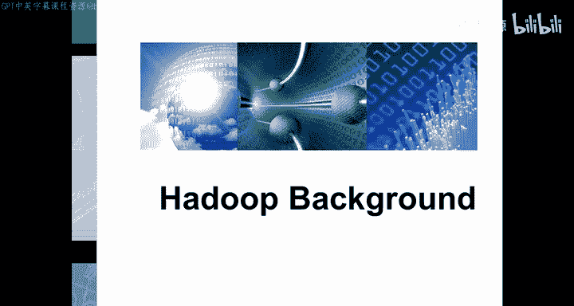
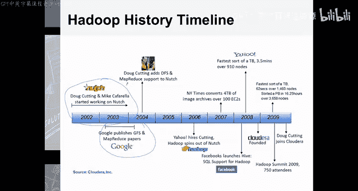
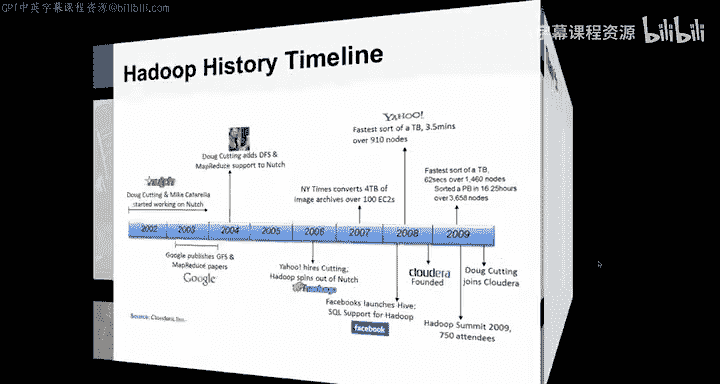
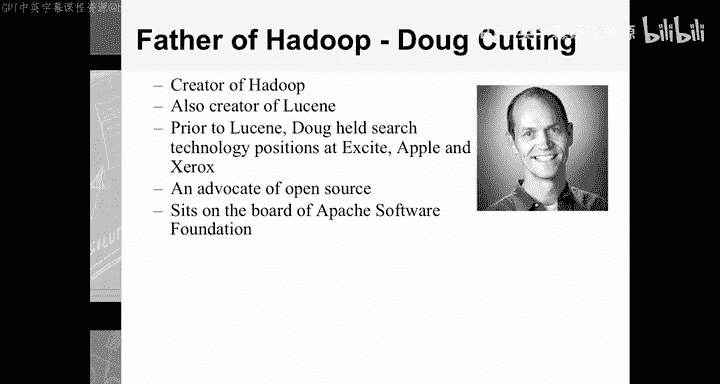
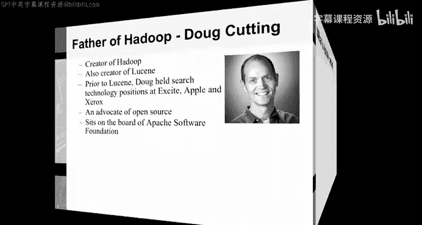
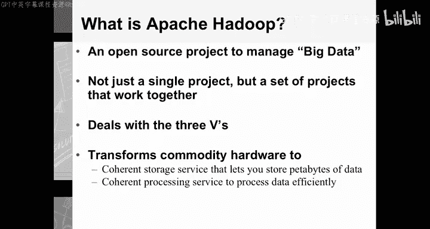
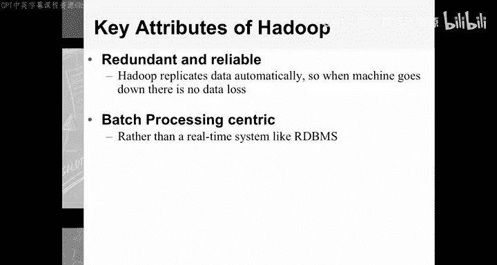
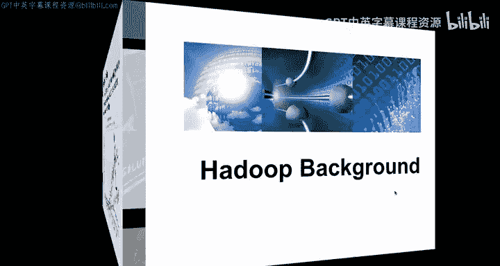
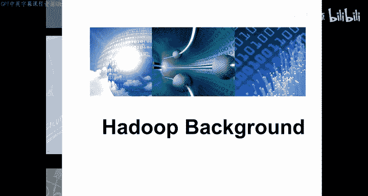

# 约翰霍普金斯大学《Hadoop大数据处理｜Big Data Processing Using Hadoop》中英字幕 - P10：9_Hadoop历史沿革.zh_en - GPT中英字幕课程资源 - BV1g5u6zBExs

Haado background。In this section， we will discuss Hadoop history。

How it started and the various evolutions Hado went through to get to where it is today。

We will then formally define Haddo and look at its key attributes。Finally。

 we will look at Hado popularity in the marketplace。Let's begin by looking at Hadoop history。

Between 2002 and 2003， two engineers， Doug cuttingtting and Mike Caferella began working on an open source project called Nuch。

Their goal was to build a web scale distributed crawler and search engine。

If you think about it in 2002， 2003， there were two dominant search players in the marketplace。

 Google and Yahoo。The other search players like Infos。

 Alta Vista and a few others pretty much had gone out of business。

And so duckucketttting wanted to build an Apache open source distributor caller and search engine。

They actually did that， they demonstrated much on four nodes。

But they found not to be operationally onerous and also achieving web scale， which means。

Being able to crawl millions of websites， downloading the content and indexing it was still a distant future。

So they were trying to figure out how to solve this problem。Fortunately， in 2003。

Google published a paper on GFS， the Google file system。You can download the paper from research。

google。com/arch/gfs。html。Later on， when we start studying HDFs， we will compare it to GFs。

 so we'll talk more about GFS at that time。In this paper on GFS， Google claimed their GFS。

 the Google file system to be a distributed file system rather than a single machine attached to a single storage。

 they also claimed that GFS was inexpensive as it was built on commodity hardware。

GFS also delivered high aggregate performance and they did it by having multiple disks across multiple machines working together。

 we saw this thing in the previous module when we talked about modern data processing technologies。

So they were able to build a highly perform， scalable fault tolerant file system。

 and most importantly， Google was using this large distributed file system for data intensive applications。

Interestingly， Google did not provide the implementation or source code。

 but only released the white paper。In 2004， Google published yet another paper called the Mareduce paper。

 you can download this paper from research。google。com/archive/mreduce。

htm We will be talking more about this paper when we discuss the mapreduce architecture later on。

In the Google Mapperty newspaper， Google described a new programming paradigm for big data processing。

They said it was a functional style programming rather than procedure oriented or object or a programming model with map and reduce functions at the heart of it。

These map and reduce functions would execute parallelly on large clusters of commodity machines using key value as inputs and of course。

 generating key value pairs as outputs。Of course， Google provided no implementation or source code for map produce。

 but only the white paperper。All this made duck cutting。And my ca are thinking。

 and so they actually changed the nuts project and ported the Nu project to a new framework。

This new framework began to use many of the concepts described in the Google papers。

 namely the Mapper newspaper and the HFS paper。They didn't call this new framework Hadoop yet。

 which is what it would be later on， as we will see。

I would like to talk about the rest of the Hadoop history in a timeline fashion。

 so we already saw that between 2002 and 2003， Doug cuttingtting and Mike Caferella started working on a nu project and between 2003 and 2004 Google published the GFS and Mareduce papers which gave Do cuttingtting an idea on how to change the nu architecture and so he began changing the nu architecture by adding DFS and Mareduce support in it。

By 2006。Yahoo hires duckering and what they do is they take the nu project and they break it into two。

The Apache Hadoop Project and the Nu Project。And so the Apache Haddu Project was born in 2006。

And lots of companies around 2007 started investigating Hadoop and one of the companies was New York Times。

 there's a really nice story of an engineer in New York Times converting four terabyte image archives using 100 EC2 machines。

 this is a classic example of Hadoop meets the cloud。And then around 2008。

 Facebook also started using Hadoop， not only did they use Haddoop， they also contributed to Hadoop。

 they actually created an open source Apache subproject called hype。

 where you could write SQL like queries， which would get translated into Mareuce programs。In 2008。

 another interesting thing happened， Yahoo started doing the terabyte sort。Test。So in 2008。

 Yahoo sorted one terabyte of data in 3。5 minutes using 910 nodes。In distributed computing。

 if you can do terabyte salt， that's a pretty good sense of how。Great。

 your project is going and as you can see， Hadop was actually going in the right place。In 2008。

 Cloud Air was founded。Cloudra was the first company that took the Apache Open source project and started providing support for enterprises。

In 2009。The Hadoop summit conference was created where 750 attendants came in。

 The other interesting thing that happened in 2001 in 2009 was Yahoo was able to sort 1 terabyte of data in 62 seconds by using 1460 nodes and they also sorted。

One petabyte worth of data over 16。25 hours using 3658 nodes， and finally。

 around 2009 is when Doug cuttingtting， the father of atu， joined CloudHeop。

If there are any companies that we should say thank you to。

 it would be Google for pointing us in the right direction in terms of the GFS paper and the Mappers paper and also Yahoo for all the contributions to the Hadoop open source project。

 they literally poured millions of dollars。And thousands and tens of thousands of manus towards the maturity of the Hadoop project。

We should also thank Duckertting， the father of hertu。He was， of course。

 the creator of Hado and also the creator of the Lucene Project， a search engine project。

Prior to that， Doug held search technology positions at Exite， Apple and Xerox。

 he' is an avid advocate of open source project and he sits on the board of Apache Soft Foundation。

Thank you， Duering for the Hado project。

So what is Apache Haddo？Apache Hado is an open source project to manage big data。

 to manage your organization's big data， right？It is not a single project but a set of projects that work together。

 so when we talk about Apache Hadoop， yes there is a site called Hadoop。appache。org。

 but there are lots of other Apache sub projectss。That are working together with Hadoop in order to create an ecosystem。

 projects like hive， pig， scoop， Fme， zookeeper， we'll talk about many of these projects later on in a different section。

Of course， Hadoop deals with the three Vs of big data， velocity， variety， and volume。

It transforms commodity hardware into coherent storage service that allows you to store paraabytes of the data。

 but not only store the data， but also provide a coherent processing service that allow you to process the data in an efficient manner。

So what's in a name， Hadoop is not an acronym， it's actually a made up name。

According to duck cutting。It was a name that his kid gave to a stuffed yellow elephant。

 and Doug Curtting thought Hadop was a pretty cool name so he decided to use it for his project。

Subprojects and other contribute modules tend to have names unrelated to their function。

 usually they have some theme related to elephant or other animals。For example， the Maha Project。

Mahaud in Hindi。Literally means elephant trainer Mahaud is actually a machine learning algorithm where typically in machine learning algorithms you train data。

 you use data sets to train your algorithm and so it kind of makes sense I guess that's why they use Mahalt as a name。

Pig is a  queryri language which was created by Yahoo。You write in PIG， you write。

 you express your programs， your Mapreice programs in a language called P Latin。

 and they get translated into Mapreice programs。And also the other thing about PIG is that pigG can consume any kind of data that is no rigid data structure for pig unlike what we see in hive。

 so there comes PI。So what are the key attributes of Hadoop？

Redundancy and reliability is one of the key attributes When you put data into Hadoop。

 it replicates the data automatically so when a machine goes down there is really no data loss。

Hedoop is also batch processing centric。Rather than in a realtime system like in a database。

 where you can do things in an interactive way where you can get subsequent response times in Hadoop。

 we have a batch processing centric engine where when you run a Hadoop job。

 it may take minutes before you get the results back， in some cases， even hours。

It makes it easy to write distributed applications。

 writing distributed applications is a pretty complicated affair。

If you have to write one because you have to deal with multiple machines。

 you have to worry about synchronization， you have to worry about network issues。

 and it's pretty complicated to do these things。But what Hadoop allows you to do it。

 it makes it possible for you to write， a distributed program， which can not only run on one machine。

 and then you can also scale it to thousands of machines without changing a line of code and you don't really have to worry about any of these low-le synchronization layers。

 they do it automatically for you。Haadop also runs on commodity hardware。

 You don't really have to buy any specialized hardware or expensive rates or redundant hardware。

 and the reliability aspect of it is built into the software。

 So running commodity hardware is good enough。Haadoop today is the fastest growing technology in the marketplace。

 Enterprises today are looking at Hadoop as another must have technology。In their data centers。

Just for fun， I decided to compare Hadoop with a few other popular modern technologies like Java EE。

 MPI programming or iPhone programming and Android programming。And this is what the results I got。

 Notice Hadoop， which is represented in orange， the number of jobs for Hadoop。

 is actually on the on the rise。 I just wanted to compare it with these other technologies。

 even though it's not as good as Android programming。Or even MPI programming。

 which is actually on the decline， it's on the right， so it's a good thing I guess， all right？

So in this section， we looked at the history of Hadobe， how it all got started。And we also finally。

Formerally defined Hadoop and its key attributes， we also saw the popularity of Hadoop ecosystem in the marketplace using indeed。

com job trends。

