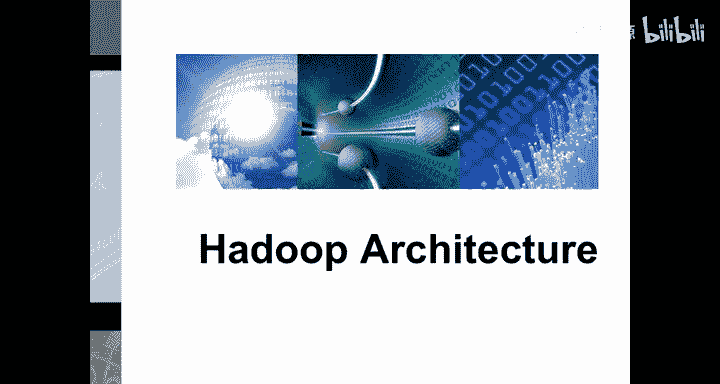
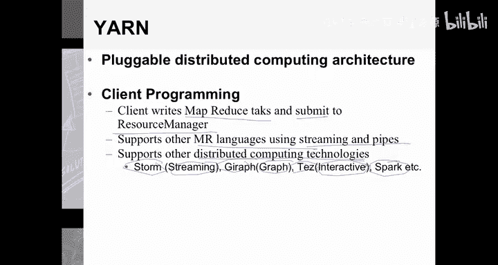
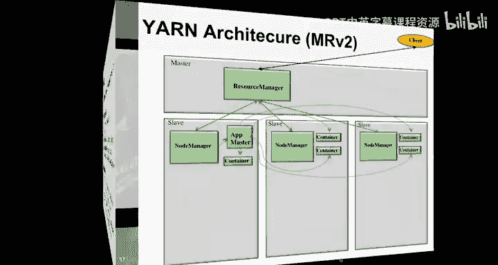
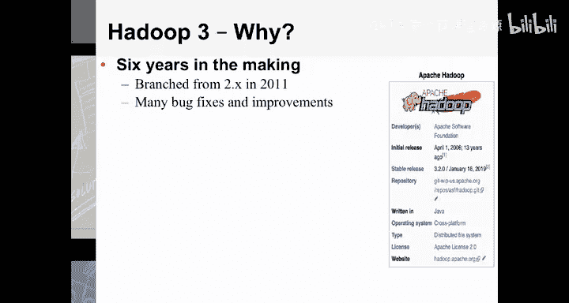
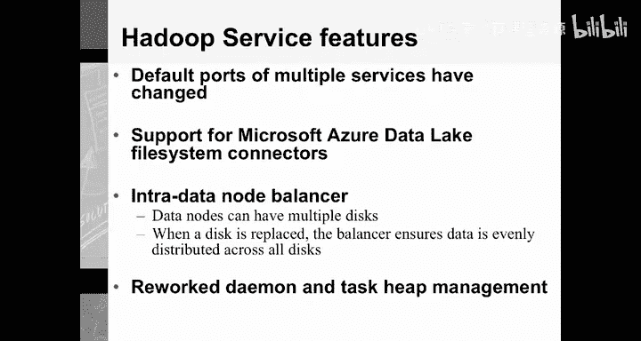
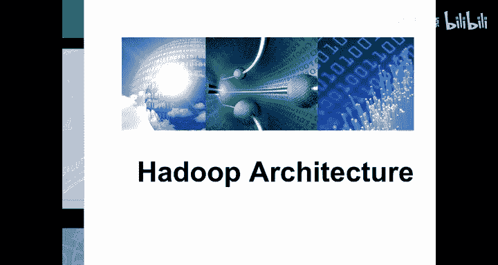

# 约翰霍普金斯大学《Hadoop大数据处理｜Big Data Processing Using Hadoop》中英字幕 - P11：10_Hadoop架构解析.zh_en - GPT中英字幕课程资源 - BV1g5u6zBExs

Haadoop architecture。In this section， we will look at Hadoop architecture。

 both the classic Hadoop architecture referred to as MV1 and Hadoop Yon architecture referred to as MV2。

We will also look at the internal modules of Hadoop and the major components that make up the Hadoop architecture。

This will be a very high level architectural view of Hadoop Later in the course we will dwell deeper into Hadoop architecture and the key interactions between the various components。

So let's look at Hadoop from a big picture perspective。

A Hadoop cluster is really made up of both physical hardware。And logical software。

 the physical aspect of Hadobe is the hardware， which is really an array of commodity servers mounted on racks within a data center。

Each individual server by itself may have multiple individual discs and course。

That's where the logical aspect of Hadoop kicks in Hadoop HDFS unifies the storage disc across the servers。

 across the racks and makes it look like a single file system。

 although it is really distributed under the hood。Haadop Yn provides a unified computational service for distributed processing by unifying the course across the servers for a single high level big processing。

 big data processing job， although things are really distributed under the hood。So what is Hadoop。

 Hadop is open source software for reliable， scalable， distributed computing。

It's distributed computing from the perspective that you can have in Hadoop。

 a whole bunch of machines， a whole bunch of servers working together for doing your processing。

 it's reliable from the perspective that when you put data into Hadoop HDFS。

 the data is split into blocks and different blocks are placed at different locations and the blocks are also replicated and so when one of the machine crashes。

 another the machine will take on that particular data retrieval process and give you that particular data。

And also。It's reliable for the perspective that when you submit a job。

 the job is broken down into tasks and those tasks are running across different machines。

 if one of the machine crashes， one of the other machines will take on that particular task。

It's scalable for the perspective that you may want to start the Hadoop cluster with let's say 10 servers and then you want to increase the capacity of your cluster。

 you can surely go in and add 10 more servers and so you can increase the capacity scale up。

 you can also scale down。The official site for Apache Hadoop is Hadoop。apacache。org。

 let's go ahead and take a look at that site。Here we are at the Apache Hadoop site。

So here's your left hand side menu， V releases， mating list， issue tracking。Here it。

Shows you the various modules that make up Hadoop， common distributed file system yarn and map produced to the four core modules of Hadoop。

It also is talking about the various related projects that you have in Hadoop。You have Amri， Avro。

 Cassandra， Ckwa， these are all related projects， projects that build upon Hadoop or work closely with Hadoop。

You can also look at the documentation， the latest documentation is a current。

There are also documentation for some of the major releases that's at the bottom over here。

 Let's click on releases。Click on download。Click on download and release now。

 go to one of the mirror sites。You'll notice that the latest version of Hadoop is 2。4。

1 as of this writing。That's the 2 dot X version for the1 dot X version of Hado that is 1。2。

1 that's available for us。Okay。As I mentioned。There are two major releases of Hadoop。

 that is Hadoop 1DtX， which is also known as classic MaRuce or MRV1 mapRuce version 1。

 it's very prevalent in the marketplace， many of the organizations that are working with Hadoop today are pretty much using Hadoop 1DX。

Then there is the Hadoop 2 dot X， which is also known as yarn， yet another resource negotiator。

 also known as MV2 map produced version 2。 This is a new and upcoming technology。

 This is the technology that we are going to be using in this class。

 Everything that you do in one dot X is completely。Portable to 2 dotX， everything works in 2t X。

 So when we learn 2 dot X， we are kind of learning all the aspects of 11 dot X also。

 but the demons are slightly different in2 dotX。 So we will be concentrating on2DtX in this class。

 That's the upcoming technology。Okay， so let's look at Hadoop 1。tX technology stack。

I am representing the core Hadoop modules in gray and all the ancillary or later projects that is built on top of Hadoop in yellow so in the core we have the common libraries and then built on top of that we have the HDFS distributed storage built on top of that is the Mareduce distributed processing when you download Hadoop this is the core Hadoop modules that you have that you get with the Hadoop download when you install Hadoop that's what you get then built on top of that or other projects so you have the hive project that allows you to write SQL like query which gets translated into Mareduce jobs。

And then you have P script that allows you to write map produced jobs in a scripting language using a language called P Latin。

Then there is HSp， which is a No SQL database built on top of HDFS Hadoop。

And then there is also several ancillary projects like Amri Fm， Uzy Zookeeper。

 we're going to talk about many of these projects， the key to understanding here is that when you download Hadoop you are downloading this and then you need to download for the various sub projectsjects or these other projects and then they all kind of work together。

So let's look at Hadoop Common module Hadoop Common provides the utilities and the libraries that support the Hadoop code project。

 which is the code of Hadoop and the other subprojects like Hive andP Now when you installed Hadoop。

 you notice that there was a file called HFs config dot Xm there was also code Configt Xml there was yaon configt Xm。

 so there's a configuration aspect of Hadoop， the configuration aspect of Hadoop is managed by the configuration API which is part of the code module。

Then there is also Hadoop file system Hadoop provides an abstraction to the file system。

 so you as a programmer or as a client will be talking to the Hadoop file system abstraction and you would ask it to create a file。

 delete a file， create a directory， delete a directory underneath it。

 it may be working on HDFS or it may be even working on the S3 file system which is the Amazon file system。

 you can have any file system under the hood In fact Ma or implemented their own C- based file system rather than HDFS written in Java。

When you store content in HDFS， you may want to compress it because you're storing large amounts of data and there are compression algorithms built in。

 for example， your BZip and GZP。When Hadoop components communicate with each other。

 they communicate using RPC， so there are RPC communication utilities available as part of the Hadoop Common module and then when。

Data is sent between components or when data is placed within HDFS it may be serialized。

 and so there is serialization that's built in， I know that in Java we have Java serialization。

 Hadoop does not use Java serialization， they have their own serialization and decilization utilities。

 which we will talk about later on。So these are the things that make up the Hadoop common module that the rest of the modules are built upon。

Then that is the Hadoop HDFS module。The Hadoop HFS module is the one that provides the distributed scalable portable file system。

 once again it's distributed from the perspective that there are multiple servers that are working together in unison in order to create a file system view for you。

It's scalable from the perspective that you can add more servers with more drives in it so you can increase the capacity of the servers of default system。

And it's portable from the perspective that it doesn't matter what kind of file system you have under the hood。

 whether you have the standard HDFS or you have S3 file system or cosmos fault system。

 it doesn't really matter it's the genetic file system abstraction that it provides for you。

As far the client API is concerned， the clients can use the Java API for CrD。

 in other words to create read， update and delete files， they can also use CAP。

 we will be using primarily the Java API in this class there is also a command line interface available Hadoop FS command or the HDFS DFS command available for us there is also RE API available Now in terms of how Hadoop HDFS works。

 well there's a series of components that make Hadoop HDFS work you have what is called the name node which is the brains behind the HDFS。

which storess the HDFS metadata metadata about files。

 then there are demons called the data node demons which actually do the reading and writing of data into the local file system。

 they are the workhorse for the name node and then when a client wants to create a file or delete a file。

 create a directory or delete directory， the client communicates directly with the name node for metadata operations and the client communicates to the data node to read and write the blocks okay so let's look at HDFS architecture from a pictographic perspective。

What I have over here are four machines， we have a master machine。

 and then we have three slave machines or three slave hostse in a master machine。

 we have a name node demonmon running， which is the master of HDFS。And then in the slave machines。

 I have the data node da Ding， which are the。Data node demon running， which are the。

Workhor for the master name node。The clients communicate with the name node in order to create a metadataboard files whenever a client wants to create a file。

 it communicates with the name node which maintains the metadata。

 the client communicates with the data node in order to actually write the file or read the file in the file system。

So。That's how the communication takes place。You'll also notice that the data node communicate with each other because when a file is written。

 it's broken down into data blocks and the data blocks have to be replicated and so the data notes replicate the data blocks amongst themselves of course under the direction of the name node don't worry too much about the architecture right now I wanted to kind of give you a big picture view later on there's an entire module devoted to HDFS architecture we will talk in great detail about the various components that make up the HDFS architecture。

Okay， so let's look at the map Red architecture。Map Red is the programming paradigm for distributed processing across many machines。

 across many nodes。The client programming for Ma produce is basically client ordering what we call map and reduce tests for the job and submitting this particular job to what is called the job tracker。

The map and Reduce programs are written typically in Java which is what we're going to be doing in this class。

 but you can also write mapre programs in other languages in that case you use what is called Hadoop streaming and Hadoop piping we will talk about it later on。

So how does it work basically in MRV1 mapRuce architecture， we have what is called the job tracker。

 which is the Bras behind Hado processing， clients submit a job to the job tracker and the job tracker then works with the slave task trackers in order to launch and run the various map and reduce tasks。

So let's look at mapreduce architecture in action。Here we have food machines。

 we have the master machine。And we have slave machines。

Youll notice that the master machine is running the master demon， which is the Jo tracker。

 and then the slave machines are running the T tracker demons。

 which are the slave task tracker demons。Whenever a client wants to submit a job。

 the client orders the job and submits the job to the job tracker。

 the job tracker works in unison with the task tracker and the task tracker launches tasks which are map and tasks to do the work for the job and then sends the results back。

 which is then sent back to the client。So jobs are submitted to Jo tracker。

 Jo tracker works with T tracker， T tracker launches the tasks， which would be map introduced tasks。

 and then the results are written back out。That's the mapreuce architecture Now of course we have mapreuce。

 but mapreuce is built on top of HDFS， so let's put all these things together。

 So the idea here is client。Can communicate with the master name node for name node related operations。

 metadata operations， file system operations。The client also communicates with the job tracker for submitting jobs to the job tracker。

The Jo tracker consults the name node under certain circumstances。

The job tracker has the slave task trackers running on the slave machines。

 and the name node has the slave data node demons running on the slave machines。

 so you can see within a slave machine， you have the task tracker demon and the data node demon running task tracker。

 data node task tracker data node。And these tasks。Would be working locally with the local data。

So these task trackers are talking to the local data node so that they can work on local data。

 that's your data locality。You'll also notice that the data nodes communicate with each other。

 that's where the replication are taking place。There are some shortcomings of MRV1 Yahoo has been working with Hadoop Mareduce versionion1 for a few years and they found some issues with MV1。

There was a scalability issue。With MRV1， the maximum cluster size that you could hit was about 4000 nodes。

 at least that's what Yahoo found they also found that you could at most run 40，000 concurrent tasks。

And the job trackers synchronization model was a core synchronization model。

 it was doing all the work， it was doing too much work。There's also some availability issues。

 if the job tracker fails and there are thousands of jobs that have been submitted to the job tracker。

 all the jobs will pretty much come to a halt and they all will fail。

And then there was also hard partition of resources into map and reduce tasks。Now。

 when I say hard pot of resources， when you have a cluster。

 let's say you have a cluster of 10 machines。You would say this first machine has eight CPUs so you can run four mapper tests and four reduce tests。

 The second machine can run four mapper tests and four reduce tests， the third machine again。

 four Maper and four reducer and so on you would organize these different machines this way。

 So if you have 10 machines，8 cores， you would run。

 let's say 40 mapper tests and 40 reducer tests So you preallocated your maps and reducer slots and you can only run that many Maper tasks and that many reduce tests So there was low resource utilization。

It also lacks support for alternate programming paradigms。

You could only do with MRV1 Mare programming， which is a batch oriented programming paradigm。

Which is slow for certain kind of iterative algorithms。

What we needed was support for other programming paradigms like graph or interactive or even stream processing paradigms。

So yarn which is Hadoop MV2， the big idea behind yarn is let's split the job tracker into two parts so that we can separate out the responsibilities。

 so they took the job tracker and they broke it down into two portions。

 one for scheduling and the other one that actually runs the Mareduce job。

And they also said that while we are at it， let's generalize the Hadoop interface so that we can run any kind of distributed computing application on top of this cluster。

And so if you really think about the name yarn， Yrn stands for yet another resource negotiator。

 in other words， it's a paradigm where you can run any kind of distributed processing。

Let's look at the Hadoop 2。 X technology stack Once again。

 I'm going to show you the core Hadoop modules in gray and I'm going to show you the ancillity projects in yellow in the core module we have common。

whichch we looked at， we have the same common， there is HDFS， which is the distributed file system。

 then there is yarn distributed processing so we have a new layer that has been added and then on top of that is where mapreuce runs。

That's what Hadoop 2 is all about that's what yarn is all about and then on top of that you have other projects like Hve。

Pig。And you have on top of yarn。😡，A few of the frameworks that you can bring in。

 you can surely bring in map use， but you can also bring in other frameworks like Giraffe。

 I'll show you in a few seconds。Then there is also H space， no SQL that's built on top of HFS。

 so you can see in Hadoop2 we have a new layer that has been added， which is the yarn layer。

 which is the yet another resource negotiated layer。

 which allows you to do map reduce processing from a classic Hadoop perspective。

 but it also allows you to do other frameworks。Of course。

 we have the ancillity projects that are available as part of Hadoop that Hadoop works with。

Here's another view of Hadoop yarn architecture， you see the HDFS and then you see the yarn and on top of yarn we have the batch map Reduce。

 which is one of the frameworks that's available that's part of Hadoop and then you can also bring in other frameworks。

 you can bring in T， you can bring in giraffe， you can bring in Spark。

 you can bring in open MPI you can bring in search Weer any of these frameworks you can bring in to run on top of yarn Of course mapR is great for big data processing and that's what we're going to be doing in this class and it's part of Hadoop 2 it's standard as part of Hadoop 2。

So what is yarn， yarn is a pluggable distributed computing architecture。

As far as client programming is concerned， client writes map and reduce tasks and submit it to what is called resource manager。

 that's the new job tracker， supports other MR languages using streaming and piping。

 it of course supports other distributed computing technologies like storm for stream processing。

 giraffe for graph processing， phase for interactive processing。

 and Spark which is a new technology for stream and interactive processing。

How it works， basically you have the master resource manager which manages the resources in the cluster and then there is also resource manager which which assigns an application master and the application master is the one that negotiates what we call containers which run the Mareduce jobs there are also these slave node manager demons that run the Mareduce tasks okay so let's look at the yan architecture don't worry too much about it again。

 we will be talking about the yaN architecture in more detail in a different module。

是。So from a high level perspective， you have four machines over here， you have the master machine。

 you have three slave machines， the master machine runs the master resource manager。

 and the slave machine runs the slave node manager demons。So whenever a client wants to submit a job。

 the client writes the job， submits it to the resource manager。

 the resource manager is communicating with the node manager that is giving information as to what resources it has。

 the resource manager will then contact the node manager to launch an application on behalf of the client。

If you recall in Mareduce one， the job tracker was the one that was managing the actual job now that work has been split。

Between resource manager and application master， so the resource manager ask the node manager to launch a job and that's where the job is running。

 the application master is the new job manager， a manager for a specific job。

 it works closely with the node manager and the resource manager to negotiate what we call containers。

 which are your tasks and these containers are the ones that are going to run your map and reduce tasks。

So that's how the ya architecture works。Of course， let's put yarn on top of HDFS when you put yarn on top of HDFS。

 all we have now is really data node added into the mixture。

And then we have the containers talking to the local data node。

 and that's where your data locality kicks in。We talked a bit about Hadoop 1 and a lot more about Hadoop 2 yarn。

 Now， that is Hadoop 3， where the architecture has not changed much。

 but as some new additional features。 So let's look at Hadoop 3， its motivation。

Haadop 3 is clearly built on the foundation of Hadoop 2， which had some major architectural change。

 but now Hadoop 3 has some new features， so let's go over some of these features。

The work on Hadop  III began in 2011， but it wasn't until late 2017 that it was first released。

During this time， some of the bug fixes and improvements made their way to Hadoop 2 recess。

 but major changes could not be easily ported back to Hadoop 2。

 One of the primary motivations for Hadoop 3 was to improve the scalability and reliability of the platform。

 The default replication factor for four tolerance， results in a 200 per storage overhead。

 In other words， if you store a 1 GB file， it ends up being stored as 3 GB。

 having to store 3 copies of every file greatly limits the scalability of HFS。

Another reliability and skillalability issue is the limitation of only two name nodes。

 one active and one standby for really large clusters。

 it may be desirable to have more than one standby name nodes。

And so in Hadoop 3 they have provisions for that Then there are some general issues with the Hadoop 2 distribution Java 7 has been end of life since 2015 so there was a push to ensure that all code was upgraded to Java 8 and so that's one of the big pushes for Hadoop 3 now we can use JDK8 Use applications for Hadoop 2 often rush into class path conflicts。

And the reason is that the library dependencies for the application can conflict with the library dependency for the Hadoop clientient APIs itself。

To get around this， the application developers would need to shade their dependency so as not to conflict with Hadoop。

 Another problem with the Hadoop 2 is the default ports。

 The default ports for some of the services or in the eemeral port range。

 The TCPI Eeral ports are automatically assigned when client applications on the host connect to remote services。

 This could result in starter problems for Hadoop 2， And so in Hadoop 3， they have changed it。

Yon with Hadoop 2 has some serious limitations too。

 there are only two resource types available for making scheduling decisions。

 CPU and memory Today's compute clusters can include other limited resources that are needed by Hadoop job and Yon does not provide a way to determine where in the cluster。

 these available resources can be found， and these resources could be GPU resources。

 and so there is support for GPU style resources。On this slide。

 Im showing you 16 features that are described in the release notes for Hadoop 3。

 In the next few slides， I will go over just a few of these features that you should be aware of。

So one of the big change in Hadoop 3 is the support for erasure coding。

Erassure coding is a redundancy technique used for discars and is being applied to blocks now that are stored in HDFS。

 This implementation of eraser coding uses striping and parity checks to provide redundancy files are represented as a sequence of data and parity blocks that are stored on multiple data nodes。

 recall that Hadoop 2 actually replicates at the block level。 And as I mentioned earlier。

 the default replication factor or3 results in a 200% overhead for storage。

 You can reduce the replication factor for files， but this also reduces fault tolerance。

 Another factor worth mentioning here is that the block replication can increase job performance。

Since the same block exists on multiple data nodes， data locality can be more easily achieved。

 You will learn more about data locality when we talk about mapreduce。

 So the point I'm trying to make is， yeah， Hadop 3 has erasure coding。

But it comes with some advantages and disadvantages with erassure coding。

 we can achieve fault tolerance without block replication。 In fact。

 erassure coding limits the replication factor to no more than 1。5。

 There are multiple policies to choose from， but in general。

 erassure codinging reduces the storage overhead to no more than 50%。

 This can greatly improve the scalability of your HDFs。

But it does come at a cost since files are being striped across multiple data nodes。

 there is an increase in network traffic for reading and writing。

 The encoding and decoding process also requires additional CPU for both the client and the server。

 there are other limitations that may affect performance too。 for example。

 append and trunccate operations are not supported。

 So even though support for erassure codinging is there in Hadoop 3。

 it has not been in white use and we are not going to do that in this class。

 but I did want to mention about that。Here are two Hadoop3 features that improve application development and performance。

As I mentioned earlier， developers for Hadoop2 would have to use shading to remove any conflicts with the Hadoop III clientient API dependencies。

In Hadoop 3， the client jars now use shading to remove the dependency conflicts。

 This means developers will not have dependency conflicts with Hadoop 3。

 but it also means that developers will need to supply their own dependencies will get more into these details when we start developing using the Hadoop APIs so don't worry about it right now。

 Another exciting feature in Hadoop 3 is the ability to define additional ya resource types。

 For example， Hadoop clusters that have GPUs which is graphical processing units can make aware of the GPU availability on each of their nodes。

 Therefore applications can be scheduled per the availability more than just the CPU and RAM so we can take advantage of GPUus。

Let's look at some of the Hadoop service features。Now that Hadoop services are no longer using the FMML port range。

 system administrators will not encounter occasional startup errors， however。

 users of Hadoop 3 need to get to know the new default ports。

 which I'm going to show you when we get into the setting up of Hadoop and operating Hadoop。

Heop 3 add support for deployments in Microsoft Azure， Microsoft Azure has its own file system。

 you have S3 in Amazon which was supported Now we are supporting Microsoft Azure file system2。

Haadoop data nodes typically have multiple drives for local storage redundancy and parallelism。

 Hadoop2 does ensure that storage is evenly distributed across all drives， however。

 when a drive fails on Hadoop 2 data node and that drive is replaced。

 storage is no longer evenly distributed， the Hadoop 3 intra node balancer will redistribute。

 such that the new drive is utilized right away and eventually restore the balance。

Another feature is that in Hadoop 2， Java Heap size had to be determined upfront for each of the demons and other tasks that are run on the cluster with Hadoop 3 Java Heap size determination is automatic and not manually configured。

 so it actually made the installation process a little bit easier。

Haoop3 distributions。 Now that we have covered some of the new features。

 let's look at where and how Hadoop 3 can be found。

 The latest release in the Apache distribution is Hadoop 3。

2 that was made available in January 2019 and that's what we are going to use in this class unless specified。

 How about the other distributions of Hadoop by the way。

 there has been a merger between Clouddera and Hortonworks。

 but both Clouddera and Horton works distributions will be maintained for another three years until a converged Clouddera distribution is made available and by the way。

 that's going to be called CDH plus HP calling it CDP。

You can see here that the commercial distributions are a bit behind， for example， Clouddera is at 3。

0。0， not that bad， and Hton works is at 3。1。1， but we will be using 3。2。

0 or above noticeice that Mar is still tied to the Hadoop 2 baseline Mar has its own implementation of HDFs。

 It used to be known as Ma or Fs， but has been renamed now into Mar XD since Maor XD does not use block replication as Hadoop 2 does。

 it doesn't make sense for them to adopt eraser coding。By the way。

 we will be talking about Hadoop distributions in more detail later on。In this section。

 we looked at Hadoop architecture， both the classic Hadoop architecture。

 as referred to as MV1 and HadoopBeyond architecture， referred to as MV2。

 We also looked at the internal modules of Hadoop and the major components that make up the Hadoop architecture。

 Then we also looked at Hadoop 3， where the architecture has not changed much。

 except for a few feature additions， especially erassure coding and Java 8 support。

 Well be using Hadoop 3 in this class。 Let's work with the bleeding edge technology。 Of course。

 this was a very high levelve architectureural view of Hadoop。 later， in this course。

 we will dwell deeper into the Hadoop architecture， and key interactions between the components。

