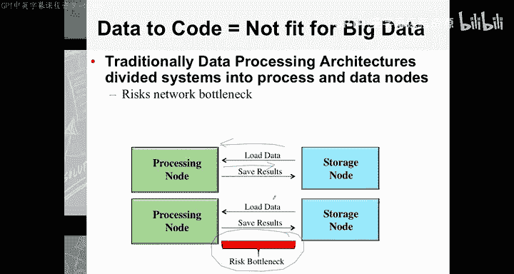
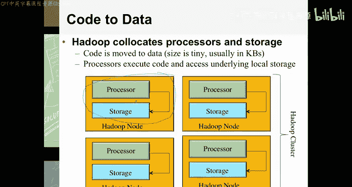
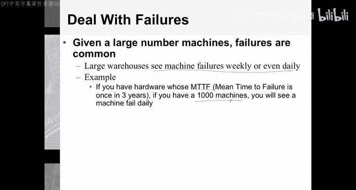
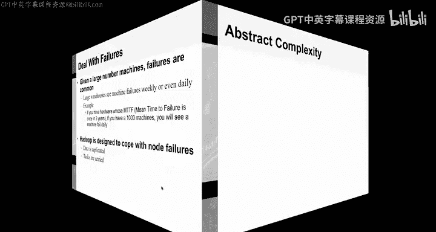
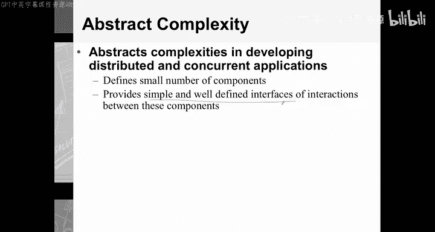

# 约翰霍普金斯大学《Hadoop大数据处理｜Big Data Processing Using Hadoop》中英字幕 - P12：11_Hadoop架构设计核心原则.zh_en - GPT中英字幕课程资源 - BV1g5u6zBExs

Key principles behind Hadoop architectureure。In this section。

 we will look at key principles behind Hadoop architecture that makes it so great for big data processing。

So what are the key principles？It breaks disc read barrier with Hadoop。

 you can have multiple dis across multiple machines work together so you can read and write much more data in a single second。

Scale out rather than scale up with Hadoop， you can add more and more servers hence scaling out rather than scale up。

 which is much more harder and much more expensive。

If you recall scalingk up is adding more CPU and RAM to existing hardware。

Bring code to data rather than data to code。One of the great things about Hadoop is how you can write your Hadoop Ma programs and you take your programs to where the data is。

 that is data locality， rather than bring the data to where the code is。

Deal with failures when you have many servers in a data center working together。

 there's a possibility that these servers may fail and Hadoop deals with those failures in an automatic fashion when a server that contains data crashes under the server that may have a replicated copy of the data will serve the data when a server that is processing some task crashes under the server that's free will take take upon that task and process that task and complete the job。

Abstract complexity of distributed and current applications when arriving distributed applications。

 there is a lot of complexity that is involved in terms of synchronization and barrier and other things that you have to do to make sure that your job completes successfully Hadoop abstracts all those complexities so you can concentrate on your business logic。

Let's look at all these things in great detail。Brick disc re barrierri。

The storage capacity has grown exponentially。In the last。Two decades。

 but the read speed has not kept up， what do I mean by this？In 1990。

You would get a hard disk that's about 1，400 megaytes or 1。4 gigabytes。

And then the transfer speed would be about 4。5 megabytes per second。So if you divide 1400 by 4。5。

 that would give you 1400。Divided by 4。5， that gives you about 311 seconds divided by 60。311 seconds。

 which is really five minutes， so if you think about it。是。

It'll take you about five minutes to read the 1。4 gigabyte drive in 1990。In 2010。

 now we get drives that are close to a terabyte。And the transfer speed is about 100 megaytes。

 so one terabyte is about a million gigabytes， so let's divide a million by 100 megaytes and see how much time it will take。

So。1 million divided by 100。That many seconds divided by 60， that many minutes， divided by 60。

 so it's going to take about 2。5 hours。So in order to read a one terabyte drive sequentially from beginning to end。

 it would take about 2。5 hours。So what does this mean。

 this means that we can process data very quickly once we are able to read or write the data into main memory。

 but then reading the data into main memory is a big bottleneck。

So one of the great things about Hadoop HDFS is that in Hadoop。

 you can have00 drives that are working at the same time and so now you can read，Hut you know。

 one terabyte of data in two minutes because now you're going to be reading in a parallel fashion。

Think about it， so in this way， Hadoop HDFS actually breaks the disc barrier。

Scale out instead scale up。Scaale up is when you add more CPU or more RA or even more drive to a single server。

Scacal out is when you add more and more servers in order for you to increase the capacity of your system。

It is actually harder and more expensive。To scale up。

And the reality is that when you add additional resources like CPU or RA， Moore's law has caught up。

 which means it is not really catching up with the data growth， yes， the CPU speed is going up。

 the RA youre getting much more RAM， but the amount of data that we have is much。

 much higher and it's just you know the proportionity is not right。And also， you know。

 when you want to scale up， you need to buy new units and sometimes you cannot add any more resources。

Of course， this is what is also called scaling vertically。Scall out。

Scacal out is when you add more machines or more nodes to an existing distributed application software like Hadoop。

 Hadoop actually takes this approach with Hadoop， you can start with a cluster of 10 nodes。

 and then you can add more node， you can make it 20， you can make it 40， you can。

You can scale up or scale down whatever you want to do。

 so Hadoop uses a scale out approach rather than a scale up approach and the scale out approach is a much better approach。

In Haddoop， we use cheap commodity hardware。So what does it mean to say cheap commodity hardware or cheap commodity server Well let's define that in today's term a cheap server would be a server that would have about 32 gigabytes of RA 121 terabyte hard drive and a Quadcore CPU and this would cost you about $5。

000 you can have 10 of these machines put together in a cluster so that would cost you about $50，000。

And if you want to double your cluster you can get 10 more。

 so that's the idea behind cheap commodity hardware rather than those supercomputers that people used to use in the 1970s and the 80s。

 so we don't need these supercomputers or these highend servers instead all we really need is a rack of commodity servers for Hadoop。

So what does a data center look like？So in a data center you would have a set of commodity servers which are cheap commodity servers。

 these servers are placed in a rack， you can see these rocks server here and multiple racks are then interconnected and of course all these things are within a single data center。

 Hadoop works within a single data center。不 of지 아들。Key principles of Hadoop map reduce。

Is actually bring the code to data rather than data to code。

Moving the data to code is not a good fit for big data。In traditional data processing architectures。

We divided the system into processing nodes and data nodes。

 so here you have some processing nodes that do your computation。

 here you have storage nodes that store the data。And then what you do is whenever you want to do your processing。

 you would load the data into the processing node， so you're reading the data into the processing node。

 process it and save the results back into the storage node。But with this。

 you actually risk bottleneck and network bottleneck。

With Hadoop。We have taken a different approach with Hadoop。

You co locatecate the processors and storage， which means within a single server。

 you would run the processing logic and the storage logic。

 the processing logic is really your task tracker and tasks。

 the storage logic is really your data node that is reading data from the local file system or the local disk。

And you have an array of these servers in this case we have four nodes in the Hadoop cluster that is doing local processing。

 so in this way you're actually moving the code to where the data is so you're colocating the data and the business logic together that's what is called data locality。

Hedu deals with failures in a really nice fashion。Given a large number of machines that you have in a cluster。

 failure is imminent。Large warehouses see machine failures weekly or even on a daily basis。

If you think about it。We have this concept called MTtTF， which means mean time to failure。

 If the mean time to failure for a server is， let's say three years， in other words。

 it would take a server within that three year period， a server would fail。

 but if you have a thousand0 servers，1 thousand0 machines。

Then what you're saying is that's about or one machine failure a day if you have an MTTF of three years right so almost on a daily basis you have server failing think about companies like Google and Facebook and Twitter and Yahoo where they have hundreds of thousands of servers they're going to see failures almost on a second or a minute basis and their systems have to deal with these failures automatically Hadoop does that really well Hadoop is designed to cope with note failures because the data is replicated。

And so if one server that has a copy of the data is has gone down。

 one of the other servers that has the copy of the same data would serve you the data and also when it comes to mapre tasks。

 if a server that is running a task fails， then one of the other servers that。

Is idle is going to pick up that particular task， even if it's not idle。

 if there is a slot associated with it， it'll pick up the task。

Haoop abstracts complexities in developing distributed applications when you have to build distributed applications there's a lot of things that you need to do in terms of synchronization and configuration and things like that Hadoop handles all these things for you Hadoop has its components that take care of all these different aspects of distributed computing complexity。

And so what Hado provides you is a simple and well defined interface。

Simple and well defined interface is your map produced interface。

And so you simply write your business logic and not worry about any of these complexities of distributed computing。

So it frees the developer from worrying about system level challenges。s as race conditions。

 starvation， processing pipelines， data partitioning， and things like that。

 don't have to worry about any of those things， just write your business logic in Maus。

So in this section， we looked at some of the key principles。

Behind the Hadoop architecture that makes it so great for big data processing。

