# 约翰霍普金斯大学《Hadoop大数据处理｜Big Data Processing Using Hadoop》中英字幕 - P13：12_Hadoop技术栈剖析.zh_en - GPT中英字幕课程资源 - BV1g5u6zBExs

Haadop technology stack。In this section， we are going to look at many of the projects in the Hadoop ecosystem。

It can be overwhelming when you hear projects like hive， PG， HBase， H catalog， scoop， Zookeeper。

 Ambarri， and it just keeps going like there is no end to it。As I record this video。

 there is probably someone thinking of creating yet another Hadoopa project。

The goal of this section is to make sense of the key Hadoopa projects and also understand which ones are genetic。

 which ones are specialized for solving specific problems。

Which ones are similar and even categorize them。I will also show you where you can find more information on upcoming Hadoop projects in the Apache incubator site。

Mostly in this section， I will pick a few key projects and give you a 50。

000 fit view of it right now， later in the course well be of course taking a deeper dive。是。

So let's look at the Hadoop technology stack。You thought there was the Apache Hadoop project and that's about it。

But here is a list of。All the projects in the Hadoop。Ecosystem。You have， of course。

 Apache Hadoop right in the center， but then you have Apache senty for security H space for No SQL axis。

 scoop for bringing data into Hadoop， pig and hi for analyticstics， Kafka， NoOX。

 another security project， Ambodyri for monitoring。HTT for Eclipse development。

 Chwa for bringing log files in， giraffe for graph processing。Drill， Avro， open MP， Tse。

 and it keeps going and going and going。So how do you make sense of this Hadoop technology stack？

In order to do that。I have tried to organize them into groups。So let's look at it。

You can organize the Hadoop technology stack into data integration projects。

 data serialization projects。Data storage， no SQL projects， data access or data analytics projects。

 more of those data access analytics projects。Management， orchestration， data intelligence， security。

 Hadoop Devtos。All right， so let's look at them in more detail。Data integration。

So you have installed the Hadoop cluster。But you cannot do anything with the Hadoop cluster unless you have data in it so you need to get data into the cluster how do you do that well there are lots of projects that are data integration projects that allow you to bring data into the cluster and take data out of the cluster Sop is a classic example it allows you to bring data from relational databases SQL to Hadoop and again take it from Hadoop into relational databases。

Flume， Chakqua， and Kafka are also very similar projects。

 except they allow you to bring in log files or events from different systems。Data serialization。

Okay， so you brought the data into the cluster， but how are you going to save it？

Are you going to save it as flat files， CSV format， comma Seator format files。

 or are you going to save it in more advanced formats？

Data serialization projects like Avro and Thrriifft allow you to store data in an advanced format where you can also store。

Schema information about the five。 So data serialization projects also give you mechanismss for you to generate。

Code or classes that you may be in need of in order to load the data into your application or write the data out into the disk。

Tta storage no SQL， you know how to store data in flat files using data serialization。

But then sometimes you want to store data in a format that allows you to do real time access so that you could do crowd operations。

Create a file or create a record， delete a record， update a record。A query record。

HSpace is such a project， HSpace is a project that's built on top of Hadoop。

 it's a No SQL database that allows you to do cloud operations。

Cassandra is also a very similar project except it doesn't directly depend on Hadoop。

 but it works closely with the Hadoop from the perspective that you many times want to bring data from the Cassandra cluster into Hadoop or vice versa。

But then Casandra also has its own map like programming language for batch processing。

Data access and analytics。So you have the data in the cluster。

But then you want to do some analytics on the data， you want to aggregate。

 you want to do some counting， how do you do that well you could write map reviews programs。

 but that takes Java developers to do the work， but you could also do this using some higher level languages like PEg and hive。

That's what these projects allow you to do。There's a lot of work that's being done in data access and data analytics。

 there's a lot of new projects that are coming up for data analytics。

Pig and high allow you to write in a higher level language that translates the code into Mareduce。

But then there are other projects that are coming up that run on top of yarn that basically have other distributed computing paradigmds。

 but they still can run on top of Haddo using the yarn architecture。Girafe， for example。

 allows you to do graph processing， St allows you to do real time processing。

 then you have drill and tastese and spark， so there are many projects that are coming up in that arena。

Management。So you have 100 machines， but how do you install Hadoop software on those machines。

 how do you manage those machines， how do you administer them。

 how do you upgrade the software Embody is a management tool that allows you to manage your Hadoop cluster。

Orchestion。So you have your Hadoop cluster， you have jobs that are running in the cluster。

 how do you coordinate those jobs， Ui allows you to do that？

How do you make sure that your cluster is running and all the different services are in sync。

 all the configuration files are up to date， zookeeper is a project that allows you to do that so orchestration services can be done using zookeeper and Uzy。

Data intelligence， machine learning projects such as Mahat allows you to do data intelligence。

Then of course you need security on Hadoop， Hadoop has some of the most important data in your organization。

 so there are a couple of projects， K Ns and sentry that are allow to do security on Hadoop。

What about development tools？If you're going to be doing Hadoop programming。

 you probably will be using something like Elipse for Ne beanss。

Haadoop Devtools or HTT is a project that allows you to。Bring in eclipse。

Pluugins that allow you to do Hadoop development easily on eclipse I think it's currently concentrating on eclipse maybe in the future they would also do for net beans。

So where can you get more information on Hadoop ecosystem projects？Incubatorappache。

org is a great place for that。Incubator Project is the entry path into the Apache Soft Foundation for projects and code bases that are wishing to become part of the Apache Soer Foundation efforts。

So let's take a look at the incubator website。

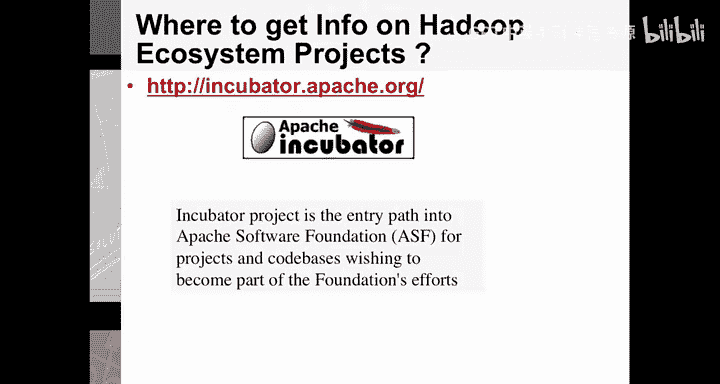

Here's the incubator website。If you go over there， you will see a list of projects。

 here's the list of all the current Apache incubator projects。

But then some of the projects are Hadoop related， you have drill。Click on drill。IncubatorApache。org。

 the drill。 So here's the drill project。

Interactivetive coordinate at scale。That's what really allows you to do。Similar to hive and take。

Okay， what else do we have， we have storm？Streams。Ts， dayss is another higher level language。

Here's the Ts incubator project right there。So I would strongly recommend that from time to time you visit this particular page。

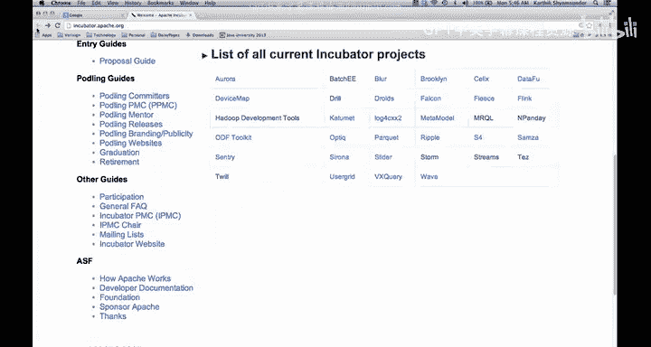

And see。And read about these projects and see which ones may be associated with Hadoop。

 so here's another one thats with a twill。There runs on top of Bay Hadoop yarn that reduces the complexity of developing distributed applications。

Here's another one。You get the idea。Okay， so let's look at some of the key Hado projects now in more detail。

Hve。Hive is a project that originated at Facebook。Data scientists and data engineers at Facebook wanted an easy way to access the data in the HDFS cluster。

Rather than writing Mareuce code， since many of them were not Java developers and did not really know Mareuce programming。

 they really needed a tool to easily do summarization and calculation and aggregation of data。

So the motivation within Facebook was to build a tool that allowed non Java developers to access the data in HFS。

And so they built this tool called hive。Hve allowed the data engineers。Or data scientists to express。

Their query in a higher level language called hiveQL， basically when you express in hiveQL。

 the hiQL queries get translated into mapre code so you really don't have to write any map reduced code。

 just express it in the SQL like language， that's all you need to do。

The interesting thing about hive is that it allows。

Data warehouse engineers who are familiar with SQL to easily stop using Hadoop of course。

 Hve requires a schema for accessing the data in HFS。

So you know you have to kind of simulateimil some kind of a schema on top of your flat files there's actually a syntax for that you can it's almost like create table syntax。

 you could do that in hive， or you could use something like Avro where you can store the file in file systems with schema information built into the file。

 and then you could use it in conjunction with hive。

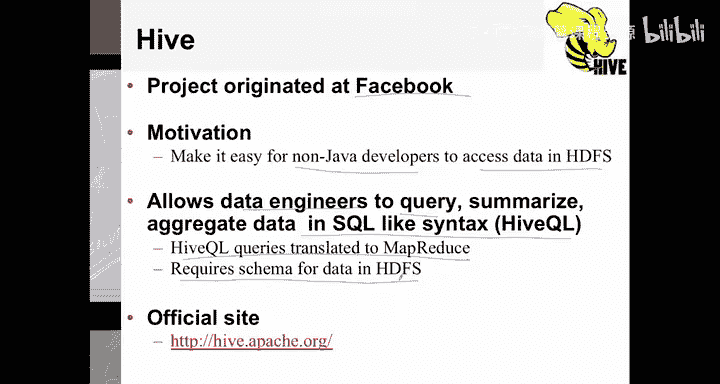

So let's take a look at the hiive Apache website， hive。apacache。org。Here's the Hiive website。

 as you can see， it says the Apache hiive Data warehousee softwareer tool facilitates quitting and managing of large dataset sets residing in distributed storage。

And of course， they use a language called hiQL。

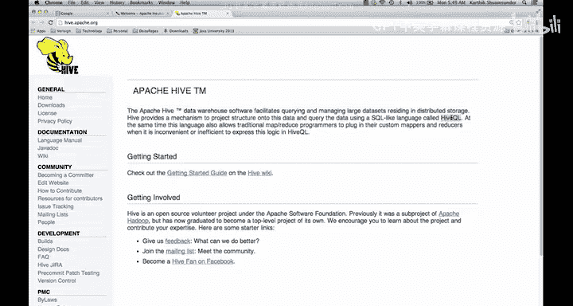

Pig。Pig is a project。That originated at Yahoo。Once again。

 the data scientists and data engineers at Yahoo wanted an easy way to access the data in HDFS。

So the motivation behind PG at Yahoo was to make it easy for data scientists who may not be Java developers to access the data in HFS。

Pig allows data engineers to load， transform， and store data using what is called a data flow language。

So the idea here is that users express their scripts in a language called pig Latin。

And basically pig Latin code gets translated into Ma Reduce code once again。

 you don't really have to write any Ma Reduce code， you don't have to be a Java developer。

And the cool thing about pig is that it works with or without schema in fact there is a running joke that says pigs eat anything so pigs can consume with schema or without schema it is considered to be more powerful than hive because in hive everything that you can do can be done if you can express in one line sQL that's great。

 otherwise you cannot really do much with SQL。But with pay， you can do a lot more。

 you can write complex scripts。So there's a little bit of a learning curve when it comes to pain。

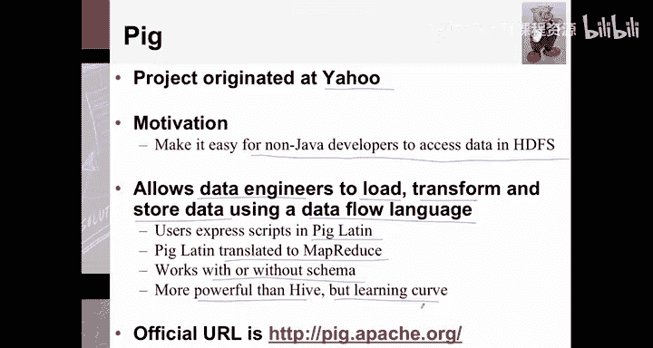

The official URL is pig。appache。org， so let's try to visit it and see。Okay。

 so here's the logo for pig。

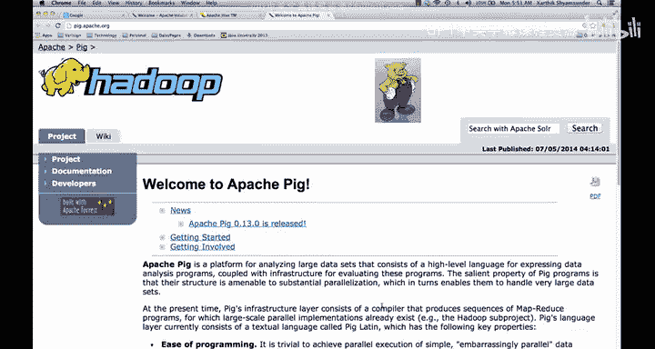

At the time of this writing， pig 0。13 was released。

It says Apache PG is a platform for analyzing large data sets that consists of high level language for expressing data analysis programs coupled with infrastructure for evaluating these programs。

It's exactly what I said a few minutes ago。Right， so let's look at the next project。H space。

ASpace is a project that originated at Facebook。Facebook is one of the first。Adoters of Hadoop。

 in fact， Facebook is the one that generated or developed the hive project for their data scientists and data engineers。

 but Facebook was also interested in having some kind of a NosQL database built on top of Hadoop。

 and they wanted to do this thing in order to solve the Facebook inbox problem for messaging。

So they took the Google big T printerer and decided to write a no SQL database called Hspace on top of Had do。

And that's really the age based project。So in the process。

 they built a distributed scalable column oriented versioned database， which is a NosQL database。

 this this HSp project provides real time access to the data so you can do cru operations。

Rather than a badge oriented approach。Of， this means that you can store billions of rows in an age based database。

We'll be taking a deeper look at age base later on in the course。

The official site for Hspacease is Hpa。apache。org。So let's take a look at that。

There's Apache H base and by the way， base stands for basically available soft state eventual consistency。

 so Hadoop basically available soft state eventual consistency。

A basisis kind of an opposite term to acid， which is atomic， consistent isolation。

 durableable databases。So Apache HBase is the Hadoop database。

 a distributed scalable big store database。Scoop。Scoop is a project that originated at Cloud Era。

As Cloududera was consulting with the customers， they saw a common need for the Cloudrara customers。

Where they wanted to bring in data from relational databases into Haddoop and then process the data and take it back into relational databases。

So S is really a take on SQL and Haddoo， it allows you to take data from relational database systems and bring it into Haddo。

And then take it from Hadoop into relational database systems， it can go both ways。So two。

Its so scoop is a tool that allows you to do data transfer between Apache Hadoop systems and structured dataset sets such as RD Bm The cool thing about scoop is you really don't have to。

To much programming， in fact， out of the box， it has JDBC support for data sources。

 which means out of the box we can use the tool to import the data in or export the data out into relation databases。

All you need to do is configure a connection， specify the RDBma scheme and the tables and the columns to import scoop doesn't have to be really used for just relation database imports and exports it can be included。

To do custom integration modules so you can integrate with other systems too for that。

 you have to write some code。We will be looking at scoop in more detail later on。

So let's look at the scoop project， the official site is scoopop。apaceache。org。Just right there。

Scoop is a tool designed for efficiently transferring bulk data between Apache。

 Hadoop and structured data stores such as solution database。

Flulum is another project that originated at Clarera。As Florida engineers were。

Consulting with the customers， they saw a need where。

Many of the organizations needed to bring in web server data or message data from these different systems across the Ed sites into the Hadoop cluster。

So Fme is basically a distributed reliable available service for efficiently collecting and aggregating and。

Moving large amounts of data， especially log data into the cluster， as you can see。

 you can have web servers and those web servers are connected to something they called sources。

Through a channel， it brings the data into the Hadoop cluster。

 so they have something called sources and things， which you configure in a Hadoop cluster。

There are similar projects in Hadoop that allow you to do this， for example， Chakwa is one。

Flom is actually much more preferable in the market because it's got much better features than what Chauckwa allows you to do。

Let's take a look at flu。It's flun。apache。org。Zookeeper。

The zookeeper is actually a centralized service。That is used for configuration information。

Across the cluster。For distributed synchronization of components within the cluster and also group services for leader election。

 so what does this mean？When you have a cluster of machines。

 these machines need configuration information。How can we centralize the configuration information for the cluster well zookeeper offers a service that allows you to do that so you can keep all the configuration information in the zookeeper cluster。

Which is usually an odd number of services that run one， three or five or seven services。

And then all the different services in the cluster can go to the zookeeper service to get access to configuration information。

 So single centralized configuration information， this is very common。In distributed computing。

You can also do distributor synchronization。Within a cluster。

 you can also use zookeeper for leader election， for example， in the case of Hadoop HP。

 there is something called the H master and HP。Which is the primary， the brains behind H space。

 then there's also a secondary H space H master that runs。

But it's not really the master right now they both are running， the primary master is running。

 the secondary master is also running， but if the primary master goes down。

 the secondary master has to be elected to be the leader zookeeper can allow you to do that and that's exactly what zookeeper gets used for in HP project it could be used to do other things too but there's an example of how zookeeperkeeper gets used within Hadoop the official site for zookeeper is zookeeper or Apache。

org so let's take a look at that。Apache Zookeeper is an effort to develop and maintain an open source server which enables highly reliable distributed coordination。

 so it's primarily a distributed coordination service rather than a big dealer service。

And whenever you have distributor computing systems。You may want to use Zookeeper。Aro。

 Avro is a project that originated at CloudEa， the motivation behind Avro was to build something that's better than thrift or protocol buffers。

 which are basically data serialerilization tools。And the advantage of A is that it allows you。

It's a library， it's a data solution，s a library that has rich data structures。

Wwhichch allows you to store data in binary format。

 and also there are schemas that you can develop in AVro which can be defined in JSON。

One of the key features of Avro is that the schema is stored with the data。

 so if you bring in data into the cluster and store the data using the Avro format。

 then it's much easier for tools like PG and Hve to read the data and make sense sort of it because the schema is already built10。

In a way， you can think of Avro as a better version for thrift or protocol buffers official site for Avro is Avro。

appache。org。Let's click on it and take a look at it， there's Avro。

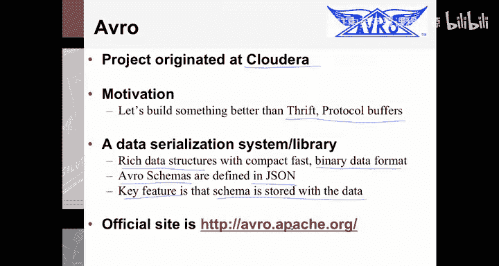

AVro is a data serialization system。

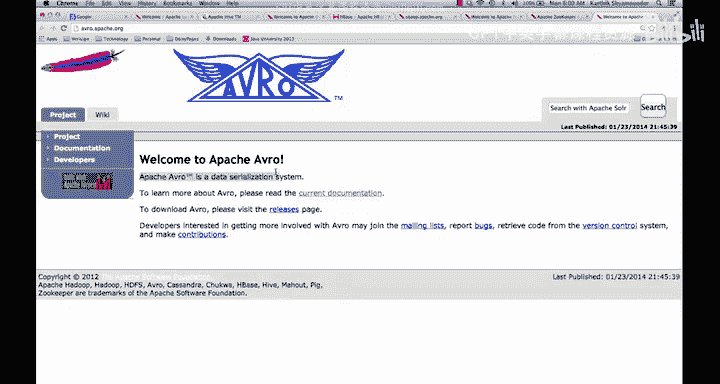

Uoozy。Uuzi is a project that originated at Yahoo。Inside Yahoo， there are thousands of machines。

in their cluster and there are thousands of jobs that are running on a daily basis。

 so Yahoo needed a mechanism for managing triggering these thousands of jobs so Yahoo built this tool called Uzy that allows you to do workflow coordination。

Or within the cluster。Basically， with Uzy， what you can do is you can trigger jobs based on time。

almost like a Chon job or you can base it on data availability。

 you can say this job should be triggered or this Hadoop job should be triggered when this data appears in this file system or on this directory or this job should be triggered at this time。

 so the entire workflow management can be done using Uzi。The official site for Uzi isoozy。apache。org。

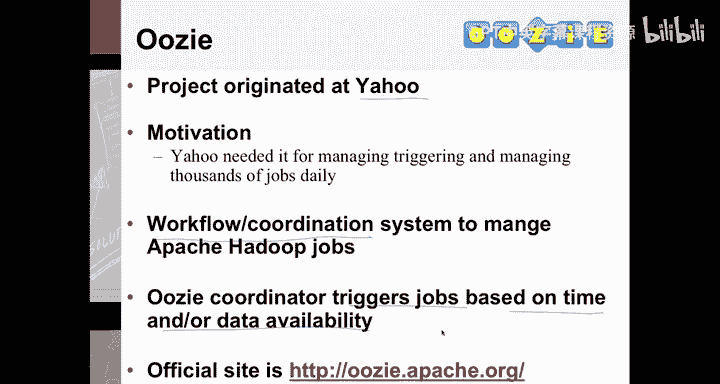

There it is， U is a workforce scheduler system to manage Apache Hadoop jobs。And you can express your。

Your job sequence using something called the directed acyclical graph daAGs。

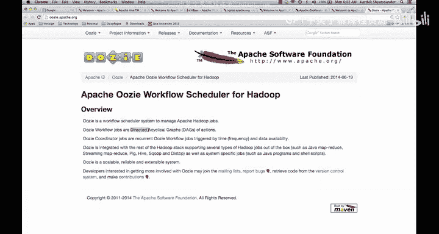

么后。Mahad is a Java based machine learning library that is built on top of Hadoop。

To be precise Hadoop Maprouce now there are lots of machine learning libraries in C and C++ and there are some Java based machine learning libraries like the Weau library。

 but the cool thing about Mahat is that it's a machine learning library that is implemented on scalable distributed system。

 which means machine learning algorithms inside Mahat can be done on top of Mareduce rather than a single machine processing Mahat has an interesting name because the word Mahat。

Actually means elephant trainer in Hindi。And when you're writing machine learning algorithms。

 you typically train your data and thats I guess that's the connection there。

 training elephant trainer and training the data and machine learning algorithms。

When it comes to machine learning algorithms， we have something called the three Cs of machine learning algorithm。

 which is clustering， classification and collaborative filtering。

 and how allows you to do all these things， they have algorithms for allow to do these things。

The official site from Mahat is Mahaapache。org。So， let's look at。There is thema hope site。

The project goal is to build scalable。Machine learning library。한발り。

Abar is a tool that originated at important works。Andm what is a tool that allows you to provision a cluster？

You can， it's a goUI tool， you can pick services for your cluster。

 whether you want hive or pigG or Fme or Mahald， what are the different components that you want。

 and then you can install the components in the cluster and manage all the services in your cluster and even monitor your services in the cluster。

So it is a management tool and the motivation was to make 100% open source tool that allows you to do monitoring of the cluster。

If you look at companies like Cloududerra and Mapr。

They take the Hadoop ecosystem projects and bundle it and package it and create their own distribution。

But when it comes to monitoring and administrative tools， they have proprietary software for that。

 but the Hton works guys said that even the monitoring tool should be for free。

And the only charge should be for consulting and support services。

 so it's a different mechanism or a different business model that they have。

 but embardi is a tool that was actually created by Horron Works because they wanted also a monitoring tool for Hadoop or administrative tool for Hadoop which is open source。

 which is some of the other companies。The official site for Ambari is Ambardi。apache。org。

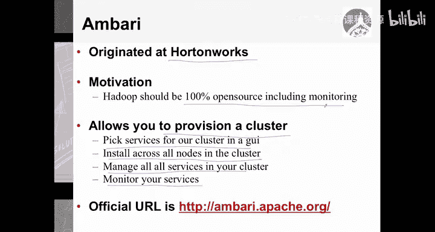

So let's quickly visit that。

Pris Burri。So the embodied project is aimed。In making Hadoop management simpler by developing software for provisioning。

 managing， and monitoring of Apache Hadoop clusters。

So in this section。We。Categorized various Hadoops of projects in the Hadoop ecosystem。

We saw where we can find more information on new Hado projects in the Apache incubator website。

Finally， we got a 50，000 foot view of some of the projects in the Hadoop ecosystem。Of course。

 later in the course， we'll be doing a deeper dive on some of the key Hadoop sub projects。

