# 约翰霍普金斯大学《Hadoop大数据处理｜Big Data Processing Using Hadoop》中英字幕 - P14：13_Hadoop发行版本.zh_en - GPT中英字幕课程资源 - BV1g5u6zBExs

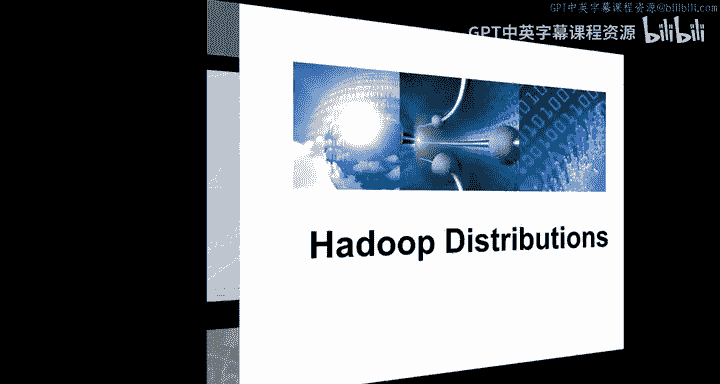

Heddu distributions。In this section， we will look at the status quo of open source Apache Hadoop distributions。

Various commercial distribution platforms in the marketplace including Cloud Hado platform providers。

 and finally we will decide on the distribution of Hado that we will be using in this class。

Let's look at the Hadoop distribution problem scenario。Let's say you want to use real。

 so you go to Hadoop。apacache。org。Download the latest version of Apache Hadop。Install it。

 configure it， bring it up， and begin to use it。After some time you realize that you would like to use Apache HBase。

 the real time No SQL database built on top of Hado。So you download Apache HSpase。

 but then you realize that it requires the older version of Hadoop because it depends upon the older version of Hadoop HDFS because you want to run Hadoop and HBase together。

You downgrade to the older version of Apache Hadoop because it doesn't affect your existing project。

And so you Hunkydori， everything is working fine， now you have Hadoop and HPB working。

After some time， you realize that you want to download P and install it for doing data analytics。

So you download PG， but then you realize that PG only works with the newer version of Apache Hadoop。

And so if you upgrade Hadoop。To the newer version， that is going to break h base。

You see the dilamma over here。This is the kind of dilemma that I was facing when I started to use Hadoop about four or five years ago when there was no commercial distribution available。

And then there is also this problem of support。

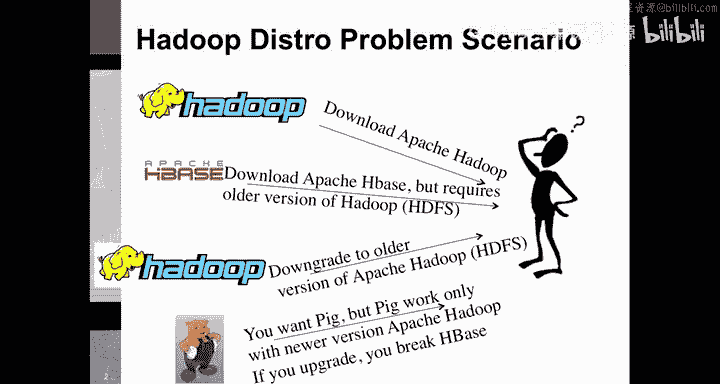

Who do you call when there's a problem？Let's look at the problem with the status quo。

All the way from building to testing to packaging to deploying。Haadoop。

 the current loosely coupled nature of the Hadoop project。

 and all these sub projectsjects has some limitations。First。

 there is insufficient bills that are being done against the trunk versions of the dependent projects like Hve。

 pigG， HPace， zookeeper， and so on。Second， there is insufficient tests run against the trunk version of the rep projects。

Third， there is no consistent packaging for the Linux servers。

 which can provide a single Hadoop data center platform for all of us to consume。

Then finally there is no functional testing against the multim clusters if you think about it。

 Hadoop is a clustered project which means you run it on a cluster of machines。

 somebody has to sit down install Hadoop and test it out to make sure that it is working on a cluster of machines properly。

And that's where the Hadoop distributions。Come intovain。

Haadoop distributions aim to resolve version in compatatibilities between Hadoop and sub projectsjects。

Their primary value proposition is to provide a comprehensive。Tested， supported。

 highly available Hadoop distribution for both Hadoop and the related projects。

 so you don't have to worry about all these incompatiities in the Hadoop software。

There are several vendors that are offering Hadoop distributions。

There is the Apache big Do open source distribution itself。

And then there are commercial distributions like Cloud Air distribution， Horenworks distribution。

 Map R distribution， Amazon， AWS Elastic Mare， also Microsoft， Cloud， Azure， HD Insight。

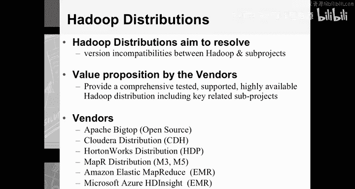

Let's look at these distributions in more detail。

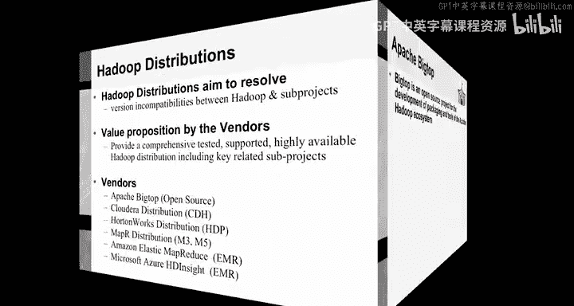

Apache big。Is actually an open source project for the development。

 packaging and testing of Apache Hadoop and all the sub projectsjects in the Apache Hadoop ecosystem。

All the major distributors are actually using BTo internally for their platform bills。

 tests and packages。But I don't really know of anybody personally who is using Apache big Do distribution for their company。

 for their corporation or their enterprises。The official site for big Doop is bigdoop。appache。org。

Notice it is a top level project about a couple of years ago， it was an incubator project。

So let's take a look at big top。

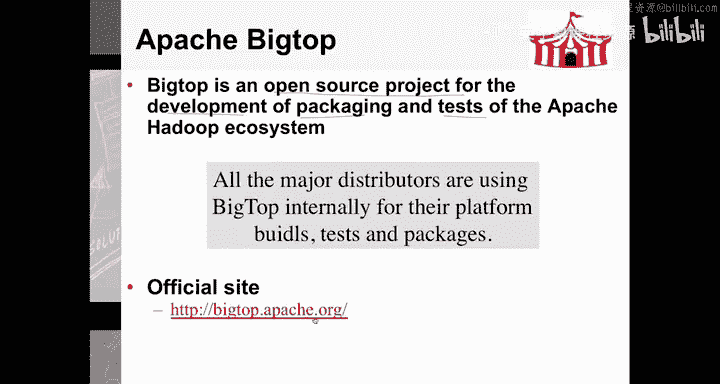

There's Apache big top。Sos Big is a project for development of packaging and tests of the Apache ecosystem。

It shows you what does it take to build Big top all the different libraries that you really need and how it can be used for contiguous integration。

 all the tests to make sure that you can build it successfully on a platform。

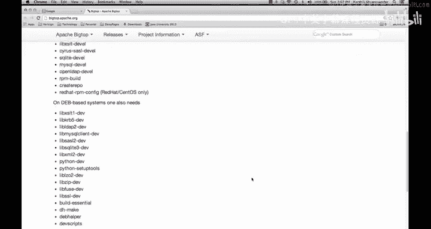

Let's look at the Cloud error distribution for Hadoop。

 Cloud error offered the first commercial distribution。

What CloudEra has done to Hadoop in terms of packaging is exactly what Red Hat accomplished for the Linux platform。

The Cloudra distribution is 100% open source Hadoop distribution， but with a small twist。

 and the twist is the Hadoop software itself is 100% open source， but the administrativeist console。

 the management console for operations that they provide is not open source。

The cloud error our distribution for Hadoop is called CDH。

CDH standing for Cloud art distribution for Hadoop。And the official site for Clouddera is Cloududera。

com。Let's look at clouderra。com。Here's the official Cloudera site。As you can see。

 they offer various products， professional services， training solutions。

 several they have several partners。And there are blogs， very good resource for information。

Now let's look at the map or distribution。MapR offered the second commercial distribution。

They are 100% open source Hadoop with a twist。And the twisters the。File system implementation。

 which is the HDFS implementation， is actually based upon a proprietary C++ implementation。And also。

 their admin management console is also proprietary。

They claim that their C++ implementation is much faster than the Java based HDF implementation。

Map or Hadoop distribution is called the MC series。M3， M5， M7， and so on。

Official site for Mapr is mapr。com。So let's take a look at that。

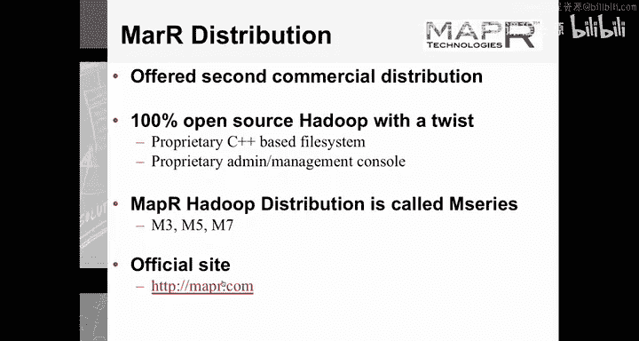

是。

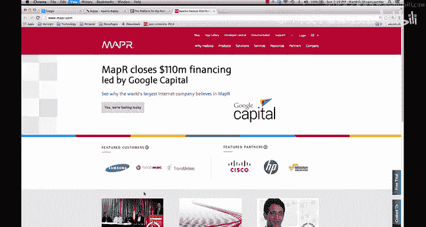

Here's Mapbar。Interestingly， at the time of this recording。

 notice it says Map R process $110 million financing led by Google Capital。

 Google Capital is a fund that has actually invested $110 million in Ma R。

 so that's a good thing I guess for Map R。And they also offer。Solutions， consulting， services。

 training， and so on and so forth and by the way this is Svevis， who is the CTO of Mar。

 he was also one of the key developers of the GFS file system， the Google file system。

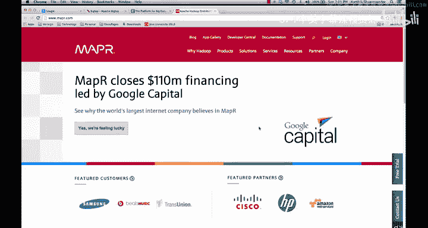

Now let's look at Hton works distribution。What and works is the third commercial distribution of Hado。

Its founded by ex Yahoo Hadoop experts， these are the guys that worked on the Hadoop software itself。

 so it's a spinoff of Yahoo。It is truly 100% open source Hadoop software without any twist。

The Hadoop software itself is， of course， 100% open source。

The administrative console and the management console， which you can do operations。

 is also 100% open source and it's a tool called Ambarri。

The Hortonworks Hadoop distribution is called HDP， Hortonworks data Pla。

Official site for Houghtonworks is Horoughtonworks。com。Let's go ahead and take a look at that。是的。

There's certainton works right there。Again， they have their own distribution， they offer solutions。

 of course， services。Training， and they also have the blog。What their on。

Then there is also the Amazon AWS distribution， as you know， Amazon AWS is a cloud provider。

 so Amazon AWS has extended their cloud services to include Mareduce called Elastic Mareduce。

It is built on top of Maor distribution， basically the Amazon AWS guys worked with the Mar guys to implement Hadoop in the cloud。

 typically when people implement Hadoop， they implement it on dedicated servers。

 but Mapor has done some special work with Amazon so that they can implement Mar on a cloud platform。

 it is with some interesting things that an AWS has done。In order to get MaA running in the cloud。

There is also special integration with the S3 file system。

You can also bring your own distribution of Hadoop on IAS IAS is infrastructure as a service。

 as you know Amazon AWS offers infrastructure as a service。

 which means you can bring in your own Hadoop cluster up by bringing virtual machines up and you can surely install your own distribution of Hadoop within that。

 but Amazon has done all those things for you so that you can just implement the service directly。

Amazon cloud service is called EMR。of course in mr transfer elastic map reduce。

Official URL for Amazon Elastic maps right here。

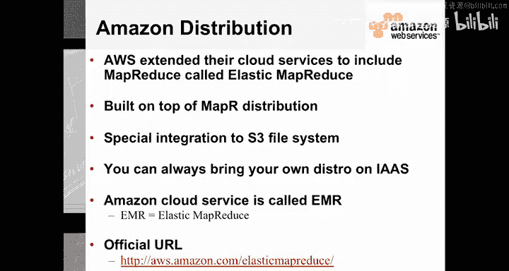

Just click on it。There's the El Ba produceduce EMR there's even a video that you can watch if you want。

One of the cool things about elastic map reduces。The rate at which you can add servers on the fly and also bring down the number of servers are're using for you。

Elastic map produce computation。There is also Microsoft distribution， as you know， Microsoft。

 Aure is the Microsoft's cloud computing platform。Microsoft Asia。

Extended their cloud services to include Mareduce called H Insight。For this。

They worked with HortonWorks， so it is built on top of the Hortonworks distribution。

 runs on the Microsoft platform in the cloud。Official URL is Asiaure。microsoft。com。

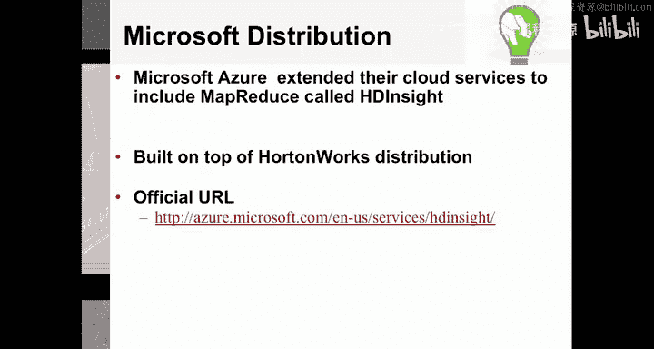

Let's take a look at that。There is the Microsoft HD inside service。

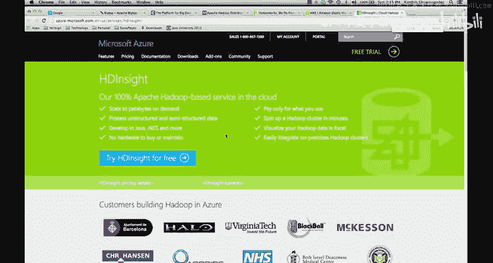

That they are offering？

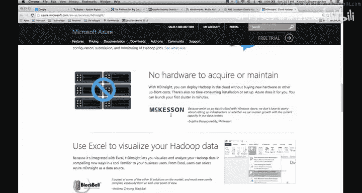

You can also get a free trial over there。

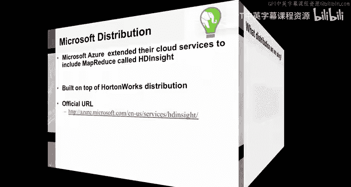

So the question is， what distribution are we going to be using in this class？

We could use any of the commercial distribution because they all give you a limited version of their software for free。

 in other words， you can run it for up to 50 nodes or 25 nodes depending upon the vendor that's giving you this。

But then I don't want to favor any specific distribution in this class Moreover。

 I want you to understand how Hadoop internalnals work， how to download the latest version。

 how to install the latest version because there are new Hadoop sub projectsject that I'm going to be coming into so I want you to experience that and that's why in this class we're going to be using the open source Apache Hadoop distribution and all the related distributions directly so I'm going to ask you to download these distributions on the fly as we go through and then we'll use it。

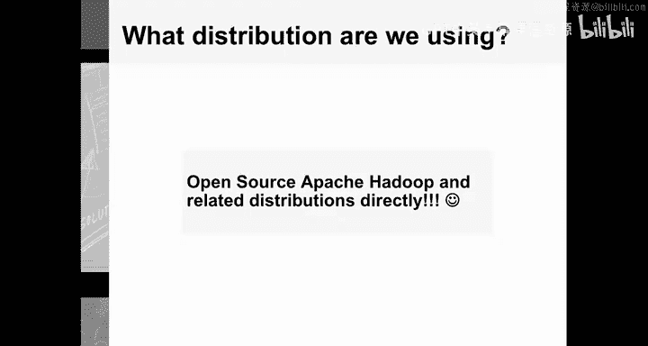

In this section， we looked at issues that one could face when using open source Apache Hadoop distributions。

We also looked at various commercial distribution platforms in the marketplace， such as CloudEra， CH。

 Mapr， MCDs and Hordenworks HP platform， including some Cloud Hadoop platform providers such as Amazon。

 AWS， Elastic Macred， or also called EMR and Microsoft， Azure。HD Inight。

We also said that we will be using the open source distribution of Haddo because we can handle it。

