# 约翰霍普金斯大学《Hadoop大数据处理｜Big Data Processing Using Hadoop》中英字幕 - P15：14_Hadoop文档体系.zh_en - GPT中英字幕课程资源 - BV1g5u6zBExs

Hao documentation。In this section， we will look at various sources for Hadoop documentation。

 including Dos， wis， blogs， books， and conferences。

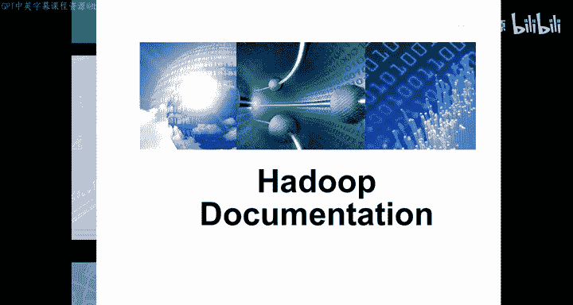

I must say that the best place for the Apache Hadoop documentation is the Apache Hadoop source code itself。

Many times I get into a situation where I want to know how things are working behind the scene。

 and there is really no web page or web articles or blogs or books that answer my question in such a case。

 I simply open the Apache Hadoop source code。Go through the code， trace it。

Debug it and figure out how things are working。 So that is the ground truth。

 That's one way by which you can figure out what's happening in Abaache Hadoop。

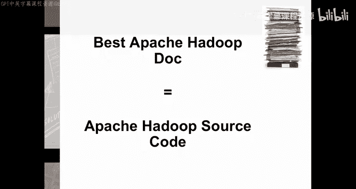

Having said that。The official Apache Hadoop documentation is Hadoop。appache。

org/common slashdocs slash release number If you don't put the release number。

 it'll take you to a web page where it'll list a list of drugies where each directory is a version number。

And when you click on the version， it'll take you to the documentation for that particular release。

All， so let's take a look at that。There it is， here's Apache documentation。

So here's all the different version numbers if I want to look at the documentation for the release 0。

19。0， I click on that， there it is， so there's the command guide， the quick start guide。You know。

 this CPp guide， Hadoop streaming guide is a lot of this is a lot of information over here。

If you want to look at the current documentation， if you don't have the release number。

 you just go over here， of course 2。3。0 was the latest version when this recording was being done。

Okay。I've also listed over here， a list of。Apache Hadoop sub projectsjects and its documentation。

 I must warn you that these URLs may change over time， so beware of that。Abaache Hado Piki。

Bickies are typically sites where people contribute their best practices， their best use cases。

 so other people can learn from it。The Apache Hadoop Wiiki page is wiki。apache。org。Slash Hadoop。

Let's click that and take a look at it。There's the key page right there。

It's got some information on Apache Hadoop， how to do certain things。

Different from what you see in the documentation page。

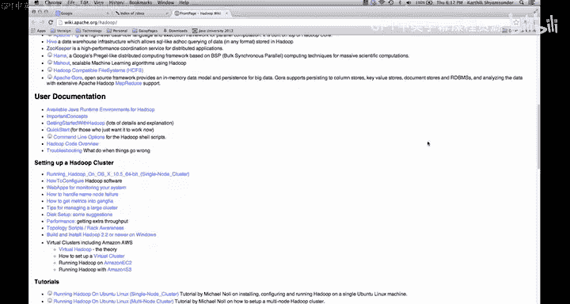

Once again， I have listed some of the Apache Haddo subproject Wiki Hs。

Please be aware that these links may change over time。Haadop logs。Of course， on the internet。

 you can find tons of blogs on Hadoop。But there are two blogs that I want to bring to your notice。

The first one is the blog by the clouder company。 It's the official blog。 You can find it at。

Clouderra。com/blog， it has practical tips， usage and gotcha on using Hadoop of course it concentrates on using the Clouder distribution for Hadoop。

 but it's got general purpose Hadoop information too so that's worthwhile for you。

It's organized by several topics。Based on Cloudrous experience supporting the customers。

You can also search on these blockss， so let's click on it and let's see that it takes us。

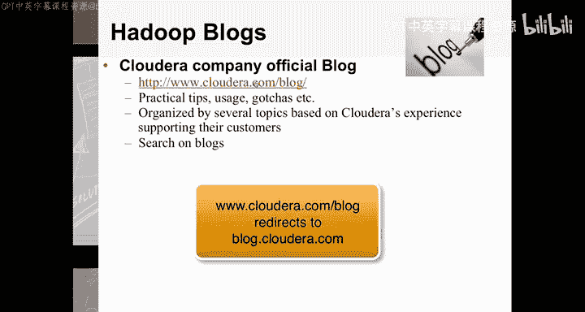

So there's blog。clouder。com s blog right there， here are the various topics。

 so for example if you're interested in all the blogs that are related to HSp， you can click on it。

 there's about 128 articles on that right you can also search on the blogs。

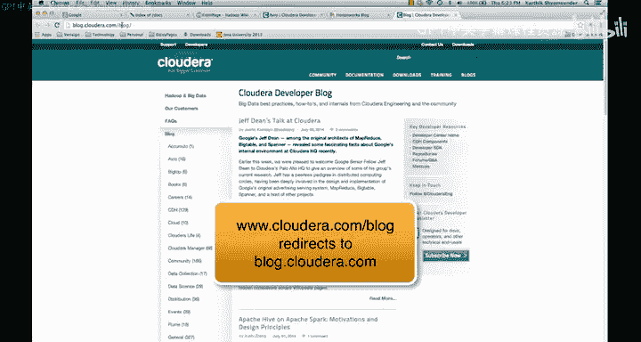

Then there is the blogs by HtonWorks。Their site is hottonworks。 co slash blog。

 they also offer practical tips and usages and gotchas and using Hadoop of course。

 concentrating on the。Qut works distribution for Hadoop。

 but they have general purpose information also on Hadoop。Since they are a late comeer to the market。

 they don't have as much information as Clauddiros blogs have。But it is growing。

You can also search on the blogs。Let's click on Hoden Works blog right there。

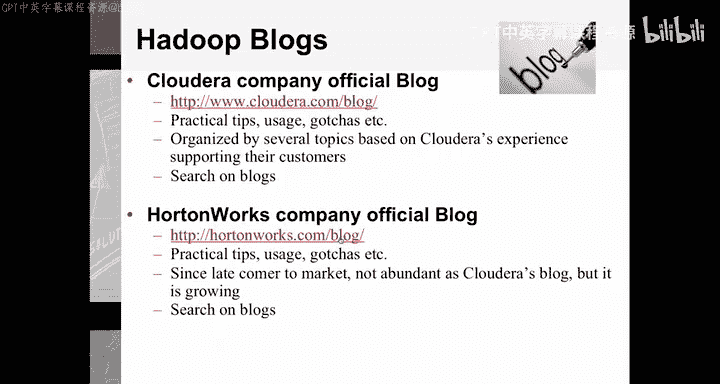

So here's all the blogs that we have from Heartorton Works， you can also search on the blogs。

They don't have groupings。Or based on topics like Cloud or a Ha， but they have blog groups this way。

 like blogs from the dev team announcements， the Hadoop ecosystem blogs， Hadoop Insights blog。

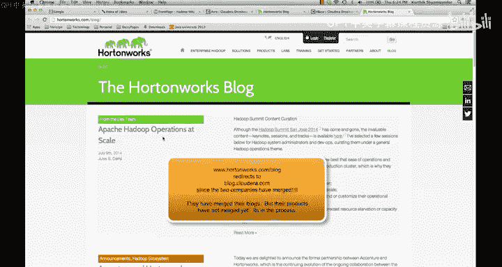

And so on and so forth。Haop books。There are about a dozen or so Hadoop books that I would like to review。

The first one is Hadoop， the definitive guide。By Tom White。Third edition。

This is a definite must have book， if there is a book on Hadoop that you should buy。

 it would be this book right here。It is a theoretical book on how the internal of Hadoop works。

Both on the Hadoop project itself and some of the sub projectss like the Hi project。

 the H based project and the P project。Haadoop inaction book written by Chuck Lamb。December 2010。

 as you can see， this is an old book， there is no second or third version of this book。

 It was a great book once upon a time， but，It's not worth getting anymore。

Then there is Pro Hadoop written by Jason Venner。I never liked this book。But then。You know。

 it hasn't been republished， the material is pretty old， so I wouldn't recommend。Getting this book。

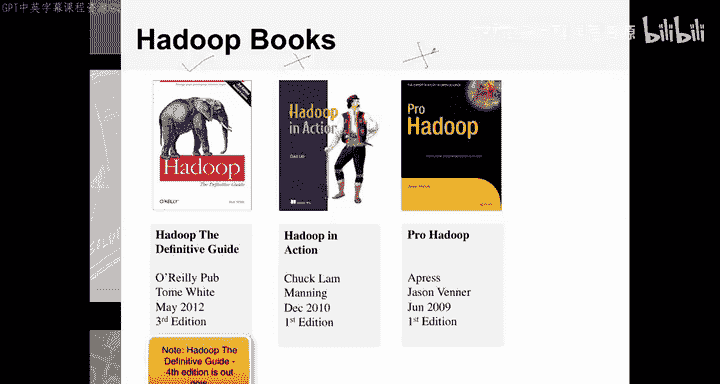

That is Hadoop in practice written by Alex Holmes， Alex Holmes was actually in my team when I was at Verign working on some of the projects over there。

I wrote the course， Alex wrote the book， this has lots of practical advice on using Hadoop。

This is a great book to have， so I recommend you getting this book if you want。

That is professional Hadoop solutions。Rarely recent book， September 2013， by Rock's Publications。

Pretty good book。If you want to get， you can get that book。If you have Hadoop in practice。

 you don't really need this book。That is also the。Apache Hadoop Yn book。

Which talks about some of the yan related technologies。

 This is the only yarn book that's out there written by Er Morti， one of the cofounders of。

Quton works。

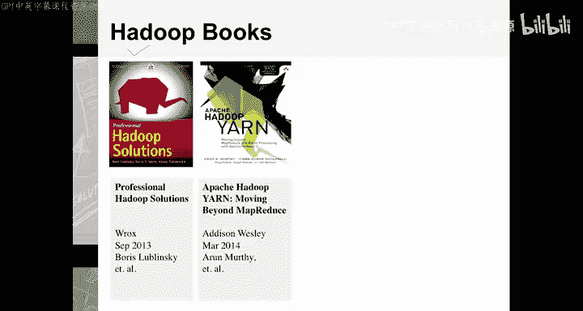

This is a great book if you want to get a book on yarn that would be worth it。Of course。

 this is the only book。There is this ebook called data intensives textex Proing with Ma Reduce written by Jim Lyin。

And Chris Dyer from University of Maryland。

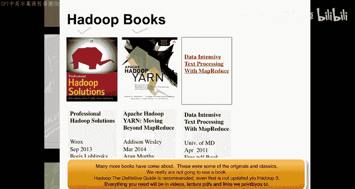

This is a great book to have， I think you can even contribute money if you like the book。

It's a PDF book， it talks about Hado map Red， it concentrates on the map Red aspect of Hado。

It's a free download you might want to get that。

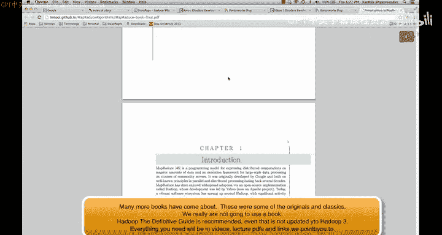

So that's a worthwhile book。

Of course， there is also Hadoop for dummies。If there's a dummy spokebri。

 that means it tells you that the topic is a hot topic。

I don't even want to comment about the dummies book。Theres a book called Hadoop Map Red Design Parts。

 a book concentrating on some of the algorithms， if you have the Hadoop and practice book。

You don't really have to buy this book， otherwise it's not a bad book。Here's a book on Peg。

It's a great book written by Alan Gates， this is a worthwhile book。To have。

 if you're going to be doing pick programming。This is another great book on Hve。

If you want to get that， you can get that。And there's a great book on Hadoop operations written by Eric Sammer。

Wwhich talks about data centers and you know the various Hadoop internals and internal parameters and how to set them and things like that。

 so it's a fairly good book to have。If you're going to be getting into Hadoop operations。

 then you may want to get that work。Then there's a great book on Hspace。

If there is a book that you should get on HBace， it would be this book， it's HBace。

 the definitive guide written by Lars George， who currently works at Cloud Eta。

And there is also age based in action， which I've looked at the book， looks fairly good。

And there's a new book that's coming up called H based Design Patterns。

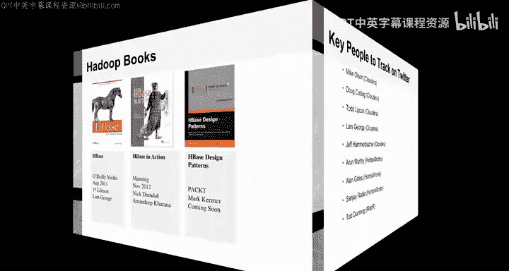

Twitter is a great social media， there are a few people that may be worth following on Twitter if you have a Twitter account。

These are the guys that work at Cloudtto。You may want to follow these guys。

 they from time to time tweet about different things that's happening in big data in Hadoop。

There is also Aaron Morti， Alan Gates and Sunjaardia， who are from Horton Works。

 you can follow them too and Ted Dunning from Mappar， these are great people to follow on Twitter。

I also have a Twitter account and sometimes I tweet， so if you want to follow me。

 that's my Twitter ID。

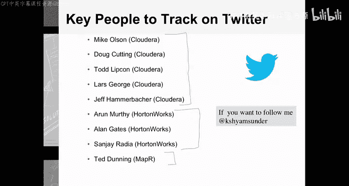

You also have Hadoop conferences that are two major Hadoop conferences。One is Hadoop World。

 it's organized by Cloud Era。It's held in New York City。Typically in the fall。

 the official site is Hadoopor。com。The other one is the Hadoop Summit conference organized by the Horron Work Skyes。

 the other company held in San Francisco， typically in the spring。The official ci is Hadoopsmit。org。

If you're going to be getting into Hadoop， I strongly recommend that you visit either one of the two conferences。

 many times you have speakers that speak at both the conferences。

 but you should attend at least one of them at least once if you're going to be getting into Hadoop。

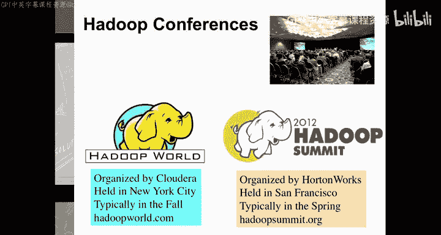

So in this section， we looked at various sources for Hadtop documentation， including dogs， Wiikiis。

 blogs， books， and conferences。But don't forget that the best source for Hadoop documentation is the Hadoop source code itself。

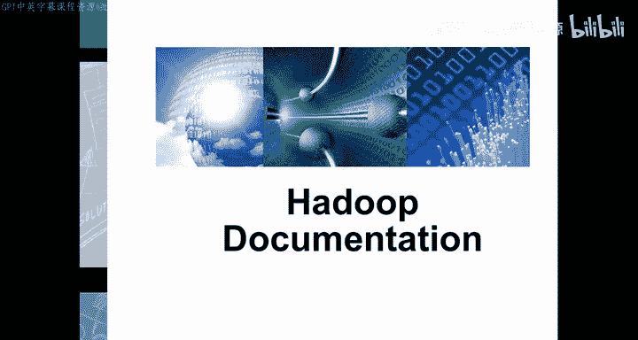