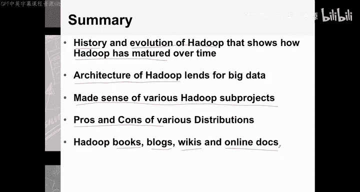

# 约翰霍普金斯大学《Hadoop大数据处理｜Big Data Processing Using Hadoop》中英字幕 - P16：15_Apache Hadoop架构与生态系统总结.zh_en - GPT中英字幕课程资源 - BV1g5u6zBExs

Apache Hadoop Architecture and ecosystems Sm。In this module。

 we saw the history and evolution of Hado that shows how Hadoop has matured over time in order to do big data processing in modern times。

We also saw the architecture of Hadoop and the key principles that make Hadoop so great for big data processing today。

We also looked at the various Hadoop sub projectsjects and made sense of the various projects and even tried to group them。

We saw the various Hadoop distributions that exist in the marketplace and understood the pros and cons of each one of those distributions。

We finally learned。Where we can find more information about Hadoop in terms of books， blogs， Wiikiis。

 and even online documentation。

