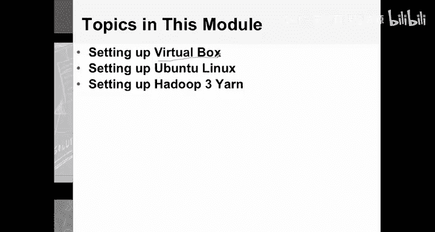
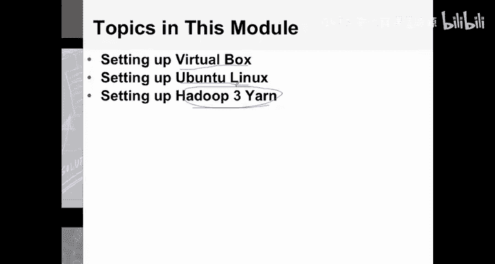
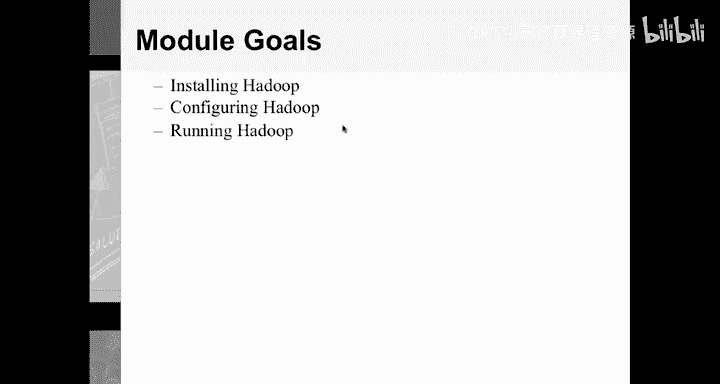
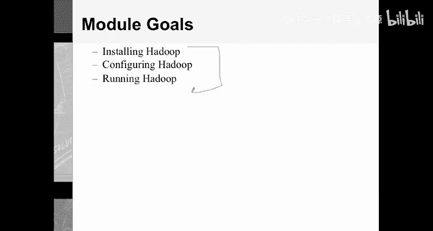

# 约翰霍普金斯大学《Hadoop大数据处理｜Big Data Processing Using Hadoop》中英字幕 - P17：16_Hadoop环境配置与运行导论.zh_en - GPT中英字幕课程资源 - BV1g5u6zBExs

Welcome to this next module， Setting Up and runningning Hadoop。In this module。

 we'll look at how to install， configure， and run Hadoop in a pseudo distributed mode on virtualized Ubu2 Linux operating system running on top of virtualbox virtualization software。

This module is presented predominantly as hands on demos。

 showing you how to set up everything for this class。So what are the topics for this module？First。

 we'll look at setting up virtual B， which is a virtualization manager on our desktop。

Then we will look at setting up and running Ubutu Linux Ubu2 is a Linux operating system which can be run on top of virtual box。

 and that's what we will do。Then we will set up Hadoop 3 yarn on top of the Ubutu Linux operatinging system。

This is where we are going to be spending most of the time。

 so this is the most important section in this module setting up Hadoop 3。

So what are the module goals？

Although in this module well be setting up virtual box and the Ubutu Linux operating system on top of it。

 the primary goal for this module is installing。Configuring and running Hado on top of virtual B。

Don't get too bogged down with all the details on what we are doing and how we are doing certain things。

 I'm going to try to explain those things to you as we go through the installation in this module。

 but things may not be all clear until we go through several modules on the Hadoop architecture。

 the internals of HDFS and Hadoop， so for now let us learn how to set up Hadoop and run Hadoop on top of our desktop。

