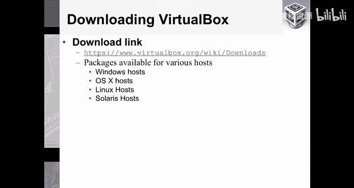
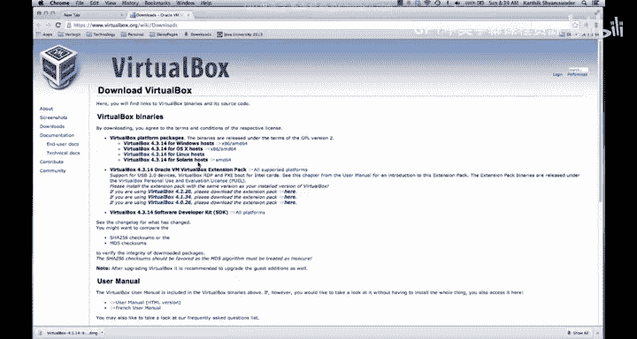
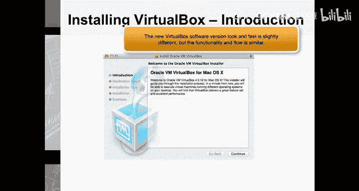
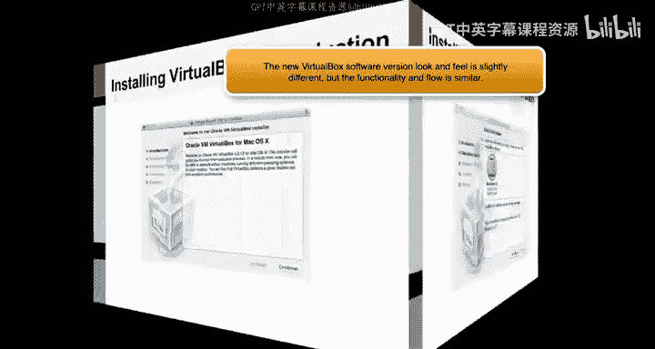
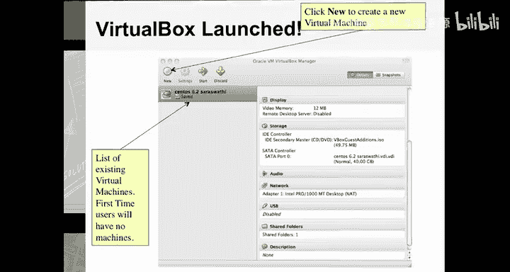

# 约翰霍普金斯大学《Hadoop大数据处理｜Big Data Processing Using Hadoop》中英字幕 - P18：17_VirtualBox安装配置.zh_en - GPT中英字幕课程资源 - BV1g5u6zBExs

그。Setting up virtual box。In this section， I will give you a brief introduction to virtualization concepts。

 Why do we care about virtualization？And the various virtualization software available in the marketplace。

In this class， we will be using virtual B， so I will quickly show you how and where you can download virtual box from。

 installing it so you can install， configure the guest Linux operating system on your host computer to be used for Hadoop。

So what is virtualization？Virtualization is creation of virtual。

 not physical version of IT infrastructure。When you say virtual。

 I mean virtualized server rather than physical instance of a server。

 even your storage devices such as your hard drive can be virtualized。

 your network devices such as firewalls and routers can be virtualized。

 and the cool thing is even your operating system can be virtualized。

 which means you can run a virtualized Linux operating system on top of a Windows operating system。

Virtualization has become a big trend in the IT industry。

 especially in terms of data center consolidation and data center maintenance and management and monitoring。

But why do we care about？Virtualization in this class。We care about it because we want to run Hado。

But Hadoop runs best on Linux， although I have to say that Hortonworks and Microsoft have gotten together and they have done a fairly good job in running Microsoft on the Windows platform。

 but we are going to be running Hadoop on Linux platform。

And since many of you have different hardware and different operating systems on your laptop or PC。

 we want to run Linux virtualized， so it's a standard for all of us when we are doing our。

Projects and assignments。The idea here is that you have your PC or laptop hardware on top of it。

 you may have an operating system such as the Windows operating system On top of it。

 we are going to install some kind of a virtualization software。

Virtual walks would be an example of that on top of it。

 we'll install virtualized Linux like the Cto S Linux。And then on top of it， we will install Hadoop。

So that we can run Hadoop demons and do big data processing using Hadoop。

So what are the virtualization software vendors in the marketplace？We have V and where。Paddles。

Both are paid versions， and there is an open source version of virtualization from Oracle。

 it's called Oracle Vitualbox。This is what we are going to be using in this class。

So what is virtual box？Virtual Box is a crosspl virtualization software。

 which means it is available on the Windows platform， the Mac OS10 platform， Linux， or even Solas。

So you can download a version of virtualualbox software for that particular operating system。

 install it， and then you can run virtualized operating system on top of that。

It can be installed on any Intel or AMD based computer。

 which most of you should be having if you're running anything different， please let me know。

Of course， it's a free open source software from Oracle。

 We like the fact that it's free an open source that's great。 so we'll be using this。

And the great thing about virtualbox is that you can run multiple operating systems at the same time。

 you can run Windows on Linux on your Mac if you want to， or if you want。

 you can run Windows server 8， 2008 on your Linux server。You can run Linux on your Windows PC。

 you can even run Mac on your Mac if you want， or Linux on Linux。

But we are going to be running Linux on your operating system。

 whatever you have installed in your hardware。There are some key virtualization virtual box terms that we should be aware of。

Host operating system。It's the operating system of your physical computer。

 your PC or your laptop or whatever your physical service has some kind of an operating system installed on it。

 and that's what we call the host operating system。

Guest operating system is the operating system that is going to be running inside the virtual machine on top of your existing operating system。

 so it's the virtualized operating system。Virtual Mach or VM is a special environment that virtual B or any kind of virtualization software creates for the guest operating system。

You can actually create even virtualized networks and have all the virtual machines communicate within that particular network。

Guest additions is actually a very specialized software to be installed inside the VM。

 This is a very special concept from virtualrual box。

 The idea here is that if you install guest editions in your VM in your guest virtual machine operating system。

 it can improve performance of your guest operating system and also gives you some extra features such as port forwarding。

Shardding USB drives。Some of the key virtual box features。

Our shared folders allows for sharing or folders between the guest and the host operating system。

 you can also do port forwarding， which means from your host operating system。

 you can connect to ports that's in the guest operating system and vice versa。

You can also do 64 bit emulation。You can also install a USB drive in your hardware。

 in your computer and。See that particular hardware in your guest operating system。

 so there's a lot of cool features that Viualboxox provides。

Downloading virtual box if you want to download and install virtual box， you can go to virtualbox。

org， so let's go ahead and take a look at it。

Here I am， as you can see， you can get virtualbox for most of the operating systems that you care about。

 we have Windows， OS10 Linux and Sos。

Of course， I'm going to be downloading OS 10 version of it。

 which is what I have actually already done and I've already installed it。

Some of you may already have Linux and you might say why do I need to run Linux on top of Linux as a virtualization software。

 you don't really have to， if you know Linux fairly well then you may be able to run Hadoop on top of your Linux。

 but if you run it in a virtualized environment， the advantage is that it's a control environment I'm going to show you the different pieces of software that you need to install so that way you will be in standard form with the rest of the class。

 that's the only advantage of it。But if you really care to not install Viualbox and run virtualization and run Linux directly。

 you're welcome to do that。Once you have downloaded virtualual B。

 you can double click on the DMG file in this case， since I'm using Mac， I have a DMG file。

You just take the software that you downloaded， you double click on it。

 and let's go through the process of installing it。

It'll give you an introduction window explaining to you the version of virtualbox。

 we will be using virtualhelbox 4。3 in this class if there's a newer version available。

 you're welcome to use that too。

Then it basically says that you have one hard drive and gives you the capacity of the hard drive。

You then click on Contio。Here's the place where you can change the installation location。

 I typically sticked the default so it can install in the normal location。

 whether your Windows operating system or the Linux operating system or even the。M opening system。

And then it begins to install virtual box， it takes only a few seconds to install virtual box and then youre done。

 so yeah virtual box is installed， so the whole process should take you no more than a couple of minutes to install and getting it going。

So now you have virtualbox installed， which means you should see a little icon appearing in your desktop。

There's the virtualbox icon， you can double click on it， when you double click on it。

 it launches virtual box。When you launched virtualbox。Here's the virtualbox application。

You'll notice that on top， you see ways by which you can create a brand U VM。

You can also change the settings on a VM， you'll also see on the left hand side pane over here a list of existing VM when you install Wel box from scratch and you don't have any VMs。

You will not see this particular message， you won't see this VM， this is my VM。

 I have a VM called C withy that I've already installed。That's why you're seeing the VM。

 but in your case， it'll probably be a blank pain。

Okay。So in this section we looked at virtualization concepts。

 including some of the key terminologies such as host operating system， guest operating system。

 virtualrualbox Eds， since well be using virtualualbox in this class。

 we learned how to download and install virtualr box on your host computer so you can install and configure the guest Linux operating system in order to run Hadoop later on。

