# 约翰霍普金斯大学《Hadoop大数据处理｜Big Data Processing Using Hadoop》中英字幕 - P19：18_VirtualBox中CentOS Linux虚拟机部署.zh_en - GPT中英字幕课程资源 - BV1g5u6zBExs

Setting up Uuntu Linux VM on Vitual B。In this section i'm going to show you how you can download。

 install and configure Utu Linux on top of virtual box。Haoop runs best on top of Linux。

 so we need a distribution of Linux that we can use so that we can run Hadoop。

There are several distributions of Linux that are available in the marketplace。

 There is the Cosos Linux distribution， which is a free distribution。

 There is also the Ubutu Linux distribution， which is another free open source distribution There is also red Hat Linux distribution。

 which is actually a licensed distribution。 What we want to do is we want to use a free version of Linux。

 and so we're going to use Ubutu Now in the previous classes I have used Coss。

 So you will see that in the future in some of the modules， some of the sections are done on Cosos。

 but basically the commands are the same for both of them。 So it's not an issue at all。

 it's just that the user interface。 the GuI would be different。

 So in this class we're going to be using Ubutu。 If you want to know more about opentu。

 there is the Wikipedia link right here， you can click on it and take a look at it and see the various releases but one interesting fact that I。

What I would like to share with you is that Uuntu is named after the African and Gumi philosophy of Uuntu。

 which means humanity to others with a connotation of I exist for you I thought that's pretty cool Anyway。

 we're going to be using the Uuntu guest operating system on top of virtual box。Okay。

 downloading Uuntu， the official site for Uuntu is Uuntu。com。You go to Uuntu。com。

 you click on download to get to download section and then you download the 604 bit version of Uuntu the LTS software。

 it's about 2。88 gigabytes it's an ISO file you just download that file and then we'll install it on top of it I'm going to demonstrate all these things for you in a few minutes but let me kind of go through the theory first and then we'll do the practical demonstration be handson exercise later。

Okay once you download Uuntu what do you do well you need to install Uuntu on top of your virtual box so here are the six steps that we are going to go through once again I'm going to go through the six steps in theory first through screenshots and then I'm going to show you the actual demonstration hands on。

Okay the first thing we have to do is create a new virtual machine on virtual B which is basically a configuration。

 and then we need to mount the ISO image， which is the image that you downloaded from Uuntu。

com that's a Uuntu ISO file we have to mount that and then we have to configure virtual box to give more CPU to the VM since we are using a guest operating system on top of the host operating system。

 we have to give the guest operating system some CPU so we'll show you how to do that so that your operating system which is the guest operating system which is Uuntu will run quite fast otherwise your Uuntu will run very slow and you want it to run fairly fast because you wanted to big data processing on this operating system。

Then you boot the VM from CD。And then you install the guest operating system。

 so this is where you're actually going through the installation of Open2 and then eventually you'll install what is called the virtualbox guest editions。

 which allow you to do certain cool things like for example。

 you may want to share the drive or you may want to have a full screen window or you may want to do port forwarding all those capabilities are possible by installing virtual box guest additions。

So we are going to go through these six steps first， let me go through the theory。All right。

 so you launch virtualbox and you have to create a new VM or a new machine。

 So you click on this little。Icon over here called new。That will launch a window。

 a dialogueog window。In the dialog window， you type in in the name section， the HD server。

 HD server is the name of our virtual machine。In type。

 you basically say what is the type of operating system， it's Linux。And then in version。

 we will use Ubu264 bit。 you'll see that these two items。

 the type and the version are both list boxes。 So when you click on the little arrow over here。

You will see that they will pop up and you can actually go and select those options。

 So the name of the operating system is HD server。 The type is Linux and the operating system version is open to 64 B。

Then it takes you to the next screen where you will enter how much memory you need for your virtual machine by default。

 it's 1024。But we want to set it to 4096， so do that。And then continue。

And then it says do you want to create a hard disk and we say yes。

 and then it's asking whether you want to create a virtual box disk image， which is a VDI5。

 we say yes and click continue。Now it's asking you whether you want a dynamically allocated hard disk。

And that's what we want。 So that's the default we'll take that。 So click continue。

 Now it's asking you how much storage do you want on the hard disk。By default， it's 10 gigabyte。

 but we want to change that to 25 gigabytes， so change this number to 25 gigabyte。And then， click。

 create。That creates the virtual machine for you。 So it has created a base virtual machine which doesn't have any operating system on it。

 So it's literally a virtual machine。 And so you're seeing the entry over here。 that's the H server。

 So that's step one that's done。Which is creating a new machine。Now we need to mount the ISO image。

So what you need to do is make sure that the HD server is selected since there's only one item in the list box over here。

 it's already selected by default， so you make sure it's selected which is blue in color。

 right mouse click over here， and then it pops up a little pop up window。

 click on settings that takes you to the settings dialog and here you click on storage which is the storage icon that takes you to the storage screen if you look at it on the storage screen。

 there is a little emptyCD， so click on this MTCD over here。And then， click on the little。

See the icon over here。When you click on the C icon， that's going to pop up。A menu。

 and you have the option of navigating to your downloads folder where you are downloaded Utu and selecting that Uun to I O image。

 In this case， I had already downloaded it and it's available。 So I just select that。

We won't do image， which is right here。Once I select that and hit OK。

i have now mounted the i s o image on top of my virtual machine，Allright。

 next thing we want to do is give more CPU to our VM。

 so right mouse click once again on the HD server anywhere over here that brings up to settings。

Then go to system。And then in systems。You will see that there's motherboard processor and acceleration。

 It would be similar like one CPU or two CPU。 You might want to drag this little。KNoob。

 so it's all the way green in your computer。 It's different for different computers。

 depending upon how much computational power you have。 Just make sure that you have given enough。

That is， keep it all the way in green for you so that you have enough computational capacity for the VM。

Okay， so now we have given more CPU to our VM， so that's done， step3 is done。

Now we need to boot the Vm from the C。Okay， so how do we do that， we select the HD server。

 then we click the start button。

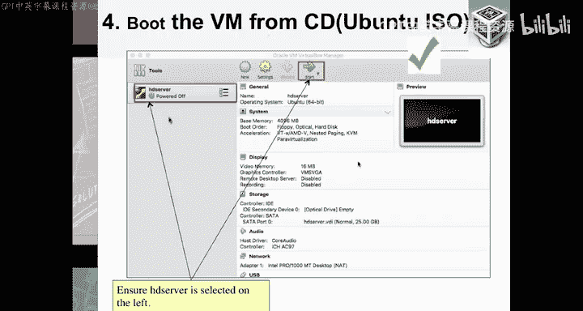

That launches the VM that boosts the U to operating system installation process。

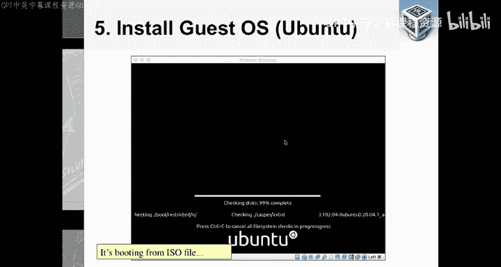

It's asking you， what is the language， it's English by default。

You click on install a window after that。Okay， again， English， English， continue。

It's a normal installation， so continue。Easese disc and install are' going to yeah the VDI。

 the virtual disk images that we have。 we want to erase all that stuff and continue。

 this is not going to erase your hard drive， it's just the virtual disk。We install now。

So click installs now。And then continue。AndNow it's asking you where you're located， in my case。

 I'm in Washington DC area， New York area， East Coast， so the default in New York is good enough。

 but if you're in a different area in a different geographical location。

 you can select the appropriate time zone。You click continuetin。Now， at this point。

 it wants to create。A login account for you。 So what we are going to do is we are going to say that。

The account user ID is going to be HD admin。The password is also HD admin and the confirmation password is also HD admin。

 so user ID is going to be HD admin， which stands for Hadoop administration。

The user name is also going to be HD admin。which is the account holder's name and then the server is going to be called HD server。

 so the most important thing to remember here is that the name of the computer is HD server。

 which is the name of the machine， the Unix machine， the name of the user ID is HD admin。

 which is Hadoop administrator and then the password is also HD admin。

It'll complain that the password is weak， but that's okay。

 it's a local operating system that's good enough， we want to keep it the same for everybody in this class so that if there is an issue at least I can log in and see what's going on over there right so that's it you click continue and then the installation starts you have to patiently wait for the installation。

 it's going to take anywhere from five to 1 minutes to go through the installation。

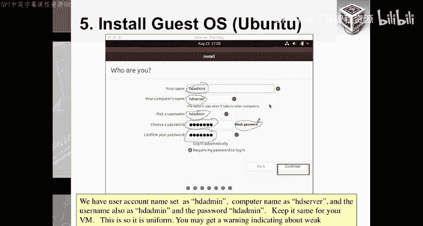

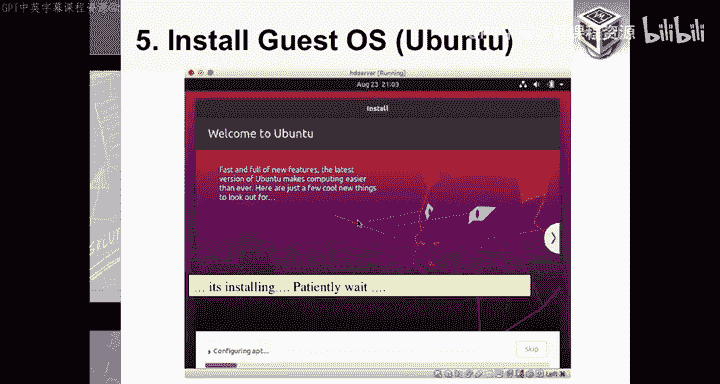

So it's kind of showing you different things that it's doing and eventually it's going to say。

 all right。

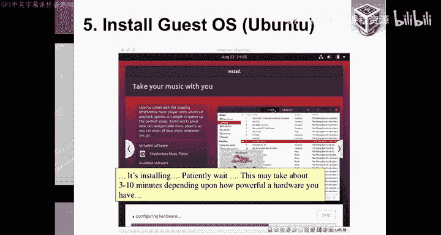

I've done the installation， let's go ahead and restart the computer， so click on restart now。

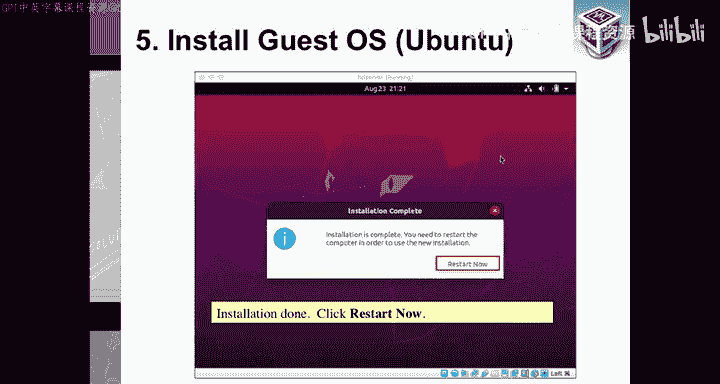

The computer is restarting which is the virtual machine at this point you have to hit enter it's waiting for your input。

 So now it's ready for you to log in remember the user ID is HD admin the password is HD admin also so you click on the little HD admin button over here。

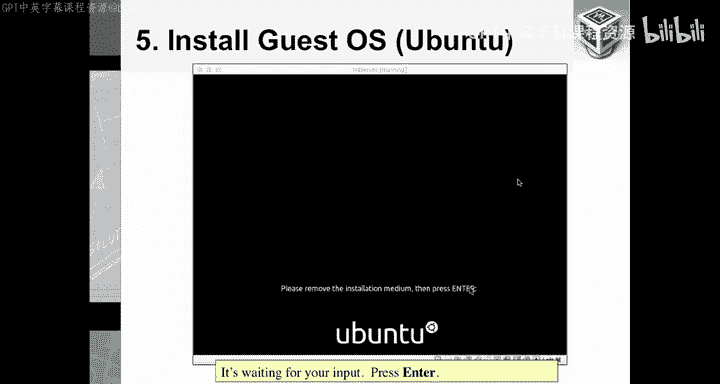

Then what you'll see is the text box and in that text box， you put your password。

 which is HD admin Now if you click the arrow over here。

 it allows you to log into the different user ID and password。

 but we only have only one user ID which is the HD admin user ID and this is the HD admin password。

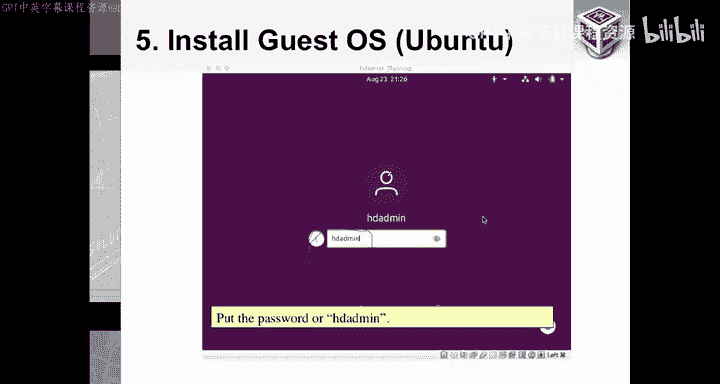

Okay， then it's going to ask you a few more questions。

 You kind of skip through all these different questions， next， next， next。

 you skip through all these things。 and eventually you had done。And。

You're good to go in terms of installing your guest operating system。

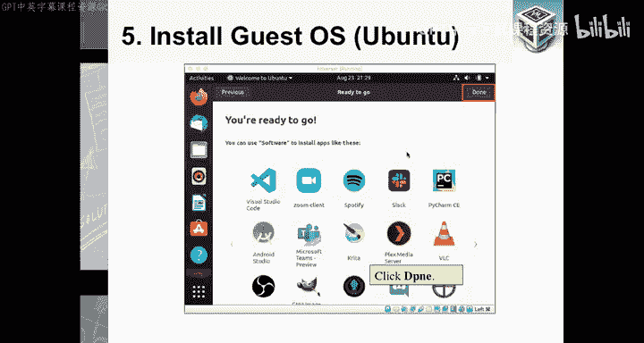

So once you have installed the guest operating system。

 it's giving you an opportunity to kind of get the latest version of the software so update the operating system because you got an image downloaded。

 which is the U to ISO image then there might be some updates since then so it's asking you do you want me to install those updates。

 you say install now yes you click on that button。

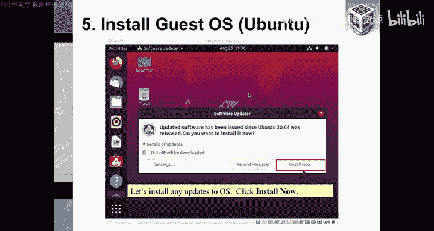

But then it asks you for your password because it wants to switch user into root。

So it's asking you for your password， so you type in HD admin， then you click on authenticuthentate。

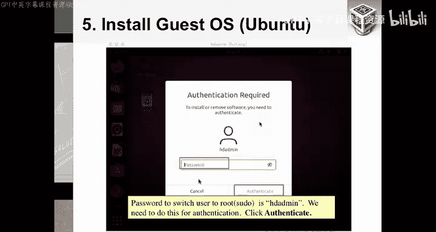

All right， so it has now installed your updates to the operating system also。

Now that you've installed the guest operating system also。

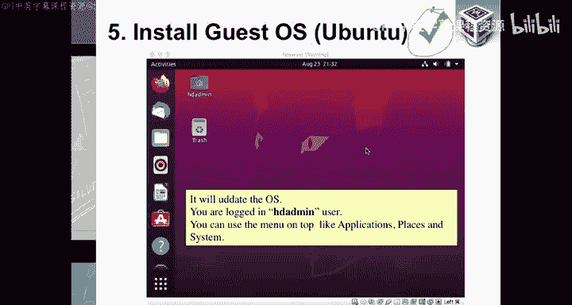

It's time to install some guest additions in order to install the guest additions。

 you have to look at the menu on the top。 If you look at the virtual box menu at the top。

 you will see something called devices and then you'll see something called insertt guest editions C image Just click on that。

It may not do anything， but then if you actually go to the。U to window。

 you'll see that if you scroll down a little bit over here。

 you'll see that there's a little C icon over here。Right nows click on the CD icon。

You'll see that it asks you whether you want to open a new window， you say yes。

 you click on the new window that bringss up a window with the contents of the CD。

 which is the virtual box guest editionions。

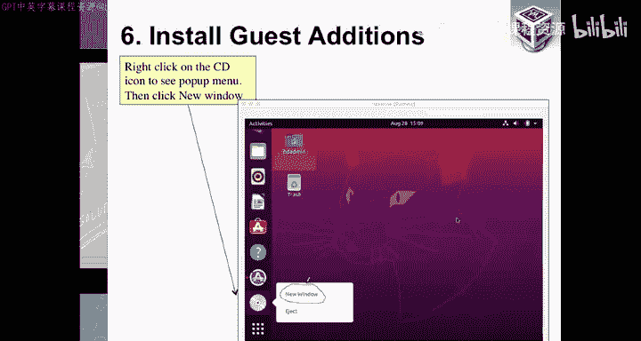

And then you click on run softwareft。That will ask you if you want to run it， you say， yes。

 I want to run it。 You click on run again。

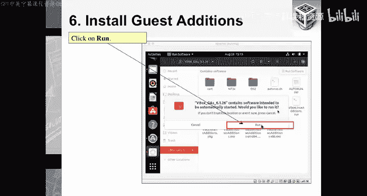

It's going to ask you once again to switch user to the super user。

 so you type in HD admin as the password and you click authenticate。

Once you enter the password and click authenticate， it go ahead and install the guest editions。

 Once it installs the guest editions， you'll see the little message that says press return to close this window。

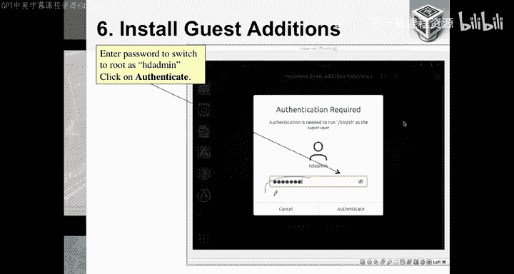

Once you see this message you hit enter and the window gets closed Now the guest editions have been also installed all we have to do to make sure that this takes into effect。

 go to the right hand side there's a little triangle when you click on the triangle it pulls down a menu and then over here you see a submenu with power off。

 you click down this particular icon2。

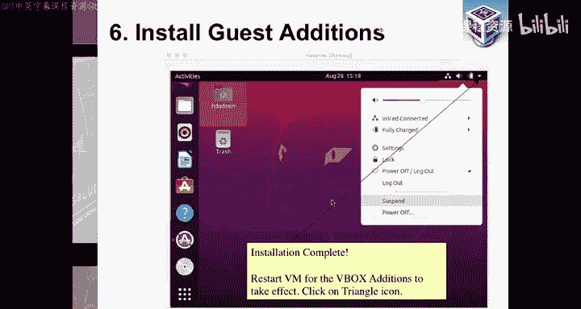

And there it gives you options like log out， suspend and power off， we select power off。

That brings up to another window， which allows you to restart， you click on restart。

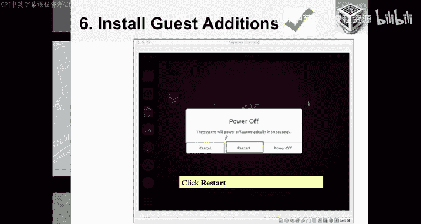

And the operating system restarts。 The installation is done once the Vm starts。You can simply go。

To the top menu and click on view， switch to full screen。

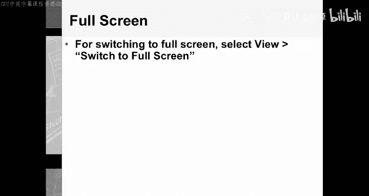

And then that will take you to a full screen version of your U to software。All right。

 so that's how you go about installing the software from a theoretical perspective。

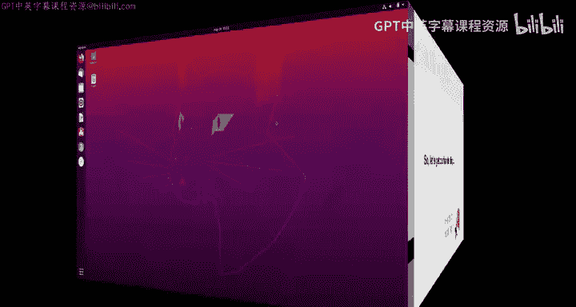

So let's get our hands dirty， let me demonstrate this entire process to you。

All right， so let's go to Uuntu。com。And see where we can download the software from。

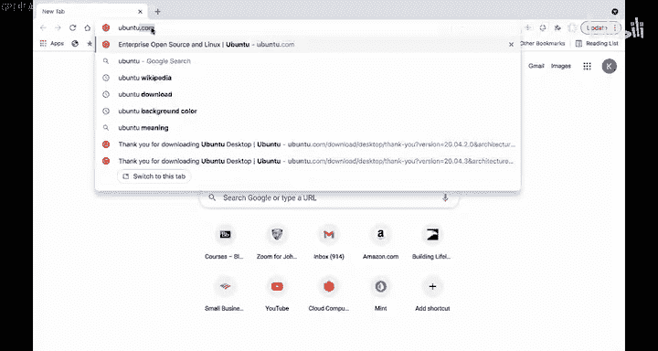

So this is bountu。com。Click on download。This is the latest version right now， 20。04 LTS。

Click on that and that should start the download process。I have already downloaded it。

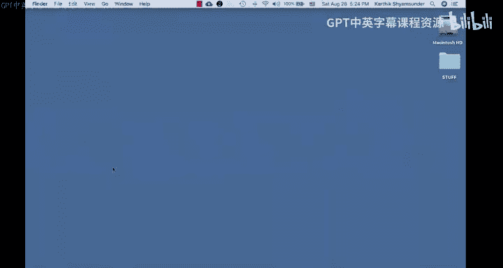

If you look at my downloads folder。I have downloaded the1 to 20。04。Dot 2，0 release。

64 bit version right here。Okay， so let's go ahead and now install Uuntu on top of virtual box。

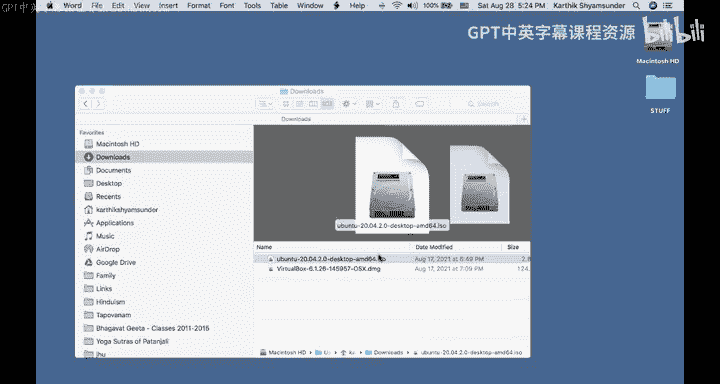

Let me open up virtual box。 So here I've opened up virtual box， click on new。

 type in the name of the machine to be HD server。The operating system is Linux。 The version is。

Upen to 64 bed。Continue。We want the memory to be 4096， I'm going to change that to 4096。

 I have 16 gigabytes of RAM over here， so that's good enough for me。Click on continue。

 I want to create a virtual hard disk now， click create。Yes， I want the VDI。

 which is the virtual box disk image Con， I want dynamically allocated storage continue。

 I would like to get 25 gig of storage for the virtual machine。

 make sure you have that much storage at least in your computer before you do this。佢。

It's going through the create process， it's still creating their rest。So that was actually step one。

 which is creating the basic virtual machine。Pite mouse click， go to settings。

Now we want to mount the ISO thats。Step two， so click on storage， click on empty。

Click on the little disc over here， you can choose the disk file by browsing I already had mounted it once before。

 so it's already available in my favorites。Notice that it says that it's there。

 that the disk now it not empty anymore， hit OK。Serving the settings。So that's done。

 Step three was to give more CPU， So click on。System。And then。Processor， gonna give a。

More CPU for V CPUpus。He okay。So that's done， too now。The next step is to。Bot it。So click on start。

That's boarding up the ear。U to installation process。It's checking the discs。

I can actually hear my computer spin right now。It's booting the operating system installation process。

🎼Okay。That's good。Yep， English， install thebutu。And then。Coninue。Normal installation， continue。

Herera the disk and installer to install now。Continue。New York is good for me。So time zone， So H D。

Admin。The name of the computer is HD。Server。The password is also HD admin。HD admin。So。

The user ID is HD admin， the password is H admin， the name of the computer is HD server。

And the account username is also HD admin， I kept it simple here。Continue。

Now this is where the installation is happening， this is going to take some time。

I'm going to fast forward the portion that takes time so that。

You don't have to waste so much time on the video。So that took about five minutes on my computer。

It has installed the operating system once we do restart my。W'ch the machine？So on restart。

I'm going to hit enter。So it's booting the Utu operating system。On top of the virtual machine。

W wants me to log in？Click on this。Now， I can。Type in my password， which is HD admin。

 you can also click on the backarrow over here and you can say not listed。

 you can type in your username that also works。HD admin is the username and HD admin is the password。

It enter。You're now logging into your operating system for the first time。You can skip this， next。

 next。Next， done。All right。So， we have installed。In the operating system。

Now it's asking me if I want to install any updates to my software， I say install now。

And it's going to update the operating system。Again， the password is HD admin。Okay， it's updating it。

Now I want to install the guest additions， you can go to the devices and insert guest addition C。

Or you can simply check before on the left hand side over here if there's a C available， if it is。

 your right mouse click， you say a new window。there it is。Run software。玩。

And then HD admin is the password to become root。It's installing the guest editions。Okay。

 now that we have installed the guest additions enter。We're good with this， we close that。

Let's go ahead and reboot again， so click on the triangle over there。

And then power off and then restart。So at this point， when we restart our。Vual the machine。

 we should have a。Wch in machine with a window on it。That allows me to go into full screen mode。Okay。

 it's rebooting right now， so hopefully once it readboots。I can switch it into full screen mode。

Login as H admin。

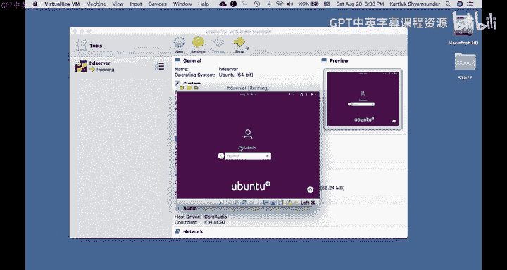

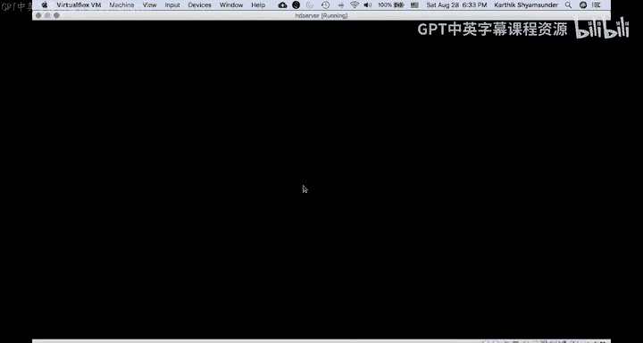

There it is there's my desktop in full screen mode。Now。

 I want to show you a few of the tricks if you click on these。Little dots over here。

You'll see a list of frequently used software versus all software。If you click on。

Search over here and type in terminal that should show you the terminal。If you click on terminal。

 double click on the terminal， it launches the terminal。

But we also want the terminal to be on our favorites， so what we can do。Is。Type in terminal。

And then once you see the terminal right mouse click and say add to favorites and what you're going to see now if I hit the S is that terminal is now available in my toolbar on the left hand side。

The other thing is that I don't like the toolbar on the left hand side。

 this big bar that you see on the left。So I would like to go to the right。

Click on settings that allows me to change my desktop preference。

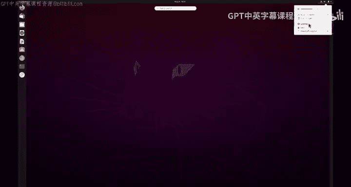

I'm gonna to go in。And change it to say in appearance to say bottom。

 So all those icons are now going to appear at the bottom。

I can launch a terminal by double clicking on it。I can also say new window。

 more terminals can be launched。As you can see， I can launch as many turns as I want。

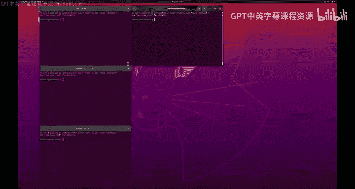

And I can run Uni command， Ls minus L， Pw D， E I will be doing some of these things later on。

Close on these terminals over here。I can also launch my browser。There is。喺正。ラヘる。Search that books。

 too。It's telling you that it's fully charged and also it's connected to the host network。Okay。

 so you have that。Close。I can also do command F to actually get out of the full screen mode so I can make it smaller。

And stretchier。 I could do that， too So lots of things you can do with U to。Craphical user interface。

And want to show you a couple of other things。 If you click on the X， it， it can。

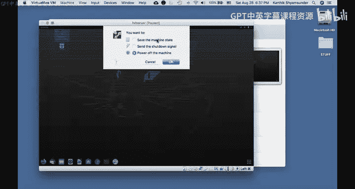

Cost the machine state。So。Let me go ahead and launch a terminal。2 and L minus L。And then。Click here。

 it saves the machine state。So the virtual machine is now paused。

 so you don't have to restart the virtual machine all the time。You can double click。

 nor as it says it' saved， you can double click Now it's restartoring the virtual machine so you can see that I'm back with the same terminal and everything。

 So all the processes that we're running are still running。

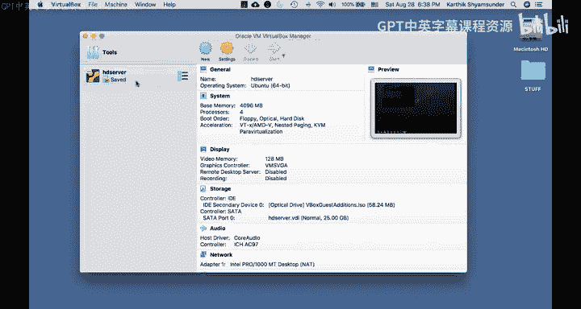

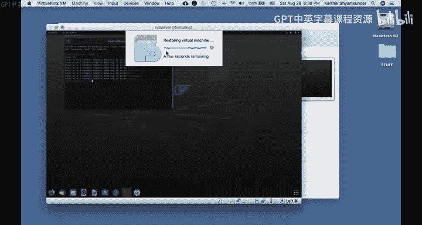

IDo， let's find to sell again。I can also power off the virtual machine。

So now the woodler machine is powered off。Yes。If I launch Port box now。

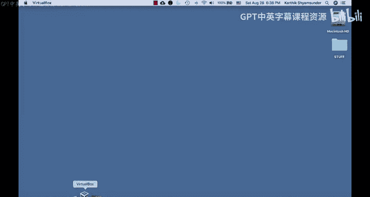

What is it' powered off。And I can put it back on。完了。By the way。

 if you're having trouble with full screen。What you can do is you can write mouse click。

You can also go to settings。And there's something called display。

You can give more memory to the video memory。This could be a problem for some of your computers。

 so just give it a lot more memory and that would actually fix the problem if you're getting into a black screen mode when you resize。

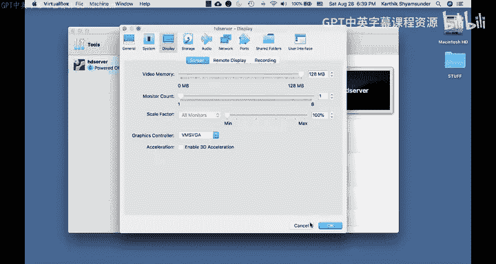

Okay， so。There it is。

So in this section， I showed you how to set up Uuntu Linux VM on top of virtualbox。

