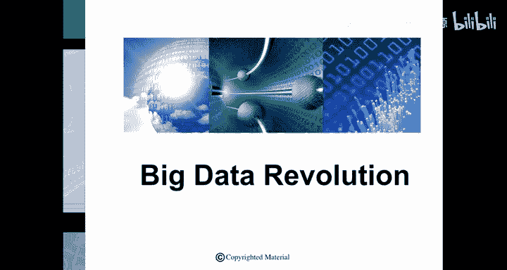
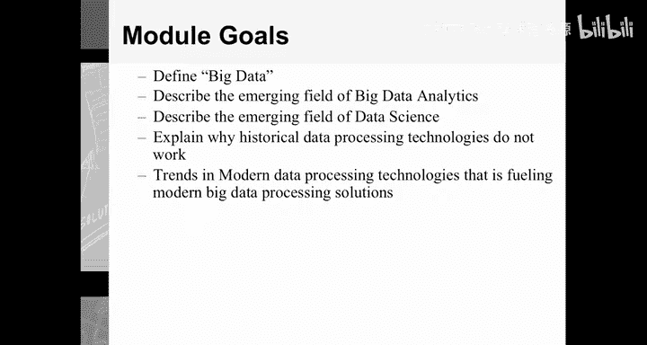
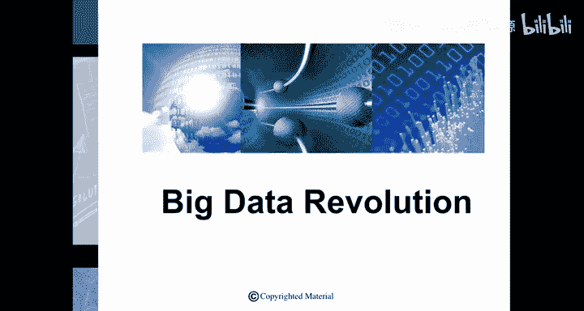

# 约翰霍普金斯大学《Hadoop大数据处理｜Big Data Processing Using Hadoop》中英字幕 - P1：0_大数据革命导论.zh_en - GPT中英字幕课程资源 - BV1g5u6zBExs

Welcome。Big data revolution。In this module， you will be introduced to the trends and concepts behind the recent big data revolution that is taking place in the information technology marketplace。

So what are the topics in this module？We will first look at data explosion。

Why so much data is being created in the marketplace？Then we would look at data economy。😡。

It's important for you to understand this new economy because this is the future of information technology。

Then we will look at big data analytics and see how it is different from traditional data analytics。

And then we will look at this emerging field of data science and what it is to be a data scientist。

Then well look at historical data processing technologies and why they don't work for big data。

And finally， we look at modern data processing technologies and trends that are making big data solutions possible。

 such as Hadoop。After completing this module， you will be able to define what big data is。

You will be able to describe the emerging field of big data analytics。

You'll also be able to describe this emerging field of data science and what it is to be a data scientist。

Explain why historical data processing technologies don't really work。

And what are the trends in modern data processing technologies that is fueling the modern big data solutions such as Hadoop？

