# 约翰霍普金斯大学《Hadoop大数据处理｜Big Data Processing Using Hadoop》中英字幕 - P20：19_Hadoop 3 YARN环境搭建.zh_en - GPT中英字幕课程资源 - BV1g5u6zBExs

Setting up Hadoop 3 yarn in the previous sections， we learned how to install and set up virtual box。

Then we learn how to set up and configure Linux on top of virtual box in this section。

 I'm going to cover the real meat， which is how to set up Hado yarn in a single Vm on top of that cententus Unix machine so that all the code component demons are up and running in one machine。

 We'll also test our installation to make sure all is good with our setup。Now。

 the primary mode by which I am going to teach this section is through hands on demonstration。

 The reality is this section is more about the operational aspect of Hadoop as we are going through the installationulation process。

 so I'll try to describe what we are doing。The real goal is to install and configure and so I will not be able to do complete justice on all the demons and configuration aspects now。

 but I promise that we will cover the architecture in more detail later on。

So granted by the time you're done with this section。

 you're not going to thoroughly understand what each of the component may be really doing。

 but it would give you a good background， so when we start discussing HFS。

 its architecture and internals， yan its architecture and internals。

 map produceuce its architecture and internals， you'll start beginning to connect the dots。Finally。

 don't forget that the goal of this course is to give you a 360 degree view of big data processing using Hadoop。

 including installation。Architecture， operations， programming， and analytics。Haadop installation。

In order to install Hadoop， we are not going to rely upon any proprietary software like Cloudra manager or open source tools like Amri。

 We are going to do pure hands on installation。 Everything from scratch。

 This will give us a better idea。😡，As to what is really going under the hood。

 and this will be a great learning experience for you。The Hadoop configuration modes。

 once you install Hadoop， Hadoop needs to be configured。

 Hadoop can be configured to run in one of three modes。The first mode。

Is the standalone mode In this mode， There are no Hadoop demons。 Everything runs inside the client。

 All the aspects of Hadoop runs inside this one JVM。 This is great for testing purposes。

 but you don't really learn much about the Hadoop internals and the Hadoop architecture。

The second mode is the pseudo distributeded mode where all the demons are running。

 but they are running in a single node in a single machine or server。

 The advantage is that you understand how the Hadoop architecture works。

 and the interrelationship that exists between them。

 So it's a great learning place but a great learning to。

 The third mode is cluster or fully distributed mode。

 In this mode all the demons run across the master and slave machines。

 So this is a multimach setup or multimachine implementation configuration。

 This is what you typically do in production。 But in this class because we want to learn how things work inside Hadoop will be installing Hadoop in pseudo distributed mode like I said。

 and it's a great way to learn about Hadoop。😊，Now let's look at the Hadoop3 yarn components。

We looked at the various Hadoop components briefly before， if you recall， they were the name node。

 which was the brains behind the distributed file system， the secondary name node。

Wwhich is a backup process that allows you to recover the name node and rebuild the image from disk in case the name node crashes for the name node。

 there is the data node， which is the workhorse for the name node storing and retrieving data in the file system。

Then there is the resource manager which manages the resources in the cluster in terms of CPU。

 memory and storage and disks。Then there is the node manager。

 which is the workhorse for the resource manager， the resource manager is giving information to the node manager and vice versa and so the resource manager knows about all the state of the resources within a specific server。

And then there is the Java history server， this keeps track of all the jobs that are being run in the Mareduce architecture。

So now let's go ahead and set up the Hado where we can bring in all these different demons。

Now in the class website for this week's module， there is a document titled Step to configurefi a single node Hadoop 3 yan cluster in pseudo distributeded mode。

 we're going to use this document as the foundation to install Hadoop yarn in a single virtual machine。

So let's get our hands dirty。

All right， so let's go ahead and log into our HD server。the virtual machine。

HT admin is the user ID and HD admin is the password。

So I'm logged in over here。 My Vm is set to go。 I would like to install Hadoop now。

So what I'm going to do is launch。The browser， go to Blackboard。

And then I'm going to download a document which is called steps to install Hadoop。

So let's go to blackboard。ju。edu。Let's go to our class。And in our class， if you go to course modules。

 if you go to setting up Hadoop。There is a document here。In lectures。

Steps to configure single node Hadoop， so let's click on that。That's the document。Save pagess。

And we're going to save it in our desktop。So this is the desktop of our virtual machine。Do that。

Let's go ahead and save it into our desktop。

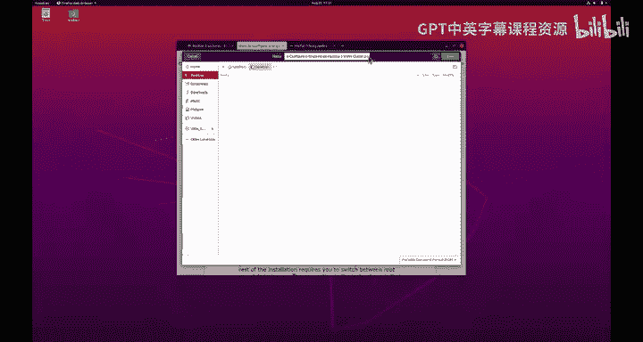

All right， so there it is， it's saved into our desktop。So I'm going to go ahead and close all this。

 we don't need it anymore。Minimize my Firefox。 So there's the document right there。

 This is the document we are going to follow to install Hadoop。

It's going to keep it on the right hand side。It's going to be a document that we will refer to as we go through。

Installing Hadoop。Launch the terminal by clicking on the terminal button over here。

Then if I do control shift plus， I can make the terminal bigger。

 like to make it a little bigger so you can actually see what I'm typing in。Move it over here。

So it says， okay， if you want to install Hadoop， log into HD server。

 which we have already done and step two says that you need to install the SSH teamman Well。

 Hadoop actually relies upon SSH。To start the variousdius Hadoop demons。

 So what we are going to do is install the open SS8 server。

 So one of the things you can do is you can actually type in the command or you can copy and paste let's case I'm copying and pasting。

 So pseudo AP is the pseudo command running the AP command inside it and installing the open S8 server。

 It's going to ask me for the password so that I can become root。

And I type in my password as H admin， it's asking me do you want to install yes。

 and it's going to go ahead and install open SSH at this point， That's step2。

So let's go ahead and install the Open SS server。Alright， so it's installed。 The next command says。

 go ahead and。Check to see。If it's correct。ok。And。You do see。That the open SSH is installed。

 that indicates that everything is good to go。 So we're all set open SH is running。 So step2 is done。

 and that was something that was needed for Hadoop。It's not directly associated to Hadoop。

 just needed as a。A service。Okay， the next thing it says set up password less SSH login。

 so let me clear the screen， step three。So what we are trying to do is set up the SSH keys。

 so what I'm going to do is type in C enter that takes me to my home directory C tilda enter also takes me to my home directory clear。

给 SSH。Dash keygen dash T or A。All right， paste it。And that is going to generate the key， oh。

 I made a mistake there。S， S， H dash。Peon。Dash T RSA。

 I'm typing it in rather than copying and pasting and see if that works。Yep， it works。

 It says where do you want to place the key file， a hit enter， a hit enter， hit enter。

 and it's placed。 Okay， so the key file has been placed。 now。

 if you're wondering why is it that my copy paste did not work。

 when you actually copy paste a command that has a dash in it， for some reason。

 the copy paste doesn't work。 So be careful of that。 if you have a dash in it， it doesn't work。

 but otherwise。It's working right here， so that's good， so just be bad of that。Okay。

 so the key files have been created and you can verify that it has been created by doing an LS minus L。

 actually Ls minus L， which will show you the hidden files。

 and you see that there's a folder called dot SSshH so you can CDd2 dot SSH and do an LS minus L。

Or you can just do the command that I have done over here， which is CA。

Dot what I'm going to do is execute this command over here。

 go back to my home directory right here and execute this command that says what I'm going to do is。

Do a CD dot dot， get back to my home directory and execute this command over here。

Which basically is saying， take the public key and put it into a file called authorized keys。Again。

 these are all SSAT set up。Allright， so that's done。 Then you need to do a chmod。On the SH。

Foroldwarder。Paste it。Done。And then。Toot again on the other ice keys。Bas it。Done， okay。

 so my SSH has。So my SSH key has been generated， I have to do what is called an SSH addd so I can add it to my environment。

Now， if I do SSH local host。Which is the name of the machine。

 Local host is the local way to refer to the machine。 He ask me for a fingerprint。 So I just say yes。

 and I hit enter。 It's been added。 So now I was able to log into my own machine using SSH。

 I can do an exit at this point。Okay， log back in again。

 And this time it should not ask me for the password。 That's the idea。

 The idea is to have SH demon running so that when you do an S SH back into local hosts。

 it doesn't ask you for your password。 Okay， we need to do the same thing for。The HD server。

So notice here it says do the same thing for the H server， SS H server。

 since we are logging in for the first time into HD server， which is again， the local machine。

He ask me， I say yes。And then it's done。 if I exit， I come back to my local host。 Now。

 if I go back and do a SSH H server again， it should not ask me the question anymore。

 This is something that you want to make sure works。 Otherwise your demons will not start up。Okay。

So we are done with that step， now we're going to move to step four。

 which is create a folder where Hadoop and related projects will be installed。

So now let's go to step four， which is create a folder where Hadoop and related projects would be installed Okay。

 so what we need to do is execute these commands。Sudo S U dash。Will make you rude。

 Now we have become rude。 Now I'm going to execute a command called MKD IR slash user。

 local headdube。Basically， what it's saying is make a photo called user local Hadtop。

And then it says group add。HD group。 So now we are creating a group called HD group。

 which is the Hadoop group， which is a UniX user group。And then。Chone。H D， admin。Coll an h group。

Slash user。Local Hadoop。Okay， so oh that shown did not work。 So let me go ahead and。Fix the typo。

 There it is。 It worked。 So I've already done all the commands now as root。

 notice I've executed these commands as root。 The pound indicates that I' have executed them as root。

I exit out。So I've done step four again， these are all background things that you need to do to make sure Hadoopprints properly。

Okay， so at this point， it's time to download Hadtu。

So step five is download Hadoop in order to download Hadoop you have a couple of choices。

 one is you can go to Hadoop。apache。org and download Hadoop from there。

Or you could simply download Hadtoop by typing in the W get command。So， let's。Let's。

Go to the browser and see if we can try to do that。 So I go to the browser。Ha do。Dot apache。Dot。Og。

And then I could go to download and I could go to 331 binary， I could download that。

 I could click the download button and that's going to download it and it'll place it in your downloads folder。

 so that would be one option。The other option is to execute the W get command。

 And what I'm going to do is execute the W get command。 So Cd to tilda slash downloads。

 that's going to my home directory inside my home directory。 There's a folder called downloads。

 I'm going to go over there。 Then I'm going to say W get。This is the command I'm going to type in。

 It's a multi。It's a single command。But because in a document。

But because on an eight and half by 11 page， you can't type in the entire command in one line because kind of wrapped up。

So let me go ahead and type the rest of it，3。3。1。Slash do。Dash 3 dot，3 dot，1 dot。Tur dot G Z。

 and hit enter。 there it is。 It started downloading Hadoop at this point。

I could have copy and pasted it too， but sometimes you have to be a little careful because when there are dashes in a certain way。

 it doesn't work right。Okay， so this is going to take a few minutes to download。

So I'm going to fast forward at this point until the download completes。Okay。

 so it took about 19 minutes to download the file。 The file has been downloaded。

 If you do an Ls minus L over here， you will see that it's about 605 megabys。

 Ls minus L H will give you a human readable version。 It's about 578 megabytes right here。 Okay。

 so we have downloaded the file。 Now it's time to。Install Hadoop。So step six is install Hadoop。

All right， so what do we need to do for that CD？To slash user， local Hadoop。

 That's the folder where we are going to install Hadoop。And we're going to say tar。Dash Z， X， V， F。

 tilda slash downloads。Headoop。331。t。tgz and hit enter。And that's going to unt the file。Okay。

 so that's the basic installation again， we have to study a whole bunch of other things too。

So it's extracting the file。Okay， so that's done。Step7 says let's set up the Hadoop home environment variable。

 so for that we need to become rude。Now I'm not reading through all these things。

 you should actually take a print out of this document。

 read through it as you're doing the installation。K through do S U dash and want to become root。

 notice my prompt has become a pound sign。 that means I'm root right now。

 and I need to execute this line that says echo。 So it's saying that whatever this line is。

 put it into a file called Hadoop dots H in et C s profile dot D。

 The idea here is that's over environment becomes configured with the environment variable。

 I'm going to do is cut this。To make it easy。And paste it over here。And then， I'm going to say。

Greater than。And then the file is right here。Okay， copy and then paste it。

So what it's saying is take this content right here and put it into this file called Hadoop dot S。

 that's an Esy slash profilele dot D here enter。The next line says。Take this content over here。

 copy it。Pasteit。And then greater than greater than which means append to a file。And the same file。

 Let's see， slash profile。Dot D and then Had do dot S， Okay。

 so that's a greater than greater than sign， which means append to that file， same file。

 the Hado dot S file。So that's done， so step seven is also done。Step 8， let me clear the screen。

Step 8 says let's install JDK。 Hadoop requires Java， So it requires at least JDK 1。t8。

 and so we are going to install JDK。 We have already route。

 So all we need to do is execute this command over here， which is the AP get command。

So I'm going to do that， I'm going to copy that， and Im want to paste it。And then hit enter。

Sometimes when there' is a dash， the command may fail when you copy paste so be careful with that。

right。Seems to work。 So it's installing。JDK8 at this point。It's not good enough just to install JDK。

 you need to go ahead and set the environment variable also for JDK。

It is a Java underscore home environment variable， and that's what we want to do in the next step over here。

With the echo of the land。Okay， so it says right here， let's go ahead and execute this line。Tste it。

M四。Greatreative van。And then put it into a file called Java or S H copy。Enageed。Okay， so that's done。

And then， it's says exit。Okay， so we exited out， which means we have gotten back to our HD admin user ID。

 let me clear the screen。Allright， now that we have set up the environment variable。

 we want to make sure that the Hadoop underscore home and Java underscore home environment variables are set correctly。

 so for that we need to log out so I'm going to click over here on the top right。And then写 log out。

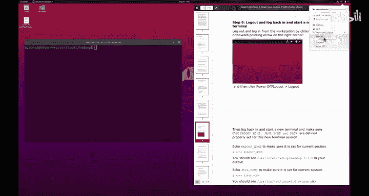

logout。Log back in again。And when I log back in again。

Environment variables will be automatically set up because the Hado dot S Java dot S H was placed in the E C slash profile or default folder。

 and they get executed now。 So let me go ahead and launch a new terminal。

Control shift， plus， plus。And then， let's go ahead and launch the。

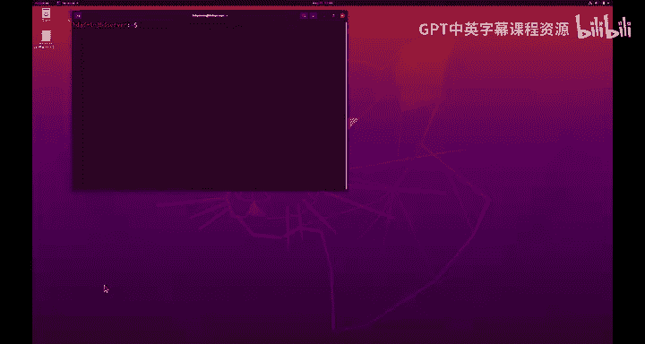

Steps also， there's the steps right there。 make a little bit smaller。Control minus。Allright。

 so so we are in step 9。 now we need to check to make sure that our environment variables are there。

 So what I'm going to do is type in E dollar Hadoop home。Echo dollar Hadoop underscore home。 Okay。

 Hadoop environment variable is set。 E dollar Java underscore home。Yes。

 Java environment video is set。 and then also path。 Let's make sure path is correct too。

 So E dollar path。And the path is set。 And the most important thing is that。User local Hadoop。

 Hadoop3。3。1 s S bin and user local Hadoop Hadoop3。3。1 slash bin。

 both of them are there in the path perfect。Okay， so we have done step 9。Clear the screen。

 so let's move to step 10。Step 10 is basically make the appropriate data directory so the name node can store the distributed file system。

So I need to make these directories right here and these things can be simply。Cut and pasted。

So I'm making a folder。And it's called user local Hadtoop slash data slash Nn。

So that's the name node。 I'm going to go back up arrow and change it to SNN。

 So it becomes secondary name node and then the end， which is the data node again。

 what these directories are and what do they do All these things we're going to study when we get into the HDFs section right now' I'm just trying to make sure that we set up our environment so we can get Hadoop running all the information about how these things are working together。

 the internal architecture of big data processing will become very clear to you And Hadoop HDfs is a very important aspect of Hadoop and Spar Okay so that's step 10。

 we have done let's move to step 11 in step 11 it says let's configure a file called course site dot Xml。

 So now we are actually getting into some Hadoop configurations So we need to go to this folder called user local Hadoop。

So let me just type it in s Cd slash user， local Hadoop， slash Hadoop。老高不 do。I do 3。t3。1。ABTC。

Solash I do， that's the folder。 then go to that folder。

To an LS minus L there's a whole bunch of files over there。

 and one of the files that's over there is called Co site dot Xml。

 We need to edit the core site dot Xml and make it look like this right now it's an XmL file that's blank。

Blannk in the sense that there is no configuration within the open configuration and closed configuration。

 There is nothing。 So we need to fix it。 So what I'm going to do is type in V I。

Core dash site dot X M L。Notice that there is nothing between the configuration。 So I'm going to。

Insert some content there。Ina copy this。Copy and then paste it right here。

Now it doesn't have to be formatted nicely， but I like to keep it formatted。

 we're going to come back and edit this file a little bit more as we go through the course。

So let me go ahead and format it again， there's a property that's being set called Fs。

 default dot name， which is where is the name node running， that's on09000。

And that's what we're doing over here once again， don't worry about the actual property values and what do they mean just let's get this thing configured right now save it WQ by the way。

 if you don't know VI， I recommend that you learn VI because it's good to learn VI。

 especially if you're going to be a data scientist。Or a data engineer。

 It's good to know Uniix fairly well。 There is also another command called G edit。

 You can type in G edit Co site dot Xml， and that will launch the normal text editor。

 You can also use that to change the contents of the file and then save it。

 So that's another thing that you can do。 I just wanted to show you both the approaches。Okay。

 so we changed core site。t xml in step 11。Let's make sure that we haven't made any mistake in our XMl file。

 so if you type in Xml WF and then courseside。 Xml。XML WF stands for XmL。Well formed。

 It'll tell you whether the X， M L file is well formed or not。 And it's telling me command X。

 M L W have not found。 It says you may want to install this。Package called expat。

 So let's do that Su。A P， T， install。E， X， BAT。Enter。H D， admin。So it can become root。

 so it has installed。So it is installing a package called expat。Now， if I type in XMl W， of course。

 I do Xml。It is going to say everything is good。 just to prove my point。

 Let me go ahead and edit the file and screw up like， for example。

 the configuration is missing an n and save the file。 If I do an Xml WF dash courseside dot Xml。

 It should give me an error notice it says mismatched tag。 Once again， I could use G edit to edit it。

If I use G edit to edit it， I can put the n。And I can save it。So here I'm going to save it， close it。

And now if I do XmlWF， it should be fine， so I just want to kind of show you that you can also use G edit to edit the file if you're not familiar with VI。

Okay， so that was step 11。Let's move to step 12。Step 12 says， well。

 let's go ahead and edit HDfs site dot Xml we are the same folder， so VI HDfs site dot Xml。

 that's the HDfs configuration， the first one was cores site dot Xm。

 which is the core Hadoop configuration。And I'll go ahead and copy HDFS side content。

There's a lot of stuff over here， so I'm going to copy all the way from here to here。

 so few properties。Copy。And then paste it。Allright， everything is pasted。 I would like to format it。

So let's go ahead and format it。Okay， so that's done。 And I would like to do an XmL WF。

HtFS site dot Xml to make sure that's good。 Okay， so we have done that。Clear the screen。

 So let's move to the next step。 Next step is step 13， which is configure mapra dashite dot Xml。

 So V mapre dash site dot Xml。And once again， come back to the configuration section。

And then copy all the configuration right here。Copy。オ。So， that's done。

That was the third configuration file， X M L， W F， Madre dashite dot XM L。Okay， so that's good。

 Let's step 13。 that's done2。 Let's go to step 14。Step 14 says to configure yet one more file called Yon side dot XML。

Yeah二。Well， you know what， this time， let me do a G edit， a G edit。Y dash site dot Xm L。There it is。

 I'm going to copy。 I could also copy the entire content over here， copypy， make sure if you do that。

 you copy the entire content。Paste it， alright。And copies， it doesn't copy the format。Okay。

 save that。Quit。Close that and let's go ahead and do a Xml WF。Beyond dash side dot Xml。

 And that's good to go to。 So step 14， done。Step 15， it basically says。

 let's go and edit the Java configuration for Hadoop。 So there's a file called。

Haadoop ENV do H again， it's in the same folder， which is the ETC Hadoop folder。V I。Atoop Env。 h。

And I'm going to look for Java underscore home。And where you find。Jo underscore home。You uncommented。

And you need to set where Java home is and Java home， it just installed JDK。

And that's where the Java underscore home is， so copy it。And paste it。Allright， so that's good。

 That's one configuration we needed to change。 The second configuration we need to change is Hadoop heap size max。

So。Her do。Heap size。 Okay， there is Max。Uncomment。That and then place double quotes 500。Basically。

 what we are saying is that the maximum size of the he for all the demons is going to be 500。

 that's the JVM max size。And then there's also a min size that's going to be set to。2 50。

 these are all important values。 And when you。Manage Hadoop。

 you have to make sure that you set these values right。

 we'll talk about these things later on because it's very hard to get big data processing done right with Hadoop。

 even with spark for that matter because the configurations need to be done correctly and I want to kind of give you a sense of that。

Okay， so we have done that and now we need to look for Hadoop ops。So I'm searching for Hadoop ops。

 and there it is。I do pus uncommon that。And the way the Hadoopops need to be is， it needs to say。

When it starts with， it needs to say。Dash， X， X colon。Print。Warnings。That's what it's saying。

 make sure that you have that followed by a dash D， and then we have the rest of it correct。

Everything else is good， so we just need to do that。Okay。You've done that。No。

We have to also change one more file， so let's go ahead and close that。

We have to change log for JDt properties， so I'm going to VI that file。And at the end of the file。

 we need to add a line。And I'm going to add this line right here once again。

 you can use G edit or you can use VI to make the changes。Okay， so I've done that， too。 Sa it。

 So we have changed a few configuration files， and weve also changed the Hadoop dot。

And we've also changed Hadoop dash E and V dot S H。 Okay， so that's step 15。Done。

Let's move to step 16。So up to this point， what we have done。

 let me kind of review what we have done up to this point。We logged into our HD server。

We installed the SS SH demon。 The reason is Ioop requires the S SH demon in order for it to。

Connect to other Hadoop machines if there are any， or even within a single node。

 it needs to make sure that it's running so that it can actually start the demons。

It's an requirement for Hadoop。We also need to set up passwordless SSH because when it actually talks to the demon。

 it wants to communicate with it using SSH and it should be a passwordless SSH。

Create a folder where Hadoop and related projects will be installed。 Now this is important。

We created a folder here called slash user slash local slash aobe， we created it as route。

 and we actually give permissions。So that when we are logged in as HD ad and we can go ahead and write to that so that's what we're doing over here So all the Hadoop projects。

And sub projects will be installed under slash users slash local slash Hadoop high will be installed underneath it。

Pig will be installed underneath it， spark will be installed underneath it。

 H space will be installed underneath it。 so this is the umbrella folder where all the Hadoop sub projects will be installed。

We did that， then we actually downloaded the Apache Hadoop software which took about 20 minutes。

 then we installed it and installation was simply extracting the tor file。

 then we set up the Hadoop home environment variable。

 this is an environment variable that points to where Hadoop is supposed to live or where Hadoop lives which is really if you look at it it's slashus/ local/lash Hadoop slash Hadoop3。

3。1 that's the version of Hadoop we are using。And then we needed to install JDK because Hadoop requires Java。

 Hadoop is built on top of Java， so we downloaded JDK， open JDK 8 and we installed it。

 we also set up an environment variable for JDK， which is Java_ home so step98 and step9 we logged out and loggged back in so the environment variables such as Hadoop_ home and Java_ home and that are all set。

Okay， we did that and then in step 10， we made a directory， in fact， a whole series of directories。

And theres a。An umbrella directory s users slash local s Hadoop slash data is the umbrella directory underneath it we created slash Nn for name node。

 SNN for secondary name node and TN for data node， This is where Hadoop HFS is going to keep the virtual file system。

So we made those folders and then we configured four major Xml files for Hadoop， Coside。xml。HtFside。

xml。

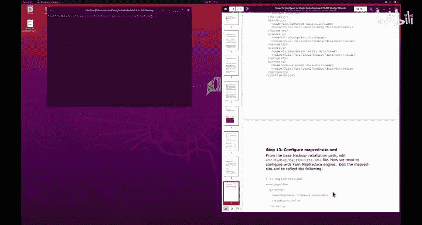

Maapraarl dotxml。And beyond our site dot Xm。 Now don't worry about what these files mean。

 we're going to talk more about this when we get into HFS and Hadoop architecture。Okay， then。

We also configured another file called Hadoop Dashk and Vt S。

We set the heap size for the various demons and also configured some options。

 We also configured log for Jdot properties。So we have done the basic installation of Hadoop。

 so this is the next step， which is step 16 now， which is format HDFS。

 so now we're going to try to create the HDFS file system It's like formatting a distributed file system So the command is I entered CD enter so I can get back to my home directory just to make sure I like to be in my home base HDFs name node dash format。

It says。It says missing plus minus settings for VM option print warnings。 Oh okay。

 so I made a mistake in my configuration， So there is a problem with print warnings。

 So let's go back。 that's good。 When you make a mistake， it's good。

 you can actually figure out what you need to do。If you go back and look at the configuration over here。

Notice there's a file called Hadoop dash E and V H， maybe we messed up something over there。

 So Cd to slash user local Hadoop。CD do。Slash user， local Hadoop underneath it。 There's Hadoop 3，3，1。

Underneath it， there is Etsy Hado。And I'm going to look at the file。

Which is Hadoop Dshny Rio de Sage。And see if I。Mesed up something it would be Hadoop。Under the score。

Os。There it is， such as。Within double quotes， double quote Xx colon。

 if you notice it's supposed to say dash print warnings， not just print warnings。

So I'm going to go ahead and put that in。Close it。写 it。And now， let me go ahead and try to run。

De commandmand。HDFS name no dash format。All right， so perfect， the name node has been formatted。

Great， so when it says。Shutting down name node at HD server。

 that means everything is good to go perfect。 Now it's time to launch。The demons。The Hadoop demons。

 So the first command I am going to execute is the HF S dash dash demon start name node。

 He said to you sometimes when you copy and paste， it fails。

 So this is a classic example of where it fails with the dashes。 So copy and paste it。

Step 17 and you will see that it fails and youll see that the dash is not correct。

 so let me go ahead and fix that。It's dash dash。Okay， hit enter and。Os。Let me go ahead。

That didn't work either。 So there's a weird character sitting over there when I do a copy paste。

 So I just want to tell you that when you do a copy paste from a PDFdf document， it doesn't work。

 So the best option right now is type in HDFS dash dash demon start。Name node and hit enter。

 and that should work。Perfect， so I wanted to show you that you could get into trouble。 All right。

 so be careful。 I recommend that when you go through these commands。

 you actually type in the command so you get used to it。And then later on。

 as you're going through the exercises in the class。

 you'll be using these commands and you'll be more familiar to you。Okay。

 so that's started the name node。And then if you do a GPS command。

 it'll actually tell you that the name node is running。 So that's a good way to figure that out。

 Alright， let's now go ahead and start the secondary name node。Once again。

 I'll just go ahead and say start secondary name node。Secondary name， node。Once again。

 let me do a J secondary name not started。Let me go and start the data node， that's the third demon。

HDFS， dash， dash， demon。Start data node。And let should start the data node。

Type in JPS and that should have started。Now I'm saying， verify either the HDFS demons running， well。

 we already did that， JPS。That shows you that all the demons are running。And by the way。

 for some reason， if the demons did not start， you can go to a folder called user local Hadoop Hadoop 331 logs。

 that folder contains the logs for all the demons so if you CD2 user local Hadoop。

 that's the umbrella folder， Hadoop is installed and Hadoop 331 and go to logs。

 that's where all the log files are and you can look at the log file for the HD server data node HD server name node。

 you can look at the log files for secondary name node notice there's a log file and there's an out file and see if there are any exceptions。

If you see any exception this in these files， then you know there's a problem。

 So let me go ahead and take a look at this file right here so I can do a more command。P do。

H D admin。Data node。Datanode HDservver。 log。So that's what the log has。I don't see any exceptions。

Tt out。And no exception。 So you can actually go back and look at these files and see if there are any exceptions。

 You can also do a grab。Minus I exception。Star and then see if there are any exceptions there。 Well。

 everything seems to be working， so we are good to go up to step 20。

Step 21 says let's start some more demons， we're going to start the resource manager and the node manager in 22。

Let's do that in step 21， which is starting the resource manager。Beyondn。Dash， dash， demon。Start。

Resource manager。Oops， made a mistake。Of course。Like there's a space。 Okay， that started。 again。

 I can check to see if that started up。 and yes， resource manager started。 Go aba again。

 And this time I'm going to start the node manager。That's good。

 and now I'm going to start the history server， History server is started using the Mat command。

So map red。Dash， dash， demon。Start。History server。And then do a GPS。

History server also has been started as's the job history server right there。So we have。1，2，3，4，5。

6 demons running once again， later on as we go through the course。

 you're going to know what these demons do， how the Hadoop architecture works， why it works。

 the way it works and you know why it's really a good technology and so on and so forth。

 So right now just make sure that these are the various components。

When you need to run Hadoop over 10，000 machines， you need to kind of understand how these things are working underneath the hood。

As a data scientist， you may not worry about it， but as a big data engineer。

 you'll have to worry about it。Especially for performance tuning and things like that。Okay。

So that's done Now， let's verify that all the demons are running on step 24， we did that。

Let's make sure that the。Consoles for some of the demons are also available。

 so you can actually log into the console for these demons and make sure that your your demons are working perfectly fine。

 So for example， HDFS， which is the distributed file system has a console running on port 9870。Now。

 what you can do is you can launch Firefox and type this particular URL in。

 or you can simply type in Firefox。HTTP Col slashlash， local host。Cool in 9，8，7，0。

 and that should launch Firefox。Pointing。To the name node web UI。

 So it's actually showing you what the HDFS file system looks like。

This is what the HDFS file system looks like right now。

It's telling you what the data nodes are and says there's 24 gigabytes in data node。Once again。

 we will learn how to navigate through this later on。 But right now。

 I just want to make sure you understand that you can。Get to the console。Okay。

 now let's look at the console for resource manager。 that's local host 8088， so H TTP。

 colon slash slash local host。8，0，8，8。 And that should take me。To the resource manager。

 and then there is also the job history server， which is 19888。Local host。Colon 1，9，8，8，8。Okay。

 that's the job history server and there's no job that has run up to this point。

 no Hadoop map reduce or any kind of job that has run at this point。Okay， perfect。

 so I'm going to do a control C。And that shut down my browser。

 you could have launched the browser from here too。We could have gone here and launched it。

And there is， those are the three。Sers。And closeose these things。 Right。

 These are the three consoles。Okay， I'm going to minimize that。Okay。

 so now what do we need to do Well， let's do some operations on the HDFs file system。

 Let's verify that the HDFs is working fine。 We have created HDFs。 We got all the demons working。

 So I'm going to C to tda slash downloads。Then what I'm going to do is run this command called W get。

The Wget command basically says go to this。Cycle Gutenberg dot org and download this file called 27010 dot Txt。

 Well， if you don't know what Gutenberg do org is， it's actually a site where you can find all the classic books。

Available as text files， if you want to do text processing is a great place to get it。

 So I'm going to do a W get。And I'm going to copy this particular URL and see if I can download the file。

Copy。Paste。And then hit enter。And it's downloading the file， so yes。

 it did download the file if I do an Ls minus L notice that 27010。 THt has been downloaded。

And if I do a more on 27010。tHt。You can see that it's a text file， which is。Really Mobi deckck book。

 right， So it's the Mobi deckck book。Quritit。All right， now that file is in my file system。

 in my UniX file system， what I need to do is put this into my HDFS file system。

So for that I need to make a folder in HDFS and the way you work with HDFS again。

 I'm asking you to just type these commands right now。

 I'm going to show you how HDFS works and we're going to learn the various commands right now in order to make a folder in HDFS called/lashinN。

 all you need to do is type in HDFs DFsMkDIR/inN。And that should make a order in HDFS。Okay。

 so it actually made a folder in HDFS now I can copy the file into HDFS and that would be HDFS。D F。

 S dash copy from local tilda slash downloads。2，7，0，1。Dash0 dash dot Txt。Slash I， slash the Mobi。

Dash di dot T H D。 What it's saying is copy this file， which is in my home。

Slash download folder called 27010。tTxt and copy it into a folder called slash IN in HDFS and name the file as MobyDasht。

ttxt。So hit enter， and that's actually doing an HDFS copy。

 so it's actually working with the name node， the data node to copy the file into HDFS。

And if I want to prove to myself that the file is an HDFS， I type in HDFS。DFS dash LS s IN。

 and I should see the file in HDFS。 It's actually coming from HDFS。 The file is right there。Okay。

 so my HDF is working， what I can do is go back to my Firefox。Go to my name node。

And go to go to utilities， go to browse the file system。

And you'll notice that in the HDFS file system， we actually have a folder called IN and inside it there's a file called MobiT。

txt perfect， so over HDFS does work。

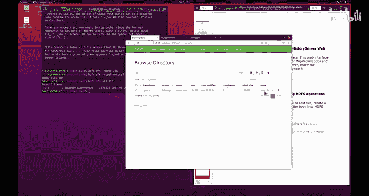

Okay， again， we'll come back to these things later on right now。

 we want to just install Hadoop and get our environment set up。Okay， so what's the next step。

 the next step， which is really the last step is to actually run a Hadoop Mapper years job。

 here's what I want to do。You know how we actually copied a file called Mobiashdick。txd into HDFs。

Which is right here， which is in the folder called slash IN。

 I actually want to run a map reduce program， a Hadoop program。

That will basically go through the contents of this particular file。

And it'll create a word count of all the words。And how many times that word appeared in that particular file。

 right， So that's what it's going to do。 So for that， I need to run the。Haoop command。Actually。

 a yarn command， yarn jar。 It's a pretty long command。 I'm running the yarn jar command slash user。

 local Hadtoop。Haoop dash 331 share。To do。Map reduce。Headoop， map produceuce examples。Word count。

Slash iron， slash out。Once again， don't worry about what this command really means。

But at a high level。Basically， it's saying run the word count program， which is a Hadoop program。

 which is in this jar file。And there's a folder called slash IN and HDFS。

 go through all the files within the folder a slash IN。Where there's only one file right now。

 which is the Mobi dasht or THD， go through your processing and generate in the output folder in HDFS。

 a file that will give me a list of all the words and the corresponding counts associated with it。

 so let's go ahead and see if we can execute that。Later on I'm going to show you how to write such programs right now we are just executing a program that's already there as part of the examples。

So you can kind of make sure that your installation is correct， your environment is working fine。

 so it's going through the map and reduce stages。Once again。

 map and Red are stages and there are many other stages that are out there and map and reduced stages are there even in Spark。

So we'll talk about that later on。Okay， so。Everything ran successfully and the way we can make sure that our output is there is I can type in HDFS。

D FS dash cat， I'm going to cat the contents of the file slash out， slash part， dash or dash0，0，0，0。

0， and I should get。The output。From this file。 Now， if I want to know how many times the word。

William appeared， I can do Gr。Minus I William。And。It says William appeared four times in the fire。

Okay， so let's look for the wordbi。See if that appears。How about the word bird。Yep， birth appears。

 birth test mark appears two times， birth appears five times and so on and so forth。

And then we can actually write complex regular expressions to actually exactly get the word birth。

 So you get the idea now Now what I'm going to show you is。

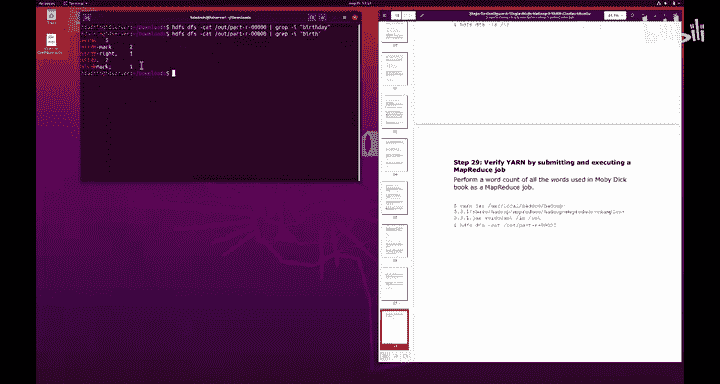

The console。And if you look at the console。We will notice that if you go to utilities and browse the file system。

That there is an outer that's created。For the job， and there's also a success file and a part and a part or 0000 file。

 again why these files exist and how they are named we'll talk about those things later on。

But right now， I just want to tell you that HDFS seems to work。 So that's telling me that， yes。

 it was able to process the contents of slash IN and then basically put the output in the slash out folderer。

Also， if you look at the applications。As's to a reload。

 you'll notice that we actually ran a Hadoop application right now and so it tells you that the Hadoop application ran and if you look at the job history。

 see if there is anything in the job history and yes。

 there is a job that was submitted called word count so that indicates that all the things are working。

In our Hadoop distributed file system and the Hadoop environment with yarn and all the demons。

All right， so hopefully this has given you a good understanding of how to set up a do。

And kind of big picture of all the components that's out there。

Use this thing as the foundation to do your assignment。

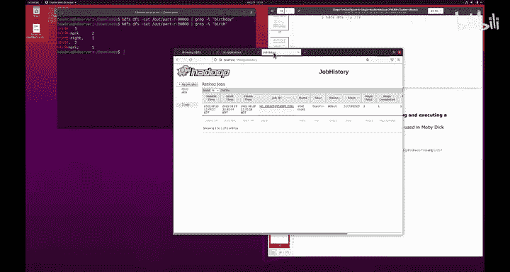

All right， so while we are here， I also want to show you how to install net beans。So。

 let's go to net beans。Download。Go to download。

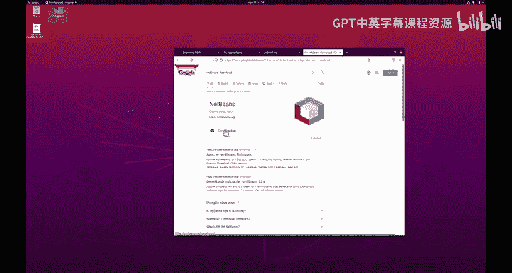

And we'll download Apache at beanss。Long term support。 So let's download the LTS over here。

Click on download。And then there's a zip file that means binary zip file， so let's click on that。

Click on that。Save the zip file。And that should get saved into our downloads folder。

If I double click。ByCD。To download into an L minus L。I should see net beans getting downloaded。

 so it's getting downloaded right now， let's wait for it to download。

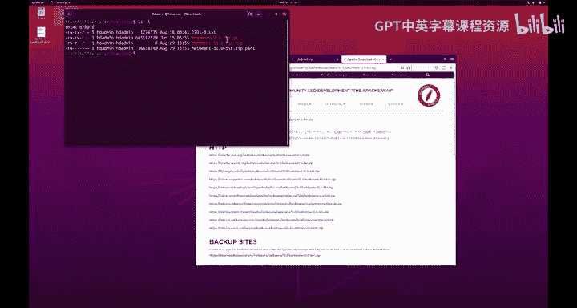

You can also go to downloads。You can also go here and see it's getting downloaded。

 it's about 357 megabytes and it's getting downloaded right now。

The reason I want to show you how to install Ne beanss is because later on we were going to start writing our own Hadoop Java applications。

 we're going to start manipulating the HDFS file system and at that time，Can use net beanss。

 you can use eclipse， you don't even have to use an IDE， you can just use VI。

 but I'm going to do all my demos using net beanss。

 so I recommend that use Ne beanss but any IDE would work。Okay， so Nebank just download it。

Let me launch a new terminal。And what I'm going to do now。Is。See to my ownbro。Do jar。Minus X。

 V F tilda s downloads。

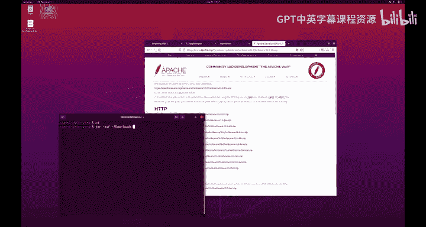

Needines。So I'm basically extracting the Netbeans zip file and I'm going to extract it into my home directory。

So you'll notice that it's in my home director。And there's a net beanss folder， Cd to net beanss。

And inside it。Cd to bin folder， is a file here called Nebs right here。If you do an LS minusl。

 you'll notice that it doesn't have execute permission。 So I just do a mod。Plus， x。Nt beans。

And that should make Ne beamams executable。So， now， I can simply。Type in。In my home directory。

 dot slash net beans。Ben slash net beans， and that should launch net beans for me。There。

 that beans is running for you。So that's one way by which you can install that beans。

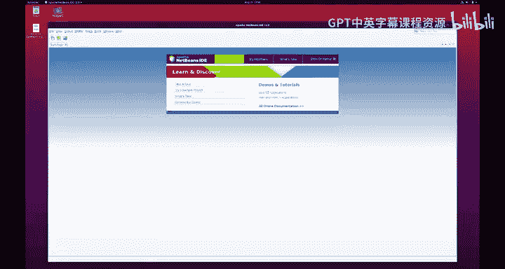

And runnet beam。And if you want to shut down， you can just click the X。I shut down。

So notice the way I ran it， I simply went to my home directory and I typed in dot slash net beans slash pins slash net beanss。

 dot s bin starting from the current folder， go to Ne beanss folder inside it there's a bin folder inside it there's a file called Ne beanss executed。

All right， so that's how you launch N beanss。So I just wanted to show you this so in the future you can use Ne beans。

 you may want to do this also as part of this exercise。

 although you'll have some chance to do that later on Alright。

 so let's get back to our PowerPoint presentation。Alright。

 so we got our hands dirty in terms of installing Hadoop3 yarn， we were able to install Hadoop。

 we were able to configure Hadoop， we were able to launch the demons。

 we were able to navigate the file system， create files， we were able to even run a map produced job。

 we were able to look at the console， the UI for the name node which is the head of the distributed file system。

 we were also able to see the UI or console for the resource manager。

 which is where the jobs get submitted， and we were also able to look at the history server which is where the map produced job details are placed。

Okay， so hopefully this gave you a pretty good idea。

 don't worry about the details of some of the configurations。

 you'll get to understand them in the future modules。

