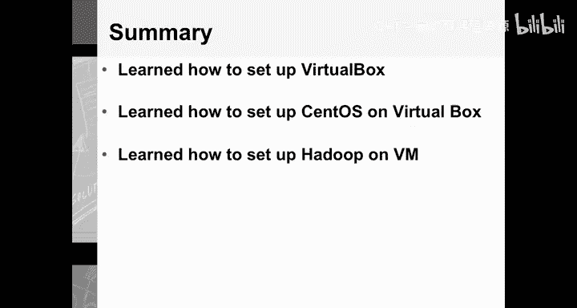

# 约翰霍普金斯大学《Hadoop大数据处理｜Big Data Processing Using Hadoop》中英字幕 - P21：20_Hadoop环境配置总结.zh_en - GPT中英字幕课程资源 - BV1g5u6zBExs

Setting up and running Hadoop summary。In this module， we learned how to set up virtualual box。

 then we learned how to set up Centtos Linux on virtualualbox， and most importantly。

 we learned how to install， configure， and run Hadoop in pseudo distributetribut mode on Linux。

We achieved all this through hands on Devs。Hopefully this module will give you some insights into operational aspects of hertu。

More importantly， you've gotten familiar with the various components that make up Hadoop。

