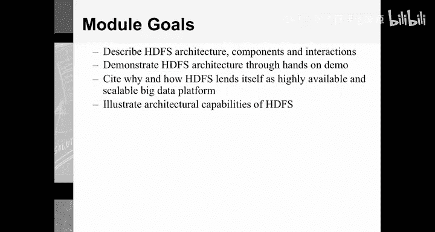

# 约翰霍普金斯大学《Hadoop大数据处理｜Big Data Processing Using Hadoop》中英字幕 - P22：0_HDFS架构导论.zh_en - GPT中英字幕课程资源 - BV1g5u6zBExs

Welcome。HtFS architectureect。In this module， we will look at the architecture of HDFS。

 the various components that make up HDFS， their interactions。

 so we can get a thorough understanding of the principles behind HDFS both from architecture and practical applicability to big data。

 we will in particular look at how HDFS stores data performs replication across servers in racks in order to provide a highly available and scalable distributed file system。

So what are the topics in this module？We will first look at core HDFS architecture in which we will look at HDFS demons and their interactions。

Then we will do a hands on demo of HDF Fo architecture in action in our VM。

Then we will look at some advanced topics like how to determine block size for the cluster replication in both single rack and multi rack systems。

Finally， we will evaluate Hadoop from architecture perspective。

So what are the module goals to describe HDFS architecture， components and interactions。

 demonstrate HDFS architecture through hands on demo， site。

 why and how HDFS lends itself as a highly available and scalable big data platform。

 and finally illustrate architectural capabilities of HDFS。

