# 约翰霍普金斯大学《Hadoop大数据处理｜Big Data Processing Using Hadoop》中英字幕 - P23：1_HDFS架构解析.zh_en - GPT中英字幕课程资源 - BV1g5u6zBExs

H T F S architecture。In this section， we are going to dig deeper into Hadoop and look at the architecture of HFS。

We will look at some of the key characteristics of HDFS， what it is good for。

 what it is not good for， the various components and demons that make up HDFS。

 their roles and their interactions。Finally， we will look at administering HDFS like formatting the file system for initialization。

 starting and stopping the demons。

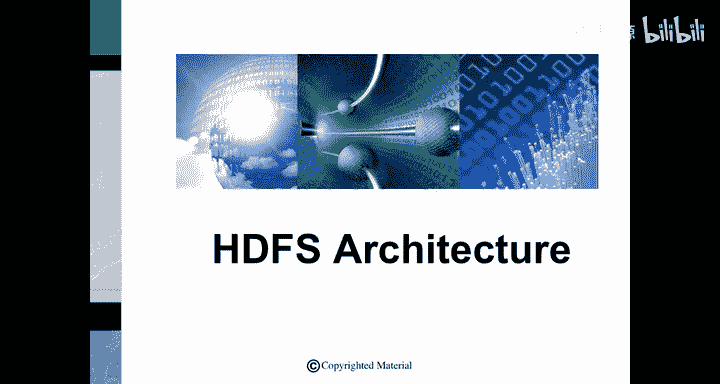

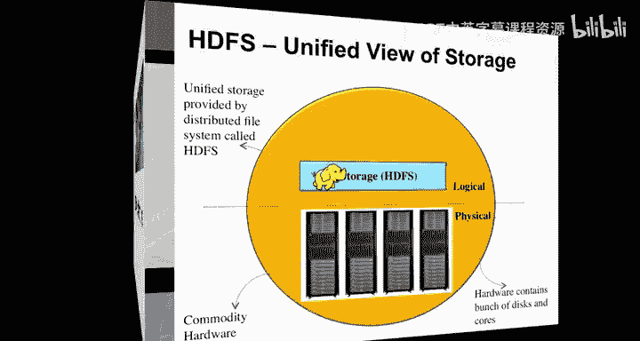

If you recall， a Hadoop cluster is a combination of both physical hardware and logical software。

The physical aspect of Hadoop is the hardware， which is really an array of commodity servers mounted in a rack。

 and there may be multiple racks within a data center。

Each individual server by itself may have multiple individual discs。

 so you have disks within a machine， multiple machines in a rack。

 a bunch of racks within a data center。Headoop HDFS unifies the storage disks across the servers。

 across the racks， and makes it look like a single file system。

 although it is all distributed under the hood。

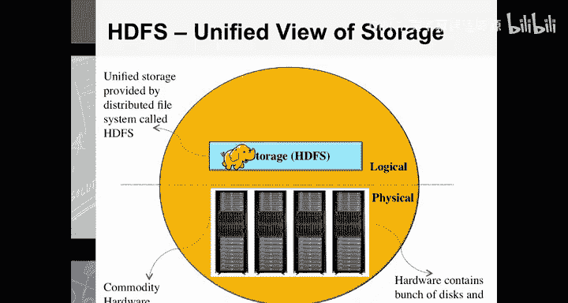

So what is HDFS？HDFS is a specialized file system。It is really not designed for general purpose use like a traditional file system that we have on top of our operating system disks。

 which is what we call a native file system。But it actually runs on top of a native file system。

For example， you may have a server， the server may have disks。

 and then you put an operating system on it， you create a file system for all the disks。

 you may create an EXT3 or EXT4 or XF file system， and then Hadoop runs on top of this native file system。

It gives a unified view across machines across the file systems， you have disks within a server。

 those disks make a file system within a server， and then you have file systems across machines。

 all these file systems are unified together to create a unified file system。

 which is the HDFS file system。It is a right once file system In other words。

 you cannot really change the contents of a file once it's written now you can append at the end of the file。

 but you cannot really go into the middle of the file and change some data within the file If you want to do that you know to create a brand new file。

 recopy all the data accept the change， make the change and then append the rest of it that's how you can make changes to an existing file。

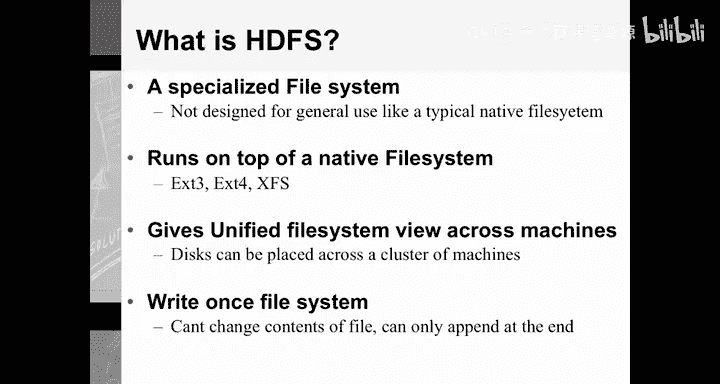

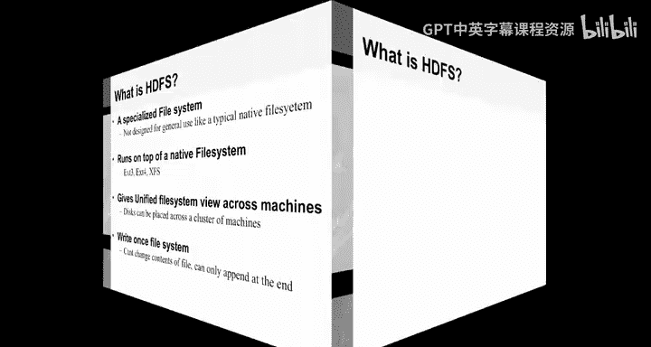

It's also fault tolerant and highly available Now when you place data in HDFS。

 it gets replicated across multiple machines， and so if one of the machine crashes which may have a block of data。

 then one of the other machines that has the data will serve that particular data。

 so machine going down is not a big problem at all。

It is scalable if you want to increase the capacity。

 the hard disk capacity or the storage capacity of your HDFS system。

 all you need to do is add more servers with more drives and you can scale up。

 you can also scale down if you want。HTFS is actually based upon Google file system。

There is a really wonderful paper that you can find at this link that discusses the internals of the GFS architecture on which HDFS architecture is based upon。

Let's take a look at the document。Here it is This document is written by Sanja Gamat and a few of his colleagues at Google It's a pretty good document that details how they conceive the GFS architecture and how they kind of implemented it inside Google I strongly suggest that you you know take a look at this document and read it so it gives you an idea as to how HDFS is architecture but once again you know in this class I will be going through the HDFS architecture so you'll get a pretty good idea as to what HDF is but still it's a good idea to read it。

Yeah。There is also another link， which is the Wikipedia link on Google F System， it's history。

 you may want to take a look at that document too。Okay， so HDFS， what's the big idea。

 the big idea behind HDFs is that files are split into blocks。

So if you have a file called customer start THD， it'll be broken down into blocks。

 Each block will be。Having its own unique ID， right， so let's look at this。

Filees are split into blocks， a block is a single unit of storage。

 and every block has a unique ID associated with it。These blocks are managed by name node。

 name node creates the block IDs， but they don't really store the blocks。

 The actual storage of the blocks are actually done by the data node itself。

 the concept of blocks is really the internals of HDFS that's transparent to us as the user of HDFS。

 when we use the HDFS API or when we use the command line shell。

 we don't really know anything about these blocks， they are all transparent through an API that is available to us。

Blocks are also replicated across machines at load time When I say load time。

 I really mean loading data into HDFS， so when you copy data into HDFS people often refer to it as loading data into HDFS。

The same block is stored on multiple machines， which is what we call replication。

The default replication factor is three， so every block is replicated three times， in other words。

 one copy and then two other copies that are replicated。

 so a total of three copies there is really no concept of a master copy it's just three copies when you say a replication factor is three。

 it's total of three copies for that particular block This helps us with fault tolerance。All right。

 so let's look at the file and blocks in action。😡，What I have here on the right hand side is a rack in a data center。

This is a picture of a rock from the backside， so what you're really seeing here are 10 servers that are mounted on the rock and that are connected through a gateway louder bridge。

Okay， so here's server one， server2， server 3，4，5，6，7，8，910。

 so we have 10 servers that are mounted on this particular rack Now you have this open space in between where there is no yellow overlay that I have that's really the router or the gateway or the bridges that connects all these different servers within a rack。

Okay， so let's say we have a file in HFS called customer。 Txt。

 We know that a file is broken into blocks， it's made up of block1 and block3。

 so it's made up of two blocks， block1 and block 3， the block IDs don't have to be contiguous。

 so think of one and three as the block IDs。We also have another file in our HDFS file system called Product。

 it is made up of three blocks and its block IDs are block 2， block 4 and block 5。

 so those are the three blocks that make up products or TXt。

Now these blocks are stored in servers actually across servers， across tests in the HDFS file system。

 so let's do that。SoCustom start TxD is made up of two blocks， block1 and block3。

 Productstar TxD is made up of three blocks， block2， block4， block 5。

 let's place them across the servers in the rack。So customer start TxD block1 will be placed。

 let's say in server1， block 3 gets placed in server6 for product start TXt， you have block 2。

 block4 and block5， block2， let's say gets placed in server1， block4 gets placed in server 3。

 and block5 gets placed in server 8。So what you're seeing over here are two files broken down into blocks and the different blocks are being placed across different servers within the same rack。

Now we also know that within HDFS we have this concept called replication。

 and there's the replication factor of 3， which is there by default。

 so all the blocks that we have over here will have to be replicated two more times a total of three。

 so block one will have to be replicated， two will have to be replicated。

 all the five blocks will have to be replicated， so let's see replication in action。

Now we have all the blocks replicated。 We have a total of five blocks。When it gets replicated。

 that's 15 blocks， we have a total of 15 blocks that are replicated and placed across the different servers。

 Now， if you take a look at each one of these blocks， they should appear three times。

 so block one appears once here， second time here， and the third third time over here。

 block two appears here， here and here， block three appears。Here， here and here， block4 appears here。

 here and here， block 5 appears once here。Once here and once here。

 and there are a total of 15 blocks，1，2，3，4，5，6，7，8，9，10，11，12，13，14，15。Okay， if you think about it。

 initially， when we started talking about big data processing in one of the earlier modules。

 we talked about this concept calledtriing and metering that is applied in traditional data processing technologies。

Here， when we took a file， broke it down into blocks and placed the blocks across multiple machines。

In a way， you've accomplished striping。And when you replicate the blocks across multiple machines。

 you have accomplished mirroring， so now we have done striping and mirroring in a distributed file system。

So why this kind of block abstractstruction in HDFS？

Block abstraction allows for a file to be larger than any single disk in the native file system in the cluster so if you think about it。

 every server， let's say， has two terabyte storage so slash data in that particular server is two terabytes basically what that means is if you use native file system you can only have a file that's two terabytes at most。

 but with this concept now I can have a file that's larger than two terabytes so there is no limit as to how big a file can be in HDFS。

😡，It fits well with the replication scheme， it's really nice now we have taken a file。

 broken it down into blocks， now each block can be replicated。

 so it works really well within our replication scheme。

It also provides full tolerance of and availability now if a server that contains a block of data has gone down for some reason either for maintenance or failed。

 some of the server that has a copy of that particular block will be able to serve that particular block of data。

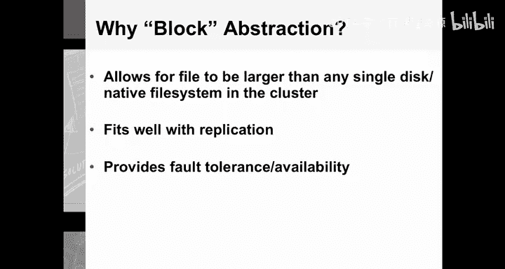

So what is HFS good for HFS is good for storing large files stored very few large files rather than lots of small files we would rather store millions of large files rather than billions of small files in HDFS when you store large files。

 there's a lot of metadata that needs to be maintained。

 so that actually puts a pressure on the name node， so we like to store large files in HFS。

And typically， the file size should be in megabytes or even in gigabytes。😡，Not kilobytes。

HTFS is good for streaming data。 You write the data once。And then you read many， many times。

 That's the pattern。 Write once and read many times。 You write the data file once。

 and then you read many times and process many times。 That's the idea。

 It's optimized for streaming reads rather than random reads。 You can surely go to。

To block number 17 and read some piece of data over that you can theres a seek function available。

 but it's great for streaming reads rather than random reads。It runs on cheap commodity hardware。

 you've heard me say this again and again， you do not need any supercomputers。

 you do not need any EMC like devices， all you need is commodity servers。

 they don't have to be highly reliable hardware either。

 it's okay for them to go down because we have replication happening in the system。

What is HDFS not good for HDFs is not good for low latency reads。😡，In other words。

 it's not good for reading small chunks of data。If you want to do something like that。

 then there is another project called HSp which addresses this issue with HSpace you have almost like a database a distributed database built on top of Hadoop HDFS that allows you to do low latency reach we will talk about HSp later on。

It is not good for load latency reads， but it's great for high throughput rates you want to read a lot of data continuously。

 it's great for that。It's not good for large amount of small files。

 we want to store millions of large files in megaytes or in gigabyte size rather than billion of small files。

 like I said， it puts a limitation on the name node which we'll talk about later on。😡。

HTF is also not good for multiple writers there is only a single writer per file once you write a file。

 you cannot really make any changes to it， you can only append to the end of the file and there can be only one writer that can write the file。

😡。

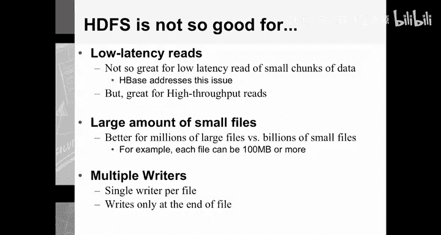

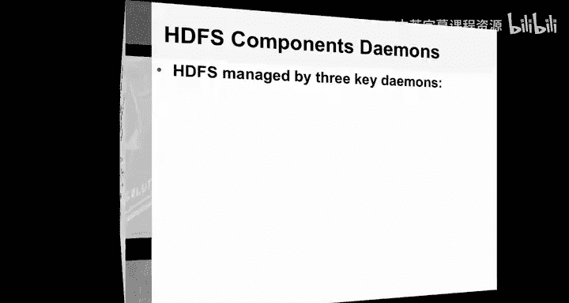

HDFS components and demons。HDF system is made up of three key demons。 You have name node， name node。

Manaages the file systems， name，space or metadata。Namespace is the portion of the file system that tracks all the different directories。

 all the different file names， metadata is where all the different blocks are。

 what the different block IDs are， all the information is managed by the name node。

 it typically runs on one machine。Data node is the one that stores and retrieves the data blocks data node is the demon that reports to the name node its current status。

And it runs on many machines， every machine， every physical server would have a data node running on it。

Then there is also something called secondary name node Second name node performs housekeeping work so that name node does not have to do that work Second name node requires similar hardware as the name node machine only because if the primary name node goes down you may want to bring the secondary name node as the primary name node。

 but otherwise the secondary name node doesn't really do the same work as the primary name node Second name node is not used for high availability。

 It is not even a backup node to name node， It is just a checkpoint node which we'll talk about in a few minutes。

In this slide I have five different servers represented in gray。

 we have a master server in which we have the name node running。We have another server。

 which is where we have the secondary name node demon running， and then we have three slave servers。

 which is where we have the data node demons running。So we have master running the name node。

 slaves running the data node demon， the data node demon and the data node demon。

 and they are maintaining their own blocks of data。

I also have represented client the client could be running in a completely different machine。

 it could also be running within the same machine， but I've kept it separately。Ac client。

Connects to the name node to perform metadata operations like creating a file， deleting a file。

 creating a directory， deleting a directory， getting metadata information about a file or a directory like who owns the file file permissions what is the size of the file The client also communicates with the data node to actually write the data or to read the data because the name node only maintains the metadata it's the data node that stores and retrievets the files for you。

 so the client directly communicate with the data nodes。

The data nodes also communicate with each other because data has to be replicated。

 so each data node is actually instructed by the name node as to where it needs to put the copy and so the data nodes are communicating with each other in order to replicate the data。

The name node is also connected to the data node， the name node performs block operations on the data node。

 the name node is consistently communicating with them。

 trying to figure out if they are up and running， what data blocks they have。

 what is the checks sum on the data block， also what needs to be replicated because it's underreplated。

 what demons are up， all those things are being managed by the master node。

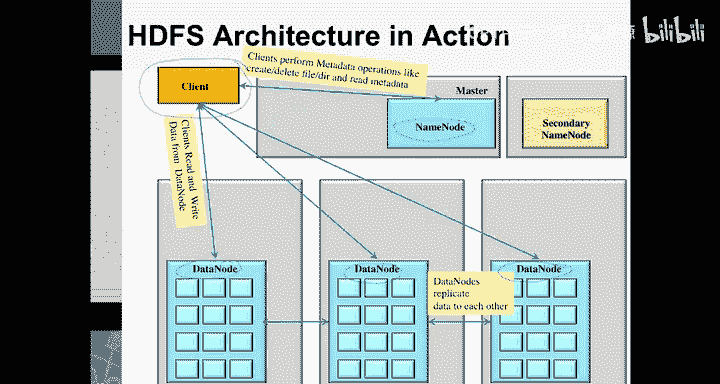

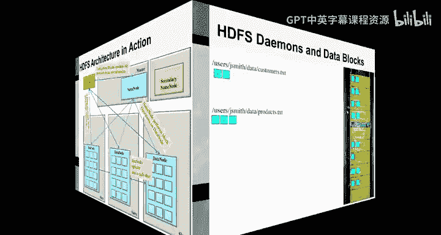

Remember a few slides ago I showed you a data center with a rack with10 servers， so let's do that。

 let's take that example， we saw we have 10 servers。

We have a couple of servers where we are really not doing anything and those are the two servers where we are going to do some work now。

 I didn't really do anything in those servers because I wanted to do something special with those servers。

On one of those servers， I'm going to put the name node demon。

 so that's my master name node and one of the other servers I'm going to put the secondary name node demon。

 so those are your master architecture and then on all the rest of the nodes or rest of the servers I'm going to put the data node demon。

So as you can see now we have a master S architecture。

 we have one machine where the master name node is running and then we have eight machines where the data node slave demons are running and each data node is managing the blocks within that particular server。

 everybody is managing their own blocks。And that could be communication that is going on between these different servers through the network。

 through the hub that we have that they're all interconnected with。

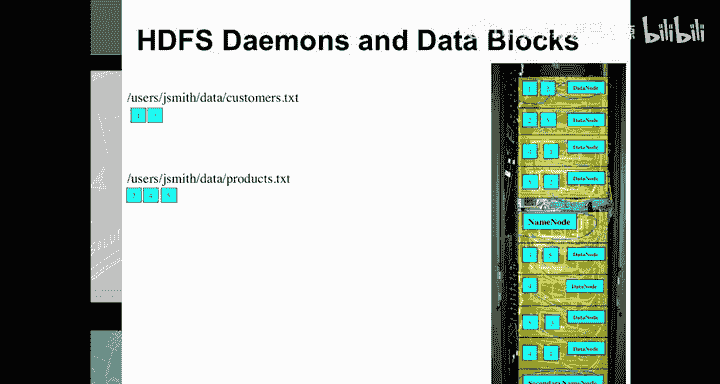

So let's talk about the name node in more detail。😡，The name note is the bookkeeper of HDFS。

It creates and maintains the file system tree and rated metadata When I say file system 3。

 I mean things like the directory name， what directory belongs to what directory。

 one of the file permission， which file is in which directory the entire file system is a tree。

 it maintains that particular tree。Dictates how files are broken down into five blocks。

 it's the name node that says okay this file will be broken down into seven blocks。

 these are the different blocks， these are the block IDs and these blocks need to go to these locations。

 all those things are managed by the name node。😡，It's dictating which blocks are going to be stored where monitors the overall health of the distributed file system。

 it's consistently communicating with the data nodes to figure out where the data nodes are。

 what they are doing what blocks are they maintaining， are the blocks corrupted。

 all those things are being maintained by the name node。

The name node is considered to be the master of the HDS file system。

 is directing the slave data node to perform the low level IO tasks。

The name node is memory and disk IO intensives， since name node has to be fast。

 all the metadata about the files and the directories are actually kept in memory。

The metadata copy is stored onto disk because if the name node ever crashes。

 it has to rebuild that information。 These are what we call file system edits。

 which are actually checkpointed to the disk from time to time。

The name node typically runs on a node by itself， it doesn't really double up with anybody else。😡。

Sometimes depending upon the size of the cluster， if it's a small cluster。

 it may be doubled up with a secondary name node that's about it。😡。

And if you run the full yarn Hadoop cluster， then sometimes it may be doubled up with a resource manager。

 which is the master in the yarn Hadoop architecture。Before you use the name node。

 before you use the HDFS file system， you have to format the file system。

 the way you format the file system is by executing the HDFS command with name node as the argument and dash format as the option When you format a file system。

 it initializes the metadata。And this initialized data structure is stored in a file。 in fact。

 if you recall when we configured。I do cluster in zero distributed mode in our HDfsconfig。xml file。

 there was a property called dfs。name。D， which is the directory where the initialization is placed。

One word of caution。Once you format the HDFS， please do not format HDFS again because if you reformat HDFS。

 you lose all the name node metadata， which means you have pretty much lost your file system Now the data blocks have not been lost。

 they' are still been stored in different machines in various disks but the way they are connected what files are connected to what data blocks。

 that information is completely lost， it's like a fact the file allocation table of a file system so do not do not reformat a file system。

 especially in production here， you can do it， that's not a problem if you do it。

 of course you're going to lose all your data that you have put into HDFS before。😡。

So a subsequent format will only destroy your existing metadata。The secondary name node。

The term secondary in the secondary name node is misleading。

It has no functionality that's very similar to the name node。

 It functionality is completely different from the name node in no event can it actually replace the primary name node if the primary name node goes down。

 That's why in the future itll be called the checkpoint node。😡。

The purpose of the secondary name node is to perform periodic checkpoints。

Basically from time to time， the secondary name node goes to where the name node has placed a file system image and the edit logs。

 which is/lash user s local/lash Hadoop s data/ n directory。

 which is where the name node has placed its file system image。

 and any changes the name node is making in the file system it's writing as edit log files and placing those things those information as edit log files。

 secondary name node takes this information。Takes the file system image and takes the edit log files and merges the two things together and create a new file system image and uploads this new file system image back into the name node The only reason it does this is if the name node ever crashes。

And then it has to be brought back up。😡，Otherwise， it has to take the file system image。

 rebuild the new file system image with all the edits， and then come up， and this may take 10。

 15 minutes， maybe even an hour or two hours depending upon how hard the name node crashed and how fast you were creating files or deleting files or updating files in the file system。

😡，The name node typically runs on a separate node by itself because it has the same hardware requirements as name node The other reason why the name node runs on a node by itself is if for some reason the server where the name node demon is running goes down then you know you cannot sit down and order a brand new server at that particular point course surely you can bring in a new VM。

 but typically what people do is they would take the secondary name node and launch it as the primary name node and so they basically will not run the secondary name node until they get a different machine。

 but thats one of the reasons why they would actually run on a separate machine same kind of a machine as the name node itself。

The data node。The data node is the workhorse of the file system。

 it's the data node that stores and retrieves the actual data blocks in the local file system in the local disks。

It is the slave of the name node， it reports from time to time to the name node as to what blocks it's st。

 what is the status of those blockss， what is the check sum for those blockss so that the name node can keep track of all those things and then give appropriate directions to the data node for example。

If a data node crashes， the name node may send information to the data node saying。

 please replicate this block from yourself into this other machine and so the data node will have to do the re to the other machine。

The data node receives data requests from the clients。

 that's the main purpose that the data node has。Whenever a client wants to read a file or whenever a client wants to write a file。

 the client talks directly to the data node and the data node writes the data into the local file system or reads the data from the local file system and returns back to the client Of course there is something called data locality when you start running your map producedd tasks you'll find the tasks or processes that are running within the same server will be talking to the data node within that particular server so that they can work on the data that is locally located。

 which is what we call data locality。Like I said， the data node is responsible for replicating the blockss。

 the number of copies based upon the replication factor。

 and it replicates to the other data nodes by talking directly to them。

 but if the guidance is being gotten from the name node。If you look at the HDFS architecture。

 we saw that we have three major demons， we have the name node demon， we have the data node demon。

 we also have the secondary name node demon。If you look at them carefully in the name node itself。

 there are many different services that are running。

We have a port on which the name node is listening on which is 50070， that's the HttP protocol port。

 which is the web Ui that we would be using to administer to look at what the status of the name node is there is also another port which is 50470 which is not configured because by default Https is not configured it's really the same admin port except it's running over secure protocol we don't have that running right now then there is the port 9000 in which the name node metaservice is running This is where the clients communicate to in order to create a file delete a file update data file and thinking all the metadata operations are being done notice the protocol for that is IPC which is interprocess communication versus the web protocol is HttP and Https So there are really three major ports that the name node is running50070 for web access。

And 9000 for the IPC communication and 5，0，4，7，0 for。

The HTPS version of the admin console for the name node。8020 is another port in which you can run on。

 it's either 8020 or 90008020 used to be where the name node for Hadoop1 used to run so just in case if you decide to run both of them side by side。

 you want to keep the port number separate。As far as the data node is concerned。

 the data node seems to have four different ports。The IPC port。

 the port in which the metadata operations and all the other communication takes place is 50020。

 there is also another port which is 50010 which is used for data transfer。

 it's used for the transfer of data。And then 50075 is where the web UI is for the data node。

 there is also 50475， which is the HtTPS version of it。As far the secondary name notice is concerned。

 it has only one port in which it's listening on， which is 50090。

 which is where the admin console for name notice。So how do you start and stop HDFS demons？

If you want to start all the HDFS demands， all you need to do is start dashdfs。sh。

 it will start all the HDFs statementss， which means it will start the name node。

 the secondary name node and the data node， we are running of course in the pseudo distributed mode so it will run all the three nodes in our machine。

If you want to stop all the demons， then you do stop dashdfs。sh。

 which shut down all the three demons， if you want to individually start a demon or stop a demon。

 then you can take the option of Hadoopdemon。sh， and then start followed by the name of the demon。

 which is either name node， secondary name node or data node。

 you can also stop an individual demonmon by typing in Hadoop demonmon。sh。

Stop demon name and the name can be again， name node， secondary name node or data node。

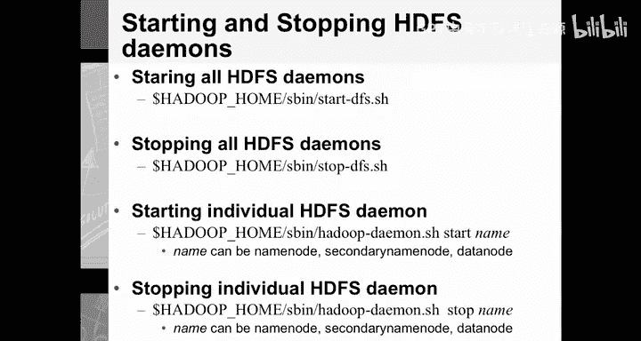

In this section， we looked deeper at the architecture of HDFS。

We also looked at some of the key characteristics of HDFS， what it is good for。

 what it is not good for， the various components and demons that make up HDFS。

 their rules and their interactions， and finally we looked at some basic administration of HDFS like formatting the file system to initialize the file system and starting and stopping demons。

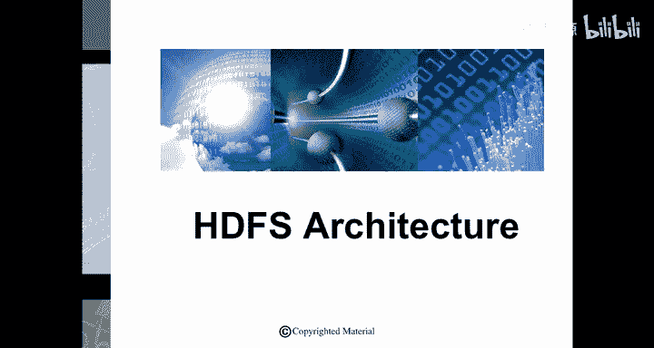