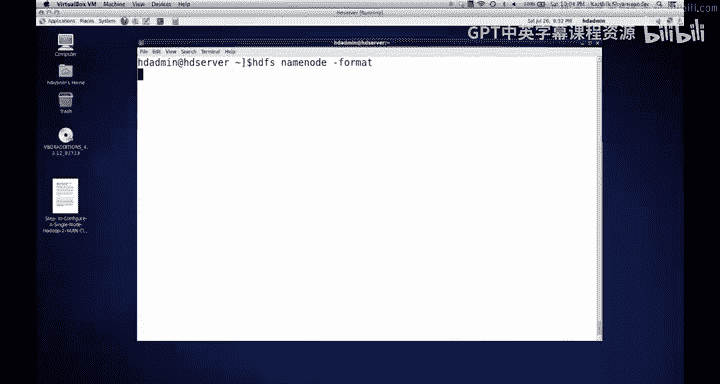
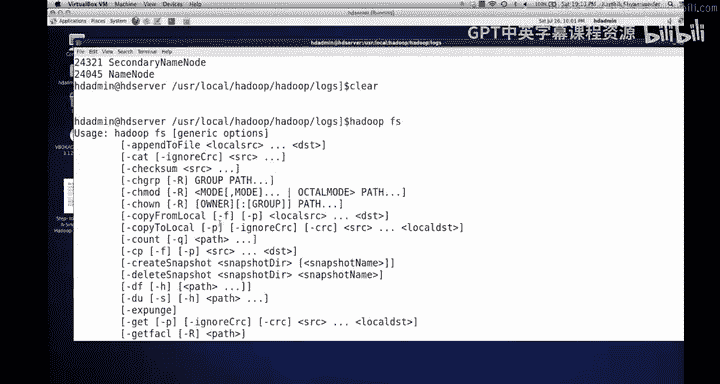
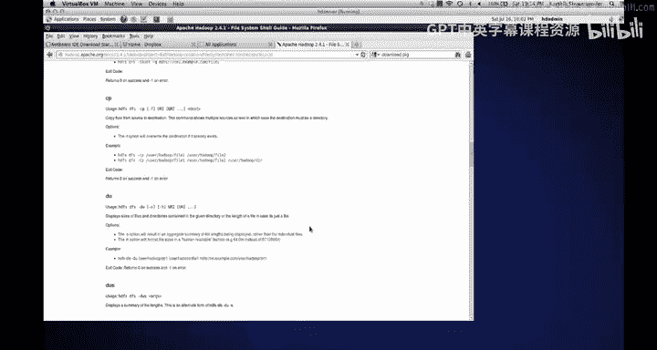
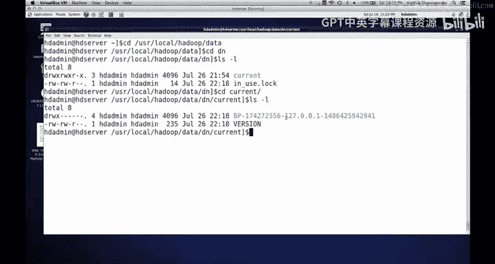
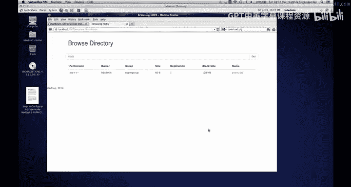
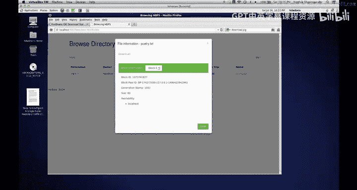
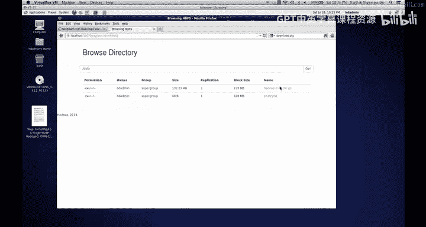
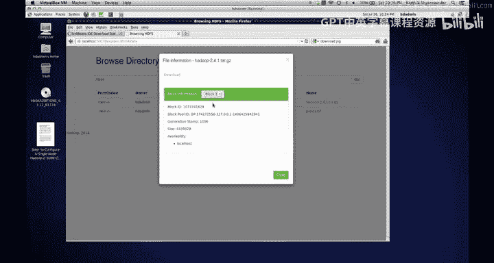

# 约翰霍普金斯大学《Hadoop大数据处理｜Big Data Processing Using Hadoop》中英字幕 - P24：2_HDFS架构实践.zh_en - GPT中英字幕课程资源 - BV1g5u6zBExs

Hands on HDFS architecture。In this section， Im going to log into the VM and demonstrate HDFS architecture from administration perspective and file system interaction perspective using built in Hadoop commands。

The goal is to give you practical understanding of HDFS architecture。

So let's log into our VM and experiment on。Okay， I'm in my HD server VM。

 I would like to log in as HD admin。And' logged in。

So what I would like to do at this point is put into practice many of the concepts that we learned in this module。

Okay， one of the first things we learned was we need to format the file system。

 the way you format the file system is you type in HDFS。Name node， dash format without format。

 you really cannot do anything。

So there it is， I just formatted the file system when I formatted the file system using the HDFS name node dash format command。

 notice it said that it formatted the file system in this rot slash users s locals s Hadoop s data slash Nn。

Let's go to slash users slash local slash Hadoop slash datas s Nn。Let's do an Ls minus cell。

 There is a directory there called current。To an LS minus L over there there is the file system image notice I said to you that name node manages the file system metadata and it actually stores a copy of the metadata in its special folder there is that's where the metadata information is being stored。

How does name Notee know where to store this metadata if you think about it？

Let's go to the config directory。In the config directory， there's a file calledFsconfig hdfss。xml。

Over there， we mentioned as to where the name node should store the metadata information。

 That's right there。 In fact， we also mentioned where the secondary name node。Is going to store its。

Information related to file system image， we also have written down as to where the checkpoint edits needs to be placed。

 which is all the edits that's done by the name node。

And also where the data nodes should place the files， the actual data content。

 that's the directory right there。Okay， so that's where the configuration is。

Right so now that we have forwarded the name node， let's go ahead and start the demon。

 the way you start the demon you stop is by typing in start dash DFs， So start dash Dfs。Sage。

That should start all the demons， it's starting the name node right now。

It's starting the data node right now。And it should start the secondary name node right there。

 It started the secondary name node。Okay there it is so all the three HDFS demons technically have been started let's check it out to a J there you go。

 we have name node running we have data node running and we have secondary name node running If I wanted to shut down all the nodes in one command I can do that by typing in stop dash dfs dosh。

And hit enter， that should shut down all the three data nodes， the name node， secondary name node。

And the data node， of course， such on all the DFS demons。Okay。

 shutting down secondary name node right now。Do GPS again。

You'll notice that none of the demons are running。 Now。

 I can always start the demons all in one shot， or I can start each demon one by one。

 The way we said we can do that is by typing in had2。Demon， Do H。

You can say start the name of the demon， we want to start the name node。Started the name note。

Start secondary， named out。Starting the secondary name node。And start the data node。

That should start the data node if I do a JPS， all three of them are running。

 I can shut these things down。I can say stop the name node， change this to stop name node。

That should shut down the name note。And I can stop the secondary name node。Secondary name en node。

That shuts down the secondary name node。And I can shut down the data note。

That would shut down the data now。If I do a J， none of the rooms should be running。

Let me go ahead and do a start all， so start theirtFS startH， start all the demon。

So we can do some file system operations。Okay。To GPS， yes， all the nodes are up and running。

 So you've learned how to do the basic administration of。HDFS， you know how to start the demons。Oh。

 by the way， you can also check to see what ports these different demons are running。

 One way to do that。Is， for example， if you look at data node， the data node is running on。

 let's look at name node， name node is running name nodes， process Is 2，4，0，4，5。

 Let's see what are all the different ports that the name node。Is listening on。

 So the way you can do that is by typing in Nestt minus A and B。Cb， listen。

 it is going to show you all the port numbers where the processes are listening on。

And then I can do Gr。2，4，0，4，5。So that's telling me that the process 24045 is a JVM process and the ports in which the name node is listening on is 9000 and 50070。

 9，000 is the IPC port where the data nodes are communicating with the name node and 50070 is the console is the admin console for the name node so you can check to see what the name node is doing。

Allright， so that you get the idea as to how to check the port numbers。Now if you get into trouble。

 you don't if you don't know why the Dame node did not start or if you don't know why the data node did not start。

 you'll have to go to the log file and the log files are located in the logs folder。

So if I do an LS minus Sl， you'll see a lot of different log files。

 if I do an LS minusl star name node。I'll see all the name node log files。

 You can see that it is actually。Rotating the log files every time you store the name node。

 it rotates the log file。Do an Ls minus L now。 There it is。 So the latest log file is right here。

 So there's a log file， and there is also an output file。You should really look at the log file。

 so the other one is a standard output。So， name node。You do VI star name node， star log。

 and you can see for any exceptions in this file。So the way I manipulate the file system。

 in other words， the way I can create files and update files and create a directory and delete a directory and copy a file。

 the way I can do all these things in the HDFS file system is by using a command called the Hadoop FS command。

Or by using a command called HD DFS， DFS command， right。

 So let's look at the Hadoop Fs command if I type in Hadoop。FS and hit Enter。

 this is the Hadoop command for file system operations。If I hit enter。

 it is going to give me a whole bunch of options。So let's look at it， so it says Hadoop Fs。

 and it gives me genetic options。And then it gives me a list of other command options that I can take as an arguments。

 for example， I can cat a file， I can append to a file， I can change the mode of a file。

 I can change the ownership， I can copy files into the file system Sos a whole bunch of different commands available so that you can manipulate the HDFs file system。

 There's really nice documentation also available。 You can take a look at the documentation。

 Let's go ahead and look at documentation if you go to Google。

Just go to Google。And type in。HD Fs。Command。Guide。Or documentation， That would be a。Oh， there it is。

HdM command shell documentation of that command shell。Documentation。

WeSince were working with release 2。 4。1， whatever your releases that you're at， you can use that。

 There it is。 Click on that。There it is， here's the list of all the commands that you can execute。

So for example， if you type in copy。From local or copy to local。It shows you how to use that， right？

Now here it says HDFSDFS， you can also use the HDFSDFS option rather than Hadoop FS option。

 these are two different ways by which you can execute the command so let's do that let's do that。

 let's try to create some files The first thing we can do is do Hadoop Fs dash Ls slash that's like saying I would like to know all the files that's in the root HDFS file system。

There should be no files in HDFS Okay， now I want to make a directory， let's make a directory。

 So that would be Hado FS dash the way you make a directory in UniX is MKD IR。

 It's very similar to UniX MKD IR slash data。That should make a director called data。

I just made it directly called data and if I do Hadoop Fs Ls。

That should allow me to see the data folder， there it is， the data folder is being created。Okay게。

I can also， if what if I say Hadoop FS dash LS and hit enter。When I do that。

 the LS command doesn't like it， it wants you to tell it what the file system directory is。

 so you have to pass an argument to it， so slash would be what you need to do。Okay。

 now what I would like to do is。Copy a file into my data directory For that。

 I would like to create a new file。 So VI。I'm going to call it create a file called poetry。 TxD。

So I already have one， I'm going to add four lines into it。This is line 4。

 I have four lines in the poetry to an Ls minus L。 This file is created locally in my local file system。

Third it is Po。t Tht 60 bys log， what I would like to do is copy this file into HDFS and I want to copy it under the s data directory。

The way you copy a file into HDFS is by typing in Hadoop FS。

Dash copy from local because you are copying from the local file system into hertu。

What is the name of the file， it's poetry。txt， so I like to give you know if it's in the local directory。

 I like to start it with dot slash so I say dot slash poetry。

txt although you don't really have to do it and it's going to go into slash data。

I don't really have to give the name of the file， I could simply say slash data that file should be copied into slash data folder if I do Hadoop Fs Ls slash data。

 the file should be available in the HDFS file system There it is I could have also copied the file as slash poetryet do THD。

That would have copied。Ohs in this case， notice it's actually telling me it's giving me a warning saying that the file cannot be copied over because there's audio file that exists。

 Now Hadoop is very good at this because Hadoop doesn't want you to copy you know a file over。

 maybe you copied a 10 gigabyte file or even 120 gigabyte file into the file system and you simply overwrite it。

 so it's trying to be a little bit cautious about it。All right。

 so that brings up an interesting point， let's go ahead and delete the file that's already there。

 so the way you delete a file is Hadoop Fs Rm slashda sPoetry。txt let should delete the file。

Now in a denaophil， it kind of moves it into this trash and then from time to time the HDFS demon cleans up the trash and that's really what it's saying if you want to you can explicitly。

Empty the trash by typing in spungge option。s it's big sponge。All right， so that's done。Okay。

 so Hado F S dash L S slash。HaoopfsL slash data。The file doesn't exist anymore。

 Let's go ahead and copy it again。 Hado Fs dash copy from a local。Dodge large poty。

Dt THD into slash data， slash poetry dot THD， I could do that。I could also rename it。

 poetry dash copy。ADifferent， different one。And I could do a Hadoop F S dash Ls。Data。

 you should see two files over there。Okay， I see two files over that。I can also。

Concateinate into a file。 So let's say I have poetry dot DXD。

 And I would like to add another line into it， so。I'm going to create a new file here locally via I addline。

Dot TxD。This is。Last line。Okay now what I would like to do is append it to the existing file notice Hadoop HDFS。

 I said you can once you create a file， you cannot modify the file。

 but you can surely append to the file So there is actually an operation available for that through commandline Hadop dash Hadoop FS。

I think it's dash a pen。And I would like to append the local file。Haoop F append dot slash addline。

 Txc， and I would like to add it to slash data slash poetry。t THD。It enter。So。Oh， there is an error。

 not a problem。 it's always a good thing when you get an error， you can find out what's going on。

 Hadoop Fs。Let's look at the options over here。 It says Hadoop， it's append2 file。 It's append2 file。

 So let's do that。Append a two file。What file？Append the contents of addline or THD into that file。

Go ahead do that。Now I can check to see if the file has the right content and the way I can find out。

Or concatenate or cap the file thats and HDFSs by using the CAT command。That would be slash data。

 slash poetry dot TxD。look at that， this is last line， so the line was added。

 so I just wanted to point to you that you can append to an existing file in HFS。Okay。

 so we were able to copy a file， we were able to。Append to the file。

 we were also able to delete the file， I think， but let's go ahead and delete the file。

Let's go ahead delete the file。 Hadoop， F S dash RM。

 Let's go ahead and delete the file RM slash data slash。Poetry dot T， H D。

That should delete the file， or we did delete the file before too， Okay， so Hadoop Fs Ls/ data。

So the file has been deleted。Okay， very good。Now I would like to see this file that's poetryed copied our TxD。

 I would like to rename that file。 So let's let's rename the file。 That's the move operation。

 So Had do。F S dash。M V。Slash data， slash poetry， doty dash copy。

 Now it doesn't do command line completion。 That's one bad thing about HDFS。Slash data， slash。

Poetry it poetry。 THD。There it moved the file。And that should be called poetry。thhd。

So we were able to create a file， we were able to read the file， we were able to append to the file。

 we were able to rename the file， we were able to delete the file。

 so we have done all the basic file system operation。We can also create directories。

 The way you create a directory is Hadoop Fs dash MkD Ir slash data， which we already did。

 Now we want to create another directory underneath it。Let's say 20002 let's say， 2014。

So I created a directory called 2014， and then I created a directory called zero。7。

And then I would like to create a director underneath that calls01。

Create another directory called 02。Create another director 03。 You get the idea。

 What I'm doing here is creating directories inside 2014 July for different days。

 And what I want to do is you know， if you have files that are coming in from your edge servers from your various web servers。

 you may want to organize the files that are coming in into HDFS when you want to load the files into HDFS and load them into different directories。

 So you can have your map or use processing later on being done。

 So it's part of organizing the data in your file system。

s it's really the normal way you organize data in your regular file system。

 except you're doing it over HDFS。 That's the point I was trying to make over here。

 So you can make a directory。 You can also delete a directory。 So I can do RMDIR。Slash data。

 slash 2014。Slash is 07， slash is 03 that is going to delete the directory。You can do RM minus R。

 which is going to delete recursively。 So RM minus R slash data。Slash 2014， oops。

 that doesn't exist 2014 that is going to delete the 2014 directlyy and everything underneath it。

 again， the trash concept came in if I do Ls minus L。I am not going to see those directories。

And you can also rename the directory， you can do all those different operations。

So you get the basic idea how name node is working， how the data node is working。

 how the different demons are working and how we as a user can interact with these name nodes。 Now。

 let me show you something interesting。 I'm going to shut down the name node。So。And do。Demon or H。

 stop。你咯。Okay， do a JPS。JPS， okay， there it is。 That was P S before。 Alright。

 so we see that only the data node and secondary name node de demons are running。

What if I do Hadoop FS L slash。Well， if I do this operation。

 it is going to talk to the name node and ask for the various files that are located in the root directory。

 which is metadata information about files。So let's see what happens I hit enter。

HaSo my command line tool is telling me that it cannot talk to the name node and so it gives us an error interesting。

 right， it makes sense。 So it makes sense because the client is talking to the name node to get information about the metadata。

All right， so let me go ahead and start the name note。Yeah。Start。Name note。Oops，Start。你呢。JPS。

The name node is running。Now I would like to do the same command。And I should get an answer back。

Okay， what I would like to do is copy Hadoop， F S dash copy。From。Local。

Local dots slash poetry or T XT to slash data。Right， oh， it already exists。 Okay， that's good。

 It already exists。What I would like to do is。Since the file already exists。

 let me remove the local copy of it。I'm actually removing the local copy and I would like to copy from the distributed file system into the local file system。

 let's do that。Haoop， F， S。Dash， instead of copy from local， it would be copy to local。

Slash data slash poetry。txt。To my local file system。 Now， if I don't put anything as an argument。

 that would give me an。啊。There it is， copy to local slash data slash poetryet。 Txt。

 and copy the file locally if I do an LS minus cell， the file。Poetry do THT exists。If you want。

 you can also do dot slash。In this case， of course， the file locally exists。We could do that。Al。Okay。

 so we have that working， let me go ahead and delete the file again。Rm。Poetry dot THD。Okay。

 so what I would like to do now is。Bring the data node down。Haado。Demon dot S， H。Stop the。JB。

So we don't have the data node running。Now I would like to do Hadoop Fs。Dash L slash。Oh。

I'm able to get information about the files that are there in the file system。

If I do Hadoop FsLs slash data。There is a file over there Po dot Tx even gives me information about the file。

 Now， what if I do Hadoop Fs dash。Cat。Slash data sPoet。

thD CA is an operation that gives you the contents of the file。Ah， in this case。

 it is throwing me an exception。And the exception it's throwing me is。

There is is the fact that it is not able to talk to the data node。

 So notice it's saying that I cannot talk to the data node。

 that's because the client talked to the name node， the name node said。

 oh this file is actually located in this particular file system in this particular data node So talk to this data node So the client which is the Hadoop Fs command is going to the data node and trying to talk to the data node and the data node is not up and running and that's really the error that you're getting right now。

 it's basically saying I'm not able to get information about the particular block。

 I'm not able to talk to the demon， which is the data node demon let me go ahead and start the data node demon up。

And now， I would like to。Do Hadop Fs L。And I would also like to do a CA operation。There it is。

 the contents of the file are being shown， so you can see。

All the different architectural characteristics that I talked about。

 all the different team interactions that I talked about is making sense。

 it's all working exactly the way I discussed。In the lectures。Okay。

 so we talked about how to start the demons， so to start the demons。

 we talked about how to interact with the file system， by the way。

 you can also do HDFS Dfs dash LS slash that's also another way to interact with the file system rather than Hadoop FS dash LS many people use Hadoop Fs dash LS option。

But you can also do everything using HDFS dash DFS。 The only difference is if you do HDFS。

 DFS and hit enter， you will see。Okay， notice that you're seeing all the different options available in HDFSDFS。

 which is exactly the same thing that you have in Hadoop FS。Except with。HDFS。

 there is a lot more things that you can do。 So if you type in HDFS and hit enter。

 you will notice you can format the name node， you can actually launch the secondary name node。

 run the secondary name node name node， you can run the ZK。

 which is the zookeeper failover controller。 So there's a lot of administrative commands that are available。

 lots of Hadoop admins actually use this particular command。If you type in Hadoop and hit enterter。

 you'll notice that there's only a few commands available for you from Hadoop users's perspective。

 so HD DFS is one option， the other option is Hadoop FS， either one would work。As a regular user。

Okay。Let's quickly look at user local Hadoop。Data。Let's look at the DN， which is the data node。

Youll notice that the data node。It is writing its data over here。

 so this is where all the data node is writing all the data blocks。

 which being written in a regular file system。

As I mentioned everything is built on top of regular file system now we can't make sense of this。

 this is all part of internals of Haddo， but that's where everything is kept。All right。

 so now what I would like to do。Is look at the admin consoles and see if we can make sense out of the admin console so。

We know that Hadoop。Name node runs on。Local host。50070， there's the name node right there。

So we have turned security off in the name node by default， there is no security。

It's talking about the configured capacity， which is 17。23 gigabytes， which is if you think about it。

 when we installed the virtual machine， we had given it 20 gigabytes and so because the slash data directory is everything that we have in the file system。

 it's 17。23 gigabytes left。What else。Genenal information。

 we can go over here and we can browse the file system。When you browse the file system。

 it's showing you that there is a folder called data。

And it's also telling you that the data folder has a file called poetry。txd， you click on that。

It's telling you that the block Id。 Remember， I said to you that every file has block and this one has only one block。

 that's block 0。 The block Id is this。And the size of the file is 60 bytes。

Okay， so what I would like to do。Is maybe put a file that has more than one block in it。

 The default block size is 64 MBby。 So if we put a file that's more than 64 MBby。

 we may be able to see more than one block。 So let's try to do that。

 What I would like to do is go to my downloads folder。

And see if I find I something that's greater than 64 meby。 Okay， so here's a file。 that's。

 that's good。 So this is more than 64 MBby。Let me copy that file in。 In fact。

 I have one that's even even higher than that。 Let's copy the Hadoop 2，4，1 To G Z file。 So Hadoop。

F S dash copy。From。乐高。The Hadoop 24，1 r GZ5 into slash data。

Let's copy it into the slash data trajectoryy。It's taking a few seconds to copy there， Hadoop FS Els。

Slash。I should say slash data， by the way， I can also do dash bar。

 I think that should show me all the contents deccursively。There it is。 It's copied， It's。

130 megabytes， let's see if we can see that。Refresh the file system。 There it is。

Click on it the replication factor sector one， click on the file。

There is block zero and that is block1。Though notice。It's telling me。

All the different blocks there is perfect。Giving you information about the blocks。

Okay。In this section， we logged into our VM， formatted the file system。

 started and stopped HDFS demons， manipulated the file system by creating。

 deleting files and directories。We saw where HDFS demons store the data in the file system。

We also simulated several conditions that demonstrated the internals of HDFS like what would happen if name node is not up and what would happen if data node is not up。

Hopefully， you found this practical demonstration helpful in understanding HDFS architecture better。

