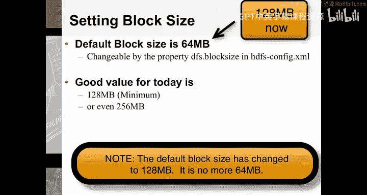
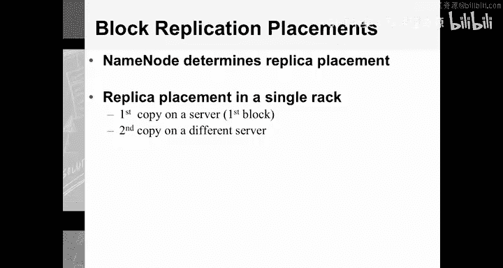
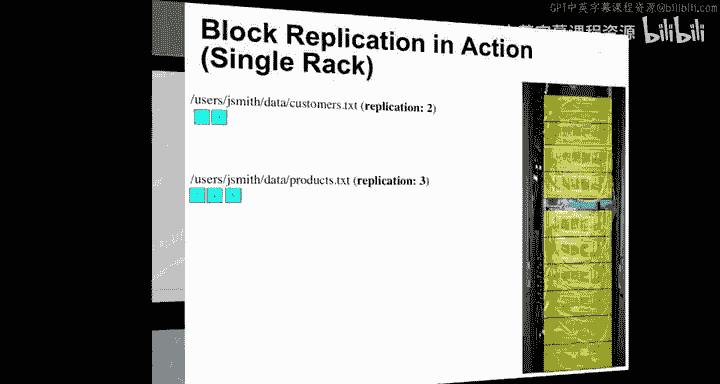
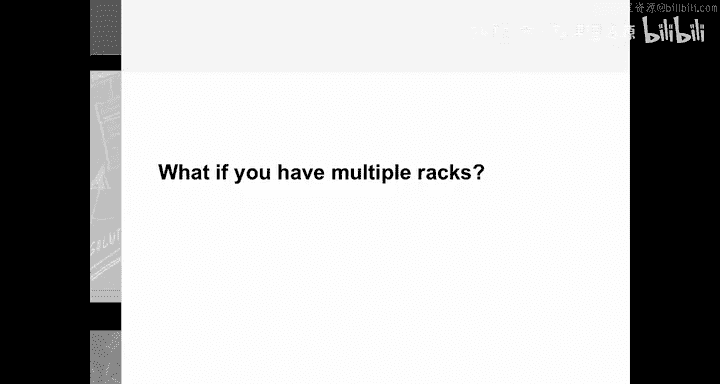
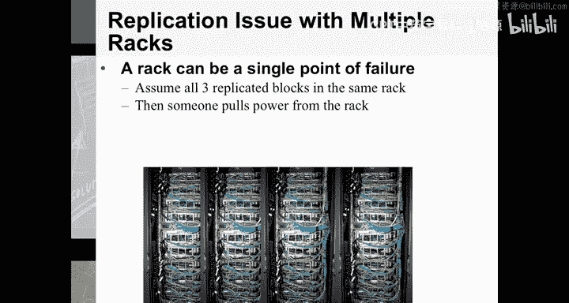
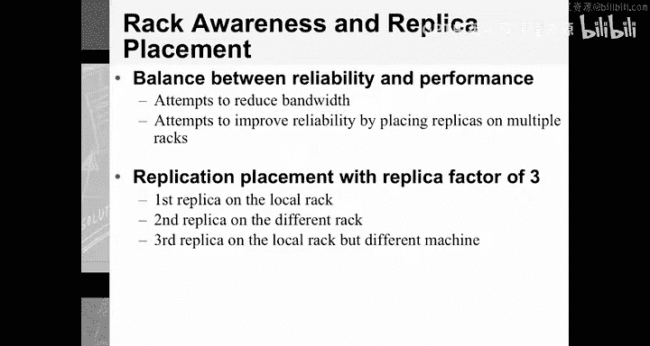

# 约翰霍普金斯大学《Hadoop大数据处理｜Big Data Processing Using Hadoop》中英字幕 - P25：3_块大小、复制与机架感知机制.zh_en - GPT中英字幕课程资源 - BV1g5u6zBExs

Block size， replica placement and rack awareness。In this section。

 we will discuss how to determine a good setting for block size。

 how replica placement is achieved in HDFS， and also the concept of rack awareness。

 which can affect replica placement。

In order to better understand how to set block size， let's review Dis drive performance。

I would like to review two concepts in particular， seat time and data transfer rate。

Seat time is the time it takes for the head to travel to the track where the data is placed so that it can actually do the read。

The average seat time is about three to five milliseconds for high end servers。

15 milliseconds for mobile drives， these are the drives that you buy from Costco so that you can backup up your laptop or desktop。

And nine milliseconds for your desktop machines。Data transfer rate is the rate at which the data moves between the disk and your main memory。

 that is your RA。Don't forget， in order to do any processing you have to first load the data。

 so the data transfer rate also the throughput is what that is all about。

The average data transfer rate in today's world is about 1，030 megabys per second。

 which is about 100 megabytes per second。Saar drives can go up to 300 megabytes per second。啲。😡。

Goal here is to minimize the cost of Cs as compared to the transfer rate。 In other words。

 the amount of time it takes to transfer the data into Ram should be far higher than the time it takes to seek。

 We want to get almost like a 99 to one ratio。So let's do some calculations。

Let's say the seat time is 10 milliseconds， that's what we saw for desktops。

And let's say the transfer rate is about 100 megabytes per second。

Which if you think about is about 100 mebytes per 1000 milliseconds。

 so in 1000 milliseconds we are able to read 100 megabytes and that would be done in a seat temp of about 10 milliseconds so the conclusion here is this is about 1% of the amount of time it takes to read 100 megabytes so 1% of the time is spent on seek for a throughput of 100 megabytes。

So the concept is in order to achieve a seat time of 1% transfer rate。

 block size will have to be 100 megabytes。That's what we should be aiming for。

So let's set the block size， well， the default block size in Hadoop is 64 megabytes。

Everything is changeable by a property， the changeable property is dfs。 block size。

 the property is located in hdfsconfig。 xml， you can change it to whatever value you want。

 a good value for today is about 120 megabytes that's a bare minimum that you should do in any system that you're building today。

 you can even take it to 256 or even 512 megabytes depending upon how larger a file you want and how many files you're going to be putting in the file system Don't forget the larger the block size。

 the lesser the overhead in terms of metadata。

So let's talk about block replication。The default block replication factor is three once again it is changeable by the property dfs。

 replication in hsconfig。xml， if you recall when we configured our cluster in the last module。

 we set the Dfs replication property to one because we only have one server since we are running in pseudo distributed mode。

Even though the default replication factor is three。

 every file can have a replication factor that's different。

You can have a replication factor of one file to be5， another file to be7， another file to be 2。

 but the default is， of course， three。That's what it is today in the Hadoop system。

 there are some talks about potentially changing this particular policy in the future。

 but currently even though in HDF or Sta XML， the default applicationplication factor is three。

 you can overwrite it in your application and later on I'll show you how you can overwrite some of these things。

There is also another concept called default minimum block replication。

 which is set to one minimum block replication is a concept where what you're saying is that when you write a block and whenever you write a file。

 you're writing a block， when you write a block， you're telling HDFS， you are successful。

 only if you're able to write this minimum number of block。

 otherwise it will be considered a failure。The default minimum replication property is one。

 which means when you write a block， as long as one block is written。

 it's considered to be successful and everything else is taken care of by replication。

If your replication factor is5， you may want to set the default replication factor to maybe two or three。

 a good number is usually the total number of replication divided by2 plus1， so if it's five。

 then it would be5 divided by2， which is two and a half plus1 which is3 and a half then you take an integer version of it。

 lower ceiling， so that's set to three。😡，So let's talk about block replication placements。

We know that name node is the master of HDFS， and it's the name node that determines the replica placements。

Let's talk about replica placement in a single rack when you have a single rack and if you have multiple machines when you write data into HDFS。

 the first copy will be placed on a server that will be your first block。

 The second copy will be placed on a different server and the third copy will be placed on a completely different server。

Now， let's look at block replication in action。In combination with the replication factor。

We have two files here， we have a file called customer。

 Tx3 note its replication is set to2 remember I mentioned to you that you can change the replication of every file even though the default replication is three。

TheCustom。 THD file is made up of two blocks， block1 and block three。

 we have another file called Product。thHt。Its replication factor is three。

 and it's made up of three blocks， block two， block4， and block5。What we have over here is Iraq。

 which1 servers in it。So let's go ahead and try to place the blocks for each of the files and see how the applicationplication would take place Now fileCustom。

 THt。Has two blocks in it， and it's two times the application。

 so block one gets placed in one server。A copy of it gets placed in a different server。

Block  three gets placed in one server and a copy of it gets placed in a different server。

For Product THD， we have three blocks and we have three factor replication in that one。

 so block 2 gets placed in one server。The second copy gets placed in a different server。

The third copy gets placed in a yet different server again for block 4， it gets placed on one server。

 second copy on a different server， third copy on a completely different server。

 and so on and so forth for block 52。The advantage of all this is what if。

A server goes down that contains block 3 and block 5， not a problem。

 The name node is going to instruct the data node to。Replate this particular block。

 it may ask another data node running on a different machine and as this block replicated。

 so we may replicate block3 over here to a different server and we may replicate block5 to a different server。

 maybe to this particular server。And so we have high availability happening in our system。

What if you have multiple racks？

Well， let's talk about replication issue with multiple racks。

A rock can actually be a single point of failure。Assume all three replicated blocks are in the same rack。

Then someone pulled the power from the rack。

Haadop would now think that we lost all the copies of that particular block。

 so now replication has to be a little bit much more smarter。Well。

 it so happens that Hadoop can be made rack of air All we have to do is just tell Hadoop which servers are in which rack。

And this is achieved by providing a script to Hadoop all we have to do is in Cos。xml。

 we need to set a property called topology。script。 file name and that property will point to a script that script will basically be called upon every time a node is added into HDfs or removed from HDFs。

So that script is consulted by the Hadoop system。To figure out which rack a server belongs to。

 the way this works is Hadoop calls the script and what Hadoop does is passes the server name to the script。

And the script will basically return the rat name associated with that particular server name。

 that's all it is all Hadoop says is I'll call you script。I'll pass you the server name。

 you tell me what the rock name is。😡，So really， in order to make Hadoop Raware。

 all we need to do is write the script now there are two ways by which people end up writing the script。

One is they create a configuration file where they have a mapping of the server names to rack names。

 and then the script will simply read this particular file and do a lookup and then give the response back or the host name itself。

Or the server name itself will have logic in it， for example。

 SRV1 rack1 would be the name of the server where the SRV1 portion says it's the server name and rack one says it's the rack name which is rack1 in this particular case right server3 is located in rack2 and so the script can be as simple as it just takes the host name and simply pares the host name to return the rack name out of that。

So there are a couple of different approaches available for you。

 that's what systems administrators do。So what's a good practice。

 we should use the host name embed method because it's much easier than maintaining a configuration file because every time you add a machine。

 you have to update the configuration file， you have to set up host names for each machine anyway。

 so this looks like a much better idea in terms of best practice。

And the name node automatically becomes rack A now when you do this right but the data that is in HDFS that is already written HDFS does not get moved to become aware so the point I'm trying to make is if you have a rack based system you have a single rack system you put a lot of files in it and suddenly you decide to add a new rack when you start creating new files in。

 they'll start taking advantage of the new rack， but the old files are still going to be within the same rack so after you make a system rack A you may have to delete the existing files and reccopy the files that is something that you'll have to do manually。

😡，So let's talk about rack awareness and replica placement。

It's really a balance between reliability and performance。In terms of。Performance。

 it's bandwidth performance。 you want to reduce the bandwidth between racks。

You want to try to keep the data as much as possible within the same rack。

 you don't want to be jumping around between all the different racks right so there is a nice balance or fine balance between reducing the bandwidth and improving the reliability of course if you place the data across multiple racks。

 all three replicas on all three different racks， clearly you're going to get a much higher reliability。

😡，So let's talk about replication placement with the replica factor of three for three racks。

Typically， the first replica will be placed on the local rack or let's say， rack 1。

The second replica will be placed on a different server， on a different rack。

And the third replica would be placed on the local rack or on the first rack。

 but on a different machine， so usually it takes advantage of two different racks。

So let's look at block replication in action in a multi Iraq situation。We have a file calledCustom。

 TxD， its replication factors 2， we have another file called Product。 TXD。

 it's replication factors 3， we have customers start Txt with blocks1 and3 and products TxD with blocks 2。

4 and 5。What we have over here is three racks，10th service each。

 and let's see how block replication would take place for customers。 THD and products THD。

So when it comes to customer start Tx， we got two times the applicationplication。

 block one and block three。Block one will be placed in， let's say， rock 1， server one， block 2。

 which will be。A copy would be placed in a completely different rack， so it gets placed on rack 2。

Now as far block3 is concerned， block3 will be placed on a server within a rack and block 3 copy will be placed in a completely different rack Okay。

 so that works now let's look at product dot TxD in product dot THD， we have three blocks2。

4 and 5 block 2， let's say gets placed in rack 3 server1。The second copy for blog two。

 which is the replicated copy will have to be placed in a different rack。

And it got placed in rack 2 now。 And then the third copy would be， again。

 within the first rack itself。 And so it goes to rack 3。Then we have block4， block floor gets placed。

 let's say， in rock one。The second copy is placed in Ra 2。

 and then the third copy will be placed in Ra 1。As far as block five is concerned。

 gets placed in rock  three， and then gets placed in rock two， and then gets placed in rock one。

So you get the idea as to how block replication is taking place in multirac situation。

In this section， we looked at how to determine。And set the HDFs block size。😡。

Then we looked at how replica placement is achieved in HDFS finally we looked at the concept of rack awareness and its effect on replica placement。

