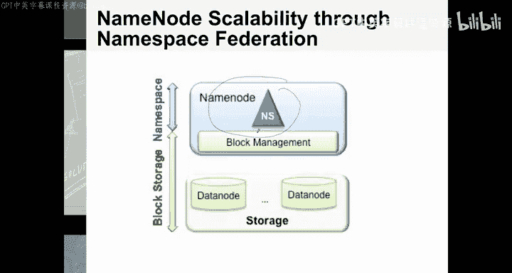
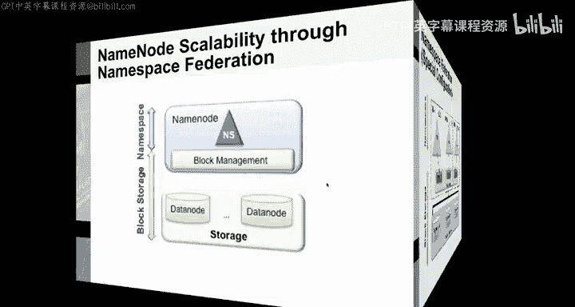
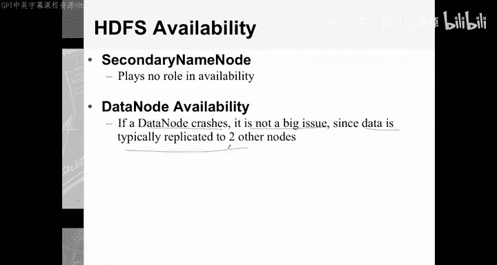
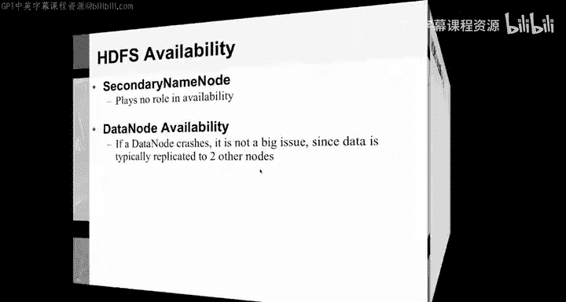
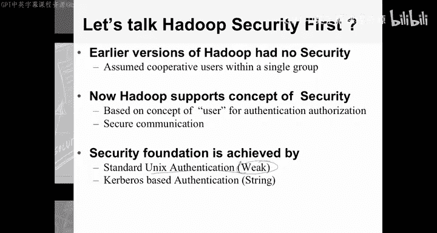
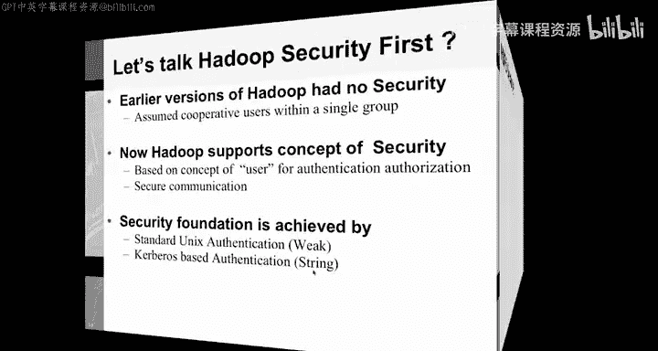
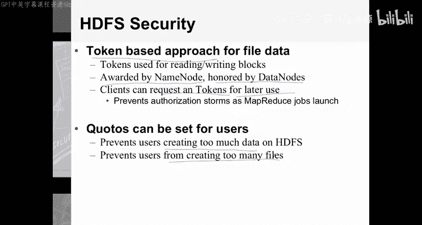

# 约翰霍普金斯大学《Hadoop大数据处理｜Big Data Processing Using Hadoop》中英字幕 - P26：4_HDFS架构核心能力.zh_en - GPT中英字幕课程资源 - BV1g5u6zBExs

HDFS architectural capabilities。In this section， we will look at the architectural capabilities of HFS and well look at it from different perspectives。

 we look at it from performance scalability。Availability。Installability， configurability。

 operaerability， usability and security perspective。

Let's look at all these capabilities for all the three demons。Name node， secondary name node。

 and The node。HtFs performance name node is memory intensive because it has to keep all the metadata for the different files and roties in memory。

 It is also diskcoo intensive because it has to write all the edit to the disk。

 It's also CPU intensive because it has to communicate with the data node。

And give instructions to the data node， also make all the changes that's necessary in the metadata。

 sometimes if the name node is restarted， it has to rebuild the file system image。

 so it's also CPU intensive。You can improve the performance of name node by adding faster CPU and faster discs。

Secondary name node performance secondary name node is CPU intensive because it has to from time to time take the file system image and then update it with all the file system edit and then rewrite the new image into the disk so it is IO intensive from that particular perspective。

The performance of secondary name node can be improved by adding faster CPU and faster disks because it's doing IO。

Datan performance data node is disk IO and network IO disk IO because it has to read and write blocks to the desk。

 network IO because it's constantly replicating the data between the different notess and also giving data back to the client whenever the client asks for data or take data from the client so that it can be written into the file system。

The way you can improve the performance of data node is by adding faster disks and faster network interconnect such as Infinniband。

HTFS scalability。Name note scalability。 Now， in the current implementation of name node that we have。

 which is the default implementation of name node。 We have one name node。

 The only way name node can be scaled is vertically。

 because name node keeps all the metadata in memory， It is memory intensive。

 If you want to maintain more metadata you'll have to add more memory and more CPU and more faster disks。

 That's the default simple implementation。But then there is also this new concept called nameme node scalability through namespace Federation that is part of Hadoop 2 We haven't installed that in our file system for our HDFS file system but it is possible to do that if you are a Hadoop administrator you may want to do something like this the idea behind namespace federation is rather than just having one name node that manages the data nodes in other words one namespace What you can do is have multiple name nodes。

 so that there can be multiple namespaces so for example。

 you see a name node over here there's another name node over here。

 there's another name node over here， all these name nodes are managing different namespaces for example。

 the name node1 is managing s data file system name node2 is managing the s home file system and name node 3 is managing this s project。

F system， but they're all working with the same data blocks under the hood。

But they are separate name nodes， this is what we call namespace federation。

 so it is possible to achieve scalability in the name node by having multiple name nodes。

 but each name node is going to maintain its own metadata tree。In terms of secondary name node。

 secondary name node can be scaled only vertically that is scale up by adding more memory。

 more CPU and more faster tasks， because all it is really doing is taking the file system image。

 applying edits to it， processing it， and rewriting the file system image。

In terms of data node scalability， data nodes are scaled by adding more and more data nodes。

 that's the great thing about Hadtbe。You double the number of data node。

 you have doubled the capacity of the system。HTFS availability。😡，Name note availability。

 this simple implementation。In the simple implementation。

 we have one name node if the name node crashes pretty much everything comes to a halt。

 and so what we typically do with name node is we try to increase the availability of the name node by getting hardware with high MTtTF MTTF means mean time to failure。

 you may get hardware or you may get a server that has MTTF of three。

 which means it would be three years before the server would fail。When name node crashes。

 all you try to do is simply try to bring the name node up。 That's all you try to do。

 There is no concept of backup name node in the simple system。Bringing up a server may take time。

 it may take up to 10 minutes， maybe even 20， 30 minutes。

 depending upon how many operations have been done in the name node itself。

 if name node is very busy where files are being added， files are being deleted。

 files are being attempted， directories are being added。

 pretty clearly all those edits are being placed and name node when it comes up。

 it needs to take the file system image and merge the file system and edits so that it can come up with that particular point。

There is a concept called high availability name node。

 which is a special configuration that is available as part of Hadoop to HDFS。The idea there is。

 you can run。Haoop HDFS name node in two modes， one is the active mode and the other one is the standby mode in the active mode。

 the clients will be sending all the requests to the primary active node。

 the active node is doing all the metadata management。

 but it's also writing all the edits to the file system which is the edits and then the standby node is simply taking all the edits and applying the edits into its memory and the idea there is that if the name node ever crashes the secondary name node can be brought back up Now this is an offering that is part of HDFS2 if you want you can implement it in your production we haven't done it in this particular class。

 but it's possible to do that。In terms of HDFS availability for the secondary name node。

 it plays really no major role in terms of availability because secondary name node。

 all it's really doing is downloading the file system image and applying the edits on it。

In terms of data node availability， if a data node crashes， it is not a big deal at all。

 it's not a big issue because the data is typically replicated to two other nodes。

 so when a data node crashes under the data node that has a copy of the data will serve that particular data。

 so availability is built into the architecture of HDFS。

When we install Hadoop。In pseudo distributed mode in our VM， we installed everything manually。

 it helped us understand what the system is all about。

 but what if you have a cluster that has 100 machines or 200 or even 500 machines？

You don't want to be doing manual installation manualual installation for a small cluster is okay。

 but large scale clusters with 100， 200 even1 thousand0 machines can be difficult to handle。

There is a really wonderful tool called Amri。which is an open source tool available。

 which is part of the Hadoop open source framework。

 you're welcome to use that to install it Now Amri is one of those tools that's available as part of HP which is Horton Work data platform。

 but if you look at Clouderra， Clouderra has their own tool which is a proprietary tool called Clouderra Manager。

Organizations also write custom installed scripts， they would use puppet or she or Ansible to do their installation。

Amazon Elastic Maprouce is a VM based solution and the cool thing about Amazon is you don't really have to install anything because all you have to do is go to Amazon EMR configuration and you simply say I want 50 machines with Hadoop1 or Hadoop to installed。

 it'll automatically have that image。Present it already has an image。

 it loads that image and is ready to go， it's a really nice approach to doing Hadoop in the cloud。

HDFS configurability Hadoop is highly configurable， in fact。

 the running joke is that there are way too many configuration parameters in Hadoop。

There are hundreds of configuration parameters available that you can change。

There are two main Xml files for HDFs that needs to be configured， that is core dashite。txm。

 it's really primarily as part of Hadoop common， it's part of HDFS only from the perspective that this is the file where you say where the name node is going to be running and then the other file is HDFs site。

t Xm， this is where you configure the Hadoop distributed file system。So here's Coside。txml。

 if you recall in Coside。txml， you say using the fs or default dot name where the name node is going to be running and what port it's going to be running on。

 so it's running on local host for 9000。HdFs dashite。xml is the second configuration file。

 you set the DFS applicationplication factor to one over here because we have a single machine cluster running。

We set the name node， name directory as。This directory。

 this is where the name node is going to place its metadata information when you format name node。

Name node check second， this is where the secondary name node。Checkpoint directory is。

 this is where the secondary name node is going to be doing its work。

This is where the name node is going to be placing all the edit files。

And this is where the data node is going to place blocks of data。HTFS Operability。😡。

Open source embarri helps in operations imagine having hundreds of machines and making sure all the demons are up and running open source embodi does a great job in terms of operations there are also other tools available for example。

 there is ganglia and there is Nagiios integration so a lot of things that can be done in order to operate Hadoop efficiently in your production system。

Several commercial products are playing an important role here， Cloudderra has the Cloudera manager。

 Houghton workss has the open source em Bo tool， Map or has what is called the Heat mapap。

 and of course like I said， there is integration with Nagios， which is a proprietary tool。

HDFS usability。If you want to interact with HDFS。😡。

You can use the Hadoop FS command so that you can list the files in Hadoop。

 you can make a directory in Hadoop， so you might say Hadoop FSMKDIR and directory name or Hadoop Fs LS。

There is also。HtFs Fs command。The difference between the Hadoop Fs command and the HDFS DFs command is that the Hadoop Fs command only allows you to do user。

Commands， in other words， you know， manipulating the file system as a user。

HDFSDFS command allows you to not only operate Hadoop file system from a user's perspective。

 it also has administration commands， for example， if you want to rebalance the cluster or bring nodes online。

 all those different administration can be done using the HDFS DFS command。

There are also two programmatic access patterns for HDFS， you have the language binding API。

 you have support for Java and C++ in the next module we will be talking about Java programming using HDFS API。

There is also a Web HDFS RE API so you can access the HDFS file system using the ever popular RE interface。

Let's talk about Hadoop security first。The earlier versions of Hadoop literally had no security。

 it assumed that the cooperative users within a cluster。

 within an organization will be nice to each other and theyre not going to step on each other's toes。

And it was a that was the idea within an organization。Let's talk about Hadoop security first。

The earlier versions of Hadoop had no security at all。

 it assumed that cooperative users within enterprise will work with each other。

 will not step on each other's ses。Now Hadoop does support the concept of security is it's based on the concept of user for authentication and authorization。

There is also secure communication that you can set up for the communication between the data nodes and the communication between client nodes and the data nodes and also the communication between the name node and the data nodes the security foundation in Hadoop is achieved by two different mechanisms one is the standard UniXbased authentication which is basically your user ID your UniX user ID will be used for authentication and authorization that's a pretty weak authentication mechanism there is also a curbrobased authentication which is a much stronger approach。

When you install Hadoop by default， you get the weak UniX authentication。

 so any user that is logged in as a UniX user， whatever his or her privileges or permissions is what is going to be applied into the HDFS file system。

So let's talk about HDFS security。The HD for security is a token based approach。Basically。

 when a client wants to read a file or write a file。

 it has to be awarded tokens and it's awarded tokens by the name node。

 which is honored by the data nodes。The clients can also request tokens for later use this gets used in the case of mapreuce programming where there may be a mapreuce program that may want to have access to 200 files if it asks for tokens all at the same time that is going to create a network storm so it can ask for tokens beforehand。

You can also set quotas for users， it prevents users from creating too much data in HDFS。

 and so the file system is full， it also prevents users from creating too many files which can bring down the name node because remember the name node。

The capacity of the name node is dependent upon the memory that the name node has。

 and there are only so many files that you can create in name node。

There is also secure data communications that you can configure。

 HDFS demons can be configured to communicate over SSL。

 you'll have to do some special configuration for that。

And Hadoop does not encrypt any files on the desk if you want to encrypt the data in the desk。

 that is something that you will have to do from the application perspective。In this section。

 we looked at the HDFS architectural capabilities。We looked at it from the perspective of performance。

 scalability， availabilityability， installability， configurability， operaerability。

 usability and security。

