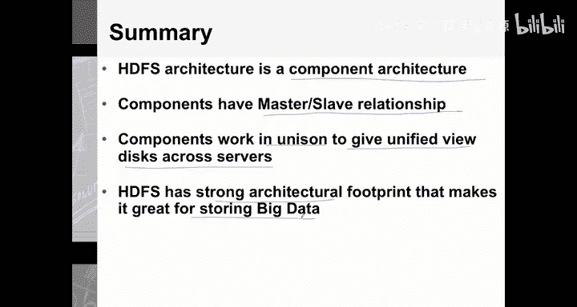

# 约翰霍普金斯大学《Hadoop大数据处理｜Big Data Processing Using Hadoop》中英字幕 - P27：5_HDFS架构总结.zh_en - GPT中英字幕课程资源 - BV1g5u6zBExs

HTFS Architecture Smary。In this module， we saw how HDFS architecture is a component based architecture。

Where the components have a master slave relationship。

 such as the name node being the master and the data node being the slave of the master name node。

The components also work in unison to give a unified view file system of disks across the servers。

HTFS also has a strong architectural footprint that makes it great for storing big data。

 and later on we will see how this strong footprint becomes the foundation for processing big data。

