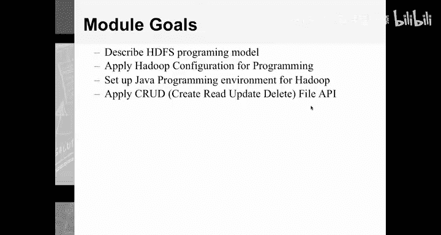

# 约翰霍普金斯大学《Hadoop大数据处理｜Big Data Processing Using Hadoop》中英字幕 - P28：6_HDFS编程基础导论.zh_en - GPT中英字幕课程资源 - BV1g5u6zBExs

Welcome。HDFS programming basics。In this module， we will look at programmatic access to HDFS。

We will start with an overview of the CAAP and a quick demo。

Then we will look at Hadoop configuration and learn to set up IDE for Java Hadoop programming。

We will set up IDE for Ne beanss， but you are welcome to use eclipse or any other IDE of your choice。

Then I'll give you an overview of the Java API for accessing HDFS。

 followed by learning to perform CrD that is create， read， update and delete operations on files。

Here is how the module is organized。 There are four major sections。

There C API overview where I'm going to show you how to write a small C program。

 compile it and run it。Then in the Hadoop Common configurationration and IDE setup。

 I'm going to show you how to instantiate the configuration object。

 which is the foundation object for pretty much anything you do in Hadoop。

 and as part of this I'm going to show you how to set up your IDE set of the class path set of the configuration so you can compile your Hadoop Java programs and run them。

In the section on Java API overview， I'm going to give you a high level overview of the various HDFS packages and classes。

In the section on F Crd， I'm going to show you how to actually write Java programs that allow you to create。

 read， update， and delete files。After completing this module you will be able to describe HDFS programming model。

 youll also be able to apply the Hadoop configuration object for Hadoop programming。

 you will be able to set up your Java programming environment so you can do Hadoop Java programming and finally you will be able to apply crle functionality on files。

