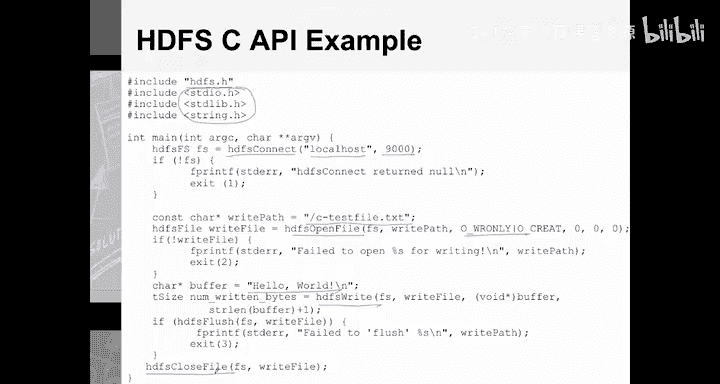
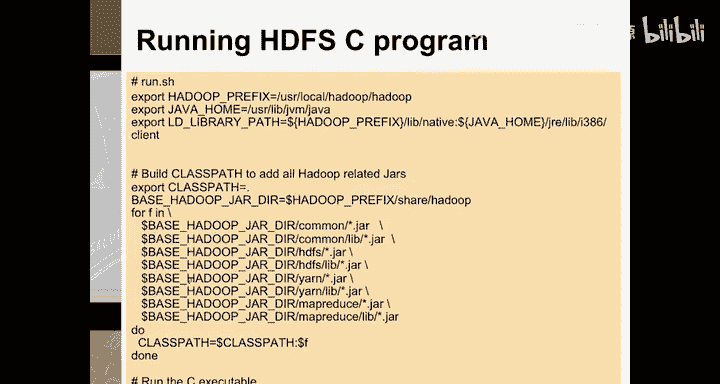
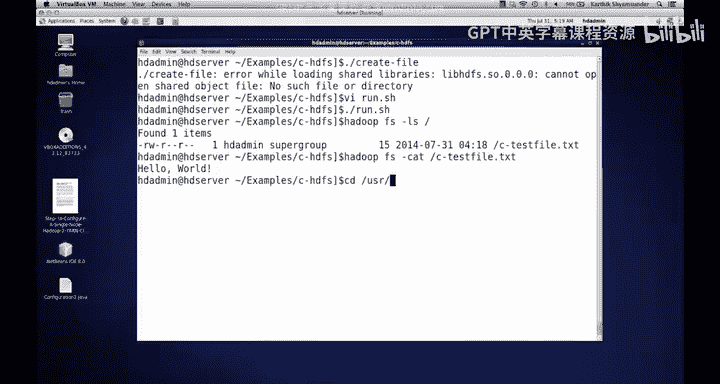
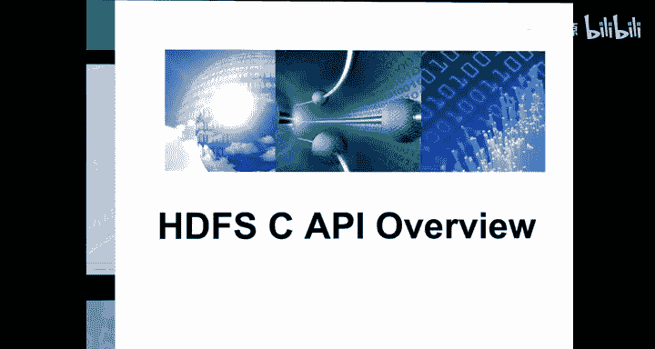

# 约翰霍普金斯大学《Hadoop大数据处理｜Big Data Processing Using Hadoop》中英字幕 - P29：7_HDFS C API解析.zh_en - GPT中英字幕课程资源 - BV1g5u6zBExs

HDFS C API。In this section， I'll give you an overview of programmatic access to HFS using C。

I'll explain this concept through a demo。

First， let's talk about HDFS programming。There are three programming interfaces available for CR operations on files and directorories in HDFS。

You have the CAAP， the CAP basically uses a JNI bridge to call the underlying Java implementation。

Then there is also the Java API， since HFS has already written in Java。

 this is a pretty straightforward API， it's a pretty straightforward call。That is also RE API。

In order to make restful calls， you need to explicitly configure and start a restful service。

Since it is stressfulful， it supports pretty much any language， any client。

 so you can write your clients in Python， in PhP， in Pearl， in whatever language you want。

Let's look at the HDFRCAP。The C API is a JNI wrapper on the Java implementation。 Now。

 what do I mean by that JNI stands for Java native interface。

It allows Java programs to call upon C C plusless programs and C C++ programs to call upon Java programs since Hadoop HDFS is written in Java here we are using the reverse J&I which is C++ programs to call upon the Java programs that's pretty much what's happening in the CAP。

嗯。When you write your C program， you need to include an HDFS header file， which is HDFs。

h that's located in Hadoop prefix that is where Hadoop is installed， slash the include folder。

You also need to require the HDFS library for compilation， which is LibBhdfS。A。

 which is the archive or the LibBhdfs。sO， which is your shared object。

 which is for use for runtime integration， which is located in Hadoop prefix。

 which is where the Hadoop is installed and LibB/ native directory。

You need also need to include the Java header file for J& I for compilation purposes and need to include the JVM library for running。

So let's do that。So here's a simple HFSC API example notice I'm including the HFS。

h header file I'm also including a whole bunch of standard header files in C then I have my main program where I'm making an HFS call to connect to local hostst 9000 that's where my name node service is running once I connect I want to open a file called C test file so here I'm making an HFS open as you can see all the HFS calls have a prefix of HFS I'm opening the file for right access and then I want to write this string called hellello world into the file I'm doing the HFS right over here and then eventually I'm closing the file。

So there's my HDFSc program。

Let's compile the C program in order to compile the C program I wrote a small She script called compiled。

sh you will see that I have exported Hadoop prefix which is the location where Hadoop is installed if you install Hadoop under user local Hadoop Hadoop 241 then I'm basically creating this as a soft link to that particular directory that's all。

And then I have Java underscore home exported and then this is where the main compilation is taking place this is Gcc。

 which is the good news C++ compiler， I'm compiling a file called create underscore file do C。

 I'm including the Hadoop header file location， I'm including the JN I Java head file location。

 I'm also including the standard Linux head file location。

 I need to do this when youre doing when you're doing J and I。Then I'm also including。

The location where the Hadoop library can be found and also including where the JVM library can be found。

I'm actually including the library right here， this is the HFS library， which is the CC++ library。

 and then this is the JVM library， and then I'm saying I would like to create an executable called create dash file。

 which is the one that I'm going to run。Let's run the HFS program now that we have the executable。

 we need to run it now you might think that it's as surpl as running the executable that we created。

 but there are certain environment variables that you need to set。So once again。

 I'm setting the Hado prefix， the Java home and the LD library Pa。But more importantly。

 because the CAP is a JI wrapper， in other words， when you make a CAI call in HDFS and C。

 it's actually calling the underlying Java implementation。

 you need to include the Java libraries or the Java Java files。There are several Java Java files。

 so basically I'm including all of them。 This is a really nice piece of code that I have over here that pretty much brings in all the Java classes or all the Java packages into a variable called Classpa So I set my classpa variable to period and then。

What I'm doing is I'm going through a for loop and going through to the directory where the Java libraries are。

 if you recall Java libraries are located in that is the Hadoop libraries are located in Hadoop prefix which is where Hadoop is installed share Hadoop underneath it that is common that is HFS that is yarn this mapreduce that is common directories jar files。

 common the associated jar files HFS and HFS associated jar files yan yarnrelated jar files and mapreduce jar files and Mareuce Lib related jar files。

 so this four loop is actually bringing all those jar files and packaging them up so by the time you're done you have one class path this is a very useful piece of shell script if you ever want to include all the Hadoop related jar files。

 this is how you will do that。And then I run the C file program and that should run my program。

All right， so let's try it。Here I am， I'm logged in into my HD server VM and I'm logged in as HD admin。

 I'm in a director called CHDFS where I can demonstrate the CHDFS program。To an L minus L。

 I have a file called create underscorespo file dot C。There it is， there's my C program right there。

With that， I also have a program called compiled dosh。 Here's my compile program。

And I also have the program called run dot H。 so I can run my program。

 So the first thing I want to do is compile。There it is。 Once I compile it。

 I should be able to find the create dash file executable。 There's the executable file right that。

 I can do create file。So I can tell you that oh， there is' a 32 bit executable file， perfect。

 now I can run that file well before I run the file， I need to make sure that。HDFS is running。

 so do a J， yep， I have my name node， my data node and secondary name node running。Pedop。F。

 S dash L slash。I already have a file over there in HDFS called C test file。

 so let me go ahead and delete that file， Hadoop FS RM。Dash， slash C， dash。Test file dot T H D。

But theres a clear of the file。I can also do HDFS， DFS Lslash remember。

 there are two ways to invoke the Hadoop command， so there's no file over there。All right。

 so there's no file now I can run the program。 Let me go ahead and run the program。

So if I run the executable。I get an error and the error says that it cannot find the like HDFS dot SO。

 So basically there are some libraries that are missing。 and that's the reason why。

In my shellll program， I include the class path and all the LD library path。

 this is the L library path， which is where the libraries， the SO files can be found。

 the CC++ SO files。Okay， so now if I run dot。Grand dollar。

 I'm hoping that that would create a file for me。So。He enter。To an L minus L。Slash， oh。

 not that one I said， it would be Hado。F S dash L slash， I'm hoping the file is there。 Yep。

 the file did get create。And I can。Do Hadoop。F S does cat。See， test file。DotthD。There it is。

 the file was created in Hadoop。So as you can see， we can write a C program。That connects to HDFS。

Let me also show you。The Hadoop HDFS headerophille， if you go to user local。

Haadoop。The place where Hadoop is installed。Include directory， there's a file called Hfs。h。

Open that file up。If I do HDFS。So here's all the HDFS functions， HDFS connect。We search for space。

 HD F S。HDFS builder Connect， HDFS builder set forth， set name node。Cbros。

So all these are opening a file in HDFS， closing a file in HDFS， checking to see if a file exists。

 as you can see， these are all C。Functions seeking into a file is allL C functions available in HDFS。

Which you can call upon if you're a C programmer， you can write C programs now。

