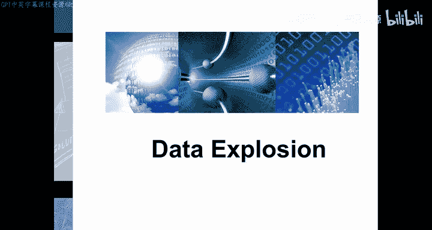
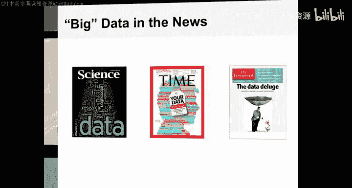
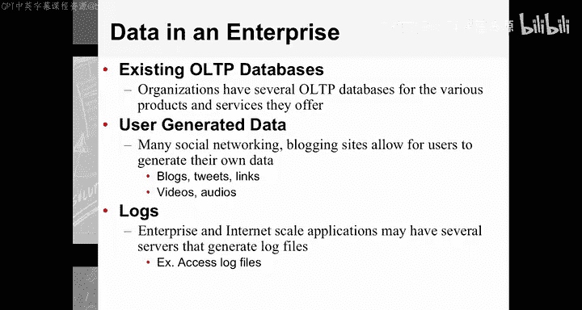
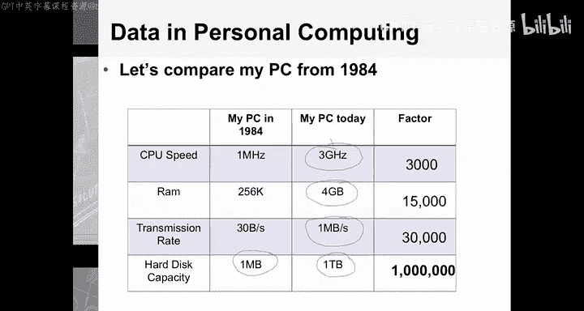
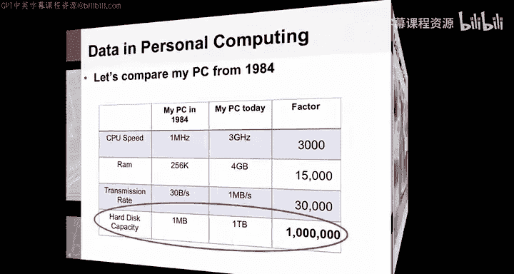

# 约翰霍普金斯大学《Hadoop大数据处理｜Big Data Processing Using Hadoop》中英字幕 - P2：1_数据爆炸.zh_en - GPT中英字幕课程资源 - BV1g5u6zBExs

Data explosion。

Unless you've been living under a rock for the past five years。

 you heard the term data to be precise， big data in the news。

Here's Science magazine talking about data。Here's Time magazine talking about your data for sale what they are really saying is that if you take a look at companies like Google。

 Facebook， Twitter， LinkedIn， they're actually taking your data， information about you。

 your corporation， your thoughts， and then stoning it on the server side。

 making it available for others in a meaningful way。

 thus making a lot of money in the process you losing your privacy。

Here's the Economist magazine talking about the data dege， which is too much data， yes。

 there is even a concept called data diet， which is the art of taking a lot of data that is being generated in the marketplace。

 throwing away the stuff that you don't really need and keeping what is needed。

 and so retrieving the most important information from this data。

So let's talk about data creation here is a visual chart that illustrates how much data is being generated per minute at this point I would like you to post the video so you can take a deeper look at this particular chart。

Let's take a look at this chart Here's YouTube and YouTube 48 hours of video is being uploaded every minute。

 which means every7 to 10 days， about 100 years that is essentially worth of video is being uploaded 571 new websites are being generated per minute in Flickr3125 photographs。

 new photographs are being added by the users every minute in Instagram 3600 new photographs are being shared by users in Tumblr27778 new posts are being generated by the users so there's a lot of data that is being generated every minute and all this data may have to be processed may have to be made sense of。

Why is there so much data being generated in the marketplace in order for us to understand that I would like to compare 1975 with today and I would like to compare it in terms of the users in terms of the applications that were being generated at that time versus now and in terms of infrastructure changes that have taken place between 1975 and today in 1975 when we built applications we built it for about 2000 users at one point I remember I used to work in AT&T and in AT&T when we built applications ordering applications we actually build applications for about 456000 users that's about it these are the people that used to work at AT&T to take your telephone orders today 2000 users is the starting point if you build an application and put it on the internet maybe you'll start getting 2000 users and then if it starts becoming popular you may。

If it starts with your city and then it'll certainly become popular within your state。

 it'll become popular within your country， let's say United States。

 and then the whole of North America， the whole of the whole North and South America and then mostly Europe。

 Asia， and so you're dealing with an exponential growth of users that are coming online and using your application in the 1970s you dealt with the static user population for example the application that I wrote for AT&T would be used by only the employees of AT&T。

 but today your population is dynamic， you can have population from all over the world as I mentioned。

In terms of applications。In the 1970s， you're doing business process automation and you're still doing business process automation。

 except the users are your everyday users， if you look at Bank of America。

 they build applications that were being used by bank employees in the 1970s。

 today they are building applications that are being used by you and me so that we can do telebanking。

 banking from our phone and all that stuff is generating data。In the 1970s。

 we dealt with highly structured data records， which is data that is usually placed in the database。

Today we are dealing with structured data， we are dealing with strstructured data。

 which is basically XML JSON， and then we are also dealing with unstructured data like audio files。

 video files PDF documents we'll talk more about the structured and semistructured data later in terms of infrastructure in the 1970s data networking was at its infancy Today we have universal highspeed data networks。

 your mobile phone， your smartphone has highspeed data with which you can connect to the internet in the 1970s we have centralized computing mainframes or mini computers Today we have distributed computing If you think about it your mobile phone itself is a computer It's actually a client computer that is connecting to the server and you're generating a lot of from your mobile phone itself so there's a lot of data that is being generated because of the way user base has changed applications have changed and the infrastructure has changed。

Now， let's look at data in an enterprise。In an enterprise， you don't usually have one database。

 you may have several OLTP databases， right for the various products and services that the company might offer in an organization。

 especially organizations like Facebook and Twitter， they are social networking sites。

 blogging sites， where users are generating their own data， blogs， tweets。

 uploading video and audio files， so again， as an organization。

 you're getting a lot of data that you need to process。Then there is logs。

 enterprises and internet scale applications， web scale applications may have several servers across different regions of the world that generate log files。

 all these log files have to be brought together and processed for example。

 the access log files imagine how much data is coming in how many requests are coming in into something like Facebook the number of access log files that are being generated for that then there is also system generated data many services inside and enterprise may generate ci log files that have to be processed know when it comes to log files and systems log files very similar things let me give you an example I work for Verign and in Verign we get about 65 billion DNS queries a day so all those queries are being logged and then they are being processed at the end of the day to figure out how many requests are coming in know from where the requests are coming in so there's a lot of data that is being generated in an。

Organization。Let's look at data in personal computing I would like to compare my PC from 1984 to what I have today In 1984 I got my first PC Tandy 1000 EX that had about1 megaHz of CPU speed today I have a CPU speed of three gigaherz in 1984 I had about 256k Ram today my PC has4 gigys of RA in 1984 the bit transmission rate was 30 byte per second today one megabytes per second is quite common in terms of hard disk I actually had my first computer in which there was no hard disk。

But because I cannot divide by zero it decided to put it as one mebyte so I have one megabyte hard drive storage today I have one terabyte hard drive storage if you think about it。

 the CPU speed has gone up 3000 times the RA has gone up 15，000 times。

 the transmission rate has gone up 30，000 times。But in terms of the hotest capacity， it has gone up。

1 million times， clearly indicating to you that even in your own personal life。

 there's a lot of data that is being generated。 You have your own documents， your Word documents。

 your PowerPoint documents， your PDFdf documents。You have your videos， your pictures。

It's a lot of data that is being generated by you and even the storage capacity has gone up。

Yes， the data volumes are growing The reason I'm representing the data volumes as an iceberg is because if you actually look at an iceberg。

 an iceberg is huge， but the interesting thing about an iceberg is that although the iceberg is huge the real mass is all the way at the bottom most of it is really at the bottom and that is exactly what is happening in the field of data。

 there's a lot of data that's coming in， I just want to tell you that this is just the beginning。

 the data volumes are growing and they are going to grow exponentially as we go through。

