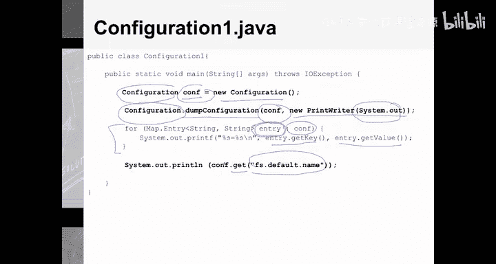
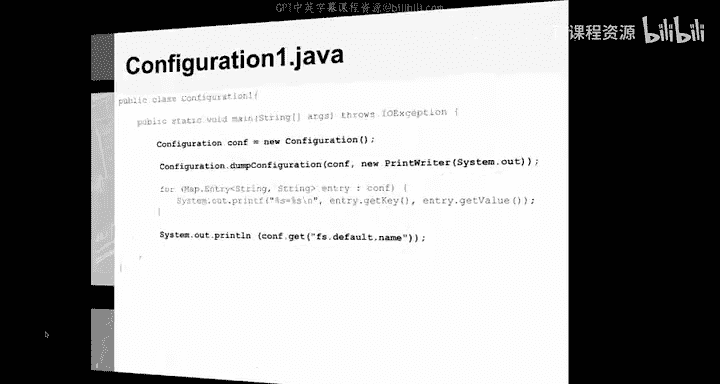
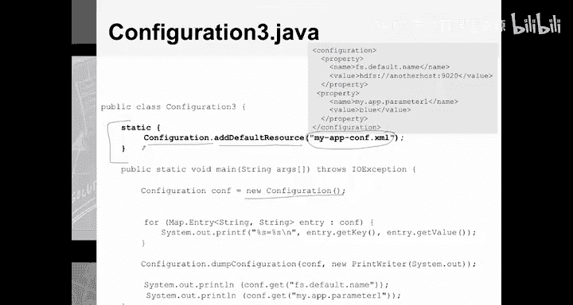
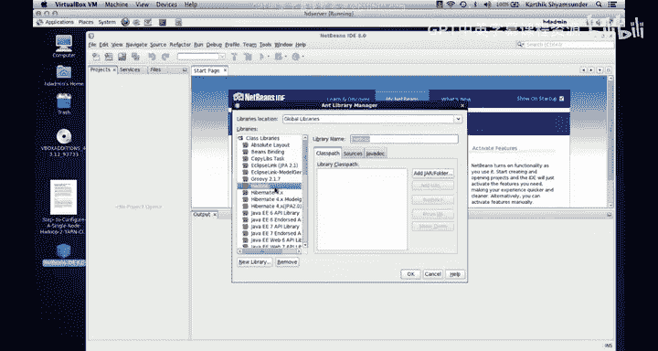
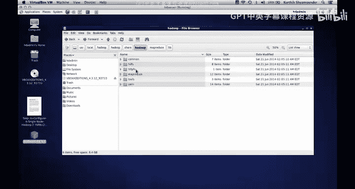
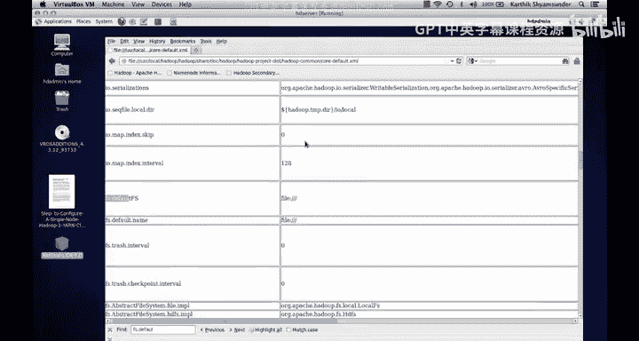
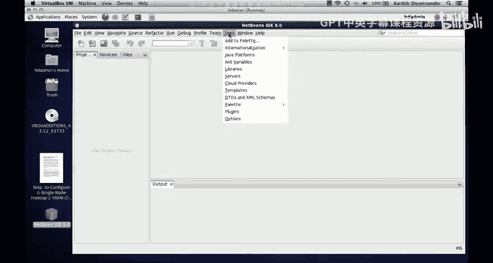
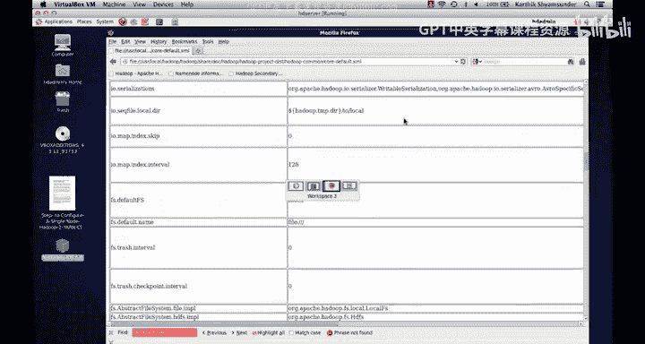
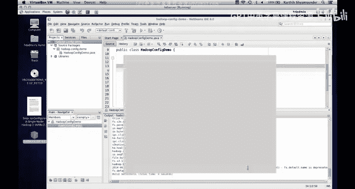
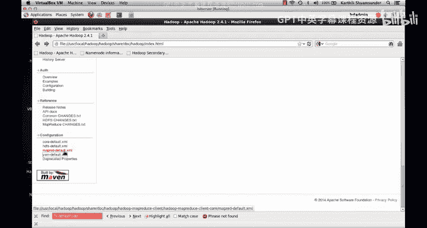

# 约翰霍普金斯大学《Hadoop大数据处理｜Big Data Processing Using Hadoop》中英字幕 - P30：8_Hadoop配置API与开发环境搭建.zh_en - GPT中英字幕课程资源 - BV1g5u6zBExs

Haadoop configurationration API and Development Envi setup。In this section。

 we will look at the Hadoop configurationration API。

A configuration object is one that you must instantiate and pass as a reference for pretty much anything you do in Hadoop。

 whether you're doing HDFS programming or yarn mapreduce programming in this section as part of demoing Hadoop configuration I will also show you how to set up Hadoop development environment I will be setting up development environment in Ne beanss。

 but you're welcome to use Eclipse or any other IDE you prefer。

Haadoop configuration Hadoop configuration is done using XML。If you look at this XML file。

 youll see that there is a root element called configuration。

And then there are several property elements and each property element has a name value pair combination。

 which is the name of the property and the value of the property you can have as many name value pair properties as you want in a configuration。

All Hadoop configuration is done using this format if you recall when you install Hadoop you had a few configuration files that you made changes to。

 there was core site。txml， Mareside。txml， yans。txml， and also Hfsside。txml。Haoop configuration files。

 There are four major Hadoop configuration files。 There is core HDfs yarn and mapre。

 This corresponds to the four major layers inside Hadoop you have the common layer for which you have core。

 you have HDfs layer built on top of common layer for that you have the HDfs and then yarn and then mapreduce。

 So the default Hadoop configuration files are core dashD4 dot Xml HfsD4 dot Xml yarn4 Xml and mapreD4 dot Xml。

 All these four files are default Xml files with default values for many of the properties and are part of the Hadoop library in the Hadoop jar files。

There is also systemwide configuration that system administrators do as part of Hadoop configuration which are placed in the Esy Hadoop folder in your Hadoop installation directory those files are called core sitet XM HF or Cytt XM yan Cyt XM and Ma sitett XM these files are files that override the files that are defined over here then your applications also can override values name L combinations in its application associated files。

The configuration class the configuration class in Hadoop represents Hadoop configuration you can create a new instance of the configuration object by invoking the constructor on the configuration object。

 the default construct， so you say new configuration and you get a brand new configuration object。

You need to instantiate a configuration object for pretty much everything you do in Hadoop when you instantiate a configuration object it by default loads two files。

 core dashashdeult。xml and it loads that from the Hadoop J libraries， it also loads core dashashs。

xml if it is in the class path。Once you have instantiateated the configuration object。

 you can look at the values that are in the configuration object。

 one way by which you can do that is by dumping the configuration。

You can invoke the static method in the configuration class。

 the static method is called D configuration， so invoke they call the D configuration object。

 passing to it， the configuration object， and also a writer object to it。

You can also iterate through the configuration object and the way you can iterate through the configuration object is by using some kind of a loop。

 maybe a for loop， and you can do this because configuration class implements the iterable interface as you iterate through you get an entry it's an entry of maps so there's a key value pair combination of string key and string value。

You can also get a specific parameter value by invoking the get method on the configuration object by passing to it。

 the parameter name， and what it returns you back is the value。

So here's a class called configurationration1。t Java here I'm going to demonstrate the use of Hadoop configuration objects here I'm declaring a variable called conf of type configuration and instantiating a configuration object。

And then I would like to dump the configuration by invoking the dump configuration method on the configuration class e static method。

 passing to it， the configuration object that I just created。

 and also passing to it as the second argument， a brand new print writer object because it takes a writer object as an argument passing to it system out out which is the output stream。

 so really what I'm saying here is that let's dump the configuration object into standard output。

And then I also have a for loop that is going to iterate through all the values in the configuration object。

And every time it iterates through， it has the。Entry object。

 and then I can go and print out the key of the entry object and the value of the entry object。

There is also a method called get that we talked about， which takes a property name。

Gives you the string representation of that particular value。And you can now print it up， you can。

 that's exactly what I'm doing over here。

You can also add your own app configuration into your configuration object。

 and the way you do that is by invoking the add resource method on the configuration object。

 passing to a file name。The file name is an XmL file。

 which is your custom XML file for the application。

 but this file has to be in the classpa for the resource to be loaded。

So let's look at an example here， I have another example called configurationration 2。

 I'm instantiating a configuration object assigning it to a variable calledConf。

 in this case I want to add a resource called Myappashkin。xm。

Notice I'm doing this on the configuration object， the idea here is that the configuration object has the default configuration loaded up and I would like to load my own configuration。

So what does this file look like here are the contents of that file。

 that file contains two properties。A property called Fs。

 default4 dot name with this value another property called my do app dot parameter 1 with the value blue。

I can then dump the configuration， I can also go through the for loop and print the contents of the configuration。

 and now I can also print the fs。d4。t name value and my do app。 parameter 1 value。

 these are the values。That are coming from the configuration object。Loading app configure by default。

 you can load your configuration into the system into the JVM by invoking a method。

 a very special method called add default resource This is a static method of the configuration object The idea here is that if you make this call and pass to it。

 the file name， then this file will be loaded up and parsed， itll be loaded up of course。

 from your class path and the assumption is that this file will be containing your configuration in the XML format and the amazing thing about it is now when you instantiate a configuration object。

 this file will be automatically loaded you don't really have to do an explicit ad resource method。

Let's look at this。Here I have a program called configurationration 3。

 where notice in my static initializer block， I'm invoking the configuration classes static method called add default resource passing to it the name of the XML file。

So now whenever I instantiate a configuration object， it will automatically。

Load the default properties and is also going to load my app con properties。

 So the idea here is that if you instantiate your configuration object 3，4，5，10 times。

 you don't really have to constantly add the resource。

 It automatically loads it for you because it's been loaded once。

 And you typically do this thing in the static initializer block。Okay， so now let's。

Put all these things into action。

Okay， here I am logged in into my HD server VM as HD admin Use ID。

I'm going to do my development environment setup using net beans。

 so I'm going to launch net beans right now。Okay， Ned beans is launched。

 I would like to write a small program describing the configuration。So in order to write the program。

 I of course， need the Hadoop libraries。So what I'm going to do is go to my tools， libraries。

 and add the Hadoop libraries into my path。I'm going to create my own library。

 there are built in libraries in Nebean's IDE， it's the same thing for Eclipse。

 so I'm going to add my own library called the Hadoop library， create a new library。

And Im going to call it Hado。Okay， but the library doesn't have any jars in it。

 I'm going to add some jars in it， so I need to add some Hadop related jars。

Well， the question is what are the Hadoopulated charts， let's take a look at that。So。

If you go to where Hadoop is installed， which in my case， it is in user。Loal。Haop。

And then I have a link called Hadoop that points to the current Hadoop directory installation。

Inside it， there's a folder called share。Haadoop， so basically wherever your Hadoop is installed。

There's a folder underneath called Share Hadoop， where there are several folders which contain the various libraries that are needed for doing Hadoop programming。

Remember in Hadoop， we have common layer， HDFS layer， yarn layer and mapreduce layer。

One built on top of each other， the jar files for each of the layers are located in these different directories。

 but it's a little bit more complicated than that if you go to the common layer。

You see the jar files for the common layer， there are three of them。

 but then there are also dependent jar files under the Lib directory under common layer。

 which are right here， so you not only need to add the common libraries。

 you also need to add the dependent libraries。The same thing is true for mapreuce。

 if you go to the mapreuce directly， these are the mapreuce jar files。

 and then there are dependent jar files， these are the dependent jar files coming from other Apache projects。

 other open source projects that the Hadop project depends upon。

So we'll have to do this for all four modules， common， HDFS， yarn and Mareduce。

 that's what we need to add。

All right， so let's go ahead and add our two jar files。Go to user。Local。Haadoop。Haadoop。

 which is my link folder pointing to the current Hadoop insulation。Share Hadoop。Common。

Add all the common jar files。And then add all the libraries。That are associated with common。Then。

Add the HDFS layer。So， HDFs。Add all the HDFs jar files。And then add the libraries that are dependent。

For HDFs。And then add the yarn layer。Here are the yarn files。

 you don't really need all the files there are some files here that are examples。

And other rate thanks testss。So you don't really need all of them。

 but it's better to add all of them。It's much easier， so that was yarn。

Then we need to add the dependent yan files。And then now we need to add mapreuce layer。

So here are the map produced jar files。And then all the dependent libraries for mappeds。Okay。

 we about all the files。Let's do a quick ratification。this is a little bit bigger。So we have common。

 common lab。Then we have HDFS， HDFS Libb。And then we have the yarn。Let's see， yarn。

And then we have yarn lip。And then we have map produce。And then via the mapreuce Lib。All right。

Do a quick check。Haoop。一。Not what I would like to do。

Is write a small Hado program showing the configuration concept。Create a brand new project。

 which is a Javava application project。Finish， call the project Hadoop dash config dash demo。

The project is being created。There's the Hadoop Confit demo class。

Delete a few things so you can see the entire program。Okay。

 what I would like to do is instant a brand new configuration object。

 so it's a configuration con equals new configuration。Gives me an error。It says。

Would you want me to import the configuration class from Javaexsecurity。or。 login。

 that's not what we want， we want the Hadoop configuration。Well。

 it's not able to find that class because we have only added a library called Hado。

 we have not added the library into our project so I will have to go to my project right most click on the project。

And add the library， which is add library， add the Hadoop library。

 which is all the jar files associated with Hadoop， hit OK。Scan it in。

Now I click on this now it's showing me a whole bunch of configuration class。

 there is a configuration class from Java security， there is a configuration class from Courthouse。

 there is one from jetty， there is one from Commons configuration。

 but the one we are really looking for is the org Apache Hadoop con configuration， select that。Okay。

 so we have created a configuration object。Now， what I would like to do is。

Dump de configurationfiguration， so I would have to say con dot。Actually， the right way to do it is。

It's a static method， so we can say configuration dot dump configuration。Passing to it。

 a conth object reference。And then what I need to do is pass a writer object。

 I'm going to say new print writer。Passing into it， system。t out。

So what I'm doing here is saying I would like to dump the configuration into standard output。

Print writer is a concrete class of the writer based class。And I pass into it the output stream。Okay。

 gives me some errors。It says import the print writer class， which I will。And it says throws Javava。

o。oex， that's because the new print writer instantiation is throwing an Iio exception。

 let's go ahead and throw the add the Thr clause。It added the throw closes right there。 Okay。

 so the dump configuration should be working too。 let me save it。

 I would like to run the program right most click。Run， and that should dump the configuration。

There it is it dumped the configuration Now if you look at the output， it dumps it in one big line。

 what it's really doing is it's dumping the map。And the map is a key value pair combination。

 So it's really dumping this map。So we have a key。Called IPC client fallback to simple auto allowed with a value of。

False。And there's also another property called is final。Remember。

 I mentioned to you that you have property。And then you have name and value。

 there is also another property， there is also another tag in it called is final to indicate whether this particular property can be overwrittenden by somebody else。

So。That's the complete dump of the configuration object。 What I would like to do is write my own。

For look。4。Map。Dot entry。String。String， because what I would like to do is。Mfi。To a string， entry。

Comt。嗯。And I would like to print out。Just front of。Prescent S equals percent S slash n。

I would like to print entry dot。Get。That's oh， it's not completing。 that's because。

I should import the U map。Class。Get。K。😊，And entry。Don't get。Value。So what I'm doing here。Is printing。

你。是。Key in value。In my own way， I'm going through the iteration myself。 Let's look at that。

Run that program。Oh。Okay， that fixes that problem。I was trying to print a string as a percent D。

Fromund the program。There it is。 Now it printed all the key value pair combinations。

The key is Iod dot sequence file compressed block size。The value is the number， S3 replication is 3。

 as you can see， these are all the different properties that are part of the configuration object。

The question is， where is getting all these properties， like I mentioned to you。

 there is core dash D4 dot Xml and there is。C dashashst Xml core dash4。

xml has a bunch of properties that they have predefined。

 and then in core dashash sitet Xm we override that particular property。

So if you're wondering what these different properties are。If you go to your Hadoop documentation。

And look at the。Botom part of the documentation on the left hand side。

 you will see this thing called configuration and there is a link to this file called Cod4。 xm。

 If you click on core dashashd4。 xml， you will see the name of the property。

 the value of the property， and also a description of the property。So for example。

 there's a property called Hadoop。temp。ter， whose value is this by default。

 and it also describes what it's being used for。So these are all the properties that are being already defined。

 This is the default value。 So many of the values that you're seeing。Are the default values。

 And what we do is we override those default values in our system wide configuration under Etsy Hadoop。

 So let me show you that if you recall we installed Hadoop。

 and if you look at the Esy Hadoop folder where Hadoop has been installed underneath it is an Had。

 there is an Etsy Hadoop folder。Let me Vi the core dash site dot Xml file。You'll notice that。F。

 S dot default dot name。Has been given a value of this。

The point I'm trying to make is if you search for code dash default。xm fs。default。 name。是。

Has been given a value of file colon slash slash slash。

 that's the default value in core default or Xml。And then we have in our core site。t Xml。

Change that to HDFS colon s slash local host colon 9000。Now， if you go back。And look at our program。

And see what the value for fs。de。 name is and what I can do now is go back to my program and print that out system。

 out。 print line。Con dot get。 Let me do this。 F， S dot default dot name。Is。Yeah。Configuration object。

 don't get。And what I'm going to pass to it is Fs。t default dot name。Let's see what gets printed out。

 it was already probably printed somewhere over here， but let's go ahead and。

Explicitly get that value and by the way， I can click on the green button to run the project2。

There it is。 And it actually prints the Fs or default dot name to be file colon slash slash slash。

 That's because it's getting the value from。

Core dash d4。t XM。Now， the interesting thing is when I instantulated a configuration object。

 I said to you that it loads the code dash d4 dot Xml and it also loads code dashash site dot Xml。

 so technically speaking it should have gotten the value from core dash site dot Xm。

 and that should have overwrittenden the value。The reason it did not do that is because core dash cytototicM is not in our class path。

 so what we need to do is add that in into our class path。

The way I like to do that is go to my tools for tools， libraries。

And then I would like to add a new library。Called Hadoopkf。And in the new library。

 I would add the folder， which is the Esy。Heoop folder。

 which is where all the configuration files are placed， so let me add that in。

So that's my new library， let's go back to libraries again。

 so I have Hadoop Library which has all the J files and HadoopConf which has all the configuration files。

 which is the special directory。Now I would like to go to my project。And add。A library。

 and in this case， I'm going to add the Hadoop configuration library。

 So we have all the jar files coming from Hadoop and we have the configurationration coming from Hadoop conf。

Now when I run the program， when I instantiate a configuration object， it'll load core dashD4。

xml from Hadoop jar files， it'll also load core dashash side。xml from my Hadoop configuration。

 and I'm hoping that when I do an fs。D4。t name printout。

 it's going to show me the value that is present in core dashashite。 Xml。Let's run it。

And lo and behold， that's exactly what it did， it showed me。The value that is there， indeed。

Configuration file that I created， which is core dash site dot Xml。

 So the point I'm trying to make is when you instantiate a configuration object。

 it's loading core default and then core site on top of that。

You can also create your own configuration and overwride what's there in Co site。

The way you can do that is by creating your own configuration file， so I'm going to go over here。

Create a brand new XMl document。 And I'm going to call it。My dash app dashcon。 Xml。

I don't have to put the prefix。Next， finish it。Go ahead and remove some of the。

Comments over there so you can see the entire thing， the root element， of course， in our case。

 is going to be configuration。Configuration。Copy it。And paste it。Allright。

 and then we have insided property。And the property。And then， name of the property。

And the value of the property。I would like to see two versions。Of property， two different properties。

First property， I'm going to say FS dot default dot name。Whose value is going to be。H D F。

Colon slash， another host， rather than local host。Coant 9020， another port rather 9000。

And then another property called my dot app dot。Crameter。And the value of blue。Okay， save it。

So what you're seeing over here。Is an XmL file， which is my own XmL file called my app Con XmL what I would like to do is load that up as part of my configuration。

When I instantiate the configuration object， I get the core default。 I also get the core site。

 Now I also want to load my own thing。 So the way I load my own configuration。

Is by going to the configuration object and invoking a method called add resource passing to it the configuration。

5ine。Which in this case is going to be my dash app dash。Conf dot X， M， L。

But because this file is in a package， I need to give the directory。Haadoop slash config， slash demo。

Okay。Now， the idea here is that when I instantiate the configuration object， it loads the。

Core dash default4。t Xml， core dashite。xml from Esy Hado。

 and then it's going to load my own configuration resource and then eventually when I print out the configuration's fs ort default name。

 it is going to pick up the defaultt name from here。

And so it should print out another host colon 1920。

Let's go back and run the program and see if it does that and yes it does that。

 So as you can see we have core dashash default dot xml and then we have core dashash side dot Xml which overrdes the properties that are there in core dashash default dot Xml and then I can override my own。

In my application configuration file， and then I can also create my own properties， in fact。

 we should try to print our own property。Which is system dot out， dot print line。

And the property was called my dot app dot parameter。1。And this property name is case sensitive。

 you have to make sure that。You type it in exactly the way you typed it in the configuration file。

Conf dot get。And it takes as an argument， my dot app。Dot。Prameter 1。

Save it and let's go ahead and run it and let it print blue， which you did。

This is how you basically pass parameters into your application。You can think of this as web。

xml in your web application in web application programming in Java。Okay。

 so we are able to get this working too。Now I would like to demonstrate one last thing。

Imagine I come in later on and instant sheet as second configuration object。

 So I say configuration con2 equals new configuration。And then I would like to print those values。

So let me paste it。And I'm going to say it's configuration 2， configuration2。

And let's see what happens when I run the program， so I have a configuration object。

 I add the resource， then I print out the values from that configuration object。

 I create a second configuration object， and then I print out the values from there。

When I run the program。You notice。That the first configuration no object。Loaded up the resource。

 Hadoopconfig demo myapp。com。xm， but the second configuration object did not load the resource。

It did not load the resource。For this one， because I didn't call the add resource method。Now。

 every time you instantiate a configuration object。

 you don't want to go in and call the add resource method。

And that's where the ad default resource concept comes into play。 So in my static initializer block。

I can say configuration。Which is the configuration class dot。Add default resource。

And I can pass the name of the file。And then I can remove this completely。

As part of this class load up， Hadoop comes to a demo when this class gets loaded up in the static initialula as a block。

 it automatically registers this X， M L file as a default resource。 Now。

 what happens is when I instantiate a configuration object， I will automatically get this X。

 M L file also。This is an idea that gets used later on by the file system and the yarn layer and the mapreuce layer。

 The point I'm trying to make is it makes it easier for you to instantiate as many configuration objects as you want。

So。When I run this program， you'll notice。That it prints the right values for both the configuration。

 I really did not have to instantiate and load for the conf and conf2 object。

 I only had to instantiate it， so it loaded it by default so that's the concept of adding a default resource as a configuration。

I wanted to show you one last thing， which is going back to the Apache Hadoop configuration concept。

We have the core default dot Xm， which is part of the configuration object when you instantiate it。

 we get that loaded up， there is also HDFSD dot Xm。And there is also Mara default to Xml。

And beyond dash default。 Xml， these Xml files get loaded only when you bring in classes that are related to HDFs or Mared or yarn For example。

 when you bring in a file system class which is located in the HDfs package。

 it will automatically load those defaults， and it will also load the corresponding site。

 Xml files to。You don't have to worry about it because it does all those things automatically。

 the most important point for you is that configuration object is a very。

 very important object that you need to instantiate for pretty much doing anything in Hadoop and now we know how to do that and you also know where the default configuration files are and what the default values are。

So in this section， we looked at the Hadoop configuration API。

This is clearly an object that we must instantiate and pass a reference to for pretty much anything we do in Hadoop we will see this as we start getting into HDFS programming。

We also learned to set up the Hadoop development environment in Ne beans。As I mentioned to you。

 I'm using net beanss， you're welcome to use net beanss， but if you're used to using eclipse。

 you can configure your IDE for Hadoop。There's a similar concept that you have in eclipse that you can use to add libraries in。

And then you're good to go。