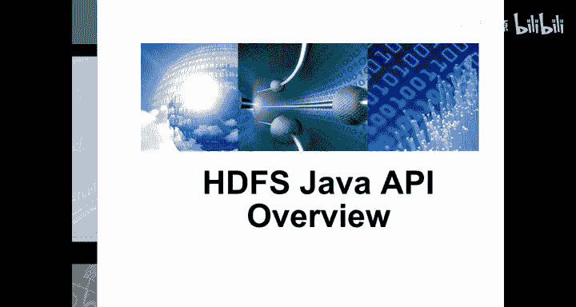
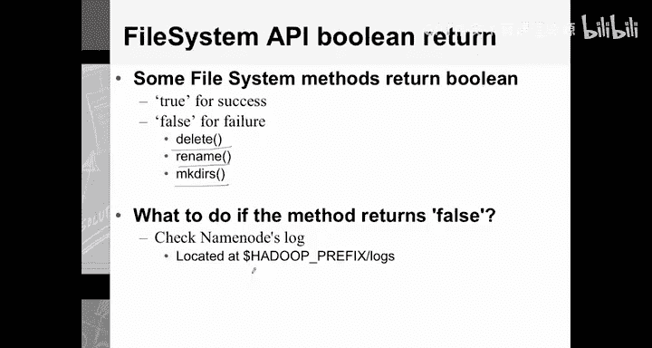
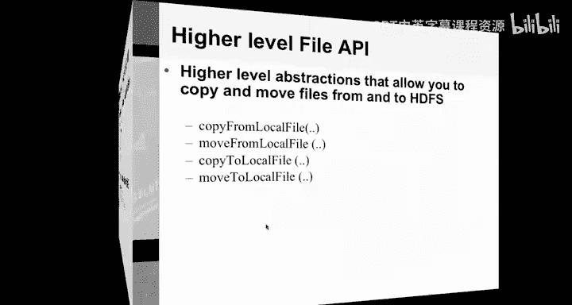
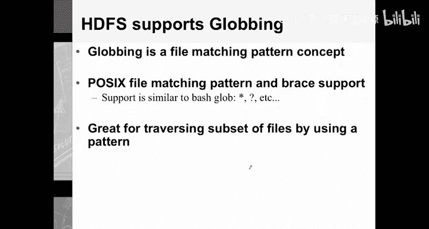
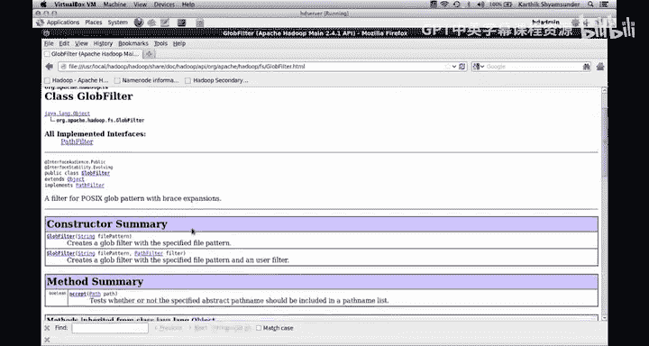
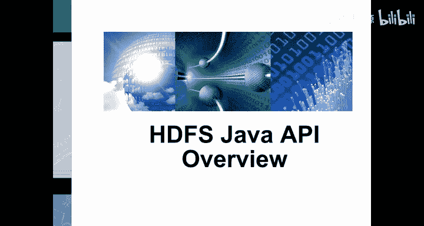

# 约翰霍普金斯大学《Hadoop大数据处理｜Big Data Processing Using Hadoop》中英字幕 - P31：9_HDFS Java API解析.zh_en - GPT中英字幕课程资源 - BV1g5u6zBExs

HDFS， Java API overview。Now that we have learned to set up Java development environment for Hadoop and learned to instantiate a Hadoop configuration object。

 it is time for us to learn the Java API for HDFS programming。In this section。

 I'll give you an overview of key Java API packages and classes to manipulate the file system。

We'll also look at how the API communicates warnings， errors， and exceptions back to the client。

As I mentioned earlier， there are three programming interfaces available for CRD operations on files and directories in HDFS。

We have the CAAPpi， which we already talked about that uses the JNI bridge to call the underlying Java implementation。

In this section， I'm going to give you an overview of the Java API。

There are several key HDFS Java API packages that we should familiarize ourselves with。

There is packageor。apache。haoop。fs。This deals with the file system API。

 as the name suggests FS stands for file System， it contains a very important abstract class called the file system class。

 and it also contains several concrete implementations of the file system class that are shipped with the Hadoop J files。

There is also a package called org。apacache。haop。o， as the name suggests it deals with IO operations。

Especially it deals with serializable aspect of IO， which is serializing objects into streams。

 network streams or file streams， so for that there is an interface called the ridriable interface and ridriable comparablearable interface which are part of this package。

There are several concrete implementation of the ridriable compatible interface for primitive types like integer。

 float， double， string， which we'll also look at in a section on Hadoop serialization。

There is also a package called orderedapacache。haoop。o。

compress as the name suggests it deals with compression， deals with all the compression API。

 there are compression codex available in this package， a codeX is codeder decoder。

 there are several compression implementations available as part of Hadoop。

 which are part of this package。There are several key HFS Java API classes that we should familiarize ourselves with。

There is the file system class， which is an abstract file system class。

 you get a reference to this file system object and get actually an instance of a real file system object to do all file system manipulation。

 it's a very important class， pretty much everything gets done using the file system class。

Then there is a path class that represents a file。Then there is FS data input stream that is used for reading in data from a file and then FS data output stream that is used to write data out to a file。

 and then file status class that gives you information about a file， for example。

 the size of the file， the owner of the file， the file permissions。

So let's look at the file system class the file system class is an abstract class。

 it's a base class for generic file system The big idea here is that you get a concrete file system object because the file system class is an abstract class and the way you do that is by using a factory style get method that is available in the file system object。

And this gett method based upon the default configuration will return your file system object。

 or it will return your file system object based upon the UI scheme that you pass to the gett method。

We will see examples of this later on in creating files in Deleting files section。

 which is the next section。Once you get a file system object in your head。

Then you can manipulate the file system using the file system object and when I say manipulate the file system。

 you can create a new file， you can open an existing file for reading。

 you can open a file for append operations， you can delete a file。

 you can also create and delete directories， you can check to see if a file or directory exists。

 you can also get status information about a file which is the length of the file for permissions file owner。

 and then there is also this concept called Globbing that we'll talk about for listing files or selecting files。

There are several concrete file system classes available as part of Hadoop you have a class or local file system in the FS package that deals with the local file system。

 every machine has a local file system which is the native file system。

 so this represents the local file system on your machine， the UI scheme is file colon and slashlash。

Then there is a class called distributed file system。

 the distributed file system class represents the HDFS。

 this is one of the most important file systems because we will be using HDFS and the UI scheme for distributed file system is HDFS colon slash/lash。

Then there is another file system called the native S3 file system。

 which represents the Amazon S3 file system。Its URL scheme is S3N colon slashlash。

 there is a variation of the S3 file system called the S3 file system。

This is called the native S3 file system notice this one is called the S3 file system。

 This is a blockbased file system just like HDFS。 This native file system has a limit as to how big a file can be can be only be 5 gigabyte file。

 This blockbased S3 file system has no limit。 So the U scheme for that is S3 colon slash typicallyy if you're going to be doing mapred programming in Amazon environment you end up using the S3 file system。

 not the。Native S3 file system， because your files are going to be more than five gigabyte files。

The point I'm trying to make is there are several file system implementations available as part of the FS package in Hadoop。

Then there is the path class。The path class is a concrete class that represents a file or directory in HDFS。

 it only represents the name of a file in the sense that you cannot instantiate a path object and then use that for reading or writing a file。

 but you can surely take a path object that represents a file name in the HDFS or even a local file system。

 you can then pass that to the file system object to open a file for reading or to open a file for writing。

There are several ways by which you can create a path object， you can pass a path object a string。

 which is the relative or absolute path， depending upon whether it starts with a slash or not。

 and it creates a path object that represents that particular file or directory。

You can also create a path object passing to it， a path object， which is the parent path object。

 the directory and also a child which may be a subdirecty or a file inside the parent path directory。

You can also do parent and child as path and string， parent in child as string and path。

 and then parent and child as string and string， there are different variations available for you。

The FS data input stream class is a stream for reading a file。

 you cannot really instantiate an FS data input stream class directly。

 but you can get an instance of it by opening an existing file for Read。

 which will return you an instance of an FS data input stream object。

Once you have the FS data input streamream object associated with a file。

Then you can read from the file， you can read integer， float， care， Boolean。

 any of the primitive types， you can also read bytes into an array so you can read multiple bytes at one time。

You can also get the current position as to how far you have read。

 you can also seek to a specific position， you can skip bys。

 so you can almost do some kind of a random access within that particular file。

Then there is the FS data output stream class， this is a stream for writing to a file。

 just like the FS data input stream class， you cannot instantiate an FS data output stream class。

 but you can surely create a new file。Or open an existing file using the file system object。

 and when you do that， it returns to you an FS data output stream object。

Once you have the FS data output stream object， you can write bytes to the file。

 so that's primitive types， Integerflow， care Boolean。

 any of those things would work if you have an array of bytes， you can write the entire array out。

 you can get the current position， you can also synchronize all the buffer so that everything that you wrote got written to the underlying file system。

De file status class。The file status class represents clientside information for the file。

 when I say clientside information， this is the Java HDFS API for a client to manipulate the file system or to get information or the file system。

 so this is the client side representation of the file status object。

The big idea here is that you get an instance of a file status object by invoking the list status method on the concrete file system object。

 so you go to the file system object and invoke the list status method and it'll return you a file status object once you have a file status object。

 you can get the length of the file， you can figure out when it was the last time it was accessed。

Modification day， date and time， block size， replication factor。

 pretty much everything you want to know about the file when you do an Ls minus L operation。

 you get information about the file， all that information is available with the file status object。

You notice that。Many of the methods in HDfS API through Java。io。io exceptionception。

 it makes sense because you're reading a file， writing a file， delet a file。

 you know they are all IO operations， so it makes sense to throw that IO exception。

So what to do if a method throws an exception pretty straightforward。

 you check the exception stack trace， of course that's what we typically do。

 but you can also check the name nodes log file which is located in Hadoop prefix where Hadoop is installed。

 s logs， look at the name log log file and see if there is any specific information you're getting on the server site because remember with HDFS programming。

 there is the client site and there is the server site which is the HDFS name node that is performing all the metadata operation。

You'll also notice that some of the file system methods return a boolean， so for example。

 delete method， rename method and make method all return a boolean。Well。

 why do methods return a boolean， Well think about it if you ask the file system API to delete a file。

And if the file doesn't exist because the file has been already deleted， well。

 what is it supposed to do， is it supposed to throw you an exception？

Or is it supposed to just be silent。 So the methods here， such as the delete method here。

 is returning you a Boolean， which indicates whether it actually did the operation or not。

 If the delete method returns are true， that means it did delete the file because the file existed。

 If the delete method returns a false。 That means it' saying I did not delete the file。

 but you want me to delete the file。 the file doesn't exist anyway。

 That's the idea behind the Boolean return types。So what to do if the method returns false。

 you can surely look at the name Notes log file and see if there is any specific information available for you。

Besides lower level APIs for creating files， deleting files， and manipulating files。

 there are higher level abstractions that allow you to copy and move files from and to HDFS。

If you recall using the Hadoop FS command， we were able to copy files from the local file system into Hadoop file system。

 move files from the local file system into Hadoop file system， and vice versa。

 copy from Hadoop distributed file system to local and move from Hadoop distributed file system to local。

 similar functionalities available in the file system API， so there are really nice methods。

 higherle methods available for you that allow you to move a file from the local file system or copy a file from the local file system to the Hadoop file system and vice versa。

HTFS also supports a concept called Ging。Globbing is a file matching pattern concept。

 it's a concept that gets used in Unix shells， there is a PoOSss file matching pattern that is available HDFS supports the PoOSs file matching pattern and of course it also adds the brace support on top of that。

This is a great technique for a traversing subset of files by using a pattern。Now。

 if you do not know what a gllobing pattern is， you may want to read more about it in Google。

 there's a lot of tutorials available on this。

HDFS supports several globing patterns， you have the question mark that matches any single character。

 you also have star that matches zero or more characters。

You have the bracket that represents or matches a single character from the characters that here ABC。

You also have range matching A through B or A through Z。You also have the negation。

Whi is anything that is not available in this particular set。

 you have slash to escape the meaning of a character， you also have the brace concept。

Which matches a string from the string at A B。本Cd。There is also matching of set within set so there's a lot of glbing concepts that it's supporting for you in HDFS once again。

 if you do not know， if you don't understand Globing。

 please refer to Gbing concept on the internet There are lots of tutorials available。

We just looked at the various HDF packages and files。So let's look at the Hadoop HDFS documentation。

If you go to the Apache Hadoop page。You have the API documentation。Let me go to the。

No frames for you。 Here's a list of all the packages。We looked at the Hadoop configuration package。

We also looked at the Hadoop FS package。And then we say that there is also the Hadoop IO package。

 which contains the HyIio compress package and there's a few other subpackages that are there as part of the IO package。

So these are the major packages that we need for HDFS programming。

Let's quickly look at the Hadoop configuration package。It contains the configuration class。Notice。

A configuration is a property that has name value and also final。

Which is an element that indicates whether a property can be changed or not。

There are methods like add default resource， which is a static method that we looked at。

There is also dump configuration that we looked at。

Let's go back and look at the file system package in the file system package。

You have the file system class， which is an abstract based class。

And there are several classes that implement the file system class or extend from the file system class like the S3 file system。

Native historyory file system or the raw local file system。

And then there is file status class that gives you information about a file， for example。

 the length of the file， the owner of the file， the path to the file， the permission of the file。

We also said that there is a Gob filter concept， so this is the Globing class that supports the Gob filter concept。

Let's look at the。Iio compress package， it contains。All the various codex。The compression codeex。

 the interfaces and several implementation of those codex。

There is also the base IO package that deals with serialization。

The key class or the key interface here is the ridriable interface and the ridriable comparable interface。

Which we'll look at later on。Here's the ridritable interface and theritable comparable interface。

So hopefully this gave you an overview of all the various packages and classes in the HDFS file system。

In this section we looked at key Java API packages and classes to manipulate the HDFS file system。

 we had the Hadoop。fs package that dealt with the file system API， then we had the Hadoop。

Io package that dealt with the serialization API， we also saw the Iot compressed package that dealt with the compression API and several classes like the file system class。

 that allows you to manipulate the file system， the path class that allows you to represent a file in HDFs or any other file system for that matter。

 the file system Fs data input stream class， and the FS data output stream class that allows you to read and write files。

 the file status class that allows you to get information about a file。

 and also we looked at how exceptions are handled in HDF。

