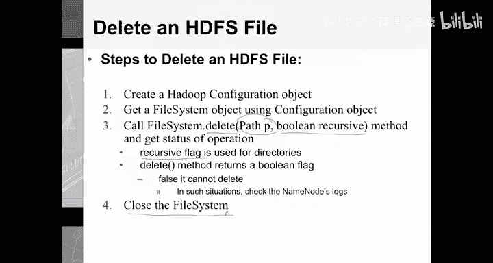
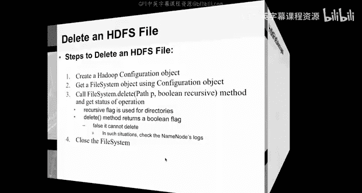
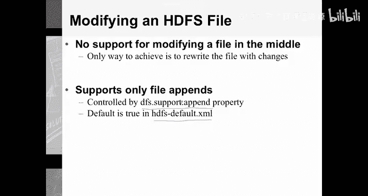
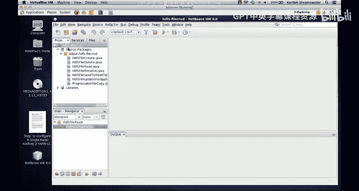
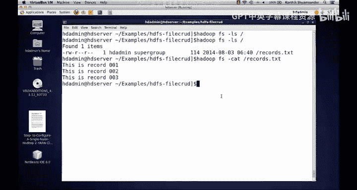
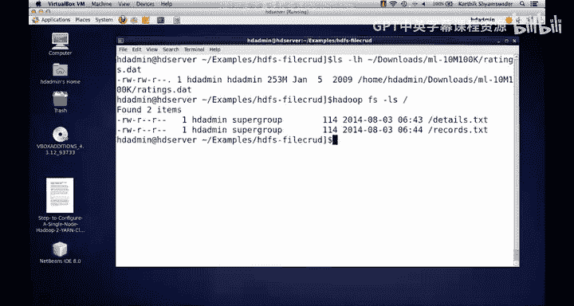
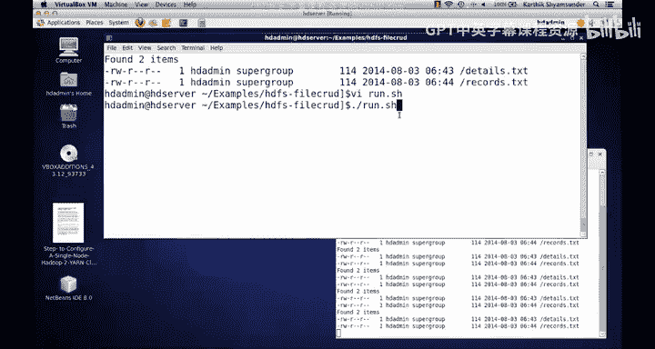
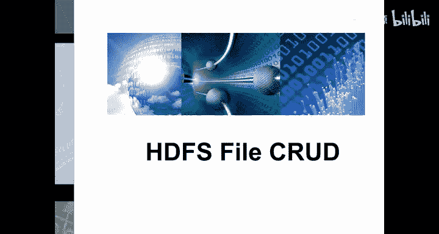

# 约翰霍普金斯大学《Hadoop大数据处理｜Big Data Processing Using Hadoop》中英字幕 - P32：10_文件增删改查操作.zh_en - GPT中英字幕课程资源 - BV1g5u6zBExs

In this section， we will look at the Java API for creating。Reading， updating。

 and deleting files in HDFS。

Here are the steps to create a file and write content to it。Step one。

 create a Hadoop configuration object。We already learned how to do this in one of the previous sections。

Step two， get a file system object using configurationration object。

The file system class has a static method called get that takes a configuration object。

 depending upon what is configured in the configuration object。

 it will return the appropriate concrete file system。If you recall。

 when we instantiate our configuration object， we found out that it reads coreret4。xml and cores。xm。

 we have configured our core dashash site。xm fs。nameer property to have hfs colon/ local host colon 9000。

 indicating that we are running the distributed file system and the name node is running on 9000。

And so the file Systems get method will return as a concrete distributed file system object。

Once we have the concrete file system object。We can invoke the createre method on the file system object。

 passing to it， the path object， if you recall the path object represents a path in the file system。

We can pass this path object to create a file if the file creation is successful。

 it will return us back an FS data output streamre object which we can use to write content to the file there are several overloaded methods available in order to create a file。

The overloaded methods allow us to customize based upon the overwrite flag。

 which gives you protection from overwriting a file， you can also set the replication level。

You can also set the buffer size that controls how many bytes can be written in one shot。

 there's also something called progress callback， which I'll show you later on。

Once you have the FS data output streamam object， all you have to do is call the right method to write the content to the file。

There are several overloaded right methods that you can take advantage of。

 you may want to refer to the API for more information on the various overloaded right methods。

Once you're done in step  five， we close the F state output stream object and we also close the file system。

Here's a program called HDFS fileCreate。t Javava。Here I am instantiating a path object that points to s records。

txt， a file in the distributed file system。I go to the file system class and invoke the get method passing to the configuration object。

A configuration object that I instantiated in a few steps about。

That'll give me back a file system object。Once I have a file system object in my hand。

 I can invoke the create method on the file system object， passing to it。

 the file that I want to create， that's a file that I had instantd in this section over here。

If the grid is successful， itll give me back an FS data output stream object。

 that's the object that I'm going to be using to do my rights。

I would like to write a few records to the file， record1， record2， and record3。

 the way I do the writing is by going to the file system data output stream object and invoking the right CAs method。

 passing to it record1。And then the same way for record2 and then the same way for record  three now that I've written all the three records into the file。

The last step is to close the file system。And of course， close the FS data output stream object。

Steps to read a file。You create a Hadoop configuration object。Step two。

 you get the file system object， we know how to do step one and step2。Step three。

 open a file using the file Systems open method， now that you have the file system object。

 you can invoke the open method passing to it， the file that you want to open。

 that's the path object。And if it is successful， it will return you an FS data input stream。

 which is the file system data input stream object you can use this file system data input stream object to do your reads from the file。

There are two overloaded methods for the open operation or the open method， one that takes a path。

 and also one that takes a path and a buffer size。Once you have opened the file and have gotten the FS data input streamream object。

 you can invoke the read method to read contents with the file。

The basic read method returns an integer。There are several overloaded read methods available。

 arguments that take position， buffer， offset and length。

 you may want to look at the Java API documentation for more information on those the simplest one returns to you one character。

Once you're done， you close the file system and the file F data input Scam object。

One another point that I wanted to make about the read method is that the read method will return you a negative one if it reaches an end of file。

So you'll have to read in some kind of a loop。Here's read HDFS file or Java。

I would like to read the file slash Record。txc， it's the file that we just created。

You get the file system object。And then you want to open the file。

 So you go to the file system object， invoke the open method， passing to it， the file to read。

 which is。/lashre。 Thd it gives you back an FS data input stream object if the open was successful。

Then I would like to read the context from the file。In order to read the contents from the file。

I call the read method。And then in a Y loop， I keep calling the read method which returns me one character at a time until I get an end of file。

 which is what the negative one is all about， and as I read I print the character out so it is like a CA command。

Once I'm done， I close the FS data input stream。And I also closed the file system。

Here's a program called HDFS Fseek to read twice， the basic idea here is to read a file and then to read the file by seeking to the beginning of the file。

 so everything that's over here is all about opening up a file and reading the contents of the file。

Then what I would like to do is。Use my seat method。 So here， once I've read the file。Once。

I seek back to the beginning of the file。You can seek whatever you want in this case I'm seeking to the beginning of the file。

And then I would like to read the content。In this case， I'm reading the content for the second time。

Once I'm done。I'll close the input stream and the file system。

Don't worry too much about executing these programs I'm going to be towards the end of this section。

Demonstrating practically all the different programs that I've written over here。

 these are working examples。Okay， let's do。And append operation on the file。First。

 you create a Hadoop configuration object， you get the story now。

Then you get the file system object using the configuration object。

Once you have the file system object， you can invoke the Append method to open a file of this path so that you can upender the file。

Since we are opening for append， we are going to get an FS data output stream object so we can append to the contents of the file。

There are several overloaded methods available， you can look at the API。

 it's very similar to the open method that you have。

Once you have the FS data output streamre object in your hand。

 there are several overloaded methods available to do the right operation。

 now you can go ahead and write contents of the file very similar to what we had done to write contents to the file before。

Once you're done， you close the FS data output stream object and you close the file system。So。

Let's go ahead and open the slash racketsstar THD and append the contents to it。

So here's the file slash recordstar Txt， that's the path object right there。

I would like to get a file system marked in my hand。

File system get configuration and I have a file system object in my hand。Now。

 the most important method， I would like to go to the file system object。

 invoke the append method on it， passing to it， the name of the file that I would like to open for append。

If successful， it'll return me an FS data output stream object。

Now I would like to append for three more records to it。I'm using the right CAs method。

 so go to the FS state output stream， called the right CAs method， passing toward it record4。

 record 5 and record6。Which means now I've added three more lines into the file。

And then once I'm done， I would like to close my FS data output stream object and the file system。

Here are the steps to delete a file。You create a Hadoop configuration object in step1。

 you get the file system object in step2。And then you go to the file system object and you invoke the delete method by passing to it the path of the file that you want to delete。

It so happens that the delete method gets used for deleting a file or a directory。

 and so the second argument that you see recursive。

Is more meaningful if it was a directory and you want to recursively delete the directory contents and the subdirecty contents and so on and so forth。

 that's what the recursive flag is used for。Once you're done deleting the file。

 you simply close the file system， notice in this case we don't really have an output stream or an input stream object。

Here is HDFS file deletete。I would like to delete the file that we just created and appender to。

So slash records。dxd is the file that I wanted to delete。Get the file system object。

And then I would like to call on the file system object， the delete method， passing to it。

 the file that I want to delete， which is recordsstar TXt and passing to it the false argument saying that。

 well， I don't really need any recursion over here because I know it's a file。And then once I'm done。

I will close default system。If you recall， the delete method throws you a booleion。

Indicating whether it really did the work or not， most of the methods through exceptions。

In this case the delete method throws you a boolean back， returns you a Boolean。

 if the file was there and it deleted successfully it will return you true。

 if the file was not there， it cannot delete it anyway in that case it returns you a false。

 but it doesn't throw you an exception， let's the idea behind the Boolean concept。

We can also rename a file from an old name to a new name。Once again。

 you create the Hadoop configuration object， get the file system object。

 and then you invoke the rename method on the file system object bypassing path to the old file and path to the new file。

The rename method also returns a flag。In situations like that。

 you may want to check the name Notes log file。Once you have renamed the file。

 you simply close the file system。Let's look at a simple rename program。Here's the file to rename。

 which is slashre dot Txt， I would like to rename it to slashmetric。 Txt， so that's the new name。

Get the file system object。And then I invoke the rename method on the file system object by passing to it。

 the old name。And then passing to the new name。It doesn't have to be。In the same directory。

 the new name doesn't have to be in the same directory， it can be in a different directory。

 in fact it can even be in a different file system。And then once I'm done。I close my file system。

Progressible copy。IfF system classes， createreate method。

 and the appendN method have overloaded versions of Cate and appendN that take a callback interface as an argument。

This callback interface will be used to call back about the progress of the right operation that you may be doing。

So if you look at this example over here in the file system object， I call the create method。

 I pass to it。A path which is the name of the file that I want to create， but as the second argument。

 this is where the second argument begins and it ends right here with the brace over here。

In the second argument， I'm passing。An anonymous in our class。

 which is an instance of a progressible object that has one method in it called progress。So， as the。

Right operations take place on the output stream from time to time。

 the progress method will be called。So here's an example called Progressible copypy。

openinging a file。Call rating。 dot， and I'm going to write contents to that file。

But you'll notice that when I crawl the C method on the file system object。

 I pass through the destination file， which is the file to which I want to write the content。

I'm also passing a progressible object。Which has one method in it called progress。

This progress method will be called upon from time to time。Don't worry about it。

 I will show you a demo of this Proible copy。Okay， so let's look at the anatomy of a file right。

 what is really happening when you are using the HDFS file API？In this slide。

I have a client node that's running a client JVM， which is an HDFS client。

 making calls to the HDFS API。I also have three data nodes。Data node1， data node 2， and data node 3。

 three data nodes that I have over here。I also have a name node running the name node demon。

What I would like to show you is what happens when you're doing these different file system operations。

If you recall for using HFS API， you get a file system object。

 which is the Dis file system object in our hand， and we call the createate method。What does happen。

 well， in step one， we call the create method on file system object。

The Dis file system then makes an RPC call to the name node。

The name node check to see if you have permission to create the file。

If you don't have the permission， it will throw back an exception which will go back to the client。

If the name node says yes， the create method can be successful， it returns success。

 but it does not really assign any data blocks to that file。

Then the client on step three calls the right method on the FS data output stream object。

The right method triggers the right to a data node By this time the FS data output stream has gotten information from the name node as to where the blocks have to go。

 so the first block gets written to let's say data node1。

But then there may be replication on the file and so data node 1 will replicate into data node 2。

 which will replicate into data node 3， all these things are done asynchronously。

 and eventually the act comes back and then the client ends up writing more content of the file。

 the client keeps on writing content， it gets replicated behind the scene。

 eventually the client close the file。Very similarly， let's look at the anatomy of a file read。

In this case， we have once again clientient node， client JVM， and we have an HDFS clientient program。

And then we have three machines， data node1， data node2， and data node 3。

We have these different data nodes running the data node demons in them。

 and then we have the name node running the name node demon。The client wants to open a file。

 so the client goes to the Dis file system invokes the open method or the distributed file system in step1。

The distributed file system makes an RPC call in step 2 to name node。

 asking whether the client has permission to open and read the file， if it doesn't。

 it throws an exception back which the client gets。If everything is successful。

 the client then makes the call to read the file， the FS data input stream by this time has gotten information from the name node as to where the blocks are。

 so on step 4 and step 5 it reads the blocks from different locations if a machine is not available of course it will go to the replicated section or replicate a node to read the blocks and eventually return the data back to the client。

After multiple reads， the client may decide to close the input stream。

Let's look at the HDFS coherency model。So the question is what happens when clients？

Try to read a file while it is being written to。Once more than a blog's worth of data has been written。

 the block will be visible to the readers。So let's say that we have client one that's writing a file。

 of course we know that files are broken down into blocks。And so when client1 writes the first block。

 here's let's say block one， when it's right in the first block， client2 cannot read that block。

Once client1 has finished writing the first block and is now writing the second block。

 which is right here， second block， let's say the first block is done。

 well when the first block is done client1 can read the file。

 read the block but when client1 is writing the second block until the second block is completely done。

 client2 cannot read the block in the same way。When client1 decides to write the third block of data。

 only then client 2 will see the second block。So clients that are reading files that are being written to can only see blocks that are completely written。

So what happens when two clients try to write or append into the same file？Well。

 HDFS supports exclusive rights only。Basically， what that means is when the first client。

Contact the name node to open the file for writing。The name node will grant a lease。

Indicating to the first line that it can update to uncreate the file。So it's a lease space system。

Since it has granted the lease to the first client。When the second client。

Tries to open the same file for writing。It is going to reject it from opening that particular file。

 it's going to get an exception。So as you know， name node is the master brains behind the HDFS file system。

 and it's actually controlling the HDFS Co andency model。What about modifying an HDFS file？

If you recall， there is no support for modifying a file in the middle。

Only way you can modify a file is to rewrite the file。

 you'll have to write a client program that reads the original file and then writes a new file with the changes in it。

And by the way， you can control Fopend by using a property called dfs。support。 append。

 which by default in hdfs/d。xml is set to true if you set this property to false。

 you're basically saying that your file system cannot support aend concept。

Okay， now I'm logged in into my HD server as HD admin。I would like to show you the various programs。

In action。So I have a project called HDFS file Cr， let's do the file creation。

 here's the file creation program。

It's the complete working program over here with exceptions being handled。

This is the program that creates a file called Recordstar Txt。Before I do that。Let me do Hadoop。

 F S dash L slash。To show you that there is no file called slashres。txt。

Now I would like to run this program called the run method。There it is。

 it says it created the file records。tthHD。If I do Hadoop a first dash LS。

I should be able to see the fire。There it is， I can also get the contents of the file。

Slash record start TXD to prove to you that the file。

Was written and those were the three lines that it was written to， and those were the three lines。

Okay， now I would like to read the file using my HDFS API， here's the reading program。

I'm going to run the program。And it should read the file and print it out right here， there it is。

 those are the three lines from the file。So it works。Now， I would like to。

let's do an update operation， I would like to update the file， so HDFS file update in this case。

I'm going to open the file。For append operation there it is。

 I'm only putting the file for aend and if you recall I'm going to write three more lines。

 this is record4， record5 and record6。Let's go ahead and run the append。Program。

It says it appended successfully。I can go in and do the cat。

Oh yes， it did， so there are three mode lines that have been added to the file。

I can also use my read program。To make sure that。It was aenditters。

Now I would like to delete the file。I must click and run the program， but before I do that。

 let me go ahead and show you the program。I'll be adding these programs to you。

 it's available through the website so you can use this as the foundation for your assignments too。

There we have file system。There， there is the method。File system are delete。

 it's going to delete the file。Let's go ahead and delete the file。It says the deleted the file。

 notice it return true。And。I'm going to do。Aduellas。The files should not exist， and it doesn't exist。

If I run the program again。In this case， it returns to false。It doesn't throw you an exception。

 but returns false。Okay， so what I would like to do is create the file。Again。I've created the file。

And what I would like to show you is the rename functionality where I would like to rename the file from sre。

tht to s detailss。tHt。Here I'm using the rename function。Rename。It says it renamed it successfully。

If I do a Hadoop a first dash LS。There it is the new file name is sdetails。txt。And then I have this。

Program called。Seeat twice。Remember the Se twice program？All right。

 so let's go ahead and create the file again。If I do N L。Ill see two files。Details and records。

And I would like to。Read twice， this is the program that reads the file once and then seeks and then reads the file again。

 so it reads the file once。And then does a seek to zero。

 that is the beginning of the file and then reads it again。Let's run that。So it read the file。

And then read the file again。Okay。Let me show you Proible file copy Progressible file copy is a program that copies are filed from the local file system into the HDFS file system。

It copies this file， it's a pretty big file。 so when it copies the file。

 it has to kind of show you or give you feedback that it's actually doing the copy and that's where we use the progressive concept as you are copying the contents of the file into HDFS and that's typically what happens in HDFS right you write large files into HDFS。

 you want to kind of give feedback back to the client that you're copying the file， whether you're。

Giving feedback in a text mode or in the graphical mode。

So what I would like to do is demonstrate this concept。

Let me show you the file that I'm trying to copy， the original file that I'm trying to copy is this file called ratingatingstarDak and you'll notice that that's a 253 megabyte file。

Located in slash home admin downloads Ml10 m or 10100，000 directory file called ratings。t。

I would like to copy this file into HDF。so I do Hado F s l s s you notice。

The file doesn't exist in HDFS。

What I would like to do。Is。Run this thing as a command line program。

I have a small shell script called Run or S。Very similar to what you saw when we did the C program。

I set my classpa。Actually， I set my Hadoop prefix， my Java home， my class path。

And then I would like to run the child program， which is the Proible copy program。

You'll see that when I run this Java program， which is the Proible copy program on command line。

It will start copying the file。The ratings start that into HDFS， but as it copies the file。

It's going to。From time to time， put a little dot indicating that it's actually doing the copy。

In order to demonstrate this concept， I'm going to do something。A little bit more interesting too。

 which is I'm going to launch another terminal。I'm going to write a little shell program。

Set my environment。是。Then I'm going to write a little shell program while true。Do。Haadop。F S。

 dash Alice slash。Sleep 3。Done every three seconds。

 it's going to show me the contents of my HDFs route。There it is， Okay。

 so that's working Now what what will happen is when I run this。Program called Run S。

 itll start copying the file rating Start dot into HFs。

 and you will start seeing that file appear over here。

Okay， there it is rating that file is being copied， you see that that file is  zero bytes。

It's actually copying the file， but if you recall the HDFS coherency model。

 you don't really see the contents of the file until the first block is written。In the meantime。

 you'll notice that my copy program is printing a bunch of dots。

 and showing you the progress of copy。That's the idea。 Now this is a pretty big files goingtaker。

Few seconds， maybe even a few minutes to copy because I haven't really done the buffer size and everything I wanted to make it a little bit more efficient。

 which you can do in your programs。So let's get back。To our representation。In this section。

 we looked at the Java API for Cr operations on files， which is creating， reading， updating。

 deleting， appentending to the file。We also looked at progressible copy， and more importantly。

 we looked at the。Anatomy of a file right and anatomy of a file read and understood the file coherency model in HDFS。

