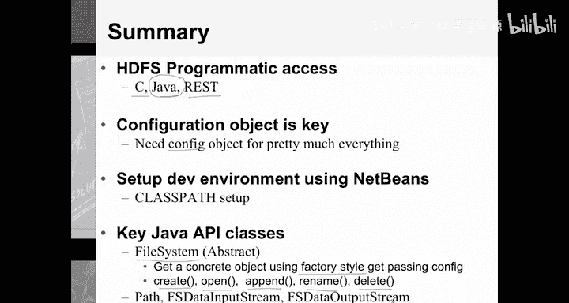

# 约翰霍普金斯大学《Hadoop大数据处理｜Big Data Processing Using Hadoop》中英字幕 - P33：11_HDFS编程基础总结.zh_en - GPT中英字幕课程资源 - BV1g5u6zBExs

HDFS programming Bas summarym。In this module we learned that there are three programmatic access to HDFS。

 C， Java and RE， we quickly learned how to program in C compile and run SE program。

 but then we spent most of our time looking at the Java API we also learned that the configuration object is key in order to do pretty much anything for Hadoop Java programming you need to get an instance of the configuration object。

 we learned how to do that then we learned to set up the dev environment for an IDE。

 we especially use the Netbes IDE， we learned to set up the class path。

 the configuration so we can compile and run Hadoop Java programs。

We also looked at some of the key Java API classes for CRD programming。

 we saw that the file system class， which is an abstract class。

 is a key class and the way you get an instance of the file system class is by using a factory style gett method by passing the configuration object that we learn to create。

We also learned that once we have a file system object in our hand。

 we can create a file by invoking the C method， we can open a file for reading。

 by calling the open method， we can append to a file。

 we can also rename a file or even delete a file。We also learned that there are several supporting classes that we have for HDFS programming。

 we have the path class that represents a file in the file system。

 we also have the FS data input stream class that allows you to read in data using a stream mechanism and the FS data output stream class so you can write to the file。

